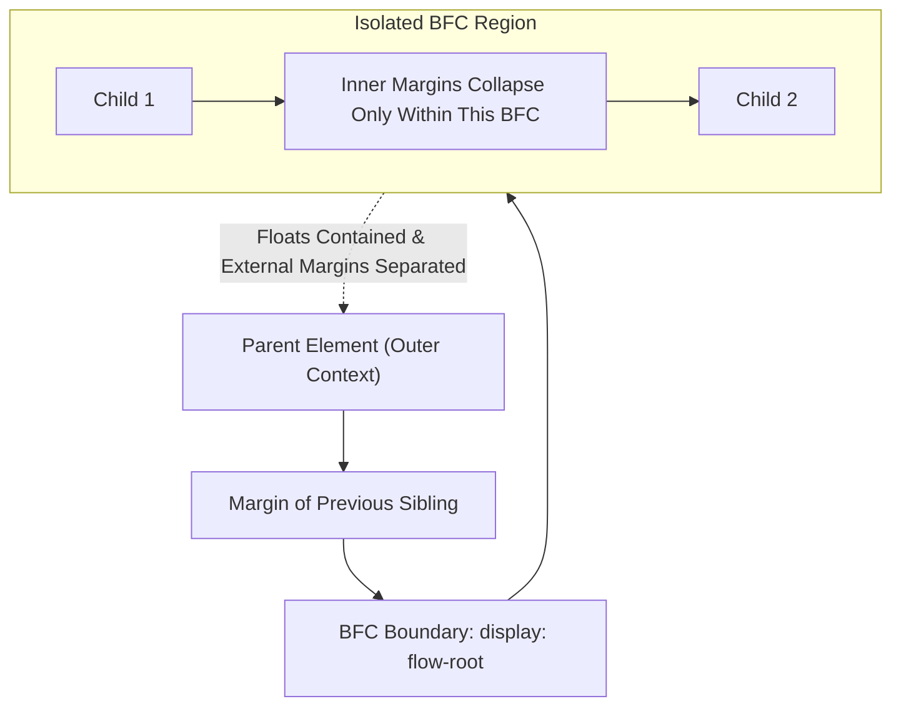
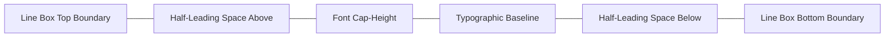

# Module 05 — Box Model & Visual Formatting Model

Before the browser can calculate the geometry of a web page, it constructs the **Box Tree** from the Document Object Model (DOM). In CSS, elements do not render as simple flat rectangles; they generate one or more nested boxes structured by the **CSS Box Model** and governed by distinct **Formatting Contexts** (Block, Inline, Flex, and Grid). Understanding how the visual formatting model establishes boundaries, why margins collapse across elements, how logical properties support bidirectional typography, and why `display: flow-root` eliminated legacy clearfix hacks is fundamental to mastering web layout.

---

## 1. Box Tree Generation & The Two-Value `display` Syntax

### The Box Tree vs. The DOM Tree
The DOM tree represents the hierarchical node structure parsed from HTML. The **Box Tree** represents the physical layout abstractions generated by CSS:
- An element with `display: none` exists in the DOM tree, but generates **zero boxes** in the box tree.
- An element with `display: contents` removes its own box from the box tree while projecting its children directly into the box tree of its parent (caution: early browser bugs stripped accessibility roles from `display: contents`).
- Pseudo-elements (`::before`, `::after`) generate independent boxes in the box tree without corresponding HTML DOM nodes.
- List items generate a principal box and an auxiliary `::marker` box.

### The Modern Two-Value `display` Grammar
CSS Display Module Level 3 decomposes the `display` property into two distinct operational components: an **outer display type** (dictating how the box participates in its parent's formatting context) and an **inner display type** (dictating how the box formats its immediate children):

```
                       display:  <outer-type>  <inner-type> ;
                                      │             │
                    ┌─────────────────┘             └──────────────────┐
                    ▼                                                  ▼
          Outer Formatting Context                           Inner Formatting Context
         (How box behaves in parent)                        (How box formats children)
          - block (generates BFC block)                      - flow (standard flow)
          - inline (sits in IFC line)                        - flow-root (new BFC)
                                                             - flex (flex container)
                                                             - grid (grid container)
```

| Modern Two-Value Syntax | Legacy Keyword Equivalent | Outer Behavior (in parent) | Inner Behavior (for children) |
| :--- | :--- | :--- | :--- |
| `display: block flow` | `display: block` | Fills horizontal width, stacks vertically | Normal block/inline flow |
| `display: inline flow` | `display: inline` | Flows horizontally within line boxes | Normal inline text flow |
| `display: block flow-root` | `display: flow-root` | Fills horizontal width, stacks vertically | Establishes a fresh independent BFC |
| `display: inline flow-root` | `display: inline-block` | Sits inline on text baseline | Establishes a fresh independent BFC |
| `display: block flex` | `display: flex` | Block-level box | Formats children using Flexbox |
| `display: inline flex` | `display: inline-flex` | Inline-level box | Formats children using Flexbox |
| `display: block grid` | `display: grid` | Block-level box | Formats children using Grid |

---

## 2. Box Sizing & Intrinsic Sizing Keywords

### `content-box` vs. `border-box`
- **`box-sizing: content-box` (CSS Specification Default)**:
  $$\text{Total Rendered Width} = \text{width} + \text{padding-inline} + \text{border-inline}$$
  Setting `width: 100%` with `padding: 20px` forces the box to exceed its parent container by 40px, causing horizontal overflow.
- **`box-sizing: border-box` (Modern Engineering Standard)**:
  $$\text{Total Rendered Width} = \text{width} \quad (\text{padding and borders are absorbed internally})$$

```css
/* Universal Border-Box Reset */
*, *::before, *::after {
  box-sizing: border-box;
}
```

### Intrinsic Sizing Keywords
CSS Sizing Level 3 & 4 provide keywords that allow boxes to size based on their contents rather than fixed units:
- **`min-content`**: The smallest possible size the box can take without causing internal overflow (e.g. the width of the longest unbreakable word).
- **`max-content`**: The ideal size the box would take if given infinite space with zero soft line wraps.
- **`fit-content(length)`**: Clamps the width to $\min(\text{max-content}, \max(\text{min-content}, \text{length}))$.
- **`aspect-ratio: <ratio>`**: Enforces an explicit proportional ratio (e.g. `aspect-ratio: 16 / 9`), computing the cross-axis dimension automatically and eliminating Cumulative Layout Shift (CLS).

```css
/* Intrinsic component card sizing */
.tag-badge {
  width: max-content; /* Never wraps text */
}

.responsive-video {
  width: 100%;
  aspect-ratio: 16 / 9; /* Automatically calculates height without JS */
}
```

---

## 3. Block Formatting Contexts (BFC) & Margin Collapsing

A **Block Formatting Context (BFC)** is an isolated region of the box tree where block boxes are laid out. What happens inside a BFC stays inside; margins and floating elements inside a BFC cannot bleed outside of it.



### What Triggers a Block Formatting Context?
A BFC is established by any of the following properties:
1. `display: flow-root` (the modern, purpose-built standard for creating a BFC without side effects).
2. Root element of the document (`<html>`).
3. Floating elements (`float: left` or `float: right`).
4. Out-of-flow positioned elements (`position: absolute` or `position: fixed`).
5. Elements with `overflow` other than `visible` or `clip` (e.g. `overflow: hidden`, `overflow: auto`).
6. Flex items (`display: flex` children) and Grid items (`display: grid` children).
7. `contain: layout`, `contain: content`, or `contain: paint`.
8. Table cells (`display: table-cell`) and table captions.

### Margin Collapsing Rules
Margin collapsing occurs exclusively between **adjacent vertical margins of block-level boxes in normal flow**. The margins combine into a single margin whose size is $\max(\text{margin}_1, \text{margin}_2)$ for positive margins.

Margin collapsing occurs in three scenarios:
1. **Adjacent Siblings**: The bottom margin of an element collapses with the top margin of its following sibling.
2. **Parent and First/Last Child**: If there is no border, padding, inline content, or BFC boundary separating a parent's top margin from its first child's top margin, the child's margin collapses into the parent and protrudes outside!
3. **Empty Blocks**: If an element has zero height, no padding, no border, and no content, its own top and bottom margins collapse together.

```css
/* THE MARGIN COLLAPSE TRAP */
.parent {
  background: lightgray;
  /* Missing border or padding means child margin collapses OUTSIDE the parent! */
}
.child {
  margin-top: 40px; /* Pushes the PARENT down, not the child away from parent! */
}

/* THE MODERN FIX: Establish a BFC */
.parent {
  display: flow-root; /* Isolates internal margins; child pushes down inside parent */
}
```

---

## 4. Inline Formatting Contexts (IFC) & Typography Sizing

An **Inline Formatting Context (IFC)** is established when a block-level container holds only inline-level boxes (text, `<span>`, `<a>`, images).

### Line Boxes & Half-Leading
Within an IFC, inline boxes are arranged horizontally into stacked **line boxes**:
- The total height of a line box is determined by the alignment and heights of all inline elements inside it.
- **Half-Leading**: The difference between an element's `font-size` and its `line-height` is split equally and distributed above and below the font's glyph glyphs (half-leading).
- **`vertical-align`**: Dictates how inline elements align relative to the line box's typographic baseline (`baseline`, `middle`, `top`, `bottom`, `text-top`).



### Native Block Centering: `align-content` on Block Containers
Historically, centering elements vertically required Flexbox or Grid. As of late 2024 / 2025 (Baseline Widely Available), the CSS Box Alignment specification allows `align-content` directly on standard block-level containers (`display: block` or `display: flow-root`):

```css
/* Modern vertical centering on a standard block container */
.hero-box {
  display: block;
  height: 300px;
  align-content: center; /* Centers block children vertically without flex or grid! */
}
```

---

## 5. Logical Properties & Bidirectional Layouts

Physical directions (`left`, `right`, `top`, `bottom`) are hardcoded to horizontal left-to-right (LTR) scripts. When translating websites to right-to-left (RTL) scripts (such as Arabic or Hebrew) or vertical East Asian scripts, physical properties fail. Modern CSS uses **Logical Properties and Values** mapped to document writing modes:

| Dimension | Physical Property | Logical Property Equivalent |
| :--- | :--- | :--- |
| **Inline (Reading Direction)** | `width` / `max-width` | `inline-size` / `max-inline-size` |
| **Block (Stacking Direction)** | `height` / `max-height` | `block-size` / `max-block-size` |
| **Margin Start** | `margin-left` (in LTR) | `margin-inline-start` |
| **Margin End** | `margin-right` (in LTR) | `margin-inline-end` |
| **Padding Block** | `padding-top` & `padding-bottom` | `padding-block: 1rem 2rem` |
| **Border Inset** | `border-left` | `border-inline-start` |
| **Absolute Positioning** | `top`, `bottom`, `left`, `right` | `inset-block-start`, `inset-inline-start`, or `inset: 0` |

```css
/* Bidirectional card layout: automatically flips padding, border, and float in RTL */
.callout {
  padding-block: 1rem;
  padding-inline: 1.5rem;
  border-inline-start: 4px solid var(--primary-color);
  margin-inline: auto; /* Centers horizontally in all writing modes */
}
```

---

## 6. Overflow Control: `clip` vs. `hidden`

CSS Overflow Module Level 3 introduces `overflow: clip`:
- **`overflow: hidden`**: Clips content that exceeds the box, but programmatically **creates a scroll container**. JavaScript can still execute `element.scrollLeft += 50` or `element.scrollTo()`, and touch gestures may inadvertently shift scroll offsets. It also creates a BFC.
- **`overflow: clip`**: Strictly clips the content to the box's padding or overflow-clip edge. It is **not a scroll container**; programmatic scrolling is strictly prohibited, reducing compositor memory usage and preventing unintended scrolling.

---

## 7. Then vs. Now: Box Model & Formatting

| Dimension | Legacy CSS Era (Clearfix & Hacks) | Modern CSS Platform (2024–2026+) |
| :--- | :--- | :--- |
| **BFC Creation** | Hacky clearfix pseudo-elements (`.clearfix::after { content: ""; display: table; clear: both; }`) | Explicit, purpose-built `display: flow-root` |
| **Directionality** | Duplicated RTL stylesheets with manual overrides (`.ltr { margin-left: 10px; } .rtl { margin-right: 10px; }`) | Native CSS logical properties (`margin-inline-start: 10px`) |
| **Vertical Centering** | `top: 50%; transform: translateY(-50%)` or `display: flex` | `align-content: center` natively on block containers |
| **Aspect Ratio Sizing** | The "Padding-Bottom Hack" (`padding-bottom: 56.25%` on an empty container) | Native `aspect-ratio: 16 / 9` directly on elements |
| **Overflow Clipping** | `overflow: hidden` inadvertently created scroll containers | `overflow: clip` strictly clips without scroll mechanics |

---

## 8. Interview Drill: Box Model & Visual Formatting Model

### Q1: What is the exact purpose of `display: flow-root`, and how does it replace legacy clearfix hacks?
<details><summary>Answer</summary>

`display: flow-root` generates a block-level element that establishes a new independent Block Formatting Context (BFC). In legacy CSS, containing floated children or preventing external margin collapsing required the "clearfix hack" (`::after` pseudo-elements with `clear: both`) or `overflow: hidden` (which accidentally cropped absolute popups or shadows). `display: flow-root` accomplishes this natively without modifying overflow behavior or introducing empty DOM pseudo-elements.
</details>

### Q2: Why does an element's top margin sometimes push its parent container down from the outside, rather than pushing the child down inside the parent?
<details><summary>Answer</summary>

This is the Parent-Child Margin Collapse anomaly. When a parent element has no border, no padding, no inline content separating it from its first child, and does not establish a BFC, the top margin of the first in-flow child collapses with the top margin of the parent. The resulting combined margin is positioned outside the parent container, pushing the parent itself down relative to its ancestors. Setting `padding-top: 1px`, `border-top: 1px solid transparent`, or `display: flow-root` on the parent isolates the context and prevents collapse.
</details>

### Q3: What is the semantic difference between `display: block` and `display: block flow-root` under the modern two-value display specification?
<details><summary>Answer</summary>

`display: block` (shorthand for `display: block flow`) generates a block-level outer box that participates in the parent's formatting context, and formats its children using normal block and inline flow *without* creating an independent BFC (meaning internal margins can collapse with external siblings). In contrast, `display: block flow-root` generates a block-level outer box whose inner display type creates a new, self-contained Block Formatting Context, isolating internal margins and containing internal floats.
</details>

### Q4: Why is `overflow: clip` preferred over `overflow: hidden` when you want to crop decorative background elements without enabling scroll behavior?
<details><summary>Answer</summary>

`overflow: hidden` establishes a scroll container in the browser's compositor; the element is technically scrollable via JavaScript (`element.scrollTo()`) or assistive input focus shifts. In contrast, `overflow: clip` strictly clips rendering at the overflow-clip edge without creating a scroll container. Programmatic scrolling is disabled, which conserves GPU compositor layer resources and prevents accidental scroll position shifts.
</details>

### Q5: How do logical properties like `margin-inline-start` differ from physical properties like `margin-left` when rendering multilingual documents?
<details><summary>Answer</summary>

Physical properties like `margin-left` are hardcoded to the physical left side of the screen regardless of language or script. In contrast, logical properties like `margin-inline-start` dynamically evaluate the element's writing mode and direction (`direction: ltr` vs. `direction: rtl`, and horizontal vs. vertical writing modes). In left-to-right English, `margin-inline-start` maps to the left; in right-to-left Arabic or Hebrew, it automatically maps to the right, eliminating the need for mirrored stylesheets.
</details>
