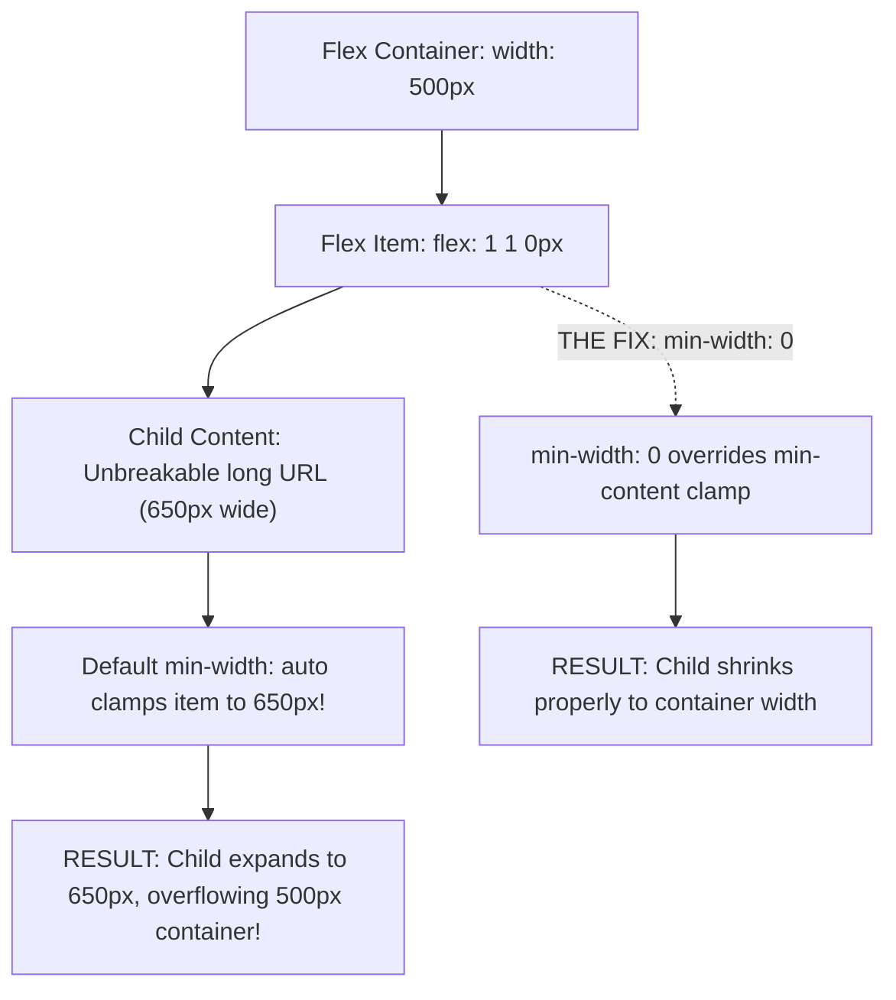
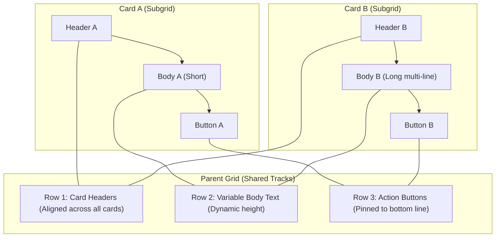

# Module 06 — Layout: Flexbox, Grid, Subgrid & Grid-Lanes

Modern web layout is powered by two complementary native formatting engines: **CSS Flexible Box Layout (Flexbox)** for one-dimensional distribution along a primary axis, and **CSS Grid Layout** for two-dimensional coordinate positioning across rows and columns. While both modules have achieved global baseline stability, production layout defects frequently arise from subtle algorithmic defaults—most notoriously the `min-width: auto` overflow trap in Flexbox and the `1fr` blowout trap in Grid. Furthermore, **Subgrid** and the emerging **Grid-Lanes (Masonry)** specification provide unprecedented alignment primitives that eliminate historical reliance on brittle JavaScript layout libraries.

---

## 1. The Flexbox Algorithm & The `min-width: auto` Overflow Trap

Flexbox distributes items along a main axis (`flex-direction: row` or `column`) and aligns them along a perpendicular cross axis.

### Flex Sizing Mechanics: `flex-basis`, `flex-grow`, and `flex-shrink`
The shorthand `flex: <grow> <shrink> <basis>` controls how free space in the flex container is absorbed or subtracted:
- **`flex-basis`**: The initial main-axis size of the flex item before free space is distributed (e.g. `200px`, `auto`, or `0`).
- **`flex-grow`**: The proportion of positive free space (leftover space when items are smaller than the container) allocated to this item:
  $$\text{Extra Width Allocated} = \text{Remaining Free Space} \times \frac{\text{Item Grow Factor}}{\sum \text{All Grow Factors}}$$
- **`flex-shrink`**: The proportion of negative space (overflow space when items exceed the container) subtracted from this item, weighted by its basis:
  $$\text{Scaled Shrink Ratio} = \frac{\text{Item Shrink Factor} \times \text{Item Basis}}{\sum (\text{Shrink Factor}_i \times \text{Basis}_i)}$$

### The Number One Flexbox Bug: `min-width: auto`
In normal block flow, an element's minimum width defaults to `0`. However, the CSS Flexible Box Layout specification normatively overrides this for flex items: **a flex item's `min-width` (or `min-height` in column direction) defaults to `auto`**.

Under `min-width: auto`, an item's minimum width is clamped to its **`min-content` size** (the width of its longest unbreakable word, pre-formatted `<pre>` block, or child image). If a flex item contains a long URL, code snippet, or nested flex container, the item **refuses to shrink below that min-content width**, causing the flex container to blow out and trigger horizontal page overflow!



```css
/* THE PRODUCTION OVERFLOW TRAP */
.flex-card {
  display: flex;
}
.flex-card .content {
  flex: 1; /* Shorthand for flex: 1 1 0% */
  /* BUG: min-width is auto! If content has a long URL, it overflows! */
}

/* THE PRODUCTION FIX: Explicitly allow shrinking */
.flex-card .content {
  flex: 1;
  min-inline-size: 0; /* Or min-width: 0 */
  overflow: hidden;   /* Allows text-overflow: ellipsis to function */
}
```

---

## 2. CSS Grid: Track Sizing, Named Areas & The `1fr` Trap

CSS Grid establishes a two-dimensional grid coordinate system with horizontal rows and vertical columns.

### Track Sizing: The Fractional Unit (`fr`) and `minmax()`
The fractional unit (`1fr`) represents one share of the available free space remaining in the grid container.
> [!IMPORTANT]
> By specification, `1fr` is mathematically defined as `minmax(auto, 1fr)`.
> Just like Flexbox, the `auto` minimum allows large content (like tables or long strings) to force the track wider than its fractional share, blowing out the grid! To guarantee that a grid column will never exceed its equal fraction of the screen, always specify `minmax(0, 1fr)`:

```css
/* HAZARD: 1fr expands if child content is wider than 1 fraction */
grid-template-columns: 1fr 1fr;

/* BULLETPROOF: Columns strictly respect fractional boundaries */
grid-template-columns: minmax(0, 1fr) minmax(0, 1fr);
```

### Auto-Placement & The `dense` Algorithm
When items do not explicitly declare `grid-column` or `grid-row` coordinates, the grid auto-placement algorithm slots them into the next available cell. Adding `grid-auto-flow: dense` instructs the engine to backfill earlier empty gaps in the grid if smaller items appear later in the DOM, creating compact mosaic layouts without JavaScript.

```css
.photo-wall {
  display: grid;
  grid-template-columns: repeat(auto-fill, minmax(180px, 1fr));
  grid-auto-flow: dense; /* Backfills holes left by 2x2 featured photos */
  gap: 1rem;
}
.photo-wall .featured {
  grid-column: span 2;
  grid-row: span 2;
}
```

---

## 3. Subgrid: Nested Two-Dimensional Alignment

CSS Grid Level 2 introduces **Subgrid** (Baseline Widely Available since March 2026). Historically, when a grid item contained child elements (such as an article card containing an image, title, body, and footer), those children could not align with the rows or columns of neighboring cards because the child created an isolated inner formatting context.

With Subgrid, a child grid can inherit the tracks of its parent grid along rows, columns, or both:



```css
/* Parent Grid defining 3 equal columns, and rows that auto-size to content */
.card-deck {
  display: grid;
  grid-template-columns: repeat(3, minmax(0, 1fr));
  gap: 2rem;
}

/* Card spans 3 rows in the parent, and delegates its row tracks to SUBGRID */
.card {
  grid-row: span 3;
  display: grid;
  grid-template-rows: subgrid; /* Inherits row track sizing from .card-deck */
}

/* All headers across all 3 cards align perfectly to Row 1! */
/* All footers across all 3 cards align perfectly to Row 3! */
```

---

## 4. Masonry Status: The `display: grid-lanes` Architecture

Masonry (waterfall) layouts allow items of varying heights to pack tightly into columns without leaving vertical gaps. For years, browser vendors debated whether masonry belonged inside CSS Grid (`display: grid; grid-template-rows: masonry`) or as an independent display model (`display: masonry`).

In 2025/2026, the W3C CSSWG achieved formal consensus in **CSS Grid Level 3**:
- Masonry is standardized as **`display: grid-lanes`**.
- It reuses the entire Grid coordinate system, line naming, track sizing (`fr`, `minmax`), and alignment properties, but treats the cross-axis as non-rigid lanes where items pack into the shortest available column.
- Safari 26.4 shipped the initial native implementation; Chromium and Firefox are completing implementation.

```css
/* Progressive enhancement for Grid-Lanes Masonry */
.masonry-gallery {
  /* Fallback: Standard CSS Grid for engines without masonry */
  display: grid;
  grid-template-columns: repeat(auto-fill, minmax(240px, 1fr));
  gap: 1.5rem;
}

@supports (display: grid-lanes) {
  .masonry-gallery {
    display: grid-lanes;
    grid-template-columns: repeat(auto-fill, minmax(240px, 1fr));
    gap: 1.5rem;
  }
}
```

---

## 5. Visual Reordering & Accessibility: `reading-flow`

CSS Flexbox and Grid allow developers to reorder elements visually using `order`, `flex-direction: row-reverse`, or arbitrary `grid-column`/`grid-row` coordinates. 

> [!CAUTION]
> Visual reordering alters only the pixel presentation on screen; it **does NOT alter DOM order**. Keyboard Tab navigation and screen readers continue to navigate through the underlying HTML source order. Creating a divergence between visual focus and DOM sequence directly violates **WCAG Success Criterion 1.3.2 (Meaningful Sequence)** and confuses sighted keyboard users.

To solve this disconnect, CSSWG standardized the **`reading-flow`** property (CSS Display Module Level 4). Setting `reading-flow: grid-order` or `flex-visual` instructs the browser's accessibility and focus-traversal engine to follow the visual layout order computed by the CSS engine, reconnecting keyboard navigation to screen presentation:

```css
.mosaic-grid {
  display: grid;
  grid-auto-flow: dense;
  /* Syncs keyboard Tab navigation and screen readers to visual grid coordinates */
  reading-flow: grid-rows;
}
```

---

## 6. Then vs. Now: Layout Primitives

| Dimension | Legacy CSS Era (2010–2018) | Modern CSS Platform (2024–2026+) |
| :--- | :--- | :--- |
| **Two-Dimensional Layout** | Float hacks with explicit clears, table display, or 12-column math frameworks | Native CSS Grid with subgrid track inheritance and `fr` units |
| **Card Deck Alignment** | JavaScript libraries calculating equal-height boxes on window resize | Native `grid-template-rows: subgrid` aligns headers, bodies, and footers |
| **Waterfall Layout** | Heavy JavaScript dependencies (Masonry.js, Packery) measuring DOM offsets | Native CSS `display: grid-lanes` with graceful `@supports` fallbacks |
| **Overflow Debugging** | Struggling with mysterious flexbox overflows caused by `min-width: auto` | Standardized `min-inline-size: 0` and `minmax(0, 1fr)` defensive patterns |
| **Focus Navigation** | Disconnected keyboard navigation whenever `order` was used | Native `reading-flow` syncs accessibility focus to computed visual coordinates |

---

## 7. Interview Drill: Layout, Flexbox, Grid & Subgrid

### Q1: Why does a flex item containing a long unbroken string overflow its flex container even when styled with `flex: 1 1 0px`?
<details><summary>Answer</summary>

Under the CSS Flexible Box Layout specification, a flex item's `min-width` defaults to `auto` rather than `0`. For flex items, `min-width: auto` calculates the item's minimum size as its `min-content` size (the width of the longest unbreakable word or element). Even though `flex-shrink: 1` and `flex-basis: 0` allow shrinking, the item cannot shrink below its minimum width. The solution is explicitly overriding the minimum size with `min-width: 0` (or `min-inline-size: 0`).
</details>

### Q2: What is the formal difference between `grid-template-columns: 1fr 1fr` and `grid-template-columns: minmax(0, 1fr) minmax(0, 1fr)`?
<details><summary>Answer</summary>

By specification, `1fr` is defined as `minmax(auto, 1fr)`. If a child element in that grid column has an intrinsic `min-content` size greater than the fractional space (such as a wide table or unformatted `<pre>` block), the column will expand to fit the content, breaking the equal distribution of tracks. In contrast, `minmax(0, 1fr)` explicitly sets the minimum track bound to zero, ensuring that neither column can exceed its exact 50% share of available container space regardless of content size.
</details>

### Q3: How does Subgrid differ from a standard nested CSS Grid?
<details><summary>Answer</summary>

A standard nested CSS Grid creates a completely independent grid coordinate system whose row and column track sizing has no relationship to the parent grid. In contrast, an element using `grid-template-rows: subgrid` or `grid-template-columns: subgrid` adopts the exact row or column tracks of its parent grid across the tracks it spans. This allows child elements inside separate grid items to align with each other across the entire parent layout (e.g. aligning card footers across cards of varying text lengths).
</details>

### Q4: Why is using CSS `order` or `flex-direction: row-reverse` an accessibility risk, and how does `reading-flow` address it?
<details><summary>Answer</summary>

CSS visual reordering properties change the rendered position of elements on the screen without updating the underlying DOM node order. Screen readers, search engines, and keyboard Tab key navigation follow DOM order, resulting in focus jumping erratically across the screen in a sequence that contradicts visual presentation (violating WCAG 1.3.2). The modern `reading-flow` property instructs the browser to traverse the accessibility tree and keyboard focus in the order dictated by computed layout coordinates.
</details>

### Q5: What is the architectural consensus regarding native Masonry layout in CSSWG?
<details><summary>Answer</summary>

The CSSWG formally integrated masonry layout into the CSS Grid specification (CSS Grid Level 3) under the display value `display: grid-lanes`. It allows grid containers to define rigid tracks along one axis (such as columns defined with `repeat(auto-fill, minmax(200px, 1fr))`), while the cross axis packs items into whichever lane has the shortest accumulated height, reusing standard Grid placement and alignment primitives without JavaScript.
</details>
