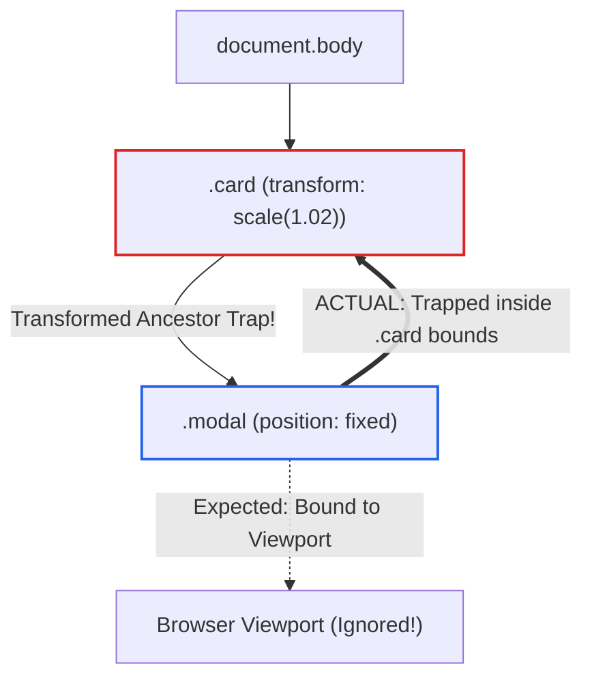
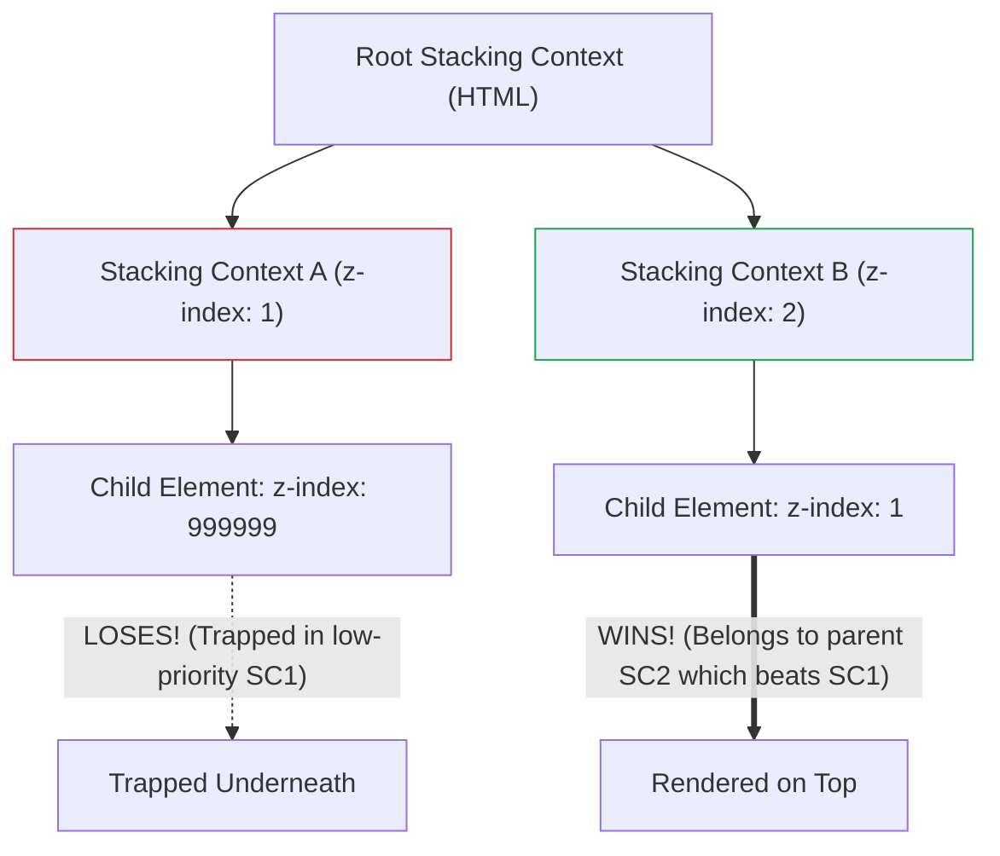
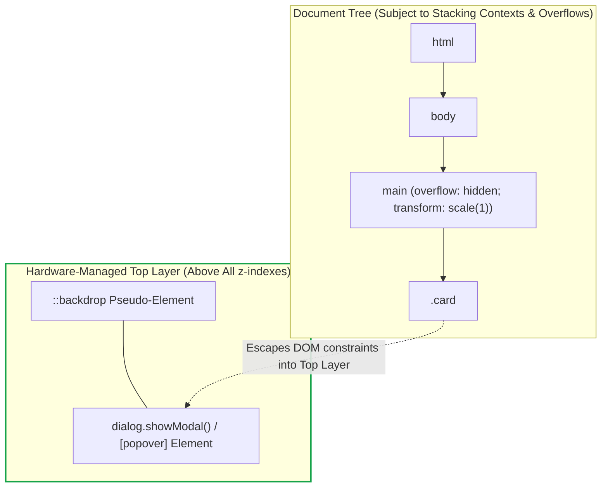
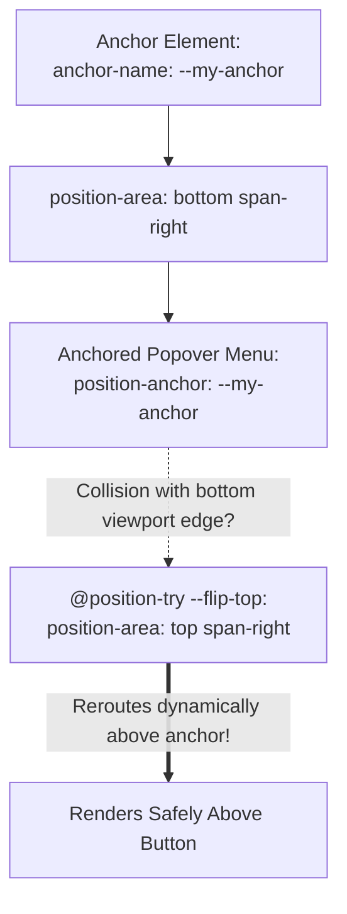

# Module 07 — Positioning, Stacking & The Top Layer

Positioning elements in CSS spans two distinct spatial dimensions: coordinate placement within the two-dimensional viewport layout, and three-dimensional depth layering along the $z$-axis. Historically, third-party libraries (such as Popper.js and Floating UI) and arbitrary z-index escalation wars (`z-index: 999999`) were required to render tooltips, dropdown menus, and modal dialogs. Modern web architecture solves these challenges natively through three foundational primitives: strict containing-block mechanics, the browser's hardware-managed **Top Layer**, and native **CSS Anchor Positioning**.

---

## 1. Positioning Schemes & The Transformed Ancestor Trap

CSS Positioned Layout Module Level 3 defines five positioning schemes:
- **`static`**: Normal document flow; top/bottom/left/right/z-index properties have no effect.
- **`relative`**: In normal document flow, but offset from its normal position without altering the layout of surrounding siblings.
- **`absolute`**: Removed from normal flow; positioned relative to its nearest **containing block** that has a position other than `static` (or that establishes a transformed containing block).
- **`fixed`**: Removed from normal flow; conventionally positioned relative to the viewport window.
- **`sticky`**: Hybrid positioning; treated as `relative` until the scroll position of its nearest scrollable ancestor reaches a defined threshold, after which it behaves as `fixed` within the bounds of its parent box.

### The Transformed Ancestor Trap
> [!CAUTION]
> A `position: fixed` element is NOT always positioned relative to the browser viewport!
> According to the CSS Transforms and Filter specifications, if any ancestor of a fixed element has any of the following properties, that ancestor becomes the **containing block** for all descendants, including fixed elements:
> 1. `transform` or `translate` other than `none` (e.g. `transform: translateZ(0)`).
> 2. `filter` other than `none` (e.g. `filter: blur(0px)`).
> 3. `perspective` other than `none`.
> 4. `will-change: transform` or `will-change: filter`.
> 5. `contain: paint`, `contain: layout`, or `container-type: size`.

When this occurs, a fixed modal dialog inside a transformed card will scroll with the card and be clipped by the card's boundaries, completely breaking full-screen overlay behavior!



---

## 2. Stacking Contexts & The Painting Order

The $z$-axis depth of elements is governed by **Stacking Contexts**. A stacking context is an isolated three-dimensional layering group within which child elements are painted in strict sequence.

### Why `z-index: 999999` Fails
Child elements inside a stacking context are sorted along the $z$-axis *only relative to other elements in that same stacking context*. An element with `z-index: 999999` inside a stacking context that has an effective level of `z-index: 1` can **never** appear above an element in a sibling stacking context with `z-index: 2`!



### What Establishes a Stacking Context?
A new stacking context is created by any of the following conditions:
1. Root element of the document (`<html>`).
2. Positioned element (`relative`, `absolute`, `fixed`, `sticky`) with a `z-index` value other than `auto`.
3. `opacity` with a value strictly less than `1`.
4. `transform`, `filter`, `perspective`, `clip-path`, or `mask` other than `none`.
5. `isolation: isolate` (the explicit, modern property for creating an isolated stacking context without visual side effects).
6. `mix-blend-mode` other than `normal`.
7. `will-change` specifying any property that would create a stacking context on its own.

### The Formal Painting Order (CSS 2.1 Appendix E)
Within a single stacking context, elements are painted from back to front in seven mandatory layers:
1. **Background and Borders** of the element establishing the context.
2. **Negative $z$-index child stacking contexts** (sorted lowest to highest).
3. **Non-inline, non-positioned in-flow block-level descendants**.
4. **Non-positioned floating descendants**.
5. **Non-positioned inline-level descendants** (including text runs and line boxes).
6. **Positioned descendants with `z-index: auto` or `z-index: 0`**.
7. **Positive $z$-index child stacking contexts** (sorted lowest to highest).

---

## 3. The Top Layer: Escaping the Stacking Context

Modern web platforms solve the containing block and z-index trap permanently via the **Top Layer** (standardized in WHATWG HTML and CSS Position 4).

The Top Layer is an internal browser rendering plane that sits entirely above the document tree. Elements rendered in the Top Layer:
- Render **above all other elements on the page**, completely ignoring parent z-index values and ancestor stacking contexts.
- Escape all parent containing blocks, clipping regions (`overflow: hidden`), and ancestor transforms.
- Provide a native **`::backdrop`** pseudo-element for full-screen dimming.
- Automatically manage **light dismiss** (closing when clicking outside or pressing the <kbd>Escape</kbd> key) and focus trapping.



### The Native Popover API & `<dialog>`
Modern applications use two primary primitives to leverage the Top Layer:
1. **Modal Dialogs (`<dialog>` + `showModal()`)**: Modal overlays that disable background interactions and enforce focus containment.
2. **The Popover API (`popover="auto"` or `"manual"`)**: Non-modal overlays (dropdowns, tooltips, action menus) declared purely in HTML with native light dismiss:

```html
<!-- Trigger Button -->
<button popovertarget="user-menu" popovertargetaction="toggle">
  Account Settings
</button>

<!-- Native Popover (Renders in Top Layer with Zero JS!) -->
<nav id="user-menu" popover="auto">
  <a href="/profile">Profile</a>
  <a href="/billing">Billing</a>
  <button popovertarget="user-menu" popovertargetaction="hide">Close</button>
</nav>
```

```css
/* Styling top layer popovers */
[popover] {
  border: 1px solid #cbd5e1;
  border-radius: 8px;
  padding: 1rem;
  box-shadow: 0 10px 25px rgba(0, 0, 0, 0.15);
}

[popover]::backdrop {
  background: rgba(0, 0, 0, 0.4);
  backdrop-filter: blur(2px);
}
```

---

## 4. CSS Anchor Positioning: Declarative Tethering

CSS Anchor Positioning Level 1 connects an absolutely positioned top-layer element (like a tooltip or dropdown menu) to an anchor element in the DOM tree, resolving coordinates dynamically without JavaScript resize listeners.

### The Core Anchor Primitives
1. **`anchor-name`**: Declares an element as an anchor using a dashed identifier (e.g. `--menu-button`).
2. **`position-anchor`**: Links a positioned element to its designated anchor.
3. **`position-area`**: Declarative 9-region placement shorthand (`top`, `bottom`, `left`, `right`, `top span-left`, `center`).
4. **`anchor()` and `anchor-size()`**: Functional expressions to read anchor edges and dimensions.
5. **`@position-try` / `position-try-fallbacks`**: Automatic collision detection and fallback repositioning when an anchored element collides with viewport boundaries.



```css
/* 1. Define the anchor button */
.dropdown-trigger {
  anchor-name: --nav-anchor;
}

/* 2. Define fallback rules for viewport edge collision */
@position-try --flip-to-top {
  position-area: top span-right;
}

/* 3. Tether the popover to the anchor */
.dropdown-menu {
  position: fixed;
  position-anchor: --nav-anchor;
  position-area: bottom span-right;
  position-try-fallbacks: --flip-to-top;
  margin-block-start: 6px;
}
```

---

## 5. Then vs. Now: Positioning & Overlays

| Dimension | Legacy Web Era (2010–2020) | Modern CSS Platform (2024–2026+) |
| :--- | :--- | :--- |
| **Overlays & Modals** | Custom `<div>` overlays placed at `<body>` root; manual focus trapping and z-index ladders | Native `<dialog>.showModal()` or `popover="auto"` in the hardware-managed Top Layer |
| **Tethered Menus** | JavaScript calculation libraries (Popper.js, Floating UI) recalculating coordinates on scroll | Native CSS Anchor Positioning (`anchor-name`, `position-area`, `position-try-fallbacks`) |
| **Stacking Isolation** | Obscure hacks like `opacity: 0.999` or `transform: translateZ(0)` | Clean, semantic `isolation: isolate` |
| **Backdrop Shading** | Inserting dedicated full-screen overlay divs behind modals | Native `::backdrop` pseudo-element managed directly by the browser |
| **Dismiss Behavior** | Listening for `keydown` (Escape) and window `click` events to close menus | Native browser "light dismiss" built into the Popover specification |

---

## 6. Interview Drill: Positioning, Stacking & Top Layer

### Q1: Why does setting `transform: scale(1)` on a parent element prevent child elements with `position: fixed` from adhering to the browser viewport?
<details><summary>Answer</summary>

According to the CSS Transforms Module, applying any `transform` other than `none` causes the element to act as the containing block for all its descendants, including elements with `position: fixed` or `position: absolute`. Instead of positioning relative to the initial containing block (the viewport), the fixed child is positioned relative to the transformed parent's padding box and moves along with the parent when the page scrolls.
</details>

### Q2: An element has `z-index: 1000000`, yet it appears visually beneath an element with `z-index: 5`. What structural mechanism explains this?
<details><summary>Answer</summary>

The two elements belong to different stacking contexts. The element with `z-index: 1000000` is nested inside an ancestor that created a stacking context with an effective z-index lower than the second element's stacking context (e.g. parent has `z-index: 1` vs `z-index: 5`). Because the parent stacking context is painted beneath the second stacking context, all of its internal children—regardless of how high their local `z-index` values are—are flattened into that parent layer and rendered underneath.
</details>

### Q3: What is the operational advantage of the browser's "Top Layer" compared to rendering modal overlays at the root of the standard DOM tree?
<details><summary>Answer</summary>

Elements in the Top Layer (such as `<dialog>` and `[popover]`) are rendered on an independent internal display plane managed directly by the browser's compositing engine. They render above all elements in the document tree, completely bypassing parent stacking contexts, clipping boundaries (`overflow: hidden`), and transformed containing blocks. The Top Layer also provides native backdrop dimming (`::backdrop`), accessibility focus trapping, and light-dismiss handling without JavaScript.
</details>

### Q4: When should an engineer use `isolation: isolate`?
<details><summary>Answer</summary>

`isolation: isolate` is used to establish a new, isolated stacking context on an element without applying arbitrary visual side effects (such as lowering `opacity` or adding dummy `transform` values). It is standard practice in component-based architectures to apply `isolation: isolate` to the root container of a component (such as a card or navigation bar) to guarantee that internal z-index layering inside the component never bleeds out to interfere with other components on the page.
</details>

### Q5: How does CSS Anchor Positioning handle viewport collision without JavaScript?
<details><summary>Answer</summary>

CSS Anchor Positioning uses the `@position-try` at-rule combined with the `position-try-fallbacks` property. The author defines preferred positions using `position-area` (e.g. `bottom span-right`) and lists fallback configurations (e.g. `@position-try --top { position-area: top span-right; }`). When the browser's layout engine detects that the anchored element would overflow the viewport bounds, it automatically evaluates and applies the first fallback rule that fits cleanly on screen.
</details>
