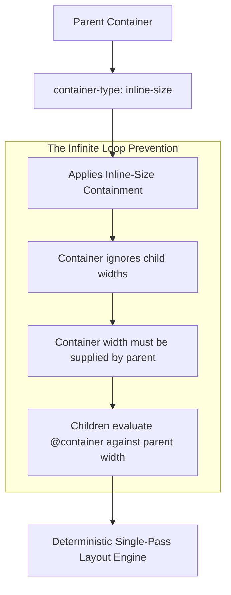
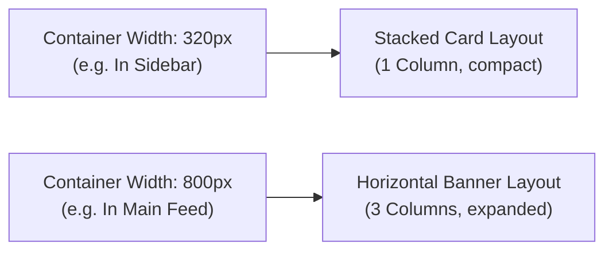
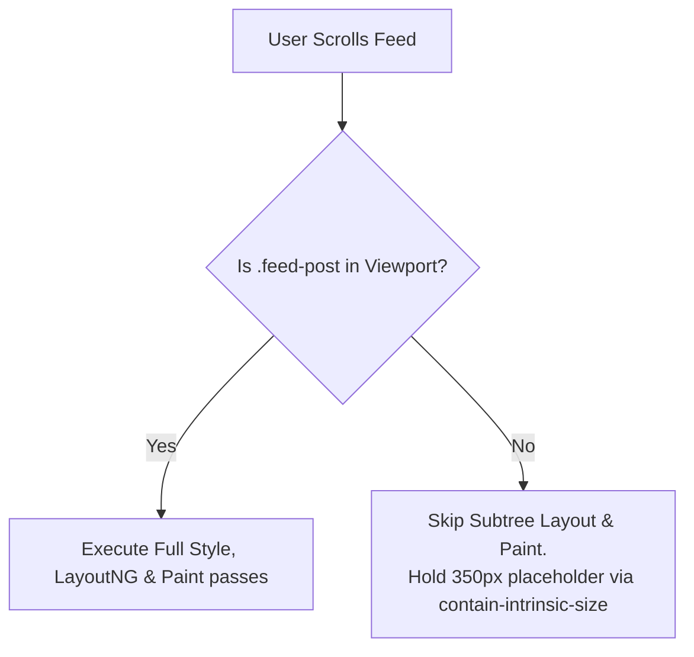

# Module 08 — Containment & Container Queries

For decades, responsive web design was constrained to global viewport media queries (`@media (min-width: 768px)`). In modern modular component architectures, sizing components against the global browser window is an anti-pattern: a card component rendered in a full-width hero container requires a horizontal layout, whereas that exact same card placed into a narrow sidebar requires a stacked vertical layout. Modern CSS solves this through **CSS Containment** and **Container Queries**, allowing components to query the physical dimensions, custom property states, and scroll dynamics of their immediate parent containers.

---

## 1. CSS Containment & The Self-Sizing Paradox

### The Four Axes of Containment
CSS Containment Module Level 2 defines four independent containment mechanisms designed to limit the scope of browser style recalc, layout, and paint computations:

1. **Layout Containment (`contain: layout`)**: Isolates internal layout. Elements outside the container cannot affect the layout of elements inside, and vice versa. It also creates a containing block for fixed/absolute elements and establishes an independent formatting context.
2. **Paint Containment (`contain: paint`)**: Guarantees that no child element will render outside the container's bounds. Off-screen elements with paint containment can be skipped by the GPU rasterizer entirely.
3. **Size Containment (`contain: size`)**: The container's size is calculated **as if it had zero children**. The engine completely ignores child dimensions, preventing changes inside the container from triggering size recalcs on ancestors.
4. **Inline-Size Containment (`contain: inline-size`)**: Applies size containment exclusively along the inline axis (width in horizontal writing modes). The container's height can still scale dynamically to fit its contents.

### The Self-Sizing Paradox
> [!IMPORTANT]
> Why does an element declaring `container-type: inline-size` collapse to width 0 if placed inside a shrink-to-fit container?
> This is the **Self-Sizing Paradox**: If a container's width depended on the width of its children, and the children changed their styles and sizes based on the container's width, the layout engine would enter an **infinite layout loop**.
> To break the circular dependency, CSS specifications mandate that setting `container-type: inline-size` applies strict inline-size containment. The container **cannot** derive its inline size from its children! If placed inside an auto-sizing flex item, floating element, or shrink-to-fit parent without an explicit width or stretch constraint, the container collapses to `0px`.
> Furthermore, an element **can never query itself**. A container query always evaluates the nearest ancestor query container.



---

## 2. Size Container Queries

Size Container Queries (Baseline Widely Available since August 2025) allow styles to branch based on the width or height of an ancestor container:

### Defining Container Roots
```css
/* Establish an anonymous inline-size container */
.card-wrapper {
  container-type: inline-size;
}

/* Establish a named container for targeted queries */
.sidebar {
  container-type: inline-size;
  container-name: sidebar-context;
}
```

### Querying Container Dimensions
Children inside the container use the `@container` at-rule with standard range syntax:

```css
/* Default: Stacked mobile layout for narrow containers (< 450px) */
.user-card {
  display: grid;
  grid-template-columns: 1fr;
  gap: 1rem;
}

/* Enhanced: Horizontal layout when container exceeds 450px */
@container (min-width: 450px) {
  .user-card {
    grid-template-columns: 120px 1fr;
    align-items: center;
  }
}

/* Enhanced: Wide banner layout when container exceeds 700px */
@container (inline-size >= 700px) {
  .user-card {
    grid-template-columns: 180px 1fr auto;
    padding: 2rem;
  }
}

/* Targeted query to a specific named ancestor */
@container sidebar-context (max-width: 300px) {
  .user-card .bio {
    display: none; /* Hide verbose bio text when embedded inside the sidebar */
  }
}
```



---

## 3. Style Container Queries

While size queries evaluate geometric dimensions, **Style Queries** (CSS Containment Level 3, Baseline Newly Available since May 2026) evaluate the computed value of CSS custom properties on an ancestor container.

Unlike size queries, style queries **do not require `container-type`**; every HTML element is automatically an implicit style container for its descendants!

```css
/* Card variations controlled declaratively via ancestor custom property */
@container style(--card-theme: dark) {
  .card-title {
    color: #ffffff;
  }
  .card-description {
    color: #cbd5e1;
  }
}

@container style(--card-theme: callout) {
  .card {
    background-color: oklch(0.95 0.08 140);
    border-inline-start: 6px solid oklch(0.55 0.22 140);
  }
}
```

This transforms CSS custom properties into high-performance styling state machines without requiring JavaScript class manipulation or React Context re-renders.

---

## 4. Scroll-State Container Queries

CSS Container Queries Level 2 extends container queries to query the dynamic scrolling state of an element using the `@container scroll-state()` syntax:

```css
/* The container must register as a scroll-state container */
.sticky-header {
  position: sticky;
  top: 0;
  container-type: scroll-state;
}

/* Styles applied dynamically ONLY when the header becomes pinned/stuck! */
@container scroll-state(stuck: top) {
  .sticky-header {
    background-color: rgba(255, 255, 255, 0.85);
    backdrop-filter: blur(8px);
    box-shadow: 0 4px 12px rgba(0, 0, 0, 0.08);
    padding-block: 0.5rem; /* Shrink header when stuck */
  }
}
```

This replaces legacy `IntersectionObserver` scroll listeners and eliminates scroll-event thrashing.

---

## 5. Rendering Optimization: `content-visibility` & `contain-intrinsic-size`

On content-heavy pages with thousands of DOM nodes (long chat feeds, infinite-scroll lists, e-commerce product catalogs), layout and rendering engines expend CPU cycles computing layout and paint for off-screen elements.

The `content-visibility` property (Baseline Newly Available since September 2025) leverages containment to deliver near-instantaneous initial page loads:
- **`content-visibility: auto`**: The browser evaluates whether the element is currently visible in the viewport. If off-screen, the engine skips layout and painting of the element's subtree entirely!
- **`contain-intrinsic-size`**: When off-screen elements are skipped, their height collapses to `0px`, causing the browser scrollbar to jump and stutter as the user scrolls. Declaring an estimated intrinsic size prevents scrollbar jumps:

```css
/* Optimize infinite list rendering */
.feed-post {
  content-visibility: auto;
  /* Reserves 350px of virtual placeholder space when post is off-screen */
  contain-intrinsic-size: auto 350px;
}
```



---

## 6. Then vs. Now: Component Sizing & Rendering

| Dimension | Legacy Web Era (2010–2020) | Modern CSS Platform (2024–2026+) |
| :--- | :--- | :--- |
| **Component Responsiveness** | Breakpoints tied to the global viewport (`@media (min-width: 768px)`), breaking in sidebars | Container queries (`@container (min-width: 400px)`) adapt directly to container space |
| **Stateful Styling** | JavaScript `ResizeObserver` observing elements and adding class names | Native size queries and `@container style(--prop: val)` |
| **Sticky Header Detection** | Attaching scroll event listeners or `IntersectionObserver` in JavaScript | Pure CSS `@container scroll-state(stuck: top)` |
| **DOM Virtualization** | Complex JavaScript virtualization libraries (react-window, virtual-scroller) | Native browser `content-visibility: auto` with `contain-intrinsic-size` |
| **Typographic Scaling** | Viewport units (`vw`) caused text inside small widgets to blow up on large monitors | Container units (`cqi`) scale text strictly relative to the containing widget |

---

## 7. Interview Drill: Containment & Container Queries

### Q1: What is the "Self-Sizing Paradox" in CSS container queries, and how does the browser specification prevent it?
<details><summary>Answer</summary>

If a container's size depended on the size of its children, and its children adjusted their size based on the container's size via container queries, the browser's layout engine would enter an infinite cyclic dependency loop. To prevent this, the specification mandates that setting `container-type: inline-size` applies strict inline-size containment: the container's width is calculated as if it had no children, requiring its width to be defined explicitly or dictated by its parent containing block. Additionally, elements are prohibited from querying themselves; they can only query ancestor containers.
</details>

### Q2: What happens if you place an element with `container-type: inline-size` inside an auto-width flex item without specifying a width or flex basis?
<details><summary>Answer</summary>

The flex item will collapse to a width of `0px`. Because `container-type: inline-size` applies inline-size containment, the container cannot derive its intrinsic size from its children (its min-content and max-content widths become zero). In an auto-sizing flex context where the parent shrinks to fit the item's content, the parent sees a content width of zero, resulting in a zero-width element. The fix is ensuring the flex item stretches (`align-self: stretch` or `flex: 1`) or assigning an explicit width.
</details>

### Q3: How do Style Container Queries (`@container style(...)`) differ fundamentally from Size Container Queries?
<details><summary>Answer</summary>

Size Container Queries require the ancestor element to explicitly declare `container-type` (such as `inline-size` or `size`), which introduces size containment and isolates layout. In contrast, Style Container Queries evaluate the computed values of CSS custom properties (e.g. `@container style(--theme: dark)`). Style queries require no `container-type` declaration and do not apply size containment; every element in the DOM tree automatically acts as a style container for its descendants.
</details>

### Q4: Why is `contain-intrinsic-size` mandatory when applying `content-visibility: auto` to elements in a scrollable list?
<details><summary>Answer</summary>

When an element with `content-visibility: auto` scrolls out of the viewport, the browser completely skips layout and painting for its subtree, causing the element's rendered height to collapse to `0px`. Without an intrinsic size placeholder, collapsing thousands of off-screen items drastically shortens the total scrollable height of the page, causing the scrollbar to violently jump, resize, and miscalculate scroll offsets. `contain-intrinsic-size` assigns a reserved virtual placeholder height to off-screen elements, preserving stable scrollbar dimensions.
</details>

### Q5: Can an element query a specific named container rather than the immediate nearest container ancestor?
<details><summary>Answer</summary>

Yes. An ancestor can assign a container name using `container-name: <name>`. When writing container queries, specifying `@container <name> (<condition>)` instructs the selector engine to bypass any intermediate anonymous containers and match specifically against the named ancestor container.
</details>
