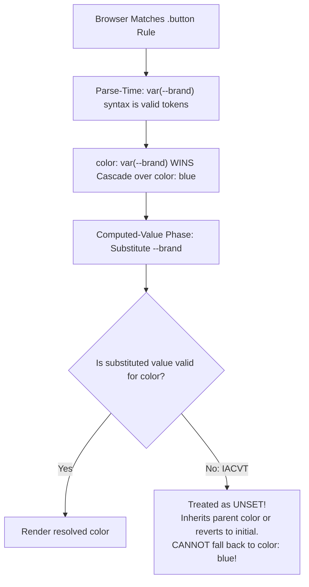
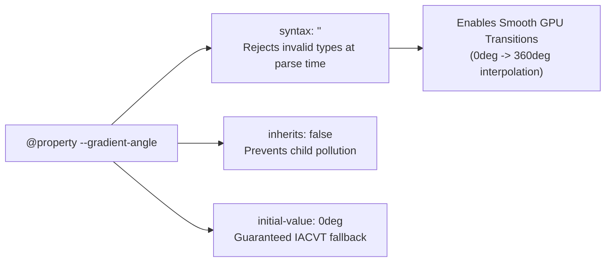

# Module 09 — Custom Properties, `@property` & CSS Functions

CSS Custom Properties (informally termed "CSS variables") represent the web platform's dynamic runtime styling API. Unlike static preprocessor variables (such as Sass `$brand-color`), which are baked into static strings at build time, CSS custom properties are live reactive nodes in the CSS Object Model: they inherit down the DOM tree, respond dynamically to media queries and user state, and re-evaluate at computed-value time. However, unchecked custom properties harbor dangerous subtle failure modes—most notably the **Invalid at Computed-Value Time (IACVT)** cascade trap. With the standardization of the **CSS Properties and Values API (`@property`)**, custom properties become strongly typed, animatable, and strictly validated runtime primitives.

---

## 1. Custom Property Mechanics & The IACVT Trap

### Declaration, Inheritance & Substitution
Custom properties are declared with a double-hyphen prefix (`--property-name`) and retrieved via the `var(--property-name, [fallback])` functional notation.
Custom properties are not evaluated during parsing; they store a raw token stream that undergoes **computed-time substitution**.

### The Invalid at Computed-Value Time (IACVT) Trap
> [!CAUTION]
> In standard CSS, if a declaration has a syntax error during parsing (e.g. `color: 42px`), the browser discards it and falls back to a previously declared rule.
> **Custom properties DO NOT WORK THIS WAY.**
> Because a custom property can hold any token sequence, the browser cannot know whether `var(--brand)` is valid for `color` until the computed-value phase. If the substituted value is invalid for that property (e.g. `--brand: 42px`), the cascade has already been "spent". The browser CANNOT roll back to an earlier CSS rule!
> Instead, the property becomes **Invalid at Computed-Value Time (IACVT)**, which the specification normatively mandates is treated as **`unset`**!

```css
/* THE IACVT DISASTER */
.button {
  color: blue; /* Author intended fallback */
  color: var(--undefined-or-invalid); /* If this variable is invalid, color BECOMES UNSET! */
}
```

If `--undefined-or-invalid` resolves to an invalid token (or is missing with no fallback), `color` does **not** remain `blue`. It becomes `unset`. Because `color` is an inherited property, it inherits the text color of its parent element (usually black). If applied to `background-color` (a non-inherited property), it resets to `initial` (transparent), completely breaking component contrast!



---

## 2. Strongly Typed Variables: The `@property` API

The **CSS Properties and Values API Level 1 (`@property`)** (Baseline Newly Available since July 2024) turns untyped custom properties into strongly typed, registered browser primitives.

### Defining Registered Custom Properties
A registered custom property explicitly specifies its grammar syntax, inheritance behavior, and initial fallback value:

```css
@property --gradient-angle {
  syntax: "<angle>";
  inherits: false;
  initial-value: 0deg;
}

@property --brand-color {
  syntax: "<color>";
  inherits: true;
  initial-value: oklch(0.65 0.25 140);
}
```



### Supported Type Syntaxes
The `syntax` descriptor accepts formal CSS data types:
- `<color>`
- `<length>` (e.g. `px`, `rem`, `vw`)
- `<percentage>`
- `<length-percentage>`
- `<number>` and `<integer>`
- `<angle>` (e.g. `deg`, `rad`, `turn`)
- `<time>` and `<resolution>`
- `<custom-ident>` and enum strings (e.g. `"primary" | "secondary" | "accent"`)
- Combinators: `<length>+` (space-separated list), `<length>#` (comma-separated list)

### Animating Custom Properties & Gradients
Standard custom properties are treated as discrete strings; browsers cannot interpolate intermediate values between `0deg` and `360deg`. By registering `--angle` as `<angle>`, the browser's animation subsystem understands how to interpolate numbers frame-by-frame, unlocking pure CSS gradient rotations:

```css
@property --spin-angle {
  syntax: "<angle>";
  inherits: false;
  initial-value: 0deg;
}

.rotating-card {
  background: conic-gradient(
    from var(--spin-angle),
    oklch(0.65 0.25 140),
    oklch(0.65 0.25 280),
    oklch(0.65 0.25 140)
  );
  animation: spin-gradient 4s linear infinite;
}

@keyframes spin-gradient {
  to {
    --spin-angle: 360deg; /* Smooth, hardware-accelerated 60fps interpolation! */
  }
}
```

### Critical `@property` Gotchas
1. **Global Registration & First Registration Wins**: Registered properties live in a flat global namespace. If two component packages both declare `@property --theme-color` with different syntaxes or initial values, the first declaration encountered in parsing wins, and the second is discarded.
2. **`inherits: false` Breaks Root Custom Property Patterns**: If a developer registers `--theme-spacing` with `inherits: false` and sets `--theme-spacing: 2rem` on `:root`, child components in the `<body>` will NOT inherit `2rem`. They will receive the property's `initial-value`!

---

## 3. Dynamic Logic: Space Toggles & The `if()` Function

Historically, developers implemented boolean logic in CSS using an obscure hack called the **CSS Space Toggle** (leveraging whitespace token substitution). Modern CSS replaces this hack with **Style Queries** and the emerging **`if()` inline condition function** (CSS Values Level 5).

### The Inline `if()` Function
The `if()` function evaluates conditions inline within a declaration:

```css
/* Inline conditional assignment */
.button {
  background-color: if(
    style(--variant: danger): oklch(0.55 0.25 25);
    style(--variant: success): oklch(0.65 0.22 140);
    else: oklch(0.50 0.05 250)
  );
}
```

---

## 4. CSS Custom Functions: `@function`

The **CSS Functions and Mixins Module Level 1** standardizes custom author-defined CSS functions via `@function`. Instead of precompiling arithmetic or repeating complex calculations, custom functions execute directly in the browser's style engine:

```css
/* Defining a reusable fluid-sizing function in pure CSS */
@function --fluid-size(--min-size <length>, --max-size <length>) {
  result: clamp(
    var(--min-size),
    calc(var(--min-size) + 2vw),
    var(--max-size)
  );
}

/* Consuming the function */
.hero-title {
  font-size: --fluid-size(1.5rem, 3.5rem);
}
```

---

## 5. Then vs. Now: Styling State & Variables

| Dimension | Legacy Web Era (Sass & Preprocessors) | Modern CSS Platform (2024–2026+) |
| :--- | :--- | :--- |
| **Variable Evaluation** | Build-time static strings (`$brand: #00f`); dead during runtime | Dynamic runtime CSSOM properties (`--brand: oklch(...)`) responding to DOM state |
| **Variable Typing** | Completely untyped; invalid values caused silent broken styles | Strongly typed `@property` with syntax validation and guaranteed fallbacks |
| **Gradient Animation** | Impossible without JavaScript canvas or complex SVG rotation hacks | Native keyframe interpolation of `@property` registered `<angle>` |
| **Logic & Conditionals** | Sass `@if` compiling duplicate classes into final CSS bundles | Native `@container style(...)` and inline `if()` expressions |
| **Reusable Math** | Sass mixins and custom Sass functions requiring build-time compilation | Native `@function` executing directly within the browser's style engine |

---

## 6. Interview Drill: Custom Properties & Functions

### Q1: What is the "Invalid at Computed-Value Time" (IACVT) rule, and why does `color: var(--missing, bad-value)` cause an element to inherit its parent's color instead of using a previous CSS rule?
<details><summary>Answer</summary>

Because CSS custom property syntax allows arbitrary token streams, the browser cannot validate whether a variable is semantically valid for a property during initial parsing. The declaration containing `var()` wins the cascade based on normal specificity. During the computed-value phase, when the variable is substituted and found to be invalid, the cascade has already executed; the engine cannot backtrack to earlier declarations. By specification, the declaration is treated as `unset`, which causes inherited properties (like `color`) to inherit from their parent, or non-inherited properties (like `background`) to revert to their initial value.
</details>

### Q2: Why is it impossible to animate a standard custom property `--angle: 0deg` to `--angle: 360deg` without using the `@property` API?
<details><summary>Answer</summary>

Without `@property`, the browser treats custom properties as raw, untyped strings of CSS tokens. The animation and transition subsystem has no knowledge that `"0deg"` represents an angular geometric quantity rather than arbitrary text; it cannot calculate intermediate mathematical interpolation frames between string tokens. Registering the property with `syntax: "<angle>"` provides the engine with semantic type metadata, enabling the interpolation engine to compute smooth numerical transitions from 0 to 360 degrees.
</details>

### Q3: What happens if two different third-party component libraries declare an `@property` rule for the same variable name `--accent` with conflicting syntax?
<details><summary>Answer</summary>

Registered custom properties share a single global registration namespace in the document. The specification dictates a "first registration wins" rule: the first `@property --accent` definition parsed by the browser becomes active, and all subsequent `@property --accent` declarations are discarded and ignored. This can cause the second component library to malfunction if it expected a different syntax or initial value.
</details>

### Q4: If an `@property` definition sets `inherits: false`, how does that affect child elements accessing that custom property?
<details><summary>Answer</summary>

When `inherits: false` is declared, the custom property behaves like a non-inherited property (similar to `border` or `padding`). It is only available directly on the specific element where it is explicitly declared. Child descendants will NOT inherit the value from parent elements; if a child accesses `var(--prop)`, it receives the registered `initial-value` rather than the parent's value.
</details>

### Q5: How does a native `@function` differ from a Sass function?
<details><summary>Answer</summary>

A Sass function executes once during the build step on a development machine or CI pipeline, baking a static evaluated value into the output CSS file. It cannot inspect runtime variables, viewport sizes, or dynamic user states. In contrast, a native CSS `@function` executes dynamically inside the browser engine during the style computation phase; it can accept runtime custom properties, calculate dynamic viewport-relative math, and react in real-time to DOM changes.
</details>
