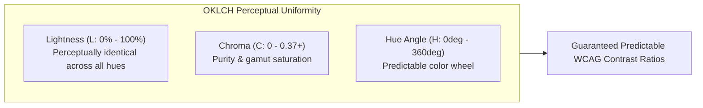
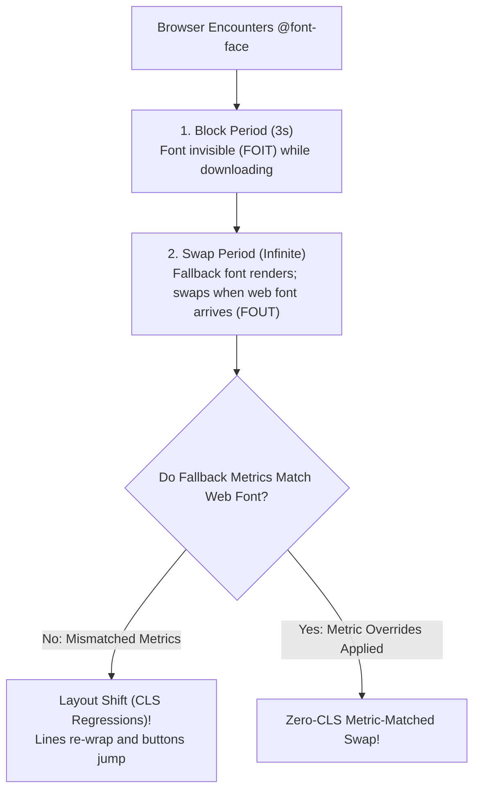

# Module 10 — Color, Theming & Typography

Color models and typographic systems on the web have undergone a profound physical and perceptual revolution. Historically, digital color was trapped in the limited sRGB color gamut defined for cathode-ray monitors in 1996, and typographic scaling was prone to jarring layout shifts during font loading. Modern web standards establish **perceptually uniform wide-gamut color spaces (OKLCH)**, declarative **Relative Color Syntax**, native light/dark mode primitives (`light-dark()`, `contrast-color()`), and **font metric overrides** that mathematically eliminate font-swap Cumulative Layout Shift (CLS).

---

## 1. Color Science: sRGB vs. Wide Gamut & The OKLCH Breakthrough

### The Flaw of Legacy sRGB & HSL
The legacy web relied on RGB (hex codes, `rgb()`) and HSL (`hsl()`). Both models are bound to the narrow **sRGB color space** and are **perceptually non-uniform**:
- In HSL, setting Lightness to $50\%$ on pure yellow (`hsl(60 100% 50%)`) produces an intensely blinding, bright color, whereas setting Lightness to $50\%$ on pure blue (`hsl(240 100% 50%)`) produces a dark, muddy blue.
- Because HSL does not correspond to human visual perception, programmatic color adjustments (like Sass `darken()` or `lighten()`) frequently destroy WCAG accessible contrast ratios.

```
                  ┌──────────── Color Space Gamut Coverage ────────────┐
                  │                                                    │
                  │   sRGB (~33% of visible human color spectrum)      │
                  │   ├── Display P3 (~50% wider, modern OLED/Retina)  │
                  │   └── Rec. 2020 (~75% of visible human colors)     │
```

### OKLCH: Perceptually Uniform Wide-Gamut Color
**OKLCH** (CSS Color Module Level 4, Baseline Widely Available since May 2023) is designed around the human visual system:
- **$L$ (Lightness)**: From $0\%$ (pitch black) to $100\%$ (pure white). $L = 70\%$ represents the exact same perceived brightness across *all* hues!
- **$C$ (Chroma)**: The saturation/purity of the color (from $0$ for pure grayscale to $\sim 0.37$ for intense vibrant pigments).
- **$H$ (Hue Angle)**: The pigment shade in degrees ($0^{\circ}$ to $360^{\circ}$), where $25^{\circ}$ is red, $140^{\circ}$ is green, and $250^{\circ}$ is blue.

```css
/* Vivid wide-gamut OKLCH colors impossible in standard sRGB */
:root {
  --neon-green: oklch(0.85 0.32 140);
  --electric-blue: oklch(0.60 0.30 250);
}
```



---

## 2. Dynamic Color Manipulation: Relative Colors & `color-mix()`

CSS Color Module Level 5 enables native mathematical color operations in the browser without preprocessors.

### Relative Color Syntax (RCS)
Relative Color Syntax allows authors to deconstruct an existing color, extract its channels into local variables, modify them, and output a new color:

```css
:root {
  --brand: oklch(0.65 0.25 140);
}

.button {
  /* 1. Opacity modification: extract channels, assign 50% alpha */
  background: oklch(from var(--brand) l c h / 0.5);

  /* 2. Lighten by 15%: modify lightness channel dynamically */
  border-color: oklch(from var(--brand) calc(l + 0.15) c h);

  /* 3. Generate complementary color: rotate hue by 180 degrees */
  accent-color: oklch(from var(--brand) l c calc(h + 180));
}
```

### `color-mix()`
The `color-mix()` function blends two colors in a specified interpolation space (typically OKLCH for natural blending without muddy gray dead-zones):

```css
.card-hover {
  /* Mix 85% brand color with 15% pure white to produce a clean hover tint */
  background: color-mix(in oklch, var(--brand) 85%, white);
}
```

---

## 3. Automated Theming: `light-dark()` & `contrast-color()`

### The `light-dark()` Function
CSS Color Module Level 5 standardizes `light-dark()`, which selects between two colors based on the current computed `color-scheme` of the element:

```css
:root {
  /* Declares that the document supports both light and dark modes */
  color-scheme: light dark;

  /* First value used in light mode; second value used in dark mode */
  --bg-surface: light-dark(#ffffff, #121212);
  --text-primary: light-dark(#1a1a1a, #f8fafc);
}

body {
  background-color: var(--bg-surface);
  color: var(--text-primary);
}

/* Local dark mode override */
.dark-panel {
  color-scheme: dark; /* Automatically switches all light-dark() children inside */
}
```

### Automated Accessibility: `contrast-color()`
The `contrast-color()` function (Baseline Newly Available since April 2026) calculates and returns either black or white (or a high-contrast palette color) guaranteed to satisfy accessible contrast ratios against any dynamic background:

```css
.badge {
  background-color: var(--dynamic-user-tag-color);
  /* Automatically selects black or white text to guarantee WCAG compliance! */
  color: contrast-color(var(--dynamic-user-tag-color));
}
```

---

## 4. Web Fonts & Zero-CLS Font Loading

Web font loading is a major cause of layout instability (Cumulative Layout Shift) and invisible text flash (FOIT).



### The Font Loading Lifecycle & `font-display`
When a web font is requested, the browser passes through three distinct phases:
- **Block Period**: If the font is not cached, the browser renders invisible placeholder text.
- **Swap Period**: If the font arrives during this period, the browser swaps it in.
- **Failure Period**: If the font fails to download, the browser renders the fallback font permanently.

| `font-display` Strategy | Block Period | Swap Period | Best Used For |
| :--- | :---: | :---: | :--- |
| `swap` | 0 ms | Infinite | Body text where immediate reading is paramount (causes FOUT). |
| `optional` | 100 ms | 0 ms | **Recommended for performance**: if font is not in cache, use fallback with 0 CLS. |
| `block` | 3000 ms | Infinite | Icon fonts where rendering fallback glyphs corrupts meaning. |
| `fallback` | 100 ms | Short (~3s) | Compromise between immediate text and eventual styling. |

### Font Metric Overrides: Eliminating Font-Swap CLS
When a custom web font downloads and replaces an operating system fallback font (e.g. replacing `Arial` with `Inter`), different x-heights, descenders, and advance widths cause paragraphs to wrap onto new lines, causing massive layout shifts.
CSS Fonts Module Level 4 introduces **Font Metric Overrides** to mathematically stretch and squash fallback fonts to match the exact dimensions of custom web fonts:

```css
/* Metric-matched fallback font */
@font-face {
  font-family: "Fallback-Arial";
  src: local("Arial");
  ascent-override: 90%;
  descent-override: 22.5%;
  line-gap-override: 0%;
  size-adjust: 107.5%; /* Scales Arial glyphs to match Inter's exact advance width */
}

body {
  /* Zero-CLS typographic stack */
  font-family: "Inter", "Fallback-Arial", sans-serif;
}
```

### The Font Preload `<link>` Trap
> [!CAUTION]
> When preloading web fonts using `<link rel="preload">`, **you must always include the `crossorigin` attribute**, even for fonts hosted on the exact same origin!
> Under the W3C Web Fonts specification, fonts are fetched using anonymous CORS mode. If `<link rel="preload" as="font" href="/fonts/inter.woff2">` omits `crossorigin`, the browser fetches the font with standard credentials, caches it, and then discovers the `@font-face` rule demands an anonymous CORS request—causing the browser to **download the exact same font file twice**!

---

## 5. Modern Typographic Formatting: `text-wrap`

CSS Text Module Level 4 provides native control over typographic line-wrapping:
- **`text-wrap: balance`**: Balances line lengths across short blocks of text (such as headlines and callouts), preventing single-word orphan lines at the end of headings. Clamped by browsers to a maximum of 4–6 lines to avoid layout performance penalties.
- **`text-wrap: pretty`**: Optimized for body paragraphs. It executes algorithmic hyphenation and line-breaking to eliminate unsightly single-word widows at the end of paragraphs.

```css
h1, h2, h3 {
  text-wrap: balance; /* Perfectly balanced headlines */
}

p {
  text-wrap: pretty; /* Prevents trailing single-word widows */
}
```

---

## 6. Then vs. Now: Colors & Typography

| Dimension | Legacy Web Era (2010–2020) | Modern CSS Platform (2024–2026+) |
| :--- | :--- | :--- |
| **Color Space** | sRGB (hex / rgb / hsl) with erratic perceptual lightness | Wide-gamut OKLCH with guaranteed perceptual uniformity |
| **Color Modification** | Build-time Sass functions (`darken($c, 10%)`, `rgba($c, 0.5)`) | Native Relative Color Syntax (`oklch(from var(--c) calc(l - 0.1) c h)`) |
| **Theming Strategy** | Duplicated `.theme-dark` CSS classes toggled by JavaScript | Native `color-scheme: light dark` and `light-dark()` function |
| **Contrast Compliance** | Manual WCAG checking and hardcoded color pairs | Native `contrast-color(var(--bg))` automated calculation |
| **Font Loading CLS** | Jarring layout shifts when web fonts swapped in | Native metric overrides (`size-adjust`, `ascent-override`) |
| **Orphan Headlines** | Non-breaking spaces (`&nbsp;`) inserted manually into CMS copy | Pure CSS `text-wrap: balance` |

---

## 7. Interview Drill: Color, Theming & Typography

### Q1: Why is the OKLCH color space considered mathematically superior to HSL for building accessible design system palettes?
<details><summary>Answer</summary>

HSL is perceptually non-uniform: two colors with identical Lightness values (such as $50\%$ in HSL) can have radically different perceived brightnesses (e.g. pure yellow appears blindingly bright while pure blue appears dark). Consequently, calculating WCAG contrast ratios in HSL requires custom per-hue adjustments. In contrast, OKLCH is based on human visual perception; Lightness ($L$) is strictly uniform across all hues ($H$). An OKLCH color with $L = 0.70$ has the exact same luminance whether it is red, yellow, green, or blue, making automated contrast calculation and accessible palette generation completely reliable.
</details>

### Q2: How does CSS Relative Color Syntax (RCS) work, and how would you use it to create a 20% transparent variant of an unknown color variable?
<details><summary>Answer</summary>

Relative Color Syntax allows authors to deconstruct an existing base color using the `from <color>` keyword, which exposes the color's constituent channels as local variables. To generate a 20% transparent variant (80% opacity) of an arbitrary color stored in `--brand`, you write `oklch(from var(--brand) l c h / 0.8)`. The browser extracts the Lightness ($l$), Chroma ($c$), and Hue ($h$) of `--brand` and emits a new color with an alpha channel of 0.8.
</details>

### Q3: What is the purpose of the `light-dark()` function, and what prerequisite CSS property must be set on an ancestor for it to work?
<details><summary>Answer</summary>

The `light-dark(lightColor, darkColor)` function conditionally returns its first argument when the element is rendered in a light color scheme, or its second argument when rendered in a dark color scheme. For `light-dark()` to operate, the element or an ancestor must declare the `color-scheme` property with both modes enabled (e.g. `color-scheme: light dark`). If `color-scheme` is omitted, the browser defaults to light mode and only the first value is evaluated.
</details>

### Q4: Why must `<link rel="preload" as="font">` always include the `crossorigin` attribute even when loading a font hosted on the exact same domain?
<details><summary>Answer</summary>

The W3C specification mandates that web fonts must be fetched using Anonymous CORS mode. If a developer preloads a font using `<link rel="preload" as="font" href="...">` without the `crossorigin` attribute, the browser fetches the file with standard credentialed request headers. When the CSS engine subsequently parses the `@font-face` rule, it initiates an Anonymous CORS request; because the cached preload does not match the anonymous CORS context, the browser discards the preload and fetches the font a second time, wasting bandwidth and delaying rendering.
</details>

### Q5: What problem does `text-wrap: balance` solve, and why do browser engines restrict its application to short blocks of text?
<details><summary>Answer</summary>

`text-wrap: balance` runs an iterative algorithmic layout pass that calculates the optimum line breaks across a text element to ensure all lines have approximately equal character lengths, eliminating unsightly single-word orphan lines at the end of headings. Because balancing lines requires multiple speculative layout passes, applying it to thousands of words in long body paragraphs would cause significant layout thrashing; browser engines therefore clamp `text-wrap: balance` to elements with a maximum of 4 to 6 lines of text.
</details>
