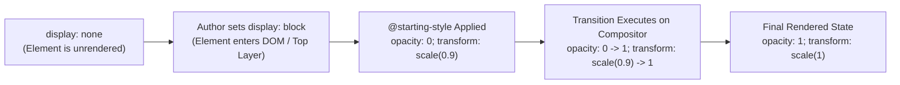
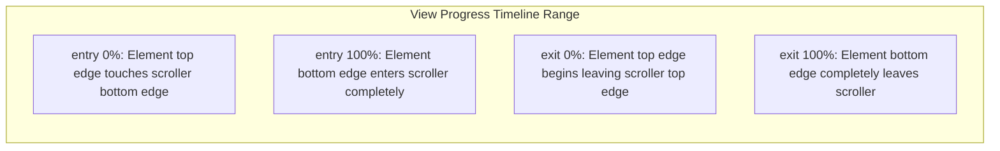
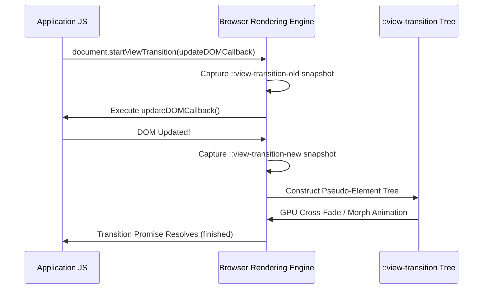

# Module 11 — Motion: Transitions, Animations, Scroll-Driven & View Transitions

Web animation has evolved from simple imperative JavaScript DOM position manipulation into a declarative, multi-tier motion subsystem executed directly on the GPU compositor thread. Modern CSS eliminates historic bottlenecks by standardizing three major capabilities: animating entry and exit states across discrete property boundaries (`@starting-style` and `transition-behavior: allow-discrete`), hardware-accelerated **Scroll-Driven Animations** linked directly to scroll progress without script listeners, and the **View Transitions API**, which enables seamless morphing transitions across DOM state changes and multi-page navigations.

---

## 1. Animating the Unanimatable: `@starting-style` & Discrete Transitions

Historically, animating an element entering the DOM from `display: none` to `display: block` or fading out a `<dialog>` before closing was impossible in pure CSS. When an element transitioned from `display: none`, the browser calculated its initial properties in the same layout frame as its target properties, preventing any transition from firing.

CSS Transitions Level 2 solves this through two complementary primitives:
1. **`transition-behavior: allow-discrete`**: Permits properties with discrete (non-interpolatable) values (such as `display`, `content-visibility`, and `overlay`) to participate in CSS transitions. The discrete property flips values at the exact beginning or end of the transition duration rather than immediately.
2. **`@starting-style`**: Declares the initial before-entry styling state an element assumes in the exact frame it transitions from `display: none` or is inserted into the Top Layer.



### Full-Fledged Dialog Entry and Exit Animations
```css
/* Standard dialog styling */
dialog {
  opacity: 0;
  transform: scale(0.85);
  /* 1. allow-discrete enables transitions on display and overlay */
  transition:
    opacity 0.3s ease-out,
    transform 0.3s cubic-bezier(0.16, 1, 0.3, 1),
    display 0.3s allow-discrete,
    overlay 0.3s allow-discrete;
}

/* Open state: target animation values */
dialog[open] {
  opacity: 1;
  transform: scale(1);
}

/* 2. Starting style: initial state when dialog opens */
@starting-style {
  dialog[open] {
    opacity: 0;
    transform: scale(0.85);
  }
}

/* 3. Backdrop transition */
dialog::backdrop {
  background-color: rgba(0, 0, 0, 0);
  transition:
    background-color 0.3s ease-out,
    display 0.3s allow-discrete,
    overlay 0.3s allow-discrete;
}

dialog[open]::backdrop {
  background-color: rgba(0, 0, 0, 0.5);
}

@starting-style {
  dialog[open]::backdrop {
    background-color: rgba(0, 0, 0, 0);
  }
}
```

> [!IMPORTANT]
> The `overlay` property manages the element's membership in the Top Layer. Transitioning `overlay: 0.3s allow-discrete` keeps the dialog inside the hardware Top Layer until the exit fade completes, preventing the element from abruptly snapping out of existence before the animation finishes!

---

## 2. Scroll-Driven Animations: Declarative Scroller Timelines

Historically, parallax scrolling effects and reading progress bars required attaching imperative JavaScript `window.addEventListener('scroll')` listeners. This forced style and layout recalculations on the main thread, causing frame drops and jitter.

CSS Scroll-Driven Animations Level 1 links animation progress directly to the scroll offset of a scroll container on the **GPU compositor thread**:

```
Traditional Animations:    Time Progress    (0s  ───────────────>  2s)
Scroll-Driven Animations:  Scroll Progress  (0%  ───────────────> 100%)
```

### The Two Timeline Types: `scroll()` vs. `view()`
1. **Scroll Progress Timeline (`scroll()`)**: Advances an animation based on the scroll position of a scroll container from top ($0\%$) to bottom ($100\%$). Ideal for reading progress bars.
2. **View Progress Timeline (`view()`)**: Advances an animation based on the physical position of a specific element as it enters, traverses, and exits the visible scrollport. Ideal for scroll-reveals and parallax effects.



### Reading Progress Bar Implementation
```css
/* Reading progress bar pinned to the top of the viewport */
.reading-progress-bar {
  position: fixed;
  top: 0;
  left: 0;
  width: 100%;
  height: 4px;
  background-color: oklch(0.65 0.25 140);
  transform-origin: 0% 50%;
  transform: scaleX(0);

  /* Connect animation progress to root document scroll position */
  animation: fill-progress linear;
  animation-timeline: scroll(root block);
}

@keyframes fill-progress {
  to {
    transform: scaleX(1);
  }
}
```

### Scroll-Reveal with View Timelines
```css
/* Card fades and scales in as it scrolls into the viewport */
.fade-in-card {
  animation: reveal-card linear both;
  animation-timeline: view();
  /* Animation begins when card enters (0%) and finishes when fully inside (100%) */
  animation-range: entry 0% entry 100%;
}

@keyframes reveal-card {
  from {
    opacity: 0;
    transform: translateY(40px) scale(0.95);
  }
  to {
    opacity: 1;
    transform: translateY(0) scale(1);
  }
}
```

---

## 3. The View Transitions API: Seamless DOM Morphing

The **View Transitions API** transforms how multi-state single-page applications (SPAs) and multi-page web applications (MPAs) animate state changes. Rather than coordinating manual FLIP (First, Last, Invert, Play) geometry math, the browser captures bitmap snapshots of the previous state, updates the DOM, captures snapshots of the new state, and animates between them.



### The View Transition Pseudo-Element Tree
During a view transition, the browser generates a transient pseudo-element hierarchy at the root of the document:

```
::view-transition
 └── ::view-transition-group(root)
      └── ::view-transition-image-pair(root)
           ├── ::view-transition-old(root)   <-- Bitmap snapshot of outgoing state
           └── ::view-transition-new(root)   <-- Live representation of incoming state
```

### Custom Element Morphing with `view-transition-name`
By default, the entire page root undergoes a cross-fade. To morph individual components (such as an image expanding from a card into a full-screen hero image), assign matching `view-transition-name` identifiers:

```css
/* In the card thumbnail */
.product-card img {
  view-transition-name: selected-product;
}

/* In the product detail view */
.product-hero img {
  view-transition-name: selected-product;
}
```

When `document.startViewTransition()` runs, the browser isolates `selected-product` into its own `::view-transition-group(selected-product)` and automatically animates its `width`, `height`, and `transform` smoothly across the screen!

> [!CAUTION]
> Every `view-transition-name` on an active page **must be globally unique**.
> If two visible elements simultaneously share the same `view-transition-name`, the browser immediately aborts the view transition and updates the DOM abruptly without animation!

---

## 4. Accessibility: Respecting User Motion Preferences

For users with vestibular disorders or motion sensitivities, animations (especially parallax scrolling and large scaling effects) can trigger dizziness, nausea, and disorientation.

The `prefers-reduced-motion` media query must always be implemented:

```css
/* Universal Motion Preference Guard */
@media (prefers-reduced-motion: reduce) {
  *,
  *::before,
  *::after {
    animation-duration: 0.01ms !important;
    animation-iteration-count: 1 !important;
    transition-duration: 0.01ms !important;
    scroll-behavior: auto !important;
  }

  /* Disable view transition snapshot cross-fades */
  ::view-transition-group(*),
  ::view-transition-old(*),
  ::view-transition-new(*) {
    animation: none !important;
  }
}
```

---

## 5. Then vs. Now: Motion & Transitions

| Dimension | Legacy Web Era (2010–2020) | Modern CSS Platform (2024–2026+) |
| :--- | :--- | :--- |
| **`display: none` Transitions** | Required `setTimeout()` in JS to stagger adding classes after rendering | Native `@starting-style` and `transition-behavior: allow-discrete` |
| **Top Layer Exit Animations** | Dialogs vanished instantly before fade-outs finished; required JS hack delays | Native `transition: overlay 0.3s allow-discrete` holds top-layer membership |
| **Parallax & Scroll Progress** | Imperative JS scroll listeners or heavy libraries (GSAP ScrollTrigger) | Pure CSS `animation-timeline: scroll()` and `view()` running on compositor |
| **Shared Element Morphing** | Complex JS FLIP calculation libraries (Framer Motion, Barba.js) | Native browser View Transitions API (`view-transition-name`) |
| **Motion Accessibility** | Often overlooked or required custom site-wide toggle switches | System-level integration via `@media (prefers-reduced-motion: reduce)` |

---

## 6. Interview Drill: Motion & View Transitions

### Q1: Why did transitions on properties like `opacity` historically fail to animate when an element switched from `display: none` to `display: block`, and how does `@starting-style` resolve this?
<details><summary>Answer</summary>

When an element transitions from `display: none`, it has no initial computed style box in the layout tree. In the single layout frame where `display: block` and `opacity: 1` are applied, the browser establishes the element's computed styles for both the start and target values simultaneously; having no prior rendered frame with `opacity: 0`, the engine cannot interpolate, causing the element to appear instantly. `@starting-style` defines an explicit set of initial values that the browser applies in the exact frame the element receives its display type, providing the starting baseline needed for the transition to interpolate.
</details>

### Q2: What is the purpose of `transition-behavior: allow-discrete`?
<details><summary>Answer</summary>

In standard CSS, properties with discrete values (such as `display`, `visibility`, or `overlay`) cannot be transitioned; they swap values instantaneously. Setting `transition-behavior: allow-discrete` enables these properties to participate in transition timelines. For example, during an exit animation, `display` remains `block` throughout the transition duration and only flips to `none` at the very end of the animation, preventing the element from vanishing prematurely.
</details>

### Q3: What is the mechanical difference between `animation-timeline: scroll()` and `animation-timeline: view()`?
<details><summary>Answer</summary>

`scroll()` creates a Scroll Progress Timeline tied to the scroll offset of a scroll container (from 0% at the top to 100% at the bottom). In contrast, `view()` creates a View Progress Timeline tied to the relative position of a specific target element as it enters, traverses, and leaves the visible scrollport of its scroll container, making `view()` ideal for reveal-on-scroll effects and parallax elements.
</details>

### Q4: Why does having two elements on the same page with the same `view-transition-name` cause a view transition to abort?
<details><summary>Answer</summary>

The View Transitions specification mandates that every `view-transition-name` within a transition must resolve to an unambiguous 1-to-1 mapping between the outgoing state (`::view-transition-old`) and the incoming state (`::view-transition-new`). If the browser encounters duplicate `view-transition-name` values, it cannot determine which element should morph to which snapshot, resulting in an ambiguous state graph. To preserve deterministic behavior, the engine immediately aborts the view transition and updates the DOM synchronously without animation.
</details>

### Q5: How do Scroll-Driven Animations maintain 60fps/120fps performance even when the browser's JavaScript main thread is completely saturated?
<details><summary>Answer</summary>

Traditional JavaScript scroll animations execute on the browser's main thread and are blocked whenever script execution or layout recalc runs. In contrast, CSS Scroll-Driven Animations link the scroll timeline directly to compositor properties (`transform`, `opacity`) inside the browser's GPU compositor process. The compositor reads hardware touch and wheel inputs and recalculates the animation timeline on the compositor thread without querying the main thread, resulting in silky-smooth motion immune to main-thread jank.
</details>
