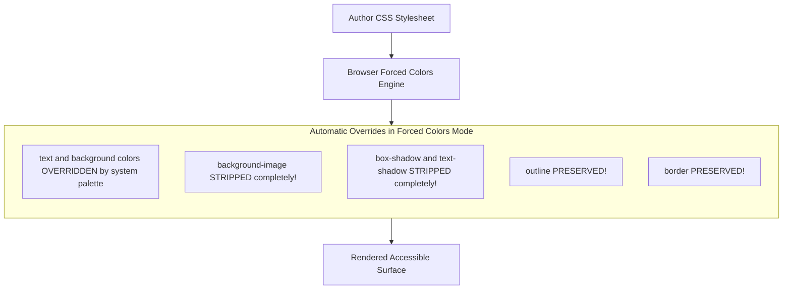

```mermaid
flowchart LR
    UserInput["User Types Long Text into <textarea>"] --> EngineCalc["Browser evaluates field-sizing: content"]
    EngineCalc --> AutoResize["Automatically expands block-size to fit text runs<br/>(Zero JavaScript, Zero Layout Thrashing)"]
```

# Module 12 — Responsive & Accessible CSS

Accessibility (a11y) and responsive design are not afterthoughts or defensive patches applied at the end of a software development cycle; they are foundational architectural constraints baked directly into the CSS specification. Modern web design goes beyond rigid screen-width breakpoints to support diverse human sensory capabilities, assistive devices, and user hardware configurations. This includes managing **Forced Colors Mode (Windows High Contrast)**, eliminating hazardous `outline: none` focus anti-patterns via **`:focus-visible`**, native auto-sizing inputs via **`field-sizing`**, and responsive image resolution switching using **`image-set()`**.

---

## 1. Modern Media Queries & User Preferences

Media Queries Level 4 & 5 replace clunky `min-width` and `max-width` syntax with mathematical range operators, and introduce media features that directly mirror operating system accessibility preferences.

### Range Syntax Comparison
```css
/* LEGACY MEDIA QUERY SYNTAX */
@media (min-width: 600px) and (max-width: 1024px) {
  .container { padding: 2rem; }
}

/* MODERN RANGE SYNTAX (Baseline Widely Available) */
@media (600px <= width <= 1024px) {
  .container { padding: 2rem; }
}
```

### System User Preference Queries
- **`prefers-color-scheme`**: Detects OS-level dark/light mode (`light` or `dark`).
- **`prefers-reduced-motion`**: Detects if the user has requested minimal non-essential motion (`reduce` or `no-preference`).
- **`prefers-contrast`**: Detects high-contrast accessibility settings (`more`, `less`, `custom`).
- **`prefers-reduced-transparency`**: Detects if the user prefers opaque UI surfaces over translucent frosted-glass blurs.

```css
/* Adapting frosted glass to user transparency preference */
.modal-overlay {
  background-color: oklch(100% 0 0 / 70%);
  backdrop-filter: blur(12px);
}

@media (prefers-reduced-transparency: reduce) {
  .modal-overlay {
    background-color: #ffffff; /* 100% solid opaque background */
    backdrop-filter: none;
  }
}
```

---

## 2. Forced Colors Mode (High Contrast): Gotchas & Hardening

**Forced Colors Mode** (commonly known as Windows High Contrast Mode) is a hardware-enforced accessibility mode utilized by millions of users with visual impairments. When active (`@media (forced-colors: active)`), the browser enforces a restricted, high-contrast system color palette and overrides author styles.



### The Three Critical Forced Colors Gotchas
1. **The CSS Background Icon Trap**: Icons implemented using CSS `background-image` (e.g. SVG icons set via `background: url(...)`) are **completely stripped and rendered invisible**!
   - *Fix*: Use inline SVGs or `mask-image` with `currentColor`, which inherits the system's `CanvasText` color.
2. **The Box-Shadow Focus Ring Trap**: Custom focus indicators created using `box-shadow: 0 0 0 3px blue` are **completely stripped**, leaving keyboard users with zero visual feedback on interactive elements!
   - *Fix*: Always use CSS `outline` for focus indicators (e.g. `outline: 3px solid transparent`), which is preserved by the engine.
3. **Loss of Semantic Badges**: Colored status pills (e.g. green for "Active", red for "Error") lose their distinct colors.
   - *Fix*: Use explicit system color keywords (`Canvas`, `CanvasText`, `LinkText`, `Highlight`, `ButtonText`) or pair color with icons and text labels.

```css
/* HARDENING AN INTERACTIVE BUTTON FOR FORCED COLORS */
.accessible-button {
  background: var(--brand-color);
  color: white;
  border: 2px solid transparent; /* Transparent border turns into visible contrast border in high contrast! */
}

.accessible-button:focus-visible {
  /* Outline is PRESERVED in Forced Colors Mode! */
  outline: 3px solid CanvasText;
  outline-offset: 2px;
}
```

---

## 3. Focus Indicator Architecture: `:focus` vs. `:focus-visible`

The greatest accessibility regression in web history was the careless reset `outline: none;` applied to remove the default browser blue halo on mouse clicks. Removing focus rings completely disables keyboard navigation for sighted users.

### The `:focus-visible` Solution
The `:focus-visible` pseudo-class (Baseline Widely Available) matches an element only when the browser heuristic detects that an intentional keyboard or assistive input is driving focus:
- Clicking a button with a mouse or tap does **not** trigger `:focus-visible`.
- Tabbing to that same button with a keyboard **does** trigger `:focus-visible`.

```css
/* THE ANTI-PATTERN: NEVER DO THIS */
button:focus {
  outline: none; /* Destroys keyboard accessibility! */
}

/* THE PRODUCTION STANDARD: Seamless mouse, clear keyboard indicator */
button:focus {
  outline: none; /* Safe to suppress for mouse clicks ONLY because :focus-visible follows: */
}

button:focus-visible {
  outline: 3px solid oklch(0.65 0.25 250);
  outline-offset: 2px;
  border-radius: 4px;
}
```

---

## 4. Responsive Images & Typographic Controls

### The `image-set()` Function
CSS Images Module Level 4 standardizes `image-set()` (Baseline Widely Available since March 2026), providing resolution switching directly in CSS without JavaScript:

```css
.hero-banner {
  /* Automatically fetches standard image for 1x screens, high-res for Retina/OLED */
  background-image: image-set(
    url("/img/banner.avif") type("image/avif") 1x,
    url("/img/banner@2x.avif") type("image/avif") 2x,
    url("/img/banner.webp") type("image/webp") 1x,
    url("/img/banner@2x.webp") type("image/webp") 2x
  );
}
```

### Auto-Sizing Form Inputs: `field-sizing: content`
Historically, creating an auto-expanding `<textarea>` or `<input>` that grows as the user types required messy JavaScript measuring scroll height on every keystroke. 

CSS Basic User Interface Module Level 4 introduces **`field-sizing: content`** (Baseline Newly Available since June 2026):

```css
/* The textarea expands vertically and horizontally to fit user text natively! */
textarea.auto-expanding {
  field-sizing: content;
  min-block-size: 3lh;  /* Minimum height of 3 lines */
  max-block-size: 15lh; /* Maximum height before scrolling occurs */
}

input.auto-width {
  field-sizing: content;
  min-inline-size: 10ch; /* Sized to fit text content without trailing whitespace */
}
```



---

## 5. Then vs. Now: Responsive & Accessible CSS

| Dimension | Legacy Web Era (2010–2020) | Modern CSS Platform (2024–2026+) |
| :--- | :--- | :--- |
| **Media Queries** | Verbose `@media (min-width: 600px) and (max-width: 900px)` | Clean range syntax `@media (600px <= width <= 900px)` |
| **Focus Rings** | Dangerous `outline: none` removed rings for all users | Native `:focus-visible` shows focus rings exclusively for keyboard users |
| **High Contrast** | Ignored; custom designs completely broke in Windows High Contrast Mode | Proactive hardening via system colors and transparent border placeholders |
| **Auto-Expanding Inputs** | Fragile JavaScript event handlers measuring `scrollHeight` on `input` | Pure CSS native `field-sizing: content` |
| **Form Accent Colors** | Re-implementing checkboxes and radio buttons with custom styled SVG divs | Native `accent-color: oklch(...)` styles native browser controls |

---

## 6. Interview Drill: Responsive & Accessible CSS

### Q1: Why is replacing `outline` with `box-shadow` for focus rings considered a critical accessibility defect in Windows High Contrast Mode?
<details><summary>Answer</summary>

In Windows High Contrast Mode (Forced Colors Mode), the operating system strips all CSS `box-shadow` and `text-shadow` declarations from the page to ensure clarity and high-contrast rendering. If an author removes `outline` and relies exclusively on `box-shadow` for focus rings, keyboard users in Forced Colors Mode receive zero visual indicator when tabbing through links and inputs. Authors should always use CSS `outline` (or `outline: 2px solid transparent` paired with a high-contrast fallback) for focus indicators, as outlines are explicitly preserved by the engine.
</details>

### Q2: What is the operational distinction between `:focus` and `:focus-visible`?
<details><summary>Answer</summary>

`:focus` fires whenever an element receives focus through any mechanism, including mouse clicks, touch gestures, and keyboard navigation. This often results in unwanted focus halos when mouse users click on buttons. `:focus-visible` matches only when the browser's heuristic determines that visual focus is helpful—primarily when the user navigates using a keyboard (e.g. Tab key) or assistive input device, providing accessible navigation for keyboard users while maintaining clean visuals for pointer users.
</details>

### Q3: How does `field-sizing: content` eliminate legacy JavaScript input-resizing scripts?
<details><summary>Answer</summary>

By default, `<input>` and `<textarea>` elements have fixed, UA-defined dimensions. In legacy CSS, expanding a textarea dynamically as a user typed required JavaScript listening to the `input` event, querying `scrollHeight`, and setting inline pixel heights. `field-sizing: content` instructs the browser's layout engine to treat the form control's contents as intrinsic sizing constraints, allowing the input or textarea to automatically expand and shrink in both inline and block directions to fit the user's typed text natively.
</details>

### Q4: In responsive design, why is using `min-width: 0` on flex items a prerequisite for responsive text truncation?
<details><summary>Answer</summary>

Flex items have an implicit default of `min-width: auto`, which clamps their minimum size to their `min-content` width. If a flex item contains a long text element styled with `text-overflow: ellipsis; white-space: nowrap; overflow: hidden;`, the flex item refuses to shrink below the natural width of the text string, causing the flex item to overflow its parent rather than truncating. Setting `min-width: 0` removes the `min-content` restriction, allowing the flex item to shrink to fit the container and triggering text truncation.
</details>

### Q5: What does the `image-set()` function achieve, and how does it optimize bandwidth across different device screens?
<details><summary>Answer</summary>

`image-set()` allows authors to define a list of alternative image sources directly within CSS background properties, annotated with display pixel densities (e.g. `1x`, `2x`) and format mime-types (e.g. `image/avif`, `image/webp`). The browser inspects the user's hardware device pixel ratio (DPR) and network conditions, and fetches only the single most appropriate image file, preventing high-density devices from showing blurry images while sparing standard devices from downloading oversized 4K image assets.
</details>
