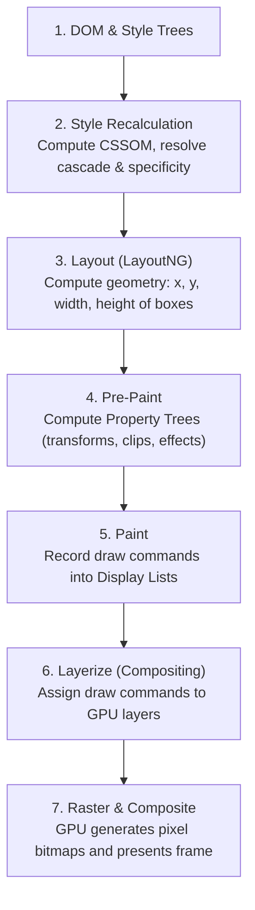
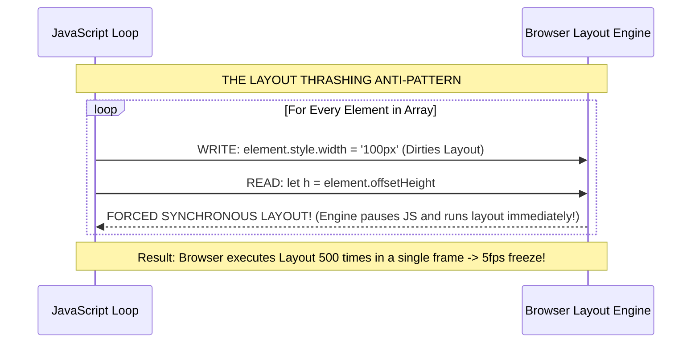

# Module 13 — Rendering Pipeline & Performance

CSS is often perceived as a purely declarative design language, but every style rule directly commands the browser's high-performance graphic rendering engine. Modern browser rendering engines (such as Chromium's RenderingNG, WebKit, and Gecko) are complex multi-process pipelines that transform HTML, CSS, and assets into hardware textures rasterized by the GPU. A single poorly designed CSS selector or interleaved JavaScript DOM read can force the browser into **Layout Thrashing**, while animating un-promoted layout properties can drag frame rates from 120fps down to single digits. Understanding the rendering lifecycle and its direct impact on Google's **Core Web Vitals** (CLS and INP) is a prerequisite for senior web engineering.

---

## 1. The Rendering Pipeline (Chromium RenderingNG)

When a web page renders or mutates, the browser executes seven distinct pipeline stages:



### 1. Style Recalculation
The browser matches CSS selectors against the DOM tree, resolves the cascade, and assigns computed values to every visible node. Complex selectors with deep universal combinators or wide `:has()` invalidation scopes increase style recalc time.

### 2. Layout (LayoutNG)
The engine generates the Box Tree and determines the exact geometric size and position of every element on screen. In Chromium, this is handled by **LayoutNG**, an immutable, single-pass layout engine. Changes to layout properties trigger **Reflow**.

### 3. Pre-Paint
Before painting, modern engines build **Property Trees** (transform, clip, effect, and scroll trees). Property trees decouple scrolling and matrix transforms from the DOM hierarchy, allowing the compositor to transform elements without re-traversing the box tree.

### 4. Paint
The engine does NOT generate pixel bitmaps at this stage; instead, it records a list of drawing instructions (called **Display Items**, such as "draw rect", "draw text run", "draw shadow") in physical painting order. Changes to visual properties trigger **Repaint**.

### 5. Layerize (Compositing)
The engine analyzes the paint display lists and groups elements into composited GPU layers. Elements with independent transforms, 3D contexts, or `will-change` are assigned to dedicated GPU surfaces.

### 6. Rasterization & GPU Compositing
Raster threads (utilizing CPU vector instructions or hardware GPU rasterizers like Skia/Ganesh/Graphite) convert display items into bitmap tiles stored in GPU VRAM. The GPU compositor draws these tiles to the screen at the monitor's native refresh rate (60Hz / 120Hz).

---

## 2. Invalidation Scopes: Layout vs. Paint vs. Composite

Every CSS property modification invalidates the pipeline at a specific stage:

| Invalidation Stage | Pipeline Cost | Triggering CSS Properties | Performance Impact |
| :--- | :---: | :--- | :--- |
| **Reflow / Layout** | **Severe (Highest Cost)** | `width`, `height`, `margin`, `padding`, `font-size`, `display`, `top`, `left`, `flex`, `grid` | Forces re-layout of the element and all surrounding/descendant elements. |
| **Repaint** | **Moderate Cost** | `color`, `background-color`, `border-color`, `box-shadow`, `visibility`, `outline` | Bypasses layout, but re-records draw instructions for the affected layer. |
| **Composite-Only** | **Minimal (Fastest / 120fps)** | `transform`, `opacity`, `filter`, `backdrop-filter` | Bypasses layout and paint entirely! Handled directly on GPU compositor thread. |

> [!TIP]
> Always animate `transform` and `opacity`. Never animate `top`, `left`, `width`, or `height`. Animating `transform: translateX(100px)` executes entirely on the GPU at 120fps without touching the CPU main thread.

---

## 3. Layout Thrashing (Forced Synchronous Layout)

In normal execution, the browser batches DOM mutations and executes style recalc and layout lazily at the end of the current microtask or animation frame. 

**Layout Thrashing** occurs when JavaScript interleaves DOM *writes* (changing CSS classes or styles) with DOM *reads* that query geometric layout properties:



### Sizing Properties that Trigger Forced Layout
Querying any of the following properties forces the browser to synchronously pause JavaScript execution and recalculate the layout:
- `offsetHeight`, `offsetWidth`, `offsetTop`, `offsetLeft`
- `scrollHeight`, `scrollWidth`, `scrollTop`, `scrollLeft`
- `clientHeight`, `clientWidth`
- `getBoundingClientRect()`
- `window.getComputedStyle()` (when querying layout properties)

### The FastDOM Fix: Batch Reads Before Writes
```javascript
// THE DEADLY ANTI-PATTERN: Interleaved Reads and Writes
elements.forEach((el) => {
  const width = el.offsetWidth; // READ
  el.style.width = width + 10 + 'px'; // WRITE (forces immediate layout on next iteration!)
});

// THE PRODUCTION FIX: Batch All Reads First, Then Batch Writes
const widths = elements.map((el) => el.offsetWidth); // BATCH READS (Single Layout Pass)

elements.forEach((el, i) => {
  el.style.width = widths[i] + 10 + 'px'; // BATCH WRITES (Deferred to next frame)
});
```

---

## 4. The `will-change` Hazard & Layer Explosion

The `will-change` property informs the browser ahead of time that a property is expected to animate (e.g. `will-change: transform`), prompting the compositor to promote the element to its own dedicated GPU layer.

> [!CAUTION]
> **The Layer Explosion Bug**: Every composited GPU layer consumes physical video RAM (VRAM) calculated as:
> $$\text{VRAM per Layer} = \text{width} \times \text{height} \times 4 \text{ bytes (RGBA)} \times \text{Device Pixel Ratio}^2$$
> A full-screen layer on a mobile device with DPR 3 consumes:
> $$390 \times 844 \times 4 \times 9 \approx 11.8 \text{ MB of VRAM}$$
> Applying `will-change: transform` indiscriminately across hundreds of cards or list items can consume hundreds of megabytes of GPU memory, triggering sudden out-of-memory (OOM) browser tab crashes on mobile devices! Apply `will-change` dynamically on pointer hover, and remove it when animation terminates.

---

## 5. CSS Architecture & Core Web Vitals (CLS & INP)

### Cumulative Layout Shift (CLS)
CLS measures unexpected visual shifts during the user experience. Top CSS-induced CLS root causes:
1. **Images and Videos without Dimensions**: When images lack `width` and `height` attributes (or CSS `aspect-ratio`), they render as 0px initially, pushing all surrounding content downward when downloaded.
2. **Web Font Swapping**: When a web font replaces a fallback font with mismatched metrics, text blocks re-wrap. Resolve with `font-display: optional` or font metric overrides (`size-adjust`).
3. **Dynamic Injected Content**: Cookie banners and late-injected ads. Always reserve placeholder space using CSS `min-block-size`.

### Interaction to Next Paint (INP)
INP measures page responsiveness to user input. Top CSS-induced INP root causes:
1. **Broad `:has()` Invalidation Scopes**: Using unconstrained parent selectors like `body:has(.active-modal)` causes the browser to re-evaluate the style of the entire DOM tree on every DOM mutation.
2. **Runtime CSS-in-JS Style Injections**: Libraries like Emotion and styled-components inserting `<style>` tags during user typing or clicks trigger massive synchronous style recalculations.

---

## 6. Eliminating Render-Blocking CSS

By default, external stylesheets (`<link rel="stylesheet">`) are **render-blocking**: the browser pauses all HTML rendering until the CSS file is completely downloaded and parsed, preventing Flash of Unstyled Content (FOUC).

### Critical CSS Inlining
To optimize First Contentful Paint (FCP), modern build pipelines extract **Critical CSS** (the minimum CSS required to render above-the-fold content) and inline it directly into `<head><style>...</style></head>`, while deferring remaining styles:

```html
<!-- Inlined Critical CSS for instant above-the-fold render -->
<style>
  body { margin: 0; font-family: system-ui; }
  .header { display: flex; height: 60px; }
  .hero { min-height: 80vh; background: #000; color: #fff; }
</style>

<!-- Non-blocking asynchronous loading of secondary stylesheet -->
<link
  rel="preload"
  href="/css/deferred-bundle.css"
  as="style"
  onload="this.onload=null;this.rel='stylesheet'"
>
<noscript><link rel="stylesheet" href="/css/deferred-bundle.css"></noscript>
```

---

## 7. Then vs. Now: CSS Performance

| Dimension | Legacy Web Era (2010–2020) | Modern CSS Platform (2024–2026+) |
| :--- | :--- | :--- |
| **Animation Execution** | Animating `top`, `left`, and `margin` with `setInterval` or jQuery | Hardware-accelerated `transform` and `opacity` on the GPU compositor |
| **GPU Promotion** | Obscure GPU hacks (`transform: translateZ(0)` or `backface-visibility: hidden`) | Explicit, disciplined `will-change: transform` applied just-in-time |
| **Layout Invalidation** | Global page reflows caused by small component mutations | CSS Containment (`contain: layout paint`) bounds invalidations locally |
| **Off-Screen DOM** | CPU-heavy JavaScript scroll virtualizers and windowing libraries | Native browser `content-visibility: auto` skipping off-screen layout |
| **Layout Shift Defense** | Hacky padding-bottom percentage wrappers on containers | Native `aspect-ratio` and font metric overrides (`size-adjust`) |

---

## 8. Interview Drill: Rendering Pipeline & Performance

### Q1: Walk through the primary stages of the browser rendering pipeline from HTML/CSS receipt to pixel display.
<details><summary>Answer</summary>

The browser executes seven sequential stages:
1. **DOM & CSSOM Generation**: HTML and CSS are tokenized and parsed into object trees.
2. **Style Recalculation**: Selectors are matched against DOM elements, resolving the cascade to produce computed styles.
3. **Layout**: The Box Tree is constructed; the geometry (exact size and coordinates) of every box is calculated.
4. **Pre-Paint**: Property Trees (transform, clip, scroll) are computed to isolate transformations from the DOM tree.
5. **Paint**: Drawing commands (Display Items) are recorded in painting order.
6. **Layerize (Compositing)**: Display lists are grouped into independent composited GPU layers.
7. **Raster & Composite**: GPU raster threads convert display items into bitmap tiles in VRAM, which the GPU draws to the display at the hardware refresh rate.
</details>

### Q2: What is "Layout Thrashing", and how does it degrade application performance?
<details><summary>Answer</summary>

Layout Thrashing (Forced Synchronous Layout) occurs when JavaScript alternates between modifying DOM styles (writes) and querying geometric layout properties (reads like `offsetHeight` or `getBoundingClientRect()`). Under normal conditions, the browser batches DOM mutations and delays layout until the end of the frame. When JavaScript reads a layout property after a style write, the browser cannot return the measurement without executing layout immediately. Alternating reads and writes inside a loop forces the engine to re-run full layout multiple times within a single frame, dropping frame rates to single digits.
</details>

### Q3: Why does animating `transform: translateX(100px)` achieve 120fps while animating `left: 100px` causes severe jank?
<details><summary>Answer</summary>

Modifying `left` alters the geometric position of an element in normal flow, invalidating the Layout stage of the pipeline. On every single frame, the engine must recalculate the geometry of the element, re-evaluate surrounding content (Reflow), and re-record draw instructions (Repaint) on the CPU main thread. In contrast, `transform` is a compositor-only property; it invalidates neither layout nor paint. The GPU compositor simply alters the transformation matrix of the existing GPU layer texture and composites it at hardware refresh rates without blocking the main thread.
</details>

### Q4: How can an engineer diagnose CSS selector performance issues using browser DevTools?
<details><summary>Answer</summary>

In Chromium DevTools, navigate to the **Performance** panel, open Record Settings, and enable **Enable CSS selector stats**. Record an interaction trace, expand the **Recalculate Style** flame chart slice, and inspect the **Selector Stats** tab. The panel displays the exact number of elements matched, fast-reject counts, and total CPU execution time spent per CSS selector rule, allowing engineers to identify slow, unconstrained selectors (such as broad `:has()` relational queries or deeply nested universal combinators).
</details>

### Q5: What is the "Layer Explosion" problem associated with the `will-change` property?
<details><summary>Answer</summary>

When an author sets `will-change: transform`, the browser promotes the element to a dedicated composited GPU layer. Each layer allocates a physical bitmap buffer in GPU video memory (VRAM), scaled by the screen's Device Pixel Ratio (DPR). If `will-change` is applied indiscriminately to hundreds of elements, the accumulated VRAM allocation can consume hundreds of megabytes of mobile memory, triggering browser stutter, GPU thrashing, and abrupt out-of-memory tab crashes.
</details>
