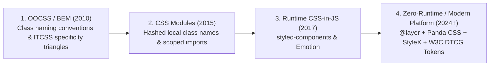
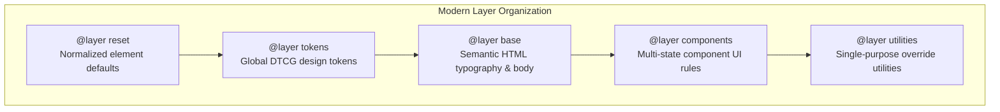
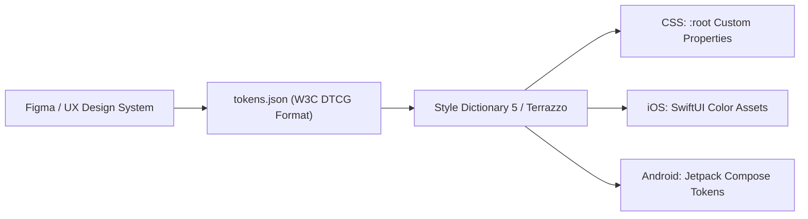

# Module 14 — CSS Architecture & Design Tokens at Scale

Scaling CSS across enterprise software organizations with hundreds of engineers and thousands of reusable components is one of the most challenging problems in frontend systems engineering. Without rigorous architectural discipline, global stylesheets inevitably succumb to dead code accumulation, specificity escalation wars, and unpredictable cascade leaks. Modern web architecture solves these problems by combining **W3C Design Tokens (DTCG 2025.10)**, zero-runtime static extraction pipelines (**Panda CSS, StyleX**), **Cascade Layers (`@layer`)**, and **Shadow DOM encapsulation**.

---

## 1. The Evolution of CSS Architecture

Over three decades, CSS methodologies progressed through four distinct paradigms to manage global scope and specificity:



### 1. Naming Conventions (BEM & ITCSS)
The Block Element Modifier (BEM) convention solved namespace collisions by encoding hierarchy into class strings (`.block__element--modifier`). Inverted Triangle CSS (ITCSS) organized stylesheets into strict specificity layers (Settings $\rightarrow$ Tools $\rightarrow$ Generic $\rightarrow$ Elements $\rightarrow$ Objects $\rightarrow$ Components $\rightarrow$ Utilities). While effective, compliance relied entirely on developer discipline.

### 2. Scoped CSS Modules
CSS Modules introduced build-time transformation to generate unique scoped class hashes (e.g. `.button_x7d9f`), ensuring components could not collide globally.

### 3. The Rise and Fall of Runtime CSS-in-JS
Runtime CSS-in-JS libraries (such as `styled-components` and `Emotion`) embedded CSS inside JavaScript template literals. While they provided colocation and prop-driven dynamic styling, they introduced severe production performance penalties:
- **Style Recalculation Storms**: Injecting `<style>` tags into the DOM during React/Vue rendering invalidates the browser's CSSOM, forcing synchronous style recalculations that degrade Google's **Interaction to Next Paint (INP)**.
- **SSR Hydration Mismatches**: Rehydrating dynamic styles on client load requires transmitting duplicated CSS strings in JavaScript bundles.
- **React Concurrency Conflicts**: Runtime style injection hooks (like `useInsertionEffect`) struggle under React 18+ concurrent rendering pipelines.

### 4. The Zero-Runtime & Atomic Paradigm
Modern architecture utilizes zero-runtime compilers—such as **Panda CSS** and **Meta's StyleX**:
- Styles are authored with full TypeScript type safety and component props.
- An ahead-of-time (AOT) compiler parses the AST at build time, extracts the styles, and emits a single, highly optimized, deduped **atomic CSS stylesheet**.
- Zero JavaScript bytes are dedicated to a CSS runtime, eliminating INP regressions and delivering pure native performance (see complete details in [Panda CSS Architecture](../../technologies/panda-css/README.md)).

---

## 2. Modern Architectural Architecture: `@layer` & Scoped Structure

Modern production design systems organize stylesheets into standard **Cascade Layers** declared at the application root:

```css
/* Application-wide layer priority hierarchy */
@layer reset, tokens, base, components, utilities;

@layer reset {
  *, *::before, *::after {
    box-sizing: border-box;
    margin: 0;
  }
}

@layer tokens {
  :root {
    --color-primary: oklch(0.65 0.25 140);
    --space-md: 1rem;
  }
}

@layer base {
  body {
    font-family: system-ui, sans-serif;
    color-scheme: light dark;
  }
}

@layer components {
  /* High specificity rules sit safely below utilities */
  .card.featured.active {
    border: 2px solid var(--color-primary);
  }
}

@layer utilities {
  /* Lowest specificity (0, 1, 0), but WINS over components due to layer order! */
  .u-hidden {
    display: none;
  }
}
```



---

## 3. The W3C Design Tokens Standard (DTCG 2025.10)

In October 2025, the W3C Design Tokens Community Group (DTCG) published the first stable specification for **Design Tokens Format Module 2025.10**. This establishes an open, vendor-neutral JSON standard for defining design tokens shared across Figma, web, iOS, and Android platforms.

### Anatomy of a `.tokens.json` File
A compliant design token file (`application/design-tokens+json`) defines tokens structured with standardized `$` prefixes:
- **`$value`**: The token's raw or aliased value.
- **`$type`**: The explicit data type (`color`, `dimension`, `duration`, `fontFamily`, `fontWeight`, `number`).
- **`$description`**: Human-readable documentation for design tooling.
- **`$extensions`**: Tool-specific metadata (e.g. Figma plugin bindings).

```json
{
  "color": {
    "brand": {
      "primary": {
        "$value": "oklch(0.65 0.25 140)",
        "$type": "color",
        "$description": "Primary interactive brand color"
      },
      "surface": {
        "$value": "{color.brand.primary}",
        "$type": "color",
        "$description": "Token alias referencing primary brand color"
      }
    }
  },
  "spacing": {
    "unit": {
      "$value": "4px",
      "$type": "dimension"
    },
    "card-padding": {
      "$value": "calc({spacing.unit} * 4)",
      "$type": "dimension"
    }
  }
}
```

### The Build Pipeline: Style Dictionary & Terrazzo
Tools like **Style Dictionary 5** or **Terrazzo CLI 2.10** parse DTCG JSON files, resolve token aliases (`{color.brand.primary}`), and compile them into CSS Custom Properties:

```css
/* Generated by Style Dictionary 5 from tokens.json */
:root {
  --color-brand-primary: oklch(0.65 0.25 140);
  --color-brand-surface: var(--color-brand-primary);
  --spacing-unit: 4px;
  --spacing-card-padding: calc(var(--spacing-unit) * 4);
}
```



---

## 4. Shadow DOM & Web Components Styling

Web Components encapsulate DOM and styles within an isolated **Shadow Root**. Styles defined in the light DOM document cannot penetrate the shadow boundary, and styles inside the shadow root cannot leak out.

### Penetrating the Shadow Boundary Accurately
Modern specifications provide explicit, intentional seams for styling Shadow DOM elements:
- **`:host`**: Selects the shadow host element from inside the shadow root.
- **`:host-context(<selector>)`**: Selects the host element only if an ancestor matches the selector (ideal for theming, e.g. `:host-context(.dark-mode)`).
- **`::part(<name>)`**: Exposes specific internal shadow elements to external author stylesheets via the `part="..."` attribute:

```html
<!-- Inside custom element Shadow DOM -->
<div class="dialog-wrapper">
  <button part="close-button" class="btn">Close</button>
</div>
```

```css
/* External author stylesheet styling exposed shadow part */
my-dialog::part(close-button) {
  background-color: oklch(0.55 0.25 25);
  border-radius: 9999px;
}
```

### Constructable Stylesheets
Instead of injecting duplicate `<style>` tags across thousands of custom element instances, modern engines use **Constructable Stylesheets**:

```javascript
// Share a single compiled CSS stylesheet across thousands of web components
const sheet = new CSSStyleSheet();
sheet.replaceSync(`
  :host { display: block; padding: 1rem; }
  h2 { color: var(--color-brand-primary); }
`);

class UserProfileCard extends HTMLElement {
  constructor() {
    super();
    this.attachShadow({ mode: 'open' });
    // All instances share the exact same stylesheet memory allocation!
    this.shadowRoot.adoptedStyleSheets = [sheet];
  }
}
customElements.define('user-profile-card', UserProfileCard);
```

---

## 5. Then vs. Now: CSS Architecture

| Dimension | Legacy Web Era (2010–2020) | Modern CSS Platform (2024–2026+) |
| :--- | :--- | :--- |
| **Component Specificity** | Complex BEM selector strings (`.c-card__title--active`) | Zero-runtime atomic CSS or native `@scope` encapsulated styles |
| **Cascade Management** | ITCSS specificity conventions enforced manually by code review | Native `@layer (reset, tokens, base, components, utilities)` |
| **Design Tokens** | Ad-hoc Sass maps (`$colors: (primary: #00f)`) hardcoded to one repo | W3C DTCG 2025.10 JSON shared cross-platform (Web, iOS, Android, Figma) |
| **CSS-in-JS** | Runtime injection (Emotion, styled-components) causing INP jank | Zero-runtime static compilation (Panda CSS, StyleX) |
| **Component Encapsulation** | Iframe isolation or manual class prefixes | Native Shadow DOM with `::part()` and `adoptedStyleSheets` |

---

## 6. Interview Drill: Architecture & Design Tokens

### Q1: Why have major frontend platforms transitioned away from runtime CSS-in-JS libraries (such as styled-components and Emotion) toward zero-runtime compilers like Panda CSS and StyleX?
<details><summary>Answer</summary>

Runtime CSS-in-JS libraries evaluate style declarations in JavaScript during the component rendering cycle and inject `<style>` tags directly into the DOM document head. In modern web applications, this induces three critical bottlenecks:
1. **INP and CPU Latency**: Injecting styles during user interactions (e.g. typing or clicking) invalidates the CSSOM and forces synchronous style recalculations on the main thread, causing severe Interaction to Next Paint (INP) regressions.
2. **Bundle Size**: Applications must ship both the CSS-in-JS compiler runtime and raw CSS template literal strings within the JavaScript payload.
3. **React Concurrency Conflicts**: Dynamic style insertion during streaming server-side rendering (SSR) or concurrent mode triggers hydration mismatches. Zero-runtime engines like Panda CSS and StyleX resolve this by parsing styles at build time, extracting deduplicated atomic CSS, and outputting standard static stylesheets with zero runtime JS overhead.
</details>

### Q2: How does the W3C Design Tokens Community Group (DTCG 2025.10) specification standardize token aliases?
<details><summary>Answer</summary>

Under the DTCG 2025.10 standard, token aliases are enclosed in curly braces containing dot-separated key paths to the referenced token (e.g. `"$value": "{color.brand.primary}"`). During compilation by tools like Style Dictionary or Terrazzo, the resolver module walks the token dependency graph, substitutes the referenced value or emits a chained CSS custom property (`var(--color-brand-primary)`), ensuring that changing the base brand token propagates universally across all semantic aliases.
</details>

### Q3: What is the architectural difference between styling a Web Component using CSS Custom Properties versus the `::part()` pseudo-element?
<details><summary>Answer</summary>

CSS Custom Properties penetrate the Shadow DOM boundary automatically via normal CSS inheritance; they allow external pages to customize predetermined design token values (such as `--button-bg` or `--button-radius`) without exposing internal DOM structure. In contrast, `::part(<name>)` explicitly exposes a specific internal shadow DOM element for full CSS styling (allowing external stylesheets to apply arbitrary properties like `border`, `transform`, or `padding`), while still preserving encapsulation for all other unexposed shadow elements.
</details>

### Q4: Why are Constructable Stylesheets (`adoptedStyleSheets`) superior to inlining `<style>` elements inside Shadow DOM web components?
<details><summary>Answer</summary>

When `<style>` elements are embedded inside every shadow root, the browser must allocate memory and parse the CSS text independently for every single instance of the custom element (e.g. 5,000 table rows = 5,000 parsed stylesheets). Constructable Stylesheets allow an author to create a single `CSSStyleSheet` instance in memory via `sheet.replaceSync(...)` and assign it to `shadowRoot.adoptedStyleSheets` across all 5,000 instances. The browser parses the CSS once and shares the underlying parsed rule tree across all instances, saving significant memory and accelerating component instantiation.
</details>

### Q5: In an enterprise `@layer` architecture declared as `@layer reset, tokens, base, components, utilities;`, why can a utility class with specificity `(0, 1, 0)` override a complex component selector with specificity `(1, 2, 3)` without using `!important`?
<details><summary>Answer</summary>

According to the formal CSS cascade specification, Cascade Layers are evaluated at Step 4 of the precedence hierarchy, before Selector Specificity at Step 5. Within the `@layer` declaration list, later layers take precedence over earlier layers for normal declarations. Because the `utilities` layer was defined after the `components` layer, any declaration inside `utilities` wins over declarations in `components`. The cascade resolves the conflict at the layer stage and never evaluates selector specificity.
</details>
