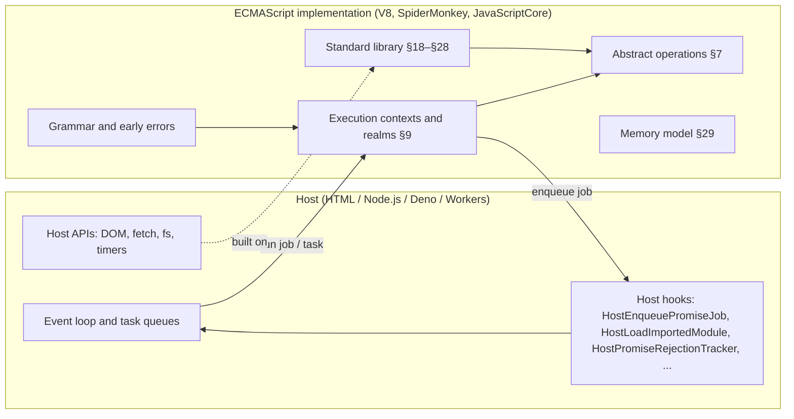

# 01 · The Specification as a Tool

> **Spec anchors:** ECMA-262 17th edition (ECMAScript 2026), §5 *Notational Conventions*, §6.2.4 *The Completion Record Specification Type*, §6.2.5 *The Reference Record Specification Type*, §16 *ECMAScript Language: Scripts and Modules*, Annex B *Additional ECMAScript Features for Web Browsers*. TC39 process document. test262.
>
> **Executable proof:** [`examples/01-reading-the-spec.test.js`](../examples/01-reading-the-spec.test.js)

Every later module in this track answers "why does JavaScript do *that*?" by pointing at a numbered section of ECMA-262. This module teaches you to read that document fluently, to know which edition you are reading, to tell a standard feature from a proposal, and to check what an engine ships today. Engines, MDN pages and blog posts are all *derived* from the specification. When they disagree, the specification and its conformance suite (test262) settle the question.

---

## 1. What ECMA-262 is, and which one you are reading

**Definition (ECMAScript).** ECMAScript is the general-purpose programming language defined by the Ecma International standard ECMA-262. "JavaScript" is the common name of ECMAScript as embedded in a *host* (a browser, Node.js, Deno, Bun, Cloudflare Workers) together with that host's APIs.

There are two documents with the same text lineage:

| Document | URL | Status | Use it when |
|---|---|---|---|
| **ECMA-262, 17th edition (ES2026)** | <https://262.ecma-international.org/17.0/> | Approved by the Ecma General Assembly in June 2026; frozen | You need a stable, citable reference. This track cites it. |
| **The living draft** | <https://tc39.es/ecma262/> | Continuously updated; becomes ES2027 in mid-2027 | You need features that reached Stage 4 after the ES2026 cut-off (Temporal, `using`, `Atomics.pause`, `Iterator.zip`) |

Editions are published yearly since ES2015 (6th edition). The edition number and the year differ by 2009: *edition = year − 2009*, so ES2026 is the 17th edition. The cut-off for a yearly edition is roughly the TC39 meeting in the first quarter of that year; anything reaching Stage 4 later waits for the next one. This is why **Temporal**, although shipped in V8 and SpiderMonkey and promoted to Stage 4 during 2026, is *ES2027* and does not appear in the 17th edition.

Companion standards you will meet:

- **ECMA-402**: the Internationalization API (`Intl.*`), plus the locale-sensitive overrides such as `toLocaleString`.
- **ECMA-404**: the JSON data interchange syntax. `JSON.parse` in ECMA-262 §25.5.2 parses a superset-compatible grammar defined against ECMA-404.
- **The HTML Living Standard** (WHATWG): defines the browser host, including the event loop that drives JavaScript jobs ([module 06](06-agents-realms-job-queue.md)).

### Then vs now: editions

| Then | Now |
|---|---|
| ES3 (1999), ES5 (2009), ES5.1 (2011): multi-year "big bang" editions; ES4 abandoned in 2008 | Yearly editions since ES2015 (6th edition), each containing whatever reached Stage 4 by the cut-off |
| "ES6", "ES7" naming | Year naming (ES2015, ES2016, ...). "ES6" survives colloquially for ES2015 only |
| Engine flags called `--harmony-*` | V8 now uses `--js-*` flags (`--js-sum-precise`, `--js-decorators`); `--harmony-*` remains for a few older features |

Migration advice: when a colleague says "ES6+", ask which specific feature they mean and look up its edition. Build tools target editions (`target: "es2022"`), but engines ship features individually, so feature-detect at runtime when it matters.

---

## 2. The map of the document

You do not read ECMA-262 front to back. You navigate it. These clause numbers are stable across recent editions except where a new section was inserted; the numbers below are for the 17th edition.

| Clause | Content | You go here for |
|---|---|---|
| §5 | Notational conventions: grammar notation, algorithm conventions, `?` and `!` | Decoding the notation |
| §6.1 | **ECMAScript language types**: Undefined, Null, Boolean, String, Symbol, Number, BigInt, Object | "What values exist?" ([module 02](02-types-values-coercion.md)) |
| §6.2 | **Specification types**: List, Record, Completion Record (§6.2.4), Reference Record (§6.2.5), Property Descriptor (§6.2.6), ... | Machinery the algorithms use; never visible as values |
| §7 | **Abstract operations**: type conversion (§7.1), testing and comparison (§7.2), operations on objects (§7.3), on iterators (§7.4) | `ToPrimitive`, `IsLooselyEqual`, `SameValue`, `Call`, `GetIterator` |
| §8 | Syntax-directed operations: BoundNames, Contains, NamedEvaluation, ... | Static facts about syntax |
| §9 | **Executable code and execution contexts**: Environment Records (§9.1), Realms (§9.3), Execution Contexts (§9.4), Jobs (§9.5), Agents (§9.6), Agent Clusters (§9.7) | Scope, `this`, job queues ([modules 03](03-execution-contexts-scope-closures.md), [06](06-agents-realms-job-queue.md)) |
| §10 | **Ordinary and exotic object behaviours**: the internal methods `[[Get]]`, `[[Set]]`, `[[DefineOwnProperty]]`; Array, arguments, TypedArray, module namespace and Proxy exotic objects | [Module 04](04-objects-prototypes-classes.md), [module 09](09-metaprogramming.md) |
| §11–§16 | Source text, lexical grammar, expressions, statements, functions and classes, scripts and modules | What syntax means |
| §17 | Error handling and language extensions | What implementations may add |
| §18–§28 | The standard library (fundamental objects, numbers and dates, text processing, collections, structured data, control abstraction, reflection) | Built-ins |
| §29 | **Memory model** | Shared memory and `Atomics` ([module 11](11-binary-data-memory-model.md)) |
| Annex A | Grammar summary | |
| **Annex B** | Additional features for web browsers: `__proto__`, HTML-like comments, legacy RegExp syntax, `escape`, `[[IsHTMLDDA]]` | Legacy weirdness that browsers must keep |
| Annex C | The strict mode of ECMAScript (informative summary) | |



The diagram shows the most important architectural fact in the specification: **ECMA-262 does not define an event loop, timers, I/O, or modules loading from disk.** It defines *host hooks*: points where the host decides. "When does a promise reaction run?" is answered jointly by ECMA-262 §9.5 (HostEnqueuePromiseJob) and by the host (the HTML microtask queue, or Node's microtask queue drained by libuv-driven ticks).

---

## 3. The notation

### 3.1 Grammar

ECMA-262 uses context-free grammars with **parameters** written as subscripts in the spec and in brackets in plain text: `FunctionBody[Yield, Await]`. A production with `[+Await]` is parsed with `await` as a keyword; with `[~Await]` it is an identifier. This is how the same source text parses differently inside and outside `async function`:

```js
function f() { var await = 1; return await; } // legal in a sloppy script: `await` is an identifier
async function g() { var await = 1; }        // SyntaxError: `await` is reserved in an async body
```

There are several **goal symbols**: `Script` and `Module` (§16). The same text may be valid as one and invalid as the other. A module is always strict, may use top-level `await`, and rejects HTML-like comments:

```js
// Valid in a classic script (Annex B.1.1), SyntaxError in a module:
x = 1 <!-- this is a comment in scripts, a syntax error in modules
```

**Early errors** (static semantics) are errors that must be reported before *any* code in the script or module runs. `let a; let a;` is an early error: the whole script fails to load, and nothing executes, not even the statements before the duplicate declaration.

### 3.2 Algorithm steps, `?` and `!`

Algorithms are numbered steps. Two prefix operators carry most of the error-handling semantics:

| Notation | Meaning | Long form |
|---|---|---|
| `? Op(x)` | Call `Op`; if the result is an abrupt completion (an exception, for instance), return it immediately; otherwise unwrap the value | `ReturnIfAbrupt(Op(x))` |
| `! Op(x)` | Call `Op`; **assert** it cannot be abrupt; unwrap the value | Editorial assertion; if it fails, the spec has a bug |

When you read `1. Let prim be ? ToPrimitive(input, number).`, the `?` tells you: *user code can run here and can throw*. Every `?` is a potential observable side effect. Interview-level consequence: `ToPrimitive` calls `obj[Symbol.toPrimitive]`, `valueOf` or `toString`, which are user code, so `a + b` can throw, log, or mutate state.

### 3.3 Completion Records (§6.2.4)

**Definition.** A *Completion Record* is a specification value with fields `[[Type]]` ∈ {normal, break, continue, return, throw}, `[[Value]]` (any language value, or *empty*), and `[[Target]]` (a label or *empty*). A completion whose type is not *normal* is an **abrupt completion**.

Every statement evaluates to a Completion Record. This explains control-flow puzzles precisely. The `try` statement (§14.15.3) evaluates the `finally` block and, **if the `finally` block's completion is abrupt, it replaces the completion of `try`/`catch`**:

```js
function f() {
  try { return 'try'; }
  finally { return 'finally'; }   // abrupt (return) completion overrides the pending return
}
f(); // 'finally'

function g() {
  for (;;) {
    try { throw new Error('lost'); }
    finally { break; }             // abrupt (break) overrides the pending throw: the error vanishes
  }
  return 'swallowed';
}
g(); // 'swallowed'
```

This is a production failure mode, not a curiosity: a `return` or `break` inside `finally` silently swallows exceptions. Linters flag it (`no-unsafe-finally`).

The completion *value* of statements is also observable through `eval`:

```js
eval('1; if (true) {}');   // undefined since ES2015 (UpdateEmpty rules); was 1 in ES5
eval('do { 2 } while (false)'); // 2
```

### 3.4 Reference Records (§6.2.5)

A **Reference Record** is how the spec represents "the thing on the left of `=`" and unresolved identifiers. `GetValue` (§6.2.5.5) reads through a Reference, and `PutValue` (§6.2.5.6) writes through it. An *unresolvable* reference (identifier not found in any environment) throws a `ReferenceError` from `GetValue`. The `typeof` operator (§13.5.3) checks for unresolvable references **before** calling `GetValue` and returns `"undefined"`:

```js
typeof notDeclaredAnywhere;   // 'undefined' (no ReferenceError)
typeof x; let x = 1;          // ReferenceError: x is in its temporal dead zone (TDZ)
```

The second line throws because `x` *is* resolvable: the binding exists in the Environment Record but is uninitialized ([module 03](03-execution-contexts-scope-closures.md)).

### 3.5 Internal slots and internal methods

Double brackets denote things that exist only in the specification:

- **Internal methods** (`[[Get]]`, `[[Set]]`, `[[Call]]`, `[[Construct]]`, `[[GetPrototypeOf]]`, ...) define object behaviour. An *ordinary object* uses the default algorithms of §10.1; an *exotic object* overrides at least one. Proxies (§10.5) let user code supply them.
- **Internal slots** (`[[Prototype]]`, `[[Extensible]]`, `[[PromiseState]]`, `[[ArrayBufferData]]`) hold state. They are not properties: `Object.getOwnPropertyNames(promise)` never shows `[[PromiseState]]`.

Brand checks rely on slots. `Map.prototype.get.call({}, 1)` throws a `TypeError` because the receiver has no `[[MapData]]` slot. This is also why `Error.isError` (ES2026, §20.5.2.1) can be reliable across realms: it checks for the `[[ErrorData]]` slot instead of the prototype chain.

### 3.6 "Host-defined", "implementation-defined", "implementation-approximated"

| Term | Meaning | Example |
|---|---|---|
| implementation-defined | The engine chooses and must document | Maximum length of a String (V8: about 2²⁹ − 24 code units on 64-bit) |
| implementation-approximated | The engine approximates an ideal result | `Math.sin` precision |
| host-defined | The host (HTML, Node) chooses | When jobs run; how modules are fetched; `HostPromiseRejectionTracker` behaviour |
| unspecified / implementation-defined *order* | Code must not depend on it | `Array.prototype.sort` with an inconsistent comparator ([module 13](13-correctness-security-pitfalls.md)) |

### 3.7 Abstract operations vs syntax-directed operations

- **Abstract operations** are named functions in prose (`ToNumber(argument)`, `Call(F, V, argumentsList)`).
- **Syntax-directed operations** are defined per grammar production (`Evaluation of AdditiveExpression : AdditiveExpression + MultiplicativeExpression`). Runtime semantics is the `Evaluation` operation; static semantics are things like `BoundNames`, `IsStrict`, `Early Errors`.

Reading recipe for any expression: find the production in the clause about that syntax (for `+`, §13.8.1), read its `Evaluation`, then follow each abstract operation it calls.

### 3.8 Order of evaluation is specified

Unlike C, ECMAScript specifies left-to-right evaluation of operands and arguments. In `a()[b()] = c()`, the calls happen in the order `a`, `b`, `c`. In `f(x++, x)`, the second argument sees the incremented value. Code may rely on this; it is tested in the example file.

---

## 4. Worked reading: what does `[] + {}` produce?

1. §13.8.1 *The Addition Operator*: `Evaluation` calls `EvaluateStringOrNumericBinaryExpression(AdditiveExpression, +, MultiplicativeExpression)`.
2. That evaluates both operands left to right, calls `GetValue` on each, then `? ApplyStringOrNumericBinaryOperator(lval, +, rval)` (§13.15.3).
3. For `+`, step 1 calls `? ToPrimitive(lval)` and `? ToPrimitive(rval)` **with no hint** (the "default" hint).
4. `ToPrimitive([])` (§7.1.1): `[]` has no `@@toPrimitive`, so `OrdinaryToPrimitive([], number)` (default is treated as number for ordinary objects) calls `valueOf` (returns the array itself, not primitive), then `toString`, giving `""`.
5. `ToPrimitive({})` gives `"[object Object]"` the same way.
6. If either primitive is a String, concatenate: `"" + "[object Object]"`.

Result: `"[object Object]"`. At a statement start, `{} + []` parses `{}` as an empty *block*, so the expression is `+[]`, which is `0`. The difference is grammar (statement vs expression position), not coercion. [Module 02](02-types-values-coercion.md) treats every conversion rigorously.

---

## 5. The TC39 process

```mermaid
stateDiagram-v2
  direction LR
  [*] --> S0: idea
  S0: Stage 0 · strawperson
  S1: Stage 1 · under consideration
  S2: Stage 2 · draft
  S27: Stage 2.7 · approved in principle, under validation
  S3: Stage 3 · recommended for implementation
  S4: Stage 4 · ready for standard
  S0 --> S1: champion, problem statement, repo
  S1 --> S2: initial spec text, all major semantics
  S2 --> S27: complete spec text, reviewer and editor sign-off
  S27 --> S3: test262 tests merged, prototypes if needed
  S3 --> S4: two compatible shipping implementations pass test262, ecma262 PR, editor sign-off
  S4 --> [*]: next yearly edition
  S3 --> S27: demotion by consensus
  S27 --> S2: demotion by consensus
```

TC39 (Ecma Technical Committee 39) evolves ECMAScript through staged proposals. The authoritative description is the process document, <https://tc39.es/process-document/>.



| Stage | Meaning | What you may do in production |
|---|---|---|
| 0–1 | Problem exploration | Nothing. The design will change. |
| 2 | Design chosen, details open | Experiment behind transpilers only; expect breaking changes |
| **2.7** | Spec text complete; validation through test262 and prototypes. Introduced in February 2024 to separate "design approved" from "tests exist" | Transpile with care; syntax may still change |
| 3 | Implementations ship, often behind flags first | Ship if the engines you target ship it unflagged |
| 4 | Two compatible shipping implementations; merged into the draft | Standard; safe to rely on where shipped |

**Demotion happens.** At the May 2026 TC39 meeting, *Decorators* and *Decorator Metadata* were moved from Stage 3 back to Stage 2.7 (agenda item "Decorators for Stage 2.7"; the tc39/proposals README now lists both under 2.7). No engine ships decorators unflagged as of 2026-10-28; V8 14.6 has only an incomplete `--js-decorators` flag. [Module 09](09-metaprogramming.md) teaches their runtime semantics with this caveat.

### Proposal snapshot (verified against tc39/proposals on 2026-10-28)

| Bucket | Proposals |
|---|---|
| **In ES2026 (17th edition)** | Upsert (`Map`/`WeakMap` `getOrInsert`, `getOrInsertComputed`), JSON.parse source text access (`JSON.rawJSON`, reviver `context.source`), Iterator Sequencing (`Iterator.concat`), `Uint8Array` to/from Base64 and hex, `Math.sumPrecise`, `Error.isError`, `Array.fromAsync` |
| **Stage 4, slated for ES2027** | Temporal, Explicit Resource Management (`using`, `await using`, `DisposableStack`), `Atomics.pause`, Joint Iteration (`Iterator.zip`), Iterator chunking, Iterator includes, Iterator join |
| **Stage 3** | Legacy RegExp features, Source Phase Imports, Dynamic Code Brand Checks, Deferring Module Evaluation (`import defer`), Non-extensible Applies to Private, Import Text, Error Stack Accessor, RegExp Buffer Boundaries (`\A`, `\z`, `\Z`), Await Dictionary, Curtailing the power of "Thenables" |
| **Stage 2.7** | Decorators, Decorator Metadata, ShadowRealm, ESM Phase Imports, Immutable ArrayBuffers, Import Bytes, JSON.parse options, `export * as ns` / "export all from", Deferred Re-exports |
| **Stage 2 (selected)** | AsyncContext |
| **Stage 1 (selected)** | Signals |

> **Correction to the research dossier:** iterator chunking, includes and join were listed as Stage 3 in the dossier; they reached Stage 4 (ES2027) in 2026.

---

## 6. Editions vs engines: feature-detect, do not assume

A feature's stage says nothing about whether *your* runtime has it. Verified locally on **Node.js 26.12.1 (V8 14.6.202)** and pinned in [`examples/01-reading-the-spec.test.js`](../examples/01-reading-the-spec.test.js):

| Feature | Spec status | Node 26.12.1 / V8 14.6 |
|---|---|---|
| `Map.prototype.getOrInsert`, `getOrInsertComputed` | ES2026 | shipped |
| `JSON.rawJSON`, reviver `context.source` | ES2026 | shipped |
| `Iterator.concat` | ES2026 | shipped |
| `Uint8Array.fromBase64`, `toHex` | ES2026 | shipped |
| `Error.isError`, `Array.fromAsync` | ES2026 | shipped |
| **`Math.sumPrecise`** | **ES2026** | **not shipped; behind `--js-sum-precise`** |
| Temporal | ES2027 (Stage 4) | shipped (on by default) |
| `using`, `await using`, `DisposableStack`, `SuppressedError` | ES2027 (Stage 4) | shipped |
| `Atomics.pause` | ES2027 (Stage 4) | shipped |
| `Iterator.zip`, `Iterator.prototype.chunks` | ES2027 (Stage 4) | **not shipped** |
| `import defer` | Stage 3 | behind `--js-defer-import-eval` |
| Decorators | Stage 2.7 | `--js-decorators` parses `accessor` but not `@decorator` syntax |
| ShadowRealm | Stage 2.7 | behind `--harmony-shadow-realm` |
| AsyncContext | Stage 2 | absent (Node has `AsyncLocalStorage`; see the Node.js track) |

The lesson generalises: an ES2026 feature (`Math.sumPrecise`) can be missing from a runtime that ships ES2027 features (Temporal). Write feature detection against the *function*, not against the edition:

```js
const sum = typeof Math.sumPrecise === 'function'
  ? (xs) => Math.sumPrecise(xs)
  : (xs) => kahanSum(xs); // fallback, see module 02
```

---

## 7. test262: the executable specification

**test262** (<https://github.com/tc39/test262>) is the official conformance suite: tens of thousands of small files, each asserting one behaviour. Every Stage 4 feature must have test262 coverage, and engines publish pass rates (<https://test262.fyi>).

Anatomy of a test file:

```js
// Copyright (C) 2025 ... All rights reserved.
/*---
esid: sec-error.iserror
description: Error.isError returns true for cross-realm errors
features: [Error.isError, cross-realm]
flags: [noStrict]        # also: onlyStrict, module, async, raw, CanBlockIsFalse
negative:                # for tests that must fail
  phase: parse           # parse | resolution | runtime
  type: SyntaxError
---*/
var other = $262.createRealm().global;
assert.sameValue(Error.isError(new other.Error()), true);
```

- `esid` links to the spec section anchor (`sec-error.iserror`), so you can go from spec to tests and back.
- `$262` is the host-provided harness object (`createRealm`, `detachArrayBuffer`, `agent` for shared memory tests).
- `negative.phase: parse` encodes **early errors**; `resolution` encodes module linking errors; `runtime` encodes thrown exceptions.

Use test262 when the spec prose is ambiguous to you: search the repository for the `esid` of the section you are reading and read the tests. They are minimal, deterministic examples written by the people who wrote the spec.

> Cross-engine runners (`esvu` to install engine binaries, `eshost-cli` to run one snippet in several engines) exist; their maintenance status was not verified for this track, so the examples here run on the pinned Node only.

---

## 8. How to answer "why does X behave like this?"

1. **Reproduce** in the smallest possible snippet, in the module *and* script goals if relevant (`node --input-type=module -e` vs `node -e`).
2. **Classify** the behaviour: syntax (grammar, early error), operator semantics (§13), built-in (§18–§28), host (HTML, Node), or engine (performance, error messages, stack traces are all implementation-defined).
3. **Find the section.** Search the multi-page spec for the operator or built-in name. Follow every `?` and abstract operation.
4. **Confirm with test262** (search by `esid`).
5. **Check engine status**: MDN browser-compat data, the engine's feature flags (`node --v8-options | grep js-`), and the proposal's README for the stage.
6. **Write a test** asserting the behaviour you rely on, so a runtime upgrade that changes it fails loudly. This track does exactly that in `examples/`.

---

## 9. Strict mode and Annex B, briefly

Strict mode (§11.2.2, informative summary in Annex C) is a *different language dialect* selected per function or script:

- Modules and class bodies are always strict.
- `"use strict"` must be the first statement of a script or function body (a *directive prologue*).
- Strict mode turns silent failures into exceptions (assigning to a non-writable property throws `TypeError`), removes `with`, makes `this` not coerced to an object in plain calls (`undefined` instead of the global object), makes `arguments` unmapped, and forbids duplicate parameter names and octal literals.

Annex B describes what browsers must support for compatibility: `Object.prototype.__proto__`, the `__proto__: value` object literal syntax, HTML-like comments in scripts, `escape`/`unescape`, `RegExp.prototype.compile`, block-level function declarations in sloppy mode with their peculiar hoisting, and `document.all`'s `[[IsHTMLDDA]]` slot (an object for which `typeof` is `"undefined"`). Node implements Annex B as well. Avoid writing new code that depends on it.

---

## 10. Production failure modes from misreading the spec

| Failure | Root cause in the spec | Defence |
|---|---|---|
| Exceptions disappear in a cleanup helper | `return`/`break` in `finally` produces an abrupt completion that replaces the throw (§14.15.3) | Never transfer control out of `finally`; lint rule `no-unsafe-finally` |
| A whole bundle fails to load because one file has a duplicate `let` | Early errors abort evaluation of the entire Script or Module | Lint and parse in CI; split vendor code |
| A feature works in Chrome but `TypeError: ... is not a function` in production Node | Shipping status differs per engine and per flag | Feature-detect; pin the runtime with mise; test on the pinned version |
| Code copied from a blog uses Stage 2/3 syntax | Proposals can change or be demoted (decorators, May 2026) | Check the stage before adopting; isolate transpiled-only syntax |
| HTML comment in inline script turns into a syntax error after moving to `type="module"` | Annex B.1.1 HTML-like comments are only for the Script goal | Do not use `<!--` in JS |

---

## Interview Drill

<details><summary>1. What is the difference between ES2026 and "the spec at tc39.es"?</summary>

ES2026 is ECMA-262 17th edition, a frozen yearly snapshot approved by the Ecma General Assembly in June 2026. tc39.es/ecma262 is the living draft that already contains features which reached Stage 4 after the 2026 cut-off (Temporal, explicit resource management, `Atomics.pause`, `Iterator.zip`) and will become ES2027. Engines ship features individually, so neither document tells you what a given runtime supports.
</details>

<details><summary>2. What do `?` and `!` mean in spec algorithms?</summary>

`? Op()` means "call Op; if it returns an abrupt completion, propagate it immediately" (ReturnIfAbrupt). It marks places where user code may run and throw. `! Op()` asserts the operation cannot complete abruptly; it is an editorial guarantee, not a runtime check.
</details>

<details><summary>3. Why does `function f(){ try { throw 1 } finally { return 2 } }` return 2 and lose the exception?</summary>

Statements produce Completion Records. The `try` statement evaluates `finally`; if the `finally` block's completion is abrupt (here a return completion), it replaces the pending throw completion. The exception is discarded. The same happens with `break` and `continue` that leave `finally`.
</details>

<details><summary>4. Why is `typeof undeclared` safe but `typeof x` before `let x` throws?</summary>

`typeof` checks whether its operand is an *unresolvable* Reference Record and returns "undefined" without calling GetValue. A `let` binding hoisted into the scope is resolvable but uninitialized (TDZ), so GetValue is called and throws a ReferenceError.
</details>

<details><summary>5. Describe the TC39 stages, including 2.7. When is it safe to use a proposal in production?</summary>

0 strawperson, 1 problem and solution space accepted, 2 draft design with initial spec text, 2.7 complete spec text approved in principle while test262 tests are written, 3 recommended for implementation, 4 two compatible shipping implementations pass test262 and the PR is merged. In production, rely on what your target runtimes ship unflagged; Stage 3 features can still change (and proposals can be demoted, as decorators were in May 2026).
</details>

<details><summary>6. What is a host hook? Give three examples.</summary>

A point where ECMA-262 delegates behaviour to the embedding environment. Examples: HostEnqueuePromiseJob (when promise jobs run), HostLoadImportedModule (how module specifiers are fetched and resolved), HostPromiseRejectionTracker (how unhandled rejections are reported), HostGetImportMetaProperties (`import.meta` contents).
</details>

<details><summary>7. How do you verify a claim like "Node 26 supports Math.sumPrecise"?</summary>

Feature-detect in the pinned runtime (`typeof Math.sumPrecise`), check `node --v8-options` for a `--js-sum-precise` flag, check MDN browser-compat data, and keep a test that asserts the result. On Node 26.12.1 it is behind a flag even though it is an ES2026 feature.
</details>

<details><summary>8. What is test262 and how do you use it as a developer?</summary>

The official ECMAScript conformance suite. Each file has YAML front matter with an `esid` linking to the spec section, the `features` it needs, flags such as `onlyStrict` or `module`, and for negative tests the phase (parse, resolution, runtime) and error type. Searching it by `esid` gives minimal authoritative examples for ambiguous prose, and engine pass rates indicate support.
</details>

<details><summary>9. Why is `{} + []` 0 at the console but `[] + {}` is "[object Object]"?</summary>

At the start of a statement, `{}` parses as an empty block, so the statement is the unary expression `+[]`, which is ToNumber("") = 0. In `[] + {}` both are expressions; ToPrimitive turns them into "" and "[object Object]", and the String branch of `+` concatenates them.
</details>
