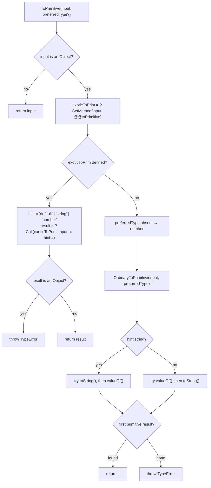
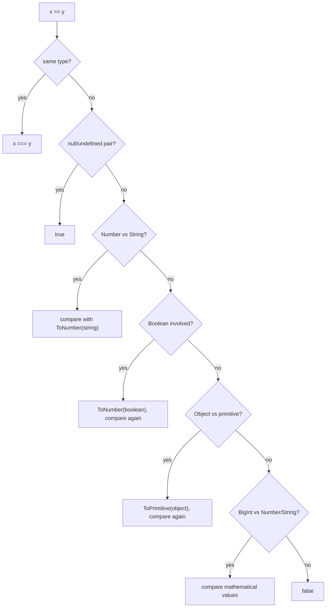

# 02 · Types, Values and Coercion

> **Spec anchors (ECMA-262 17th edition):** §6.1 *ECMAScript Language Types* (§6.1.1–§6.1.7), §6.1.5.1 *Well-Known Symbols*, §6.1.6.1 *The Number Type*, §6.1.6.2 *The BigInt Type*, §7.1 *Type Conversion* (§7.1.1 ToPrimitive, §7.1.1.1 OrdinaryToPrimitive, §7.1.2 ToBoolean, §7.1.3 ToNumeric, §7.1.4 ToNumber, §7.1.5 ToIntegerOrInfinity, §7.1.6 ToInt32, §7.1.13 ToBigInt, §7.1.17 ToString, §7.1.18 ToObject, §7.1.19 ToPropertyKey), §7.2 *Testing and Comparison Operations* (§7.2.9 SameValue, §7.2.10 SameValueZero, §7.2.12 IsLessThan, §7.2.13 IsLooselyEqual, §7.2.14 IsStrictlyEqual), §13.5.3 `typeof`, §13.8.1 addition, §21.3.2.34 `Math.sumPrecise`.
>
> **Executable proof:** [`examples/02-types-values-coercion.test.js`](../examples/02-types-values-coercion.test.js) (includes fast-check property tests)

Coercion is where JavaScript has the worst reputation and the most precise specification. Every conversion is an abstract operation with a short algorithm. Once you know about ten of them, "JavaScript is weird" becomes "the algorithm says so", and you can predict any expression.

---

## 1. The eight language types

**Definition (§6.1).** An *ECMAScript language value* is a value whose type is one of: **Undefined, Null, Boolean, String, Symbol, Number, BigInt, Object**. The first seven are *primitive* types; their values are immutable and have no identity beyond their content. An Object is a collection of properties with identity.

| Type | Values | `typeof` | Notes |
|---|---|---|---|
| Undefined | `undefined` | `"undefined"` | Default for missing things. `undefined` is a non-writable property of the global object, not a keyword |
| Null | `null` | **`"object"`** | Historic bug from the first implementation (type tag 0 shared with objects); kept for web compatibility |
| Boolean | `true`, `false` | `"boolean"` | |
| String | finite sequences of 16-bit unsigned integers (UTF-16 code units), length ≤ 2⁵³ − 1 | `"string"` | Engines impose lower limits (V8: 2²⁹ − 24) |
| Symbol | unique, non-String property keys | `"symbol"` | Optional `[[Description]]` |
| Number | IEEE 754-2019 binary64 values, including ±0, ±∞ and NaN | `"number"` | |
| BigInt | arbitrary-precision integers | `"bigint"` | ES2020 |
| Object | collections of properties | `"object"` or **`"function"`** | `"function"` iff the object has a `[[Call]]` internal method |

`typeof` (§13.5.3) is a table lookup on the type, with two special cases: callables report `"function"`, and objects with the Annex B `[[IsHTMLDDA]]` slot (only `document.all` in browsers) report `"undefined"`. There is no reliable `typeof` test for "array" (use `Array.isArray`, which sees through Proxies) or for "null" (use `=== null`).

### Primitives behave like values, wrappers behave like objects

Accessing a property on a primitive (`"abc".length`, `(1).toFixed(2)`) runs `ToObject` (§7.1.18) to create a temporary wrapper (`String`, `Number`, ...) whose prototype provides the methods. The wrapper is not observable unless you create it explicitly:

```js
const s = 'abc';
s.custom = 1;          // sloppy: silently lost on a temporary wrapper; strict: TypeError
typeof new String('a'); // 'object'
new Boolean(false) ? 'truthy' : 'falsy'; // 'truthy': every object is truthy
```

Never construct wrappers with `new`. Calling them as functions (`String(x)`, `Number(x)`, `Boolean(x)`, `BigInt(x)`) is the idiomatic explicit conversion.

---

## 2. Number: IEEE 754 binary64

**Definition (§6.1.6.1).** The Number type has exactly 2⁶⁴ − 2⁵³ + 3 values: the double-precision 64-bit format IEEE 754-2019 values, except that the 2⁵³ − 2 distinct NaN bit patterns are represented as a **single** NaN value, plus the two infinities and the two zeros.

Layout of a binary64 value:

| Field | Bits | Meaning |
|---|---|---|
| sign *s* | 1 | |
| exponent *e* | 11 | biased by 1023; all ones = ∞/NaN; all zeros = subnormal/zero |
| fraction *f* | 52 | 53 bits of precision with the implicit leading 1 |

For normal numbers the value is $(-1)^s \times 1.f \times 2^{e-1023}$.

Consequences:

| Fact | Value | Why |
|---|---|---|
| Largest integer *n* such that all integers in [−n, n] are exact | `Number.MAX_SAFE_INTEGER` = 2⁵³ − 1 = 9007199254740991 | 53 bits of significand |
| `2 ** 53 + 1 === 2 ** 53` | `true` | 2⁵³ + 1 is not representable; round-to-nearest-even |
| `0.1 + 0.2 === 0.3` | `false` (`0.30000000000000004`) | 0.1, 0.2, 0.3 are not representable in binary; each literal is rounded, then the sum is rounded |
| `Number.EPSILON` | 2⁻⁵² | Gap between 1 and the next double; useless as a universal tolerance for large magnitudes |
| `Number.MIN_VALUE` | 5e-324 | Smallest positive *subnormal* |
| `1 / 0`, `-1 / 0` | `Infinity`, `-Infinity` | IEEE semantics; no exception |
| `0 / 0`, `Infinity - Infinity` | `NaN` | |

### NaN and the two zeros

- `NaN` is the only value not equal to itself under `===` and `==`. Use `Number.isNaN(x)` (no coercion) or `Object.is(x, NaN)`. The global `isNaN` coerces first (`isNaN('abc')` is `true`), which is almost never what you want.
- `+0 === -0` is `true`, but they are distinguishable: `1 / -0 === -Infinity`, `Object.is(0, -0) === false`, `Math.sign(-0)` is `-0`. `-0` arises from `-1 * 0`, `Math.round(-0.4)`, `-x` when `x` is 0. `String(-0)` and `JSON.stringify(-0)` both give `"0"`, so a round-trip through text loses the sign.

### Number to string: shortest round-trip

`Number::toString` (§6.1.6.1.20) produces the **shortest** decimal string that converts back to the same Number. This is why `0.1` prints as `0.1` although the stored double is 0.1000000000000000055511151231257827.... The property "for every finite double *x*, `Number(String(x)) === x`" holds and is checked by a fast-check property in the example file.

### Then vs now: float summation

| Then (any version) | Now (ES2026) |
|---|---|
| `xs.reduce((a, b) => a + b, 0)`: error grows with *n* and with cancellation | `Math.sumPrecise(xs)` (§21.3.2.34) returns the correctly rounded sum of the *exact* mathematical values |
| Hand-written Kahan/Neumaier summation | Keep it as a fallback: **Node 26.12.1 does not ship `Math.sumPrecise` without `--js-sum-precise`** |

`Math.sumPrecise` accepts an iterable of Numbers, throws `TypeError` on non-Numbers (no coercion), returns `-0` for an empty iterable, and propagates NaN and infinities.

Neumaier's compensated summation, the portable fallback, in CLRS-style pseudocode:

```
NEUMAIER-SUM(A[1..n])
1  s ← 0;  c ← 0                     ▷ s: running sum, c: running compensation
2  for i ← 1 to n
3      t ← s + A[i]                   ▷ rounded
4      if |s| ≥ |A[i]|
5          c ← c + ((s − t) + A[i])   ▷ low-order bits of A[i] lost in t
6      else
7          c ← c + ((A[i] − t) + s)   ▷ low-order bits of s lost in t
8      s ← t
9  return s + c
```

**Loop invariant.** At the start of iteration *i*, s + c approximates the exact sum Σ₁^{i−1} A[k] with error bounded by O(ε)·Σ|A[k]| independent of *i* (to first order), where ε = 2⁻⁵³; whereas naive summation has an error bound of O(nε)·Σ|A[k]|. **Termination:** the loop runs exactly *n* times. The fallback is still not *exactly* rounded like `Math.sumPrecise`; the example test shows a case where naive summation returns 0, Neumaier returns the right answer, and `Math.sumPrecise` (under the flag) agrees.

---

## 3. BigInt

**Definition (§6.1.6.2).** The BigInt type represents mathematical integers of arbitrary magnitude. Literals end in `n` (`10n`, `0x1fn`).

Rules that matter:

1. **No implicit mixing in arithmetic.** `1n + 1` throws `TypeError` ("Cannot mix BigInt and other types"). Convert explicitly: `BigInt(1)`, `Number(1n)`. The committee chose this because any implicit choice silently loses precision either way.
2. **Comparisons across types are allowed and exact.** `1n < 2` is `true`; `2n == 2` is `true`; `2n === 2` is `false` (different types).
3. **Unary `+` throws** (`+1n`), because asm.js relies on `+x` always producing a Number. Unary `-` works.
4. **Division truncates** toward zero: `7n / 2n === 3n`, `-7n / 2n === -3n`.
5. **No `>>>`** (unsigned shift has no meaning for unbounded integers): `TypeError`.
6. `BigInt(1.5)` throws `RangeError` (not an integer); `BigInt('0x10')` is `16n`; `BigInt('1.0')` throws `SyntaxError`.
7. `JSON.stringify({ n: 1n })` throws `TypeError` unless you define `BigInt.prototype.toJSON` or use a replacer. [Module 13](13-correctness-security-pitfalls.md) shows lossless JSON with `JSON.rawJSON`.
8. `BigInt.asIntN(64, x)` / `asUintN(64, x)` wrap to fixed widths (interop with `BigInt64Array`, database IDs).

BigInt is slower than Number for small values (heap-allocated in V8). Use it for identifiers above 2⁵³, cryptography-adjacent arithmetic, and exact money in minor units when amounts may exceed 2⁵³.

---

## 4. String: sequences of UTF-16 code units

**Definition (§6.1.4).** A String value is a finite ordered sequence of zero or more 16-bit unsigned integer values ("elements" or **code units**). ECMAScript does not require them to be valid UTF-16; where an operation interprets them as text, it treats them as UTF-16.

| Operation | Unit |
|---|---|
| `.length`, `[i]`, `charCodeAt`, `slice` | code units |
| `for...of`, `[...s]`, `Array.from(s)`, `codePointAt` | code points (surrogate pairs combined) |
| `Intl.Segmenter` with `granularity: 'grapheme'` | user-perceived characters |

```js
const s = '👍🏽';                 // U+1F44D U+1F3FD
s.length;                          // 4 code units
[...s].length;                     // 2 code points
[...new Intl.Segmenter('en', { granularity: 'grapheme' }).segment(s)].length; // 1 grapheme
```

A **lone surrogate** (a high surrogate not followed by a low one, or vice versa) makes a string *ill-formed*. `encodeURIComponent` throws `URIError` on it; `TextEncoder` replaces it with U+FFFD. ES2024 added `String.prototype.isWellFormed()` and `toWellFormed()`. Truncating with `slice(0, n)` can cut a pair in half: a classic bug in "show the first 100 characters".

String comparison with `<` compares **code unit by code unit** (§7.2.12 IsLessThan), not by locale or code point: `'Z' < 'a'` is `true`, and `'～' > '\u{1F600}'` is `true` although U+1F600 is the larger code point. Use `localeCompare` or `Intl.Collator` for human ordering.

---

## 5. Symbol and the well-known symbols

**Definition (§6.1.5).** A Symbol value is a unique, non-String value usable as a property key. `Symbol('x') !== Symbol('x')`. `Symbol.for('x')` returns the symbol registered under `'x'` in the **GlobalSymbolRegistry**, which is shared by all realms, so `Symbol.for('x') === Symbol.for('x')` even across iframes.

Symbols are not private: `Object.getOwnPropertySymbols` and `Reflect.ownKeys` list them. They avoid *collisions*, not access. For privacy, use `#private` fields ([module 04](04-objects-prototypes-classes.md)).

**Well-known symbols (§6.1.5.1)** are the protocol hooks of the language:

| Symbol | Consulted by | Module |
|---|---|---|
| `Symbol.toPrimitive` | ToPrimitive | this module |
| `Symbol.iterator`, `Symbol.asyncIterator` | `for...of`, spread, destructuring, `for await` | [05](05-iterators-generators.md) |
| `Symbol.hasInstance` | `instanceof` | [04](04-objects-prototypes-classes.md) |
| `Symbol.toStringTag` | `Object.prototype.toString` | [04](04-objects-prototypes-classes.md) |
| `Symbol.species` | derived object creation in `map`, `then`, ... | [09](09-metaprogramming.md) |
| `Symbol.isConcatSpreadable` | `Array.prototype.concat` | |
| `Symbol.match`, `matchAll`, `replace`, `search`, `split` | String methods delegating to RegExp-like objects | |
| `Symbol.unscopables` | `with` statement | |
| `Symbol.dispose`, `Symbol.asyncDispose` (ES2027 draft) | `using`, `await using` | [10](10-resource-management-temporal.md) |

---

## 6. Conversions: the abstract operations

### 6.1 ToPrimitive (§7.1.1)



Which hint each operator uses:

| Context | Hint | Example |
|---|---|---|
| Binary `+`, `==` against a primitive | `"default"` | `obj + ''`, `obj == 1` |
| Arithmetic (`-`, `*`, `/`, `%`, `**`, unary `+`, `-`), relational (`<`, `>=`), `Number(x)` | `"number"` | `obj * 2` |
| Template literals, `String(x)`, property keys, `${}` | `"string"` | `` `${obj}` `` |

`Date` is the one built-in whose `@@toPrimitive` treats `"default"` as `"string"`, so `date + 1` concatenates while `date - 1` subtracts. `Symbol.prototype[@@toPrimitive]` returns the symbol itself, so `` `${sym}` `` throws `TypeError` (ToString of a Symbol throws) whereas `String(sym)` works (the `String` function special-cases symbols).

### 6.2 ToBoolean (§7.1.2)

ToBoolean never calls user code. The **falsy** values are exactly:

`false`, `+0`, `-0`, `0n`, `NaN`, `""`, `null`, `undefined`, and objects with `[[IsHTMLDDA]]` (`document.all`).

Everything else is truthy, including `"0"`, `"false"`, `[]`, `{}`, `new Boolean(false)`, and `-1n`.

### 6.3 ToNumber (§7.1.4) and ToNumeric (§7.1.3)

| Argument | Result |
|---|---|
| `undefined` | `NaN` |
| `null` | `+0` |
| `true` / `false` | `1` / `+0` |
| String | `StringToNumber`: trim whitespace and line terminators; empty → `0`; `"0x1F"`, `"0o17"`, `"0b11"` accepted; `"Infinity"` accepted; `"1_000"` → `NaN` (separators are only for literals); `"12px"` → `NaN` |
| Symbol | throws `TypeError` |
| BigInt | throws `TypeError` (use `Number(big)`, which special-cases BigInt) |
| Object | `ToNumber(? ToPrimitive(arg, number))` |

`ToNumeric` returns BigInt unchanged, otherwise ToNumber. Arithmetic operators call ToNumeric on both sides and then require both results to have the *same* type.

`parseInt`/`parseFloat` are *not* ToNumber: they parse a prefix and ignore the rest. `parseInt('12px')` is 12, `parseInt('')` is NaN, and `parseInt(0.0000005)` is **5**, because the argument is first converted to the string `"5e-7"`. Always pass the radix: `parseInt(s, 10)`. Prefer `Number(s)` plus `Number.isFinite` for validation.

### 6.4 ToString (§7.1.17)

| Argument | Result |
|---|---|
| `undefined`, `null`, booleans | `"undefined"`, `"null"`, `"true"`/`"false"` |
| Number | `Number::toString`: `-0` → `"0"`, `1e21` → `"1e+21"`, `NaN` → `"NaN"` |
| BigInt | decimal digits, no `n` |
| Symbol | throws `TypeError` |
| Object | `ToString(? ToPrimitive(arg, string))`; arrays join with `,` (`[1,[2,3]]` → `"1,2,3"`, `[null]` → `""`) |

### 6.5 ToPropertyKey (§7.1.19)

`ToPrimitive(arg, string)`, then Symbol stays Symbol, everything else becomes a String. So `obj[1]` and `obj['1']` are the same property, `obj[{}]` is `obj['[object Object]']` (a classic cache-collision bug), and array indices are strings that happen to be canonical numeric strings ([module 04](04-objects-prototypes-classes.md)).

### 6.6 ToIntegerOrInfinity (§7.1.5) and ToInt32 (§7.1.6)

- `ToIntegerOrInfinity`: NaN → 0, truncate toward zero, keep ±∞. Used for indices (`at`, `slice`, `Array(len)` uses ToUint32 with a range check instead).
- `ToInt32`: ToNumber, NaN/±∞ → 0, truncate, then **modulo 2³²** into [−2³¹, 2³¹ − 1]. Every bitwise operator (`|`, `&`, `^`, `~`, `<<`, `>>`) uses ToInt32; `>>>` uses ToUint32. Hence `x | 0` truncates only within the 32-bit range: `(2 ** 32 + 5) | 0` is `5` and `2 ** 31 | 0` is `-2147483648`. Using `| 0` for "floor" is a bug for large or negative inputs.

---

## 7. Equality: four algorithms

| Algorithm | Spec | Exposed as | NaN equals NaN? | +0 equals −0? | Coerces? |
|---|---|---|---|---|---|
| IsStrictlyEqual | §7.2.14 | `===`, `!==`, `indexOf`, `lastIndexOf`, `switch` | no | yes | no |
| IsLooselyEqual | §7.2.13 | `==`, `!=` | no | yes | **yes** |
| SameValue | §7.2.9 | `Object.is`, `Object.defineProperty` change detection, React's dependency comparison | **yes** | **no** | no |
| SameValueZero | §7.2.10 | `includes`, `Map`/`Set` keys, `TypedArray#includes` | **yes** | yes | no |

```js
[NaN].indexOf(NaN);   // -1   (IsStrictlyEqual)
[NaN].includes(NaN);  // true (SameValueZero)
new Set([0, -0]).size; // 1   (SameValueZero)
Object.is(0, -0);     // false (SameValue)
```

### 7.1 IsLooselyEqual (§7.2.13)

The full algorithm, in order:

1. If `Type(x)` is `Type(y)`, return `IsStrictlyEqual(x, y)`.
2. If one is `null` and the other `undefined`, return **true**.
3. *(Annex B)* If one is an object with `[[IsHTMLDDA]]` and the other is `null` or `undefined`, return true.
4. Number vs String: compare `x == ToNumber(y)` (or the mirror).
5. BigInt vs String: `n = StringToBigInt(string)`; if undefined (unparsable), return **false**; else compare.
6. Boolean vs anything: convert the Boolean with `ToNumber` and compare again. (So `true == '1'` → `1 == '1'` → true, and `[] == false` → `[] == 0` → `'' == 0` → `0 == 0` → true.)
7. Object vs String/Number/BigInt/Symbol: `ToPrimitive(object)` (hint default) and compare again.
8. BigInt vs Number: if either is NaN or ±∞, false; otherwise compare mathematical values (`2n == 2` true, `2n == 2.5` false).
9. Otherwise false. (In particular, `null == 0` is **false**: null and undefined are only loosely equal to each other.)



**`==` is not transitive**: `'0' == 0` and `0 == ''` but `'0' != ''`. It is also not an equivalence relation on NaN. The example file contains this counterexample and a property test proving SameValue *is* an equivalence relation.

The one idiom that survives code review: `x == null` to test "null or undefined" in one comparison. Everywhere else, use `===`.

### 7.2 Relational comparison: IsLessThan (§7.2.12)

`a < b` calls `ToPrimitive` with hint number on both. If both are Strings, compare code units lexicographically. Otherwise convert to numeric (BigInt and Number compare mathematically; a String compared to a BigInt is parsed with StringToBigInt). Any NaN makes the result *undefined*, which the operators turn into `false`. `a <= b` is defined as `!(b < a)` with the undefined case mapped to false, which yields:

```js
null >= 0;  // true  (ToNumber(null) is 0, and !(0 < 0))
null == 0;  // false (null is only == undefined)
null > 0;   // false
NaN <= NaN; // false
```

---

## 8. The binary `+` operator

`ApplyStringOrNumericBinaryOperator` (§13.15.3) for `+`:

1. `lprim = ? ToPrimitive(lval)`, `rprim = ? ToPrimitive(rval)` (default hint, **left first**).
2. If either is a String: `ToString(lprim) + ToString(rprim)`.
3. Else `ToNumeric` both; if the types differ (Number vs BigInt), throw `TypeError`; else add.

```js
1 + '2';        // '12'
'3' - 1;        // 2      (- is numeric only)
1 + null;       // 1
1 + undefined;  // NaN
[1, 2] + [3];   // '1,23'
true + true;    // 2
1n + 2n;        // 3n
1 + 2 + '3';    // '33'  (left-associative: (1 + 2) + '3')
'1' + 2 + 3;    // '123'
```

---

## 9. Explicit conversion: the idioms

| Goal | Write | Avoid | Reason |
|---|---|---|---|
| to Number, strict | `Number(s)` and check `Number.isFinite` | `+s`, `parseFloat(s)` | `parseFloat` accepts garbage suffixes; `+` fails on BigInt with a TypeError |
| to integer from user input | `Number.parseInt(s, 10)` then range-check | `~~s`, `s \| 0` | 32-bit truncation |
| to String | `String(x)` | `x + ''` | `x + ''` throws for Symbols and runs `valueOf` first |
| to Boolean | `Boolean(x)` or `!!x` | | |
| NaN check | `Number.isNaN(x)` | `isNaN(x)`, `x !== x` | global `isNaN` coerces; `x !== x` is correct but obscure |
| integer check | `Number.isSafeInteger(x)` | `Number.isInteger(x)` alone | `Number.isInteger(2 ** 60)` is true but imprecise |
| equality including NaN | `Object.is(a, b)` | | |

### Then vs now

| Then | Now | Changed in |
|---|---|---|
| `isNaN(x)`, `isFinite(x)` (coercing globals) | `Number.isNaN`, `Number.isFinite` | ES2015 |
| `x !== x` for NaN, `1/x === -Infinity` for −0 | `Object.is` | ES2015 |
| Integers above 2⁵³ as strings or libraries (bignumber.js) | `BigInt` | ES2020 |
| Money as floating point dollars | integer minor units (Number up to 2⁵³ − 1, BigInt beyond), or a decimal library; *Decimal* is only a Stage 1 proposal | — |
| Hand-written compensated summation | `Math.sumPrecise` | ES2026 (flagged in Node 26) |
| Numeric separators unavailable | `1_000_000` in literals (not in `Number('1_000')`) | ES2021 |

---

## 10. Production failure modes

| Failure | Mechanism | Defence (and test) |
|---|---|---|
| Totals drift by a cent | float addition of decimal fractions | integer minor units; `Math.sumPrecise` where available |
| IDs from an API change after `JSON.parse` | IDs > 2⁵³ lose precision as Numbers | reviver with `context.source` + BigInt ([module 13](13-correctness-security-pitfalls.md)) |
| `if (count)` skips the zero case | 0 is falsy | `if (count !== undefined)` or `count ?? default` |
| `value \|\| default` overwrites a legitimate `''`, `0` or `false` | `\|\|` tests truthiness | `??` (nullish coalescing, ES2020) |
| Cache keyed by objects collapses to one entry | `obj[{}]` uses `ToPropertyKey`, giving `'[object Object]'` | `Map` with object keys |
| `x \| 0` wraps large timestamps negative | ToInt32 modulo 2³² | `Math.trunc` |
| Sorting numbers gives `[1, 10, 2]` | default comparator compares `ToString` values | `(a, b) => a - b` ([module 13](13-correctness-security-pitfalls.md)) |
| `JSON.stringify` silently turns `NaN`/`Infinity` into `null` and drops `undefined` | JSON has no such values | validate before serialising |
| Template string with a Symbol crashes logging | ToString(Symbol) throws | `String(sym)` or `sym.description` |

---

## Interview Drill

<details><summary>1. List the falsy values.</summary>

`false`, `0`, `-0`, `0n`, `NaN`, `""`, `null`, `undefined`, plus objects with the `[[IsHTMLDDA]]` slot (`document.all`). Everything else, including `[]`, `{}`, `"0"` and `new Boolean(false)`, is truthy.
</details>

<details><summary>2. Why is `typeof null === "object"`?</summary>

In the first implementation, values carried a type tag and objects had tag 0; `null` was the null pointer, which also had tag 0. The bug was preserved for web compatibility; an ES Harmony-era proposal to change it to `"null"` was rejected because it broke existing code.
</details>

<details><summary>3. Walk through `[] == ![]`.</summary>

`![]` is `false` (objects are truthy). `[] == false`: Boolean operand → ToNumber(false) = 0, so `[] == 0`. Object vs Number → ToPrimitive([]) = "" so `"" == 0`. String vs Number → ToNumber("") = 0, so `0 == 0` is true.
</details>

<details><summary>4. What is the difference between `===`, `Object.is` and SameValueZero? Where is each used?</summary>

`===` (IsStrictlyEqual) treats NaN as unequal to itself and +0 equal to −0; used by `indexOf` and `switch`. `Object.is` (SameValue) treats NaN equal to NaN and +0 different from −0; used for property-redefinition checks and by React for state comparison. SameValueZero treats NaN equal and ±0 equal; used by `includes`, `Map`, `Set`.
</details>

<details><summary>5. Why does `0.1 + 0.2 !== 0.3`, and what do you do about money?</summary>

0.1, 0.2 and 0.3 are not representable in binary64; each literal is rounded to the nearest double, and the sum is rounded again, giving 0.30000000000000004. For money, store integer minor units (cents) as Number while below 2⁵³, BigInt beyond, or use a decimal library; format with `Intl.NumberFormat`. For summing many floats, use `Math.sumPrecise` where shipped or compensated summation.
</details>

<details><summary>6. Why does `1n + 1` throw but `1n < 2` works?</summary>

Arithmetic requires both ToNumeric results to be the same numeric type, because any implicit conversion could lose precision (BigInt → Number loses magnitude bits, Number → BigInt loses fractions). Comparison can be decided exactly on mathematical values, so it is permitted across types.
</details>

<details><summary>7. What does `parseInt(0.0000005)` return and why?</summary>

5. `parseInt` converts its argument to a String first; ToString(5e-7) is "5e-7", and parseInt reads the leading digits "5" and stops at "e".
</details>

<details><summary>8. How do you make an object that adds as a number but prints as a string?</summary>

Implement `[Symbol.toPrimitive](hint)` returning a Number for hints "number" and "default", and a String for "string". `+obj` and `obj * 2` use the number hint, template literals use the string hint, and `obj + ''` uses default.
</details>

<details><summary>9. Why is `'abc'.length` 3 but `'😀'.length` 2?</summary>

String length counts UTF-16 code units. U+1F600 is outside the Basic Multilingual Plane and is encoded as a surrogate pair (two code units). Iteration (`for...of`, spread) works by code points; `Intl.Segmenter` gives graphemes.
</details>

<details><summary>10. Is `==` transitive? Prove it.</summary>

No: `'0' == 0` (ToNumber('0') = 0) and `0 == ''` (ToNumber('') = 0), but `'0' == ''` compares two Strings without conversion and is false.
</details>
