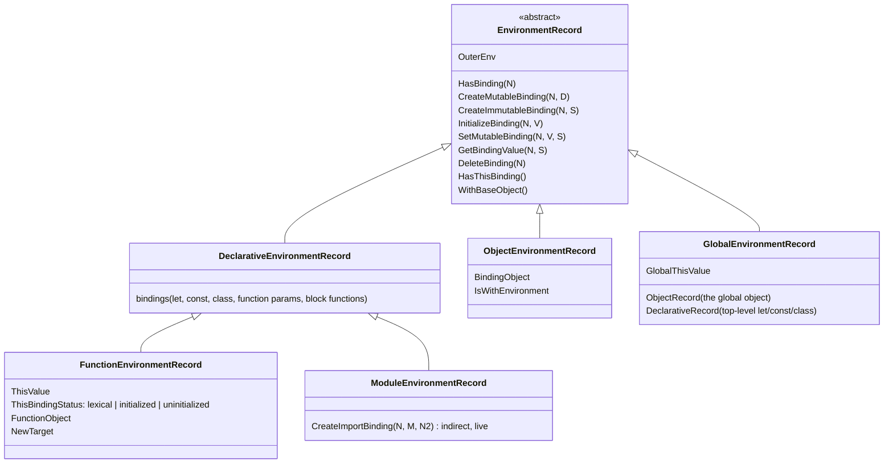

# 03 · Execution Contexts, Scope, Closures and `this`

> **Spec anchors (ECMA-262 17th edition):** §9.1 *Environment Records* (§9.1.1.1 Declarative, §9.1.1.2 Object, §9.1.1.3 Function, §9.1.1.4 Global, §9.1.1.5 Module), §9.2 *PrivateEnvironment Records*, §9.4 *Execution Contexts* (§9.4.2 ResolveBinding, §9.4.3 GetThisEnvironment, §9.4.4 ResolveThisBinding), §10.2 *ECMAScript Function Objects* (§10.2.1.2 OrdinaryCallBindThis, §10.2.11 FunctionDeclarationInstantiation), §10.4.1 *Bound Function Exotic Objects*, §16.1.7 *GlobalDeclarationInstantiation*, §19.2.1 `eval` and §19.2.1.1 *PerformEval*, §11.2.2 *Strict Mode Code*, Annex B.3 (block-level functions).
>
> **Executable proof:** [`examples/03-execution-contexts-scope-closures.test.js`](../examples/03-execution-contexts-scope-closures.test.js)

Scope, hoisting, closures and `this` are four views of one mechanism: **an execution context points at a chain of Environment Records**, and every function object remembers the Environment Record that was current when it was created. Learn the mechanism and the "quiz questions" become mechanical.

---

## 1. Execution contexts

**Definition (§9.4).** An *execution context* is a specification device that tracks the runtime evaluation of code. At any time there is at most one *running execution context* per agent; the contexts form the **execution context stack** (the call stack).

Components of every execution context:

| Component | Meaning |
|---|---|
| code evaluation state | where to resume (needed for generators and `await`) |
| Function | the function object being evaluated, or null for scripts and modules |
| Realm | the Realm Record whose intrinsics this code uses ([module 06](06-agents-realms-job-queue.md)) |
| ScriptOrModule | the Script Record or Module Record the code came from |

Additional components for ECMAScript code:

| Component | Meaning |
|---|---|
| **LexicalEnvironment** | the Environment Record used to resolve identifiers; changes as blocks are entered and left |
| **VariableEnvironment** | the Environment Record holding `var` bindings of the function or script |
| **PrivateEnvironment** | the PrivateEnvironment Record for `#private` names in enclosing classes (§9.2) |

Generators and async functions also hold a *Generator* component. Suspending a generator removes its execution context from the stack *with* its environments; resuming pushes it back. That is why local variables survive `yield` and `await` ([module 05](05-iterators-generators.md), [module 07](07-async-in-depth.md)).

---

## 2. Environment Records

**Definition (§9.1).** An *Environment Record* is a specification type that associates identifiers with variables and functions, based on the lexical nesting of the code. Each has an `[[OuterEnv]]` field (null for the global record). The chain through `[[OuterEnv]]` *is* the scope chain.



| Kind | Created for | Notable behaviour |
|---|---|---|
| Declarative (§9.1.1.1) | blocks, `catch` clauses, function bodies | Bindings can be **uninitialized** (TDZ) |
| Function (§9.1.1.3) | each function call | Holds the `this` binding (unless arrow), `new.target`, `super` home |
| Module (§9.1.1.5) | each module | **Import bindings are indirect**: reading one reads the exporter's binding *now* (live bindings, [module 08](08-modules.md)) |
| Object (§9.1.1.2) | `with` statements, the object part of the global record | Bindings are properties; can be shadowed by `Symbol.unscopables` |
| Global (§9.1.1.4) | the realm | Two-part: object record (global object properties: `var`, function declarations, built-ins) + declarative record (top-level `let`/`const`/`class`) |

### Identifier resolution

`ResolveBinding(name)` (§9.4.2) calls `GetIdentifierReference(env, name, strict)` which walks `[[OuterEnv]]` until some record's `HasBinding(name)` is true, returning a Reference Record whose base is that Environment Record. If no record has it, the reference is *unresolvable*: reading throws `ReferenceError`; assigning creates a global property in sloppy mode and throws `ReferenceError` in strict mode.

Resolution is **lexical**: the chain is fixed by where the code is written, not by who calls it. The only constructs that make resolution dynamic are `with` and sloppy direct `eval` (which can add `var` bindings to the calling function's scope). Both defeat engine optimisations ([module 12](12-engine-internals-v8.md)).

---

## 3. Hoisting, formally

"Hoisting" is not a spec term. It is the informal name for **declaration instantiation**: before the body of a function, script or module runs, the engine creates all bindings declared in it.

`FunctionDeclarationInstantiation` (§10.2.11), simplified:

1. Bind parameters (in their own environment if there are default-value expressions, so defaults cannot see body declarations).
2. Create the `arguments` object unless the function is an arrow, or a parameter or function declaration is named `arguments`.
3. For each `var` name: create a binding and **initialize it to `undefined`**.
4. For each function declaration: create a binding and **initialize it to the function object** (so it can be called before the line where it appears).
5. For each `let`, `const`, `class` in the top-level lexical scope: create the binding **uninitialized**.

`GlobalDeclarationInstantiation` (§16.1.7) does the same for scripts, plus collision checks: a script that declares `let x` when another script already declared `var x` (or vice versa) fails with a `SyntaxError` *before any of it runs*.

| Declaration | Binding created at | Initialized at | Before initialization |
|---|---|---|---|
| `var` | instantiation | instantiation (`undefined`) | reads `undefined` |
| function declaration | instantiation | instantiation (function object) | callable |
| `let`, `const` | instantiation | when the declaration is evaluated | **ReferenceError (TDZ)** |
| `class` | instantiation | when the class is evaluated | ReferenceError (TDZ) |
| `import` | module instantiation (link) | it is an indirect binding to the exporter | ReferenceError if the exporter's binding is in TDZ |

### The temporal dead zone is temporal

The TDZ is the time between binding creation and initialization. It is about *execution order*, not text position:

```js
function readLater() { return value; } // mentions `value` before its declaration: fine
let value = 42;
readLater(); // 42: by the time of the call, `value` is initialized

{
  readLater2(); // ReferenceError: called while `v2` is in TDZ
  let v2 = 1;
  function readLater2() { return v2; }
}
```

Also in TDZ: `let x = x;` (the right side reads the uninitialized `x`), default parameters referring to later parameters (`function f(a = b, b) {}` when `a` is defaulted), and `typeof x` before `let x`.

### Global scope details

In a classic **script** (not a module):

```js
var a = 1;       // creates globalThis.a (non-configurable property of the global object)
let b = 2;       // creates a binding in the global *declarative* record; globalThis.b is undefined
function c() {}  // creates globalThis.c
```

Modules have their own Module Environment Record: top-level `var` in a module does **not** create a global property. Code that relies on `var` leaking into `window` breaks when converted to a module.

### Block-level functions in sloppy mode (Annex B.3.3)

In strict code, a function declared in a block is block-scoped, like `let`. In sloppy code, for web compatibility, it is *also* assigned to a `var`-like binding in the enclosing function when the declaration is evaluated. The behaviour is complex and differs from intuition:

```js
// sloppy script
console.log(typeof f); // 'undefined' (var-like binding exists, not yet assigned)
{ function f() {} }
console.log(typeof f); // 'function'
```

Do not write function declarations inside blocks in sloppy code. Modules and classes are always strict, which removes the problem.

---

## 4. Closures

**Definition.** A *closure* is a function object together with the Environment Record that was the running execution context's LexicalEnvironment when the function was created. ECMA-262 stores that record in the function's `[[Environment]]` internal slot (§10.2); when the function is called, its new Function Environment Record gets `[[OuterEnv]] = F.[[Environment]]`.

Every function in JavaScript is a closure in this sense. The interesting cases are those where the function *outlives* the call that created its environment.

```js
function counter() {
  let n = 0;                         // lives in counter's Function Environment Record
  return { inc: () => ++n, get: () => n };
}
const c = counter();
c.inc(); c.inc();
c.get(); // 2: both arrows share the same record
```

### The `var`-in-a-loop classic, explained by environments

```js
const fs = [];
for (var i = 0; i < 3; i++) fs.push(() => i);
fs.map(f => f()); // [3, 3, 3]: one binding `i` in the function's VariableEnvironment

const gs = [];
for (let j = 0; j < 3; j++) gs.push(() => j);
gs.map(g => g()); // [0, 1, 2]
```

For `let` in a `for` head, the spec (`ForBodyEvaluation`, `CreatePerIterationEnvironment`, §14.7.4) creates a **fresh declarative environment per iteration** and copies the current values into it before the increment expression. Each closure captures a different record. `for...of` and `for...in` with `let`/`const` likewise get a new binding per iteration.

### What a closure retains (V8 reality)

The spec says a closure retains its whole Environment Record chain. Engines optimise: V8 performs scope analysis at parse time and puts a variable in a heap-allocated **Context** only if some inner function references it; other locals live in registers or on the stack. However, **all closures created in the same scope share one Context**. Consequence:

```js
function handler(req) {
  const big = loadHugeBuffer(req);
  const log = () => console.log(big.length); // references big → big goes into the shared Context
  const onDone = () => 'ok';                 // does not mention big...
  return onDone;                             // ...but retains the Context, hence big
}
```

As long as `onDone` is reachable (stored in a cache, registered as a listener, captured by a timer), `big` cannot be collected even though `onDone` never reads it. The example file proves this with `WeakRef` under `--expose-gc` in a child process, and proves the control case (no sibling closure: collected). Mitigation: null out large locals after use (`big = null` with `let`), split the function so the large value and the long-lived callback are in different scopes, or pass data explicitly.

Other closure-related leaks:

- Event listeners and timers registered with closures that capture DOM nodes or requests and are never removed. Use `AbortSignal` for listeners (`addEventListener(type, fn, { signal })`) and `clearInterval`.
- Caches (`Map`) keyed by objects with closures as values. Prefer `WeakMap` keyed by the owner object ([module 09](09-metaprogramming.md)).

### Stale closures

A closure reads the binding it captured; if the code later creates a *new* binding instead of mutating the old one, the closure keeps seeing the old value. In React, each render is a new function call with new `const` bindings, so an effect or callback created in render *N* sees render *N*'s state forever unless it is re-created. See the React track for the framework delta ([`../../../technologies/react/`](../../../technologies/react/)); the language mechanism is exactly the per-call Environment Record described here.

---

## 5. `this`

`this` is **not** lexical for ordinary functions. It is a property of the Function Environment Record, set at call time by `OrdinaryCallBindThis` (§10.2.1.2) according to the function's `[[ThisMode]]`:

| `[[ThisMode]]` | Functions | `this` is |
|---|---|---|
| lexical | arrow functions | not bound; resolved from the enclosing environment (`GetThisEnvironment`, §9.4.3) |
| strict | strict functions, class methods, module code | exactly the `thisArgument` passed by the caller (may be `undefined` or a primitive) |
| global | sloppy functions | `thisArgument`; if `undefined` or `null`, the realm's `globalThis`; primitives are boxed with ToObject |

What the caller passes as `thisArgument` depends on the **call expression form**:

| Call form | `thisArgument` | Why |
|---|---|---|
| `obj.method()`, `obj['method']()`, `obj?.method()` | `obj` | the callee is a property Reference whose base is `obj` |
| `(obj.method)()` | `obj` | parentheses keep the Reference |
| `(0, obj.method)()`, `(f = obj.method)()` | `undefined` | the comma/assignment operator calls GetValue: the Reference is gone |
| `f()` (plain identifier) | `undefined` (base is an Environment Record, whose `WithBaseObject()` is undefined except in `with`) | |
| `new F()` | a new object whose prototype is `F.prototype` (`OrdinaryCreateFromConstructor`) | for derived classes, `this` is uninitialized until `super()` returns |
| `f.call(x, ...)`, `f.apply(x, [...])` | `x` | |
| `f.bind(x)()` | `x` | bound function exotic object (§10.4.1) |
| tagged template `` obj.tag`...` `` | `obj` | same as a method call |

Precedence when several apply: **`new` > bound > explicit (`call`/`apply`) > method call > plain call**. Arrows ignore all of them.

### Bound functions (§10.4.1)

`f.bind(t, ...args)` returns an exotic object with `[[BoundTargetFunction]]`, `[[BoundThis]]`, `[[BoundArguments]]`. Facts that interviews probe:

- Binding again does not change `this`: `f.bind(a).bind(b)` calls `f` with `this = a` (but the second bind's extra arguments are appended).
- `new` on a bound function **ignores** `[[BoundThis]]` and constructs the target; `new.target` is the target.
- `name` becomes `"bound f"`; `length` is `max(0, f.length - args.length)`.
- A bound function has no `prototype` property.

### Classes and `this`

- Class bodies are strict; extracted methods called plainly get `this === undefined` → `TypeError` when they touch `this.x`.
- **Class fields** are defined on the instance during construction, with `this` = the instance. An arrow function in a field initializer captures that `this` permanently:

```js
class Button {
  label = 'ok';
  onClick = () => this.label;        // per-instance function, `this` fixed
  method() { return this?.label; }   // shared on the prototype, `this` depends on the call
}
const { onClick, method } = new Button();
onClick();  // 'ok'
method();   // undefined
```

Arrow fields cost one function object per instance, are not on the prototype (cannot be overridden by `super.onClick()` in a subclass or spied on via the prototype), but are safe to pass as callbacks. Binding in the constructor (`this.m = this.m.bind(this)`) has the same trade-offs.

- In `static` methods, `this` is the constructor (or a subclass constructor when inherited).
- `super.method()` uses the method's `[[HomeObject]]` to find the prototype, but keeps the current `this`.

### Then vs now: capturing `this`

| Then (ES5) | Now (ES2015+) |
|---|---|
| `var self = this; setTimeout(function () { self.x++; })` | `setTimeout(() => { this.x++; })` |
| `this.handle = this.handle.bind(this)` in constructors (React class components) | class field arrow `handle = () => {...}`, or function components |
| `arguments` object (array-like, mapped to parameters in sloppy mode) | rest parameters `(...args)`; arrows have no own `arguments` |
| IIFE `(function () { var private; ... })()` to create scope | block scope (`{ let x; }`) and modules |

Mixing pitfall: converting a method that uses `arguments` or `this` into an arrow silently changes both to the enclosing function's values.

---

## 6. Strict mode semantics

Strict mode (§11.2.2) affects scope and `this` directly:

| Behaviour | Sloppy | Strict |
|---|---|---|
| Assignment to an undeclared identifier | creates a global property | `ReferenceError` |
| `this` in a plain call | `globalThis` | `undefined` |
| Primitive `this` (`f.call(5)`) | boxed `Number` object | `5` |
| `arguments` ↔ parameters | mapped (writing one updates the other) | unmapped copy |
| `arguments.callee` | the function | throws `TypeError` |
| `with` | allowed | `SyntaxError` |
| Direct `eval` declaring `var` | adds to the calling function's scope | eval gets its own variable environment |
| Assign to read-only property / extend non-extensible object / delete non-configurable property | silently fails | `TypeError` |
| Duplicate parameter names, legacy octal `010`, `delete identifier` | allowed | `SyntaxError` |
| Reserved words `implements`, `interface`, `let`, `package`, `private`, `protected`, `public`, `static`, `yield` | identifiers | reserved |

Modules, class bodies, and code inside them are always strict. Since practically all modern code is ESM or classes, sloppy mode survives mostly in legacy scripts, `new Function` bodies, browser console snippets and Node CommonJS files without `"use strict"`.

---

## 7. `eval` and `new Function`

`PerformEval(x, strictCaller, direct)` (§19.2.1.1) distinguishes:

| Form | Scope | Notes |
|---|---|---|
| **Direct eval**: the callee expression is exactly the identifier `eval` resolving to the intrinsic `%eval%` | the caller's LexicalEnvironment and VariableEnvironment | In sloppy code it can add `var` bindings to the caller; it can see and modify local variables, defeating optimisation of the whole enclosing function |
| **Indirect eval**: anything else (`(0, eval)(s)`, `const e = eval; e(s)`, `globalThis.eval(s)`) | the global environment | Behaves like a separate global script |
| `new Function(args, body)` | the global environment of its realm, never the caller's | Body is sloppy unless it starts with `"use strict"` |

All three are blocked by a Content Security Policy without `'unsafe-eval'` and by Node's `--disallow-code-generation-from-strings`. The Stage 3 *Dynamic Code Brand Checks* proposal adds host hooks for Trusted Types integration.

---

## 8. Production failure modes

| Failure | Mechanism | Defence |
|---|---|---|
| `TypeError: Cannot read properties of undefined (reading 'x')` after passing a method as a callback | method extracted from its Reference; `this` is `undefined` in strict code | arrow wrapper, class field arrow, or `.bind` |
| Memory grows with each request | long-lived closure shares a V8 Context with a closure that captured a large object | split scopes; null out large locals; heap snapshot "retainers" view shows `context` |
| Timers fire with stale data | closure captured a binding that the code replaced instead of mutating | read from a mutable holder (`ref.current`) or recreate the closure |
| `ReferenceError: Cannot access 'X' before initialization` at startup | TDZ: a function using `X` called before `let/const/class X` is evaluated; very common in circular imports ([module 08](08-modules.md)) | reorder, or move the use into a function called later |
| Global variable clobbering between scripts | sloppy implicit globals or top-level `var` in classic scripts | modules; strict mode; lint `no-undef` |
| Converting `function` to arrow breaks a library | arrows have lexical `this` and no `arguments`/`prototype`, cannot be constructors | keep `function` where callers set `this` (jQuery handlers, Mocha `this.timeout`) |

---

## Interview Drill

<details><summary>1. What is printed by `for (var i = 0; i < 3; i++) setTimeout(() => console.log(i))`? Fix it two ways.</summary>

`3 3 3`. There is one `var i` binding in the function scope; all closures read it after the loop finished. Fix with `let i` (a new binding per iteration via CreatePerIterationEnvironment) or by capturing the value in a new scope per iteration (an IIFE or `setTimeout(console.log, 0, i)` passing the value as an argument).
</details>

<details><summary>2. Explain the temporal dead zone. Is it about position or time?</summary>

`let`, `const` and `class` bindings are created when the scope is instantiated but initialized only when the declaration is evaluated. Any access in between throws ReferenceError. It is about time: a function whose body mentions the variable may be defined above the declaration, as long as it is called after initialization.
</details>

<details><summary>3. List the rules for `this` in order of precedence.</summary>

Arrow functions: lexical, ignore everything else. Otherwise: `new` (fresh object, or uninitialized until `super()` in derived classes) > bound function (`bind`) > explicit `call`/`apply` > method call on a property Reference (`obj.m()`) > plain call (`undefined` in strict code, `globalThis` in sloppy code). Class bodies and modules are strict.
</details>

<details><summary>4. Implement `Function.prototype.bind` (simplified) and say what it gets wrong.</summary>

```js
function bind(fn, thisArg, ...bound) {
  function boundFn(...args) {
    return new.target
      ? Reflect.construct(fn, [...bound, ...args], new.target === boundFn ? fn : new.target)
      : fn.apply(thisArg, [...bound, ...args]);
  }
  return boundFn;
}
```
It gets `name` and `length` wrong (spec: `"bound f"`, `max(0, f.length - bound.length)`), has a `prototype` property while real bound functions have none, and `instanceof boundFn` behaviour relies on `prototype` instead of delegating to the target through `[[BoundTargetFunction]]`.
</details>

<details><summary>5. Why can an unused variable cause a closure memory leak in V8?</summary>

V8 allocates variables referenced by any inner function in one Context object per scope, shared by all closures created in that scope. If one closure references a large object, every closure from that scope retains the Context, and hence the object, for as long as any of them is reachable.
</details>

<details><summary>6. What is the difference between direct and indirect eval?</summary>

Direct eval (`eval(src)` where `eval` is the intrinsic) runs in the caller's scope and can see local variables; in sloppy mode it can add `var` bindings to the caller. Indirect eval (`(0, eval)(src)`) runs in the global scope. `new Function` always uses the global scope of its realm.
</details>

<details><summary>7. Why does `let x = 1` at the top of a script not create `window.x`, while `var x = 1` does?</summary>

The Global Environment Record has two parts: an object record backed by the global object (receives `var` and function declarations) and a declarative record (receives `let`, `const`, `class`). Only the object record's bindings are properties of `globalThis`.
</details>

<details><summary>8. What does `(0, obj.method)()` do and why would anyone write it?</summary>

The comma operator evaluates `obj.method` with GetValue, producing the function value without the property Reference, so the call has `this = undefined`. Transpilers emit it to call imported functions without passing the module namespace object as `this`.
</details>

<details><summary>9. A class method passed as `onClick={this.handle}` throws on `this.setState`. Explain and fix.</summary>

Passing `this.handle` reads the function value; the caller later invokes it as a plain function, and class bodies are strict, so `this` is `undefined`. Fix with a class field arrow (`handle = () => {...}`), binding in the constructor, or an inline arrow at the call site.
</details>
