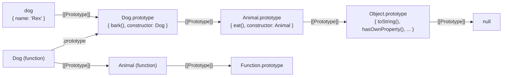

# 04 · Objects, Prototypes and Classes

> **Spec anchors (ECMA-262 17th edition):** §6.1.7 *The Object Type* (§6.1.7.2 object internal methods and their invariants), §6.2.6 *The Property Descriptor Specification Type*, §6.2.10 *PrivateElement*, §7.3.15 *SetIntegrityLevel*, §7.3.21 *OrdinaryHasInstance*, §10.1 *Ordinary Object Internal Methods* (§10.1.6 [[DefineOwnProperty]], §10.1.8 [[Get]], §10.1.9 [[Set]], §10.1.11.1 OrdinaryOwnPropertyKeys, §10.1.13 OrdinaryCreateFromConstructor), §10.4 *Built-in Exotic Object Internal Methods* (§10.4.2 Array, §10.4.4 arguments, §10.4.5 TypedArray, §10.4.6 module namespace), §13.3.5 `new`, §13.10.2 InstanceofOperator, §15.7 *Class Definitions* (§15.7.14 ClassDefinitionEvaluation), §14.7.5.9 EnumerateObjectProperties, Annex B.2.2.1 `Object.prototype.__proto__`.
>
> **Executable proof:** [`examples/04-objects-prototypes-classes.test.js`](../examples/04-objects-prototypes-classes.test.js)

JavaScript has one object model: objects are bags of properties with a link to a prototype, and every behaviour is defined by a small set of **internal methods**. Classes, arrays, functions, module namespaces and proxies are all variations on that model. This module covers the ordinary model, the exotic variations built into the language, and what `class` adds on top.

---

## 1. Properties and descriptors

**Definition (§6.1.7.1).** A *property* is identified by a key (a String or a Symbol) and has attributes. A **data property** has `[[Value]]` and `[[Writable]]`; an **accessor property** has `[[Get]]` and `[[Set]]` (functions or undefined). Both kinds have `[[Enumerable]]` and `[[Configurable]]`.

| Attribute | Meaning when false |
|---|---|
| `writable` | `[[Set]]` fails (silently in sloppy code, `TypeError` in strict code) |
| `enumerable` | skipped by `for...in`, `Object.keys`, spread, `JSON.stringify` |
| `configurable` | cannot delete, cannot change kind (data ↔ accessor), cannot change attributes, except `writable: true → false` and changing `value` while still writable |

Defaults differ by API, a common source of bugs:

| Created by | writable | enumerable | configurable |
|---|---|---|---|
| assignment `o.x = 1`, object literal | true | true | true |
| `Object.defineProperty(o, 'x', { value: 1 })` | **false** | **false** | **false** |
| class method | true | **false** | true |
| class field | true | true | true |

The rules for changing an existing property are in `ValidateAndApplyPropertyDescriptor` (called from `[[DefineOwnProperty]]`, §10.1.6). Once non-configurable and non-writable, a property is a constant forever; the engine may rely on that.

### Integrity levels

| Operation | Effect | Depth |
|---|---|---|
| `Object.preventExtensions(o)` | no new properties | own object only |
| `Object.seal(o)` | + every property non-configurable | shallow |
| `Object.freeze(o)` | + every data property non-writable (`SetIntegrityLevel(o, frozen)`, §7.3.15) | **shallow**: nested objects stay mutable |

`Object.freeze` does not freeze the prototype, `Map` contents (internal slots are not properties), or `Date` values (`setTime` still works).

---

## 2. The essential internal methods

Every object, ordinary or exotic, implements these (§6.1.7.2, Table 4):

| Internal method | Triggered by |
|---|---|
| `[[GetPrototypeOf]]()` / `[[SetPrototypeOf]](V)` | `Object.getPrototypeOf`, `instanceof`, `__proto__` |
| `[[IsExtensible]]()` / `[[PreventExtensions]]()` | `Object.isExtensible`, `freeze`, `seal` |
| `[[GetOwnProperty]](P)` | `Object.getOwnPropertyDescriptor`, `hasOwn` |
| `[[DefineOwnProperty]](P, Desc)` | `Object.defineProperty`, class fields, spread into a literal |
| `[[HasProperty]](P)` | `in` |
| `[[Get]](P, Receiver)` | property read |
| `[[Set]](P, V, Receiver)` | property assignment |
| `[[Delete]](P)` | `delete` |
| `[[OwnPropertyKeys]]()` | `Reflect.ownKeys`, `Object.keys`, `for...in` (partly) |
| `[[Call]]`, `[[Construct]]` (functions only) | calls, `new` |

The spec also states **invariants** these methods must keep (for example, a non-configurable own property must always be reported). Ordinary objects keep them by construction; Proxies are checked against them at runtime ([module 09](09-metaprogramming.md)).

### 2.1 `[[Get]]` (§10.1.8, OrdinaryGet)

```
OrdinaryGet(O, P, Receiver)
1  desc ← O.[[GetOwnProperty]](P)
2  if desc is undefined
3      parent ← O.[[GetPrototypeOf]]()
4      if parent is null return undefined
5      return parent.[[Get]](P, Receiver)        ▷ walk up, keep the original receiver
6  if desc is a data descriptor return desc.[[Value]]
7  getter ← desc.[[Get]]
8  if getter is undefined return undefined
9  return Call(getter, Receiver)                 ▷ getters see the *receiver* as this
```

The Receiver is the object the access started on. A getter defined on a prototype runs with `this` set to the instance.

### 2.2 `[[Set]]` (§10.1.9, OrdinarySet) and the override mistake

```
OrdinarySetWithOwnDescriptor(O, P, V, Receiver, ownDesc)
1  if ownDesc is undefined
2      parent ← O.[[GetPrototypeOf]]()
3      if parent is not null return parent.[[Set]](P, V, Receiver)   ▷ look up the chain first
4      ownDesc ← { value: undefined, writable: true, enumerable: true, configurable: true }
5  if ownDesc is a data descriptor
6      if ownDesc.[[Writable]] is false return false                  ▷ (*)
7      existing ← Receiver.[[GetOwnProperty]](P)
8      if existing is a data descriptor: update its value on Receiver
9      else create a new own data property on Receiver
10 else (accessor)
11     call ownDesc.[[Set]] with this = Receiver, or return false if absent
```

Assignment always looks up the prototype chain first. Two consequences:

1. **Inherited setters intercept assignment.** `obj.x = 1` calls a setter found on a prototype instead of creating an own property.
2. **The "override mistake"** (step *): if an *inherited* property is a non-writable data property, assignment to the instance **fails**, even though the instance has no own property of that name. This is why freezing `Object.prototype` (as hardened-JavaScript environments do) breaks innocent code like `obj.toString = () => 'x'` (TypeError in strict code). Use `Object.defineProperty` to create an own property regardless.

Assignment (`[[Set]]`) vs definition (`[[DefineOwnProperty]]`) is also the difference between `Object.assign` (uses `[[Set]]` on the target, triggers setters) and object spread `{...src}` (defines properties on a new object, triggers no setters), and between TypeScript's legacy `useDefineForClassFields: false` and standard class fields (define semantics). See the TypeScript track for the compiler flag ([`../../typescript/`](../../typescript/)).

### 2.3 Own property key order (§10.1.11.1)

`OrdinaryOwnPropertyKeys` returns:

1. **array indices** (canonical numeric strings for integers 0 ≤ i ≤ 2³² − 2), in ascending numeric order;
2. other **String** keys, in property creation order;
3. **Symbol** keys, in property creation order.

```js
Object.keys({ b: 1, 2: 1, a: 1, 1: 1, '-1': 1, '01': 1 });
// ['1', '2', 'b', 'a', '-1', '01']   ('-1' and '01' are not array indices)
```

`Object.keys`, `Object.entries`, `JSON.stringify`, `Reflect.ownKeys` and (since ES2020, for ordinary objects without prototype mutation during iteration) `for...in` all follow this order. Do not use object key order as a sorted map with numeric-like string keys; use a `Map`, which preserves insertion order for all keys.

---

## 3. Prototypes

Every object has a `[[Prototype]]` internal slot, either an object or `null`. Property lookup (`[[Get]]`, `[[HasProperty]]`) walks the chain; property creation (`[[Set]]` on a missing key, `[[DefineOwnProperty]]`) always targets the receiver.



Note the two parallel chains created by `class Dog extends Animal`: instances inherit through `Dog.prototype → Animal.prototype`, and the constructors themselves inherit through `Dog → Animal` (so static methods are inherited).

| API | Purpose | Notes |
|---|---|---|
| `Object.create(proto, descriptors?)` | create with a given prototype | `Object.create(null)` gives a dictionary with no inherited keys |
| `Object.getPrototypeOf(o)` | read `[[Prototype]]` | |
| `Object.setPrototypeOf(o, p)` | change `[[Prototype]]` after creation | invalidates engine shape assumptions; slow paths for every object sharing the shape ([module 12](12-engine-internals-v8.md)) |
| `o.__proto__` | Annex B accessor on `Object.prototype` | absent on null-prototype objects; never use with untrusted keys ([module 13](13-correctness-security-pitfalls.md)) |
| `{ __proto__: p }` in a literal | Annex B literal syntax: sets the prototype | the only non-deprecated `__proto__` form; a computed `['__proto__']` key creates an own property instead |
| `Object.hasOwn(o, k)` | own-property test | ES2022; works on null-prototype objects, unlike `o.hasOwnProperty(k)` |
| `k in o` | own or inherited | `'toString' in {}` is true |

### `new`, implemented

`new F(...args)` (§13.3.5) calls `F.[[Construct]](args, F)`. For an ordinary (non-class, base) function, `[[Construct]]` (§10.2.2) does:

```js
function myNew(F, ...args) {
  if (typeof F !== 'function' || !F.prototype) throw new TypeError('not a constructor'); // simplified
  const proto = Object(F.prototype) === F.prototype ? F.prototype : Object.prototype;   // OrdinaryCreateFromConstructor
  const obj = Object.create(proto);
  const result = F.apply(obj, args);
  return Object(result) === result ? result : obj;   // an object return value replaces `this`
}
```

Real `new` additionally sets `new.target`, rejects arrow functions and methods (no `[[Construct]]`), and for derived classes does not create `this` at all: `this` is created by the base constructor and bound when `super()` returns.

### `instanceof`, implemented

`InstanceofOperator(V, Target)` (§13.10.2): if `Target[Symbol.hasInstance]` exists, call it; otherwise `OrdinaryHasInstance` (§7.3.21), which walks `V`'s prototype chain looking for `Target.prototype`:

```js
function myInstanceof(v, Target) {
  if (Object(v) !== v) return false;
  const proto = Target.prototype;
  for (let p = Object.getPrototypeOf(v); p !== null; p = Object.getPrototypeOf(p)) {
    if (p === proto) return true;
  }
  return false;
}
```

`instanceof` is about prototype identity, which is **per realm**: an array from an iframe or `vm` context is not `instanceof Array` in the main realm. Use `Array.isArray` and `Error.isError` (ES2026), which check internal slots ([module 06](06-agents-realms-job-queue.md)).

---

## 4. Classes

**Definition.** A *class declaration* (§15.7) creates a constructor function whose `[[ConstructorKind]]` is *base* or *derived*, a prototype object holding methods, and the class's static members. Classes are mostly, but not entirely, sugar over constructor functions and prototypes.

### What is genuinely new (not desugarable to ES5)

| Feature | Behaviour |
|---|---|
| `[[IsClassConstructor]]` | calling a class without `new` throws `TypeError` |
| derived constructors | `this` is uninitialized until `super()` returns; the *base* constructor allocates the object using `new.target.prototype` |
| subclassing built-ins | `class MyArr extends Array` gets a real Array exotic object (length magic works), because allocation happens in `Array` with `new.target` = `MyArr` |
| `#private` names | per-class private names with hard encapsulation and brand checks |
| `super` | methods have a `[[HomeObject]]`; `super.x` looks up from `HomeObject.[[Prototype]]` |
| TDZ for the class binding | class declarations behave like `let` |
| strict mode | the whole class body is strict |
| method attributes | methods are non-enumerable; class methods have no `prototype` and no `[[Construct]]` |

### Fields and initialization order

Public fields (`x = 1`) and private fields (`#y = 2`) are **defined** (with `[[DefineOwnProperty]]`, not `[[Set]]`) on the instance:

- in a base class, right after the instance is allocated and before the constructor body runs;
- in a derived class, right after `super()` returns.

Consequences:

```js
class Base {
  constructor() { this.init(); }          // runs before Derived's fields exist
  init() {}
}
class Derived extends Base {
  value = 'field';
  init() { this.seen = this.value; }      // reads undefined: field not defined yet
}
new Derived().seen; // undefined
```

and a field shadows a setter inherited from the base class (define semantics do not call setters), which is the main behavioural change behind TypeScript's `useDefineForClassFields`.

### Private names

`#x` is not a property. Each class evaluation creates a fresh **Private Name**; instances get a `PrivateElement` (§6.2.10) in an internal list. Rules:

- Accessing `obj.#x` when `obj` lacks it throws `TypeError` (a *brand check*). `#x in obj` (ES2022) tests without throwing.
- Private names are lexically scoped: only code inside the class body can mention them, including static methods operating on *other* instances of the same class.
- **Proxies do not forward private names**: `new Proxy(instance, {}).method()` that reads `this.#x` throws, because the proxy object itself has no private element. This breaks naive Proxy-based reactivity and mocking of classes with private fields.
- Private methods (`#m() {}`) and accessors are installed per instance (conceptually) but share one function object.
- `Object.freeze` does not affect private fields; they remain writable.

### Static members and static blocks

`static x = 1`, `static m() {}`, `static #count = 0`, and `static { ... }` (ES2022) initialization blocks, which run once during class evaluation with `this` = the constructor and access to private names (useful for granting a friend function access to `#private` state).

### `accessor` is not standard yet

`accessor x = 1` (auto-accessors) belongs to the **Decorators proposal, Stage 2.7** as of 2026-10-28. TypeScript accepts it; V8 parses it only behind `--js-decorators`. Do not treat it as standard class syntax ([module 09](09-metaprogramming.md)).

> **Exam delta (JSA-41-01).** The JS Institute associate exam does not state its ECMAScript edition, and its "Classes" and "Classless Objects" sections predate ES2022. Expect constructor functions, `prototype` assignment and ES2015 class syntax; `#private` fields, static blocks, `Object.hasOwn` and `#x in obj` may be absent from the exam even though they are current practice. See [exams/README.md](../exams/README.md).

### Then vs now

| Then (ES5 and conventions) | Now |
|---|---|
| `function Animal(n) { this.n = n } Animal.prototype.eat = function () {}` | `class Animal { constructor(n) { this.n = n } eat() {} }` (ES2015) |
| `Dog.prototype = Object.create(Animal.prototype); Dog.prototype.constructor = Dog; Animal.call(this, n)` | `class Dog extends Animal { constructor(n) { super(n) } }` |
| `_private` naming convention, or WeakMap-based privacy | `#private` fields and methods (ES2022) |
| assigning fields in the constructor | class fields (ES2022) |
| `Object.prototype.hasOwnProperty.call(o, k)` | `Object.hasOwn(o, k)` (ES2022) |
| static initialization after the class: `Foo.cache = new Map()` | `static cache = new Map()` / `static { }` (ES2022) |
| `__proto__` for prototype access | `Object.getPrototypeOf` / `Object.create` |

Migration pitfalls: converting a constructor function to a class makes calling it without `new` throw (old factory-style call sites break); converting `this.x = ...` assignments to fields changes from `[[Set]]` to `[[DefineOwnProperty]]` (setters on a base class stop firing); classes are not hoisted like function declarations.

---

## 5. Built-in exotic objects

An *exotic object* overrides at least one essential internal method.

### Array exotic objects (§10.4.2)

Arrays override `[[DefineOwnProperty]]` to maintain the `length` invariant:

- An **array index** is a canonical numeric String for an integer in [0, 2³² − 2].
- Defining an index ≥ `length` sets `length` to index + 1.
- Setting `length` smaller deletes trailing elements (stopping at the first non-configurable one).
- `arr['1.0'] = x` or `arr[-1] = x` creates ordinary properties; they do not affect `length`.
- **Holes**: `[1, , 3]` and `new Array(3)` have missing indices. Methods disagree on holes: `forEach`/`map` skip them, `for...of`/spread/`Array.from` treat them as `undefined`, `includes` sees `undefined`, `indexOf` skips them. Holey arrays are also slower in V8 ([module 12](12-engine-internals-v8.md)).

### Arguments exotic objects (§10.4.4)

In sloppy functions with simple parameter lists, `arguments` is *mapped*: `arguments[0]` and the first parameter alias each other. Strict functions, and functions with default/rest/destructured parameters, get an unmapped object.

### TypedArray exotic objects (§10.4.5)

For any key that is a **canonical numeric string** (including `"-0"`, `"1.5"`, `"Infinity"`), TypedArrays never consult the prototype and never create ordinary properties: out-of-bounds reads give `undefined`, out-of-bounds writes are ignored, and `ta[1.5] = 1` does nothing. Values are converted on write (`Uint8Array` wraps modulo 256; `Uint8ClampedArray` clamps). Details in [module 11](11-binary-data-memory-model.md).

### Module namespace exotic objects (§10.4.6)

`import * as ns` gives an object with a null prototype, keys sorted by code unit order, `Symbol.toStringTag` = `"Module"`, non-extensible, whose properties are **live getters** onto the exporting module's bindings. Writes throw in strict code; `Object.isFrozen(ns)` is false because the properties report `writable: true` (they are live). See [module 08](08-modules.md).

### String exotic objects

`new String('ab')` has own index properties `'0'`, `'1'` and a non-writable `length`.

---

## 6. Copying objects

| Technique | Depth | Copies | Triggers | Loses |
|---|---|---|---|---|
| `{ ...src }` | shallow | own enumerable String and Symbol keys | source getters (read); **defines** on the target | prototype, non-enumerables, accessors become data |
| `Object.assign(t, src)` | shallow | own enumerable keys | source getters, **target setters** | same |
| `structuredClone(src)` | deep, handles cycles and shared references | data per the HTML structured serialization algorithm | source getters | prototypes (class instances become plain objects), functions (throws `DataCloneError`), Symbol keys, property attributes |
| `JSON.parse(JSON.stringify(src))` | deep | JSON-representable data | `toJSON` | `undefined`, functions, Symbols, `Map`/`Set` (become `{}`), `Date` (becomes string), `NaN` (becomes `null`), BigInt (throws), cycles (throws) |

`structuredClone` and its limits are covered fully in [module 11](11-binary-data-memory-model.md).

---

## 7. Production failure modes

| Failure | Mechanism | Defence |
|---|---|---|
| Prototype pollution: one request changes behaviour of every object | recursive merge of untrusted JSON writes `__proto__` → `Object.prototype` | null-prototype objects, `Map`, key allow-lists, `Object.freeze(Object.prototype)` in hardened apps ([module 13](13-correctness-security-pitfalls.md)) |
| `obj.toString = ...` throws after a security library froze intrinsics | override mistake: inherited non-writable data property blocks `[[Set]]` | `Object.defineProperty` |
| `for (const i in arr)` iterates `'0'`, `'1'`, ... and also an added `Array.prototype.myHelper` | `for...in` iterates inherited enumerable string keys, as strings | `for...of`, `forEach`, `Object.keys` |
| Subclass setter not called for a field after upgrading TypeScript target | define semantics of class fields | declare the field with `declare` (TS) or set it in the constructor |
| Base constructor calls an overridden method that reads a subclass field: `undefined` | subclass fields are defined after `super()` returns | do not call overridable methods from constructors |
| Mocking or reactive proxies throw `TypeError: Cannot read private member` | private names are not forwarded by Proxy | wrap at a different boundary; avoid proxying class instances with `#private` |
| Megamorphic, slow code after `Object.setPrototypeOf` or `delete` in hot objects | shape transitions | create objects with final shape; use `Map` for dynamic keys ([module 12](12-engine-internals-v8.md)) |
| `instanceof Array` is false for arrays created in an iframe or a `vm` context (messages from workers are fine: structured clone recreates them in the receiving realm) | per-realm intrinsics | `Array.isArray`, `Error.isError` |

---

## Interview Drill

<details><summary>1. What does `new` do, step by step?</summary>

For a base constructor: create an object whose prototype is `F.prototype` (or `%Object.prototype%` if that is not an object), call `F` with `this` bound to it and `new.target = F`, and return the call's result if it is an object, otherwise the created object. For derived classes, no object is created up front: `super()` calls the parent's `[[Construct]]` with the same `new.target`, and the result becomes `this`.
</details>

<details><summary>2. Explain `[[Get]]` vs `[[Set]]` with prototypes. What is the override mistake?</summary>

`[[Get]]` walks the chain and returns the first found value, calling getters with the original receiver. `[[Set]]` also walks the chain first: an inherited setter is called; an inherited non-writable data property makes the assignment fail; otherwise an own data property is created on the receiver. The override mistake is that last rule's surprise: freezing a prototype prevents instances from shadowing its properties by assignment.
</details>

<details><summary>3. What is the property enumeration order?</summary>

Integer-like keys (array indices up to 2³² − 2) ascending, then other string keys in insertion order, then symbols in insertion order. `Object.keys`, `JSON.stringify` and `for...in` (own part) follow it.
</details>

<details><summary>4. Are classes just syntactic sugar?</summary>

Largely, but not entirely: class constructors throw when called without `new`, derived constructors delegate allocation to the base (which is what makes subclassing `Array` and `Error` work), `#private` names and brand checks cannot be expressed with properties, methods get a `[[HomeObject]]` for `super`, and class bodies are strict with TDZ bindings.
</details>

<details><summary>5. Implement `instanceof` and explain why it fails across realms.</summary>

Walk `Object.getPrototypeOf` from the value until reaching `Target.prototype` (true) or `null` (false), after honouring `Symbol.hasInstance`. Each realm has its own `Array.prototype`, so an array created in another realm has a different prototype object. Use slot-based checks (`Array.isArray`, `Error.isError`).
</details>

<details><summary>6. Difference between `Object.assign` and object spread?</summary>

Both copy own enumerable properties shallowly and invoke source getters. `Object.assign` writes with `[[Set]]`, so target setters run and an inherited read-only property on the target throws. Spread defines properties on a fresh object with `[[DefineOwnProperty]]`, so no setters run.
</details>

<details><summary>7. Why does a Proxy around a class instance with `#private` fields throw?</summary>

Private field access checks that the *receiver* has the private element. When a method is called through the proxy, `this` is the proxy, which has no private elements; the access throws `TypeError`. Proxies only intercept the essential internal methods, and private names are not properties.
</details>

<details><summary>8. What happens to `arr.length` when you do `arr[10] = 1` on an empty array, and what does `arr.forEach` see?</summary>

Array exotic `[[DefineOwnProperty]]` sets `length` to 11. Indices 0–9 are holes; `forEach` skips holes and calls the callback once, while `for...of` yields ten `undefined`s and then `1`.
</details>

<details><summary>9. When would you use `Object.create(null)`?</summary>

For dictionaries built from untrusted keys: there are no inherited properties (`'toString' in dict` is false), no `__proto__` accessor to abuse, and `hasOwnProperty` cannot be shadowed because it is not there (use `Object.hasOwn`). A `Map` is usually even better.
</details>
