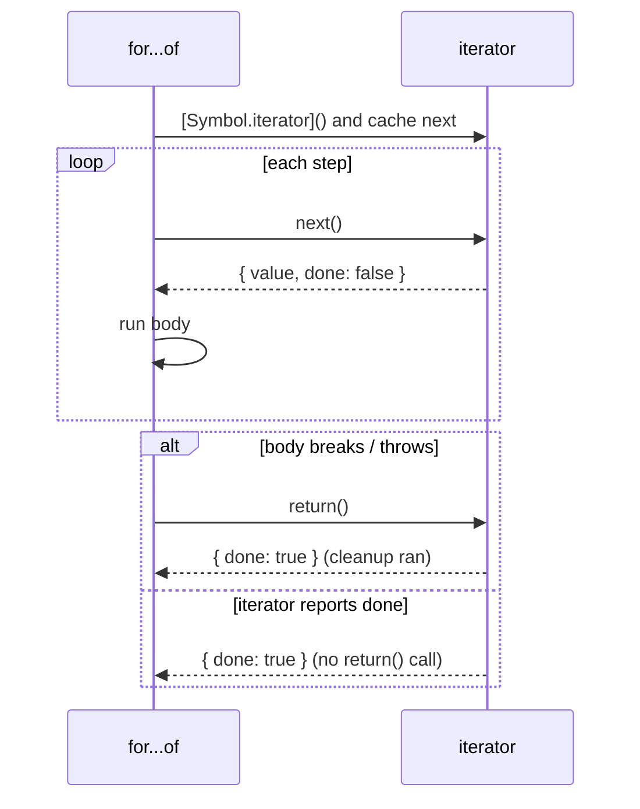
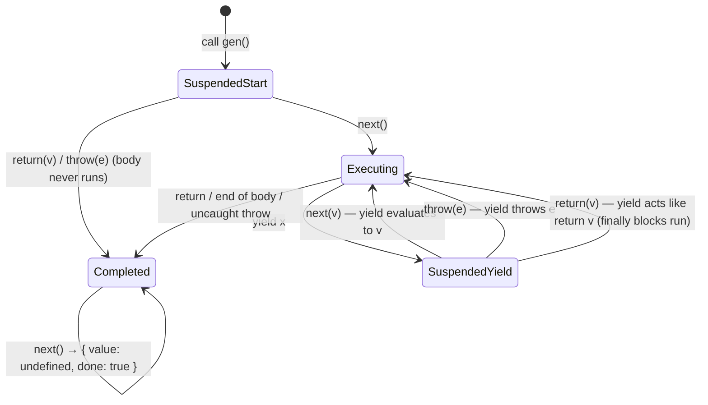

# 05 · Iterators, Generators and Async Iteration

> **Spec anchors (ECMA-262 17th edition):** §7.4 *Operations on Iterator Objects* (§7.4.11 IteratorClose, §7.4.14 AsyncIteratorClose), §27.1 *Iteration* (§27.1.1.2 the Iterator interface, §27.1.3 Iterator objects, §27.1.3.2.1 `Iterator.concat`, §27.1.3.2.2 `Iterator.from`, §27.1.3.3.x helpers), §27.1.5 AsyncFromSyncIterator objects, §15.5 *Generator Function Definitions*, §27.5 *Generator Objects* (§27.5.1.3 `return`, §27.5.3.3 GeneratorResume), §27.6 *AsyncGenerator Objects*, §14.7.5.6 ForIn/OfHeadEvaluation, §23.1.2.2 `Array.fromAsync`. ES2027 draft (tc39.es/ecma262): `Iterator.zip`, iterator chunking.
>
> **Executable proof:** [`examples/05-iterators-generators.test.js`](../examples/05-iterators-generators.test.js)

Iteration is a *protocol*, not a type. Anything that follows two small contracts can be consumed by `for...of`, spread, destructuring, `Array.from`, `Promise.all`, `Map`/`Set` constructors, and `yield*`. Generators are the language's built-in way to write such objects as straight-line code, and they are full coroutines: the basis of async/await's design, of lazy pipelines, and of library APIs like Solid's `action(function* ...)` and React's async iterable support.

---

## 1. The two protocols

**Definition (§27.1.1).**
- An **iterable** is an object with a `[Symbol.iterator]()` method that returns an iterator.
- An **iterator** is an object with a `next(value?)` method returning an **IteratorResult** object `{ value, done }`. It may also have `return(value?)` (called when the consumer stops early) and `throw(exception?)`.

```js
const range = {
  from: 1, to: 3,
  [Symbol.iterator]() {
    let cur = this.from; const last = this.to;
    return {
      next: () => cur <= last ? { value: cur++, done: false } : { value: undefined, done: true },
      return: () => { /* release resources */ return { value: undefined, done: true }; },
      [Symbol.iterator]() { return this; },   // iterators are conventionally iterable
    };
  },
};
[...range]; // [1, 2, 3]
```

Rules worth knowing:

1. `done` and `value` are read with `[[Get]]`; a missing `done` is falsy (keep going), a missing `value` is `undefined`.
2. A **fresh iterator per `[Symbol.iterator]()` call** makes an iterable *reusable* (arrays, Maps). Iterators that return `this` (generators, Map iterators) are **one-shot**: a second `for...of` over the same generator object yields nothing.
3. The spec caches `next` once at the start (the *Iterator Record* `{ [[Iterator]], [[NextMethod]], [[Done]] }`, §7.4.1); replacing `it.next` mid-loop has no effect on the loop already running.

### Who calls `return()` (IteratorClose, §7.4.11)

`return()` is the cleanup hook. Consumers call it when they stop **before** `done: true`:

| Consumer | Calls `return()` when |
|---|---|
| `for...of` | `break`, `return`, `throw` out of the body, or a labelled `continue` to an outer loop |
| array destructuring `const [a, b] = it` | after taking the needed elements, if the iterator was not exhausted |
| spread, `Array.from` | never early (they exhaust), but on an exception thrown by a mapping function |
| `Promise.all`/`Map` constructor | if a step throws (for example, a non-object entry passed to `new Map`) |
| `yield*` | when the outer generator is closed |
| iterator helpers (`take`, `find`, `some`, `every`) | when they stop early, they close the underlying iterator |

A consumer does **not** call `return()` if the iterator itself threw from `next()` (it is assumed broken) or if it already returned `done: true`. If the body throws and `return()` also throws, the **original** exception wins; if the body exits normally (break) and `return()` throws, that exception propagates. If `return()` returns a non-object, the consumer throws `TypeError`.



---

## 2. Generators

**Definition (§15.5, §27.5).** A *generator function* (`function*`) returns a **generator object** without running its body. The generator object is both an iterator and an iterable (its `[Symbol.iterator]` returns itself). Each `next(v)` resumes the body until the next `yield`, which suspends the generator's execution context and produces `{ value, done: false }`; returning (explicitly or by falling off the end) produces `{ value: returnValue, done: true }`.

Generator states (§27.5.3): *suspended-start* → *executing* ⇄ *suspended-yield* → *completed*.



### Two-way communication

- The **first** `next(v)` starts the body; its argument is discarded (there is no `yield` waiting for it).
- `next(v)` makes the paused `yield` expression evaluate to `v`.
- `gen.throw(e)` makes the paused `yield` throw `e` at that point; the generator may catch it.
- `gen.return(v)` makes the paused `yield` behave like `return v`: `finally` blocks run, and a `finally` may even `yield` again (and the `return()` call then gets that yielded value with `done: false`), which is legal but surprising.
- Calling `next()` while the generator is executing (re-entrantly, from inside its own body) throws `TypeError`.

```js
function* dialogue() {
  const name = yield 'name?';
  const age  = yield `hello ${name}, age?`;
  return `${name} is ${age}`;
}
const g = dialogue();
g.next();        // { value: 'name?', done: false }   (argument would be ignored)
g.next('Ada');   // { value: 'hello Ada, age?', done: false }
g.next(36);      // { value: 'Ada is 36', done: true }
```

### `yield*` delegation

`yield* inner` iterates `inner` and forwards `next`, `throw` and `return` calls to it; the value of the `yield*` expression is the inner iterator's *return value* (which `for...of` ignores). If the inner iterator lacks `throw`, delegating a `throw` closes the inner iterator and throws a `TypeError` (protocol violation).

### Generators as coroutines

A generator is a function whose execution context can be suspended and resumed. This is exactly what an `async` function needs: `await` is "yield a promise to a driver that resumes me when it settles". Before ES2017, libraries (co, Redux-Saga, Babel's regenerator) implemented async functions this way; the example file contains a 10-line `run(generatorFn)` driver. Today, `async` functions are implemented natively with the same suspend/resume machinery (V8 uses the generator infrastructure for both).

### Lazy, possibly infinite sequences

Generators compute on demand, so they can represent infinite sequences and pipelines that never materialise intermediate arrays:

```js
function* naturals() { for (let n = 0; ; n++) yield n; }
naturals().filter(n => n % 2).map(n => n * n).take(3).toArray(); // [1, 9, 25]
```

---

## 3. Iterator helpers (ES2025) and sequencing (ES2026)

ES2025 added `Iterator` as a global with `Iterator.prototype` methods that work lazily on **any** iterator inheriting from `%Iterator.prototype%` (all built-in iterators and generators do):

| Lazy (return a new iterator) | Eager (consume) |
|---|---|
| `map(fn)`, `filter(fn)`, `take(n)`, `drop(n)`, `flatMap(fn)` | `toArray()`, `reduce(fn, init?)`, `forEach(fn)`, `some(fn)`, `every(fn)`, `find(fn)` |

Plus:

- `Iterator.from(obj)` wraps an iterable or an iterator-like object (just `next`) so the helpers are available.
- `Iterator.concat(...iterables)` (**ES2026**, §27.1.3.2.1) lazily yields from each iterable in turn. It validates up front that every argument is an object with a `[Symbol.iterator]`, but opens each one only when reached.
- **ES2027 (Stage 4, in the draft):** `Iterator.zip(iterables, { mode: 'shortest' | 'longest' | 'strict', padding })` and `Iterator.zipKeyed`, `iterator.chunks(n)` / `windows(n)`, `includes`, `join`. **Not shipped in Node 26.12.1**; the example file asserts their absence.

Differences from array methods that matter:

| | Array methods | Iterator helpers |
|---|---|---|
| Evaluation | eager, allocate a full array per step | lazy, one element at a time |
| Callback arguments | `(value, index, array)` | `(value, counter)`, no third argument |
| Work on infinite sources | no | yes, with `take`/`find`/`some` |
| Reusable result | yes | no: the result is a one-shot iterator |
| Closing | n/a | early-stopping helpers call `return()` on the source |

`flatMap` in iterator helpers rejects strings returned by the mapper (it flattens only iterators/iterables that are objects), unlike `Array.prototype.flatMap`, which flattens only arrays.

### Then vs now: lazy pipelines

| Then | Now |
|---|---|
| `[...gen()].filter(...).map(...).slice(0, 10)`: materialises everything, never terminates on infinite generators | `gen().filter(...).map(...).take(10).toArray()` (ES2025) |
| lodash/IxJS lazy wrappers | built-in helpers; libraries still needed for zipping in Node 26 (`Iterator.zip` is ES2027, unshipped) |
| hand-written concat generator `function* concat(...its) { for (const it of its) yield* it; }` | `Iterator.concat` (ES2026) |

---

## 4. Async iteration

**Definition (§27.1.1.3–4).** An **async iterable** has `[Symbol.asyncIterator]()` returning an **async iterator**, whose `next()` returns a *promise* of an IteratorResult.

`for await (const x of source)` (only in async functions and module top level):

1. Calls `source[Symbol.asyncIterator]()`; if absent, falls back to `[Symbol.iterator]()` wrapped in an **AsyncFromSyncIterator** (§27.1.5), which awaits each `value`.
2. Awaits each `next()` result; closes with `AsyncIteratorClose` (awaiting `return()`) on early exit.

**Async generators** (`async function*`) combine both: `await` inside, `yield` outward, and the object queues `next()` calls so that concurrent calls are served in order (§27.6, the AsyncGenerator request queue). `yield` in an async generator awaits its operand, so `yield promise` yields the settled value.

```js
async function* paginate(fetchPage) {
  let cursor = null;
  do {
    const page = await fetchPage(cursor);
    yield* page.items;            // sync iterable inside an async generator is fine
    cursor = page.next;
  } while (cursor);
}
for await (const item of paginate(api)) { if (done(item)) break; } // break → return() → generator's finally
```

### Pitfall: `for await` over an array of promises

`for await (const r of [p1, p2, p3])` uses AsyncFromSyncIterator: it awaits `p1`, then `p2`, ... in order. If `p2` rejects **before** the loop reaches it, Node reports an **unhandled rejection** at that moment (no handler is attached to `p2` yet), which by default crashes the process. Use `Promise.all`/`allSettled` for a set of already-started promises; use `for await` for genuinely lazy async sources ([module 07](07-async-in-depth.md)).

### `Array.fromAsync` (ES2026, §23.1.2.2)

`Array.fromAsync(asyncIterableOrIterable, mapFn?)` collects an async iterable into an array, awaiting each element (and the mapper's result) **sequentially**. It is the async counterpart of `Array.from`, not a concurrent `Promise.all`: one element at a time.

### Streams and events as async iterables

Hosts expose async iterables widely: Node `Readable` streams and `events.on(emitter, 'x')`, WHATWG `ReadableStream` (async iterable in Node and modern browsers), `fs.promises.opendir`. Backpressure semantics of streams belong to the Node.js track ([`../../../technologies/nodejs/`](../../../technologies/nodejs/)); the language contract is only `next()` / `return()`.

---

### Then vs now: consuming asynchronous sequences

| Then | Now |
|---|---|
| `stream.on('data', cb)` + `on('end')` + `on('error')`, manual pause/resume for backpressure | `for await (const chunk of stream)`: pull-based, so backpressure is implicit; `break` destroys the stream through `return()` |
| Callback pagination helpers (`fetchAll(cb)`) | async generators that `yield*` each page |
| RxJS/IxJS for simple async pipelines | async generators; observables remain useful for push-based multicast |
| `Promise.all(await Promise.all(...))` to flatten paged results | `Array.fromAsync(paginate())` (ES2026), sequential by design |

Mixing pitfall: attaching a `'data'` listener to a stream that is also consumed with `for await` switches it to flowing mode and loses chunks; pick one consumption style per stream.

### Worked example: lazy in-order traversal of a binary search tree

Recursive generators make tree traversals lazy, but each `yield*` level adds one delegation hop per element, so a tree of height *h* costs O(*h*) per yielded value. An explicit stack gives O(1) amortised per element and constant-depth suspension:

```
INORDER-ITER(root)
1  S ← empty stack;  x ← root
2  while S is not empty or x ≠ NIL
3      while x ≠ NIL                ▷ descend left, remembering the path
4          PUSH(S, x);  x ← x.left
5      x ← POP(S)
6      YIELD x.key
7      x ← x.right
```

**Loop invariant.** At the top of the outer loop, the keys already yielded are exactly the keys smaller than every key in the subtree rooted at *x* and smaller than every node on *S*, in ascending order; *S* holds the ancestors of *x* whose left subtrees have been fully yielded but which have not been yielded themselves. **Termination:** each node is pushed and popped exactly once, so the loop runs Θ(*n*) times in total; amortised O(1) per `next()`.

The example file implements both versions, checks with fast-check that they yield the sorted keys, and shows that `take(3)` on a 2,000-node left spine visits each spine node once (the initial descent) and yields only three keys: the rest of the traversal is never run.

## 5. The algorithms behind `for...of` and generators

### 5.1 `for...of`, step by step

`for (const x of expr) body` is evaluated by ForIn/OfHeadEvaluation and **ForIn/OfBodyEvaluation (§14.7.5.7)** with *iterationKind* = iterate. Condensed:

```
FOR-OF-BODY(lhs, body, iteratorRecord)            ▷ iteratorRecord from GetIterator (§7.4.4)
1  V ← undefined
2  repeat
3      nextResult ← ? Call(iteratorRecord.[[NextMethod]], iteratorRecord.[[Iterator]])
4      if nextResult is not an Object, throw TypeError
5      if ? IteratorComplete(nextResult) return V              ▷ exhausted: no return() call
6      nextValue ← ? IteratorValue(nextResult)
7      create a fresh declarative environment for lhs (let/const)  ▷ per-iteration binding
8      status ← bind lhs to nextValue (destructuring may throw)
9      if status is abrupt
10         return ? IteratorClose(iteratorRecord, status)      ▷ destructuring failure closes
11     result ← evaluate body
12     if LoopContinues(result) is false                        ▷ break, return, throw, outer continue
13         return ? IteratorClose(iteratorRecord, UpdateEmpty(result, V))
14     if result.[[Value]] is not empty, V ← result.[[Value]]
```

**Invariant.** At the top of each iteration, the iterator has been neither closed nor exhausted, and `iteratorRecord.[[NextMethod]]` is the method read once by GetIterator. The loop leaves through exactly one of three exits: line 5 (exhausted, no close), line 3/4/6 throwing (the iterator is presumed broken, no close), or lines 10/13 (close with the pending completion).

The `?` on lines 3–6 is why an exception thrown by `next()` or by a `value` getter does **not** trigger `return()`: the abrupt completion propagates immediately, before reaching any IteratorClose.

**IteratorClose (§7.4.11)** with a pending *completion*:

```
ITERATOR-CLOSE(iteratorRecord, completion)
1  returnMethod ← GetMethod(iterator, "return")             ▷ may itself throw
2  if returnMethod is undefined, return completion
3  innerResult ← Call(returnMethod, iterator)
4  if completion is a throw completion, return completion    ▷ the body's error wins
5  if innerResult is a throw completion, return innerResult  ▷ else return()'s error wins
6  if innerResult.[[Value]] is not an Object, throw TypeError
7  return completion
```

Line 4 is the rule tested in the example file: the body's exception takes priority over an exception from `return()`. Line 6 makes a `return()` that returns a primitive a protocol violation, but only when the loop exits normally (`break`).

### 5.2 Generators in the specification

A generator object has `[[GeneratorState]]` ∈ {suspended-start, suspended-yield, executing, completed} and `[[GeneratorContext]]` (the suspended execution context).

- **GeneratorStart (§27.5.3.1)** stores the body as the continuation of a fresh execution context, without running it.
- **GeneratorResume (§27.5.3.3)**: `GeneratorValidate` throws `TypeError` if the state is executing (re-entrancy). If completed, return `{ value: undefined, done: true }`. Otherwise set the state to executing, push the generator's context onto the execution context stack, and resume it with the `next()` argument as the result of the paused `yield`.
- **GeneratorYield (§27.5.3.6)** sets the state to suspended-yield, removes the generator's context from the stack, and returns the iterator result to the caller of `next()`.
- `return(v)` and `throw(e)` go through GeneratorResumeAbrupt: in suspended-start they complete the generator immediately (the body never runs); in suspended-yield they resume the context with a return or throw completion **at the `yield`**, so `try/finally` blocks run.
- `yield*` (§15.5.5) loops over the inner iterator, forwarding `next`/`throw`/`return`. If the inner iterator has no `throw` method, it closes the inner iterator and throws a `TypeError` ("the iterator does not provide a 'throw' method").

### 5.3 Async generators and the request queue

Async generator objects (§27.6) have `[[AsyncGeneratorState]]` ∈ {suspended-start, suspended-yield, executing, draining-queue, completed} and an `[[AsyncGeneratorQueue]]`. Every call to `next`, `throw` or `return` creates a promise and appends a request to the queue (AsyncGeneratorEnqueue, §27.6.3.4); the generator resumes only when it is not already executing, and completes requests strictly in order.

```mermaid
stateDiagram-v2
  [*] --> SuspendedStart: call asyncGen()
  SuspendedStart --> Executing: next() dequeued
  SuspendedStart --> DrainingQueue: return()/throw() before start
  Executing --> SuspendedYield: yield v (resolve the head request with {v, false})
  Executing --> Executing: await (requests keep queueing)
  SuspendedYield --> Executing: next request dequeued
  Executing --> DrainingQueue: body completes or throws
  DrainingQueue --> DrainingQueue: settle remaining requests ({undefined, true}; awaits return(v) values)
  DrainingQueue --> Completed: queue empty
  Completed --> DrainingQueue: new request
```



> **Then vs now:** before ES2024 the spec had an *awaiting-return* state; the queue-draining logic was restructured into the *draining-queue* state. The observable behaviour (requests settle in order; `return(promise)` awaits the promise) did not change.

Consequences: `Promise.all([it.next(), it.next()])` is safe and ordered; a `return()` issued while the generator is executing waits behind earlier requests; `yield promise` and `return promise` in an async generator await the promise first, so consumers never receive a promise as `value`.

AsyncFromSyncIterator (§27.1.5.1) wraps a sync iterator for `for await`: it awaits each `value` (so rejected promises yielded by a sync generator become thrown errors in the loop) and, since ES2025, closes the sync iterator if awaiting a yielded value rejects.

## 6. Engine mechanics (V8)

- **Generators are resumable functions.** Ignition compiles a generator body into bytecode with `SuspendGenerator`/`ResumeGenerator` instructions and a `SwitchOnGeneratorState` jump table at the entry. On suspension, the live interpreter registers are copied into the generator object (a `JSGeneratorObject` with a register-file array); on resumption, they are copied back and execution jumps to the saved offset. Async functions reuse exactly this machinery (`JSAsyncFunctionObject`), which is why an `await` costs about as much as a `yield` plus one promise reaction.
- **Optimising compilers handle generators**, but every suspension materialises the frame, so a hot inner loop that yields per element is slower than a plain loop over an array. Lazy pipelines trade throughput for memory; use them for large or unbounded sources, not to replace `map`/`filter` on small arrays.
- **Array iteration fast paths.** `for...of`, spread and destructuring over arrays do not literally call `next()` per element in optimised code: V8 inlines the array iterator, guarded by a *protector* (a global "nobody has modified the array iteration protocol" flag). Assigning `Array.prototype[Symbol.iterator]` or `%ArrayIteratorPrototype%.next` invalidates the protector **for the whole isolate**, permanently sending every array spread and `for...of` to the generic path. Semantically, the patched method is honoured everywhere (the example file proves that a patched iterator changes `[...arr]` and destructuring of every array); the performance cost is V8-specific.
- **Iterator helpers allocate** one helper object per stage and one result object per element (`{ value, done }`); escape analysis can remove some allocations in optimised code, but not across megamorphic stages.

## 7. Production failure modes

| Failure | Mechanism | Defence (tested) |
|---|---|---|
| File handle or DB cursor leaked when a consumer breaks out early | iterator without `return()`, or a generator without `try/finally` | put cleanup in `finally` inside generators; implement `return()` in hand-written iterators; prefer `using` ([module 10](10-resource-management-temporal.md)) |
| Cursor leaked when **destructuring in the loop head** throws | binding failure is abrupt → IteratorClose runs, but only if `return()` exists | same as above; the example proves `return()` is called |
| Second loop over a generator silently does nothing | generators are one-shot iterators | expose an *iterable* (object with `[Symbol.iterator]() { return gen() }`) |
| Process crash on `for await` over pre-created promises | later promises reject before a handler is attached | `Promise.allSettled` |
| Memory blow-up in a "streaming" pipeline | spreading a generator into an array before filtering | iterator helpers / async generators end to end |
| Slow sequential I/O | `Array.fromAsync(urls, fetch)` fetches one by one | start work before collecting, or use a concurrency limiter ([module 07](07-async-in-depth.md)) |
| `TypeError: Generator is already running` | calling `next()` from inside the generator's own body | restructure; generators are not re-entrant |
| `yield*` delegation to a plain iterator throws `TypeError` on `gen.throw()` | the inner iterator has no `throw` method; spec closes it and throws | give delegated iterators a `throw` method or avoid `throw()` on delegating generators |
| A polyfill or test helper patches `Array.prototype[Symbol.iterator]`; unrelated code changes behaviour and every array loop slows down | the iteration protocol is global and honoured everywhere; V8's array-iterator protector is invalidated | never patch built-in iteration; wrap instead |

---

## Interview Drill

<details><summary>1. What is the difference between an iterable and an iterator? Why are arrays reusable but generators not?</summary>

An iterable has `[Symbol.iterator]()` returning an iterator; an iterator has `next()` returning `{ value, done }`. Arrays return a fresh iterator on each call, so each loop starts over. A generator object's `[Symbol.iterator]` returns itself, so once exhausted, later loops get `done: true` immediately.
</details>

<details><summary>2. When is an iterator's `return()` called?</summary>

When a consumer stops before exhaustion: `break`/`return`/`throw` in `for...of`, destructuring that does not consume everything, `yield*` delegation being closed, and helpers like `take` or `find` that stop early. Not when `next()` itself throws or after `done: true`.
</details>

<details><summary>3. Implement a minimal `co`-style driver that runs a generator yielding promises.</summary>

```js
function run(genFn, ...args) {
  return new Promise((resolve, reject) => {
    const it = genFn(...args);
    const step = (method, arg) => {
      let r;
      try { r = it[method](arg); } catch (e) { return reject(e); }
      if (r.done) return resolve(r.value);
      Promise.resolve(r.value).then((v) => step('next', v), (e) => step('throw', e));
    };
    step('next');
  });
}
```
</details>

<details><summary>4. Why is the argument of the first `next()` ignored?</summary>

The first `next()` starts the body from the beginning; there is no suspended `yield` expression to receive the value. Values passed to later `next(v)` become the result of the `yield` at which the generator is paused.
</details>

<details><summary>5. What does `gen.return(5)` do if the generator is inside `try { yield 1 } finally { cleanup() }`?</summary>

The paused `yield` behaves like `return 5`: the `finally` block runs `cleanup()`, then the generator completes with `{ value: 5, done: true }`. If the `finally` itself yields, `return()` produces that yielded value with `done: false`.
</details>

<details><summary>6. How do iterator helpers differ from array methods?</summary>

They are lazy, work on infinite iterators, produce one-shot iterators, pass `(value, counter)` without the source collection, and close the source when they stop early. Array methods are eager and allocate a new array per step.
</details>

<details><summary>7. Why can `for await (const x of arrayOfPromises)` crash a Node process?</summary>

The loop attaches a handler to each promise only when it reaches it. A later promise that rejects earlier has no handler at that time; Node's unhandled-rejection tracking reports it, and the default mode (`throw`) terminates the process.
</details>

<details><summary>8. Write a lazy `take(n)` without iterator helpers that closes its source.</summary>

```js
function* take(iterable, n) {
  if (n <= 0) return;
  for (const x of iterable) {        // for...of closes the source on early exit
    yield x;
    if (--n === 0) return;
  }
}
```
</details>

<details><summary>9. Why does an exception thrown by `next()` not call `return()`, while an exception in the loop body does?</summary>

In ForIn/OfBodyEvaluation, the call to `next()`, the `done` check and the `value` read are all `?` operations: an abrupt completion propagates before IteratorClose is reached, because an iterator that throws from `next()` is considered broken. An exception from the body is caught by the loop algorithm, which then calls IteratorClose with the throw completion; the body's error wins over any error from `return()`.
</details>

<details><summary>10. What happens when `for await` iterates a sync generator that yields a rejected promise?</summary>

AsyncFromSyncIterator awaits each yielded value; the rejection is thrown into the loop at that iteration. Since ES2025 the wrapper also closes the underlying sync iterator, so its `finally` blocks run before the error reaches your `catch`.
</details>
