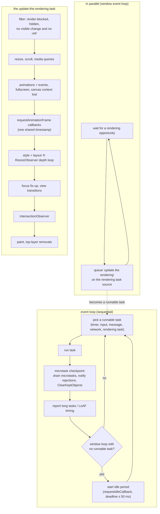

# 06 · Agents, Realms, the Job Queue and the Event Loop

> **Spec anchors:** ECMA-262 17th edition §9.3 *Realms*, §9.4 *Execution Contexts*, §9.5 *Jobs and Host Operations to Enqueue Jobs* (§9.5.5 HostEnqueuePromiseJob), §9.6 *Agents*, §9.7 *Agent Clusters*, §9.8 *Forward Progress*, §27.2.1 *Promise Abstract Operations* (§27.2.1.3 CreateResolvingFunctions, §27.2.1.9 HostPromiseRejectionTracker), §27.2.2.1 NewPromiseReactionJob, §27.2.2.2 NewPromiseResolveThenableJob, §27.2.5.4.1 PerformPromiseThen, §27.7.5.3 Await, §20.5.2.1 `Error.isError`. **HTML Living Standard** §8.1.7 *Event loops* (§8.1.7.1 definitions, §8.1.7.2 queuing tasks, §8.1.7.3 processing model), §8.1.6.4 HostPromiseRejectionTracker, §8.1.6.6.4 HostEnqueuePromiseJob, §8.1.4.7 unhandled promise rejections.
>
> **Executable proof:** [`examples/06-agents-realms-job-queue.test.js`](../examples/06-agents-realms-job-queue.test.js), with an executable model of the HTML processing model in [`examples/06-event-loop-model.js`](../examples/06-event-loop-model.js)

ECMA-262 defines *what* a job is and *that* promise jobs must run in FIFO order after the current code finishes. It does **not** define timers, I/O, rendering, or when "after" is. The host does. This module separates the two layers precisely, because nearly every "predict the output" interview question and every UI-jank or starvation bug lives on the boundary between them.

---

## 1. Agents and agent clusters

**Definition (§9.6).** An *agent* comprises a set of ECMAScript execution contexts, an execution context stack, a running execution context, an **Agent Record**, and an *executing thread*. Code in an agent runs on one thread at a time; that is the language's single-threadedness guarantee.

| Host construct | Agent? |
|---|---|
| A browser tab's main thread (similar-origin window agent: all same-site windows that can reach each other share one) | yes |
| Each `Worker`, `SharedWorker`, `ServiceWorker`, worklet | its own agent |
| Node.js main thread; each `worker_threads.Worker` | its own agent |
| `vm` contexts, iframes of the same agent | **not** separate agents: same thread, different *realms* |

**Agent cluster (§9.7).** A set of agents that can share memory (`SharedArrayBuffer`). In browsers this requires cross-origin isolation ([module 11](11-binary-data-memory-model.md)). The Agent Record's `[[CanBlock]]` says whether `Atomics.wait` may block: false on a browser main thread, true in workers and in Node's main thread.

**Forward progress (§9.8).** An agent makes progress when it is not blocked, but the spec does not require fairness *between* agents beyond that. Any fairness you see comes from the host and the OS scheduler.

---

## 2. Realms

**Definition (§9.3).** A *Realm Record* has `[[Intrinsics]]` (one fresh copy of every built-in: `%Array%`, `%Object.prototype%`, `%Promise%`, ...), a `[[GlobalObject]]`, a `[[GlobalEnv]]`, and `[[HostDefined]]` data. All ECMAScript code is associated with a realm, and built-in functions create objects using **the realm they belong to** (the *current realm* of the running execution context, or the function's own `[[Realm]]`).

Realms you meet in practice: each iframe and window, each `vm.createContext()` in Node, each worker (also a separate agent), and, in the future, `ShadowRealm` (Stage 2.7, behind `--harmony-shadow-realm` in V8 14.6).

Consequences of separate intrinsics:

| Check | Cross-realm safe? | Why |
|---|---|---|
| `x instanceof Array` | **no** | compares with *this* realm's `Array.prototype` |
| `Array.isArray(x)` | yes | checks for an Array exotic object (and sees through Proxies) |
| `x instanceof Error` | **no** | |
| `Error.isError(x)` (ES2026) | yes | checks the `[[ErrorData]]` internal slot |
| `Object.prototype.toString.call(x)` | mostly | uses `Symbol.toStringTag`, which can be spoofed |
| `x.constructor === Object` | no | |
| structured clone (`postMessage`) | yes | recreates the value *in the receiving realm* |

Frameworks hit this when they receive objects from iframes, from `vm`-based test runners (Jest's environment uses `vm` contexts, so `instanceof Error` fails for errors thrown by Node core in some setups), or from libraries bundled twice (not a realm issue, but the same symptom: two different `class` objects).

---

## 3. Jobs in ECMA-262

**Definition (§9.5).** A *Job* is an Abstract Closure with no parameters that initiates an ECMAScript computation when no other ECMAScript computation is running. Jobs are scheduled through host-defined operations; ECMA-262 itself uses only three:

| Host hook | Used for |
|---|---|
| `HostEnqueuePromiseJob(job, realm)` (§9.5.5) | promise reactions and thenable resolution |
| `HostEnqueueGenericJob(job, realm)` | e.g. `Atomics.waitAsync` resolution |
| `HostEnqueueTimeoutJob(timeoutJob, realm, ms)` | e.g. `Atomics.waitAsync` timeouts |

Requirements on promise jobs: they run **in FIFO order relative to each other**, and only when the execution context stack is empty. Everything else (when "empty" happens, what else runs in between) is up to the host. In HTML, `HostEnqueuePromiseJob` enqueues a **microtask**.

### The promise machinery

Each promise has `[[PromiseState]]` (pending, fulfilled, rejected), `[[PromiseResult]]`, `[[PromiseFulfillReactions]]`, `[[PromiseRejectReactions]]` and `[[PromiseIsHandled]]`.

- `p.then(f, r)` → `PerformPromiseThen` (§27.2.5.4.1): if `p` is pending, append reactions; if already settled, **immediately enqueue** a `NewPromiseReactionJob` (§27.2.2.1). Callbacks never run synchronously, even for an already-resolved promise.
- Calling a promise's `resolve(x)` (from `CreateResolvingFunctions`, §27.2.1.3):
  - if `x` is not an object, or has no callable `then`: fulfil immediately (reactions are enqueued);
  - if `x` is the promise itself: reject with `TypeError`;
  - if `x` is a **thenable** (including a native promise): enqueue a `NewPromiseResolveThenableJob` (§27.2.2.2), which later calls `x.then(resolve, reject)`. That costs extra ticks.
- Only the first call to `resolve`/`reject` counts (the `[[AlreadyResolved]]` flag).

### Walkthrough: from `resolve(x)` to a reaction job

The algorithms, with their ES2026 section numbers:

```
CreateResolvingFunctions(promise)                                   §27.2.1.3
  resolve(resolution):
  1  if alreadyResolved, return undefined;  alreadyResolved ← true
  2  if resolution is promise itself → RejectPromise(promise, TypeError)
  3  if resolution is not an Object → FulfillPromise(promise, resolution)
  4  thenAction ← Get(resolution, "then")                 ▷ SYNCHRONOUS: a getter runs now
  5  if that threw → RejectPromise(promise, error)
  6  if thenAction is not callable → FulfillPromise(promise, resolution)
  7  job ← NewPromiseResolveThenableJob(promise, resolution, thenAction)   §27.2.2.2
  8  HostEnqueuePromiseJob(job.[[Job]], job.[[Realm]])    ▷ the then() call happens one tick later

FulfillPromise / RejectPromise                                      §27.2.1.4 / §27.2.1.7
  set [[PromiseState]], [[PromiseResult]], clear both reaction lists;
  RejectPromise also calls HostPromiseRejectionTracker(promise, "reject") if not [[PromiseIsHandled]];
  then TriggerPromiseReactions(reactions, value)                    §27.2.1.8
     for each reaction, in order: HostEnqueuePromiseJob(NewPromiseReactionJob(reaction, value))

PerformPromiseThen(promise, onFulfilled, onRejected, resultCapability)    §27.2.5.4.1
  1  wrap callables in JobCallback Records (HostMakeJobCallback)
  2  if pending: append to both reaction lists
  3  if fulfilled: enqueue NewPromiseReactionJob(fulfillReaction, result)
  4  if rejected: if not handled, HostPromiseRejectionTracker(promise, "handle");
                  enqueue NewPromiseReactionJob(rejectReaction, reason)
  5  [[PromiseIsHandled]] ← true

NewPromiseReactionJob(reaction, argument)                           §27.2.2.1
  run the handler (or pass the value through / rethrow if the handler is undefined),
  then resolve or reject the derived promise (reaction.[[Capability]]) with the outcome
```

Facts that fall out of the algorithms and are tested:

- Step 4 of `resolve` reads `then` **synchronously**: a `then` getter on a resolution value runs inside the `resolve()` call, and an exception from it rejects the promise instead of propagating to the caller.
- Reactions registered on the same promise run in **registration order**, because TriggerPromiseReactions enqueues them in list order.
- `p.then()` with no handlers still creates a derived promise that adopts `p`'s outcome (the pass-through in NewPromiseReactionJob), so a rejection travels down a chain of `then(onFulfilled)` calls until a rejection handler.
- `[[PromiseIsHandled]]` is set by `then`, so attaching any handler silences unhandled-rejection reporting for **that** promise, but not for the derived promise `then` returns: `p.then(f)` on a rejecting `p` produces a new rejected promise, which is itself unhandled.

In HTML, HostEnqueuePromiseJob (§8.1.6.6.4) queues a microtask that prepares to run script with the settings object of the job's realm (the realm of the handler function, or of the `then` function for thenable jobs), runs the job, cleans up after running script, and **reports** an exception thrown by the job to that realm's global (`error` event) instead of letting it escape.

### Tick accounting (measured on Node 26 and pinned in the example file)

Counting "ticks" as successive microtask turns after the current script ends:

| Code | Its continuation runs after |
|---|---|
| `Promise.resolve().then(f)` | 1 tick |
| `await nativePromise` | **1 tick** (ES2019 change: `Await` uses `PromiseResolve`, which returns a native promise unchanged) |
| `Promise.resolve(thenableObject).then(f)` | 2 ticks (resolve-thenable job, then the reaction) |
| `new Promise(r => r(nativePromise)).then(f)` | **3 ticks** (resolve-thenable job → `then` reaction on the inner promise → outer reaction) |
| `async function f() { return nativePromise }` then `f().then(g)` | 3 ticks (same mechanism: returning a promise from an async function resolves the outer promise with a thenable) |

The practical rule: **`return await p` inside an async function is not slower than `return p`**; it is actually fewer ticks, and it keeps the function in the async stack trace. (ESLint's old `no-return-await` was deprecated for this reason.)

### Then vs now: `await` cost

| Then (ES2017–ES2018 engines) | Now (ES2019+) |
|---|---|
| `await v` wrapped `v` in a *new* promise and resolved it, costing 3 ticks even for a native promise | `await v` calls `PromiseResolve`, reusing native promises: 1 tick |
| `return await p` discouraged as "extra tick" | `return await p` recommended inside `try` (otherwise rejections bypass your `catch`) and harmless elsewhere |

### HostPromiseRejectionTracker (§27.2.1.9)

Called with operation `"reject"` when a promise is rejected **without** any handler, and with `"handle"` when a handler is added to an already-rejected, previously unhandled promise. ECMA-262 only reports; the host decides policy:

- **HTML**: collects "about-to-be-notified rejected promises" and, after the microtask checkpoint, fires `unhandledrejection` on the global; a later handler fires `rejectionhandled`. The default action logs to the console.
- **Node**: emits `process.on('unhandledRejection')` after the microtask queue drains; the default mode since Node 15 is `--unhandled-rejections=throw`, which raises it as an uncaught exception and **exits with code 1** if no listener handles it. Details of Node's modes belong to the Node.js track ([`../../../technologies/nodejs/`](../../../technologies/nodejs/)).

"Unhandled" means *no handler by the time the host checks*, not "never handled". Attaching a `.catch` one macrotask later is too late in both hosts.

---

## 4. The HTML event loop processing model

The HTML Standard (§8.1.7) defines the browser host's event loop. This track owns this section; the CSS track owns what happens *inside* style, layout and paint ([`../../css/`](../../css/)), and Node's libuv phases belong to the Node.js track.

### Definitions (§8.1.7.1)

- An **event loop** has one or more **task queues**. A task queue is a *set*, not a queue: the loop picks the first *runnable* task from a queue of its choosing, so the browser may prioritise (for example) input over timers. Order is guaranteed only **within** one task source.
- A **task** has steps, a *source* (DOM manipulation, user interaction, networking, history traversal, timers, posted messages, ...), a document and a script evaluation environment settings object set.
- The **microtask queue** is a real FIFO queue, one per event loop. Promise reactions, `queueMicrotask` callbacks and `MutationObserver` notifications are microtasks.
- The **performing a microtask checkpoint** flag prevents re-entrancy of the checkpoint.

### Processing model (§8.1.7.3), verified against the HTML Standard source on 2026-10-30

The event loop runs two things: a sequential loop that processes tasks, and, for window event loops, an **in-parallel** process that waits for rendering opportunities and queues rendering tasks.

```
EVENT-LOOP()                                         ▷ "continually run through the following steps"
1  oldestTask ← null
2  if some task queue has a runnable task
3      taskQueue ← one such queue, chosen in an implementation-defined manner
4      taskStartTime ← now; oldestTask ← first runnable task of taskQueue (removed)
5      record task start time (Long Animation Frames)
6      currently running task ← oldestTask; run oldestTask's steps; currently running task ← null
7      PERFORM-MICROTASK-CHECKPOINT()
8  taskEndTime ← now
9  if oldestTask ≠ null: report long tasks (> 50 ms) for the affected top-level browsing contexts,
10     record task end time
11 if window event loop with no runnable task: start an idle period for each same-loop window,
12     deadline = min(last idle start + 50 ms, earliest active timer,
13                    next render deadline if rAF callbacks or rendering updates are pending)
14 if worker event loop: optionally run the worker's animation frame callbacks and render
15     (OffscreenCanvas in dedicated workers); destroy the loop if closing and no tasks remain

IN PARALLEL, for a window event loop:
1  wait until some navigable might have a rendering opportunity
2  last render opportunity time ← now
3  for each navigable with a rendering opportunity:
       queue a global task on the RENDERING TASK SOURCE to UPDATE-THE-RENDERING

PERFORM-MICROTASK-CHECKPOINT()
1  if performing-a-microtask-checkpoint flag is true, return        ▷ re-entrancy guard
2  set the flag
3  while the microtask queue is not empty
4      dequeue the oldest microtask and run it                       ▷ new microtasks join this drain
5  for each environment settings object of this loop: notify about rejected promises
6  cleanup IndexedDB transactions
7  ClearKeptObjects()                                                 ▷ WeakRef targets become collectable
8  unset the flag; record timing info for the microtask checkpoint
```

**Loop invariant.** When step 2 selects the next task, the microtask queue is empty. Every task (including the rendering task) is followed by a complete drain of the microtask queue, and a microtask that enqueues another microtask extends the *current* drain. Consequently, microtasks can starve tasks and rendering forever; tasks cannot starve microtasks.

The checkpoint also runs outside step 7: "clean up after running script" performs a microtask checkpoint whenever the JavaScript execution context stack becomes empty, for example between two event listeners dispatched by the browser for one user click, or between two `requestAnimationFrame` callbacks. That is why a promise reaction queued in the first click listener runs **before** the second listener for a real click, but **after** the second listener when the click is dispatched by script (`el.click()`), because then the stack never empties in between.

The 50 ms idle cap (line 12) is the same threshold as the long-task definition: "to ensure responsiveness to new user input within the threshold of human perception".

### Updating the rendering

The **rendering task**, for its event loop, takes the fully active documents (ancestors before descendants) and runs these steps, in this order:

1. **Filter non-renderable documents**: drop documents that are render-blocked, whose visibility state is `hidden`, whose rendering is suppressed for a view transition, or whose navigable has no rendering opportunity now.
2. **Unnecessary rendering**: drop documents where updating would have no visible effect *and* the map of animation frame callbacks is empty. The user agent may also skip documents for other reasons (for example to coalesce timer callbacks with only microtask checkpoints in between).
3. Reveal each document; flush autofocus candidates (top-level only).
4. **Run the resize steps** (fire `resize`, CSSOM View).
5. **Run the scroll steps** (fire `scroll`, `scrollend`, CSSOM View).
6. **Evaluate media queries and report changes** (`MediaQueryList` `change` events).
7. **Update animations and send events** (Web Animations, CSS animation and transition events), with the frame timestamp.
8. **Run the fullscreen steps**.
9. Run the canvas **context lost** steps for 2D contexts whose backing storage was lost (`contextlost` / `contextrestored`).
10. **Run the animation frame callbacks** (`requestAnimationFrame`), all receiving the **same** timestamp: the last render opportunity time.
11. For each document, loop: **recalculate styles and update layout**; determine `content-visibility: auto` proximity (repeat once if an initial determination made content visible); gather active `ResizeObserver` observations at the current depth; if any, broadcast them and repeat at the new depth; otherwise stop. Observations skipped because of the depth limit produce the "ResizeObserver loop completed with undelivered notifications" error.
12. Focus fix-up: if the focused area is no longer focusable (hidden, disabled), run the focusing steps for the viewport (fires `blur`, possibly `change`).
13. Perform pending **view transition** operations.
14. **Run the update intersection observations steps** (`IntersectionObserver`).
15. Record rendering time (Long Animation Frames).
16. **Paint**: "update the rendering or user interface of *doc* and its node navigable to reflect the current state".
17. Process top-layer removals (popovers, dialogs).

Because the rendering update is itself a task, it is followed by a microtask checkpoint, and because each rAF callback is invoked from an empty stack, microtasks queued by one rAF callback run before the next rAF callback.

**Rendering opportunities** are not mandated: they depend on the display refresh rate and page performance. The standard's own examples: at most every 16.7 ms for 60 Hz, a drop to 30 per second for a navigable that cannot keep up, and "4 rendering opportunities per second, or even less" for a navigable that is not visible.

> **Then vs now:** older versions of the standard (and most blog posts before 2024) describe "update the rendering" as a step of the event loop, run after the microtask checkpoint of every iteration. The current standard runs an in-parallel wait for rendering opportunities that **queues a task on the rendering task source**. Observable ordering is essentially the same; the change lets browsers prioritise rendering against other task sources and gives Long Animation Frame timing a clean definition. Newer steps also appeared in the list over the years (view transitions, `content-visibility`, `contextlost`, `scrollend`, top-layer removals).



### Ordering consequences you can predict

```js
console.log('1 sync');
setTimeout(() => console.log('5 timer task'), 0);
requestAnimationFrame(() => console.log('? rAF: before or after the timer'));
Promise.resolve().then(() => console.log('3 microtask'));
queueMicrotask(() => console.log('4 microtask'));
console.log('2 sync');
```

`1, 2, 3, 4` are fixed by the spec (synchronous code, then the checkpoint after the script task, in FIFO order). Whether the rAF callback runs before or after the timer depends on whether a rendering opportunity occurs before the timer task is chosen: it is **not deterministic** across browsers and frames. Code that needs "after the next paint" uses `requestAnimationFrame` + `setTimeout`/`MessageChannel`, or `scheduler.postTask`/`scheduler.yield()` where supported.

Other rules:

- `setTimeout(f, 0)` is clamped to ≥ 4 ms after five levels of nesting, and timers in background tabs are throttled (to 1 s or more).
- A long task (> 50 ms) blocks input and rendering: nothing in the processing model preempts running JavaScript.
- `MutationObserver` callbacks are microtasks, so DOM mutations from many statements are delivered as one batch at the checkpoint.
- Framework batching (React's automatic batching, Solid's flush) is built on these primitives; see the React and SolidJS tracks.

### Worked example: listeners, microtasks and dispatch paths

```js
button.addEventListener('click', () => {
  Promise.resolve().then(() => log('microtask from listener 1'));
  log('listener 1');
});
button.addEventListener('click', () => log('listener 2'));
```

| Dispatch | Log |
|---|---|
| user clicks the button | `listener 1`, `microtask from listener 1`, `listener 2` |
| script calls `button.click()` | `listener 1`, `listener 2`, `microtask from listener 1` (after the calling script returns) |

The difference is the stack: the browser invokes each listener for a real click from an empty stack and runs "clean up after running script" after each; `click()` runs both listeners inside the caller's execution context. The executable model's `dispatch(listeners, { fromUser })` reproduces both orders.

### Yielding to the event loop correctly

| Technique | Lets input and rendering run? | Notes |
|---|---|---|
| `await null`, `await Promise.resolve()` | **no** | continues in the same microtask drain |
| `queueMicrotask(next)` | **no** | same |
| `setTimeout(next, 0)` | yes | clamped to ≥ 4 ms after 5 nested levels; low priority |
| `MessageChannel` post | yes | a task without timer clamping (used by React's scheduler) |
| `await scheduler.yield()` | yes | continuation is prioritised ahead of other queued tasks of the same priority, so long jobs keep their place (Chromium; check support) |
| `requestIdleCallback(fn)` | only when idle | deadline ≤ 50 ms; may never run on a busy page without `timeout` |

### Node.js as a host, briefly

Node also drains the microtask queue after each callback from libuv, and has `process.nextTick`, a separate queue processed **before** promise microtasks. Its loop phases (timers, pending callbacks, poll, check, close) are owned by the Node.js track. For the code in this track, the relevant guarantee is the same as HTML's: synchronous code → all microtasks → next macrotask.

---

## 5. Engine mechanics: where the queues live

- **V8** keeps a `MicrotaskQueue` per native context group (by default one per isolate). Promise reaction jobs are `PromiseReactionJobTask` objects, and the queue is drained by the `RunMicrotasks` builtin under a policy chosen by the embedder: Node uses `kExplicit` (the host calls it), Blink uses `kScoped` (microtasks run when the outermost script scope exits, which implements "clean up after running script"). V8 never runs microtasks on its own; the HTML checkpoint and Node's tick processing are host code.
- **Await fast path.** Since V8 7.2 (2018), `await` on a native promise neither allocates a throwaway wrapper promise nor goes through a thenable job. This is the engine side of the ES2019 spec change: Await (§27.7.5.3) calls PromiseResolve and then **PerformPromiseThen directly**, never the user-visible `then` method. Resolving a promise *with* a promise, by contrast, looks up and calls `then` (step 4 above), so a patched `Promise.prototype.then` is observable there and costs two extra ticks. The example file proves both: a patched `then` is called 0 times by `await p` and once by `new Promise(r => r(p))`.
- **Chromium** runs the HTML processing model in Blink's scheduler with prioritised task queues (input and rendering high, timers lower, background tabs throttled); `scheduler.postTask(fn, { priority })` and `scheduler.yield()` expose that priority to script.
- **Node.js** drains `process.nextTick` callbacks first, then calls V8's `RunMicrotasks`, repeating until both are empty, after every callback from libuv (`processTicksAndRejections`). It reports unhandled rejections at the end of that drain. Phase structure and `nextTick` semantics are owned by the Node.js track ([`../../../technologies/nodejs/`](../../../technologies/nodejs/)).

## 6. Executable model of the processing model

[`examples/06-event-loop-model.js`](../examples/06-event-loop-model.js) implements a deterministic simulator of the window event loop. It is a teaching model, so it simplifies on purpose:

| Modelled faithfully | Simplified |
|---|---|
| task sources with FIFO order within a source and an implementation-defined choice between sources (a fixed priority list) | one document, one navigable, one event loop |
| one FIFO microtask queue, drained completely after every task, with the re-entrancy flag | every task costs 1 ms of simulated time |
| rendering opportunities at frame boundaries queue a task on the rendering task source | rendering opportunity = every `frameMs`, never throttled |
| hidden documents filtered out of rendering (no rAF callbacks run) | "unnecessary rendering" = no rAF callbacks pending |
| all rAF callbacks in one frame receive the same timestamp; microtasks run between them | style, layout and paint are log entries |
| sub-step order of the rendering task (verbose mode) | ResizeObserver depth loop not modelled |
| idle deadline = min(idle start + 50 ms, next timer, next render deadline) | |
| listener dispatch from user input (checkpoint after each listener) vs `el.click()` from script | |

Tests replay the classic puzzles against it **and against Node** where the behaviour is host-independent, and show starvation: a self-re-enqueuing microtask prevents both timers and rendering forever, while a self-re-enqueuing *task* lets rendering interleave.

---

## 7. Production failure modes

| Failure | Mechanism | Defence |
|---|---|---|
| UI freezes although work is "async" | a long chain of promise continuations is a single microtask drain; no rendering in between | yield to the event loop: `await scheduler.yield()` or `await new Promise(r => setTimeout(r))`; chunk work; move CPU work to a worker |
| Infinite loop without a loop: tab hangs | microtask that enqueues itself (recursive `queueMicrotask`, or a promise chain that re-subscribes) starves tasks | bounded recursion; schedule via tasks |
| Node process exits with code 1 under load | rejection without a handler at checkpoint time (a forgotten `await`, a `.catch` attached later) | always `await` or `.catch` immediately; lint `no-floating-promises`; global `unhandledRejection` handler for logging, not for recovery |
| Animation stutters | layout reads after writes in rAF (forced synchronous layout), or work scheduled with `setTimeout(16)` | batch reads then writes; drive animations with rAF timestamps |
| Test flakes "sometimes passes" | relying on rAF vs timer ordering, or on cross-source task ordering | wait on explicit signals; use fake timers that model microtasks |
| `instanceof Error` false in tests | errors created in a different realm (`vm`-based runners) | `Error.isError` |
| Promise rejected although the code "never throws" | a `then` getter or a throwing `then` method on a resolution value: resolve reads `then` synchronously and rejects on error | do not resolve promises with objects that have a `then` property unless they are real thenables; wrap data (`{ value: obj }`) |
| Process exits with code 1 although the promise had `.catch` | `p.then(f)` returns a **new** promise that rejects too; only `p` was handled | end every chain with `.catch`, or `await` it |
| Microtask ordering differs between real clicks and `el.click()` in tests | real dispatch empties the stack between listeners (checkpoint between them); synthetic dispatch from script does not | test with the dispatch path users take, or do not depend on cross-listener microtask order |
| Animations stop and timers run rarely in background tabs | hidden documents are filtered out of rendering (no rAF callbacks); rendering opportunities drop to a few per second or none | do not drive logic from rAF; use `visibilitychange` to pause and resume |
| "ResizeObserver loop completed with undelivered notifications" in error logs | a resize callback changed layout at a shallower depth, so observations were skipped | avoid resizing the observed element from its own observer; defer with rAF |

---

## Interview Drill

<details><summary>1. Predict: `setTimeout(A, 0); Promise.resolve().then(B); queueMicrotask(C); (async () => { await null; D() })(); E()`.</summary>

E (synchronous), then B, C, D (microtasks in FIFO order of enqueueing; `await null` enqueues its continuation when the async function runs, after B and C were enqueued), then A (a task).
</details>

<details><summary>2. What is the difference between a task and a microtask? Who defines each?</summary>

ECMA-262 defines Jobs and requires promise jobs to run in FIFO order when the stack is empty. HTML maps promise jobs to the microtask queue and defines tasks (macrotasks) in task queues per source. After every task, the event loop drains the microtask queue completely. Microtasks can starve tasks and rendering; tasks yield to rendering opportunities.
</details>

<details><summary>3. Where does `requestAnimationFrame` run relative to microtasks and paint?</summary>

Inside the "update the rendering" task, after resize/scroll/media-query/animation steps and before style recalculation, layout and paint. Microtasks queued by a rAF callback run when that callback returns (the stack empties), before the next rAF callback and before layout.
</details>

<details><summary>4. Why does `new Promise(r => r(otherPromise))` take longer to settle than `await otherPromise`?</summary>

Resolving with a thenable enqueues a NewPromiseResolveThenableJob that later calls `otherPromise.then(resolve, reject)`; that reaction then resolves the outer promise, whose own reaction runs later: three microtask turns. Since ES2019, `await` uses PromiseResolve, which returns a native promise unchanged and subscribes directly: one turn.
</details>

<details><summary>5. What is a realm and when does it bite?</summary>

A set of intrinsics plus a global object and environment. Iframes, `vm` contexts and workers each have their own, so prototype-based checks (`instanceof`, `constructor ===`) fail across them. Use `Array.isArray`, `Error.isError`, or structured cloning, which recreates values in the receiving realm.
</details>

<details><summary>6. When is a promise rejection "unhandled"?</summary>

When it is rejected without a reaction, and still has none when the host checks: in HTML after the microtask checkpoint (`unhandledrejection` event), in Node after the microtask queue drains (default `--unhandled-rejections=throw`, exit code 1). A handler added later triggers `rejectionhandled` in HTML.
</details>

<details><summary>7. Can `await` in a loop block rendering?</summary>

If every awaited value is already resolved, the whole loop runs within one microtask drain, so yes: no task or rendering opportunity occurs until it finishes. Awaiting something that settles in a later task (I/O, a timer, `scheduler.yield()`) lets the event loop run tasks and render in between.
</details>

<details><summary>8. Why is a task "queue" actually a set?</summary>

The event loop chooses the first *runnable* task from a queue of its choosing; tasks whose document is not fully active are skipped, and browsers prioritise some sources (input, rendering) over others (timers). Only tasks from the same source keep their relative order.
</details>

<details><summary>9. What does `new Promise(r => r({ get then() { throw new Error('x') } }))` produce, and when does the getter run?</summary>

The getter runs synchronously inside `r(...)`, because CreateResolvingFunctions step 4 reads `then` immediately. The exception does not escape the executor: the promise is rejected with it.
</details>

<details><summary>10. Why does a real user click run a microtask queued by the first listener before the second listener, but `el.click()` does not?</summary>

For a user click, the browser invokes each listener from an empty JavaScript stack, and "clean up after running script" performs a microtask checkpoint after each callback. With `el.click()` the dispatch happens inside running script, the stack never empties between listeners, and microtasks run only after `click()` returns and the calling script finishes.
</details>
