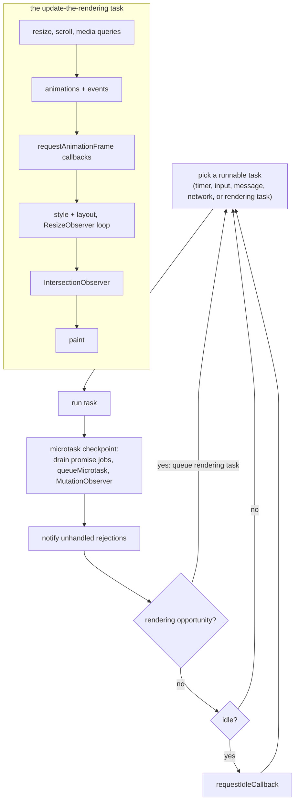

# 06 · Agents, Realms, the Job Queue and the Event Loop

> **Spec anchors:** ECMA-262 17th edition §9.3 *Realms*, §9.4 *Execution Contexts*, §9.5 *Jobs and Host Operations to Enqueue Jobs* (§9.5.5 HostEnqueuePromiseJob), §9.6 *Agents*, §9.7 *Agent Clusters*, §9.8 *Forward Progress*, §27.2.1 *Promise Abstract Operations* (§27.2.1.3 CreateResolvingFunctions, §27.2.1.9 HostPromiseRejectionTracker), §27.2.2.1 NewPromiseReactionJob, §27.2.2.2 NewPromiseResolveThenableJob, §27.2.5.4.1 PerformPromiseThen, §27.7.5.3 Await, §20.5.2.1 `Error.isError`. **HTML Living Standard** §8.1.7 *Event loops* (§8.1.7.1 definitions, §8.1.7.2 queuing tasks, §8.1.7.3 processing model), §8.1.6.4 HostPromiseRejectionTracker, §8.1.6.6.4 HostEnqueuePromiseJob, §8.1.4.7 unhandled promise rejections.
>
> **Executable proof:** [`examples/06-agents-realms-job-queue.test.js`](../examples/06-agents-realms-job-queue.test.js), with an executable model of the HTML processing model in [`examples/06-event-loop-model.js`](../examples/06-event-loop-model.js)

ECMA-262 defines *what* a job is and *that* promise jobs must run in FIFO order after the current code finishes. It does **not** define timers, I/O, rendering, or when "after" is. The host does. This module separates the two layers precisely, because nearly every "predict the output" interview question and every UI-jank or starvation bug lives on the boundary between them.

---

## 1. Agents and agent clusters

**Definition (§9.6).** An *agent* comprises a set of ECMAScript execution contexts, an execution context stack, a running execution context, an **Agent Record**, and an *executing thread*. Code in an agent runs on one thread at a time; that is the language's single-threadedness guarantee.

| Host construct | Agent? |
|---|---|
| A browser tab's main thread (similar-origin window agent: all same-site windows that can reach each other share one) | yes |
| Each `Worker`, `SharedWorker`, `ServiceWorker`, worklet | its own agent |
| Node.js main thread; each `worker_threads.Worker` | its own agent |
| `vm` contexts, iframes of the same agent | **not** separate agents: same thread, different *realms* |

**Agent cluster (§9.7).** A set of agents that can share memory (`SharedArrayBuffer`). In browsers this requires cross-origin isolation ([module 11](11-binary-data-memory-model.md)). The Agent Record's `[[CanBlock]]` says whether `Atomics.wait` may block: false on a browser main thread, true in workers and in Node's main thread.

**Forward progress (§9.8).** An agent makes progress when it is not blocked, but the spec does not require fairness *between* agents beyond that. Any fairness you see comes from the host and the OS scheduler.

---

## 2. Realms

**Definition (§9.3).** A *Realm Record* has `[[Intrinsics]]` (one fresh copy of every built-in: `%Array%`, `%Object.prototype%`, `%Promise%`, ...), a `[[GlobalObject]]`, a `[[GlobalEnv]]`, and `[[HostDefined]]` data. All ECMAScript code is associated with a realm, and built-in functions create objects using **the realm they belong to** (the *current realm* of the running execution context, or the function's own `[[Realm]]`).

Realms you meet in practice: each iframe and window, each `vm.createContext()` in Node, each worker (also a separate agent), and, in the future, `ShadowRealm` (Stage 2.7, behind `--harmony-shadow-realm` in V8 14.6).

Consequences of separate intrinsics:

| Check | Cross-realm safe? | Why |
|---|---|---|
| `x instanceof Array` | **no** | compares with *this* realm's `Array.prototype` |
| `Array.isArray(x)` | yes | checks for an Array exotic object (and sees through Proxies) |
| `x instanceof Error` | **no** | |
| `Error.isError(x)` (ES2026) | yes | checks the `[[ErrorData]]` internal slot |
| `Object.prototype.toString.call(x)` | mostly | uses `Symbol.toStringTag`, which can be spoofed |
| `x.constructor === Object` | no | |
| structured clone (`postMessage`) | yes | recreates the value *in the receiving realm* |

Frameworks hit this when they receive objects from iframes, from `vm`-based test runners (Jest's environment uses `vm` contexts, so `instanceof Error` fails for errors thrown by Node core in some setups), or from libraries bundled twice (not a realm issue, but the same symptom: two different `class` objects).

---

## 3. Jobs in ECMA-262

**Definition (§9.5).** A *Job* is an Abstract Closure with no parameters that initiates an ECMAScript computation when no other ECMAScript computation is running. Jobs are scheduled through host-defined operations; ECMA-262 itself uses only three:

| Host hook | Used for |
|---|---|
| `HostEnqueuePromiseJob(job, realm)` (§9.5.5) | promise reactions and thenable resolution |
| `HostEnqueueGenericJob(job, realm)` | e.g. `Atomics.waitAsync` resolution |
| `HostEnqueueTimeoutJob(timeoutJob, realm, ms)` | e.g. `Atomics.waitAsync` timeouts |

Requirements on promise jobs: they run **in FIFO order relative to each other**, and only when the execution context stack is empty. Everything else (when "empty" happens, what else runs in between) is up to the host. In HTML, `HostEnqueuePromiseJob` enqueues a **microtask**.

### The promise machinery

Each promise has `[[PromiseState]]` (pending, fulfilled, rejected), `[[PromiseResult]]`, `[[PromiseFulfillReactions]]`, `[[PromiseRejectReactions]]` and `[[PromiseIsHandled]]`.

- `p.then(f, r)` → `PerformPromiseThen` (§27.2.5.4.1): if `p` is pending, append reactions; if already settled, **immediately enqueue** a `NewPromiseReactionJob` (§27.2.2.1). Callbacks never run synchronously, even for an already-resolved promise.
- Calling a promise's `resolve(x)` (from `CreateResolvingFunctions`, §27.2.1.3):
  - if `x` is not an object, or has no callable `then`: fulfil immediately (reactions are enqueued);
  - if `x` is the promise itself: reject with `TypeError`;
  - if `x` is a **thenable** (including a native promise): enqueue a `NewPromiseResolveThenableJob` (§27.2.2.2), which later calls `x.then(resolve, reject)`. That costs extra ticks.
- Only the first call to `resolve`/`reject` counts (the `[[AlreadyResolved]]` flag).

### Tick accounting (measured on Node 26 and pinned in the example file)

Counting "ticks" as successive microtask turns after the current script ends:

| Code | Its continuation runs after |
|---|---|
| `Promise.resolve().then(f)` | 1 tick |
| `await nativePromise` | **1 tick** (ES2019 change: `Await` uses `PromiseResolve`, which returns a native promise unchanged) |
| `Promise.resolve(thenableObject).then(f)` | 2 ticks (resolve-thenable job, then the reaction) |
| `new Promise(r => r(nativePromise)).then(f)` | **3 ticks** (resolve-thenable job → `then` reaction on the inner promise → outer reaction) |
| `async function f() { return nativePromise }` then `f().then(g)` | 3 ticks (same mechanism: returning a promise from an async function resolves the outer promise with a thenable) |

The practical rule: **`return await p` inside an async function is not slower than `return p`**; it is actually fewer ticks, and it keeps the function in the async stack trace. (ESLint's old `no-return-await` was deprecated for this reason.)

### Then vs now: `await` cost

| Then (ES2017–ES2018 engines) | Now (ES2019+) |
|---|---|
| `await v` wrapped `v` in a *new* promise and resolved it, costing 3 ticks even for a native promise | `await v` calls `PromiseResolve`, reusing native promises: 1 tick |
| `return await p` discouraged as "extra tick" | `return await p` recommended inside `try` (otherwise rejections bypass your `catch`) and harmless elsewhere |

### HostPromiseRejectionTracker (§27.2.1.9)

Called with operation `"reject"` when a promise is rejected **without** any handler, and with `"handle"` when a handler is added to an already-rejected, previously unhandled promise. ECMA-262 only reports; the host decides policy:

- **HTML**: collects "about-to-be-notified rejected promises" and, after the microtask checkpoint, fires `unhandledrejection` on the global; a later handler fires `rejectionhandled`. The default action logs to the console.
- **Node**: emits `process.on('unhandledRejection')` after the microtask queue drains; the default mode since Node 15 is `--unhandled-rejections=throw`, which raises it as an uncaught exception and **exits with code 1** if no listener handles it. Details of Node's modes belong to the Node.js track ([`../../../technologies/nodejs/`](../../../technologies/nodejs/)).

"Unhandled" means *no handler by the time the host checks*, not "never handled". Attaching a `.catch` one macrotask later is too late in both hosts.

---

## 4. The HTML event loop processing model

The HTML Standard (§8.1.7) defines the browser host's event loop. This track owns this section; the CSS track owns what happens *inside* style, layout and paint ([`../../css/`](../../css/)), and Node's libuv phases belong to the Node.js track.

### Definitions (§8.1.7.1)

- An **event loop** has one or more **task queues**. A task queue is a *set*, not a queue: the loop picks the first *runnable* task from a queue of its choosing, so the browser may prioritise (for example) input over timers. Order is guaranteed only **within** one task source.
- A **task** has steps, a *source* (DOM manipulation, user interaction, networking, history traversal, timers, posted messages, ...), a document and a script evaluation environment settings object set.
- The **microtask queue** is a real FIFO queue, one per event loop. Promise reactions, `queueMicrotask` callbacks and `MutationObserver` notifications are microtasks.
- The **performing a microtask checkpoint** flag prevents re-entrancy of the checkpoint.

### Processing model (§8.1.7.3), condensed

```
EVENT-LOOP()
1  loop forever
2      taskQueue ← an implementation-chosen task queue containing a runnable task
3      if taskQueue exists
4          oldestTask ← the first runnable task in taskQueue; remove it
5          run oldestTask's steps                      ▷ e.g. a setTimeout callback, an event dispatch,
6                                                       ▷ or the "update the rendering" task
7      PERFORM-MICROTASK-CHECKPOINT()
8      record task timing; if this is a window event loop and there is
9          no runnable task and no rendering opportunity, the idle period may start
10         (requestIdleCallback deadlines are computed here)

PERFORM-MICROTASK-CHECKPOINT()
1  if performing-checkpoint flag is set, return
2  set the flag
3  while the microtask queue is not empty
4      dequeue the oldest microtask and run it          ▷ microtasks enqueued now run in this same loop
5  for each environment settings object: notify about rejected promises
6  cleanup IndexedDB transactions; ClearKeptObjects() (WeakRef targets may now be collected)
7  unset the flag
```

**Loop invariant.** When step 2 selects the next task, the microtask queue is empty. Every task (including the rendering update) is followed by a complete drain of the microtask queue, and a microtask that enqueues another microtask extends the *current* drain. Consequently, microtasks can starve tasks and rendering forever; tasks cannot starve microtasks.

### Updating the rendering

In the current standard, whenever the window event loop has a **rendering opportunity** (typically aligned with the display's refresh, about every 16.7 ms at 60 Hz, and only for documents that are visible and not throttled), it queues an **"update the rendering" task** on the *rendering task source*. That task, for each fully active document whose rendering is relevant, runs in this order (condensed from the standard; consult §8.1.7.3 for the full list):

1. reveal the document, flush autofocus candidates;
2. **run the resize steps** (fire `resize`);
3. **run the scroll steps** (fire `scroll`, `scrollend`);
4. evaluate media queries and report changes (`matchMedia` listeners);
5. update animations and send events (Web Animations, CSS animation/transition events);
6. run the fullscreen steps;
7. **run the animation frame callbacks** (`requestAnimationFrame`), each with the same timestamp;
8. loop: **recalculate styles and update layout**, gather and broadcast `ResizeObserver` observations (repeat while observations at deeper depths exist);
9. update intersection observations (`IntersectionObserver`);
10. **paint**: update the rendering or user interface of the document and its browsing context.

Because the rendering update is itself a task, it too is followed by a microtask checkpoint, and every rAF callback is a separate callback invocation, after which microtasks queued by it run ("clean up after running script" performs a microtask checkpoint when the JavaScript stack empties).

> **Then vs now:** older versions of the standard (and most blog posts before 2024) describe "update the rendering" as a *step* of the event loop after the microtask checkpoint. The standard was refactored so that rendering is a task on its own task source. Observable ordering is essentially the same; the change makes rendering prioritisable like other task sources. (Servo's event loop rewrite references it as "add an update-the-rendering task".)



### Ordering consequences you can predict

```js
console.log('1 sync');
setTimeout(() => console.log('5 timer task'), 0);
requestAnimationFrame(() => console.log('? rAF: before or after the timer'));
Promise.resolve().then(() => console.log('3 microtask'));
queueMicrotask(() => console.log('4 microtask'));
console.log('2 sync');
```

`1, 2, 3, 4` are fixed by the spec (synchronous code, then the checkpoint after the script task, in FIFO order). Whether the rAF callback runs before or after the timer depends on whether a rendering opportunity occurs before the timer task is chosen: it is **not deterministic** across browsers and frames. Code that needs "after the next paint" uses `requestAnimationFrame` + `setTimeout`/`MessageChannel`, or `scheduler.postTask`/`scheduler.yield()` where supported.

Other rules:

- `setTimeout(f, 0)` is clamped to ≥ 4 ms after five levels of nesting, and timers in background tabs are throttled (to 1 s or more).
- A long task (> 50 ms) blocks input and rendering: nothing in the processing model preempts running JavaScript.
- `MutationObserver` callbacks are microtasks, so DOM mutations from many statements are delivered as one batch at the checkpoint.
- Framework batching (React's automatic batching, Solid's flush) is built on these primitives; see the React and SolidJS tracks.

### Node.js as a host, briefly

Node also drains the microtask queue after each callback from libuv, and has `process.nextTick`, a separate queue processed **before** promise microtasks. Its loop phases (timers, pending callbacks, poll, check, close) are owned by the Node.js track. For the code in this track, the relevant guarantee is the same as HTML's: synchronous code → all microtasks → next macrotask.

---

## 5. Executable model of the processing model

[`examples/06-event-loop-model.js`](../examples/06-event-loop-model.js) implements a deterministic simulator: task sources with FIFO order within a source, one microtask queue, a checkpoint after every task, and a rendering task queued whenever the simulated clock crosses a frame boundary. Tests replay the classic puzzles against it and against Node, and show starvation: a self-re-enqueuing microtask prevents both timers and rendering forever, while a self-re-enqueuing *task* lets rendering interleave.

---

## 6. Production failure modes

| Failure | Mechanism | Defence |
|---|---|---|
| UI freezes although work is "async" | a long chain of promise continuations is a single microtask drain; no rendering in between | yield to the event loop: `await scheduler.yield()` or `await new Promise(r => setTimeout(r))`; chunk work; move CPU work to a worker |
| Infinite loop without a loop: tab hangs | microtask that enqueues itself (recursive `queueMicrotask`, or a promise chain that re-subscribes) starves tasks | bounded recursion; schedule via tasks |
| Node process exits with code 1 under load | rejection without a handler at checkpoint time (a forgotten `await`, a `.catch` attached later) | always `await` or `.catch` immediately; lint `no-floating-promises`; global `unhandledRejection` handler for logging, not for recovery |
| Animation stutters | layout reads after writes in rAF (forced synchronous layout), or work scheduled with `setTimeout(16)` | batch reads then writes; drive animations with rAF timestamps |
| Test flakes "sometimes passes" | relying on rAF vs timer ordering, or on cross-source task ordering | wait on explicit signals; use fake timers that model microtasks |
| `instanceof Error` false in tests | errors created in a different realm (`vm`-based runners) | `Error.isError` |

---

## Interview Drill

<details><summary>1. Predict: `setTimeout(A, 0); Promise.resolve().then(B); queueMicrotask(C); (async () => { await null; D() })(); E()`.</summary>

E (synchronous), then B, C, D (microtasks in FIFO order of enqueueing; `await null` enqueues its continuation when the async function runs, after B and C were enqueued), then A (a task).
</details>

<details><summary>2. What is the difference between a task and a microtask? Who defines each?</summary>

ECMA-262 defines Jobs and requires promise jobs to run in FIFO order when the stack is empty. HTML maps promise jobs to the microtask queue and defines tasks (macrotasks) in task queues per source. After every task, the event loop drains the microtask queue completely. Microtasks can starve tasks and rendering; tasks yield to rendering opportunities.
</details>

<details><summary>3. Where does `requestAnimationFrame` run relative to microtasks and paint?</summary>

Inside the "update the rendering" task, after resize/scroll/media-query/animation steps and before style recalculation, layout and paint. Microtasks queued by a rAF callback run when that callback returns (the stack empties), before the next rAF callback and before layout.
</details>

<details><summary>4. Why does `new Promise(r => r(otherPromise))` take longer to settle than `await otherPromise`?</summary>

Resolving with a thenable enqueues a NewPromiseResolveThenableJob that later calls `otherPromise.then(resolve, reject)`; that reaction then resolves the outer promise, whose own reaction runs later: three microtask turns. Since ES2019, `await` uses PromiseResolve, which returns a native promise unchanged and subscribes directly: one turn.
</details>

<details><summary>5. What is a realm and when does it bite?</summary>

A set of intrinsics plus a global object and environment. Iframes, `vm` contexts and workers each have their own, so prototype-based checks (`instanceof`, `constructor ===`) fail across them. Use `Array.isArray`, `Error.isError`, or structured cloning, which recreates values in the receiving realm.
</details>

<details><summary>6. When is a promise rejection "unhandled"?</summary>

When it is rejected without a reaction, and still has none when the host checks: in HTML after the microtask checkpoint (`unhandledrejection` event), in Node after the microtask queue drains (default `--unhandled-rejections=throw`, exit code 1). A handler added later triggers `rejectionhandled` in HTML.
</details>

<details><summary>7. Can `await` in a loop block rendering?</summary>

If every awaited value is already resolved, the whole loop runs within one microtask drain, so yes: no task or rendering opportunity occurs until it finishes. Awaiting something that settles in a later task (I/O, a timer, `scheduler.yield()`) lets the event loop run tasks and render in between.
</details>

<details><summary>8. Why is a task "queue" actually a set?</summary>

The event loop chooses the first *runnable* task from a queue of its choosing; tasks whose document is not fully active are skipped, and browsers prioritise some sources (input, rendering) over others (timers). Only tasks from the same source keep their relative order.
</details>
