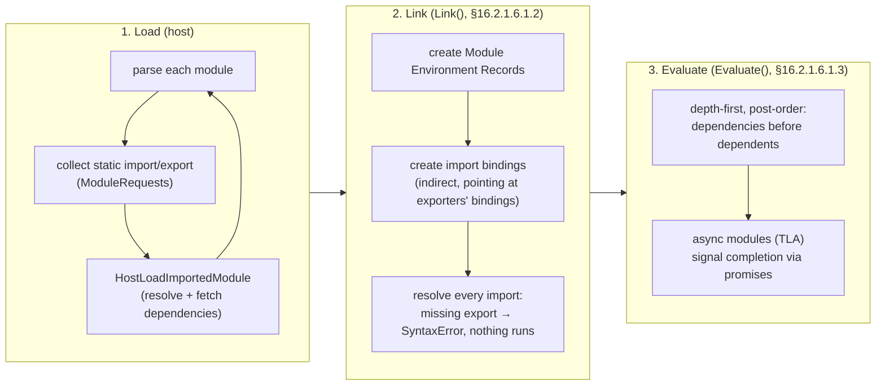

# 08 · Modules: ESM Semantics, Live Bindings, Cycles, Top-Level Await and Conditions

> **Spec anchors (ECMA-262 17th edition):** §16.2 *Modules*: §16.2.1.5 *Abstract Module Records*, §16.2.1.6 *Cyclic Module Records* (§16.2.1.6.1.2 Link, §16.2.1.6.1.3 Evaluate, §16.2.1.6.1.3.1 InnerModuleEvaluation, §16.2.1.6.1.3.2 ExecuteAsyncModule, §16.2.1.6.1.3.4 AsyncModuleExecutionFulfilled), §16.2.1.7 *Source Text Module Records*, §16.2.1.10 HostLoadImportedModule, §16.2.1.11 FinishLoadingImportedModule, §16.2.1.13 GetModuleNamespace, §16.2.2 *Imports*, §16.2.3 *Exports*, §9.1.1.5 *Module Environment Records*, §10.4.6 *Module Namespace Exotic Objects*, §13.3.10 `import()` (§13.3.10.2 EvaluateImportCall), §13.3.12.1.1 HostGetImportMetaProperties. Proposals: Deferring Module Evaluation (Stage 3), Source Phase Imports (Stage 3). Node.js documentation: *Modules: Packages* (`exports`, conditions).
>
> **Executable proof:** [`examples/08-modules.test.js`](../examples/08-modules.test.js) with fixtures in [`examples/fixtures/08-modules/`](../examples/fixtures/08-modules/)

ECMAScript modules (ESM) are the language's own module system. Its semantics are not "a fancier `require`": imports are resolved and **linked before any code runs**, bindings are **live references** rather than copied values, and evaluation of a graph may be **asynchronous**. This module covers the language semantics fully. The CommonJS loader, `require(esm)`, Node's resolution algorithm internals and loader hooks are owned by the Node.js track ([`../../../technologies/nodejs/`](../../../technologies/nodejs/)); TypeScript's `moduleResolution` typing is owned by the TypeScript track ([`../../typescript/`](../../typescript/)).

---

## 1. Module Records and the three phases

**Definition (§16.2.1.5).** A *Module Record* encapsulates structural information about one module: its realm, its environment, its namespace object, and host-defined data. A **Cyclic Module Record** (§16.2.1.6) can participate in dependency cycles; a **Source Text Module Record** (§16.2.1.7) is one created from ECMAScript source. Hosts can add other kinds (JSON modules are Synthetic Module Records in HTML; WebAssembly modules integrate through the ESM Integration proposal).

Loading a module graph happens in three phases, separated in time:



1. **Load.** Starting from the entry, the host parses each module, extracts its `ModuleRequests` (specifier plus import attributes), and loads each dependency (`HostLoadImportedModule`). Parsing finds every `import`/`export` statically: they must be at the top level, with string-literal specifiers. A syntax error anywhere fails the whole graph.
2. **Link.** For each module, create its Module Environment Record and **import bindings**. Every import must resolve to an export (`ResolveExport`, following `export ... from` re-exports and `export *`). A missing named export is a `SyntaxError` at link time: **no module in the graph runs**.
3. **Evaluate.** Execute module bodies depth-first, post-order, each module **at most once** per realm and per resolved URL. The result of `Evaluate()` is a promise (since ES2022, because of top-level await).

The `[[Status]]` field tracks the progress: *new → unlinked → linking → linked → evaluating → evaluating-async → evaluated*. A module that throws during evaluation is *evaluated* with an `[[EvaluationError]]`; importing it again rethrows the **same** error object. A module failing once is broken for the lifetime of the realm; there is no retry.

### Static structure is the point

Because imports and exports are known before execution:

- tools can **tree-shake** (remove unused exports) and detect missing exports at build time;
- engines can link bindings without running code;
- cycles can be handled deterministically (§3).

The dynamic escape hatch is `import(specifier)` (§13.3.10), an expression that returns a promise for the module namespace object and can be used anywhere, including in CommonJS and classic scripts.

---

## 2. Live bindings

**Definition (§9.1.1.5).** In a Module Environment Record, an import is an **indirect binding**: `CreateImportBinding(N, M, N2)` makes the local name `N` an alias for the binding `N2` in module `M`'s environment. Reading the import reads the exporter's variable *at that moment*.

```js
// counter.js
export let count = 0;
export function increment() { count++; }
export default count;              // default export of an *expression*: evaluated once, a snapshot

// main.js
import snapshot, { count, increment } from './counter.js';
increment();
count;     // 1   (live: reads counter.js's `count`)
snapshot;  // 0   (export default <expression> creates a hidden *default* binding initialised once)
count = 5; // TypeError: Assignment to constant variable (imports are read-only for the importer)
```

Facts:

- Imports are **immutable from the importer's side** (assignment throws `TypeError`, also in sloppy code, because modules are strict). The exporter can still change them.
- `export default function f() {}` and `export default class C {}` export the **declaration's binding** (live if reassigned inside the module). `export default <expression>` exports a hidden binding named `*default*`, initialised once.
- `export { x as default }` exports the live binding `x`.
- Transpiling ESM to CommonJS emulates live bindings with getters (`exports.count` via `Object.defineProperty(exports, 'count', { get })`); hand-written CJS `module.exports = { count }` copies the value and is **not** live.

### Module namespace objects (§10.4.6)

`import * as ns from './counter.js'` gives an exotic object with:

| Property | Value |
|---|---|
| `[[Prototype]]` | `null` |
| keys | exported names, **sorted by code unit order** (not declaration order) |
| `ns[Symbol.toStringTag]` | `'Module'` |
| extensible? | no |
| property descriptors | `{ writable: true, enumerable: true, configurable: false }`, but `[[Set]]` always fails, so assignments throw in strict code |
| `Object.isFrozen(ns)` | `false` (properties report `writable: true` so that their live values can change) |

The namespace is created lazily and cached: the same module gives the same namespace object to every importer and every `import()` call.

---

## 3. Cycles and the temporal dead zone

Evaluation is a depth-first traversal (`InnerModuleEvaluation`, using Tarjan-style DFS indices to identify strongly connected components). When a cycle exists, the module visited **first** from the entry finishes **last**, and the others run while some of its bindings are still uninitialised.

Fixture ([`examples/fixtures/08-modules/cycle/`](../examples/fixtures/08-modules/cycle/)):

```js
// a.js                              // b.js
import { b } from './b.js';          import { a } from './a.js';
export const a = 'A';                let seen;
export function useB() { return b; } try { seen = a; } catch (e) { seen = e.message; }
                                     export const b = 'B';
                                     export const sawA = seen;
                                     export function readALater() { return a; }
// main.js
import { useB } from './a.js';       // a.js is visited first
import { sawA, readALater } from './b.js';
```

Traversal from `main.js`: visit `a.js` → visit `b.js` → `b.js` imports `a.js`, which is already *evaluating* (in the current DFS stack), so `b.js` does not wait → `b.js` **evaluates first** and reads `a` while `a.js` has not run: `ReferenceError: Cannot access 'a' before initialization`. Then `a.js` evaluates. Later calls to `readALater()` succeed because the binding is live and now initialised.

Swap the entry's import order and the error disappears. That fragility is the problem: **circular imports make program correctness depend on import order**. Defences:

1. Break the cycle: move shared code to a third module that both import.
2. In a cycle, only access imported bindings **inside functions called later**, never at module top level (function declarations are hoisted and initialised at link time, so exporting functions is safer than exporting `const` values or classes).
3. Detect cycles in CI (`madge --circular`, bundler warnings, `eslint-plugin-import`'s `no-cycle`).

Class declarations are a common victim: `class Admin extends User` at the top level of a module in a cycle with `user.js` throws if `admin.js` evaluates first.

---

## 4. Top-level await (ES2022)

A module whose body contains `await` at the top level is an **async module** (`[[HasTLA]]`). Evaluation semantics (§16.2.1.6.1.3.2–4):

- A module that depends on an async module (directly or transitively) does not start evaluating until that module's evaluation promise fulfils.
- **Siblings that do not depend on it continue**: while `slow.js` awaits, an unrelated `sibling.js` in the same graph runs. The graph evaluates "as concurrently as possible while preserving dependency order".
- If the async module rejects, every module that depends on it is marked evaluated with that error.

Fixture ([`examples/fixtures/08-modules/tla/`](../examples/fixtures/08-modules/tla/)): `entry.js` imports `consumer.js` (which imports `slow.js`, an async module) and then `sibling.js`. The observed order is:

```
slow:start → sibling → slow:end → consumer sees slow → entry
```

Production implications:

| Use | Verdict |
|---|---|
| `const config = await loadConfig()` in an application entry module | fine |
| `await` a database connection in a **shared** library module | dangerous: every importer's startup waits for it; a failure makes the module permanently broken in that realm; tests that import it need the DB |
| TLA in a module that participates in a cycle | can **deadlock** the cycle's evaluation (each waits on the other) |
| TLA for a dynamic, optional import (`const mod = await import(x)`) | fine in entry modules; in libraries prefer exporting an async function |

`require()` of an ESM graph containing TLA throws `ERR_REQUIRE_ASYNC_MODULE` in Node (details in the Node.js track), so TLA in a library also limits who can consume it.

---

## 5. Dynamic import, `import.meta`, attributes and phases

### `import()`

- Returns a promise for the namespace object. Works in scripts, CommonJS and modules.
- The specifier is any expression (ToString'd), so bundlers cannot always analyse it; templated paths like ``import(`./locales/${lang}.js`)`` are partially supported by bundlers via glob analysis.
- Same caching as static imports: a module evaluates once per realm, and a failed evaluation rethrows the same error.
- `export default` arrives as `ns.default`.

### `import.meta` (§13.3.12)

A per-module object populated by the host (`HostGetImportMetaProperties`):

| Host | Properties |
|---|---|
| HTML | `url`, `resolve(specifier)` |
| Node 26 | `url`, `resolve(specifier)`, `filename`, `dirname`, `main` (true for the entry module) |

`import.meta.dirname` and `filename` replace the `fileURLToPath(new URL('.', import.meta.url))` boilerplate in Node ≥ 20.11.

### Import attributes (ES2025)

```js
import data from './data.json' with { type: 'json' };
const css = await import('./theme.css', { with: { type: 'css' } }); // browsers (CSS module scripts)
```

The attribute is a security feature: the importer states the *expected* type, so a server that returns JavaScript for `data.json` cannot execute code in the importer. Hosts **must** reject a JSON import without `type: 'json'` (Node: `ERR_IMPORT_ATTRIBUTE_MISSING`). JSON modules give the parsed value as `default` only, with `JSON.parse` semantics (so large integers lose precision, see [module 13](13-correctness-security-pitfalls.md)).

> **Then vs now:** import *assertions* (`assert { type: 'json' }`, shipped in Chrome 91 and Node 17–21) were replaced by import *attributes* (`with { type: 'json' }`). V8 removed `assert` support; Node 22+ rejects it. Migrate by replacing `assert` with `with`.

### Phase imports (Stage 3)

| Syntax | Proposal | Meaning | Node 26.12.1 |
|---|---|---|---|
| `import defer * as ns from './heavy.js'` | Deferring Module Evaluation, Stage 3 | load and link now; **evaluate on first property access** of `ns` (synchronously) | behind `--js-defer-import-eval` |
| `import source wasmMod from './x.wasm'` | Source Phase Imports, Stage 3 | get the module's *source* representation (a `WebAssembly.Module`) without instantiating it | V8 flag on by default; Node support for Wasm source imports is experimental |
| `import.sync` | Import Sync, Stage 2 | | absent |

`import defer` is a startup-time optimisation: the module and its dependencies are fetched and linked eagerly (so errors still surface early), but their bodies run only when needed. It cannot defer async modules (TLA) synchronously; those are evaluated eagerly. The example runs the fixture under the flag and shows `main body` logged before `heavy evaluated`.

---

## 6. Package `exports` and conditions at runtime

Bare specifiers (`'react'`, `'solid-js/web'`) are resolved by the host. In Node and every major bundler, a package's `package.json` `"exports"` field is the public entry-point map:

```json
{
  "name": "cond-demo",
  "type": "module",
  "exports": {
    ".": {
      "development": "./src/dev.js",
      "node": "./src/node.js",
      "default": "./src/default.js"
    },
    "./feature": "./src/feature.js",
    "./internal/*": null
  }
}
```

Rules (from the Node.js *Packages* documentation, which bundlers follow):

1. **Encapsulation.** Only subpaths listed in `exports` can be imported. `import 'cond-demo/src/secret.js'` fails with `ERR_PACKAGE_PATH_NOT_EXPORTED`. `null` targets explicitly block subpaths.
2. **Condition matching.** Within a conditions object, keys are tested **in object order**; the first key that is in the active condition set wins. Put specific conditions first and `"default"` last.
3. **Active conditions** depend on the environment:

| Condition | Active when |
|---|---|
| `import` / `require` | loaded via `import`/`import()` or via `require()` |
| `module-sync` | loader can load ESM synchronously (Node ≥ 22.10, with `require(esm)`) |
| `node`, `deno`, `bun`, `workerd` | in that runtime |
| `browser`, `worker` | bundlers/browsers targeting those |
| `development` / `production` | user-enabled (`node --conditions=development`, bundler `mode`) |
| `react-server` | React Server Components builds (see the React track) |
| `types` | TypeScript only, must be first (see the TypeScript track) |
| `default` | always |

4. **Self-reference.** Code inside a package can import itself by its own name, which goes through `exports` (the fixture uses this).
5. **`imports`** (`"#internal": "./src/internal.js"`) maps private specifiers beginning with `#`, usable only within the package.

The "dual package hazard": a package shipping both CJS and ESM entry points can be loaded twice in one process (once per format), giving two copies of its state and two different classes (`instanceof` fails, singletons duplicate). Node's `require(esm)` and the `module-sync` condition reduce the need for dual builds; details are in the Node.js track.

SolidJS and React both ship condition-based builds (`browser`/`node`/`development`/`worker`, `react-server`); their tracks link here for the mechanism.

---

## 7. ESM vs CommonJS, at the language level

| | ESM | CommonJS |
|---|---|---|
| Defined by | ECMA-262 | Node.js (host convention) |
| Imports | static declarations, linked before evaluation | `require()` call, evaluated when reached |
| Bindings | live, read-only for importers | copies of `module.exports` properties at the time of reading |
| Loading | asynchronous-capable (TLA, network) | synchronous |
| Strict | always | only with `"use strict"` |
| Top-level `this` | `undefined` | `module.exports` |
| `__dirname`, `require`, `module` | absent (`import.meta.dirname`, `createRequire`) | available |
| Cycles | live bindings + TDZ errors | partially filled `module.exports` objects (`{}`) |
| Tree-shaking | yes | limited |

Interop details (`import cjs from './x.cjs'` gives `module.exports` as `default` plus statically detected named exports; `require(esm)` in Node 22.12+/20.19+) are Node.js-track material.

---

## 8. Production failure modes

| Failure | Mechanism | Defence |
|---|---|---|
| `ReferenceError: Cannot access 'X' before initialization` at startup after an innocuous refactor | circular import; evaluation order changed | break cycles; lint `import/no-cycle`; access cyclic imports only inside functions |
| `SyntaxError: The requested module './x.js' does not provide an export named 'y'` | link-time resolution failure; nothing ran | fix the import; for CJS dependencies use the default import |
| App startup hangs | top-level await in a shared module waiting on a slow or dead dependency; or TLA in a cycle | keep TLA in entry modules; export async init functions |
| A failed module stays failed until restart | evaluation errors are cached per realm | do not throw from module top level for recoverable conditions |
| Two copies of a library, `instanceof` fails, singleton state split | dual package hazard, or two versions in `node_modules` | single format; `npm ls`/dedupe; `peerDependencies` |
| Production build uses development code (or vice versa) | condition order wrong in `exports`, `default` listed first | put specific conditions first; test with `--conditions` |
| Deep import breaks on a minor upgrade | consumer imported an unexported internal path | rely only on `exports`; packages should block internals with `null` |
| JSON import silently loses precision for big IDs | JSON modules use `JSON.parse` semantics | parse with a reviver at runtime instead |

---

## Interview Drill

<details><summary>1. What are the phases of loading an ES module graph, and what can fail in each?</summary>

Load/parse (syntax errors, fetch/resolution failures), link (missing exports, ambiguous `export *` names: SyntaxError, nothing has run), evaluate (runtime exceptions, TDZ errors in cycles, rejected top-level await). Each module evaluates at most once per realm; evaluation errors are cached and rethrown on later imports.
</details>

<details><summary>2. What is a live binding? Show the difference from CommonJS.</summary>

An import is an indirect reference to the exporter's variable, so `import { count }` sees later increments made by the exporting module. In CommonJS, `const { count } = require('./c')` copies the value at that moment. Importers cannot assign to imports (TypeError).
</details>

<details><summary>3. Why does a circular import produce "Cannot access 'X' before initialization"?</summary>

Evaluation is depth-first post-order; in a cycle, a module that is still evaluating does not block its dependents, so a dependent can run before the module that declares `X`, and `X` is still in its TDZ. Which module sees the error depends on which module the entry imports first.
</details>

<details><summary>4. How does top-level await affect sibling and dependent modules?</summary>

Dependents of an async module wait for it to finish; modules that do not depend on it keep evaluating in the meantime. A rejection propagates to all dependents. TLA in a shared library delays every importer and in a cycle can deadlock.
</details>

<details><summary>5. What does `export default count` export, compared with `export { count as default }`?</summary>

`export default <expression>` evaluates the expression once and stores it in a hidden `*default*` binding: a snapshot. `export { count as default }` exports the live binding `count`.
</details>

<details><summary>6. How are `exports` conditions chosen?</summary>

The resolver walks the conditions object in key order and picks the first key in the active set (`import`/`require`, the runtime such as `node`, user conditions like `development`, and always `default`). Unlisted subpaths are not importable; `null` blocks a subpath.
</details>

<details><summary>7. Why do import attributes exist?</summary>

To make the importer state the expected module type. Without `with { type: 'json' }`, a compromised or misconfigured server could serve JavaScript for a `.json` URL and get it executed. Hosts reject JSON imports without the attribute.
</details>

<details><summary>8. What does `import defer` change?</summary>

The deferred module and its dependencies are loaded and linked eagerly, but evaluation is postponed until the first property access on the namespace, which then runs synchronously. It is a startup optimisation for rarely used, expensive modules. Stage 3; behind a flag in Node 26.
</details>
