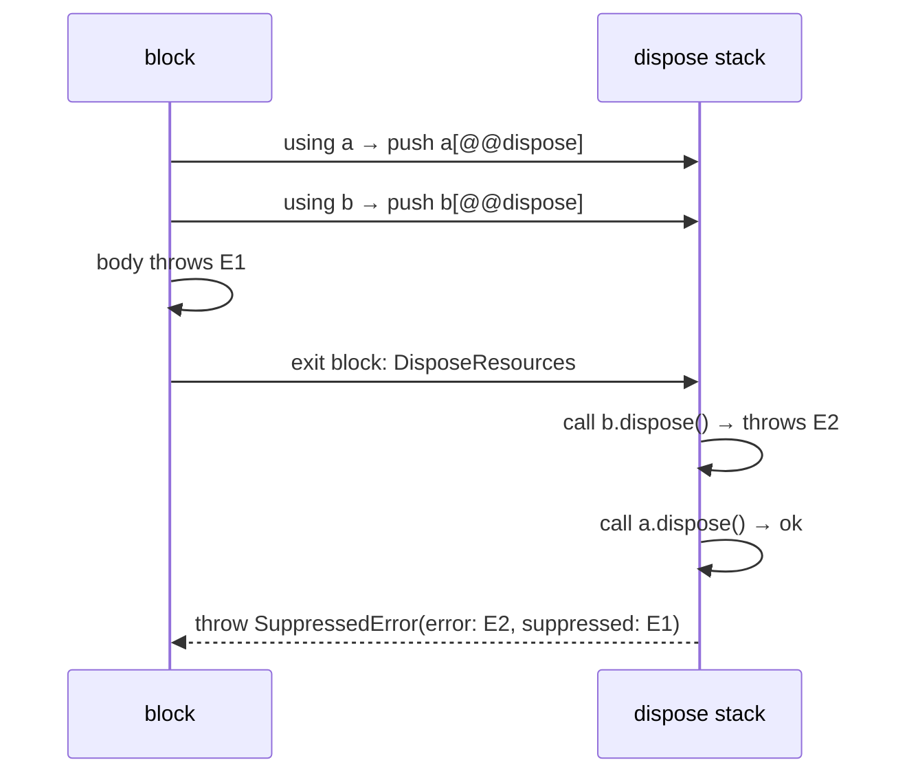
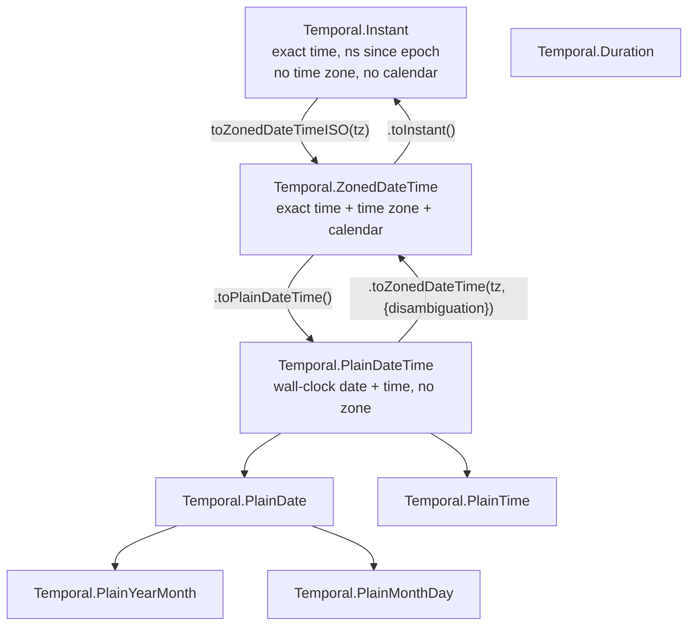

# 10 · Explicit Resource Management and Temporal (ES2027)

> **Spec anchors:** both features reached **Stage 4 in 2026 and are slated for ES2027**; they are in the living draft (<https://tc39.es/ecma262/>), not in the ES2026 (17th edition) text. Primary sources: proposal-explicit-resource-management (spec text: `using` declarations, `DisposeResources`, `DisposableStack`, `AsyncDisposableStack`, `SuppressedError`), proposal-temporal (spec text and the Temporal documentation at <https://tc39.es/proposal-temporal/docs/>). Time-zone data: IANA tz database (Node 26.12.1 ships tz 2026e).
>
> **Executable proof:** [`examples/10-resource-management-temporal.test.js`](../examples/10-resource-management-temporal.test.js)

Two long-standing gaps in the language were closed by the same edition: deterministic cleanup of resources (files, locks, connections, subscriptions) and a correct date-time library to replace `Date`. Both ship unflagged in Node 26 (V8 14.6). Browser support is uneven, so check MDN compatibility data before using them in client code.

---

## Part A · Explicit resource management

### 1. The problem

```js
const handle = await open(path);
try {
  const lock = await acquire(handle);
  try {
    await work(handle);
  } finally {
    await lock.release();       // nested try/finally per resource; order easy to get wrong
  }
} finally {
  await handle.close();         // and if release() throws, the original error from work() is lost
}
```

`try/finally` is correct but verbose, easy to forget, and loses errors: an exception thrown by cleanup **replaces** the exception from the body (the completion-record rule from [module 01](01-reading-the-spec.md)).

### 2. `using` and `await using`

**Definition.** A `using` declaration binds a value whose `[Symbol.dispose]()` method is called when control leaves the enclosing block, by any path: normal completion, `break`, `return`, or `throw`. An `await using` declaration calls and awaits `[Symbol.asyncDispose]()` (falling back to `[Symbol.dispose]()`).

```js
{
  using file = openSync(path);          // file[Symbol.dispose] captured now
  await using conn = await pool.get();  // conn[Symbol.asyncDispose] captured now
  // ... use both
} // dispose conn (awaited), then file: reverse order of declaration
```

Semantics, step by step:

1. At declaration, the initializer is evaluated. If the value is `null` or `undefined`, nothing is registered (an optional resource). Otherwise the method `[Symbol.dispose]` (or `[Symbol.asyncDispose]`) is **read immediately**; if it is not callable, a `TypeError` is thrown at the declaration.
2. The binding is `const`-like: it cannot be reassigned.
3. When the block exits, resources are disposed in **reverse order of declaration** (a stack).
4. If disposal throws while an error is already pending, the errors are combined into a **`SuppressedError`** with `error` (the newer error, from disposal) and `suppressed` (the earlier one). No error is lost.
5. `using` is allowed in blocks, function bodies, `for` heads (`for (using x of resources)`, disposing each value at the end of its iteration), and module top level, but **not** at the top level of a classic script and not with destructuring patterns.
6. `await using` is allowed only where `await` is (async functions, modules). The `await` at block exit happens **even if** the resource was `null`, so control flow is consistently asynchronous.



### 3. `DisposableStack` and `AsyncDisposableStack`

For resources acquired conditionally or in loops, or for adapting APIs without `Symbol.dispose`:

| Method | Purpose |
|---|---|
| `stack.use(resource)` | register a disposable; returns it |
| `stack.adopt(value, onDispose)` | register a non-disposable value with a cleanup callback |
| `stack.defer(fn)` | register a callback |
| `stack.move()` | transfer all registrations to a **new** stack and mark this one disposed: the "ownership transfer" pattern for constructors |
| `stack.dispose()` / `[Symbol.dispose]` | dispose everything in reverse order |
| `stack.disposed` | whether it has been disposed |

The constructor pattern (acquire several resources; if any acquisition fails, release the ones already acquired; on success, hand them to the object):

```js
class Session {
  #resources;
  constructor() {
    using stack = new DisposableStack();       // disposed if the constructor throws
    this.socket = stack.use(openSocket());
    this.log = stack.adopt(openLog(), (l) => l.close());
    this.#resources = stack.move();            // success: the stack being disposed is now empty
  }
  [Symbol.dispose]() { this.#resources.dispose(); }
}
```

### 4. Making your APIs disposable

- Implement `[Symbol.dispose]()` (sync) or `[Symbol.asyncDispose]()` (returns a promise) on handle-like objects. Make it idempotent.
- Node core implements them on several handle types (for example `fs.promises` `FileHandle` has `[Symbol.asyncDispose]`); the authoritative list is in the Node.js track.
- Keep `close()`/`release()` methods for callers that cannot use `using` yet; make `[Symbol.dispose]` call them.
- TypeScript types these with `Disposable`/`AsyncDisposable` interfaces (`lib: esnext.disposable` or `es2027` targets in newer TypeScript; see the TypeScript track).

### Then vs now

| Then | Now (ES2027, Node 26) |
|---|---|
| nested `try/finally`, cleanup errors overwrite body errors | `using` / `await using`, errors combined in `SuppressedError` |
| `finally { a.close(); b.close(); }`: if `a.close()` throws, `b` leaks | dispose stack: every resource is disposed even if one disposal throws |
| library-specific `withConnection(async (c) => ...)` callback helpers | plain blocks with `await using` |
| Finalizers (`FinalizationRegistry`) misused for cleanup | deterministic disposal; registries only as leak detectors ([module 09](09-metaprogramming.md)) |

Migration pitfalls: `using x = await getThing()` disposes **synchronously**; if the resource needs async cleanup you must write `await using`. Transpiled `using` (TypeScript ≤ native support, Babel) requires a `Symbol.dispose` polyfill in older runtimes; mixing polyfilled and native symbols produces "not disposable" TypeErrors.

---

## Part B · Temporal

### 5. Why `Date` had to be replaced

`Date` (ES1, modelled on Java's 1995 `java.util.Date`) is one mutable number (milliseconds since the Unix epoch) with a local-time veneer:

| Problem | Example |
|---|---|
| Mutable | `d.setMonth(1)` changes a shared object |
| Only UTC and the *host's* local time zone | no way to say "9:00 in Tokyo" |
| Parsing inconsistencies | `new Date('2026-03-29')` is **UTC midnight** but `new Date('2026-03-29T00:00')` is **local** midnight; non-ISO formats are implementation-defined |
| Month numbering from 0 | `new Date(2026, 0, 31)` is January |
| Overflow silently rolls over | `new Date(2026, 1, 30)` is March 2 |
| No date-only or time-only types | birthdays shift by a day when the time zone changes |
| No calendar support beyond Gregorian | |
| No duration type, DST-unaware arithmetic | `d.getTime() + 24 * 3600e3` is not "same time tomorrow" across DST |

### 6. The Temporal type system

Temporal separates **exact time** (a point on the timeline) from **wall-clock time** (what a calendar and clock on a wall show), and makes every type immutable.



| Type | Use for |
|---|---|
| `Instant` | timestamps, logs, ordering events, storage in UTC |
| `ZonedDateTime` | anything a human schedules in a place: meetings, deadlines, "every day at 9:00 in Prague"; the only type that does DST-correct arithmetic |
| `PlainDate` | birthdays, holidays, due dates without a time |
| `PlainTime` | opening hours |
| `PlainDateTime` | a wall-clock moment whose zone is unknown yet or irrelevant (form input before the user picks a zone) |
| `PlainYearMonth`, `PlainMonthDay` | credit-card expiry, recurring anniversaries |
| `Duration` | amounts of time: `P1Y2M3DT4H` (ISO 8601), with calendar-aware balancing |
| `Temporal.Now` | `instant()`, `zonedDateTimeISO()`, `plainDateISO()`, `timeZoneId()` |

Design rules: immutable values with `with()`/`add()`/`subtract()`/`round()` returning new objects; nanosecond precision; ISO 8601 / RFC 9557 strings (`2026-03-29T12:00:00+02:00[Europe/Prague]`); comparisons via the static `compare` (instances throw `TypeError` from `valueOf`, so `<` cannot be used by accident); explicit options for ambiguity.

### 7. Time zones and DST, precisely

In Europe/Prague, 2026-03-29 has **23 hours** (02:00 → 03:00 skipped) and 2026-10-25 has **25 hours** (02:00–03:00 repeated).

```js
const z = Temporal.ZonedDateTime.from('2026-03-28T12:00[Europe/Prague]');
z.add({ days: 1 });   // 2026-03-29T12:00+02:00: same wall-clock time ("calendar day")
z.add({ hours: 24 }); // 2026-03-29T13:00+02:00: exactly 24 elapsed hours
```

Both are correct; they answer different questions. `Date` arithmetic only offers the second.

**Disambiguation** when converting a wall-clock time that does not exist (gap) or exists twice (fold) to an exact time:

| Option | Gap (02:30 on 2026-03-29) | Fold (02:30 on 2026-10-25) |
|---|---|---|
| `'compatible'` (default, matches `Date`) | later: 03:30+02:00 | earlier: 02:30+02:00 |
| `'earlier'` | 01:30+01:00 | 02:30+02:00 |
| `'later'` | 03:30+02:00 | 02:30+01:00 |
| `'reject'` | `RangeError` | `RangeError` |

**Offset conflicts** when parsing a string with both an offset and a zone (`offset: 'use' | 'prefer' | 'ignore' | 'reject'`): relevant when stored future timestamps meet a changed tz database (a country abolishes DST after you stored `2027-07-01T09:00+02:00[Region]`). Store future human-scheduled events as **wall-clock time + zone ID**, not as instants, and recompute.

### 8. Calendar arithmetic and overflow

```js
Temporal.PlainDate.from('2026-01-31').add({ months: 1 });                       // 2026-02-28 (constrain)
Temporal.PlainDate.from('2026-01-31').add({ months: 1 }, { overflow: 'reject' }); // RangeError
Temporal.PlainDate.from({ year: 2026, month: 2, day: 30 });                      // 2026-02-28 (constrain)
```

Durations with years, months, weeks or days are **relative**: their length depends on the starting point. Rounding or totalling them requires `relativeTo`:

```js
const d = Temporal.Duration.from({ hours: 25 });
d.round({ largestUnit: 'day', relativeTo: z }); // P1DT2H across the 23-hour day
d.total({ unit: 'minute' });                     // 1500 (no calendar units involved)
```

`until`/`since` choose a default `largestUnit` per type (`hour` for `ZonedDateTime`, `day` for `PlainDate`): March 2026 in Prague is `PT743H` (31 × 24 − 1) or `P31D` with `largestUnit: 'day'`.

### 9. Migrating from `Date`

| Then (`Date`, moment.js, date-fns) | Now (Temporal) |
|---|---|
| `Date.now()` | `Temporal.Now.instant()` (ns) or keep `Date.now()` for ms timestamps |
| `new Date(isoString)` | `Temporal.Instant.from(s)` if it has an offset/`Z`; `PlainDate.from` for date-only strings |
| `date.getTimezoneOffset()` | `zdt.offset`, `zdt.offsetNanoseconds` |
| moment-timezone / Luxon zones | `ZonedDateTime` with IANA IDs |
| `d.setDate(d.getDate() + 1)` | `zdt.add({ days: 1 })` |
| `d1 < d2` | `Temporal.Instant.compare(a, b) < 0` |
| `Intl.DateTimeFormat().format(date)` | `zdt.toLocaleString(locale, options)` (Intl accepts Temporal objects) |
| interop | `date.toTemporalInstant()`, `new Date(instant.epochMilliseconds)` |

Pitfalls when mixing: `Date` is millisecond-precision and has no zone, so a round trip `ZonedDateTime → Date → ZonedDateTime` loses the zone and sub-millisecond precision; JSON serialisation gives strings that must be parsed with the right type; browser support lags Node (check before shipping client-side; the `@js-temporal/polyfill` and `temporal-polyfill` packages exist).

---

## 10. Production failure modes

| Failure | Mechanism | Defence (tested) |
|---|---|---|
| File descriptors exhausted under errors | cleanup skipped on exception paths | `using` / `await using` |
| Root cause missing from logs | cleanup exception overwrote the original | `SuppressedError` carries both; log `error` and `suppressed` |
| Async cleanup not awaited | `using` instead of `await using` | lint; types (`AsyncDisposable`) |
| Reminder fires at 13:00 instead of 12:00 the day after DST | "+24 h" arithmetic | `ZonedDateTime.add({ days: 1 })` |
| Birthday shown one day early for users west of UTC | date-only value stored as a UTC `Date` | `PlainDate` |
| Job scheduled at 02:30 runs twice or never on DST days | wall-clock time inside a fold or gap | choose `disambiguation` explicitly; schedule in UTC where possible |
| Monthly billing on the 31st | overflow rules | `overflow: 'constrain'` documented, or `'reject'` and handle |
| Stored future meeting moves after a tz-database update | stored as an instant/offset | store wall-clock + zone ID |
| Comparison with `<` gives nonsense | `Date` coerces; Temporal throws | `Temporal.X.compare` |

---

## Interview Drill

<details><summary>1. What does `using` guarantee that `try/finally` does not, out of the box?</summary>

Disposal of every registered resource in reverse order on every exit path, with errors aggregated into `SuppressedError` instead of the cleanup error silently replacing the body's error, and with the dispose method captured at declaration time (a non-disposable value fails fast). It is also less code, so it is not forgotten.
</details>

<details><summary>2. In which order are resources disposed and what happens if two disposals throw?</summary>

Reverse declaration order. If the body threw E0, disposal 1 throws E1 and disposal 2 throws E2, the final error is `SuppressedError(E2, SuppressedError(E1, E0))`: each new error wraps the previous one as `suppressed`.
</details>

<details><summary>3. What is `DisposableStack.prototype.move` for?</summary>

Ownership transfer: inside a constructor or factory, register acquired resources on a stack declared with `using` (so they are released if construction fails), and at the end `move()` them into a new stack stored on the object; the original stack is then empty and its disposal at block exit does nothing.
</details>

<details><summary>4. Why is `new Date('2026-03-29')` different from `new Date('2026-03-29T00:00')`?</summary>

ECMA-262's date-time string format treats date-only forms as UTC and date-time forms without an offset as local time. The first is midnight UTC; the second is midnight in the host's time zone.
</details>

<details><summary>5. What is the difference between `zdt.add({ days: 1 })` and `zdt.add({ hours: 24 })`?</summary>

`days` is calendar arithmetic: same wall-clock time on the next day, which may be 23 or 25 elapsed hours across DST. `hours` is exact-time arithmetic: 24 elapsed hours, which may land at a different wall-clock time.
</details>

<details><summary>6. Which Temporal type do you use for a birthday, a log timestamp, and a recurring 9:00 meeting in Prague?</summary>

`PlainDate`; `Instant`; `ZonedDateTime` (or store `PlainTime` + zone ID and generate `ZonedDateTime`s per occurrence).
</details>

<details><summary>7. What happens when you convert 02:30 on the spring-forward day to a ZonedDateTime?</summary>

The time does not exist. With the default `disambiguation: 'compatible'` you get 03:30 (shifted forward by the gap length); `'earlier'` gives 01:30, `'later'` 03:30, `'reject'` throws `RangeError`.
</details>

<details><summary>8. Why can't you compare Temporal objects with `<`?</summary>

Their `valueOf` throws `TypeError` by design, because a relational comparison would otherwise coerce to strings and compare lexicographically (wrong for different offsets or calendars). Use the static `compare` or `equals`.
</details>
