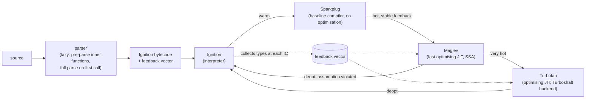

# 12 · Engine Internals for JavaScript Developers (V8 Lens)

> **Scope:** this is the "why is my code slow?" level: enough of V8's architecture to predict and diagnose performance cliffs. Nothing here is specified by ECMA-262; it is **implementation behaviour of V8 14.6 (Node 26.12.1)** and changes between versions. Sources: the V8 blog (<https://v8.dev/blog>): "Fast properties in V8" (2017), "Elements kinds in V8" (2017), "Launching Ignition and TurboFan" (2017), "Sparkplug — a non-optimizing JavaScript compiler" (2021), "Maglev — V8's fastest optimizing JIT" (2023), "Land ahoy: leaving the Sea of Nodes" (Turboshaft, 2025); Hölzle, Chambers & Ungar, "Optimizing Dynamically-Typed Object-Oriented Languages with Polymorphic Inline Caches" (ECOOP 1991); Chambers, Ungar & Lee, "An Efficient Implementation of SELF" (OOPSLA 1989) for hidden classes ("maps"). GC tuning flags and heap sizing belong to the Node.js track ([`../../../technologies/nodejs/`](../../../technologies/nodejs/)).
>
> **Executable proof:** [`examples/12-engine-internals-v8.test.js`](../examples/12-engine-internals-v8.test.js) runs child processes with `--allow-natives-syntax` (`%HaveSameMap`, `%HasFastProperties`, elements-kind and optimisation-status intrinsics) and `--trace-deopt`. These tests are **pinned to V8 14.6** and are expected to need updates on V8 upgrades.

---

## 1. The pipeline



| Tier | Since | Role |
|---|---|---|
| **Parser** | | *Lazy parsing*: functions not called at startup are only pre-parsed (syntax checked, scopes analysed for closures); they are fully parsed and compiled on first call. Wrapping a function in parentheses (`(function () {...})`) is a heuristic for "invoked immediately" (PIFE) and triggers eager compilation |
| **Ignition** | 2016–17 | Register-based bytecode interpreter. Every property access, call and arithmetic operation has a **feedback slot** recording the types and shapes it saw |
| **Sparkplug** | 2021 | Compiles bytecode to machine code 1:1 without optimisation. Cheap; removes interpreter dispatch overhead |
| **Maglev** | 2023 | Mid-tier optimising compiler: SSA graph from bytecode + feedback, fast to compile |
| **Turbofan** | 2017 | Top-tier optimising compiler; speculative optimisation based on feedback. Its backend was replaced by **Turboshaft** (control-flow-graph IR replacing the Sea of Nodes) |

**Speculative optimisation.** Optimising tiers assume the future looks like the feedback: "`p` and `q` were always small integers (Smis), so emit an integer add with an overflow check". If an assumption fails (a string arrives), the code **deoptimises**: execution transfers back to Ignition at the equivalent bytecode, the optimised code is discarded, and the function may be re-optimised later with more general feedback. Occasional deopts are normal; deopt *loops* and permanently generic feedback are performance bugs.

```js
function add(p, q) { return p + q; }
// warm up with Smis, force optimisation (natives syntax, test-only)
add('a', 'b');   // --trace-deopt: "bailout (kind: deopt-eager, reason: not a Smi)"
```

---

## 2. Hidden classes (maps) and shapes

JavaScript objects are dynamic dictionaries semantically ([module 04](04-objects-prototypes-classes.md)), but V8 represents most of them like C structs: each object points to a **map** (hidden class, "shape" in other engines) describing its property names, their order, attributes and in-object offsets. Objects created the same way share a map.

- Adding a property creates a **transition** from the old map to a new one. Maps form a transition tree; `{}` → `{x}` → `{x, y}`.
- **Order matters**: `{x, y}` and `{y, x}` have different maps.
- Values of the same field can be tracked with a *field representation* (Smi, Double, HeapObject, Tagged) and field type; storing a double into a field that so far held Smis generalises the map (a *map deprecation*, migrating existing objects lazily).
- **Dictionary mode** ("slow properties"): after `delete` of a property (V8 14.6 transitions even when the deleted property was the last one added, verified in the example), after adding many properties dynamically, or for objects used as hash maps, V8 switches the object to a hash-table representation. Property access no longer benefits from offsets and inline caches.
- `Object.setPrototypeOf` / `__proto__` assignment on an object invalidates prototype-chain assumptions (prototype maps are tracked specially); doing it on objects that are already in use is a known cliff.

Guidelines:

1. Initialise all fields in the constructor (or as class fields), always in the same order.
2. Do not `delete` properties of hot objects; assign `undefined` or use a `Map`.
3. Use `Map` for dictionaries with dynamic keys; keep plain objects for records with a fixed shape.
4. Avoid adding properties to functions or arrays in hot paths.

---

## 3. Inline caches

An **inline cache** (IC) is the feedback slot at one property access site plus the specialised fast path built from it:

| IC state | Maps seen at the site | Cost |
|---|---|---|
| uninitialised | 0 | |
| **monomorphic** | 1 | one map check + load at a fixed offset; inlinable |
| **polymorphic** | 2–4 | a small linear chain of map checks |
| **megamorphic** | > 4 | global stub cache lookup (hash of map + name); optimising compilers cannot specialise it |

```js
function area(shape) { return shape.w * shape.h; }   // one site, many shapes?
area({ w: 1, h: 2 });              // map A
area({ h: 2, w: 1 });              // map B (different order)
area({ w: 1, h: 2, color: 'r' });  // map C
area(new Rect(1, 2));              // map D
area({ w: 1, h: 2, id: 7 });       // map E → megamorphic
```

The same code with objects created by one factory or class is monomorphic. Real-world sources of megamorphism: objects built from parsed JSON with varying key orders or optional keys, "options bag" parameters with arbitrary subsets of keys, mixins, and generic utility functions (deep equal, serialisers) that see every shape in the program; for the last, megamorphism is unavoidable and acceptable.

---

## 4. Elements kinds (arrays)

V8 tracks the *kind* of each array's elements, separately from named properties:

```
PACKED_SMI_ELEMENTS → PACKED_DOUBLE_ELEMENTS → PACKED_ELEMENTS
        ↓                       ↓                       ↓
HOLEY_SMI_ELEMENTS  → HOLEY_DOUBLE_ELEMENTS  → HOLEY_ELEMENTS
```

- Transitions only go **down and to the right** (more general). Removing the double or the string later does **not** transition back (verified: after `push(1.5)` and `push('s')` and two `pop`s, the array keeps `PACKED_ELEMENTS`).
- **Holey** arrays (`new Array(n)`, `[1, , 3]`, writing past the end, `delete arr[i]`) require hole checks and prototype-chain lookups on every hole access.
- Packed Smi and double arrays store unboxed values: summing a `PACKED_DOUBLE_ELEMENTS` array is much faster than an array of boxed heap numbers.
- `-0`, `NaN` and `Infinity` force double elements; a single string or object forces generic elements.

Guidelines: create hot arrays with literals, by pushing into `[]`, with `Array.from({ length: n }, fn)`, or with `new Array(n).fill(v)`. All four are packed in V8 14.6 (`fill` over the full length of a fresh `new Array(n)` produces packed elements; verified in the example), but a bare `new Array(n)` or a partially filled one stays holey. Do not mix types in numeric arrays; use typed arrays for large numeric data ([module 11](11-binary-data-memory-model.md)).

---

## 5. Functions, closures and inlining

- Small monomorphic functions are **inlined** by Maglev/Turbofan, removing call overhead and enabling further optimisation. Megamorphic call sites (calling many different closures from one place, typical of callback-heavy generic code) prevent inlining.
- Each closure *instance* shares bytecode (the `SharedFunctionInfo`) but has its own context; feedback is per function literal, so a factory producing closures used with different shapes pollutes one shared feedback vector.
- Closure contexts: variables captured by any inner function live in a heap-allocated context shared by all closures of that scope (the memory-retention consequence is shown in [module 03](03-execution-contexts-scope-closures.md)).
- `arguments` in sloppy functions with mapped parameters, `eval`, and `with` force conservative compilation of the enclosing function.
- `try/catch` is no longer a deoptimisation trigger (it was in the Crankshaft era, before 2017).

---

## 6. Garbage collection basics

V8's heap (Orinoco project) is **generational**:

| Space | Collector | Notes |
|---|---|---|
| Young generation (nursery + intermediate) | **Scavenger**: parallel semi-space copying collector | Most objects die young; scavenges are frequent and short |
| Old generation | **Mark-Compact**: concurrent marking, parallel compaction, incremental steps | Triggered by heap growth; full pauses minimised by concurrency |
| Large object space | | objects above a size threshold, never moved |

Mechanisms worth knowing:

- **Write barriers**: every pointer store into an old object that points to a young object records the slot (remembered set), so scavenges need not scan the old generation. This is why allocation-heavy code with many old→young pointers costs more.
- **Reachability** from roots (stack, globals, handles) is the only criterion; cycles are collected. Leaks are always "still reachable": forgotten listeners, caches, closures' contexts, detached DOM trees referenced from JS.
- WeakMap entries are ephemerons, processed specially during marking ([module 09](09-metaprogramming.md)).

Heap snapshots (Chrome DevTools, `node --heapsnapshot-signal`, `v8.writeHeapSnapshot()`) with the **retainers** view answer "why is this object alive?". Flags such as `--max-old-space-size` and `--max-semi-space-size` are Node.js-track material.

---

## 7. Diagnosing performance

| Question | Tool |
|---|---|
| Where is time spent? | `node --cpu-prof`, Chrome DevTools Performance panel, `--prof` + `--prof-process`, Linux `perf` with `--perf-basic-prof` |
| Is my function optimised? Did it deoptimise? | `--trace-opt`, `--trace-deopt` (look for the `reason:`), DevTools "deoptimised" markers, `%GetOptimizationStatus` (tests only) |
| Are my objects sharing shapes? | `%HaveSameMap(a, b)` and `%DebugPrint(obj)` with `--allow-natives-syntax` (tests and experiments only, never in production) |
| Who keeps memory alive? | heap snapshots and allocation timelines |
| Is GC the problem? | `--trace-gc`, `performance.measureUserAgentSpecificMemory` (browsers), `PerformanceObserver` with `gc` entries (Node) |

Rules for micro-benchmarks: warm up (let tiering happen), defeat dead-code elimination (consume results), vary inputs realistically (a monomorphic benchmark of polymorphic production code lies), measure distributions not single runs, and prefer profiling the real application over micro-benchmarks.

### Then vs now

| Then (Crankshaft era, ≤ 2016) | Now (V8 ≥ 2017, Ignition + Sparkplug + Maglev + Turbofan) |
|---|---|
| `try/catch` in a function prevented optimisation | optimised normally |
| `arguments` leaking, `for...in` over many keys, and `let` in loops caused "optimisation killers" | most killers removed; remaining cliffs are about feedback (shapes, megamorphism, elements kinds) |
| Full-codegen baseline compiler | Ignition interpreter + Sparkplug baseline (lower memory, faster startup) |
| One optimising tier | Maglev mid-tier + Turbofan top tier; Turboshaft replaced Turbofan's Sea-of-Nodes backend |
| Advice like "use `|0` everywhere" (asm.js style) | write type-stable code; the JIT infers Smi/double from feedback |

---

## 8. Production failure modes

| Failure | Mechanism | Defence (tested where possible) |
|---|---|---|
| A hot function becomes 10–100× slower after a refactor | call site went megamorphic (objects created in different key orders or with optional keys) | construct objects with one factory/class; `%HaveSameMap` in experiments |
| Throughput collapses after a "cleanup" that deletes temporary fields | `delete` → dictionary mode | assign `undefined`, or separate the temporary data |
| Numeric code slow | arrays holey or generic (one `undefined` or string) | packed arrays, typed arrays |
| Latency spikes in long-running processes | deopt loops (function repeatedly optimised and deoptimised) or GC pressure | `--trace-deopt`; reduce allocation in hot loops |
| Memory grows steadily | reachable garbage: closures' contexts, caches, listeners | heap snapshot retainers; `WeakMap`; `AbortSignal` for listeners |
| Benchmark says A is faster, production disagrees | benchmark is monomorphic or dead code was eliminated | profile real workloads |

---

## Interview Drill

<details><summary>1. What is a hidden class (map) and why does property order matter?</summary>

An engine-internal descriptor of an object's layout: property names, order, attributes and in-object offsets, shared by objects created the same way. Adding properties transitions between maps; objects that received the same properties in different orders end up with different maps, so code that handles both sees more shapes (polymorphism).
</details>

<details><summary>2. Explain monomorphic, polymorphic and megamorphic inline caches.</summary>

An inline cache records the maps seen at one property-access site. One map: monomorphic, a single map check and a fixed-offset load, which the optimiser can inline. Two to four: polymorphic, a short chain of checks. More: megamorphic, a generic hashed stub-cache lookup that optimising compilers cannot specialise.
</details>

<details><summary>3. What is a deoptimisation and when is it a problem?</summary>

Optimised code is generated under assumptions from type feedback; when an assumption fails at runtime, execution falls back to the interpreter at the equivalent point and the optimised code is discarded. Occasional deopts are normal; repeated deopt/re-optimise cycles or permanently generic feedback in hot code are problems.
</details>

<details><summary>4. Why is `delete obj.prop` discouraged in hot code?</summary>

In V8 it usually moves the object to dictionary (hash table) mode, losing fast property access and inline-cache benefits for every subsequent access to that object. Assign `undefined` instead, or use a `Map` for dynamic keys.
</details>

<details><summary>5. What are elements kinds, and what makes an array holey?</summary>

V8 classifies array storage as Smi, double or generic, each packed or holey, and only transitions to more general kinds. Holes come from `new Array(n)`, array literals with elisions, writing beyond the length, or `delete arr[i]`; holey arrays need hole checks and prototype lookups.
</details>

<details><summary>6. Name V8's execution tiers and what each one does.</summary>

Ignition interprets bytecode and collects feedback; Sparkplug compiles bytecode to unoptimised machine code quickly; Maglev is a fast mid-tier optimising compiler; Turbofan (with the Turboshaft backend) is the top-tier optimising compiler for very hot code.
</details>

<details><summary>7. How does a generational GC decide what to collect, and what is a write barrier?</summary>

It collects objects unreachable from roots, scavenging the young generation often (most objects die young) and mark-compacting the old generation rarely. A write barrier records old→young pointers when they are written, so a young-generation collection can find all its roots without scanning the whole old generation.
</details>

<details><summary>8. How would you investigate a sudden slowdown in a Node service?</summary>

Reproduce under load and capture a CPU profile (`--cpu-prof`) to find the hot functions; check `--trace-deopt` for repeated deopts and their reasons; check whether hot objects have consistent shapes; check GC activity (`--trace-gc`) and heap growth with snapshots. Fix the root cause (shape stability, allocation in hot loops) rather than micro-optimising syntax.
</details>
