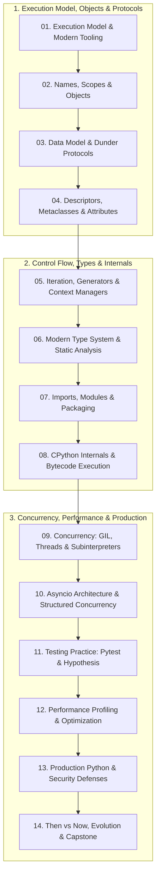

# Python: From CPython Internals to Free-Threaded Concurrency

A rigorous, production-grade engineering curriculum covering modern Python 3.15, from compiler internals and bytecode execution mechanics to PEP 695 static typing, structured concurrency, and PEP 703 free-threaded architecture. Theoretical concepts are grounded in primary PEP specifications and CPython runtime architecture, accompanied by deterministic, executable test suites and property-based test suites using Pytest and Hypothesis.

> Verified against Python 3.15.2, uv 0.13.6 on 2026-10-30

---

## 1. Syllabus & Curriculum Structure

The curriculum is organized as a progressive technical narrative spanning 14 in-depth modules:



### Module Directory
1. [Module 01: Execution Model & Tooling Baseline](modules/01-execution-model-and-tooling.md): CPython compilation pipeline (Tokenizer $\to$ PEG parser $\to$ AST $\to$ Symtable $\to$ Bytecode $\to$ VM eval loop), CPython vs PyPy/GraalPy, the `uv` and `ruff` ecosystem, `pyproject.toml`, interpreter startup & runtime flags (`-X dev`, `-X faulthandler`).
2. [Module 02: Names, Scopes & Object Model](modules/02-names-scopes-and-objects.md): PyObject memory anatomy (`ob_refcnt`, `ob_type`), identity vs equality (`is` vs `==`), small int cache `[-5, 256]`, string interning, LEGB lexical lookup rules, mutable default arguments, late-binding closure traps, PEP 649/749 deferred annotations.
3. [Module 03: Data Model & Dunder Protocols](modules/03-data-model-and-dunder-protocols.md): String representation (`__repr__` vs `__str__`), hash invariant ($a == b \implies \text{hash}(a) == \text{hash}(b)$), sequence slicing (`slice.indices()`), reflected arithmetic returning `NotImplemented`, memory optimization with `__slots__`, subclass customization via `__init_subclass__` (PEP 487).
4. [Module 04: Descriptors, Metaclasses & Attribute Machinery](modules/04-descriptors-metaclasses-and-attributes.md): Data vs non-data descriptors, method binding descriptor mechanics (`types.MethodType`), `__set_name__`, C3 Linearization MRO algorithm, cooperative multiple inheritance with `super()`, metaclasses, Abstract Base Classes (ABCs) & `__subclasshook__`.
5. [Module 05: Iteration, Generators & Context Managers](modules/05-iteration-generators-and-context-managers.md): Iteration protocol (`__iter__`/`__next__`), generator frame suspension states, bidirectional `.send()`, `.throw()`, `.close()`, `yield from` subgenerator delegation, context manager protocol (`__enter__`/`__exit__`), `contextlib.ExitStack`, PEP 654 `ExceptionGroup` and `except*`.
6. [Module 06: Type System, Generics & Modern Annotations](modules/06-type-system-and-annotations.md): PEP 695 generics (`class Box[T]:`, `type Alias[T] = ...`), PEP 696 type defaults, automatic variance inference, `typing.Protocol` with `@runtime_checkable`, `ParamSpec` & `Concatenate` higher-order callables, PEP 742 `TypeIs` bidirectional narrowing, `@overload`.
7. [Module 07: Imports, Modules & Packaging](modules/07-imports-modules-and-packaging.md): Import machinery (`sys.meta_path`, `ModuleSpec`, `Loader`, `sys.modules`), circular import mechanics & diagnosis, PEP 810 draft lazy imports (`lazy import`), PEP 420 namespace packages, Wheel format anatomy & modern `uv.lock` packaging.
8. [Module 08: CPython Internals, Bytecode & Garbage Collection](modules/08-cpython-internals-and-bytecode.md): Bytecode disassembly (`dis`), PEP 659 Specialized Adaptive Interpreter, Zero-cost exception tables, reference counting, PEP 683 immortal objects, cyclic generational garbage collection (tri-color trial deletion), `pymalloc` & `mimalloc`.
9. [Module 09: Concurrency: GIL, Threads, Processes & Subinterpreters](modules/09-concurrency-gil-threads-and-subinterpreters.md): GIL mechanics & switch intervals, PEP 703/779 free-threaded CPython (`python3.15t`), thread safety in pure Python, `threading.Lock`, multiprocessing start methods (`fork` vs `spawn` vs `forkserver`), PEP 734 subinterpreters (`InterpreterPoolExecutor`).
10. [Module 10: Asyncio Internals & Structured Concurrency](modules/10-asyncio-internals-and-structured-concurrency.md): Reactor pattern, coroutines/tasks/futures, `asyncio.TaskGroup` structured concurrency, cancellation semantics (`CancelledError`), `asyncio.timeout`, `contextvars.ContextVar`, `asyncio.to_thread()`, `asyncio.Queue` backpressure & `Queue.shutdown()`.
11. [Module 11: Testing with Pytest & Hypothesis](modules/11-testing-pytest-and-hypothesis.md): Pytest fixture dependency injection & scopes, `@pytest.mark.parametrize`, Hypothesis property-based testing (shrinking, round-trip invariants), `create_autospec` mock drift prevention, `pytest.raises` regex match, `pytest.warns` deprecation verification.
12. [Module 12: Performance Profiling & Optimization](modules/12-performance-profiling-and-optimization.md): Profiling taxonomy (deterministic tracing vs statistical sampling), `cProfile` & `pstats` metrics (`tottime` vs `cumtime`), micro-optimizations (local variable caching, string `join`, `__slots__`), SIMD vectorization & Rust native extensions (PyO3).
13. [Module 13: Production Python & Security](modules/13-production-python-and-security.md): Structured JSON logging, PEP 686 UTF-8 default mode, Unix signal orchestration (`SIGTERM` graceful draining), minimal multi-stage Docker builds with `uv`, security vulnerability mitigations: `pickle` RCE, `subprocess` command injection, path traversal.
14. [Module 14: Then vs Now, Version History & Capstone](modules/14-then-vs-now-version-history-and-capstone.md): Evolution from Python 2.7 $\to$ 3.8 $\to$ 3.11 $\to$ 3.15, Version history matrix, Capstone Project: High-Performance Distributed Asynchronous Task Orchestrator with backpressure, structured worker pools, context propagation, and graceful shutdown.

---

## 2. Certifications & Exams

This curriculum provides comprehensive coverage for the primary industry certifications and senior engineering interview loops:

| Certification / Standard | Vendor / Authority | Exam Guide & Status | Target Version | Format | Passing Score |
|---|---|---|---|---|---|
| **PCAP™ (Exam PCAP-31-03)** | OpenEDG Python Institute | [PCAP-31-03 Guide](https://pythoninstitute.org/pcap) · Active | Python 3.x | 40 Single/Multiple choice · 65 min | 70% |
| **PCPP1™ (Exam PCPP-32-101)** | OpenEDG Python Institute | [PCPP-32-101 Guide](https://pythoninstitute.org/pcpp1) · Active | Python 3.x | 45 Single/Multiple choice · 65 min | 70% |
| **Senior / Staff Python Engineering Loop** | Tier-1 Tech (Google, Meta, Bloomberg) | [Interview Bank & Mock Exam](exams/interview.md) · Active | Python 3.15+ | 75 Qs + 90-min Hands-on Coding Mock | Staff Bar |

### Prerequisites
- Proficiency in structured programming, functions, and elementary data structures (lists, dicts, sets).
- Familiarity with the terminal command line and git.

### Out of Scope
- Legacy Python 2 syntax and obsolete C-API idioms deprecated prior to Python 3.11.
- GUI frameworks (Tkinter, PyQt) and client-side web development.

- **Coverage Matrix**: Complete mapping of exam objectives and weightings across modules and tests in [`exams/README.md`](exams/README.md).
- **Question Bank & Mock Exam**: 75 detailed questions and a 90-minute Staff-level timed mock exam in [`exams/interview.md`](exams/interview.md).

---

## 3. Tooling & Runnable Verification

All tooling dependencies are resolved and pinned locally via `mise` (`.mise.toml`, `mise.lock`) and `uv` (`pyproject.toml`, `uv.lock`).

### Running the Test Suite
```bash
# Execute all 82 hermetic unit and property tests
mise exec -- uv run pytest

# Run static type checking with strict mypy configuration
mise exec -- uv run mypy examples

# Run code formatting and linter validation
mise exec -- uv run ruff check .
```

### Environment Specifications
- **Python**: 3.15.2 (and `python3.15t` for free-threaded execution)
- **Package Manager**: `uv` 0.13.6
- **Test Runner**: `pytest` 9.2.0 with `hypothesis` 6.170.14
- **Linter & Formatter**: `ruff` 0.17.3
- **Type Checker**: `mypy` 2.4.1 (Strict Mode)
