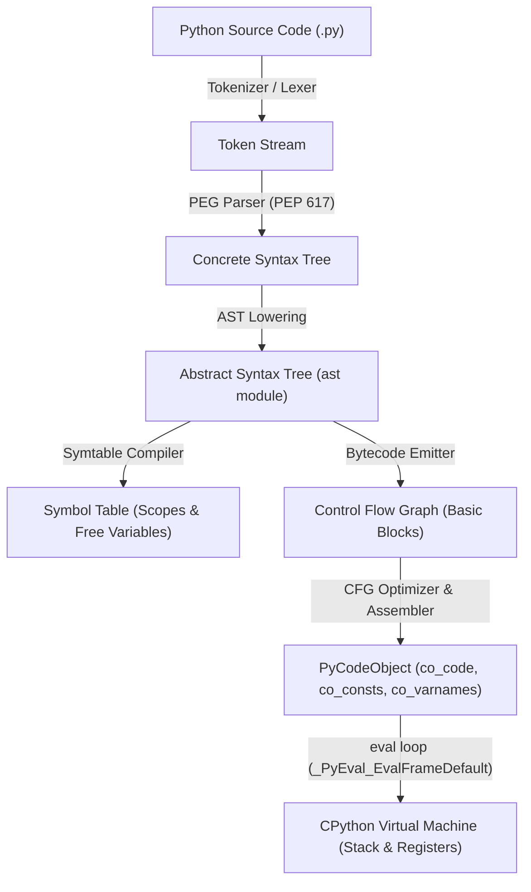
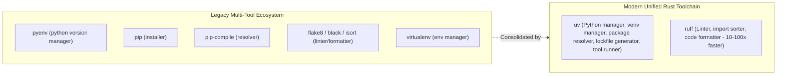

# Module 01: Execution Model & Tooling Baseline

Python is an interpreted, high-level, dynamically typed language with an explicit execution model centered around bytecode compilation, an abstract virtual machine, and a garbage-collected runtime. While commonly described as an "interpreted language," modern Python implementations—chief among them CPython—never execute raw human-readable source code directly. Instead, every Python program undergoes an ahead-of-time compilation pipeline that generates abstract syntax trees, symbol tables, and compact stack-based bytecode instructions before execution begins on the virtual machine loop.

Understanding Python at a senior engineering level requires moving past the syntax into the operational reality of the CPython runtime, alternative runtimes (PyPy, GraalPy), modern packaging standards governed by Python Enhancement Proposals (PEPs), and the modern toolchain centered around `uv`, `ruff`, and strict dependency resolution.

---

## 1. The CPython Compilation & Execution Pipeline

When you invoke `python script.py`, the CPython runtime processes the source code through four distinct, deterministic compiler phases before handing execution to the virtual machine evaluation loop (`_PyEval_EvalFrameDefault`).



### 1.1 Tokenizer & Lexer
The tokenizer scans raw UTF-8 bytes and converts source text into a stream of categorized tokens (e.g., `NAME`, `NUMBER`, `STRING`, `INDENT`, `DEDENT`, `NEWLINE`). Python's significant indentation is handled at the lexer level by maintaining an internal indentation stack:
- When a line begins with more leading whitespace than the current stack top, the lexer pushes the new column width onto the stack and emits an `INDENT` token.
- When indentation decreases, the lexer pops column widths from the stack and emits a `DEDENT` token for each popped level until matching an existing column width. If no matching indentation level is found, the tokenizer raises an immediate `IndentationError: unindent does not match any outer indentation level`.

### 1.2 PEG Parser (PEP 617) & Direct AST Generation
Starting in Python 3.9, CPython replaced its legacy LL(1) parser with a high-performance **Parsing Expression Grammar (PEG)** parser (`pegen`). The legacy parser produced an intermediate Concrete Syntax Tree (CST) that required lowering; modern CPython constructs the **Abstract Syntax Tree (AST)** directly from the grammar actions during PEG parsing.

The PEG parser operates with arbitrary lookahead and backtracks when necessary, enabling cleaner syntactic features such as parenthesized context managers across multiple lines without backslashes, structural pattern matching (`match/case`), and PEP 695 type parameter syntax.

### 1.3 Abstract Syntax Tree (AST) & Symbol Table
The AST models the hierarchical semantics of the program, stripping away superficial syntactic artifacts (parentheses, whitespace, commas). Developers can inspect, mutate, and evaluate this tree at runtime using the standard library `ast` module.

Concurrently, CPython builds a **Symbol Table** (`symtable` module). This pass analyzes every identifier in the AST to categorize its scope:
- **Local (`DEF_LOCAL`)**: Assigned within the current block without a `global` or `nonlocal` declaration.
- **Global (`DEF_GLOBAL`)**: Explicitly declared `global` or assigned at top-level module scope.
- **Free / Cell (`DEF_FREE` / `DEF_CELL`)**: Referenced in an inner function but bound in an enclosing lexical scope (forming closures).

This lexical scoping classification happens entirely during compilation. Because CPython determines variable scopes at compile time, an assignment anywhere inside a function causes that name to be classified as local for the *entire* function body, which is the root cause of the classic `UnboundLocalError`.

### 1.4 Bytecode & the `PyCodeObject`
The compiler translates the AST and symbol table into a Control Flow Graph (CFG) of basic blocks, applies AST constant folding and CFG optimizations (such as jump-to-jump elimination and dead block pruning via `Python/flowgraph.c` and `Python/assemble.c`), and outputs a `PyCodeObject`. A code object is an immutable container holding:
- `co_code`: The raw bytes representing bytecode instructions and their opargs.
- `co_consts`: A tuple of literal constants loaded by `LOAD_CONST`.
- `co_varnames`: A tuple of local variable names accessed by fast array indexing (`LOAD_FAST`).
- `co_names`: A tuple of non-local names resolved via hash tables (`LOAD_GLOBAL`, `LOAD_NAME`).
- `co_cellvars` & `co_freevars`: Tuples of variables captured in closures.
- `co_linetable` / `co_positions`: Mapping between bytecode offsets and source line/column positions.

```python
import dis

def calculate_discount(price: float, discount: float) -> float:
    final_price = price * (1.0 - discount)
    return final_price

dis.dis(calculate_discount)
```
Output:
```text
  2           0 RESUME                   0
              2 LOAD_FAST                0 (price)
              4 LOAD_CONST               1 (1.0)
              6 LOAD_FAST                1 (discount)
              8 BINARY_OP               10 (-)
             12 BINARY_OP                5 (*)
             16 STORE_FAST               2 (final_price)

  3          18 LOAD_FAST                2 (final_price)
             20 RETURN_VALUE
```
Notice that local variables (`price`, `discount`, `final_price`) are accessed via `LOAD_FAST` and `STORE_FAST`, which index directly into a fixed-size C array on the call frame in $O(1)$ time, whereas global variable lookups (`LOAD_GLOBAL`) require dictionary lookups.

---

## 2. CPython vs Alternative Runtimes

CPython is the reference implementation of Python, written in C and maintained by the Python core developers. However, multiple alternative implementations exist, each targeting distinct architectural constraints and performance profiles:

| Runtime | Implementation Language | Execution Model | JIT Compiler | GIL Architecture | Best Used For |
|---|---|---|---|---|---|
| **CPython** | C | Stack VM + Tier 2 Micro-Op JIT (experimental 3.13+) | Copy-and-Patch Tier 2 JIT | Traditional GIL or Free-Threaded (PEP 703/779) | General purpose, native C extensions (NumPy, PyTorch), standard ecosystem |
| **PyPy** | RPython (Restricted Python) | Trace-based JIT VM | Meta-tracing JIT compiler | Global Interpreter Lock | Long-running, pure-Python CPU-bound loops, high-throughput network daemons |
| **GraalPy** | Java / Truffle framework | Polyglot GraalVM runtime | Graal JIT compiler (compiler-as-a-service) | Managed memory / Java threads | Enterprise Java interoperability, polyglot embeddings, JVM integration |
| **Micropython** | C | Minimalist byte-code VM | Optional native emitter | None (bare metal) | Microcontrollers, embedded systems, micro-devices ($< 256\text{KB}$ RAM) |

### 2.1 The PyPy Trade-Off
PyPy is a high-performance alternative implementation of Python. It uses a **tracing JIT**: as a pure-Python loop executes, PyPy records the exact sequence of executed operations, specializes them for the observed data types, and compiles them directly into native machine instructions (x86-64 / ARM64). For long-running, pure-Python algorithms, PyPy often runs 4–10x faster than standard CPython.

However, PyPy introduces two critical engineering trade-offs:
1. **Warmup Latency**: Code runs slowly under the interpreter until loops reach invocation thresholds and trigger JIT compilation.
2. **C-API Emulation Overhead**: CPython extensions written in C (such as NumPy, SciPy, or Pandas) interact with CPython's internal `PyObject` pointers directly. PyPy must emulate this interface via `cpyext`, which involves marshaling and unwrapping objects across the RPython boundary. As a result, code dominated by native C extensions is often significantly *slower* on PyPy than on CPython.

---

## 3. Modern Python Tooling: The `uv` & `ruff` Revolution

Historically, the Python packaging ecosystem was notorious for fragmentation, slow resolution speeds, and fragile global environments (`virtualenv`, `pip`, `pip-tools`, `poetry`, `pipenv`, `flit`). In modern engineering practice, Astral's `uv` and `ruff` (written in Rust) have consolidated and transformed this landscape into an integrated, deterministic, and lightning-fast developer experience.



### 3.1 What is `uv`?
`uv` is an extremely fast Python package manager and resolver designed as a drop-in replacement for `pip`, `pip-tools`, `virtualenv`, `poetry`, and `pyenv`.
- **Global Python Tooling**: `uv python install 3.15.2` installs standalone CPython builds directly into user-space without needing root permissions, system package managers, or `pyenv`.
- **Deterministic Resolution & Locking**: Generates a universal, cross-platform `uv.lock` file containing cryptographic hashes of all transitive dependencies.
- **Universal Cache & Fast Linking**: Uses hardlinks or reflinks from a centralized global package cache (`~/.cache/uv`), making virtual environment creation and package installation nearly instantaneous ($< 50\text{ms}$).
- **Tool Execution (`uvx`)**: Replaces `pipx` by downloading, caching, and executing ephemeral command-line tools without polluting the project or system environment (`uvx ruff check .`).

### 3.2 What is `ruff`?
`ruff` is an ultra-fast Python linter and code formatter written in Rust that replaces `flake8`, `black`, `isort`, `pylint`, `pyupgrade`, and dozens of plugins with a single binary. It parses Python into ASTs via Rust's parser, checking hundreds of lint rules concurrently across multi-core processors in milliseconds.

---

## 4. Modern Project Configuration: `pyproject.toml`

Modern Python packaging is defined by **PEP 517**, **PEP 518**, and **PEP 621**. Legacy setup files (`setup.py`, `setup.cfg`, `requirements.txt`) are obsolete. All project metadata, build requirements, dependencies, and tool settings reside in a single standardized configuration file: `pyproject.toml`.

```toml
[project]
name = "enterprise-service"
version = "1.0.0"
description = "High-performance distributed backend service"
readme = "README.md"
requires-python = ">=3.14"
license = { text = "MIT" }
authors = [
    { name = "Principal Engineer" }
]
dependencies = [
    "httpx>=0.28.0",
    "pydantic>=2.10.0",
    "structlog>=24.4.0",
]

[project.optional-dependencies]
dev = [
    "hypothesis>=6.170.0",
    "mypy>=2.4.0",
    "pytest>=9.2.0",
    "pytest-asyncio>=1.4.0",
    "ruff>=0.17.0",
]

[project.scripts]
enterprise-service = "enterprise_service.cli:main"

[build-system]
requires = ["hatchling"]
build-backend = "hatchling.build"

[tool.ruff]
line-length = 100
target-version = "py315"

[tool.ruff.lint]
select = ["E", "F", "W", "I", "UP", "B", "SIM"]
ignore = ["E501"]

[tool.pytest.ini_options]
testpaths = ["tests"]
asyncio_mode = "strict"
asyncio_default_fixture_loop_scope = "function"

[tool.mypy]
python_version = "3.15"
strict = true
warn_unused_configs = true
disallow_untyped_defs = true
```

---

## 5. CPython Interpreter Startup & Key `-X` Flags

When launching CPython, the runtime evaluates environment variables and command-line flags that directly configure memory management, garbage collection, and runtime safety.

### 5.1 Critical Command-Line & `-X` Options
- `python -X dev` (Development Mode): Activates runtime sanity checks: enables `asyncio` debug mode (detecting coroutines never awaited and event-loop-blocking calls), installs the `faulthandler` for C segfault stack traces, and enables memory allocation debug hooks (`PYTHONMALLOC=debug`).
- `python -X tracemalloc` or `python -X tracemalloc=N`: Pre-allocates trace buffers to record the source file and line number of every memory allocation, capturing up to $N$ stack frames.
- `python -X gil=0` / `python -X gil=1` (Free-Threaded builds): In Python 3.13+ free-threaded builds, forces the Global Interpreter Lock to be explicitly disabled (`0`) or re-enabled (`1`).
- `python -X perf`: Enables Linux `perf` profiler trampoline support, allowing kernel profilers to resolve Python bytecode frame functions in stack traces.
- `python -O` (Optimize): Strips `assert` statements and ignores `__debug__` boolean checks.
- `python -OO`: In addition to `-O`, strips all docstrings (`__doc__ = None`), reducing memory overhead in production containers.

---

## 6. Then vs Now: Python Tooling & Packaging

| Dimension | Legacy Python (Python 2.7 / 3.6–3.9) | Modern Python (Python 3.14 / 3.15+) | Why it Changed |
|---|---|---|---|
| **Package Installer** | `pip install -r requirements.txt` (slow, unpinned transitive deps) | `uv sync --frozen` (sub-second resolution, cryptographic lockfile) | Fragile, non-deterministic deployments and dependency drift caused production outages. |
| **Environment Management** | `virtualenv venv; source venv/bin/activate` | `uv run <cmd>` or automatic virtualenv orchestration | Eliminates the need to manually activate shell environments or risk accidental pollution. |
| **Code Formatting & Linting** | `flake8` + `black` + `isort` + `pyupgrade` (multiple tools, minutes in CI) | `ruff check --fix` + `ruff format` (single Rust binary, $< 100\text{ms}$) | Toolchain fragmentation and slow CI pipeline execution times. |
| **Project Specification** | `setup.py` / `setup.cfg` / `requirements.txt` | `pyproject.toml` (PEP 517 / 518 / 621) | `setup.py` executed arbitrary code during build/inspect; `pyproject.toml` is declarative. |
| **Parser Architecture** | LL(1) Parser with 1-token lookahead | PEG Parser (PEP 617) with arbitrary backtracking | Enables clean multi-line statements, pattern matching, and flexible modern syntax. |
| **Default File Encoding** | Locale-dependent (e.g. `cp1252` on Windows, `ISO-8859-1`) | Standard UTF-8 everywhere (PEP 686) | Eliminates `UnicodeDecodeError` across operating systems. |

---

## 7. Interview Drill: Questions & Model Answers

<details>
<summary>1. What happens under the hood when a Python source file is imported for the first time?</summary>

**Answer:**
When module `foo` is imported:
1. Python checks `sys.modules` to see if `foo` is already loaded. If found, it returns the cached module object immediately.
2. If not found, CPython iterates over `sys.meta_path` finders (e.g., `PathFinder`).
3. The finder locates the source file on `sys.path` and returns a `ModuleSpec`.
4. The loader checks for an up-to-date bytecode cache file (`__pycache__/foo.cpython-315.pyc`). A `.pyc` file is valid if its header matches either the source file's timestamp/size or a cryptographic hash of the source.
5. If the `.pyc` is missing or stale, CPython tokenizes, parses, and compiles `foo.py` into a `PyCodeObject`, and writes the compiled `.pyc` file back to `__pycache__`.
6. CPython creates an empty `types.ModuleType` object, adds it to `sys.modules`, and creates a call frame to execute the module's code object in the module's namespace dictionary (`__dict__`).
7. All top-level class definitions, function definitions, and module-level code execute sequentially, populating the module dictionary.
</details>

<details>
<summary>2. Why does Python determine variable scopes at compile time rather than runtime?</summary>

**Answer:**
CPython determines variable scope during the symbol table compilation phase to optimize variable access in the virtual machine. By knowing at compile time that a variable is local to a function, the compiler can emit `LOAD_FAST` and `STORE_FAST` instructions instead of `LOAD_NAME` or `LOAD_GLOBAL`. `LOAD_FAST` accesses the local variable via an $O(1)$ offset into a fixed-size C array on the evaluation frame (`frame->f_localsplus`), bypassing dictionary hashing and key comparisons. If scope were dynamic, every single variable lookup would require dynamic hash table lookups across local, enclosing, global, and builtin dictionaries.
</details>

<details>
<summary>3. What is the cause of `UnboundLocalError: local variable referenced before assignment`, and how is it resolved?</summary>

**Answer:**
Because variable scopes are determined at compile time, if an assignment statement (e.g., `x = 1`) appears *anywhere* inside a function body, the compiler marks `x` as a local variable for the *entire* function scope. If code references `x` prior to that assignment line, the virtual machine executes `LOAD_FAST` for `x`. Because the local variable slot contains a null pointer (uninitialized), the VM raises `UnboundLocalError`.
To resolve this:
- If modifying a global variable, declare `global x` at the top of the function.
- If modifying a variable from an enclosing outer function, declare `nonlocal x`.
- If intending to read an outer variable and create a local variable, rename the local variable to avoid name shadowing.
</details>

<details>
<summary>4. What are the key architectural advantages of the PEG parser introduced in PEP 617?</summary>

**Answer:**
The legacy LL(1) parser was restricted to looking ahead at most one token and required grammar rules to be deterministic without backtracking. This created severe grammar restrictions: grammar designers could not use left-recursion, multi-statement compound constructs in context managers, or rich syntax without adding synthetic tokens. The PEG (Parsing Expression Grammar) parser eliminates the 1-token limitation, supports unlimited backtracking, handles direct and indirect left recursion via memoization (Packrat parsing), and allows clean implementation of complex modern syntax such as `match/case` structural pattern matching and parenthesized context managers.
</details>

<details>
<summary>5. Why is `uv` significantly faster than legacy `pip` and `pip-tools`?</summary>

**Answer:**
`uv` achieves orders-of-magnitude faster performance through several systems-level design decisions:
1. **Implementation Language**: Written in Rust, with zero garbage collection overhead and multi-threaded parallel computation.
2. **PubGrub Algorithm**: Uses an optimized Rust implementation of the PubGrub version-solving algorithm with fast backtracking.
3. **HTTP/2 & Pipelined Network IO**: Maximizes connection multiplexing and concurrent wheel metadata streaming.
4. **Lazy Metadata Fetching**: Fetches only the wheel's `METADATA` file via HTTP range requests rather than downloading the entire multi-megabyte wheel archive when resolving dependencies.
5. **Global Cache & File-System Linking**: When installing packages into a virtual environment, `uv` creates hardlinks or copy-on-write reflinks (on APFS and Btrfs) from its global cache (`~/.cache/uv`), avoiding physical disk byte duplication.
</details>
