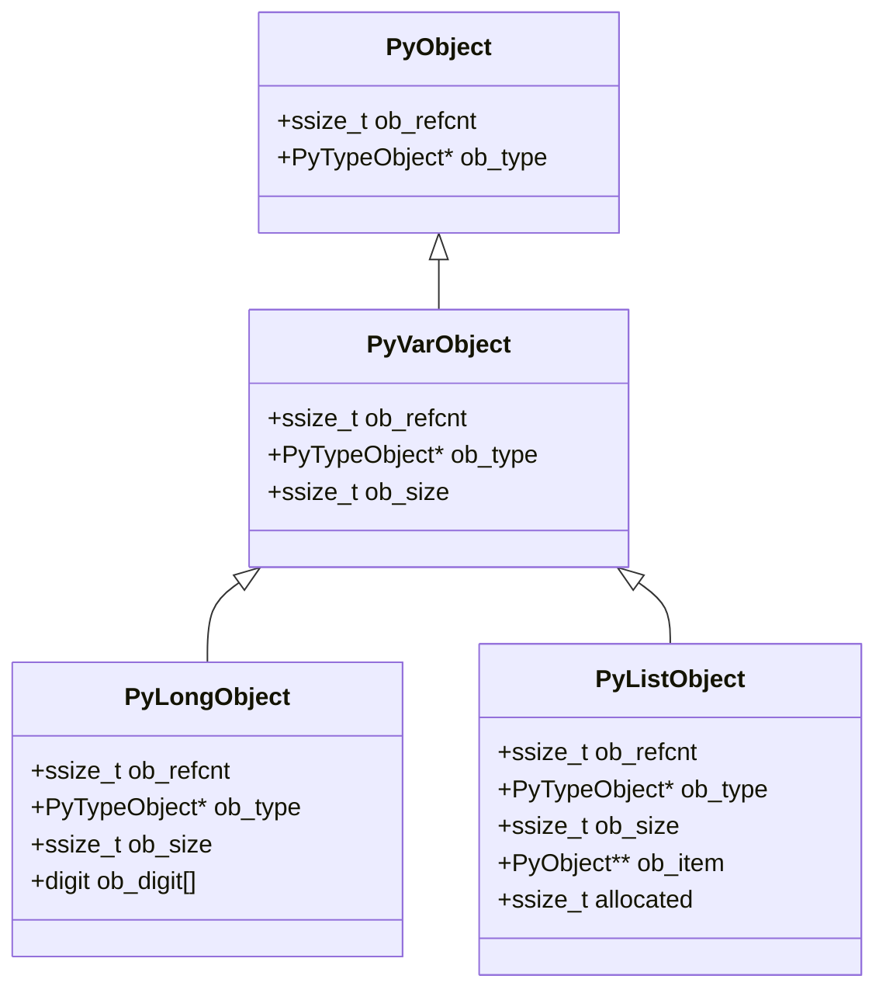
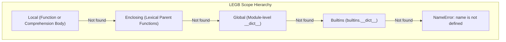

# Module 02: Names, Scopes & Object Model

In Python, the adage "everything is an object" is an operational reality of the CPython C runtime. Every integer, float, string, function, module, class, and exception instance is a heap-allocated C structure inheriting from a standardized base header. Python variables are not memory addresses or typed storage slots; they are references (pointers) bound to dynamically allocated objects in memory.

Understanding how Python represents objects, binds identifiers to namespaces, resolves variable lookups through the LEGB rule, constructs lexical closures, and manages memory is foundational to avoiding classic production bugs such as mutable default arguments, late-binding closure bugs, and subtle identity comparisons.

---

## 1. The Anatomy of a `PyObject`

At the C implementation level, every Python object is represented by a C structure containing the `PyObject_HEAD` macro. For variable-length objects (such as strings, tuples, and lists), it uses `PyObject_VAR_HEAD`.



### 1.1 The Base Fields
1. `ob_refcnt` (`Py_ssize_t`): The reference counter tracking how many active references currently point to this object. When this counter drops to zero, the object is immediately deallocated (unless part of an uncollected cyclic reference cycle managed by the cyclic GC).
2. `ob_type` (`struct _typeobject*`): A pointer to the type object that defines the behavior, methods, and dunder protocols of this instance (e.g. `&PyLong_Type`, `&PyList_Type`).
3. `ob_size` (in `PyVarObject`): Tracks the number of items or digits currently contained in a variable-sized object (e.g., number of elements in a list, characters in a string, or limbs in an arbitrary-precision integer).

Because of this metadata overhead, even the simplest integer `0` consumes 28 bytes of memory on a 64-bit architecture: 8 bytes for `ob_refcnt`, 8 bytes for `ob_type`, 8 bytes for `ob_size`, and 4 bytes for the 30-bit integer digit.

---

## 2. Object Identity, Equality & Caching

Python distinguishes strictly between **Identity** and **Value Equality**:
- **Identity (`is`)**: Checks whether two references point to the exact same physical memory address: `a is b` $\iff$ `id(a) == id(b)`.
- **Equality (`==`)**: Invokes the `__eq__` dunder method on the left operand, evaluating whether two objects represent equivalent values according to their domain logic.

```python
a = [1, 2, 3]
b = [1, 2, 3]
print(a == b)  # True (equal contents)
print(a is b)  # False (distinct heap-allocated lists)
```

### 2.1 The Small Integer Cache (`small_ints`)
To optimize performance and eliminate heap allocations for common integers, CPython pre-allocates an array of singleton integer objects for numbers in the range `[-5, 256]` during interpreter startup.

```python
x = 250
y = 250
assert x is y  # True: both point to the pre-allocated singleton in small_ints

x = 1000
y = 1000
assert x is not y  # True: two distinct PyLongObject instances on the heap
assert x == y      # True: equal values
```

> [!WARNING]
> Never use `is` to compare numbers or strings in production code! Relying on `is` for integer comparisons introduces insidious bugs where values $\le 256$ pass tests while values $> 256$ fail in production. The `is` operator should be used almost exclusively for checking singleton sentinels: `if val is None:`, `if flag is True:`, or custom sentinel identities.

### 2.2 String Interning
CPython automatically interns string literals that resemble valid Python identifiers (ASCII letters, digits, and underscores) via `sys.intern()`. Interned strings share a single canonical memory address, allowing the CPython compiler and dictionary lookup routines to replace expensive string character comparisons (`memcmp`) with instantaneous pointer equality checks (`ptr1 == ptr2`).

---

## 3. Mutability vs Immutability

Every Python type falls into one of two fundamental categories:

| Category | Built-in Types | Characteristics & Invariants |
|---|---|---|
| **Immutable** | `int`, `float`, `bool`, `str`, `tuple`, `frozenset`, `bytes` | State cannot be altered after creation. Hashable if all contained elements are hashable. Safe to share across threads without locks. |
| **Mutable** | `list`, `dict`, `set`, `bytearray` | State can be modified in-place without altering object identity (`id()`). Unhashable (`__hash__ = None`). |

### 3.1 The "Mutable Inside Immutable" Trap
A tuple is immutable: its sequence of contained references cannot be extended, shortened, or reassigned. However, if a tuple contains a reference to a mutable object (such as a list), the contents of that list can be mutated freely in-place!

```python
nested_tuple = (1, [10, 20])
nested_tuple[1].append(30)
print(nested_tuple)  # (1, [10, 20, 30])
```
Because the contents of `nested_tuple` can change, it cannot compute a stable hash code. Attempting to call `hash(nested_tuple)` raises `TypeError: unhashable type: 'list'`. A tuple is hashable if and only if **all** of its constituent elements are themselves hashable.

---

## 4. Lexical Scoping: The LEGB Rule

When Python encounters an identifier inside a code block, it resolves the name by searching up to four hierarchical namespaces in strict order: **LEGB**.



1. **Local (L)**: Names declared or assigned within the current function body (stored in the frame's `f_localsplus` array).
2. **Enclosing (E)**: Names in the local scope of any enclosing lexical functions (from innermost to outermost), accessible via closures (`co_freevars`).
3. **Global (G)**: Names declared at top-level module scope or explicitly marked with `global` (stored in `module.__dict__`).
4. **Builtin (B)**: Built-in functions, constants, and exceptions provided by the `builtins` module (`len`, `range`, `Exception`, `True`).

### 4.1 Rebinding Outer Names: `global` vs `nonlocal`
In Python, assignment (`=`) binds a name in the current local scope by default. To rebind a variable in an outer scope, you must declare intent explicitly:
- `global name`: Binds all reads and writes of `name` directly to the module's top-level global dictionary.
- `nonlocal name`: Binds reads and writes to the closest enclosing lexical function scope, skipping the global namespace. If no matching enclosing variable is found, Python raises `SyntaxError: no binding for nonlocal 'name' found`.

```python
def make_counter(start: int = 0):
    count = start
    def increment():
        nonlocal count
        count += 1
        return count
    return increment

c = make_counter(10)
assert c() == 11
assert c() == 12
```

---

## 5. Classic Scoping Traps & Failure Modes

### 5.1 The Mutable Default Argument Trap
In Python, default parameter expressions in `def` statements are evaluated **exactly once at compile/definition time**, not each time the function is called!

```python
# ANTI-PATTERN:
def add_item(item: str, target: list[str] = []) -> list[str]:
    target.append(item)
    return target

print(add_item("apple"))   # ['apple']
print(add_item("banana"))  # ['apple', 'banana'] -- BUG: shared list instance!
```

**The Senior Engineering Fix**:
Use `None` as the default argument sentinel and assign a fresh list inside the function:
```python
def add_item(item: str, target: list[str] | None = None) -> list[str]:
    if target is None:
        target = []
    target.append(item)
    return target
```

### 5.2 The Late-Binding Closure Trap
In Python, closures bind variables **by reference (lookup by name), not by value**! When an inner function references an outer variable, it looks up the value of that variable at the time the inner function is *executed*, not when it is *defined*.

```python
# ANTI-PATTERN:
callbacks = [lambda: i for i in range(4)]
print([cb() for cb in callbacks])  # [3, 3, 3, 3] -- BUG: all see the final loop value i=3!
```

**The Fixes**:
1. **Default Argument Binding**: Exploit default argument evaluation at definition time:
   ```python
   callbacks = [lambda i=i: i for i in range(4)]
   assert [cb() for cb in callbacks] == [0, 1, 2, 3]
   ```
2. **Factory Function / `functools.partial`**:
   ```python
   from functools import partial
   callbacks = [partial(lambda x: x, i) for i in range(4)]
   assert [cb() for cb in callbacks] == [0, 1, 2, 3]
   ```

---

## 6. Comprehension Scoping & Python 3 Isolation

In Python 2, list comprehensions leaked their loop variables into the enclosing local scope, silently overwriting existing variables.
In Python 3+, all comprehensions (list, dict, set comprehensions and generator expressions) are compiled into isolated, anonymous nested function scopes. Variables defined within a comprehension do **not** leak into the outer scope.

```python
x = "outer"
squares = [x * 2 for x in range(3)]
assert x == "outer"  # Loop variable x did NOT leak or overwrite outer x!
```

---

## 7. Deferred Annotations & `annotationlib` (PEP 649 / PEP 749)

Historically (PEP 563 / Python 3.7+), `from __future__ import annotations` converted all type annotations into raw strings. While this solved circular imports and forward references, it broke runtime type inspection tools (Pydantic, dataclasses, FastAPI) because evaluating stringified annotations required calling `eval()` on arbitrary scopes.

### 7.1 Modern Solution: `annotationlib`
In Python 3.14 and 3.15, **PEP 649** and **PEP 749** introduced deferred annotations evaluated via compiler-generated code objects rather than raw strings or eager execution. Annotations are compiled into a special function (`__annotate__`) and evaluated lazily only when inspected via the new standard library `annotationlib` module.

```python
import annotationlib

class Service:
    client: "UnresolvedClient"  # Forward reference works without string quotes!

# Inspect annotations in different formats
annos = annotationlib.get_annotations(Service, format=annotationlib.Format.FORWARDREF)
assert annos["client"] is not None
```

Available `annotationlib.Format` formats:
- `VALUE`: Evaluates annotations into real Python types (raises `NameError` if a forward reference is undefined).
- `FORWARDREF`: Returns a `ForwardRef` proxy object for undefined types, allowing safe inspection without runtime failure.
- `STRING`: Returns the exact string representation of the annotation expression.
- `VALUE_WITH_FAKE_GLOBALS`: Evaluates annotations substituting undefined names with proxy objects.

---

## 8. Interview Drill: Questions & Model Answers

<details>
<summary>1. What is the difference between `is` and `==`, and when is it safe to use `is`?</summary>

**Answer:**
`is` tests pointer identity (`id(a) == id(b)`): whether both references point to the exact same physical memory address on the heap. `==` tests value equality by invoking `a.__eq__(b)`.
`is` is safe and recommended only when checking against known singleton instances whose identity is guaranteed to be unique throughout interpreter execution:
1. `val is None`
2. `flag is True` or `flag is False`
3. Custom sentinel objects (`sentinel = object()`)
4. Checking whether an object is identical to itself for caching/short-circuiting.
It is never safe to use `is` for integers, floats, or strings, because Python's internal caching and interning mechanisms are implementation-dependent.
</details>

<details>
<summary>2. Why does `a = ([1, 2], 3); a[0] += [4]` both modify the list and raise a `TypeError`?</summary>

**Answer:**
This is the famous Python "augmented assignment on tuple" anomaly.
1. The expression `a[0] += [4]` translates to `a[0].__iadd__([4])` followed by `a[0] = result`.
2. First, `__iadd__` executes on the mutable list `a[0]`. It mutates the list in-place by appending `4`, and returns the reference to `a[0]`. The list is now `[1, 2, 4]`.
3. Next, the virtual machine executes the assignment `STORE_SUBSCR` to assign the result back into `a[0]`.
4. Because `a` is an immutable tuple, the tuple's item assignment fails and raises `TypeError: 'tuple' object does not support item assignment`.
Result: The in-place mutation succeeded, but the subsequent tuple assignment failed, leaving the modified list inside the tuple accompanied by an unhandled `TypeError`.
</details>

<details>
<summary>3. How do closures maintain access to outer variables in CPython after the outer function has returned?</summary>

**Answer:**
When CPython's symbol table detects that an inner function references a variable from an enclosing scope, the compiler marks that variable as a **cell variable** (`DEF_CELL`) in the outer function and a **free variable** (`DEF_FREE`) in the inner function.
Instead of storing the variable in a fast local stack slot, CPython allocates a heap-resident `PyCellObject`. Both the outer function's local frame and the inner function's closure tuple (`func.__closure__`) hold a reference to this cell object. When the outer function returns and its call frame is destroyed, the `PyCellObject` survives on the heap because the inner function's closure keeps a positive reference count. When the inner function executes, it reads and writes to the cell's `ob_ref` pointer via `LOAD_DEREF` and `STORE_DEREF`.
</details>

<details>
<summary>4. How does `nonlocal` differ from `global` in nested scopes?</summary>

**Answer:**
- `global x` instructs the compiler that references and assignments to `x` in the current block should bind directly to the top-level module namespace dictionary (`__dict__`). It bypasses all intermediate enclosing scopes.
- `nonlocal x` instructs the compiler to search backwards through enclosing lexical function scopes (from innermost to outermost) for an existing binding of `x`. It binds to that specific enclosing scope's cell variable without reaching the global module namespace. If no matching enclosing variable exists, `nonlocal` raises a compile-time `SyntaxError`.
</details>

<details>
<summary>5. What problem does PEP 661 / sentinel objects solve, and how are sentinels properly implemented?</summary>

**Answer:**
When an API needs to distinguish between a parameter that was explicitly passed as `None` versus a parameter that was omitted entirely, using `arg=None` as the default fails.
To resolve this, engineers use a unique sentinel object:
```python
_MISSING = object()

def fetch(key: str, default: object = _MISSING) -> object:
    if default is _MISSING:
        # User did not supply a default; raise KeyError
        return cache[key]
    # User supplied a default, which could legally be None
    return cache.get(key, default)
```
Using `object()` creates a unique heap reference with no special methods, guaranteeing that `default is _MISSING` is True if and only if the caller did not supply an argument.
</details>
