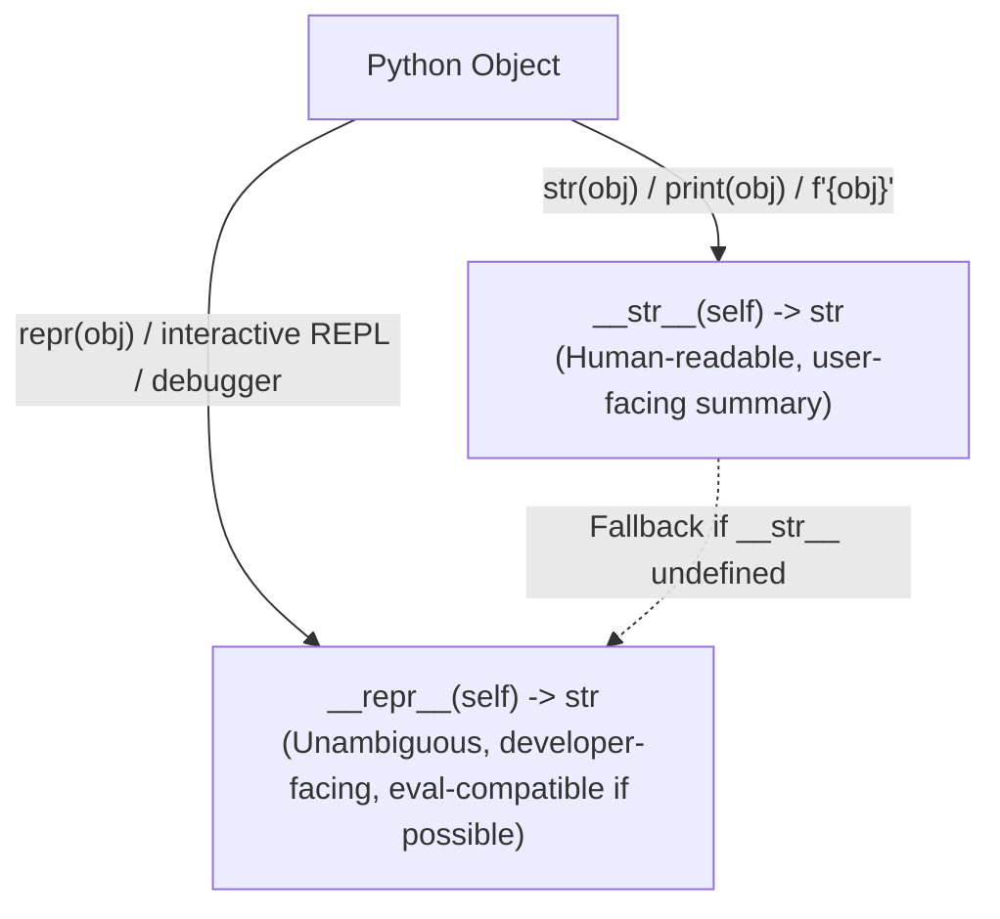
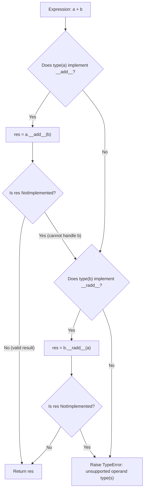

# Module 03: Data Model & Dunder Protocols

The Python Data Model is the formalized interface through which user-defined objects integrate seamlessly with Python's language constructs, operators, and built-in functions. Rather than prescribing hardcoded behaviors for specific data types, Python defines a protocol-oriented architecture: by implementing specific double-underscore ("dunder") methods on your classes, your objects participate natively in iteration, container indexing, context management, arithmetic expressions, and hashing.

Mastering the Data Model requires a thorough understanding of the dunder protocol contracts, the mathematical invariants governing equality and hashing, memory optimization via `__slots__`, class customization via `__init_subclass__`, and modern immutable mapping primitives such as `frozendict` (PEP 814).

---

## 1. Core Representation & String Protocols

Every object in Python should provide meaningful string representations. Python distinguishes between two fundamental string protocols:



- **`__repr__(self) -> str`**: Intended for developers, loggers, and interactive debugging. It must be unambiguous and, whenever practical, should look like valid Python source code that could recreate the object (e.g., `Point(x=10, y=20)`). If a class defines `__repr__` but omits `__str__`, Python falls back to `__repr__` for all string conversions.
- **`__str__(self) -> str`**: Intended for end-users. It returns a readable, informative presentation of the object's value. If `__repr__` is omitted, Python falls back to the default `object.__repr__`, which outputs `<ClassName object at 0x...>`.

---

## 2. Equality, Identity & the Hashing Invariant

In Python, an object is **hashable** if it has a hash value that never changes during its lifetime (evaluated via `__hash__`) and can be compared to other objects (evaluated via `__eq__`). Hashable objects can be used as dictionary keys and set members, because these data structures utilize hash tables to achieve $O(1)$ amortized lookups.

### 2.1 The Cardinal Mathematical Invariant
$$\forall a, b: \quad a == b \implies \text{hash}(a) == \text{hash}(b)$$
If two objects are considered equal according to their `__eq__` implementation, their `__hash__` values **must** be identical. If two equal objects produce different hash codes, hash tables will place them into different hash buckets, causing `dict` lookups and `set` deduplication to fail unpredictably. The converse is not required: two unequal objects may produce the same hash code (a hash collision), which the hash table resolves via open addressing probing.

### 2.2 The Automatic `__hash__ = None` Rule
If a class overrides `__eq__` without explicitly defining `__hash__`, CPython automatically sets `__hash__ = None` on the class!
```python
class Account:
    def __init__(self, account_id: str):
        self.account_id = account_id

    def __eq__(self, other: object) -> bool:
        if not isinstance(other, Account):
            return NotImplemented
        return self.account_id == other.account_id

acc = Account("ACC-100")
# Attempting to hash acc raises TypeError!
hash(acc)  # TypeError: unhashable type: 'Account'
```
**Why does Python do this?**
By default, user-defined classes inherit `object.__eq__` (which compares object identity: `self is other`) and `object.__hash__` (which derives a hash from the memory address). When you override `__eq__` to compare instance attributes, the object becomes mutable unless explicitly designed otherwise. If attributes change after the object is inserted into a hash table, its hash bucket location becomes permanently corrupted. Setting `__hash__ = None` protects developers from accidentally placing mutable objects into hash collections.

### 2.3 Implementing an Immutable, Hashable Class
To make an object safely hashable:
1. Ensure all identity attributes are immutable.
2. Implement `__hash__` using a tuple of those attributes:
```python
class FrozenAccount:
    def __init__(self, account_id: str):
        self._account_id = account_id

    @property
    def account_id(self) -> str:
        return self._account_id

    def __eq__(self, other: object) -> bool:
        if not isinstance(other, FrozenAccount):
            return NotImplemented
        return self._account_id == other._account_id

    def __hash__(self) -> int:
        return hash((self.__class__, self._account_id))
```

---

## 3. Container & Sequence Protocols

Python enables custom collection classes through the sequence and mapping protocols. Rather than requiring inheritance from an abstract base class, Python relies on duck typing: implementing specific dunder combinations activates built-in behaviors.

| Protocol | Required Dunder Methods | Enabled Behaviors |
|---|---|---|
| **Sized** | `__len__(self) -> int` | `len(obj)`, boolean truthiness check (`bool(obj)`) |
| **Container** | `__contains__(self, item: object) -> bool` | `item in obj`, `item not in obj` |
| **Iterable** | `__iter__(self) -> Iterator[T]` | `for x in obj:`, `iter(obj)`, unpacking `*obj` |
| **Sequence (Read-Only)** | `__len__`, `__getitem__(self, key: int | slice)` | Random access `obj[i]`, slicing `obj[1:5:2]`, reverse traversal |
| **Sequence (Mutable)** | `__setitem__`, `__delitem__`, `insert` | In-place mutation `obj[i] = val`, `del obj[i]` |
| **Mapping** | `__getitem__`, `__setitem__`, `__delitem__`, `__iter__`, `__len__`, `keys`, `values`, `items` | Hash table dictionary operations `obj["key"]` |

### 3.1 Handling Slices in `__getitem__`
When indexing an object, the key passed to `__getitem__` can be an integer or a `slice` object. A robust sequence implementation must handle both:
```python
class NumberRange:
    def __init__(self, start: int, stop: int):
        self.start = start
        self.stop = stop

    def __len__(self) -> int:
        return max(0, self.stop - self.start)

    def __getitem__(self, index: int | slice) -> int | list[int]:
        if isinstance(index, slice):
            # Extract start, stop, step normalized against length
            indices = index.indices(len(self))
            return [self.start + i for i in range(*indices)]
        if not isinstance(index, int):
            raise TypeError(f"Indices must be integers or slices, not {type(index).__name__}")
        if index < 0:
            index += len(self)
        if index < 0 or index >= len(self):
            raise IndexError("Index out of range")
        return self.start + index
```

---

## 4. Arithmetic & Reflected Operators

Python supports operator overloading through binary arithmetic methods (`__add__`, `__sub__`, `__mul__`) and their reflected counterparts (`__radd__`, `__rsub__`, `__rmul__`).



### 4.1 Returning `NotImplemented` vs Raising `TypeError`
When implementing binary dunder methods, never raise `TypeError` directly if the operand type is unsupported! Instead, return the built-in singleton `NotImplemented`.
- Returning `NotImplemented` signals to the CPython virtual machine that the left operand cannot handle the right operand.
- The VM immediately falls back to calling the reflected method on the right operand (`b.__radd__(a)`).
- Only if the reflected method also returns `NotImplemented` does CPython raise a user-friendly `TypeError: unsupported operand type(s) for +: 'A' and 'B'`. Raising `TypeError` directly aborts evaluation prematurely, preventing cooperative multi-type arithmetic.

---

## 5. Memory Optimization with `__slots__`

By default, every instance of a user-defined class stores its attributes in an internal dictionary (`instance.__dict__`). While flexible (allowing arbitrary new attributes to be attached dynamically at runtime), this introduces significant memory overhead: a Python dictionary consumes hundreds of bytes of hash table memory per instance.

When creating millions of small objects (e.g. coordinates, graph nodes, telemetry packets), you can define `__slots__`:

```python
class OptimizedPoint:
    __slots__ = ("x", "y")

    def __init__(self, x: float, y: float):
        self.x = x
        self.y = y
```

### 5.1 Mechanics of `__slots__`
1. **Array of Descriptors**: CPython reserves a fixed C array of pointers on the instance structure itself. Attributes are mapped to fixed numeric offsets using C descriptor objects (`member_descriptor`).
2. **Eliminates `__dict__`**: Unless `__dict__` is explicitly included in `__slots__`, instances do not possess a `__dict__` dictionary.
3. **No Dynamic Attribute Creation**: Attempting to set an attribute not listed in `__slots__` raises `AttributeError: 'OptimizedPoint' object has no attribute 'z'`.
4. **Memory Reduction**: Reduces memory usage from $\sim 152\text{ bytes}$ down to $\sim 48\text{ bytes}$ per instance (over 65% memory savings).
5. **Subclassing Caveat**: If a subclass inherits from a class with `__slots__`, the subclass will *still* allocate a `__dict__` unless the subclass explicitly defines its own `__slots__ = ()`.

---

## 6. Class Customization with `__init_subclass__` (PEP 487)

Before Python 3.6, customizing class creation (validating attributes, auto-registering subclasses in plugins) required complex custom metaclasses. **PEP 487** introduced `__init_subclass__`, which allows parent classes to intercept and customize the creation of their subclasses cleanly without metaclass conflicts.

```python
class PluginBase:
    registry: dict[str, type["PluginBase"]] = {}

    def __init_subclass__(cls, plugin_name: str | None = None, **kwargs: object) -> None:
        super().__init_subclass__(**kwargs)
        name = plugin_name or cls.__name__.lower()
        if name in cls.registry:
            raise ValueError(f"Duplicate plugin name: {name}")
        cls.registry[name] = cls

class S3StoragePlugin(PluginBase, plugin_name="s3"):
    pass

class GCSStoragePlugin(PluginBase, plugin_name="gcs"):
    pass

assert "s3" in PluginBase.registry
assert PluginBase.registry["s3"] is S3StoragePlugin
```

---

## 7. Immutable Mappings & `frozendict` (PEP 814)

In modern Python architectures (PEP 814 / Python 3.15+), immutable dictionary mappings are standardized via `frozendict`.
- A `frozendict` is an immutable, hashable mapping.
- Attempting to set or delete an item raises `TypeError`.
- Because `frozendict` is hashable (provided all keys and values are hashable), it can be used directly as dictionary keys or set elements, enabling clean functional state modeling and cached memoization keys.

---

## 8. Dataclasses vs `attrs` vs Pydantic

| Feature | Standard `dataclasses` (stdlib) | `attrs` (third-party) | `pydantic` v2 (third-party) |
|---|---|---|---|
| **Primary Use Case** | Lightweight in-memory domain objects, structs | Highly customizable Python classes with slotted memory | API schema serialization, runtime input validation, parsing |
| **Runtime Overhead** | Zero (generates pure Python dunders) | Near-zero (generates optimized C/Python methods) | Fast Rust core (pydantic-core), but validates data types at runtime |
| **Slots Support** | `slots=True` (Python 3.10+) | `slots=True` (native default) | N/A (validates arbitrary dict inputs) |
| **Immutability** | `frozen=True` | `frozen=True` | `model_config = ConfigDict(frozen=True)` |
| **Type Validation** | Static only (mypy/pyright; no runtime coercion) | Optional runtime validators | Strict runtime validation & automatic type coercion |

---

## 9. Interview Drill: Questions & Model Answers

<details>
<summary>1. Why must `__hash__` return an integer, and what happens if two equal objects return different hashes?</summary>

**Answer:**
`__hash__` must return a 64-bit integer representing the object's hash code for use in hash-based collections (`dict` and `set`).
If two equal objects ($a == b$) produce different hash values, the fundamental hashing invariant is violated. When $a$ is added to a dictionary (`d[a] = 1`), it is placed in bucket $h_1 = \text{hash}(a) \pmod N$. When querying `d[b]`, the dictionary looks in bucket $h_2 = \text{hash}(b) \pmod N$. Because $h_1 \neq h_2$, the dictionary searches the wrong bucket and fails to locate the key, incorrectly claiming the key does not exist even though $a == b$. Furthermore, adding both $a$ and $b$ to a set will result in duplicate equal elements existing simultaneously in the set, corrupting collection integrity.
</details>

<details>
<summary>2. What is the difference between `__getattr__` and `__getattribute__`?</summary>

**Answer:**
- `__getattribute__(self, name: str)`: Called **unconditionally** for *every* attribute access on the object (`obj.attr`). It is responsible for resolving descriptors, checking `__dict__`, and traversing the class hierarchy. Overriding it requires caution; calling `self.attr` inside it causes infinite recursion. Developers must call `super().__getattribute__(name)`.
- `__getattr__(self, name: str)`: A fallback method called **only** when `__getattribute__` fails to locate the attribute via standard descriptor lookup and dictionary lookup (i.e. when `AttributeError` would otherwise be raised). It is used to implement lazy evaluation, dynamic proxying, and default attribute values.
</details>

<details>
<summary>3. Why should binary arithmetic methods return `NotImplemented` instead of raising `TypeError`?</summary>

**Answer:**
When Python evaluates `a + b`, it calls `a.__add__(b)`. If `a` does not recognize the type of `b` and raises `TypeError`, evaluation halts immediately with an exception. However, if `a.__add__(b)` returns `NotImplemented`, the virtual machine catches this sentinel and immediately checks if `b` knows how to interact with `a` by invoking `b.__radd__(a)`. Returning `NotImplemented` allows cooperative inter-type arithmetic (for example, allowing a custom `Vector` class to be multiplied by a standard `int` or `float` regardless of which operand is on the left).
</details>

<details>
<summary>4. What are the memory and inheritance implications of using `__slots__`?</summary>

**Answer:**
- **Memory**: Replaces the per-instance `__dict__` with a compact, fixed C array of pointers managed by C descriptors. This reduces per-instance memory consumption by 60–70% and prevents the dynamic creation of undeclared attributes.
- **Inheritance**: If a class defines `__slots__` and its subclass does not define `__slots__`, instances of the subclass will allocate a standard `__dict__`, negating memory savings. To maintain memory optimization, every class throughout the inheritance hierarchy must explicitly declare `__slots__` (even an empty tuple `__slots__ = ()` if introducing no new attributes).
- **Multiple Inheritance**: Multiple inheritance is only possible if at most one base class defines non-empty `__slots__`; multiple bases with non-empty slots cause a layout conflict and raise `TypeError: multiple bases have instance lay-out conflict`.
</details>

<details>
<summary>5. How does `__init_subclass__` simplify framework architecture compared to metaclasses?</summary>

**Answer:**
Before `__init_subclass__` (PEP 487), customizing class definition (such as enforcing method implementations, auto-registering plugins, or injecting attributes) required writing a custom metaclass inheriting from `type`. Metaclasses suffer from the "metaclass conflict": if a class inherits from two base classes that define different metaclasses, Python raises `TypeError` unless a unified metaclass is created.
`__init_subclass__` is a standard class method executed whenever a class is derived from the parent. It receives the newly created subclass as its first argument and accepts arbitrary keyword arguments passed in the class definition header (`class MyPlugin(BasePlugin, name="auth"):`). It solves 95% of plugin registration and validation use cases without introducing metaclass complexity or inheritance conflicts.
</details>
