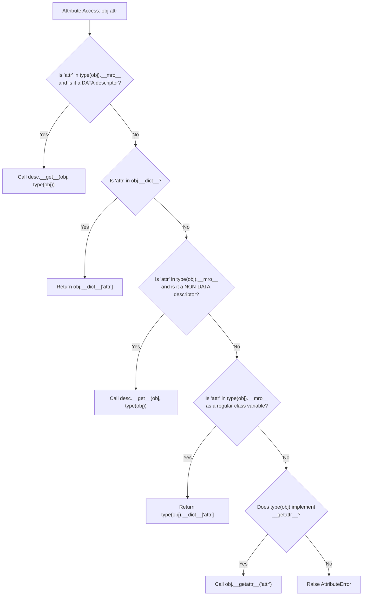
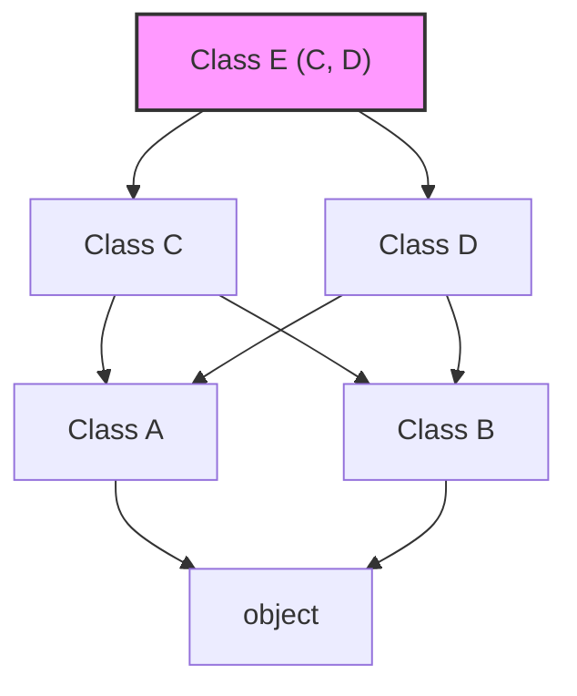
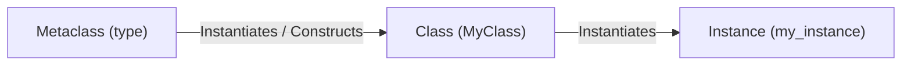

# Module 04: Descriptors, Metaclasses & Attribute Machinery

Python's object-oriented architecture is dynamic, reflective, and governed by explicit protocol machinery. Features that appear to be fundamental compiler syntax—such as the `@property` decorator, `@classmethod`, `@staticmethod`, object method binding (`self`), and attribute access (`obj.attr`)—are entirely realized through Python's **Descriptor Protocol**.

Similarly, how Python resolves attributes across complex inheritance hierarchies is governed mathematically by the **C3 Linearization Algorithm (MRO)**, while class creation itself can be customized and intercepted via **Metaclasses** and **Abstract Base Classes (ABCs)**.

---

## 1. The Descriptor Protocol

A descriptor is an object attribute whose access, mutation, or deletion is intercepted by double-underscore methods defined on the descriptor's class:
- `__get__(self, instance, owner=None) -> Any`
- `__set__(self, instance, value) -> None`
- `__delete__(self, instance) -> None`

If an object defines any of these methods, it is considered a descriptor. Crucially, **descriptors must be declared on the class dictionary, not on an instance dictionary**.



### 1.1 Data Descriptors vs Non-Data Descriptors
Python makes an essential distinction between two categories of descriptors:

| Descriptor Category | Defining Condition | Priority over Instance `__dict__` | Examples |
|---|---|---|---|
| **Data Descriptor** | Defines `__set__` or `__delete__` (often alongside `__get__`) | **Higher priority than `__dict__`**: shadows instance variables | `@property` with a setter, ORM fields, type validators |
| **Non-Data Descriptor** | Defines **only** `__get__` (omits `__set__` and `__delete__`) | **Lower priority than `__dict__`**: shadowed by instance variables | Functions (methods), `@staticmethod`, `@classmethod`, cached properties |

### 1.2 How Methods Bind: Functions as Non-Data Descriptors
Every standard Python function is a non-data descriptor! In CPython, `function` objects implement `__get__`:
```python
class Greeter:
    def greet(self):
        return "Hello"

g = Greeter()
# When you evaluate g.greet, CPython invokes:
# Greeter.__dict__['greet'].__get__(g, Greeter)
# which returns a types.MethodType object binding 'self' to 'g'!
bound_method = Greeter.__dict__["greet"].__get__(g, Greeter)
assert bound_method() == "Hello"
```
When accessed via the class (`Greeter.greet`), `__get__(None, Greeter)` returns the raw, unbound function. When accessed via an instance (`g.greet`), `__get__(g, Greeter)` returns a bound method (`types.MethodType`) with `self` pre-bound to `g`.

### 1.3 Automatic Identifier Binding: `__set_name__` (PEP 487)
Before Python 3.6, descriptors could not determine the name of the attribute they were assigned to without requiring the developer to pass the name as a string to the descriptor's constructor. **PEP 487** introduced `__set_name__(self, owner, name)`: when the containing class is constructed, Python calls `__set_name__` on every descriptor, passing the owner class and the attribute name automatically.

```python
class ValidatedString:
    def __set_name__(self, owner: type, name: str) -> None:
        self.storage_name = f"_{name}"

    def __get__(self, instance: object, owner: type | None = None) -> str:
        if instance is None:
            return self  # type: ignore[return-value]
        return getattr(instance, self.storage_name)

    def __set__(self, instance: object, value: str) -> None:
        if not isinstance(value, str):
            raise TypeError(f"Expected str, got {type(value).__name__}")
        setattr(instance, self.storage_name, value)

class User:
    username = ValidatedString()  # __set_name__ automatically binds self.storage_name = "_username"
```

---

## 2. Method Resolution Order (MRO) & C3 Linearization

In languages with multiple inheritance, determining which method or attribute to invoke across complex diamond hierarchies is fraught with ambiguity. Python resolves this deterministically using the **C3 Linearization Algorithm** (Kim Barrett et al., adopted in Python 2.3).

### 2.1 The Three Invariants of C3 Linearization
The linearization $L(C)$ of a class $C$ with base classes $B_1, B_2, \dots, B_n$ is the class $C$ followed by the merge of the linearizations of its parents and the list of parents:
$$L(C) = [C] + \text{merge}(L(B_1), L(B_2), \dots, L(B_n), [B_1, B_2, \dots, B_n])$$

The merge operation satisfies three strict mathematical invariants:
1. **Local Precedence Order**: Direct base classes appear in the exact left-to-right order declared in the `class C(B1, B2):` header.
2. **Monotonicity**: If class $X$ precedes class $Y$ in the MRO of any parent class, $X$ must precede $Y$ in the MRO of all descendant classes.
3. **Consistency**: If no order exists that satisfies both local precedence and monotonicity, class creation fails immediately with a compile-time `TypeError: Cannot create a consistent method resolution order (MRO)`.


In the diamond above, if class $C$ declares `(A, B)` while class $D$ declares `(B, A)`, attempting to create `class E(C, D)` produces an irreconcilable ordering contradiction ($A < B$ in $C$, but $B < A$ in $D$). Python refuses to guess and raises `TypeError`.

### 2.2 Cooperative Multiple Inheritance with `super()`
In Python, `super()` does **not** simply call the immediate parent class! `super(CurrentClass, self)` returns a proxy object that delegates method calls to the **next class in the instance's MRO chain** (`type(self).__mro__`).

```python
class Root:
    def ping(self) -> list[str]:
        return ["Root"]

class ServiceA(Root):
    def ping(self) -> list[str]:
        return ["ServiceA"] + super().ping()

class ServiceB(Root):
    def ping(self) -> list[str]:
        return ["ServiceB"] + super().ping()

class CombinedService(ServiceA, ServiceB):
    def ping(self) -> list[str]:
        return ["Combined"] + super().ping()

s = CombinedService()
# MRO: [CombinedService, ServiceA, ServiceB, Root, object]
assert s.ping() == ["Combined", "ServiceA", "ServiceB", "Root"]
```
Notice that inside `ServiceA`, `super().ping()` calls `ServiceB.ping()`, even though `ServiceA` and `ServiceB` have no direct inheritance relationship! This is **cooperative multiple inheritance**: by using `super()` consistently, every class in the MRO is executed exactly once in topological order.

---

## 3. Metaclasses: The Constructors of Classes

In Python, classes are themselves first-class objects (instances of `type`). A **metaclass** is the class of a class: it defines how class objects are constructed, validated, and initialized.



### 3.1 The Class Creation Lifecycle
When Python executes a `class MyClass(Base, metaclass=MyMeta):` statement:
1. Python creates the class namespace dictionary by calling `MyMeta.__prepare__(name, bases)`.
2. Python executes the class body code in this namespace dictionary.
3. Python calls `MyMeta.__new__(mcs, name, bases, namespace)`: this allocates and returns the new `type` class object.
4. Python calls `MyMeta.__init__(cls, name, bases, namespace)`: this initializes the newly created class object.
5. Python executes `__init_subclass__` hooks on any parent classes.

```python
class StrictModelMeta(type):
    def __new__(mcs, name: str, bases: tuple[type, ...], namespace: dict[str, object]):
        # Enforce that every subclass defines a docstring
        if not namespace.get("__doc__"):
            raise TypeError(f"Class '{name}' must provide a docstring")
        return super().__new__(mcs, name, bases, namespace)

class ValidModel(metaclass=StrictModelMeta):
    """A fully documented production model."""
    pass
```

### 3.2 Metaclass Conflicts
If class $C$ inherits from base $A$ (with metaclass $M_A$) and base $B$ (with metaclass $M_B$), and neither metaclass is a subclass of the other, Python raises:
`TypeError: metaclass conflict: the metaclass of a derived class must be a (non-strict) subclass of the metaclasses of all its bases`.
To resolve this, developers must create a combined metaclass that inherits from both $M_A$ and $M_B$. This fragility is why `__init_subclass__` is preferred for modern applications.

---

## 4. Abstract Base Classes (ABCs) & Structural Typing

Python provides the `abc` module to define formal interfaces and abstract base classes.

### 4.1 Nominal Interface Enforcement
Using `abc.ABCMeta` and `@abc.abstractmethod`, an ABC prevents direct instantiation of subclasses that have not fully implemented all abstract methods:
```python
import abc

class Repository(abc.ABC):
    @abc.abstractmethod
    def save(self, entity_id: str, data: dict[str, object]) -> None:
        pass

    @abc.abstractmethod
    def find(self, entity_id: str) -> dict[str, object] | None:
        pass
```
Attempting to instantiate a subclass that omits `save()` or `find()` raises `TypeError: Can't instantiate abstract class IncompleteRepo with abstract method save`.

### 4.2 Structural Virtual Subclasses via `__subclasshook__`
ABCs also support dynamic structural duck typing via `__subclasshook__`. A class can be recognized as a virtual subclass of an ABC via `isinstance()` and `issubclass()` **without** explicitly inheriting from the ABC:

```python
class SizedIterable(abc.ABC):
    @classmethod
    def __subclasshook__(cls, subclass: type) -> bool:
        if cls is SizedIterable:
            has_len = any("__len__" in B.__dict__ for B in subclass.__mro__)
            has_iter = any("__iter__" in B.__dict__ for B in subclass.__mro__)
            return has_len and has_iter
        return NotImplemented

class CustomList:
    def __len__(self) -> int: return 0
    def __iter__(self): return iter([])

# CustomList did NOT inherit from SizedIterable, yet issubclass is True!
assert issubclass(CustomList, SizedIterable)
assert isinstance(CustomList(), SizedIterable)
```

---

## 5. Interview Drill: Questions & Model Answers

<details>
<summary>1. Explain the attribute resolution order in Python from instance to class and fallback.</summary>

**Answer:**
When evaluating `obj.attr`, CPython executes the following priority order:
1. Search `type(obj).__mro__` for an attribute named `attr`. If found and it is a **Data Descriptor** (defines `__set__` or `__delete__`), invoke its `__get__(obj, type(obj))` method.
2. Otherwise, check the instance dictionary `obj.__dict__` (or its slotted array). If `attr` exists, return its value.
3. Otherwise, check `type(obj).__mro__` for `attr`. If found and it is a **Non-Data Descriptor** (defines only `__get__`, such as a method or `@staticmethod`), invoke its `__get__(obj, type(obj))`.
4. If found on `type(obj).__mro__` as a plain class variable, return it directly.
5. If not found in any of the above, call `obj.__getattr__('attr')` if defined on the class.
6. If `__getattr__` is missing or raises `AttributeError`, the operation terminates with `AttributeError`.
</details>

<details>
<summary>2. Why does a method call `obj.method()` pass `self` automatically, while `Class.method()` does not?</summary>

**Answer:**
Because functions are non-data descriptors implementing `__get__`.
- When accessed via an instance (`obj.method`), `function.__get__(obj, Class)` is evaluated. It returns a `types.MethodType` object: a callable wrapper that binds the instance `obj` as the first argument (`self`) to the underlying C function.
- When accessed via the class (`Class.method`), `function.__get__(None, Class)` is evaluated. Because the instance argument is `None`, `__get__` returns the underlying bare `function` object without binding. Invoking `Class.method()` therefore requires passing the instance explicitly: `Class.method(obj)`.
</details>

<details>
<summary>3. What is C3 Linearization, and why did Python adopt it over earlier MRO algorithms?</summary>

**Answer:**
C3 Linearization is an algorithm for calculating a deterministic topological sort of classes in a multiple-inheritance hierarchy. Python adopted C3 in version 2.3 because earlier MRO algorithms (DFS pre-order in Python 2.1, and an early BFS hybrid in Python 2.2) suffered from monotonicity and local precedence violations:
1. In Python 2.1 DFS, diamond inheritance hierarchies visited base classes before subclasses, causing method overriding to fail.
2. C3 guarantees **Monotonicity**: if class $A$ precedes class $B$ in any parent's MRO, $A$ must precede $B$ in all descendant MROs.
3. C3 guarantees **Local Precedence**: base classes are visited in the exact left-to-right order declared in the `class` definition.
4. If a hierarchy contains contradictory ordering constraints, C3 fails fast at compile time with a `TypeError` rather than choosing an arbitrary or silently broken method resolution order.
</details>

<details>
<summary>4. What is the difference between `super()` in single inheritance vs multiple inheritance?</summary>

**Answer:**
In single inheritance, `super()` trivially delegates to the single immediate parent class.
In multiple inheritance, `super()` does **not** call the parent class; it calls the **next class in the instance's MRO**. This means:
- The target of `super()` cannot be determined by inspecting the class alone; it depends dynamically on the `__mro__` of the runtime instance (`type(self)`).
- A class method using `super()` may invoke a peer sibling class with which it shares no direct inheritance ancestry (cooperative multiple inheritance).
- Every class in the hierarchy must accept cooperative arguments (`*args, **kwargs`) and forward them via `super()` to ensure the entire chain terminates cleanly at `object`.
</details>

<details>
<summary>5. When should you use a Metaclass instead of `__init_subclass__` or Class Decorators?</summary>

**Answer:**
Use `__init_subclass__` or class decorators by default. A Metaclass is strictly required only when you must:
1. Intercept or customize the class namespace dictionary *before* the class body is evaluated (via `__prepare__`, e.g. enforcing ordered enum definitions or tracking declaration order).
2. Alter or reject class construction before the `type` object is instantiated (in `__new__`).
3. Define class-level properties or dunder methods (e.g., implementing custom `__getitem__` on the class object itself, like `MyClass[int]`, or class-level `@property` descriptors that execute on `MyClass.attr` without instantiation).
In all other cases, `__init_subclass__` is preferred because it avoids metaclass conflicts and complex inheritance mechanics.
</details>
