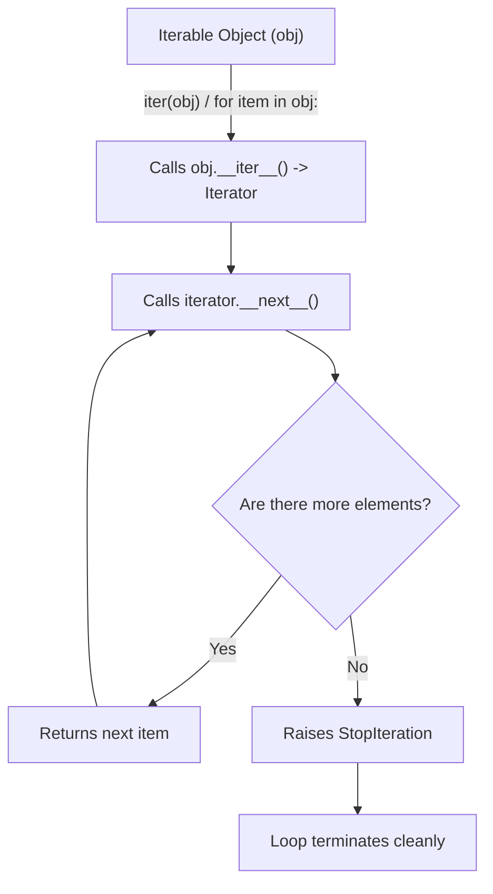
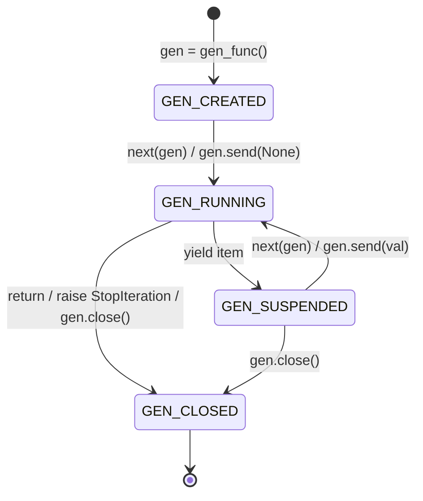

# Module 05: Iteration, Generators & Context Managers

Python's iteration and resource management primitives are among its most elegant and expressive features. At the core of data processing pipelines, streaming systems, and concurrency engines lies the **Iteration Protocol** and its coroutine extension: **Generators**. Rather than loading entire datasets into physical memory, generators produce elements lazily on demand by suspending and resuming execution frames on the CPython evaluation stack.

Similarly, deterministic resource management—guaranteeing that database connections, file descriptors, network sockets, and locks are released under both normal flow and unexpected exceptions—is governed by the **Context Manager Protocol** (`__enter__` / `__exit__`), `contextlib.ExitStack`, and modern **Exception Groups** (`except*`, PEP 654).

---

## 1. The Iteration Protocol

The iteration protocol decouples data storage from sequence traversal. It consists of two distinct protocol contracts:



1. **Iterable**: Any object that implements `__iter__(self) -> Iterator[T]`, returning a fresh iterator object. It may alternatively implement legacy `__getitem__` with integer indices starting at zero.
2. **Iterator**: Any object that implements `__next__(self) -> T` (returning the next element or raising `StopIteration` when exhausted) AND implements `__iter__(self) -> Self` (returning `self` so that an iterator can itself be passed to a `for` loop).

```python
class CountUpTo:
    def __init__(self, limit: int):
        self.limit = limit

    def __iter__(self):
        # Returns a fresh iterator instance
        return CountUpToIterator(self.limit)

class CountUpToIterator:
    def __init__(self, limit: int):
        self.limit = limit
        self.current = 0

    def __iter__(self):
        return self

    def __next__(self) -> int:
        if self.current >= self.limit:
            raise StopIteration
        val = self.current
        self.current += 1
        return val
```

---

## 2. Generators & Frame Suspension Mechanics

A generator is a specialized function containing the `yield` keyword. Calling a generator function does not execute its body; instead, CPython compiles the function with the `CO_GENERATOR` flag and returns a `PyGenObject`.

### 2.1 The `PyGenObject` Lifecycle
A generator object wraps an execution frame (`_PyInterpreterFrame`). When execution reaches a `yield expr` statement:
1. The evaluated expression is pushed to the caller's stack.
2. CPython records the current instruction pointer (`f_lasti`) on the generator's frame.
3. The generator's state transitions to `GEN_SUSPENDED`.
4. Control returns to the caller, leaving all local variables and the execution stack intact inside the generator frame on the heap.



You can inspect this state programmatically using `inspect.getgeneratorstate()`:
- `GEN_CREATED`: Waiting to start execution.
- `GEN_RUNNING`: Currently executing on a thread.
- `GEN_SUSPENDED`: Suspended at a `yield` expression.
- `GEN_CLOSED`: Execution has completed or the generator was closed.

---

## 3. Bidirectional Coroutines: `send()`, `throw()`, and `close()`

Beyond producing streams, generators act as bidirectional communication channels via three methods:

### 3.1 `generator.send(value)`
The `yield` keyword is an expression that evaluates to the value passed in via `.send(value)`.
- When advancing a generator using `next(gen)`, it is equivalent to calling `gen.send(None)`.
- To start a freshly created generator (`GEN_CREATED`), you **must** prime it with `gen.send(None)`. Sending a non-None value to a generator that has not started raises `TypeError: can't send non-None value to a just-started generator`.

```python
def running_average():
    total = 0.0
    count = 0
    average = None
    while True:
        # yield produces 'average' to caller, and receives 'val' from caller's .send(val)
        val = yield average
        if val is None:
            break
        total += val
        count += 1
        average = total / count

avg = running_average()
next(avg)  # Prime generator (advances to first yield)
assert avg.send(10) == 10.0
assert avg.send(20) == 15.0
assert avg.send(30) == 20.0
```

### 3.2 `generator.throw(typ, [val, [tb]])`
Raises an exception of type `typ` at the exact point of the suspended `yield` statement. If the generator catches the exception with a `try/except` block, execution continues to the next `yield`. If unhandled, the exception propagates out of the `.throw()` call to the caller.

### 3.3 `generator.close()`
Raises a `GeneratorExit` exception at the suspended `yield` statement.
- The generator may execute cleanup code in `finally` blocks.
- **Invariant**: If a generator catches `GeneratorExit` and attempts to yield another value, CPython raises `RuntimeError: generator ignored GeneratorExit`.

---

## 4. Subgenerator Delegation via `yield from`

Prior to Python 3.3 (PEP 380), delegating work from an outer generator to an inner subgenerator required verbose loops handling values, exceptions, and `send()` values manually.
`yield from iterable` establishes a direct, transparent bidirectional channel between the caller and the subgenerator:
1. Every value yielded by the subgenerator is passed directly to the caller.
2. Every value sent via `send()` or exception injected via `throw()` is forwarded directly to the subgenerator.
3. If the subgenerator terminates with `return result`, Python extracts `result` from the `StopIteration` exception and assigns it: `res = yield from subgen()`.

```python
def sub_task():
    yield 1
    yield 2
    return "Finished SubTask"

def main_coordinator():
    result = yield from sub_task()
    yield f"Result: {result}"

gen = main_coordinator()
assert list(gen) == [1, 2, "Result: Finished SubTask"]
```

---

## 5. The Context Manager Protocol

A context manager manages runtime resources using the `with` statement. It guarantees that entry setup and exit cleanup are executed deterministically, even if the body raises an unhandled exception or terminates early via `return`.

### 5.1 Protocol Specification
- `__enter__(self) -> T`: Prepares the resource and returns the target bound to the `as` variable (`with Resource() as r:`).
- `__exit__(self, exc_type, exc_val, exc_tb) -> bool | None`:
  - If the `with` block executes cleanly without error: called with `(None, None, None)`.
  - If an exception occurs: called with the exception class, exception instance, and traceback object.
  - **Exception Suppression Rule**: If `__exit__` returns `True`, Python **suppresses** the exception and resumes normal execution after the `with` block. If `__exit__` returns `False` or `None`, Python re-raises the exception.

```python
class ManagedTransaction:
    def __init__(self, db_client):
        self.db = db_client

    def __enter__(self):
        self.db.begin_transaction()
        return self

    def __exit__(self, exc_type, exc_val, exc_tb) -> bool:
        if exc_type is not None:
            self.db.rollback()
            # Suppress specific recoverable errors, or return False to propagate
            return False
        self.db.commit()
        return True
```

### 5.2 Dynamic Resource Management: `contextlib.ExitStack`
When an application needs to manage an arbitrary or dynamic number of context managers (e.g. opening $N$ files based on user input, or acquiring multiple distributed locks), static nested `with A(), B(), C():` statements fail.
`contextlib.ExitStack` provides a programmatic stack that tracks an arbitrary number of context managers and callbacks, unwinding them in strict LIFO (Last-In, First-Out) order upon exit.

```python
from contextlib import ExitStack

def process_multiple_files(paths: list[str]) -> list[str]:
    contents = []
    with ExitStack() as stack:
        # Dynamically enter as many context managers as needed
        files = [stack.enter_context(open(p, "r", encoding="utf-8")) for p in paths]
        # If any open() fails, ExitStack automatically closes all previously opened files!
        for f in files:
            contents.append(f.read())
    return contents
```

---

## 6. Exception Groups & `except*` (PEP 654)

When dealing with concurrent operations (such as multiple parallel tasks in an `asyncio.TaskGroup` or multiple sub-threads), multiple independent exceptions can occur simultaneously. Standard `try/except` can catch only a single exception at a time, forcing earlier frameworks to either discard secondary exceptions or bundle them into custom wrapper classes.

**PEP 654** introduced **Exception Groups** and the `except*` syntax:
- `ExceptionGroup(message, [exc1, exc2, ...])` bundles multiple exceptions into a tree.
- `except* ExceptionType as eg:` matches and extracts only the subset of exceptions within the group matching `ExceptionType`, allowing multiple `except*` branches to execute for a single group!

```python
def run_concurrent_batch():
    raise ExceptionGroup(
        "Batch failure",
        [ValueError("Invalid id: -1"), KeyError("Missing key: 'token'"), ValueError("Invalid count: 0")]
    )

try:
    run_concurrent_batch()
except* ValueError as eg:
    # eg contains ONLY the two ValueError instances
    print(f"Caught {len(eg.exceptions)} ValueErrors")
except* KeyError as eg:
    # eg contains the KeyError instance
    print(f"Caught {len(eg.exceptions)} KeyErrors")
```

---

## 7. Interview Drill: Questions & Model Answers

<details>
<summary>1. What is the fundamental difference between an Iterable and an Iterator in Python?</summary>

**Answer:**
- An **Iterable** is an object capable of returning its members one at a time. It implements `__iter__()` returning a new iterator object (e.g., `list`, `dict`, `set`, `str`). An iterable can be iterated over multiple times, each time producing an independent iterator starting from the beginning.
- An **Iterator** is an active stateful stream object. It implements both `__next__()` (returning the next element or raising `StopIteration`) and `__iter__()` (returning `self`). An iterator represents a single traversal over an iterable: once exhausted, calling `next()` repeatedly raises `StopIteration`; it cannot be reset or rewound.
</details>

<details>
<summary>2. Why does calling a generator function not execute the code inside it immediately?</summary>

**Answer:**
During bytecode compilation, if CPython detects the `yield` or `yield from` keyword inside a function body, it flags the code object with `CO_GENERATOR`.
When the function is invoked, CPython inspects the code object flags: noticing `CO_GENERATOR`, it does not create a standard evaluation frame on the call stack. Instead, it allocates a heap-resident `PyGenObject` wrapping the function's code object and arguments, and returns this generator immediately in the `GEN_CREATED` state. The function body begins executing only when the caller invokes `next(gen)` or `gen.send(None)`.
</details>

<details>
<summary>3. What happens if a generator catches `GeneratorExit` and attempts to yield another value?</summary>

**Answer:**
When a generator is garbage collected or explicitly closed via `gen.close()`, CPython raises a `GeneratorExit` exception inside the suspended frame. The generator is permitted to catch this exception in a `try/finally` or `except GeneratorExit` block to perform cleanup (e.g., closing files, releasing locks).
However, the contract of `close()` strictly forbids further value production. If the generator catches `GeneratorExit` and executes another `yield expr`, CPython detects this violation and raises `RuntimeError: generator ignored GeneratorExit`.
</details>

<details>
<summary>4. How does `yield from` handle return values from subgenerators?</summary>

**Answer:**
When a generator contains `return val`, CPython terminates the generator by raising `StopIteration(val)`, storing the return value in the exception's `.value` attribute.
When using `result = yield from subgenerator()`, the `yield from` protocol intercepts the `StopIteration` exception raised by the subgenerator, extracts the `.value` attribute, and assigns it to `result`. This allows subgenerators to yield intermediate streaming items while cleanly returning a final summary or status value to the delegating generator.
</details>

<details>
<summary>5. How does `except*` differ from traditional `except` when handling an `ExceptionGroup`?</summary>

**Answer:**
- Traditional `except ExceptionType as e` checks the group as a single monolithic object. If the group matches, the single `except` block executes, and no other `except` blocks are evaluated.
- `except* ExceptionType as eg` decomposes the `ExceptionGroup`. It extracts *all* exceptions within the group matching `ExceptionType` and binds them as a new `ExceptionGroup` to `eg`. The remaining unhandled exceptions in the group are passed along to subsequent `except*` clauses. This allows multiple `except*` blocks to execute in the same `try` statement, handling heterogeneous concurrent errors independently while preserving full causal trace trees for any unhandled exceptions.
</details>
