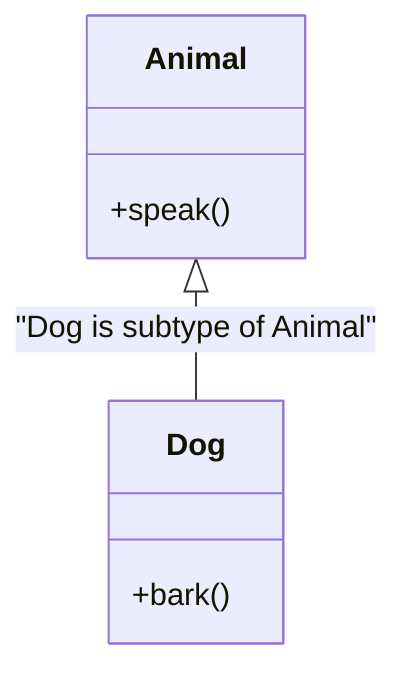

# Module 06: Type System, Generics & Modern Annotations

Python's type system has undergone a profound evolution. Originating in Python 3.5 (PEP 484) as an optional, comment-like annotation mechanism, static typing in Python is now an expressive, sound, and comprehensive type system capable of modeling complex generic abstractions, structural subtyping, higher-order function decorators, and type-narrowing predicates.

Crucially, Python remains a **gradually typed** language: type annotations are ignored by the CPython virtual machine at runtime during bytecode execution. Instead, type correctness is verified ahead-of-time by static type checkers (**mypy**, Microsoft's **pyright**, and Astral's **ty**).

Mastering modern Python typing requires fluency with **PEP 695** type parameter syntax, variance inference, structural **Protocols**, **TypeIs** vs **TypeGuard** narrowing (PEP 742), **ParamSpec** decorator preservation, and **TypeVarTuple** (PEP 646).

---

## 1. Modern Generics: PEP 695 & PEP 696

Before Python 3.12, defining a generic function or class required verbose boilerplate: manually instantiating `TypeVar`, binding bounds, declaring variance, and inheriting from `typing.Generic[T]`.

**PEP 695** (Python 3.12+) introduced first-class language syntax for type parameters:

```python
# Modern PEP 695 syntax (No TypeVar, no Generic[T] base class!):
class Repository[T, ID]:
    def __init__(self) -> None:
        self._storage: dict[ID, T] = {}

    def save(self, entity_id: ID, entity: T) -> None:
        self._storage[entity_id] = entity

    def get(self, entity_id: ID) -> T | None:
        return self._storage.get(entity_id)

# Generic type aliases using the 'type' statement:
type Vector3D[T] = tuple[T, T, T]
type JsonValue = str | int | float | bool | None | list[JsonValue] | dict[str, JsonValue]
```

### 1.1 Type Parameter Defaults (PEP 696)
In Python 3.13+, **PEP 696** allows type parameters to declare default types, mirroring default arguments in function signatures:
```python
class Response[Data = dict[str, object], Error = str]:
    def __init__(self, data: Data | None, error: Error | None = None) -> None:
        self.data = data
        self.error = error

# Defaults to Response[dict[str, object], str]
default_resp: Response = Response({"status": "ok"})
# Explicitly specialized
custom_resp: Response[int, ValueError] = Response(100, None)
```

---

## 2. Subtyping Variance: Invariance, Covariance & Contravariance

Variance describes how the subtyping relationship between component types ($A <: B$) affects the subtyping relationship between generic types constructed from them ($F[A]$ and $F[B]$).



### 2.1 The Three Variance Rules
1. **Invariance**: $F[Dog]$ has NO subtyping relationship to $F[Animal]$. A mutable container **must** be invariant:
   ```python
   dogs: list[Dog] = [Dog()]
   animals: list[Animal] = dogs  # TYPE CHECKER REJECTS THIS!
   animals.append(Cat())        # If permitted, a Cat would now be inside a list of Dogs!
   ```
2. **Covariance**: If $Dog <: Animal$, then $F[Dog] <: F[Animal]$ (the subtyping direction is preserved). A read-only / producer container is covariant:
   ```python
   from collections.abc import Sequence
   dogs: Sequence[Dog] = (Dog(),)
   animals: Sequence[Animal] = dogs  # VALID: Sequence is read-only
   ```
3. **Contravariance**: If $Dog <: Animal$, then $F[Animal] <: F[Dog]$ (the subtyping direction is reversed). A consumer / write-only sink is contravariant:
   ```python
   from collections.abc import Callable
   # A function that can process ANY Animal can safely be used where a function processing Dogs is expected!
   animal_inspector: Callable[[Animal], None] = lambda a: print(a)
   dog_inspector: Callable[[Dog], None] = animal_inspector  # VALID
   ```

### 2.2 PEP 695 Automatic Variance Inference
In legacy Python, developers had to manually deduce and specify variance: `T_co = TypeVar("T_co", covariant=True)`.
Under **PEP 695**, static type checkers automatically infer the variance of generic classes based on how the type parameters are used across attributes and method signatures! If a parameter is used exclusively in return types, it is inferred as covariant; if used in both parameter and return positions, it is inferred as invariant.

---

## 3. Structural Subtyping: `typing.Protocol`

Python's dynamic nature is famously rooted in "duck typing" ("if it walks like a duck and quacks like a duck, it's a duck"). Standard nominal inheritance (`class Dog(Animal):`) requires classes to declare their inheritance explicitly, creating tight architectural coupling.

**PEP 544** introduced `typing.Protocol`: **structural subtyping** for static type checkers. A class satisfies a Protocol if it defines the required attributes and methods with matching signatures, regardless of its inheritance hierarchy.

```python
from typing import Protocol, runtime_checkable

@runtime_checkable
class Renderable(Protocol):
    def render(self) -> str: ...

class UIWidget:
    # Does NOT inherit from Renderable!
    def render(self) -> str:
        return "<div>Widget</div>"

def display(component: Renderable) -> None:
    print(component.render())

# Fully passes static type check (mypy/pyright)!
display(UIWidget())

# Because @runtime_checkable was used, isinstance() also works at runtime!
assert isinstance(UIWidget(), Renderable)
```

---

## 4. Advanced Decorator Typing: `ParamSpec` & `Concatenate`

Before **PEP 612**, typing function decorators was a notorious pain point in Python: using `TypeVar("F", bound=Callable[..., Any])` preserved the callable nature of the wrapped function, but erased all parameter names, default values, and keyword-argument types.

`ParamSpec` captures the exact signature of a callable (including positional, keyword, and optional parameters), while `Concatenate` allows decorators to prepend or remove parameters:

```python
from collections.abc import Callable
from typing import Concatenate, ParamSpec, TypeVar
import time

P = ParamSpec("P")
R = TypeVar("R")

def time_it(func: Callable[P, R]) -> Callable[P, R]:
    """Decorator that preserves the exact parameter types and return type of the wrapped function."""
    def wrapper(*args: P.args, **kwargs: P.kwargs) -> R:
        start = time.perf_counter()
        result = func(*args, **kwargs)
        duration = time.perf_counter() - start
        print(f"{func.__name__} took {duration:.4f}s")
        return result
    return wrapper

@time_it
def compute(x: int, y: str, debug: bool = False) -> str:
    return f"{y}:{x}"

# Mypy strictly validates that compute takes (int, str, bool), preserving full IDE autocomplete!
res = compute(10, "label", debug=True)
```

---

## 5. Type Narrowing: `TypeGuard` vs `TypeIs` (PEP 742)

In Python, functions that check types at runtime are common (e.g. `is_string_list(val)`). However, standard boolean functions do not inform the static type checker that a variable has been narrowed inside an `if` branch.

### 5.1 The Flaw of `TypeGuard` (PEP 647)
`TypeGuard[T]` narrows the type in the `if` (positive) branch, but does **not** narrow the type in the `else` (negative) branch:
```python
from typing import TypeGuard

def is_str(val: object) -> TypeGuard[str]:
    return isinstance(val, str)

x: str | int = get_val()
if is_str(x):
    # x is narrowed to str
    pass
else:
    # FLAW: In the else branch, x remains 'str | int' under TypeGuard!
    pass
```

### 5.2 The Solution: `TypeIs` (PEP 742 / Python 3.13+)
`TypeIs[T]` enforces strict bidirectional narrowing. In the `if` branch, the type is narrowed to $T$; in the `else` branch, the type is narrowed by subtracting $T$ ($Original \setminus T$):

```python
from typing import TypeIs

def is_int(val: object) -> TypeIs[int]:
    return isinstance(val, int)

def process(val: int | str) -> str:
    if is_int(val):
        # val is narrowed to int
        return f"Integer: {val * 2}"
    else:
        # val is mathematically narrowed to str!
        return f"String: {val.upper()}"
```

---

## 6. Variadic Generics: `TypeVarTuple` & `Unpack` (PEP 646)

When working with multi-dimensional arrays, database row tuples, or variadic coordinate spaces, generic types need to accept an arbitrary number of type arguments. **PEP 646** introduced `TypeVarTuple` and `Unpack` (or `*Shape` in Python 3.12+):

```python
from typing import TypeVarTuple, Unpack

Ts = TypeVarTuple("Ts")

class Array[*Ts]:
    def __init__(self, shape: tuple[*Ts]):
        self.shape = shape

# Array with 3 dimensions: int, int, str
arr: Array[int, int, str] = Array((1920, 1080, "RGB"))
```

---

## 7. Function Overloading: `@typing.overload`

When a function's return type depends dynamically on the types or literal values of its input arguments, defining a single signature forces developers to use vague unions (`Union[str, bytes]`).
`@overload` allows developers to declare multiple distinct type signatures for static analysis, terminated by a single runtime implementation:

```python
from typing import Literal, overload

@overload
def read_data(binary: Literal[False]) -> str: ...

@overload
def read_data(binary: Literal[True]) -> bytes: ...

@overload
def read_data(binary: bool = False) -> str | bytes: ...

def read_data(binary: bool = False) -> str | bytes:
    if binary:
        return b"\x00\x01\x02"
    return "text data"

# Mypy accurately infers concrete types without type assertions!
text: str = read_data(False)
raw: bytes = read_data(True)
```

---

## 8. Interview Drill: Questions & Model Answers

<details>
<summary>1. Why is `list[Dog]` not a subtype of `list[Animal]` in Python's type system?</summary>

**Answer:**
Because `list` is a mutable container. If `list[Dog]` were considered a subtype of `list[Animal]`, the Liskov Substitution Principle would allow a `list[Dog]` to be passed to any function expecting a `list[Animal]`. That function could legally execute `animals.append(Cat())`. Since `animals` and the original list reference the same physical heap object, the `list[Dog]` would now contain a `Cat`, causing runtime `AttributeError`s when the caller attempts to invoke `.bark()` on all items in the list. To preserve type safety, mutable containers must always be invariant.
</details>

<details>
<summary>2. What is the fundamental difference between `Protocol` and `abc.ABC`?</summary>

**Answer:**
- `abc.ABC` enforces **nominal subtyping**: a class is recognized as an instance of the ABC only if it explicitly declares the ABC in its inheritance list (`class Service(BaseService):`). It couples the implementation to the interface's module.
- `typing.Protocol` enforces **structural subtyping** (static duck typing): any class that implements the required methods and attributes with matching signatures is automatically accepted by static type checkers, without requiring any inheritance relationship or dependency on the protocol's package.
</details>

<details>
<summary>3. Why was `TypeIs` introduced in PEP 742 to replace `TypeGuard`?</summary>

**Answer:**
`TypeGuard[T]` (PEP 647) provided one-way narrowing: it narrowed the type in the `if` (truthy) branch to $T$, but was forbidden from narrowing the type in the `else` (falsy) branch. This was because `TypeGuard` did not require that *all* non-$T$ items return `False` (for example, a typeguard could narrow `float` to `int` if it checked `isinstance(x, int)`, but a float could still be equal to an int).
`TypeIs[T]` (PEP 742) enforces a strict equivalence: `is_T(x) == True` if and only if $x \in T$. This mathematical guarantee enables type checkers to narrow bidirectionally: in the `if` branch, $x$ is $T$; in the `else` branch, $x$ is narrowed by removing $T$ from its original union ($Original \setminus T$), preventing false positive type errors in negative branches.
</details>

<details>
<summary>4. How does `ParamSpec` solve the decorator typing problem?</summary>

**Answer:**
Before `ParamSpec`, typing a decorator using `Callable[..., R]` stripped all parameter names, default argument values, and positional/keyword constraints from the wrapped function, destroying IDE autocomplete and static type safety at call sites.
`ParamSpec` represents an entire parameter specification as a single type variable. By typing the decorator as `Callable[P, R] -> Callable[P, R]`, the type checker preserves the exact parameter signatures, argument names, and types of the wrapped function, allowing decorators to be applied transparently while retaining 100% type safety.
</details>

<details>
<summary>5. What are the key architectural improvements introduced by PEP 695 in Python 3.12+?</summary>

**Answer:**
1. **Clean Syntax**: Replaced verbose `TypeVar("T")` and `Generic[T]` boilerplate with first-class language syntax: `def func[T](x: T) -> T:` and `class Box[T]:`.
2. **Explicit Type Aliases**: Introduced the `type Alias[T] = ...` statement, replacing ambiguous variable assignments (`Alias = Union[...]`).
3. **Automatic Variance Inference**: Type checkers infer whether a type parameter is covariant, contravariant, or invariant from its usage in class definitions, eliminating manual variance guessing.
4. **Scoped Type Parameters**: Type parameters declared on a function or class are scoped strictly to that code block, preventing accidental leakage or unintended sharing of type variables across distinct functions.
</details>
