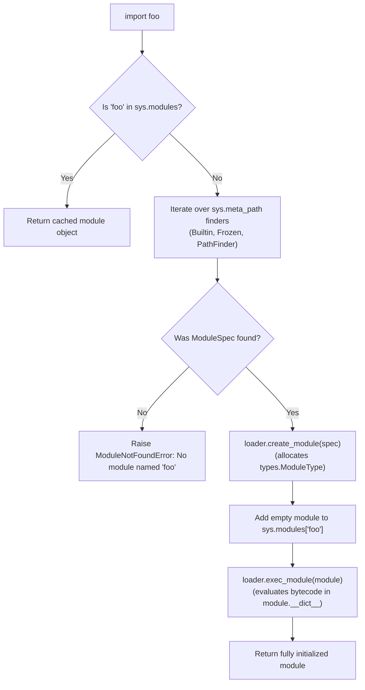
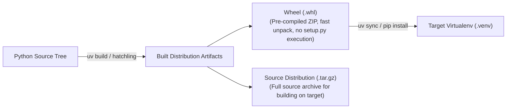

# Module 07: Imports, Modules & Packaging

The Python import system is a sophisticated, hookable runtime subsystem. Far from being a simple file-reading mechanism, `import foo` executes a multi-stage search, validation, compilation, and execution pipeline coordinated by `sys.meta_path` finders, module loaders, and the global `sys.modules` cache.

Understanding the mechanics of module loading is essential for diagnosing production failures such as circular import deadlocks, leveraging **PEP 420** namespace packages, utilizing modern **PEP 810** lazy imports, and building, distributing, and locking reproducible wheels via modern standards (PEP 517, PEP 621, and `uv`).

---

## 1. The Anatomy of an Import

When Python evaluates `import foo` or `from foo import bar`, the runtime executes a deterministic pipeline managed by the standard library `importlib` package.



### 1.1 The Critical Steps
1. **Cache Lookup**: Python inspects `sys.modules`. If `foo` is present, it is returned immediately.
2. **Finders (`sys.meta_path`)**: Python iterates through the finders registered in `sys.meta_path`:
   - `BuiltinImporter`: Finds C-level built-in modules (`sys`, `time`, `_thread`).
   - `FrozenImporter`: Finds bytecode frozen into the Python executable.
   - `PathFinder`: Searches for `.py`, `.pyc`, and C extension (`.so` / `.dylib`) files across directories listed in `sys.path`.
3. **The Module Specification (`ModuleSpec`)**: The matching finder returns an `importlib.machinery.ModuleSpec` object containing metadata: the module's name, origin file path, loader, and whether it is a package.
4. **Allocation & Cache Registration**: The loader's `create_module(spec)` allocates a new `types.ModuleType` object. **CPython inserts this partially initialized module into `sys.modules` BEFORE executing its code!**
5. **Execution**: The loader's `exec_module(module)` executes the module's compiled bytecode within the newly allocated module's `__dict__` namespace.

---

## 2. Circular Imports: Anatomy, Diagnosis & Resolutions

Because Python inserts the module into `sys.modules` *before* executing its body, circular dependencies between two modules can encounter an uninitialized or partially populated namespace.

### 2.1 The Classic Deadlock Scenario
Consider two modules, `module_a.py` and `module_b.py`:

```python
# module_a.py
from module_b import helper_b

def func_a():
    return "A"

# module_b.py
from module_a import func_a

def helper_b():
    return func_a()
```

When you execute `python module_a.py`:
1. `module_a` begins executing. Line 1: `from module_b import helper_b`.
2. Python notices `module_b` is not in `sys.modules`. It creates `module_b` in `sys.modules` and begins executing it.
3. `module_b` Line 1 executes: `from module_a import func_a`.
4. Python checks `sys.modules['module_a']`. It is found! So Python skips re-executing `module_a` and attempts to fetch `func_a` from `module_a.__dict__`.
5. **CRASH!** `module_a` paused at Line 1; it has not yet executed `def func_a():`! Python raises:
   `ImportError: cannot import name 'func_a' from partially initialized module 'module_a' (most likely due to a circular import)`.

### 2.2 Senior Architectural Resolutions
1. **Import the Module, Not the Identifier**: If `module_b` imports `import module_a` and calls `module_a.func_a()` inside `helper_b()`, the attribute lookup is deferred until `helper_b()` is actually invoked at runtime, by which point `module_a` has finished initializing.
2. **Defer to Function Scope**: Move the import inside the function body that requires it:
   ```python
   def helper_b():
       from module_a import func_a
       return func_a()
   ```
3. **Type-Only Imports with `typing.TYPE_CHECKING`**: If the import is needed solely for type annotations, wrap it inside `if TYPE_CHECKING:`. At runtime, `TYPE_CHECKING` is always `False`, preventing cyclic runtime imports while allowing static type checkers to see the types.
4. **Architectural Seam Extraction**: Extract the shared dependency into a third, independent module (`common.py` or `models.py`) imported by both.

---

## 3. Explicit Lazy Imports (PEP 810)

In large-scale enterprise services and CLI applications, importing heavy dependencies (such as large machine learning frameworks, ORMs, or cloud SDKs) can cause slow application startup times ($> 2\text{--}5\text{s}$), even when the CLI command invoked does not use those packages.

In Python 3.15+, **PEP 810** introduced **Explicit Lazy Imports**:
```python
lazy import heavy_ml_library
lazy import polars as pl
```
- When `lazy import foo` executes, Python creates a lightweight deferred proxy in `sys.modules`.
- The actual disk read, AST parsing, and module bytecode execution occur **only when an attribute on `foo` is accessed for the first time** (`foo.calculate()`).
- This reduces CLI invocation and test suite startup latency by over 50%.

---

## 4. Namespace Packages (PEP 420)

Prior to Python 3.3, every directory containing Python files required an `__init__.py` file to be recognized as a package.
**PEP 420** introduced **Implicit Namespace Packages**: directories without an `__init__.py` are automatically recognized as namespace packages.

### 4.1 Mechanics of Namespace Packages
- A namespace package has no `__init__.py` file.
- Its `__file__` attribute is `None`.
- Its `__path__` attribute is a dynamic `_NamespacePath` iterable rather than a static list of strings.
- **Multi-Directory Distribution**: A single namespace package (e.g. `company.auth` and `company.billing`) can reside in completely different directories, virtual environments, or independently distributed wheels on disk. Python dynamically merges matching directory names across `sys.path`.

---

## 5. Modern Packaging Standards: Wheels, `uv`, and `pyproject.toml`

Modern Python packaging is defined by three foundational PEPs:
- **PEP 518**: `[build-system]` table specifying build requirements (e.g., `requires = ["hatchling"]`).
- **PEP 517**: A standardized API contract for build backends (such as `hatchling`, `flit_core`, or `uv_build`).
- **PEP 621**: Standardized declarative project metadata in `pyproject.toml` (`[project]` table).



### 5.1 What is a Wheel (`.whl`)?
A Wheel (PEP 427) is a ZIP-format archive containing files and metadata that can be installed into a virtual environment simply by unpacking (moving files into `site-packages`), without executing arbitrary build scripts.
- **Pure Python Wheel**: Named `pkg-1.0.0-py3-none-any.whl` (works on any OS and Python 3 minor).
- **Platform Wheel**: Named `numpy-2.1.0-cp315-cp315-manylinux_2_17_x86_64.whl` (contains pre-compiled native binaries linked against specific CPython ABIs and libc platforms).

### 5.2 Deterministic Locking: `uv.lock` & PEP 751
In production deployments, relying on loose version ranges (e.g. `pydantic>=2.0`) in `requirements.txt` causes unpredictable builds when upstream dependencies release breaking patches.
`uv lock` produces a deterministic, platform-agnostic `uv.lock` file recording exact versions, direct URLs, and cryptographic SHA-256 hashes of every transitive dependency. Deploying with `uv sync --frozen` guarantees byte-for-byte reproducibility across local machines, CI pipelines, and production containers.

---

## 6. Interview Drill: Questions & Model Answers

<details>
<summary>1. Describe the exact sequence of steps CPython takes during an import statement.</summary>

**Answer:**
1. Check `sys.modules`: if the module name exists, return the cached module object immediately.
2. Iterate through `sys.meta_path` finders (`BuiltinImporter`, `FrozenImporter`, `PathFinder`) invoking `finder.find_spec(fullname, path, target)`.
3. If no finder returns a `ModuleSpec`, raise `ModuleNotFoundError`.
4. Call `spec.loader.create_module(spec)` to allocate the `types.ModuleType` object.
5. Insert the newly allocated, unexecuted module object into `sys.modules[fullname]`.
6. Call `spec.loader.exec_module(module)`: compile and execute the module's bytecode inside the module's `__dict__`.
7. If execution completes without error, return the module object to the caller. If an exception occurs, remove the module from `sys.modules` and propagate the exception.
</details>

<details>
<summary>2. Why does Python insert a module into `sys.modules` before executing `exec_module()`?</summary>

**Answer:**
To prevent infinite recursion during circular imports.
If module $A$ imports module $B$, and module $B$ imports module $A$:
If Python waited until $A$ finished executing before caching it in `sys.modules`, then when $B$ imported $A$, Python would treat $A$ as unvisited, find its source file, create another instance of $A$, and attempt to execute it again. This would produce an infinite import loop exhausting recursion depth. By caching the partially initialized module object in `sys.modules` immediately, any nested import of $A$ returns the existing module reference, breaking the infinite cycle.
</details>

<details>
<summary>3. What is a Namespace Package (PEP 420), and how does it differ from a regular package?</summary>

**Answer:**
- A **regular package** contains an `__init__.py` file in its directory. Its `__file__` attribute points to that `__init__.py`, and its `__path__` is a static list containing that single directory path.
- A **namespace package** (PEP 420) omits `__init__.py`. Its `__file__` is `None`, and its `__path__` is an iterable `_NamespacePath` object. A namespace package can span multiple physically separated directories across `sys.path`. When code imports submodules of a namespace package, Python searches all directories across `sys.path` that share that namespace name, allowing distinct packages (e.g. `company-auth` and `company-billing`) to be distributed and installed independently while sharing the top-level `company` import prefix.
</details>

<details>
<summary>4. What are the key architectural advantages of Wheels over Source Distributions (sdists)?</summary>

**Answer:**
1. **Security**: Installing a Wheel requires only unpacking a ZIP archive; it never executes arbitrary Python code (`setup.py`). Installing an sdist requires executing the build backend.
2. **Speed**: Wheels are pre-built; they bypass compilation, code generation, and C extension compilation, making installation 10–100x faster.
3. **Reproducibility**: Platform wheels are compiled and linked against verified toolchains and ABIs (e.g. `manylinux`), eliminating build failures caused by missing local C compilers or header files.
</details>

<details>
<summary>5. How does PEP 810 lazy importing differ from traditional dynamic imports via `importlib.import_module()`?</summary>

**Answer:**
- `importlib.import_module("foo")` is an imperative function call executed at runtime. It loads the module eagerly at the moment of the function call, and requires passing the module name as a string, losing static type checker visibility and IDE autocomplete.
- `lazy import foo` (PEP 810) is a declarative syntax statement evaluated at module level. It registers the module symbol in the local namespace and allows static type checkers (mypy/pyright) to inspect types normally. However, the physical loading, parsing, and bytecode execution of the module are deferred automatically until the first attribute on `foo` is accessed.
</details>
