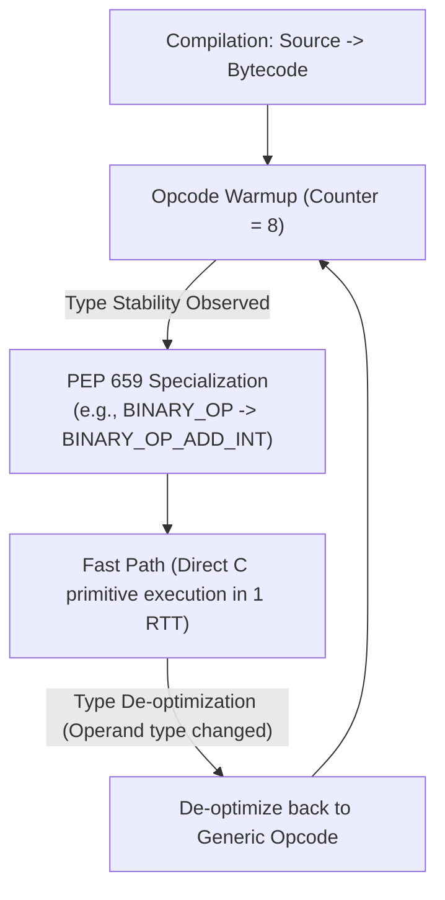
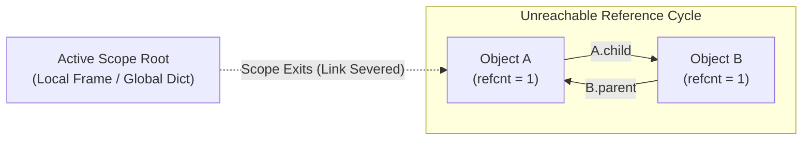
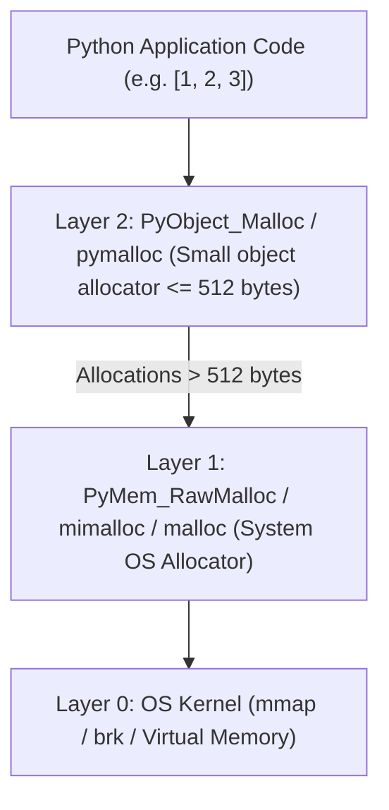

# Module 08: CPython Internals, Bytecode & Garbage Collection

CPython is an optimizing, stack-based bytecode virtual machine implemented in C. While high-level application developers interact with Python through syntax, data structures, and functions, production reliability and performance engineering demand an understanding of what occurs beneath the abstraction layer: how the CPython compiler generates bytecode, how the **Specializing Adaptive Interpreter (PEP 659)** optimizes instruction dispatch at runtime, how the runtime manages execution frames, and how the **Dual Memory Management Engine** (Reference Counting + Cyclic Generational Garbage Collection) reclaims heap memory.

---

## 1. The CPython Virtual Machine & Bytecode Architecture

CPython implements a stack-based virtual machine where instructions operate on an evaluation stack within execution frames. Starting in Python 3.11, the Faster CPython initiative restructured this pipeline into a high-performance interpreter loop.



### 1.1 Specializing Adaptive Interpreter (PEP 659)
Historically, every Python bytecode instruction (such as `BINARY_OP` or `LOAD_ATTR`) was strictly generic: on every single execution, it had to check operand types, inspect type dictionaries, traverse MROs, and invoke dunder methods.

PEP 659 introduced runtime bytecode specialization:
1. When a code object is executed, its instructions start with a counter.
2. If an instruction executes repeatedly with identical operand types (e.g. `a + b` where both `a` and `b` are always `int`), CPython rewrites the instruction in-place to an optimized, specialized opcode:
   - `BINARY_OP` $\to$ `BINARY_OP_ADD_INT` or `BINARY_OP_ADD_FLOAT`
   - `LOAD_ATTR` $\to$ `LOAD_ATTR_MODULE`, `LOAD_ATTR_SLOT`, or `LOAD_ATTR_INSTANCE_VALUE`
   - `LOAD_GLOBAL` $\to$ `LOAD_GLOBAL_MODULE` or `LOAD_GLOBAL_BUILTIN`
3. If an unexpected type arrives later (e.g. passing a `str` to a path specialized for `int`), the specialized instruction fails its guard check, safely de-optimizes back to the generic opcode, and resets the adaptation counter.

---

## 2. Zero-Cost Exception Handling

In legacy Python (prior to 3.11), setting up a `try/except` block required executing `SETUP_FINALLY` and pushing a block context onto a runtime block stack on every entry. This imposed a measurable performance penalty on every function that used `try/except`, even when no exception occurred.

Modern CPython uses **Zero-Cost Exception Tables**:
- Entering a `try` block emits **zero** runtime bytecode instructions.
- Instead, the compiler generates a separate static **Exception Table** mapping bytecode instruction offset ranges `[start, end]` to their target exception handler offset.
- If no exception occurs, the code runs at maximum speed with zero overhead.
- Only when an exception is raised does CPython look up the current instruction pointer (`f_lasti`) in the exception table to find the appropriate `except` or `finally` target handler.

---

## 3. Reference Counting & Immortal Objects (PEP 683)

CPython uses two complementary memory management engines: **Reference Counting** (the primary, deterministic engine) and the **Cyclic Garbage Collector** (the secondary engine for reference cycles).

### 3.1 Reference Counting Mechanics
Every `PyObject` contains an `ob_refcnt` field.
- When an object reference is copied, passed to a function, or assigned to a variable, `ob_refcnt` increments (`Py_INCREF`).
- When a reference goes out of scope, is reassigned, or deleted via `del`, `ob_refcnt` decrements (`Py_DECREF`).
- When `ob_refcnt` reaches zero, the memory for that object is deallocated immediately.

```python
import sys

x = [1, 2, 3]
# sys.getrefcount() takes a reference as an argument, incrementing count by 1 temporarily
initial_count = sys.getrefcount(x)
y = x
assert sys.getrefcount(x) == initial_count + 1
del y
assert sys.getrefcount(x) == initial_count
```

### 3.2 Immortal Objects (PEP 683)
Historically, even immutable singletons like `None`, `True`, `False`, small integers, and core built-in functions had active reference counters. Every time a thread accessed `None`, it wrote to `None->ob_refcnt`. In multi-core systems, this caused severe **cache line bouncing** (false sharing): CPU cores continuously invalidated each other's L1/L2 caches simply by reading shared immutable singletons.

**PEP 683** introduced **Immortal Objects**:
- A special bit flag sets `ob_refcnt` to a fixed sentinel value (`_Py_IMMORTAL_REFCNT`).
- `Py_INCREF` and `Py_DECREF` become no-ops for immortal objects: they are never modified in memory.
- Immortal objects can be shared safely across CPU cores, subinterpreters, and processes via shared memory without dirtying memory pages or triggering copy-on-write (COW).

---

## 4. The Cyclic Garbage Collector

Reference counting has one fatal blind spot: **Reference Cycles**. If object $A$ holds a reference to object $B$, and object $B$ holds a reference to object $A$, their reference counts will never drop to zero, even if both objects become completely unreachable from root pointers.



### 4.1 The Tri-Color Mark-and-Sweep Cycle Detection Algorithm
To reclaim cyclic garbage, CPython runs a cyclic garbage collector (`gc` module) that tracks all container objects (lists, dictionaries, custom class instances, tuples containing containers).
1. **Trial Deletion**: For every container in a generation, CPython copies `ob_refcnt` to a temporary field `gc_refs`.
2. It then traverses all pointers reachable from that container, decrementing `gc_refs` for each referenced child.
3. If an object's `gc_refs` reaches zero, its references come *entirely from within the isolated cluster itself*!
4. Any object whose `gc_refs > 0` is reachable from an external root: the collector marks it and all objects reachable from it as **live**.
5. The remaining objects whose `gc_refs == 0` are confirmed garbage and deallocated.

### 4.2 Generational Garbage Collection
CPython organizes trackable objects into three generations based on the weak generational hypothesis ("most objects die young"):
- **Generation 0**: Newly allocated container objects. Collected frequently.
- **Generation 1**: Objects that have survived one Gen 0 collection.
- **Generation 2**: Long-lived objects (survived Gen 1 collection). Collected least frequently.

```python
import gc

# Inspect collection thresholds: (threshold0, threshold1, threshold2)
# Gen 0 is collected when allocations exceed threshold0.
# Gen 1 is collected when Gen 0 has been collected threshold1 times.
print(gc.get_threshold())  # Typically (700, 10, 10)
```

> [!NOTE]
> In Python 3.14.0–3.14.4, an experimental incremental GC was tested. However, due to severe memory-pressure regressions on long-running workloads, Python 3.14.5 and Python 3.15 reverted the collector back to the proven generational GC engine.

---

## 5. Memory Allocator Architecture: `pymalloc` & `mimalloc`

CPython manages operating system memory through a layered hierarchy:



1. **`pymalloc` (Small Object Allocator)**: Designed specifically for objects $\le 512$ bytes. Allocating small objects directly via OS `malloc()` causes severe memory fragmentation. `pymalloc` allocates large 256 KB **Arenas** from the OS, subdivides them into 4 KB **Pools**, and carves pools into uniform **Blocks** (e.g., 32-byte blocks, 64-byte blocks). Small allocations execute in $O(1)$ time by returning a pre-sized free block pointer without calling the kernel.
2. **`mimalloc` (Thread-Safe Allocator)**: In modern CPython builds (especially free-threaded builds without the GIL), Microsoft's `mimalloc` is embedded to provide scalable, multi-threaded heap allocations with thread-local free lists and rapid page re-use.

---

## 6. Interview Drill: Questions & Model Answers

<details>
<summary>1. How does the Specializing Adaptive Interpreter (PEP 659) improve execution speed in Python 3.11+?</summary>

**Answer:**
PEP 659 introduces runtime instruction specialization. Instead of executing generic, type-agnostic bytecode instructions that repeatedly inspect types and dictionary lookups on every loop iteration, CPython tracks execution counts. When an instruction (like `BINARY_OP` or `LOAD_ATTR`) executes repeatedly with the identical operand types, CPython rewrites the bytecode instruction in-place to a specialized variant (`BINARY_OP_ADD_INT`, `LOAD_ATTR_SLOT`). These specialized instructions skip MRO traversal and dynamic dispatch, executing direct C primitive operations in a single step. If an unexpected type arrives, a guard check triggers safe de-optimization back to the generic opcode.
</details>

<details>
<summary>2. Why can Reference Counting alone not manage all memory in CPython?</summary>

**Answer:**
Reference counting cannot collect **isolated reference cycles**.
If object $A$ holds a reference to object $B$, and object $B$ holds a reference to object $A$, both objects have an `ob_refcnt` of at least 1. If all external references to $A$ and $B$ from active frames, local variables, and global scopes are deleted, the objects become completely unreachable by application code. However, because their mutual references keep their reference counts at 1, reference counting alone will never deallocate them, causing a permanent memory leak. CPython requires a secondary Cyclic Garbage Collector to detect and destroy isolated cycles.
</details>

<details>
<summary>3. What is an Immortal Object (PEP 683), and what problem does it solve in multi-core systems?</summary>

**Answer:**
An immortal object is an object whose reference count is set to a special sentinel bit pattern (`_Py_IMMORTAL_REFCNT`), instructing the runtime to bypass `Py_INCREF` and `Py_DECREF` operations entirely.
In multi-core and multi-threaded systems (including subinterpreters and free-threaded Python), shared immutable singletons like `None`, `True`, `False`, and small integers were previously modified by every thread that accessed them. Writing to `ob_refcnt` dirtied the CPU cache line holding the object, causing continuous **cache line bouncing** and invalidations across CPU cores. Immortal objects make singletons truly read-only, allowing them to reside in shared CPU caches and copy-on-write memory pages without invalidation.
</details>

<details>
<summary>4. How does Python's Zero-Cost Exception Handling work compared to legacy Python?</summary>

**Answer:**
Legacy Python required executing `SETUP_FINALLY` and `POP_BLOCK` instructions to push and pop handler contexts onto a runtime stack whenever a `try` block was entered and exited, adding CPU overhead to every executed `try` statement even when no error occurred.
Zero-cost exception handling eliminates all runtime instructions when entering a `try` block. Instead, the compiler generates a static lookup table mapping bytecode offset ranges to exception handler targets. During normal execution, code runs with zero overhead. Only when an exception occurs does the VM inspect the exception table to find the handler corresponding to the current instruction offset (`f_lasti`).
</details>

<details>
<summary>5. How does `pymalloc` mitigate memory fragmentation in CPython?</summary>

**Answer:**
CPython applications continuously allocate and deallocate millions of small, short-lived objects (integers, strings, tuples). Passing all these allocations directly to the OS `malloc()` creates severe memory fragmentation, as small allocations interleave with large ones, preventing the OS from reclaiming contiguous virtual memory.
`pymalloc` handles all allocations $\le 512$ bytes. It requests large 256 KB memory Arenas from the OS, slices them into 4 KB Pools, and subdivides each pool into fixed-size Blocks (size classes in multiples of 16 bytes: 16, 32, 48 ... 512 bytes). Allocations and deallocations simply update a pool-local free list pointer in $O(1)$ time, completely shielding the operating system allocator from small object churn and preventing virtual memory fragmentation.
</details>
