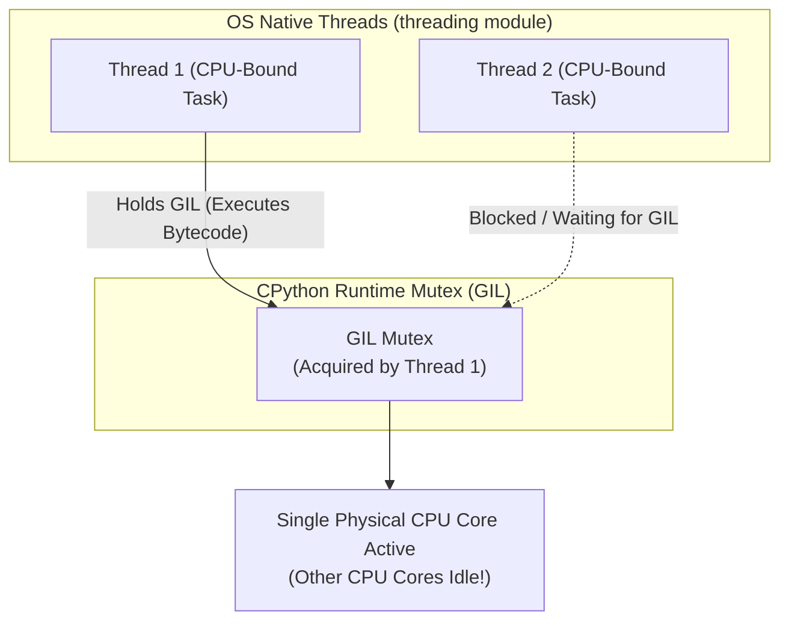
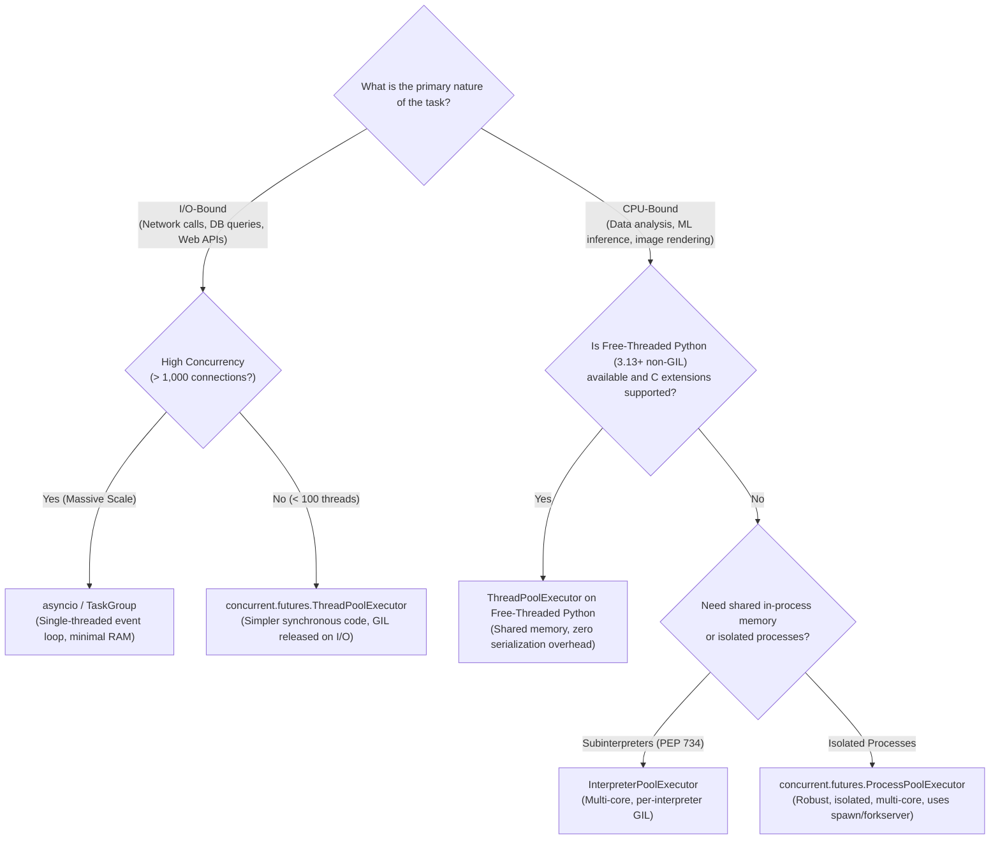

# Module 09: Concurrency: GIL, Threads, Processes & Subinterpreters

Concurrency in Python has historically been defined—and constrained—by the **Global Interpreter Lock (GIL)**. For over three decades, the GIL ensured that CPython could execute only one thread of Python bytecode at any given millisecond, making multi-threaded CPU-bound speedups impossible without dropping down to native C extensions or spawning multiple operating system processes.

However, modern Python is in the midst of a historic concurrency transformation: **Free-Threaded CPython (PEP 703 / PEP 779)** officially allows Python to run without the GIL, while **Subinterpreters (PEP 734)** provide isolated, multi-core interpreter execution within a single OS process.

Choosing the right concurrency model requires an architectural understanding of the GIL's mechanics, the trade-offs of the free-threaded build, process start methods (`fork` vs `spawn` vs `forkserver`), and the operational boundaries between threads, processes, and subinterpreters.

---

## 1. The Global Interpreter Lock (GIL)

The Global Interpreter Lock is a mutual exclusion lock implemented in C that prevents multiple native OS threads from executing Python bytecode simultaneously within a single CPython process.



### 1.1 Why Does the GIL Exist?
The GIL was introduced in CPython's earliest days for three fundamental reasons:
1. **Memory Safety & Reference Counting**: CPython's primary memory management engine is reference counting. Every object modification or read increments or decrements `ob_refcnt`. Without a lock, concurrent threads would suffer data races on reference counts, causing memory corruption and double-free crashes.
2. **C Extension Simplicity**: The GIL made writing C extensions (such as database drivers and NumPy) simple: C authors could assume that calls into Python objects were thread-safe without managing fine-grained mutexes.
3. **Single-Threaded Performance**: Fine-grained locking on every object introduces massive lock acquisition overhead. A single global lock allowed CPython to achieve world-class single-threaded execution speed.

### 1.2 The Switch Interval & When the GIL is Released
The GIL does **not** permanently lock out other threads. CPython automatically releases and reacquires the GIL under two conditions:
1. **Blocking I/O Operations**: Whenever a thread executes system calls (reading/writing files, waiting for network sockets, executing `time.sleep()`), CPython explicitly drops the GIL (`Py_BEGIN_ALLOW_THREADS`). Other Python threads can execute while the first thread waits for the kernel.
2. **The Switch Interval**: For CPU-bound tasks, CPython forces the running thread to drop the GIL after a configurable time interval (`sys.getswitchinterval()`, default $5\text{ms}$ or $0.005\text{s}$), giving waiting threads an opportunity to acquire the lock.

> [!IMPORTANT]
> Because the GIL is released during blocking I/O, **multi-threading (`threading.Thread`) is highly effective for I/O-bound concurrency** (such as making concurrent HTTP requests or querying databases). It is ineffective *only* for CPU-bound computations.

---

## 2. Free-Threaded CPython (PEP 703 / PEP 779)

In Python 3.13 and 3.14+, **PEP 703** and **PEP 779** introduced the experimental and officially supported **Free-Threaded CPython build** (compiled with `--disable-gil`). In this build, the Global Interpreter Lock is removed entirely, enabling true multi-core CPU parallelism across standard Python threads.

```python
import sys

# Check whether the current runtime is running with the GIL enabled
if hasattr(sys, "_is_gil_enabled"):
    print(f"GIL Enabled: {sys._is_gil_enabled()}")
else:
    print("Standard GIL build")
```

### 2.1 How Free-Threading Works Internally
Removing the GIL required CPython engineers to replace global locking with three architectural innovations:
1. **Biased Reference Counting (BRC)**: Objects track the thread that allocated them (the "owning thread"). The owning thread increments and decrements reference counts without atomic instructions. Other threads modify a separate atomic counter, minimizing multi-core synchronization overhead.
2. **Per-Object Locking & Critical Sections**: Instead of a global lock, mutable containers (such as `list` and `dict`) use fine-grained internal locks to protect internal C pointers during mutations.
3. **Thread-Safe Allocator (`mimalloc`)**: Small object allocations use Microsoft's `mimalloc`, providing thread-local allocation pools that eliminate lock contention on heap management.

### 2.2 The GIL Re-Enabling Trap
In free-threaded Python, if you import an older C extension that was compiled against the legacy ABI (`abi3`) and has not been explicitly compiled with support for free-threading (`Py_MOD_PER_INTERPRETER_GIL_SUPPORTED` / `abi3t`), **CPython automatically re-enables the GIL at runtime!** A runtime warning is emitted, and the process reverts back to single-threaded bytecode execution.

### 2.3 The False Sense of Security: Data Races in Pure Python
Many developers incorrectly believed that the GIL prevented race conditions in Python application code. **It never did!**
The GIL guarantees only that internal CPython C data structures are safe from memory corruption; it does **not** make multi-step Python operations atomic.
```python
# ANTI-PATTERN: Data race even under the GIL!
count = 0

def increment():
    global count
    for _ in range(100_000):
        # count += 1 translates to:
        # 1. LOAD_GLOBAL count
        # 2. LOAD_CONST 1
        # 3. BINARY_OP +
        # 4. STORE_GLOBAL count
        # Threads can be preempted between step 1 and step 4!
        count += 1
```
Running this function across 2 threads produces a final count far below 200,000 due to lost updates. In free-threaded Python, this race condition manifests even more aggressively. **Explicit locks (`threading.Lock`) remain mandatory for application-level state synchronization.**

---

## 3. Multiprocessing & OS Process Start Methods

To bypass the GIL and achieve true multi-core parallel processing on standard CPython builds, Python provides the `multiprocessing` package. Each worker is an independent operating system process with its own dedicated CPython interpreter and private memory space.

### 3.1 Start Methods: `fork` vs `spawn` vs `forkserver`

| Start Method | Supported Platforms | Mechanics & Performance | Critical Gotchas |
|---|---|---|---|
| **`spawn`** | Windows (default), macOS (default), Linux | Starts a fresh Python process from scratch. Re-imports the entry-point module. Slowest start ($50\text{--}200\text{ms}$). | Code executing in main module must be guarded by `if __name__ == '__main__':`. |
| **`fork`** | Linux (legacy default) | Uses the POSIX `fork()` syscall. Clones the parent process instantly via Copy-on-Write (COW). Fastest startup. | **Deadly in multi-threaded programs**: Clones only the calling thread, leaving mutexes held by other threads permanently locked in the child process! |
| **`forkserver`** | Linux (modern default in 3.14/3.15+), macOS | Starts a clean single-threaded server process at startup; workers are forked from the server process on demand. | Safe from multi-threaded deadlock; fast startup; does not inherit parent's thread state. |

```python
import multiprocessing as mp

# Configure safe start method explicitly
if __name__ == "__main__":
    mp.set_start_method("forkserver")
```

---

## 4. Subinterpreters & `concurrent.interpreters` (PEP 734)

A major limitation of `multiprocessing` is that processes have completely separate memory spaces: sharing data between processes requires serializing objects through IPC pipes (`pickle`), which introduces heavy CPU serialization overhead.

**PEP 734** (Python 3.14+) introduces **Subinterpreters** with **Per-Interpreter GILs** into the standard library via `concurrent.interpreters` and `InterpreterPoolExecutor`:
- Multiple independent CPython interpreters run within the **same** operating system process.
- Each subinterpreter has its own private GIL, allowing multiple subinterpreters to execute Python bytecode concurrently on separate CPU cores!
- Subinterpreters communicate via high-speed shared memory channels (`interpreters.create_channel()`), avoiding IPC sockets and reducing inter-worker communication latency.

```python
# Modern PEP 734 Subinterpreters (Conceptual & Staged Architecture):
from concurrent.interpreters import InterpreterPoolExecutor

def cpu_heavy_work(data_chunk: bytes) -> int:
    return sum(data_chunk)

with InterpreterPoolExecutor(max_workers=4) as executor:
    futures = [executor.submit(cpu_heavy_work, b"...") for _ in range(4)]
    results = [f.result() for f in futures]
```

---

## 5. Choosing the Right Concurrency Model



---

## 6. Interview Drill: Questions & Model Answers

<details>
<summary>1. Why does multi-threading in standard CPython fail to speed up CPU-bound programs?</summary>

**Answer:**
Because of the Global Interpreter Lock (GIL). In standard CPython, only one native OS thread can hold the GIL and execute Python bytecode instructions at any given instant. When running a CPU-bound workload across multiple threads, the operating system distributes the threads across multiple CPU cores. However, only the single thread currently holding the GIL can execute; all other threads block waiting for the mutex. Furthermore, the threads continuously compete to acquire and release the lock at every switch interval ($5\text{ms}$), introducing thread-context-switching overhead that causes multi-threaded CPU-bound programs to run *slower* than a single-threaded equivalent.
</details>

<details>
<summary>2. Why does `multiprocessing` with the `fork` start method cause deadlocks in multi-threaded programs?</summary>

**Answer:**
The POSIX `fork()` system call duplicates the calling process's memory space via copy-on-write, but it duplicates **only the single thread that invoked `fork()`**; all other threads in the parent process disappear in the child.
If any of those other threads held a lock (such as a database connection pool lock, a logging lock, or an internal memory allocator mutex) at the exact instant `fork()` was called, that lock remains marked as "acquired" in the child's memory. However, the thread that held the lock does not exist in the child and will never release it. The moment any code in the child process attempts to acquire that lock, the child process deadlocks permanently.
</details>

<details>
<summary>3. What is the difference between Biased Reference Counting and traditional reference counting in free-threaded Python?</summary>

**Answer:**
Traditional reference counting modifies `ob_refcnt` using atomic CPU instructions (such as `LOCK XADD` on x86-64), which forces multi-core CPU caches to synchronize on every single reference increment or decrement, severely degrading multi-threaded scalability.
Biased Reference Counting (BRC, PEP 703) assigns an "owner thread" to each object (the thread that allocated it). When the owner thread increments or decrements the reference count, it uses fast, non-atomic instructions without synchronization. When non-owning threads access the object, they update a secondary atomic reference counter. When the owner thread prepares to deallocate the object, it merges both counters. This eliminates 80–90% of atomic synchronization overhead on thread-local objects.
</details>

<details>
<summary>4. Why does an operation like `counter += 1` require explicit locking even under the GIL?</summary>

**Answer:**
Because `counter += 1` is not an atomic operation at the bytecode level. It decomposes into four discrete instructions: `LOAD_GLOBAL`, `LOAD_CONST`, `BINARY_OP`, and `STORE_GLOBAL`.
If Thread 1 executes `LOAD_GLOBAL` (reading value 10) and is preempted by the CPython switch interval before executing `STORE_GLOBAL`, Thread 2 can run, read value 10, increment it, and store 11. When Thread 1 resumes, it adds 1 to its previously loaded value (10) and writes 11 back, silently overwriting Thread 2's update. The GIL guarantees only that individual CPython bytecode instructions do not corrupt memory; it does not protect multi-instruction application transactions.
</details>

<details>
<summary>5. How do Subinterpreters (PEP 734) differ from standard Multiprocessing?</summary>

**Answer:**
- **Multiprocessing**: Spawns independent operating system processes. Each process has its own separate virtual memory address space. Sharing data requires serializing objects into byte streams (`pickle`) and passing them through IPC pipes or Unix domain sockets, which incurs significant CPU serialization overhead.
- **Subinterpreters**: Run multiple isolated CPython interpreters within the **same** operating system process and address space. Each subinterpreter possesses its own isolated GIL and namespace, enabling concurrent multi-core execution without process boundaries. They communicate through in-memory communication channels and shared memory buffers, avoiding OS process IPC overhead.
</details>
