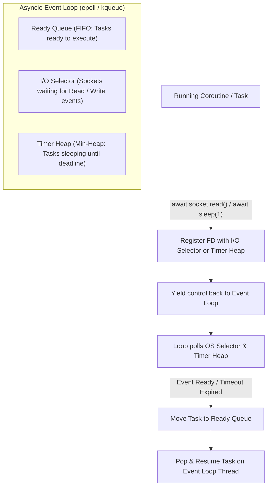
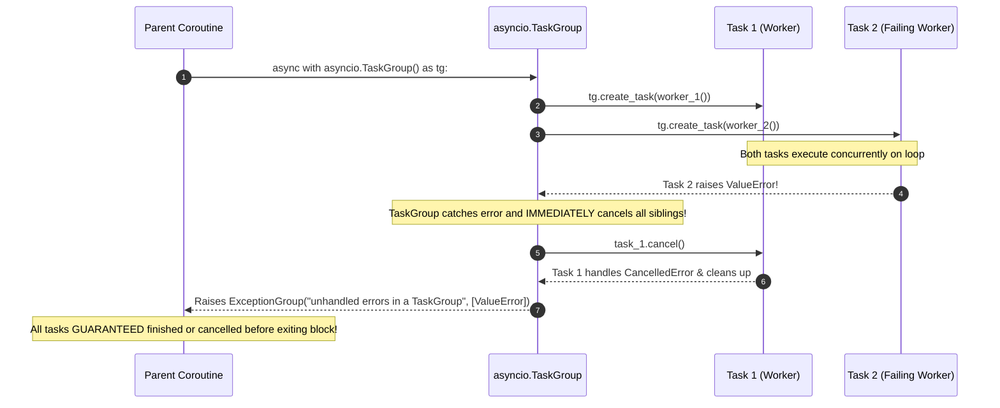

# Module 10: Asyncio Internals & Structured Concurrency

Asynchronous programming in Python (`asyncio`) provides high-concurrency, single-threaded cooperative multitasking designed specifically for I/O-bound network applications. Rather than spawning thousands of heavy operating system threads—each requiring megabytes of reserved stack space and kernel context switching—`asyncio` multiplexes tens of thousands of concurrent network connections on a single OS thread using an asynchronous event loop powered by kernel I/O readiness notifications (`epoll` on Linux, `kqueue` on macOS/BSD).

In modern Python engineering, unstructured async primitives (`asyncio.gather()`, unanchored `create_task()` calls) have been replaced by **Structured Concurrency** (`asyncio.TaskGroup`), strict cancellation contracts (`asyncio.CancelledError`), contextual timeouts (`asyncio.timeout`), and context variable propagation (`contextvars`).

---

## 1. The Asyncio Architecture: Coroutines, Tasks & Event Loop

At the hardware and OS boundary, `asyncio` is an implementation of the **Reactor Pattern**.



### 1.1 Coroutines vs Futures vs Tasks
- **Coroutine (`async def`)**: A function compiled with the `CO_COROUTINE` flag. Calling it does not execute its body; it returns a `coroutine` object implementing `__await__`. A coroutine does nothing until explicitly awaited or scheduled as a task.
- **Future (`asyncio.Future`)**: A low-level container representing an eventual result that is not yet available. It tracks callbacks and state: `PENDING`, `CANCELLED`, or `FINISHED`.
- **Task (`asyncio.Task`)**: A subclass of `Future` that wraps a coroutine and registers it with the event loop. The task drives the coroutine forward by repeatedly calling its `.send(None)` method whenever the task becomes ready, advancing it from one `await` yield point to the next.

> [!WARNING]
> **The Fire-and-Forget GC Trap**:
> When invoking `asyncio.create_task(coro())`, you **must** retain a strong reference to the returned task object (e.g. in a set: `background_tasks.add(task)`). If no strong reference is kept, Python's garbage collector can deallocate the task mid-flight while it is waiting for an I/O event, causing silent task termination and unhandled exception drops!

---

## 2. Structured Concurrency: `asyncio.TaskGroup`

Historically, Python developers spawned concurrent tasks using `asyncio.gather()`. However, `gather()` violates the principles of **Structured Concurrency**:
1. If task $A$ fails with an exception, `gather()` immediately raises the exception to the caller, leaving tasks $B$ and $C$ running orphaned in the background without clean cancellation.
2. If the calling scope is cancelled, background tasks could leak beyond the lifetime of the calling function.

### 2.1 The `TaskGroup` Contract (Python 3.11+)
Inspired by Martin Sústrik's and Nathaniel J. Smith's structured concurrency research, `asyncio.TaskGroup` guarantees that **the lifetime of concurrent operations is strictly bounded by the lexical scope of the `with` block**:



```python
import asyncio

async def fetch_user(user_id: int) -> dict[str, int]:
    await asyncio.sleep(0.01)
    return {"id": user_id}

async def fetch_profile(user_id: int) -> dict[str, str]:
    await asyncio.sleep(0.01)
    if user_id < 0:
        raise ValueError(f"Invalid user id: {user_id}")
    return {"name": "Alice"}

async def load_dashboard(user_id: int):
    async with asyncio.TaskGroup() as tg:
        t1 = tg.create_task(fetch_user(user_id))
        t2 = tg.create_task(fetch_profile(user_id))
    # Both tasks are guaranteed completed when exiting the block!
    return t1.result(), t2.result()
```

---

## 3. Cancellation Semantics & The `CancelledError` Invariant

Cancellation in `asyncio` is cooperative. Calling `task.cancel()` does not terminate the OS thread or abort bytecode execution abruptly; instead, the event loop injects an `asyncio.CancelledError` exception into the coroutine at the exact point of its currently suspended `await` expression.

### 3.1 The Cardinal Rule of `CancelledError`
Starting in Python 3.8, **`asyncio.CancelledError` inherits from `BaseException`**, not `Exception`!
```python
BaseException
 ├── Exception
 │    ├── ValueError
 │    ├── KeyError
 │    └── ... (Application exceptions)
 ├── KeyboardInterrupt
 └── asyncio.CancelledError
```

**Why was this changed?**
Developers frequently write generic exception handlers: `except Exception: logger.error(...)`. If `CancelledError` inherited from `Exception`, generic handlers would swallow the cancellation signal, preventing the task from unwinding, hanging task groups, and ignoring shutdown requests.

> [!CAUTION]
> If you write `except BaseException:`, you **must** re-raise `CancelledError`! Never swallow `CancelledError` without re-raising it:
> ```python
> try:
>     await process_stream()
> except asyncio.CancelledError:
>     # Clean up resources
>     await release_locks()
>     raise  # MANDATORY: re-raise cancellation signal!
> ```

### 3.2 Shielding Tasks: `asyncio.shield()`
If a critical cleanup step (such as committing an audit log or closing a transaction) must not be aborted even if the enclosing task is cancelled, wrap the coroutine in `asyncio.shield()`:
```python
await asyncio.shield(critical_audit_log_commit())
```

---

## 4. Modern Timeouts: `asyncio.timeout`

In legacy Python, setting timeouts required `asyncio.wait_for(coro(), timeout=5.0)`. However, `wait_for` suffered from cancellation edge cases: if the timeout expired at the exact moment the inner coroutine was finishing, unhandled race conditions could lose the result or drop exceptions.

Python 3.11+ introduced `asyncio.timeout(delay)` as an asynchronous context manager:
```python
import asyncio

async def fetch_with_deadline():
    try:
        async with asyncio.timeout(2.0):
            result = await fetch_remote_resource()
            return result
    except TimeoutError:
        # Raised cleanly when 2.0s elapses
        return "fallback"
```

---

## 5. Context Propagation: `contextvars`

In synchronous multi-threaded applications, thread-local storage (`threading.local()`) is commonly used to store request-scoped data (such as correlation IDs, authentication tokens, and tenant IDs).
However, **`threading.local` is completely broken in `asyncio`!** Because thousands of concurrent coroutines execute on the *same* OS thread, modifying a thread-local variable overwrites the state for all other concurrent coroutines on that thread.

### 5.1 Using `ContextVar`
Python 3.7+ introduced **PEP 567** `contextvars`. A `ContextVar` provides coroutine-local storage:
- Every `asyncio.Task` inherits a copy of the current context when spawned via `create_task()` or `TaskGroup`.
- Mutations inside a task modify only that task's local context without leaking to concurrent tasks.

```python
from contextvars import ContextVar
import asyncio

# Request-scoped correlation ID
request_id_ctx: ContextVar[str] = ContextVar("request_id", default="unassigned")

async def worker(task_name: str, req_id: str):
    # Set context variable for this specific task
    request_id_ctx.set(req_id)
    await asyncio.sleep(0.01)
    # The variable value is strictly isolated to this coroutine context!
    assert request_id_ctx.get() == req_id

async def main():
    async with asyncio.TaskGroup() as tg:
        tg.create_task(worker("t1", "REQ-1001"))
        tg.create_task(worker("t2", "REQ-1002"))

asyncio.run(main())
```

---

## 6. Running Blocking Code: `asyncio.to_thread()`

The fatal failure mode of async applications is calling a synchronous, blocking function (such as `time.sleep()`, synchronous database drivers, or heavy CPU cryptography) directly inside an `async def` function.
Because the event loop runs on a single thread, **a blocking call freezes the event loop completely**, halting all other concurrent tasks, heartbeat timers, and network I/O.

To safely execute blocking functions without stalling the event loop, use `asyncio.to_thread()`:
```python
import asyncio
import time

def sync_heavy_computation(data: str) -> str:
    # Synchronous blocking call
    time.sleep(0.5)
    return data.upper()

async def async_handler():
    # Runs sync_heavy_computation in a separate worker thread from CPython's ThreadPoolExecutor,
    # freeing the event loop to continue serving other coroutines!
    result = await asyncio.to_thread(sync_heavy_computation, "payload")
    return result
```

---

## 7. Streaming Backpressure: `asyncio.Queue` & `Queue.shutdown()`

In producer-consumer streaming pipelines, fast producers can easily overwhelm slow consumers, consuming gigabytes of memory buffering unconsumed messages.
- An `asyncio.Queue(maxsize=N)` enforces backpressure: when the queue contains $N$ items, `await queue.put(item)` suspends the producer coroutine until a consumer processes an item via `await queue.get()`.
- In Python 3.13+, `asyncio.Queue.shutdown()` was introduced: producers call `queue.shutdown()` to signal that no more items will be sent. Subsequent `put()` calls raise `asyncio.QueueShutDown`, and waiting consumers exit cleanly once all buffered items are consumed.

---

## 8. Interview Drill: Questions & Model Answers

<details>
<summary>1. What happens if you call a blocking synchronous function (like `time.sleep(5)`) inside an `async def` coroutine?</summary>

**Answer:**
Calling a blocking synchronous function inside a coroutine freezes the entire CPython event loop for that duration (5 seconds). Because the event loop executes cooperatively on a single thread, it cannot poll I/O selectors, dispatch ready tasks, evaluate timeouts, or respond to network packets while the synchronous function holds the CPU thread. All concurrent network connections stall, timers fire late, and health check heartbeats fail. Blocking operations must always be delegated to background threads using `asyncio.to_thread()` or `loop.run_in_executor()`.
</details>

<details>
<summary>2. Why does `asyncio.CancelledError` inherit from `BaseException` rather than `Exception`?</summary>

**Answer:**
Prior to Python 3.8, `CancelledError` inherited from `Exception`. In production code, developers frequently write generic exception handlers: `except Exception as e: logger.error(e)`. This caused generic handlers to inadvertently catch and swallow `CancelledError`, preventing the coroutine from unwinding and terminating. By making `CancelledError` inherit directly from `BaseException` (like `KeyboardInterrupt` and `SystemExit`), standard `except Exception` blocks ignore it, allowing the cancellation signal to propagate cleanly through task hierarchies and ensure proper shutdown.
</details>

<details>
<summary>3. Why is `threading.local` dangerous in async code, and what replaces it?</summary>

**Answer:**
`threading.local` associates data with the physical OS thread. In `asyncio`, thousands of independent, concurrent coroutines run interleaved on the *same* physical OS thread. If one coroutine sets a thread-local variable, that value becomes immediately visible to—and will overwrite the state of—all other coroutines executing on that thread, causing severe race conditions and data leaks across tenant requests.
It is replaced by `contextvars.ContextVar`, which associates data with the logical coroutine context. Each `asyncio.Task` maintains its own isolated context dictionary that automatically copies on task creation and isolates mutations.
</details>

<details>
<summary>4. What are the key architectural advantages of `asyncio.TaskGroup` over `asyncio.gather()`?</summary>

**Answer:**
1. **Guaranteed Scoping**: When an `async with asyncio.TaskGroup()` block exits, all tasks created within the group are guaranteed to have completed, failed, or been cancelled. Tasks can never leak beyond the scope.
2. **Immediate Sibling Cancellation**: If any task inside a `TaskGroup` raises an unhandled exception, the task group automatically and immediately cancels all other still-running tasks in the group, preventing wasted CPU and unanchored orphan execution.
3. **Comprehensive Error Reporting**: If multiple concurrent tasks fail, `TaskGroup` bundles all exceptions into an `ExceptionGroup` (PEP 654), ensuring zero exceptions are silently dropped or masked.
</details>

<details>
<summary>5. How does `asyncio.Queue(maxsize=N)` implement backpressure?</summary>

**Answer:**
When an `asyncio.Queue` is initialized with a positive `maxsize`, it limits the number of items that can be buffered simultaneously. When the queue reaches `maxsize`, any subsequent call to `await queue.put(item)` suspends the producer coroutine: the task is removed from the event loop's ready queue and placed on an internal wait list. The producer remains suspended until a consumer coroutine calls `await queue.get()` and removes an item, which wakes up the producer. This forces the producer's production rate to match the consumer's consumption rate, preventing unbounded memory growth.
</details>
