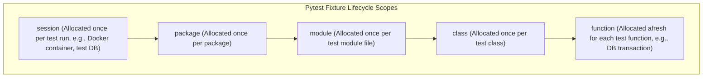
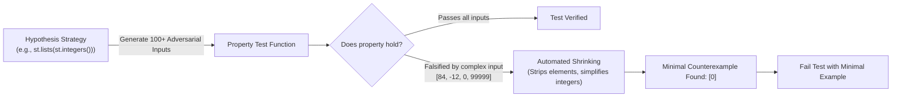

# Module 11: Testing with Pytest & Hypothesis

Testing in Python has evolved far beyond standard `unittest.TestCase` class hierarchies. The modern industry standard is anchored in **pytest**'s composable fixture dependency injection, expressive assertion rewriting, and parametric testing matrices, coupled with **Hypothesis** for mathematically rigorous property-based testing.

Production software engineering requires designing tests that prove invariant behaviors at the right architectural boundaries, testing negative edge cases and deprecation cycles, utilizing safe test doubles (`autospec`) to prevent mock drift, and leveraging property-based test case shrinking to discover subtle corner cases.

---

## 1. Pytest Architecture: Fixtures & Dependency Injection

Unlike legacy xUnit frameworks that couple test state to class inheritance, `pytest` treats fixtures as modular, dependency-injected resources.



### 1.1 The Teardown Invariant: Generator Fixtures
A pytest fixture manages both setup and teardown using a `yield` statement. Code before the `yield` executes prior to the test; code after the `yield` is guaranteed to execute during teardown, even if the test fails or raises an unexpected exception.

```python
import pytest
from typing import Generator

@pytest.fixture(scope="function")
def isolated_db_session() -> Generator[dict[str, str], None, None]:
    # SETUP: Allocate isolated memory session
    session = {"status": "connected"}
    yield session
    # TEARDOWN: Guaranteed to execute upon test completion
    session.clear()
```

### 1.2 Essential Built-in Fixtures
- `tmp_path`: An ephemeral, unique `pathlib.Path` directory created specifically for the test and cleaned up automatically.
- `monkeypatch`: Safely mutates environment variables (`monkeypatch.setenv()`), dictionary entries, or class attributes, automatically restoring original values at the end of the test.
- `caplog`: Captures log records emitted during execution, enabling assertions on log levels, messages, and structured log contexts.
- `capsys`: Captures standard output (`sys.stdout`) and standard error (`sys.stderr`).

---

## 2. Parametric Testing Matrices

Testing repetitive permutations with loops inside a test function is an anti-pattern: if the first iteration fails, execution halts immediately, hiding whether subsequent test cases would have passed.
`@pytest.mark.parametrize` generates distinct, independently reported test cases for every input tuple:

```python
import pytest

@pytest.mark.parametrize(
    ("input_str", "expected_count"),
    [
        ("", 0),
        ("hello", 5),
        ("zero-to-one", 11),
    ],
    ids=["empty", "single_word", "hyphenated"]
)
def test_string_lengths(input_str: str, expected_count: int) -> None:
    assert len(input_str) == expected_count
```

---

## 3. Property-Based Testing with Hypothesis

Example-based testing verifies only the specific inputs the engineer thought to test (e.g., test with `[1, 2, 3]`). This leaves systems vulnerable to edge cases that human engineers routinely overlook: empty collections, Unicode zero-width spaces, integers $> 2^{63}-1$, negative zeros (`-0.0`), and deeply nested recursion.

**Hypothesis** (David R. MacIver) inverts this approach:
1. The developer states a universal mathematical property or invariant: $\forall x \in \text{Domain}, \quad P(x) = \text{True}$.
2. Hypothesis generates hundreds of randomized, adversarial test inputs matching the strategy.
3. If an input falsifies the property, Hypothesis executes an automated **Shrinking Algorithm**: it systematically strips away extraneous data until it discovers the **minimal reproducible counterexample**.



### 3.1 Writing Invariant Tests with Hypothesis
Common algebraic properties to verify with Hypothesis:
- **Round-Trip Serialization (Invertibility)**:
  $$\forall obj: \quad \text{deserialize}(\text{serialize}(obj)) == obj$$
- **Idempotence**:
  $$\forall obj: \quad f(f(obj)) == f(obj)$$
- **Commutativity / Associativity**:
  $$\forall a, b: \quad a \oplus b == b \oplus a$$

```python
from hypothesis import given, strategies as st
import json

@given(st.dictionaries(keys=st.text(min_size=1), values=st.integers()))
def test_json_roundtrip_property(payload: dict[str, int]) -> None:
    serialized = json.dumps(payload)
    deserialized = json.loads(serialized)
    assert deserialized == payload
```

---

## 4. Test Doubles & The Mock Drift Pitfall

Mocks and stubs isolate units under test from external side effects (e.g. payment gateways, email servers, external microservices). However, unchecked dynamic mocks (`unittest.mock.MagicMock`) introduce a severe production failure mode: **Mock Drift**.

### 4.1 The Mock Drift Problem
Because `MagicMock` dynamically accepts *any* attribute access or method call, if the underlying production class changes a method signature (e.g., renaming `process_payment(amount)` $\to$ `charge(amount, currency)`), tests using raw `MagicMock` will continue to pass! The mock blindly returns a mock object, masking the breaking change until the code crashes in production.

### 4.2 The Solution: `autospec=True`
Always use `create_autospec()` or `@patch(..., autospec=True)`.
`autospec` inspects the real production class and enforces its exact signature:
- Calling a method that does not exist raises `AttributeError`.
- Passing incorrect arguments, omitting required arguments, or supplying unexpected keyword arguments raises `TypeError`.

```python
from unittest.mock import create_autospec

class PaymentGateway:
    def charge(self, customer_id: str, amount: float) -> str:
        # Real network HTTP call
        return "tx_123"

# SAFE: create_autospec mirrors the exact interface of PaymentGateway
mock_gateway = create_autospec(PaymentGateway, instance=True)

# Calling with invalid arguments raises TypeError in the test!
# mock_gateway.charge("CUST-1") -> TypeError: missing required argument: 'amount'
mock_gateway.charge("CUST-1", 99.5)
mock_gateway.charge.assert_called_once_with("CUST-1", 99.5)
```

---

## 5. Negative Testing & Warning Contracts

Robust test suites verify not only what a system does when given valid inputs, but how strictly it rejects invalid inputs:
- `pytest.raises(ExceptionClass, match=regex)`: Asserts that an exception of the specified type was raised, and verifies that the error message strictly matches the expected regular expression pattern.
- `pytest.warns(WarningClass, match=regex)`: Asserts that a deprecation or runtime warning was emitted, preventing silent deprecation regressions.

---

## 6. Interview Drill: Questions & Model Answers

<details>
<summary>1. How does Hypothesis's "shrinking" mechanism work when a property test fails?</summary>

**Answer:**
When Hypothesis generates a randomized input that falsifies an invariant assertion, that initial input is usually large, messy, and complex (e.g. a list of 85 random negative integers containing Unicode strings and edge values).
Instead of reporting that noisy input, Hypothesis begins a deterministic shrinking loop:
1. It tries removing elements from sequences.
2. It tries reducing numbers towards zero or smaller magnitudes.
3. It tries replacing characters with simpler ASCII characters (like `'a'` or `'0'`).
At each step, Hypothesis re-runs the test. If the simplified input still triggers the assertion failure, Hypothesis adopts the simpler input and continues shrinking. The loop terminates when no further reduction can trigger the failure, delivering the **minimal counterexample** (such as `x = 0` or `s = ""`) directly to the engineer.
</details>

<details>
<summary>2. What is "Mock Drift", and how does `autospec` protect against it?</summary>

**Answer:**
Mock Drift occurs when a mock object's simulated interface becomes out of sync with the evolving real implementation. Because standard `unittest.mock.MagicMock` is dynamic and accepts arbitrary method calls and arguments, if a production method is renamed or its parameter signature changes, tests using standard mocks will continue to pass, providing false confidence while production code fails.
`autospec=True` (or `create_autospec()`) introspects the real target class or function via the `inspect` module. It binds the mock to the target's exact signature: attempting to access non-existent methods raises `AttributeError`, and calling methods with incorrect parameter counts or names raises `TypeError` immediately during test execution.
</details>

<details>
<summary>3. Why are generator fixtures with `yield` preferred over manual setup/teardown methods in pytest?</summary>

**Answer:**
Generator fixtures encapsulate setup and teardown within a single, localized scope.
1. **Locality of Behavior**: Setup and teardown code reside side-by-side in the same function, making resource lifecycle management immediately clear.
2. **Guaranteed Teardown**: Pytest guarantees that the code following the `yield` statement executes even if the test function fails, times out, or raises an unexpected exception.
3. **Composability**: Fixtures can depend on other fixtures. Pytest executes their setup in dependency order, and unwinds their teardown in reverse LIFO order, ensuring layered resources (like databases and transactions) clean up cleanly without manual boilerplate.
</details>

<details>
<summary>4. What is the difference between testing an invariant versus testing an example?</summary>

**Answer:**
- **Example-based testing** checks a single point in the state space: given input $X$, assert output $Y$. It verifies that known happy-paths and known historical bug inputs work, but cannot prove that the behavior holds across the infinite remainder of the domain.
- **Invariant (Property-based) testing** asserts universal truths about the algorithm's behavior across the entire domain space: for all valid inputs, the result must satisfy property $P$. Examples include round-trip invertibility ($\text{decode}(\text{encode}(x)) == x$), idempotence ($f(f(x)) == f(x)$), conservation of quantities, or sortedness. It allows automated fuzzing engines like Hypothesis to explore thousands of adversarial edge cases automatically.
</details>

<details>
<summary>5. How should deprecations be tested in Python libraries?</summary>

**Answer:**
Deprecations should be tested using `pytest.warns(DeprecationWarning, match=...)`.
This asserts both that invoking the deprecated function or passing a deprecated parameter emits a `DeprecationWarning` and that the warning message contains clear migration instructions for users. In CI environments, Python should be executed with `-W error` (or `filterwarnings = ["error"]` in `pyproject.toml`) to treat unexpected warnings as test failures, while explicitly testing anticipated deprecations with `pytest.warns()`.
</details>
