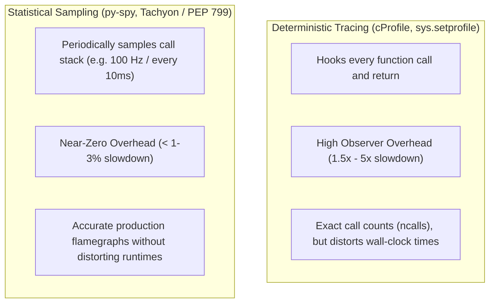
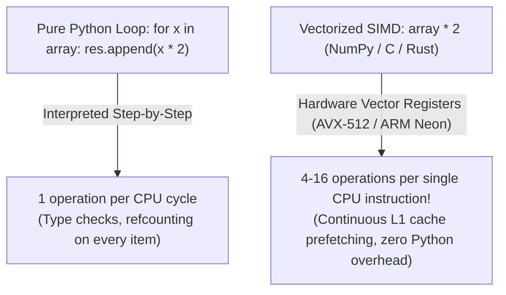

# Module 12: Performance Profiling & Optimization

Python's dynamic nature, rich object model, and automatic memory management provide unmatched developer productivity. However, in production microservices, data pipelines, and streaming systems, unoptimized Python code can suffer from high CPU utilization, memory bloat, and cache thrashing.

Optimizing Python requires a rigorous, measurement-driven engineering approach. Senior engineers never optimize based on intuition or guesswork; they apply **Profiling Taxonomy** to locate true bottlenecks, distinguish between **Deterministic Tracing** and **Statistical Sampling**, optimize critical hot paths using CPython runtime mechanics (local variable caching, `__slots__`, string builders), and know when to vectorize with SIMD or drop down to native extensions via **Rust (PyO3)**.

---

## 1. Profiling Taxonomy: Tracing vs Sampling

To optimize a slow system, you must first measure where CPU time and memory allocations are actually consumed. Profilers fall into two distinct architectural categories:



### 1.1 Deterministic Tracing (`cProfile`)
The standard library `cProfile` module instruments the interpreter: it records an event on every function entry and exit.
- **Strength**: Provides exact, deterministic counts of how many times every function was called (`ncalls`).
- **Fatal Weakness (The Observer Effect)**: For functions that execute in sub-microseconds and are called millions of times in tight loops, the overhead of the profiling hook itself dwarfs the actual function execution time, severely distorting the profile and making small utility functions appear artificially slow.

### 1.2 Statistical Sampling Profilers (`py-spy`, PEP 799)
Sampling profilers (such as `py-spy` and Python 3.15's `profiling.sampling` Tachyon profiler) do not hook function calls. Instead, they run out-of-process or via lightweight OS timers, sampling the call stack at regular intervals (e.g. 100 times per second).
- **Strength**: Negligible overhead ($< 1\text{--}3\%$), safe to run in production under live traffic, and produces accurate **Flamegraphs** reflecting real wall-clock latency.
- **Weakness**: May miss functions that execute faster than the sampling frequency.

---

## 2. Profiling CPU Time with `cProfile` & `pstats`

To profile Python code programmatically:
```python
import cProfile
import pstats
import io

def heavy_computation():
    return sum(i * i for i in range(100_000))

profiler = cProfile.Profile()
profiler.enable()
heavy_computation()
profiler.disable()

# Format statistics
stream = io.StringIO()
stats = pstats.Stats(profiler, stream=stream).sort_stats(pstats.SortKey.CUMULATIVE)
stats.print_stats(10)
print(stream.getvalue())
```

### 2.1 Reading `pstats` Metrics
- `ncalls`: The number of times the function was called. If two numbers appear (e.g. `3/1`), the second is the number of primitive (non-recursive) calls.
- `tottime`: The total time spent in the function itself, **excluding** time spent in sub-function calls. A high `tottime` indicates an internal CPU bottleneck (e.g. busy loops, heavy math).
- `cumtime`: The cumulative time spent in this function **and all sub-functions it called**. A high `cumtime` with low `tottime` indicates the function is an orchestrator waiting on downstream functions.
- `percall`: The quotient of `tottime` (or `cumtime`) divided by `ncalls`.

---

## 3. High-Impact CPython Micro-Optimizations

When a profiler reveals a hot loop, CPython's internal evaluation mechanics allow several high-impact optimizations:

### 3.1 Local Variable Binding Caching
Global and module-level lookups (`math.sin`, `len`) require hash table searches via `LOAD_GLOBAL` on every single loop iteration. In contrast, local variables are accessed via `LOAD_FAST`, which is an $O(1)$ direct array index lookup.
By binding a global function or method to a local variable before entering a tight loop, you eliminate dictionary hashing entirely:

```python
# SLOW: 1,000,000 LOAD_GLOBAL lookups on 'math' and attribute lookups on 'sqrt'
import math
def compute_slow(data: list[float]) -> list[float]:
    return [math.sqrt(x) for x in data]

# FAST: Local variable binding loads sqrt once via LOAD_FAST
def compute_fast(data: list[float]) -> list[float]:
    local_sqrt = math.sqrt  # Bound to local frame slot!
    return [local_sqrt(x) for x in data]
```

### 3.2 String Concatenation: `join()` vs `+=`
Python strings are immutable. In loops, appending strings via `+=` (`s += chunk`) forces the runtime to allocate a new string and copy all existing bytes on each iteration, resulting in quadratic $O(N^2)$ memory copying overhead.
Using `''.join(chunks)` pre-calculates the exact aggregate byte buffer size required, allocates memory once, and copies all chunks in a single $O(N)$ C-level `memcpy` operation.

```python
# ANTI-PATTERN: O(N^2) memory copying
s = ""
for chunk in string_list:
    s += chunk

# SENIOR IDIOM: O(N) single allocation
s = "".join(string_list)
```

### 3.3 Attribute Access: `__slots__`
As proven in Module 03, classes with `__slots__` replace the dynamic per-instance `__dict__` hash table with fixed numeric descriptor offsets, reducing memory footprint by $>60\%$ and speeding up attribute reads and writes by 20–30%.

---

## 4. Vectorization & Native Extensions (SIMD & PyO3)

Python loops are executed instruction-by-instruction by the virtual machine. When operations can be expressed as bulk transformations over homogeneous numeric data, **Vectorization** with NumPy or Polars bypasses the Python interpreter loop entirely.



### 4.1 When to Drop to Rust (PyO3)
When an algorithm cannot be vectorized cleanly (such as custom graph traversals, state machines, or complex parsing), rewriting the hot path as a native extension in **Rust** using **PyO3** provides native machine-code performance while preserving Pythonic ergonomics:
- Zero Python interpreter overhead.
- True multi-core execution (releasing the GIL with `py.allow_threads`).
- Memory safety guaranteed by the Rust compiler.

---

## 5. Interview Drill: Questions & Model Answers

<details>
<summary>1. Why do statistical sampling profilers like `py-spy` introduce less distortion than `cProfile`?</summary>

**Answer:**
`cProfile` is a deterministic tracing profiler that hooks every function call and return event via CPython's internal profiling API (`sys.setprofile()`). Executing hook logic on every function call adds fixed runtime overhead per call. In codebases with many small, fast function calls, this fixed overhead accumulates disproportionately on leaf functions, distorting the profile and causing small functions to appear as false bottlenecks (the Observer Effect).
`py-spy` is an out-of-process sampling profiler. It operates without modifying or hooking the target Python process: it inspects the CPython process's memory space and call stack at fixed periodic intervals (e.g. 100 Hz). The target program executes at 98–99% of its native speed, yielding realistic flamegraphs that accurately reflect production wall-clock latency.
</details>

<details>
<summary>2. How does local variable caching optimize performance in CPython loops?</summary>

**Answer:**
In CPython, global functions and module attributes (e.g. `math.sin` or `len`) require dynamic dictionary lookups:
1. `LOAD_GLOBAL` searches the module's `__dict__` hash table, falling back to `builtins.__dict__` if not found.
2. If accessing an attribute (like `math.sin`), `LOAD_ATTR` inspects the module object's dictionary.
In contrast, local variables inside a function are allocated slots in a fixed-size C array on the evaluation frame (`f_localsplus`) at compile time. Local variable access emits `LOAD_FAST`, which performs an $O(1)$ direct array index lookup without hashing, string comparisons, or dictionary probes. Caching a global reference in a local variable before a loop replaces millions of dynamic hash table searches with single-cycle array lookups.
</details>

<details>
<summary>3. Why is `"".join(list_of_strings)` asymptotically superior to repeated `+=` string concatenation?</summary>

**Answer:**
Python strings are immutable sequences of bytes.
When concatenating strings using `+=` inside a loop of $N$ chunks of length $K$, the string grows incrementally: length $K, 2K, 3K, \dots, NK$. At each step, Python must allocate a new heap buffer and copy all previously accumulated bytes. The total work performed is:
$$\sum_{i=1}^N i \cdot K = K \cdot \frac{N(N + 1)}{2} = O(K \cdot N^2)$$
This quadratic time and memory copying degrades severely as $N$ grows.
In contrast, `"".join(chunks)` makes two linear passes:
1. Pass 1: Sums the lengths of all strings in the collection to compute the exact total buffer size $N \cdot K$.
2. Pass 2: Allocates a single heap buffer of that exact size and copies all chunks directly via C-level `memcpy`.
Total work is $O(K \cdot N)$ (strictly linear time), utilizing memory with maximal cache efficiency.
</details>

<details>
<summary>4. What is the difference between `tottime` and `cumtime` in `cProfile` output?</summary>

**Answer:**
- `tottime` (Total Time): The aggregate execution time spent strictly within that specific function body, excluding all time spent executing any sub-functions or child calls made from within it. Functions with high `tottime` represent internal CPU bottlenecks (e.g. complex math, heavy nested loops, compression).
- `cumtime` (Cumulative Time): The total execution time spent in that function *including* all sub-functions and downstream calls made by it. A high `cumtime` function is often an orchestrator (like an HTTP handler or controller) whose work consists of calling out to other services, databases, or algorithms.
</details>

<details>
<summary>5. When should an engineering team choose to write a native C/Rust extension instead of optimizing Python code?</summary>

**Answer:**
A native extension (e.g. via PyO3 in Rust) should be chosen only when:
1. **Profiling Evidence**: Profiling demonstrates that a CPU-bound bottleneck accounts for a major portion of overall system latency and cannot be eliminated via algorithmic improvements.
2. **Non-Vectorizable Logic**: The computation cannot be expressed efficiently as bulk matrix or columnar vector operations in NumPy or Polars (e.g. pointer-heavy graph algorithms, custom binary protocol parsers, state machines).
3. **Multi-Core Parallelism**: The workload requires true multi-core CPU parallelism, and releasing the GIL (`py.allow_threads`) in native code is cleaner than managing multi-process IPC.
4. **Maintenance Trade-Off**: The team is prepared to maintain compilation toolchains, cross-platform build matrices (producing platform wheels for manylinux, macOS, Windows), and multi-language debugging pipelines.
</details>
