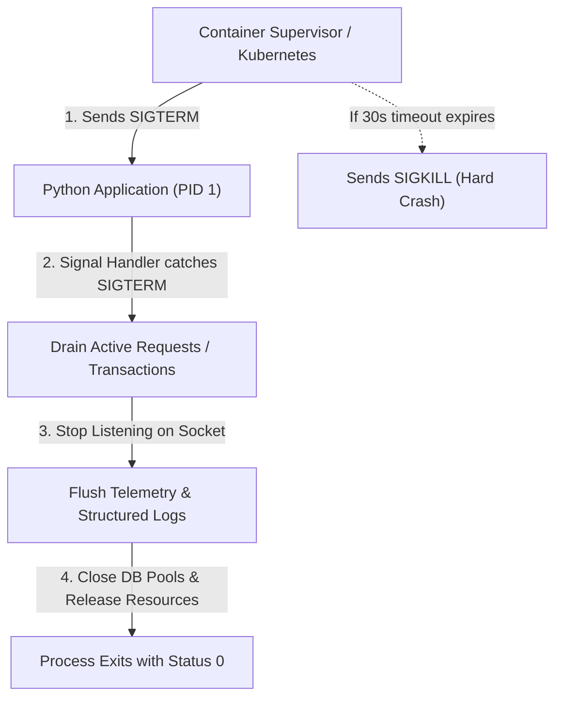
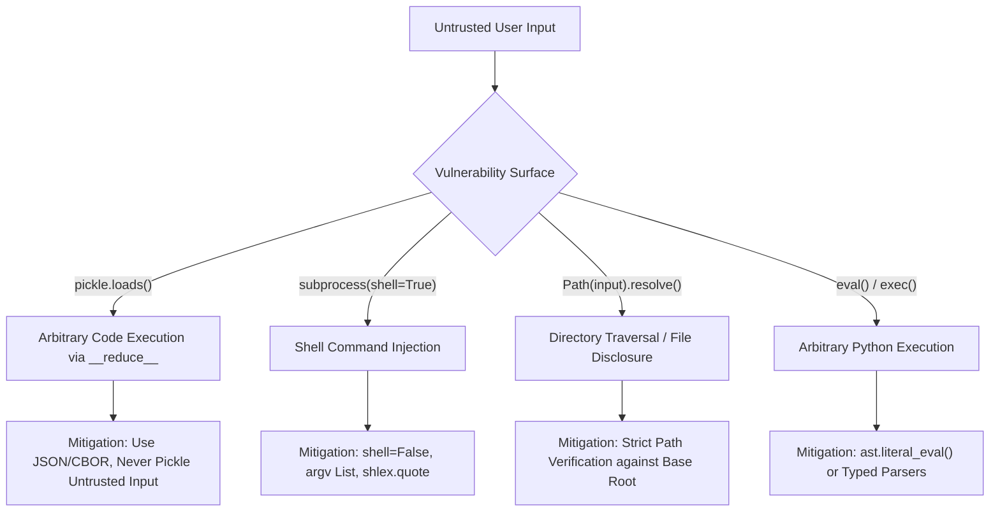

# Module 13: Production Python & Security

Building production systems in Python requires moving beyond functional code to address operational resilience, container packaging, predictable I/O encoding, and defensive security. In enterprise architectures, Python microservices must gracefully handle lifecycle signals, emit structured telemetry, minimize container image sizes with deterministic build tools like `uv`, and defend against classic CPython vulnerability classes.

This module details production engineering patterns for Python 3.15 services: structured JSON logging, system signal orchestration, deterministic Docker packaging, and deep vulnerability mitigations covering `pickle` deserialization exploits, command injection, and input sanitization.

---

## 1. System Signals & Graceful Lifecycle Shutdown

When Kubernetes or a system supervisor terminates a container, it sends `SIGTERM`, waits for a termination grace period (default 30 seconds), and sends `SIGKILL` if the process has not exited. Unhandled `SIGTERM` in Python causes an immediate abrupt exit without closing database connection pools, flushing I/O buffers, or completing in-flight transactions.



### 1.1 Synchronous vs Asynchronous Signal Handling
In standard synchronous Python, signals are handled via `signal.signal(signal.SIGTERM, handler)`. The handler receives `(signum, frame)`. However, signal handlers run asynchronously on the main interpreter thread and can interrupt arbitrary bytecodes, making complex cleanup unsafe inside the raw handler.

In asynchronous applications (`asyncio`), you register signal handlers directly with the event loop via `loop.add_signal_handler()`:

```python
import asyncio
import signal
import sys

async def main() -> None:
    loop = asyncio.get_running_loop()
    shutdown_event = asyncio.Event()

    def _on_signal(sig: signal.Signals) -> None:
        print(f"Received signal {sig.name}, initiating graceful shutdown...")
        shutdown_event.set()

    # Register handlers for SIGTERM and SIGINT
    for sig in (signal.SIGTERM, signal.SIGINT):
        loop.add_signal_handler(sig, _on_signal, sig)

    print("Service running. Awaiting shutdown signal...")
    await shutdown_event.wait()

    # Graceful teardown
    print("Flushing logs and draining connection pools...")
    await asyncio.sleep(0.1)  # Simulate pool close
    print("Shutdown complete.")

if __name__ == "__main__":
    asyncio.run(main())
```

> [!NOTE]
> `loop.add_signal_handler()` is available on Unix platforms only. On Windows, signal emulation requires socket pairs or console event handlers.

---

## 2. Structured JSON Telemetry

Standard human-readable text logs (`logging.basicConfig(format="%(asctime)s - %(message)s")`) are unusable in cloud-native aggregation pipelines (Elasticsearch, Datadog, Loki) because they require expensive regex parsing and cannot support structured querying.

In production, log records must be formatted as single-line JSON objects containing standard contextual metadata: timestamp (ISO 8601), log level, logger name, process/thread IDs, distributed trace/span IDs, and structured extra attributes.

```python
import json
import logging
import time
from typing import Any

class JSONFormatter(logging.Formatter):
    """Production JSON log formatter emitting newline-delimited JSON."""

    def format(self, record: logging.LogRecord) -> str:
        log_payload: dict[str, Any] = {
            "timestamp": time.strftime("%Y-%m-%dT%H:%M:%SZ", time.gmtime(record.created)),
            "level": record.levelname,
            "logger": record.name,
            "message": record.getMessage(),
            "module": record.module,
            "line": record.lineno,
        }

        # Include exception tracebacks if present
        if record.exc_info:
            log_payload["exception"] = self.formatException(record.exc_info)

        # Include custom extra fields
        if hasattr(record, "extra_fields") and isinstance(record.extra_fields, dict):
            log_payload.update(record.extra_fields)

        return json.dumps(log_payload, ensure_ascii=False)
```

---

## 3. PEP 686: Python UTF-8 Default Mode

Historically, Python's default encoding for file and pipe I/O depended on the host operating system's locale (e.g. `cp1252` on legacy Windows or `ASCII` in minimal Docker images lacking locale settings). This caused the notorious `UnicodeEncodeError` / `UnicodeDecodeError` when code tested on macOS or Linux was deployed to Windows or bare-bones containers.

Starting with **PEP 686** (mandated in Python 3.15), CPython enables **UTF-8 mode by default** across all platforms:
- `open(filename, "r")` defaults to `encoding="utf-8"` instead of `locale.getencoding()`.
- Standard streams (`sys.stdin`, `sys.stdout`, `sys.stderr`) default to UTF-8.
- To explicitly opt out or test legacy behavior, the environment variable `PYTHONUTF8=0` or CLI flag `-X utf8=0` must be supplied.

---

## 4. Modern Production Packaging with `uv` & Docker

Deploying Python applications in containers traditionally suffered from bloated image sizes (often $> 1\text{ GB}$), slow layer caching, and compilation dependencies leaking into the final runtime image.

With `uv` and multi-stage Docker builds, production Python images achieve minimal footprints ($< 100\text{ MB}$), pre-compiled bytecode (`--compile-bytecode`), and non-root execution:

```dockerfile
# Stage 1: Build virtualenv using uv
FROM python:3.15-slim AS builder

COPY --from=ghcr.io/astral-sh/uv:0.13.6 /uv /uvx /bin/

WORKDIR /app

# Enable bytecode compilation to eliminate startup latency in production
ENV UV_COMPILE_BYTECODE=1
ENV UV_LINK_MODE=copy

# Install dependencies first for optimal Docker layer caching
COPY pyproject.toml uv.lock ./
RUN uv sync --frozen --no-dev --no-install-project

# Copy application source and complete project sync
COPY . .
RUN uv sync --frozen --no-dev

# Stage 2: Minimal runtime image
FROM python:3.15-slim AS runtime

WORKDIR /app

# Create unprivileged service user
RUN groupadd -r appgroup && useradd -r -g appgroup -d /app -s /sbin/nologin appuser

# Copy virtualenv and application from builder stage
COPY --from=builder --chown=appuser:appgroup /app /app

ENV PATH="/app/.venv/bin:$PATH"
USER appuser

# Direct execution bypassing shell ensures Python receives PID 1 signals
ENTRYPOINT ["python", "-m", "myservice.main"]
```

---

## 5. Security Vulnerability Classes & Hardened Defenses

Python's dynamic execution features can create critical security vulnerabilities when handling untrusted user input.



### 5.1 The `pickle` Remote Code Execution (RCE) Exploit
`pickle` is CPython's native object serialization protocol. It is an executable virtual machine instruction stream, **not** a secure data exchange format. Any class can define a `__reduce__()` dunder method that instructs the unpickler to invoke an arbitrary callable with arbitrary arguments upon deserialization.

#### The Exploit Mechanism:
```python
import os
import pickle

class Exploit:
    def __reduce__(self):
        # Instructs the unpickler to call os.system('id') upon deserialization!
        return (os.system, ("id",))

payload = pickle.dumps(Exploit())
# When an unsuspecting server executes:
# pickle.loads(payload)
# -> Spawns a shell and executes arbitrary OS commands!
```

> [!CAUTION]
> Never unpickle untrusted data. Cryptographic HMAC signatures can protect against tampering in transit, but untrusted clients must never provide pickle payloads. Use JSON, Protocol Buffers, or MessagePack for external data boundaries.

### 5.2 Subprocess Command Injection
Executing OS processes via `subprocess` with `shell=True` invokes `/bin/sh -c` (or `cmd.exe`), passing the input string through the shell's command interpreter. Attackers can append shell metacharacters (`;`, `|`, `&&`, `` ` ``, `$()`) to execute arbitrary shell commands.

```python
import subprocess
import shlex

# VULNERABLE: Shell command injection!
def query_user_vulnerable(username: str) -> str:
    # If username is "alice; rm -rf /", shell executes both commands!
    cmd = f"id {username}"
    return subprocess.check_output(cmd, shell=True, text=True)

# HARDENED: shell=False with explicit argument vector (argv list)
def query_user_safe(username: str) -> str:
    # OS kernel invokes the binary directly; arguments cannot escape into commands
    result = subprocess.run(
        ["id", username],
        check=True,
        capture_output=True,
        text=True,
        shell=False,  # Enforce kernel-level argv execution
    )
    return result.stdout
```

### 5.3 Path Traversal Defenses
Accepting file paths from users without boundary validation allows path traversal attacks via `../` sequences, escaping the intended storage directory and reading sensitive system files (e.g. `/etc/passwd`).

```python
from pathlib import Path

def get_safe_file_content(base_dir: Path, user_supplied_path: str) -> str:
    """Resolve user path and guarantee it remains strictly within base_dir."""
    target_path = (base_dir / user_supplied_path).resolve()

    # Verify that the canonical resolved path starts with the base directory
    if not target_path.is_relative_to(base_dir.resolve()):
        raise PermissionError(f"Access denied: path traversal attempt detected ({user_supplied_path})")

    if not target_path.is_file():
        raise FileNotFoundError(f"File not found: {user_supplied_path}")

    return target_path.read_text(encoding="utf-8")
```

---

## 6. Interview Drill: Questions & Model Answers

<details>
<summary>1. Why is `pickle` inherently insecure for parsing data from untrusted clients, and why can't input sanitization fix it?</summary>

**Answer:**
`pickle` is not a passive data serialization format like JSON or Protocol Buffers; it is an interpreted byte-oriented stack machine language. The pickle bytecode specification includes opcodes (such as `REDUCE` and `GLOBAL`) designed specifically to look up arbitrary module attributes and call arbitrary callables with supplied arguments to reconstruct objects.
By implementing the `__reduce__()` protocol on a serialized class, an attacker can specify any callable (e.g. `posix.system`, `subprocess.Popen`) and its arguments. When `pickle.loads()` deserializes the stream, it executes the callable during reconstruction. Input sanitization is ineffective because the exploit is an intentional core feature of the protocol's object reconstruction design.
</details>

<details>
<summary>2. How does `shell=False` prevent command injection when using `subprocess.run()`?</summary>

**Answer:**
When `shell=True`, Python passes the entire command string to the system command interpreter (e.g. `/bin/sh -c "<command>"`). The shell parses metacharacters (`;`, `&`, `|`, `$()`, backticks), allowing an attacker who controls part of the string to terminate the initial command and inject secondary arbitrary commands.
When `shell=False` (the default) and the command is passed as a list of strings (`["id", username]`), Python bypasses the shell entirely. It makes a direct system call (`execve` on POSIX or `CreateProcess` on Windows) to the executable (`/usr/bin/id`), passing the list elements directly as the `argv` array. Metacharacters inside `username` are treated strictly as literal data characters within that single argument string and cannot be evaluated as shell syntax.
</details>

<details>
<summary>3. What changes with PEP 686 in Python 3.15 regarding default text encoding?</summary>

**Answer:**
Prior to PEP 686, standard Python file operations (`open()`, `sys.stdin`, `sys.stdout`) used the operating system's locale-dependent encoding (e.g. `cp1252` on Windows, or `ASCII` on misconfigured Linux containers). This led to silent data corruption or `UnicodeDecodeError` when code tested on UTF-8 systems ran in environments with different locale defaults.
Starting with PEP 686 in Python 3.15, CPython enables UTF-8 mode by default across all platforms. `open("data.txt", "r")` defaults to `encoding="utf-8"` regardless of system locale, standard streams use UTF-8, and predictable cross-platform behavior is guaranteed out of the box.
</details>

<details>
<summary>4. Why should signal handlers in asynchronous applications be registered via `loop.add_signal_handler()` rather than `signal.signal()`?</summary>

**Answer:**
`signal.signal()` registers a low-level synchronous callback that CPython invokes on the main thread at an arbitrary point between bytecode instructions. Executing complex asynchronous logic, awaiting coroutines, or directly interacting with the asyncio event loop inside a raw `signal.signal` handler can cause re-entrancy issues, deadlocks, or state corruption.
`loop.add_signal_handler()` integrates signal delivery directly into the asyncio event loop's reactor mechanism (using a self-pipe or signalfd on POSIX). When a signal arrives, the loop wakes up and executes the registered callback cleanly as part of its normal event loop turn, allowing safe manipulation of asyncio events, task cancellation, and structured shutdown.
</details>

<details>
<summary>5. What are the key Docker best practices for Python microservices using `uv`?</summary>

**Answer:**
1. **Multi-Stage Builds**: Separate the build environment (compilation headers, `uv` binary, build dependencies) from the final minimal runtime image.
2. **Bytecode Pre-compilation**: Set `UV_COMPILE_BYTECODE=1` during `uv sync` to compile `.pyc` files ahead-of-time, eliminating JIT bytecode compilation overhead during cold container startup.
3. **Layer Caching**: Copy `pyproject.toml` and `uv.lock` and run `uv sync --no-install-project` before copying application source code, so dependency layers are cached across source-only commits.
4. **Unprivileged User**: Create and run as a dedicated non-root user (`appuser`) to limit the blast radius of container escapes.
5. **Direct Entrypoint**: Use `ENTRYPOINT ["python", "-m", "..."]` (exec form) rather than shell form (`ENTRYPOINT python ...`) so Python runs as PID 1 and receives `SIGTERM` signals directly from the container runtime.
</details>
