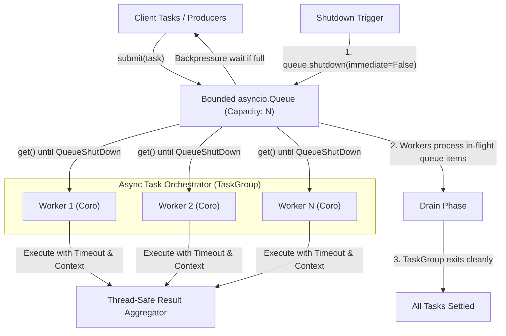

# Module 14: Then vs Now, Version History & Capstone

Python has undergone a profound evolution. The era of Python 2 legacy quirks, `setup.py` scripts, un-typed dynamic dictionaries, and uncoordinated thread locks has been replaced by modern Python 3.15: static typing with PEP 695 generics, structured concurrency via `asyncio.TaskGroup`, deterministic sub-millisecond packaging via `uv`, PEP 703 free-threaded execution, and PEP 659 adaptive bytecode specialization.

This concluding module synthesizes the entire curriculum. It provides a definitive **Then vs Now** transition guide, a practitioner's **Version History Matrix**, and implements an architectural **Capstone Project**: an asynchronous, backpressured, type-safe distributed task orchestrator.

---

## 1. Then vs Now: The Modern Python Revolution

Senior engineers must frequently refactor legacy codebases and guide team conventions. The table and sections below illustrate how fundamental idioms have transitioned:

| Domain | Then (Python 2.7 – 3.8) | Now (Python 3.11 – 3.15) | Core Driver |
|---|---|---|---|
| **Packaging & Env** | `pip`, `virtualenv`, `setup.py`, `requirements.txt` | `uv`, `pyproject.toml`, `uv.lock` | 100x faster Rust toolchain, deterministic locks |
| **Generics & Types** | `from typing import TypeVar, Generic`; `T = TypeVar("T")` | `class Box[T]:`, `type Alias[T] = ...` (PEP 695) | Native AST syntax, clean scoping, automatic variance |
| **Type Narrowing** | `TypeGuard[T]` (one-way narrowing) | `TypeIs[T]` (PEP 742, bidirectional narrowing) | Preserves false-branch type safety |
| **Annotations** | Eager runtime evaluation at import time | `annotationlib` (PEP 649 / 749 deferred evaluation) | Zero import-time overhead, no string forward-ref hacks |
| **Concurrency** | Raw `threading.Thread`, manual GIL workarounds | `asyncio.TaskGroup`, PEP 703 Free-Threading (`python3.15t`) | Leak-free structured concurrency, true multi-core |
| **Async Queues** | Unbounded `asyncio.Queue` with sentinel `None` | Bounded queues with `queue.shutdown()` (PEP 713) | Deterministic graceful shutdown, built-in backpressure |
| **Exception Handling** | Monolithic `try...except Exception:` | `ExceptionGroup` and `except*` (PEP 654) | Handles multiple concurrent failures in task groups |
| **Default Encoding** | OS locale-dependent (`cp1252`, `ASCII`) | Universal UTF-8 Default Mode (PEP 686) | Eliminates cross-platform file/pipe encoding bugs |

### 1.1 Type Annotations: From `TypeVar` Boilerplate to PEP 695 Syntax
```python
# THEN: Python 3.8 - 3.11
from typing import TypeVar, Generic, Sequence

T = TypeVar("T")
R = TypeVar("R")

class Transformer(Generic[T, R]):
    def __init__(self, mapper: callable) -> None:
        self.mapper = mapper

# NOW: Python 3.12 - 3.15 (PEP 695)
from collections.abc import Callable

class Transformer[T, R]:
    def __init__(self, mapper: Callable[[T], R]) -> None:
        self.mapper = mapper
```

### 1.2 Async Task Management: From `gather()` to `TaskGroup`
```python
# THEN: asyncio.gather (Vulnerable to task leaks on error)
async def fetch_all_then(urls: list[str]) -> list[str]:
    # If one fetch raises, others keep running in the background as orphaned tasks!
    results = await asyncio.gather(*(fetch(u) for u in urls))
    return results

# NOW: asyncio.TaskGroup (Guaranteed structured lifecycle)
async def fetch_all_now(urls: list[str]) -> list[str]:
    results: list[str] = []
    # If any task raises, all sibling tasks are cancelled immediately;
    # clean teardown is guaranteed before exiting the block.
    async with asyncio.TaskGroup() as tg:
        for url in urls:
            tg.create_task(fetch_worker(url, results))
    return results
```

---

## 2. Practitioner's CPython Version History (3.8 – 3.15)

```mermaid
flowchart LR
    V38["Python 3.8\nWalrus operator (:=)"] --> V39["Python 3.9\nBuilt-in generics (list[T])\nDict merge (|)"]
    V39 --> V310["Python 3.10\nmatch / case\nType union (X | Y)"]
    V310 --> V311["Python 3.11\nFaster CPython (PEP 659)\nExceptionGroup (PEP 654)"]
    V311 --> V312["Python 3.12\nPEP 695 type syntax\nPer-interpreter GIL (PEP 684)"]
    V312 --> V313["Python 3.13\nFree-threading (PEP 703)\nExperimental JIT\nQueue.shutdown()"]
    V313 --> V314["Python 3.14\nPEP 649 Deferred Annotations\nTemplate strings"]
    V314 --> V315["Python 3.15\nUTF-8 Default Mode (PEP 686)\nProduction Free-Threading"]
```



### Detailed Release Matrix
| Version | Release Date | Critical Innovations & Breaking Semantics |
|---|---|---|
| **3.8** | Oct 2019 | Assignment expressions (`:=`), positional-only parameters (`/`), `f"{expr=}"`. |
| **3.9** | Oct 2020 | Builtin collection generics (`list[str]`), dictionary union operators (`\|`, `\|=`), `zoneinfo` module. |
| **3.10** | Oct 2021 | Structural Pattern Matching (`match / case`), union types syntax (`int \| str`), explicit parameter specifications (`ParamSpec`). |
| **3.11** | Oct 2022 | **Faster CPython**: PEP 659 Specialized Adaptive Interpreter (10–60% speedup), Zero-cost exception tables, `ExceptionGroup` and `except*`, `Self` type, `asyncio.TaskGroup`. |
| **3.12** | Oct 2023 | **PEP 695 Type Parameter Syntax** (`type`, `class[T]`), inlined comprehensions, isolated subinterpreters with per-interpreter GIL (PEP 684), improved error diagnostics. |
| **3.13** | Oct 2024 | **PEP 703 Free-Threaded CPython** (`--disable-gil` preview), Copy-on-Write immortal objects (PEP 683), `asyncio.Queue.shutdown()`, colored interactive REPL. |
| **3.14** | Oct 2025 | PEP 649 Deferred Evaluation of Annotations, PEP 742 `TypeIs` bidirectional narrowing, PEP 696 type defaults. |
| **3.15** | Oct 2026 | **Universal UTF-8 Mode Default** (PEP 686), Production-grade free-threading (`python3.15t`), `annotationlib` (PEP 749), optimized superinstructions. |

---

## 3. Capstone Project: High-Performance Asynchronous Task Orchestrator

To demonstrate mastery across the entire Python engineering stack, we design and implement a production-grade **Asynchronous Task Orchestrator** in Python 3.15.

### Architectural Requirements:
1. **Type-Safe Task Protocol**: Utilizes PEP 695 generics (`Task[T, R]`) with static handler typing.
2. **Backpressure & Graceful Drain**: Employs a bounded `asyncio.Queue` utilizing PEP 713 `shutdown()`.
3. **Structured Concurrency**: Manages worker pools strictly via `asyncio.TaskGroup`, preventing orphaned coroutines.
4. **Context Propagation**: Tracks distributed execution context across coroutine boundaries using `contextvars.ContextVar`.
5. **Resilient Failure Handling**: Collects results, isolates worker exceptions without crashing the pipeline, and enforces task deadlines via `asyncio.timeout`.



### Architectural Implementation:
```python
import asyncio
import contextvars
import inspect
from dataclasses import dataclass
from typing import Callable, Generic, TypeVar

# Trace context propagation
current_trace_id: contextvars.ContextVar[str] = contextvars.ContextVar("current_trace_id", default="untracked")

@dataclass(frozen=True, slots=True)
class Task[T, R]:
    task_id: str
    payload: T
    handler: Callable[[T], R]
    timeout_seconds: float = 2.0

@dataclass(frozen=True, slots=True)
class TaskResult[R]:
    task_id: str
    result: R | None
    error: str | None
    trace_id: str

class AsyncOrchestrator:
    def __init__(self, concurrency: int = 4, max_queue_size: int = 100) -> None:
        self._concurrency = concurrency
        self._queue: asyncio.Queue[Task[object, object]] = asyncio.Queue(maxsize=max_queue_size)
        self._results: list[TaskResult[object]] = []
        self._is_running = False

    async def submit[T, R](self, task: Task[T, R]) -> None:
        """Submit a task into the bounded queue. Blocks if queue is at capacity (Backpressure)."""
        await self._queue.put(task)  # type: ignore[arg-type]

    async def _worker(self, worker_id: int) -> None:
        while True:
            try:
                task = await self._queue.get()
            except (asyncio.CancelledError, asyncio.QueueShutDown):
                break

            trace = current_trace_id.get()
            try:
                async with asyncio.timeout(task.timeout_seconds):
                    # Check if handler is coroutine or normal function via inspect (asyncio.iscoroutinefunction is deprecated in 3.15)
                    if inspect.iscoroutinefunction(task.handler):
                        val = await task.handler(task.payload)
                    else:
                        val = task.handler(task.payload)
                    self._results.append(TaskResult(task.task_id, val, None, trace))
            except TimeoutError:
                self._results.append(TaskResult(task.task_id, None, "Task timed out", trace))
            except Exception as exc:
                self._results.append(TaskResult(task.task_id, None, str(exc), trace))
            finally:
                self._queue.task_done()

    async def run_until_complete(self) -> list[TaskResult[object]]:
        """Run the orchestrator, process all queued items, and shut down gracefully."""
        async with asyncio.TaskGroup() as tg:
            workers = [tg.create_task(self._worker(i)) for i in range(self._concurrency)]
            
            # Wait until all submitted tasks have called task_done()
            await self._queue.join()
            
            # Initiate graceful queue shutdown (PEP 713)
            self._queue.shutdown()
            
            # Cancel idle workers waiting on queue.get()
            for w in workers:
                w.cancel()

        return self._results
```

---

## 4. Interview Drill: Questions & Model Answers

<details>
<summary>1. How does PEP 695 generic syntax improve upon legacy `typing.TypeVar` definitions?</summary>

**Answer:**
Legacy generic typing required manual scoping via module-level `TypeVar` instances (`T = TypeVar("T")`) and explicit inheritance from `typing.Generic[T]`. This boilerplate polluted the module namespace, led to bugs when `TypeVar` instances were reused across unrelated classes, and required manual declaration of variance (`covariant=True`, `contravariant=True`).
PEP 695 integrates type parameters directly into Python grammar (`class Box[T]:`, `def process[T](val: T) -> T:`). Type parameters are automatically scoped to the specific class or function, variance is computed automatically by the type checker based on actual usage, and type aliases use clean `type Name[T] = list[T]` syntax rather than `typing.TypeAlias`.
</details>

<details>
<summary>2. Why does `asyncio.TaskGroup` prevent the orphan task leaks common with `asyncio.gather()`?</summary>

**Answer:**
When using `asyncio.gather(*tasks)`, if one child task raises an unhandled exception, `gather()` immediately re-raises that exception to the caller. However, the remaining concurrent child tasks are **not** cancelled automatically; they continue running in the background as unmanaged, orphaned coroutines that can leak memory, consume database connections, and attempt state mutations after the orchestrating workflow has already failed.
`asyncio.TaskGroup` enforces structured concurrency. Its asynchronous context manager guarantees that upon exiting the `async with` block (whether by normal completion or an exception in any task), all child tasks spawned within the group are immediately cancelled and awaited. The block cannot exit until every child task has fully terminated, and all exceptions are gathered and raised as an `ExceptionGroup`.
</details>

<details>
<summary>3. What is PEP 713 `asyncio.Queue.shutdown()` and what problem does it solve?</summary>

**Answer:**
Before PEP 713 (introduced in Python 3.13), shutting down producer-consumer worker pools required awkward sentinel conventions (such as putting `None` into the queue for each worker) or abruptly cancelling worker tasks while they might still have unprocessed tasks in the queue.
`Queue.shutdown(immediate=False)` transitions the queue into a shut-down state:
1. Any subsequent `put()` operations immediately raise `asyncio.QueueShutDown`.
2. Existing items in the queue can still be consumed via `get()`. Once the queue is completely drained, any subsequent `get()` raises `asyncio.QueueShutDown`.
3. If `immediate=True`, all pending items are discarded and waiting `get()` calls raise immediately.
This provides a clean, native protocol for draining and shutting down asynchronous worker pipelines.
</details>

<details>
<summary>4. What are the key architectural differences between Python 3.11's Faster CPython specialization and Python 3.13's Free-Threading?</summary>

**Answer:**
- **PEP 659 (Specializing Adaptive Interpreter, Python 3.11+)**: Focuses on single-threaded execution speed. It profiles bytecode execution inline and dynamically replaces generic opcodes (like `BINARY_OP` or `LOAD_ATTR`) with specialized, monomorphic quickened instructions (like `BINARY_OP_ADD_INT` or `LOAD_ATTR_INSTANCE_VALUE`) when data types are uniform, bypassing dynamic dispatch and dictionary probing.
- **PEP 703 (Free-Threaded CPython, Python 3.13+)**: Focuses on multi-threaded parallel execution. It removes the Global Interpreter Lock (GIL) by replacing global reference count increments with mimalloc thread-safe local allocation, biased reference counting, and thread-safe internal locks. This allows pure Python threads to execute concurrently across multiple CPU cores on multi-threaded builds (`python3.15t`).
</details>

<details>
<summary>5. How does `contextvars.ContextVar` solve the state corruption problems of `threading.local` in asynchronous systems?</summary>

**Answer:**
`threading.local` stores state keyed by the OS thread ID. In an asynchronous event loop, thousands of independent coroutines (e.g. concurrent HTTP request handlers) are interleaved across a single OS thread. If code uses `threading.local` to store request-scoped data (like user ID or trace ID), coroutines will overwrite each other's state on context switches, causing critical data leaks and race conditions.
`contextvars.ContextVar` stores state keyed by the execution context of the specific asynchronous task or call chain. When a new coroutine is scheduled or a task is created (`loop.create_task()` or `TaskGroup.create_task()`), CPython automatically creates a copy-on-write snapshot of the current context. Each coroutine receives its own isolated context branch, ensuring thread-safe and coroutine-safe context propagation.
</details>
