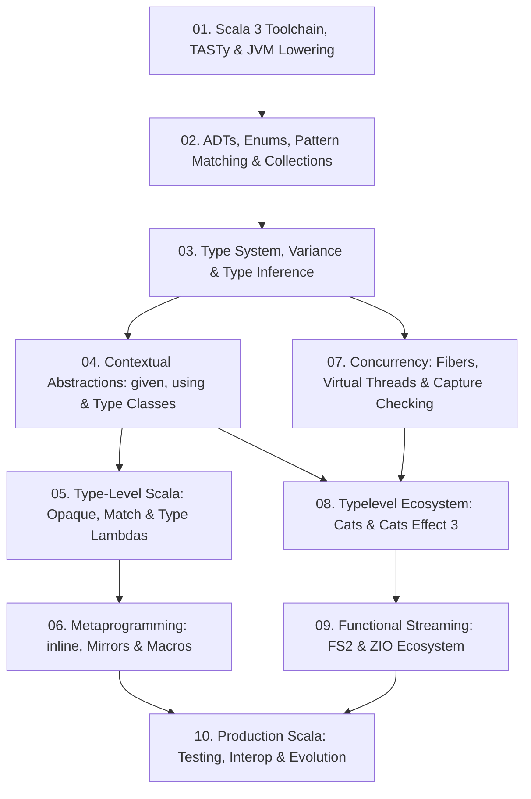

# Scala 3: Type System, Metaprogramming & Functional Effect Systems

A progressive, engineering-focused curriculum covering Scala 3.10.1 (alongside Scala 3.9.0 LTS) from TASTy intermediate representation and JVM bytecode lowering through algebraic data types, declaration-site variance, contextual abstractions, type-level programming, hygienic macros, capture checking, and production effect runtimes (Cats Effect 3, FS2, ZIO, and Ox).

> Verified against Scala 3.10.1 (Scala CLI 1.18.0), OpenJDK 25.0.5 LTS, Cats 2.13.0, Cats Effect 3.7.1, FS2 3.16.0, MUnit 1.3.6, munit-scalacheck 1.3.1 on 2026-11-20

**Ownership & Deduplication.** This track owns Scala 3 language semantics, compiler mechanics (TASTy, erasure, SAM conversion, `@tailrec`), Scala 3 type-level features (`opaque type`, match types, native type lambdas, polymorphic function types), metaprogramming (`inline`, `Mirror`, quotes/splices), JVM 25 virtual threads & capture checking, and ecosystem libraries (Cats 2.13.0, Cats Effect 3.7.1, FS2 3.16.0, ZIO 2.1.26, Ox 1.0.9, MUnit / ScalaCheck). Language-neutral pure FP theory, algebraic law proofs, trampolining, `ST`, and stream-transducer derivations are cross-linked to [Functional Programming Architecture](../../architecture/functional-programming/README.md).

## Curriculum Flow



## 1. Modules & Syllabus

| # | Module | Core Topics | Runnable Proof |
| --- | --- | --- | --- |
| 01 | [Scala 3 Toolchain, TASTy & JVM Lowering](./modules/01-scala3-toolchain-tasty-and-jvm-lowering.md) | Scala CLI (`scala`), Scala 3.10 vs 3.9 LTS, TASTy trees & binary compatibility, `@main`, indentation syntax, `@tailrec` & SAM lowering | [`examples/project.scala`](./examples/project.scala) |
| 02 | [ADTs, Enums, Pattern Matching & Collections](./modules/02-adts-enums-pattern-matching-and-collections.md) | `enum` ADTs & GADTs, exhaustivity checking, `unapply` extractors, `boundary`/`break`, `LazyList` vs Scala 2 `Stream`, CHAMP tries | [`01-AdtsEnumsAndLazyList.test.scala`](./examples/01-AdtsEnumsAndLazyList.test.scala) |
| 03 | [Type System, Variance & Type Inference](./modules/03-type-system-variance-and-type-inference.md) | Unified type lattice (`Any` / `Matchable` / `Nothing`), declaration-site `+A`/`-A`, lower-bound widening, local type inference | [`02-VarianceGivenOpaqueAndMatch.test.scala`](./examples/02-VarianceGivenOpaqueAndMatch.test.scala) |
| 04 | [Contextual Abstractions: `given`, `using` & Type Classes](./modules/04-contextual-abstractions-given-using-and-typeclasses.md) | `given`/`using`, `extension` methods, implicit resolution & coherence, orphan instances, `derives`, context functions (`A ?=> B`) | [`02-VarianceGivenOpaqueAndMatch.test.scala`](./examples/02-VarianceGivenOpaqueAndMatch.test.scala) |
| 05 | [Type-Level Scala: Opaque, Match & Type Lambdas](./modules/05-type-level-scala-opaque-match-and-lambdas.md) | `opaque type` zero-cost newtypes, union (`A \| B`) & intersection (`A & B`) types, match types, `[X] =>> F[S, X]`, polymorphic functions | [`02-VarianceGivenOpaqueAndMatch.test.scala`](./examples/02-VarianceGivenOpaqueAndMatch.test.scala) |
| 06 | [Metaprogramming: `inline`, Mirrors & Macros](./modules/06-metaprogramming-inline-mirrors-and-macros.md) | `inline` specialization, `transparent inline`, `Mirror.ProductOf`/`SumOf`, quotes/splices (`'{...}`/`${...}`), phase consistency | [`02-VarianceGivenOpaqueAndMatch.test.scala`](./examples/02-VarianceGivenOpaqueAndMatch.test.scala) |
| 07 | [Concurrency: Fibers, Virtual Threads & Capture Checking](./modules/07-concurrency-fibers-virtual-threads-and-capture-checking.md) | `Future` & `ExecutionContext` pitfalls, JDK 25 virtual threads, Ox structured concurrency, Scala 3 Capture Checking (`^`) | [`04-CatsEffectAndFs2Streams.test.scala`](./examples/04-CatsEffectAndFs2Streams.test.scala) |
| 08 | [Typelevel Ecosystem: Cats & Cats Effect 3](./modules/08-typelevel-ecosystem-cats-and-cats-effect.md) | `Monoid`/`Functor`/`Applicative`/`Monad`/`Traverse`, `ValidatedNel` vs `Either`, `IO` trampoline, `Resource`, `Ref`, `Deferred`, cancelation | [`03-CatsLawsAndValidation.test.scala`](./examples/03-CatsLawsAndValidation.test.scala), [`04-CatsEffectAndFs2Streams.test.scala`](./examples/04-CatsEffectAndFs2Streams.test.scala) |
| 09 | [Functional Streaming: FS2 & ZIO Ecosystem](./modules/09-functional-streaming-fs2-and-zio-ecosystem.md) | FS2 chunked `Pull` & `Stream[F, O]`, `Stream.bracket` resource safety, backpressure, ZIO 2 `ZIO[R, E, A]` & `ZLayer` comparison | [`04-CatsEffectAndFs2Streams.test.scala`](./examples/04-CatsEffectAndFs2Streams.test.scala) |
| 10 | [Production Scala: Testing, Interop & Evolution](./modules/10-production-scala-testing-interoperability-and-evolution.md) | MUnit & ScalaCheck property laws, `-Werror`/`-Yexplicit-nulls`, Java interop, Scala 2 → 3 migration ("Then vs now"), version history | [`03-CatsLawsAndValidation.test.scala`](./examples/03-CatsLawsAndValidation.test.scala) |

Reference companions: [GLOSSARY.md](./GLOSSARY.md) (EN ↔ CZ), [CHEATSHEET.md](./CHEATSHEET.md), and [exams/README.md](./exams/README.md).

### Prerequisites

- Familiarity with pure functional programming concepts (referential transparency, algebraic data types, monoids, functors, monads, and pure error handling) as covered in [Functional Programming Architecture](../../architecture/functional-programming/README.md).
- Working knowledge of JVM execution basics and typed imperative or object-oriented programming.

### Out of Scope

- **Language-neutral pure FP derivations**: Category-theoretic definitions, combinator proofs, `ST` soundness proofs, and abstract `Free` / trampoline derivations live in [Functional Programming Architecture](../../architecture/functional-programming/README.md).
- **Distributed consensus & streaming brokers**: Kafka internals, Raft/Paxos, and cluster partitioning belong to the distributed-systems and data-systems architecture tracks.
- **Scala.js and Scala Native linker internals**: Covered conceptually in Module 01 regarding TASTy portability, while build and runtime details focus on the JVM 25 target.

## 2. Certifications & Exams

There is **no active official proctored vendor certification** for Scala. Lightbend (now Akka) sunsetted its commercial Scala certifications (_Lightbend Certified Scala Developer_ and _Lightbend Certified Scala Professional Levels 1 & 2_).

The recognized industry and academic substitutes are:

| Program / Format | Provider | Status | Scope & Format | Link |
| --- | --- | --- | --- | --- |
| **Functional Programming in Scala Specialization** (5 courses) | EPFL / Scala Center (Coursera) | Active | Graded programming assignments & quizzes covering FP principles, parallel computing, Spark/big-data FP, and capstone | [Coursera Specialization](https://www.coursera.org/specializations/scala) |
| **Effective Programming in Scala** | EPFL / Scala Center (Coursera) | Active | Scala 3 syntax, ADTs, type classes, collections, error handling, testing, and concurrent programming | [Coursera Course](https://www.coursera.org/learn/effective-scala) |
| **Senior Scala & Functional Systems Interview Loop** | Industry standard | Active | Technical deep dive: Scala 3 type system, variance, `given`/`using`, metaprogramming, Cats Effect / ZIO runtime semantics, FS2 streaming, and JVM 25 concurrency | [Official Scala 3 Reference](https://docs.scala-lang.org/scala3/reference/) |

See [exams/README.md](./exams/README.md) for the 6-domain coverage matrix and [exams/scala-epfl-interview.md](./exams/scala-epfl-interview.md) for the 65-question preparation bank and 30-question / 90-minute timed mock exam.

## 3. Running the Examples & Verification

All toolchain versions are pinned in [`.mise.toml`](./.mise.toml) (`java = "temurin-25.0.5+8.0.LTS"`, `scala = "3.10.1"`) and library dependencies are pinned in [`examples/project.scala`](./examples/project.scala).

```bash
cd languages/scala
mise install                 # Installs pinned OpenJDK 25.0.5 LTS + Scala 3.10.1 (Scala CLI 1.18.0)
mise run fmt                 # Format examples with scalafmt (Scala 3 dialect)
mise run typecheck           # Compile main and test sources
mise run test                # Run MUnit & ScalaCheck suites in examples/
mise run lint                # Compile with -Werror -Wunused:all
mise run fmt:check           # Verify formatting without modifying files
```

### What the Test Suites Prove

- [`01-AdtsEnumsAndLazyList.test.scala`](./examples/01-AdtsEnumsAndLazyList.test.scala): Proves stack-safe `@tailrec` traversal over 50,000 elements, GADT type refinement on `Expr[A]`, `LazyList` deferred head and tail evaluation on construction (contrasting Scala 2 `Stream` eager head evaluation), head-retention avoidance over 1,000,000 elements, and typed `boundary`/`break` short-circuiting.
- [`02-VarianceGivenOpaqueAndMatch.test.scala`](./examples/02-VarianceGivenOpaqueAndMatch.test.scala): Proves declaration-site variance with `B >: A` lower bounds, zero-overhead `opaque type` encapsulation, native type lambdas, polymorphic function values, match-type reduction, `Mirror.ProductOf` derivation, and **four compile-time negative assertions** via `scala.compiletime.testing.typeCheckErrors` (variance violation, ambiguous `given` instances, `opaque type` representation leak, and `strictEquality` rejection).
- [`03-CatsLawsAndValidation.test.scala`](./examples/03-CatsLawsAndValidation.test.scala): Uses `munit.ScalaCheckSuite` to verify `Monoid`, `Functor`, `Applicative`, `Monad`, and `Traverse` laws, contrasts `ValidatedNel` error accumulation with `Either` fail-fast semantics, and includes a **negative property test** falsifying a non-associative subtraction `Monoid`.
- [`04-CatsEffectAndFs2Streams.test.scala`](./examples/04-CatsEffectAndFs2Streams.test.scala): Proves `IO` stack safety across 100,000 chained `flatMap`s, deterministic `Resource.make` finalizer execution under normal exit, error, and fiber cancelation, race-free `Ref` updates across 1,000 concurrent fibers, `Deferred` synchronization, and FS2 `Pull` / `Stream.bracket` cleanup on early `.take(3)` termination and mid-stream failures.
