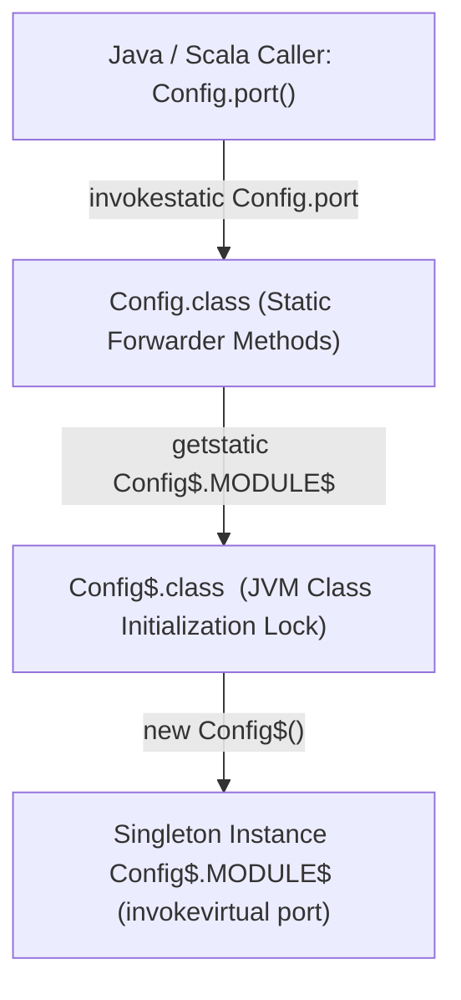

# Module 01 — Scala 3 Toolchain, TASTy, and JVM Lowering

Scala 3 (originally codenamed **Dotty**, grounded in the Dependent Object Types or **DOT** calculus) is not merely a syntactic refresh of Scala 2; it is a ground-up compiler architecture built around a typed intermediate representation (**TASTy**) and an updated JVM lowering pipeline. While pure functional programming principles—referential transparency, substitution, and algebraic laws—are language-neutral and covered in [FP Module 01](../../../architecture/functional-programming/modules/01-referential-transparency-and-lambda-calculus.md), exploiting functional abstractions safely and efficiently on the JVM requires understanding how Scala 3 parses, types, pickles, erases, and lowers code into Java bytecode.

---

## 1. Release Model, Runtime Baseline, and Build Toolchain

The modern Scala 3 ecosystem splits releases into two parallel tracks governed by **SIP-56 (Scala 3 Release Model)**:

| Track | Current Baseline | Purpose | TASTy & Binary Compatibility |
| --- | --- | --- | --- |
| **Scala Next** | `3.10.1` | Latest stable language features, tooling improvements, and compiler diagnostics | Binary-compatible with Scala 3.x libraries; emits the latest TASTy minor version |
| **Scala LTS (Primary)** | `3.9.0` | Long-Term Support line for production services and published open-source libraries | Consumes older 3.x TASTy; libraries compiled on `3.9.0` work on `3.9.x` and `3.10.x` |
| **Scala LTS (Legacy)** | `3.3.9` | Extended-maintenance LTS series for long-lived enterprise codebases | Consumes `3.0`–`3.3` TASTy; widely targeted by foundational libraries |
| **JVM Runtime** | OpenJDK `25.0.5 LTS` | Primary execution target (Temurin LTS) with modern GC, `invokedynamic`, and virtual threads | Bytecode target `--release` / `-java-output-version` up to JDK 25 |

### Why Library Authors Target LTS While Applications Can Use Next

TASTy compatibility is **forward-compatible in the reader, not backward-compatible**. A compiler on Scala `3.10.1` (Next) can read `.tasty` files generated by Scala `3.3.9` or `3.9.0` (LTS), because the TASTy unpickler supports all earlier minor versions in the `3.x` series. Conversely, a compiler on Scala `3.9.0` **cannot** read a `.tasty` file emitted by `3.10.1` if `3.10.1` bumped the TASTy minor version. Publishing a library with Scala Next therefore locks out every downstream consumer still on LTS. Applications sit at the top of the dependency graph and can safely run `3.10.1`, whereas libraries publish on LTS (`3.3.x` or `3.9.x`) so both LTS and Next consumers can resolve them.

### Unified `scala` CLI Runner, `sbt` 2.1.0, and Mill

Under **SIP-46**, the `scala-cli` project became the official `scala` runner (`1.18.0` bundled with Scala `3.10.1`). A single executable handles scripting, REPL sessions, compilation, testing, formatting, and native/JVM packaging without requiring a full `build.sbt` ceremony for small projects or reproducible test harnesses:

```scala
//> using scala 3.10.1
//> using dep org.typelevel::cats-core:2.13.0
//> using test.dep org.scalameta::munit:1.3.6
//> using options -deprecation -feature -unchecked -Werror

@main def hello(name: String): Unit =
  println(s"Hello, $name on Scala 3.10.1")
```

For multi-module enterprise builds and cross-platform matrices (JVM, Scala.js, Scala Native), **sbt `2.1.0`** (featuring project-matrix cross-building, remote/local task caching, and unified client-server commands) and **Mill** (an explicit, Bazel-inspired DAG build tool with fast cold-start incremental compilation) remain the standard build orchestrators:

```scala
// build.sbt (sbt 2.1.0)
ThisBuild / scalaVersion := "3.10.1"

lazy val core = project
  .settings(
    scalacOptions ++= Seq(
      "-deprecation",
      "-feature",
      "-unchecked",
      "-Wunused:all",
      "-Wvalue-discard",
      "-Wnonunit-statement",
      "-Werror",
      "-release:25",
    ),
    libraryDependencies ++= Seq(
      "org.typelevel" %% "cats-core" % "2.13.0",
      "org.scalameta" %% "munit"     % "1.3.6" % Test,
    ),
  )
```

In **Mill** (`build.mill`), the same build is declared as ordinary typed Scala objects with explicit task dependencies:

```scala
// build.mill
import mill.*, scalalib.*

object core extends ScalaModule:
  def scalaVersion = "3.10.1"
  def scalacOptions = Seq(
    "-deprecation",
    "-feature",
    "-unchecked",
    "-Wunused:all",
    "-Wvalue-discard",
    "-Wnonunit-statement",
    "-Werror",
    "-release:25",
  )
  def ivyDeps = Agg(
    ivy"org.typelevel::cats-core:2.13.0"
  )
```

Notice the high-leverage Scala 3 production compiler warnings:

| Compiler Option | Defect Caught at Compile Time | FP / Reliability Benefit |
| --- | --- | --- |
| `-Wvalue-discard` | Implicitly converting a non-`Unit` expression to `Unit` | Prevents silently dropping `IO[Unit]`, `Either[E, A]`, or `Future[Unit]` values |
| `-Wnonunit-statement` | Standalone statement expressions in blocks returning non-`Unit` | Catches forgotten `flatMap` / `yield` or uncomposed effect values inside `{ ... }` |
| `-Wunused:all` | Unused imports, locals, `private` members, or method params | Eliminates dead code and accidental unused `given` imports |
| `-Ysafe-init-global` | Forward-reference cycles across top-level `object` initialization | Catches `null` field reads caused by cyclic singleton initialization |
| `-release:25` | Links standard Java APIs strictly against JDK 25 class signatures | Prevents accidental use of non-portable internal JDK symbols |

---

## 2. The Scala 3 Compilation Pipeline

Understanding where type inference runs, when `inline` and macros expand, when `.tasty` is written, and where types disappear is essential for diagnosing compile errors, erasure warnings, and runtime boxing overhead.


Notice the strict ordering of three critical phases:

1. **Inlining precedes Pickler**: Macro expansion and `inline` evaluation run on typed trees _before_ `Pickler` emits `.tasty`, though the unexpanded `inline` method body is itself preserved inside the `.tasty` tree so downstream callers in other JARs can inline it during their own compilation.
2. **Pickler precedes Erasure**: `.tasty` captures the **fully typed, un-erased Scala AST**—opaque types, union types, variance annotations, `given` parameters, and type lambdas are still intact.
3. **Erasure precedes TailRec and GenBCode**: By the time bytecode is emitted, generic type arguments, opaque abstractions, and union types have already collapsed to their JVM representations.

---

## 3. TASTy Binary Format and Cross-JAR Capabilities

In Scala 2, separate compilation relied on a custom `ScalaSignature` annotation attached to `.class` files. That format encoded only public member signatures, not full method bodies, and lacked a stable versioned AST specification. Scala 3 replaces it with **TASTy** (**Typed Abstract Syntax Trees**), stored in standalone `.tasty` files alongside `.class` files inside every JAR.

### Anatomy of a `.tasty` File

Every `.tasty` file pairs with its corresponding JVM `.class` file via a 128-bit UUID stored in a custom JVM classfile attribute named `TASTy`. When `scalac` reads a compiled dependency, it verifies that the `.class` UUID matches the `.tasty` file's UUID so stale bytecode and stale type metadata can never drift out of sync. Internally, a `.tasty` file contains:

- **Header**: Magic bytes (`0x5C 0xA1 0xAB 0x1F`), TASTy major/minor/experimental version numbers, compiler version string, and the 128-bit UUID.
- **Name Table**: Deduplicated UTF-8 identifiers, qualified names, and mangled operator names referenced by compact integer indices.
- **Tree Section**: A prefix-encoded, length-delimited binary tree of typed AST nodes (`VALDEF`, `DEFDEF`, `TYPEDEF`, `APPLY`, `TYPEAPPLY`, `INLINED`, etc.) where every expression node carries its resolved type.
- **Positions & Comments Sections**: Source line/column offsets (compressed delta-encoded integers) and Scaladoc comments, enabling stack-accurate error reporting and IDE hover documentation directly from compiled JARs.

You can inspect the TASTy tree produced for any Scala 3 source file—or inspect the exact JVM bytecode emitted after `Erasure` and `TailRec`—directly from the CLI:

```bash
# Print the typed AST stored in .tasty
scala compile --scalac-option -Yprint-tasty Hello.scala

# Print compiler trees right after Erasure or TailRec
scala compile --scalac-option -Xprint:erasure --scalac-option -Xprint:tailrec Hello.scala

# Disassemble emitted JVM .class bytecode (including static forwarders & goto loops)
javap -c -p -v .scala-build/*/classes/main/Hello\$.class
```

### Programmatic `.tasty` Inspection with `TastyInspector`

Because `.tasty` files store typed trees inside compiled JARs, static-analysis tools and custom architectural linters can traverse compiled libraries without touching source code using `scala.tasty.inspector.TastyInspector` (adding `"org.scala-lang" %% "scala3-tasty-inspector"`):

```scala
import scala.tasty.inspector.*
import scala.quoted.*

object AuditInspector extends Inspector:
  def inspect(using Quotes)(tastys: List[Tasty[quotes.type]]): Unit =
    import quotes.reflect.*
    for tasty <- tastys do
      val tree = tasty.ast
      // Walk typed AST nodes (DefDef, ValDef, Apply) directly from compiled JARs
      println(s"Inspected TASTy path: ${tasty.path}, root symbol: ${tree.symbol.fullName}")
```

### What TASTy Enables in Practice

- **Cross-JAR Inlining and Zero-Cost Abstractions**: Because an `inline def` preserves its typed body inside `.tasty`, a library compiled six months ago can have its `inline` methods and `Mirror`-based type-class derivations specialized directly into an application's call site without shipping source files.
- **Whole-Program Static Analysis (`TastyInspector`)**: Tools like documentation generators, binary-compatibility checkers (`MiMa`), and custom architectural linters load `.tasty` files via `scala.tasty.inspector.TastyInspector` without re-parsing source code or invoking the front-end parser.
- **Scala 2.13 Interoperability**: Scala `2.13.x` includes the `-Ytasty-reader` flag, allowing Scala 2.13 applications to consume Scala 3 `.tasty` libraries published up to Scala 3.7 (Scala 3.8+ dropped 2.13 TASTy reader compatibility), whereas Scala 3 reads Scala 2.13 `.class` pickles natively without `-Ytasty-reader`.

---

## 4. JVM Lowering Mechanics: Erasure, Boxing, Singletons, and `@tailrec`

The JVM instruction set (`JVM Specification §2.2`) knows only primitive types (`boolean`, `byte`, `short`, `char`, `int`, `long`, `float`, `double`), `Object` references, arrays, and classes/interfaces with single inheritance of classes. Every high-level Scala 3 abstraction must lower to those primitives during **Erasure** and **GenBCode**.

### Type Erasure Rules

During the `Erasure` phase, type parameters vanish according to deterministic rules:

| Scala 3 Source Type | Erased JVM Bytecode Type | Consequence at Runtime |
| --- | --- | --- |
| `Int`, `Double`, `Boolean` (direct) | `int`, `double`, `boolean` | Zero heap allocation; lives on JVM operand stack and local variable table |
| `T` (unbounded type parameter) | `java.lang.Object` | Primitives box to `java.lang.Integer`, `java.lang.Double`, `java.lang.Boolean` |
| `T <: Number` | `java.lang.Number` | Upper bound becomes the erased JVM descriptor |
| `List[Int]`, `List[String]` | `scala.collection.immutable.List` | Type arguments disappear; `x.isInstanceOf[List[Int]]` triggers an unchecked warning |
| `Int \| String` (union type) | `java.lang.Object` (LUB) | Least upper bound in the JVM class hierarchy; runtime `match` dispatches on `Integer` / `String` |
| `A & B` (intersection type) | First non-trait class, else first trait (`A`) | Calls to `B` members insert synthetic JVM `checkcast` instructions at call sites |
| `opaque type UserId = Long` | `long` (unboxed!) | Zero wrapper allocation; see [Module 05](05-type-level-scala-opaque-match-and-lambdas.md) for boundary rules |

Because `List[Int]` and `List[String]` erase to the exact same JVM class descriptor (`Lscala/collection/immutable/List;`), two overloaded methods `def f(xs: List[Int]): Unit` and `def f(xs: List[String]): Unit` collide in JVM bytecode and are rejected at compile time with `"have the same type after erasure"` (unless disambiguated with `@targetName("fStrings")`, though callers from Java still see the mangled name).

### Boxing Traps and `AnyVal` Value Classes

Consider summing a `List[Int]` vs an `Array[Int]` vs a generic wrapper `case class Meter(value: Double) extends AnyVal`:

1. **`List[Int]`**: `::[A]` stores `head: A` whose erased field type is `java.lang.Object`. Every `Int` inserted into `List[Int]` allocates a `java.lang.Integer` wrapper (outside the JVM `-128..127` integer cache) and dereferences a pointer on read.
2. **`Array[Int]` / `IArray[Int]`**: Scala arrays map directly to JVM primitive arrays (`int[]`), avoiding boxing completely. `IArray[T]` (an `opaque type IArray[+T] = Array[? <: T]` in Scala 3) provides immutable array semantics with primitive `int[]` memory layout.
3. **`extends AnyVal` Value Classes**: Extending `AnyVal` attempts to elide the wrapper class by passing the underlying primitive `double` directly in method descriptors. **However, `AnyVal` still allocates a heap wrapper object whenever:**
   - Stored in a generic container (`List[Meter]`, `Option[Meter]`, `(Meter, String)`).
   - Assigned to a supertype (`Any`, `Matchable`, or any `trait` implemented by `Meter`).
   - Pattern-matched or stored inside an `Array[Meter]`.

Because these silent re-boxing traps catch teams off guard in hot loops, Scala 3 introduces **`opaque type`** aliases (covered in depth in [Module 05](05-type-level-scala-opaque-match-and-lambdas.md)), which guarantee zero boxing in generic-free direct storage and avoid `AnyVal`'s inheritance loopholes.

### Singleton `object` Lowering (`MODULE$` and `<clinit>` Deadlock Hazard)

Every standalone Scala `object Config` compiles to two JVM classfiles (or a companion pair when paired with `class Config`):



Understanding this lowering prevents two subtle production failures:

1. **Multi-threaded `<clinit>` deadlock**: Because the JVM holds an exclusive initialization lock per class during `<clinit>` (`JVM Spec §5.5`), if Thread 1 initializes `object A` (whose constructor references `B.value`) simultaneously while Thread 2 initializes `object B` (whose constructor references `A.value`), both threads deadlock permanently inside `<clinit>`! Even on a single thread, cyclic `object` initialization reads uninitialized `null`/`0` values before `<clinit>` completes. Keep `object` bodies purely declarative or enable `-Ysafe-init-global` to detect initialization cycles statically.
2. **`lazy val` synchronization overhead**: Every `lazy val` on a class or object compiles to a thread-safe double-checked locking state machine (using `VarHandle` / `Unsafe` CAS on modern JDKs) via `scala.runtime.LazyVals`. Avoid placing `lazy val` inside tight inner loops or heavily contended singleton objects where plain `val` or local `def` suffices.

### `@tailrec` Bytecode Lowering and Stack Safety

As established in [FP Module 01](../../../architecture/functional-programming/modules/01-referential-transparency-and-lambda-calculus.md), the JVM lacks general tail-call elimination (`tailcall` bytecode instruction) across arbitrary method calls or `Function1.apply` virtual dispatches. Scala compensates for **direct self-recursion** with the `TailRec` compiler phase and the `@scala.annotation.tailrec` verification annotation:

```scala
import scala.annotation.tailrec

def factorial(n: Int): BigInt =
  @tailrec
  def loop(k: Int, acc: BigInt): BigInt =
    if k <= 1 then acc
    else loop(k - 1, acc * k)
  loop(n, BigInt(1))
```

During `TailRec`, the compiler rewrites `loop(k - 1, acc * k)` into variable reassignments followed by an unconditional JVM `goto` jump back to offset `0` of `loop`:

```text
// Conceptual bytecode lowering of loop(k, acc)
L0:
  iload_1          // load k
  iconst_1
  if_icmple L1     // if k <= 1 jump to return acc
  iload_1
  iconst_1
  isub             // k - 1
  aload_2          // acc
  ...              // acc * k
  astore_2         // acc = acc * k
  istore_1         // k = k - 1
  goto L0          // zero stack frame growth!
L1:
  aload_2
  areturn
```

Notice four common `@tailrec` **failure modes** where the compiler rejects the annotation at compile time (verifiable directly via `scala.compiletime.testing.typeChecks`):

1. **Non-final instance method**: A `class` method that is neither `private` nor `final` could be overridden by a subclass; `loop(...)` would be a polymorphic virtual dispatch (`invokevirtual`), which cannot safely be lowered to a static `goto`. Fix by marking the method `final` or `private`, or using an inner `def loop`.
2. **Operation after the recursive call**: Writing `n * factorial(n - 1)` requires multiplying after the recursive call returns, leaving an open stack frame.
3. **Recursive call inside `try { ... } catch { ... } finally { ... }`**: The JVM exception handler table tracks stack-frame-scoped exception regions; a self-call inside `try`, `catch`, or `finally` cannot jump cleanly out of the active exception/unwinding handler and fails `@tailrec`. Move the fallible step into `scala.util.Try(...)` and pattern-match on `Success`/`Failure` outside any `try`/`catch`/`finally` block so the recursive call sits in true tail position.
4. **Mutual recursion**: Two functions `isEven(n)` and `isOdd(n)` calling each other in tail position are **not** self-recursive and fail `@tailrec`; stack-safe mutual recursion on the JVM requires heap trampolining (`scala.util.control.TailCalls.TailRec`, covered in [FP Module 12](../../../architecture/functional-programming/modules/12-effects-io-trampolining-st-and-streaming.md)).

```scala
import scala.compiletime.testing.typeChecks

val nonFinalFails = typeChecks("""
  import scala.annotation.tailrec
  class Counter:
    @tailrec def down(n: Int): Int = if n <= 0 then 0 else down(n - 1)
""") // false: "Cannot rewrite recursive call: it is not in tail position / method is not final"

val tryCatchFails = typeChecks("""
  import scala.annotation.tailrec
  @tailrec def parseLoop(n: Int): Int =
    try if n <= 0 then 0 else parseLoop(n - 1)
    catch case _: Exception => -1
""") // false: recursive call inside try block
```

### Lambda Lowering via `invokedynamic`

Since Scala 2.12 and throughout Scala 3, non-polymorphic function literals such as `(x: Int) => x + 1` do not generate an anonymous `Foo$$anonfun$1.class` file per lambda site. Instead, `GenBCode` compiles the lambda body into a private synthetic static/instance method (`$anonfun$...`) and emits a JVM **`invokedynamic`** instruction targeting `java.lang.invoke.LambdaMetafactory.metafactory` (or `altMetafactory` for serializable SAMs). On first execution, the JVM links the call site dynamically; non-capturing lambdas allocate only a single cached singleton instance rather than allocating per invocation.

---

## 5. Entry Points (`@main`) and Significant Indentation

Scala 3 modernizes entry points and block syntax while maintaining 100% deterministic parsing.

### Typed `@main` Methods

Any top-level or object-scoped method annotated with `@main` generates a synthetic class of the same name containing a standard `public static void main(String[] args)` entry point:

```scala
import scala.util.CommandLineParser.FromString

enum LogLevel:
  case Debug, Info, Warn

given FromString[LogLevel] with
  def fromString(s: String): LogLevel = s.toLowerCase match
    case "debug" => LogLevel.Debug
    case "info"  => LogLevel.Info
    case "warn"  => LogLevel.Warn
    case other   => throw IllegalArgumentException(s"Invalid log level: $other")

@main def server(port: Int, host: String = "0.0.0.0", level: LogLevel = LogLevel.Info): Unit =
  println(s"Starting on $host:$port at level=$level")
```

The compiler synthesizes argument parsing via `CommandLineParser.FromString[T]` type-class instances (built-in for `String`, `Int`, `Long`, `Double`, `Boolean`, etc.), handles default values, and automatically prints a helpful diagnostic message if required arguments are missing or fail parsing. Vararg trailing CLI arguments (`files: String*`) map cleanly to remaining `args` elements, and you can also define multiple `@main` functions in different packages/files—each emitting its own independent Java entry class:

```scala
@main def migrate(dryRun: Boolean = true, targets: String*): Unit =
  if targets.isEmpty then
    System.err.println("Error: provide at least one migration target")
    sys.exit(1)
  else
    println(s"Running migration (dryRun=$dryRun) on: ${targets.mkString(", ")}")
```

Under `Erasure`, `migrate` generates both `class migrate` (holding `public static void main(String[] args)`) and the underlying Scala method, delegating argument conversion to `scala.util.CommandLineParser`. If a user passes `--` or invalid numeric syntax like `port=abc` to `server(port: Int)`, `CommandLineParser.showError` reports the exact offending parameter name and exits with code `1` before the method body ever runs.

### Significant Indentation and Quiet Control Syntax

Scala 3 supports **braceless (indentation-based) syntax** alongside traditional `{ ... }` blocks. The parser tracks indentation width after tokens such as `=`, `=>`, `:`, `then`, `else`, `do`, `yield`, `match`, `try`, `catch`, and `finally`. Key rules and traps:

- **Fewer braces (`:` for lambdas)**: Under Scala 3.3+ (standard in `3.10.1`), an indented block after `:` passes a multi-line lambda argument without parentheses or outer braces, e.g. `xs.map: x =>` followed by indented lines.
- **Explicit `end` markers**: Long indented definitions can close cleanly with `end server`, `end match`, `end if`, or `end class`. The compiler verifies that the `end` marker name matches the enclosing construct.
- **Indentation traps**: Mixing tabs and spaces on consecutive lines in the same indentation region is a compile error. Additionally, if an `else` is aligned differently from its `if`, or an inline comment alters perceived nesting, the parser reports an indentation mismatch; running `scala fmt` (Scalafmt with `runner.dialect = scala3`) or `-rewrite -indent` / `-no-indent` enforces consistency automatically.

---

## 6. Then vs now: Scala 2.10–2.13 to Scala 3.10.1

Teams upgrading production Scala 2 codebases or reading older literature (such as the 2015 first edition of _Functional Programming in Scala_) encounter several superseded idioms whose replacements fix concrete runtime and tooling bugs.

| Area | Then (Scala 2.10–2.13) | Now (Scala 3.10.1 / 3.9 LTS) | Why It Changed |
| --- | --- | --- | --- |
| Program entry point | `object AppMain extends App { ... }` | `@main def run(...): Unit = ...` | `App` relied on deprecated `DelayedInit`, running user initialization inside `<clinit>` / constructor and causing initialization deadlocks and null-field races |
| Procedure syntax | `def log(msg: String) { println(msg) }` | `def log(msg: String): Unit = println(msg)` | Omitting `=` silently discarded any non-Unit return value and created parser ambiguity; removed in Scala 3 |
| Control syntax | `if (cond) a else b`, `for (x <- xs) yield x` | `if cond then a else b`, `for x <- xs yield x` | Quiet syntax eliminates mandatory outer parentheses around conditions and enables clean indentation blocks |
| Separate compilation AST | `ScalaSignature` classfile annotation | Standalone `.tasty` binary AST files | Enables cross-JAR `inline` expansion, macro inspection, and forward TASTy compatibility |
| CLI & scripts | Separate `scalac`, `scala`, `amm`, `sbt` | Unified `scala` CLI (`1.18.0`) + `sbt 2.1.0` / Mill | Single fast runner for scripts, dependencies (`//> using`), tests, and REPL |
| XML literals | Built-in `val doc = <user>{name}</user>` | Deprecated; use `scala-xml` string interpolators or libraries | Baked XML grammar complicated lexer/parser rules and error recovery |

### Why `extends App` Was Dangerous

In Scala 2, `trait App` extended `DelayedInit` (removed in Scala 3). The compiler rewrote the entire body of `object Main extends App` into a closure passed to `delayedInit(...)` and executed it inside `App.main`. If another thread or helper object referenced a `val` on `Main` before `main` ran, or during static class initialization (`<clinit>`), threads could observe `null` / `0` uninitialized fields or deadlock on JVM class initialization locks (`JVM Spec §5.5`). `@main` compiles to a clean static `main` method that executes normal top-down calls with zero `DelayedInit` magic.

```scala
// THEN (Scala 2 anti-pattern — initialization hazard, fails on Scala 3 if relying on DelayedInit)
// object LegacyApp extends App:
//   val config = loadConfig() // ran via DelayedInit hook; null if accessed early!

// NOW (Scala 3.10.1 — clean static main wrapper + typed arguments)
@main def modernApp(env: String = "prod"): Unit =
  val config = loadConfig(env)
  println(s"Booted $config")

def loadConfig(env: String): String = s"config-$env"
```

---

## Interview Drill

### 1. Why can Scala `3.10.1` read a library compiled with Scala `3.9.0` LTS, while a Scala `3.9.0` project cannot consume a library compiled with Scala `3.10.1`?

<details><summary>Answer</summary>

TASTy format compatibility is forward-compatible for readers and backward-incompatible for older compilers reading newer minor TASTy versions. Scala `3.10.1` (Next) knows how to unpickle all earlier `3.x` TASTy minor versions (`3.3`, `3.9`, etc.), whereas Scala `3.9.0` (LTS) rejects `.tasty` files emitted with the newer `3.10` TASTy minor version because it cannot safely interpret AST constructs introduced after `3.9.0`. That is why open-source libraries publish against LTS versions while applications can upgrade freely to Scala Next.
</details>

### 2. What is the difference between `.class` bytecode and `.tasty` files in a compiled Scala 3 JAR, and what breaks if `.tasty` files are stripped?

<details><summary>Answer</summary>

The `.class` file contains erased JVM bytecode (generics stripped to `Object` or upper bounds, `opaque type` unwrapped, `inline` bodies absent as Scala ASTs), whereas the `.tasty` file stores the full typed, un-erased Scala AST linked by a 128-bit UUID in the `.class` `TASTy` attribute. If `.tasty` files are stripped from a library JAR, the JVM can still execute already-compiled code, but `scalac` can no longer compile Scala 3 callers against that JAR (losing Scala-specific type information, `inline` bodies, `opaque` boundaries, `given` metadata, and macro definitions).
</details>

### 3. When does a Scala value class (`extends AnyVal`) still allocate an object on the JVM heap?

<details><summary>Answer</summary>

Although `AnyVal` attempts to pass the underlying primitive directly in method signatures, the compiler must box the wrapper on the JVM heap whenever the value is stored in a generic container (`List[Meter]`, `Option[Meter]`, tuples), assigned to a supertype (`Any`, `Matchable`, or a universal trait), placed into an `Array[Meter]`, or used in a pattern match that requires an object reference. Scala 3's `opaque type` avoids `AnyVal`'s trait-boxing loopholes and compiles directly to the underlying type without a wrapper class existing at runtime.
</details>

### 4. How does `@tailrec` compile on the JVM, and name three situations where `@tailrec` fails to compile.

<details><summary>Answer</summary>

During the `TailRec` compiler phase (after `Erasure`), self-recursive tail calls are rewritten into parameter reassignments and an unconditional JVM `goto` jump back to the method entry, executing in $O(1)$ stack space. `@tailrec` fails to compile when: (1) the method is non-`final` and non-`private` on a class (so calls are virtual `invokevirtual` dispatches); (2) work happens after the recursive call (`1 + loop(...)`); (3) the recursive call sits inside a `try` or `catch` block; or (4) the recursion is mutual across two distinct methods rather than direct self-recursion.
</details>

### 5. Why does `def f(xs: List[Int])` and `def f(xs: List[String])` fail to compile as overloaded methods in the same scope, and how can Scala 3 resolve it?

<details><summary>Answer</summary>

JVM bytecode erases generic type arguments, so both signatures lower to the identical JVM method descriptor `(Lscala/collection/immutable/List;)V`, causing a double-definition clash after `Erasure`. In Scala 3, you can annotate one overload with `@scala.annotation.targetName("fStrings")` to emit a distinct JVM bytecode method name while keeping the Scala source name `f` (or differentiate parameter types via type classes/`DummyImplicit`).
</details>

### 6. Why did Scala 3 remove `DelayedInit` and deprecate/discourage `extends App` in favor of `@main`?

<details><summary>Answer</summary>

`DelayedInit` rewrote the body of an `extends App` object into a closure executed later inside `App.main`, splitting field declarations from their initialization during class construction (`<clinit>`). Accessing fields of the `App` object from other threads or static initializers before `delayedInit` ran exposed uninitialized `null`/`0` values or triggered JVM class-loader deadlocks. `@main` generates a plain static `main` wrapper around a regular method, preserving normal top-down initialization and adding type-safe CLI argument parsing via `CommandLineParser.FromString`.
</details>

### 7. In the Scala 3 compilation pipeline, why must `Inlining` run before `Pickler`, and `Pickler` before `Erasure`?

<details><summary>Answer</summary>

`Inlining` expands macros and compile-time operations using full typed trees before `Pickler` serializes the resulting AST (while still preserving `inline def` templates in `.tasty` for downstream callers). `Pickler` must run before `Erasure` because `.tasty` needs the exact un-erased Scala types—opaque types, union/intersection types, variance, and type lambdas—so separate compilation and `TastyInspector` see the true Scala type system rather than erased `Object` descriptors.
</details>

### 8. How does a Scala `object` singleton lower to JVM bytecode, and how can two `object`s deadlock at startup?

<details><summary>Answer</summary>

`object Config` lowers to `Config$.class` holding a `public static final Config$ MODULE$` field instantiated inside the JVM `<clinit>` static initializer, paired with static forwarder methods on `Config.class`. Because the JVM acquires an exclusive class initialization lock for `<clinit>`, if Thread 1 initializes `object A` (which accesses `B` during field initialization) while Thread 2 simultaneously initializes `object B` (which accesses `A`), the two threads deadlock inside `<clinit>`. Enabling `-Ysafe-init-global` catches cyclic global object initialization at compile time.
</details>
