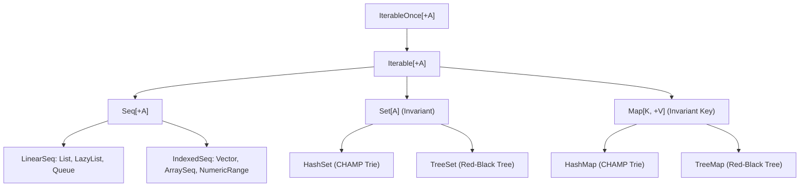
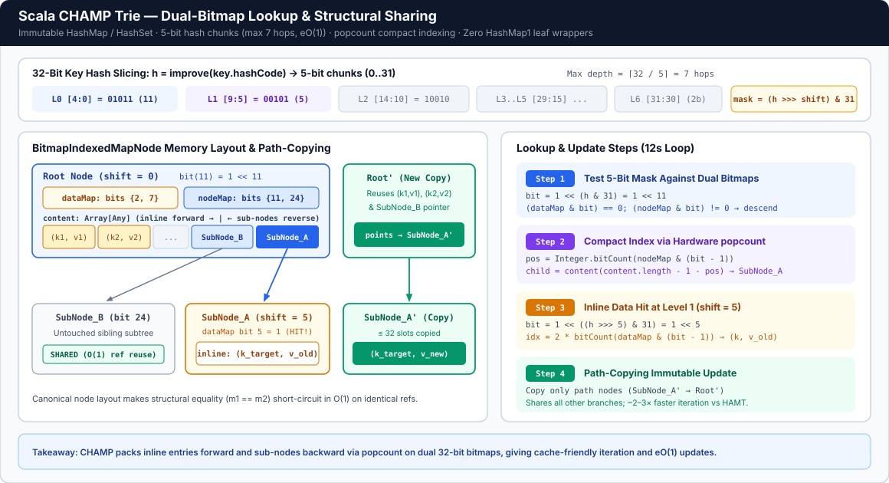
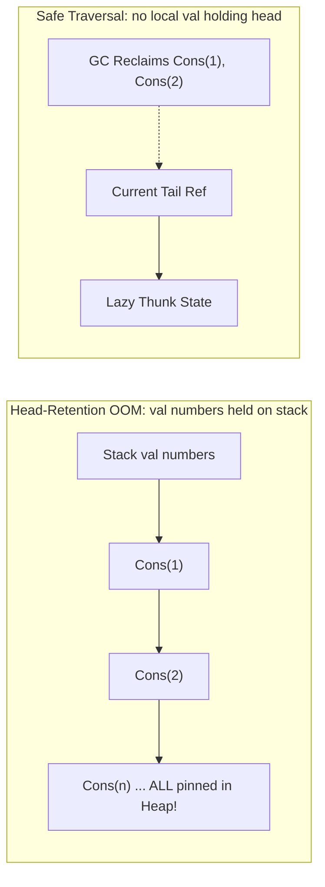

# Module 02 — ADTs, Enums, Pattern Matching, and Collections

Pure functional domain modeling relies on **Algebraic Data Types (ADTs)**—sum and product types closed at compile time—combined with structural pattern matching and persistent data structures. While [FP Module 02](../../../architecture/functional-programming/modules/02-persistent-data-structures-and-structural-sharing.md) establishes the theory of persistent structural sharing, catamorphisms, and amortized queues, [FP Module 03](../../../architecture/functional-programming/modules/03-algebraic-error-handling-and-totality.md) covers algebraic error handling, and [FP Module 04](../../../architecture/functional-programming/modules/04-strictness-laziness-and-corecursion.md) develops laziness and corecursion, this module focuses on **Scala 3.10.1's concrete realizations**: how `enum` ADTs and GADTs desugar to JVM classes, how the pattern matcher compiles exhaustivity checks and zero-allocation extractors, how Scala 2.13/3's `Vector`, `Queue`, `IArray`, and CHAMP `Map`/`Set` work in memory, and how `boundary`/`break` and `LazyList` fix classic Scala 2 traps.

---

## 1. Scala 3 `enum`: Simple Enums, ADTs, and GADTs

Scala 3 unifies enumerations, algebraic sum types, and Generalized Algebraic Data Types (GADTs) under a single `enum` keyword.

### Simple Enumerations and JVM Lowering

A parameterless `enum` defines a finite set of singleton values:

```scala
enum HttpMethod:
  case Get, Post, Put, Delete
```

During `PostTyper` and `Erasure`, the compiler desugars `HttpMethod` into a `sealed abstract class HttpMethod` extending `scala.reflect.Enum` (plus `java.lang.Enum` only if explicitly declared `extends java.lang.Enum[HttpMethod]`), accompanied by:

- A companion `object HttpMethod` exposing `values: Array[HttpMethod]`, `valueOf(name: String): HttpMethod`, and `fromOrdinal(ordinal: Int): HttpMethod`.
- Anonymous singleton instances stored in static fields (`Get`, `Post`, `Put`, `Delete`), each assigned a zero-based `ordinal: Int` (`0, 1, 2, 3`).

When interoperating directly with Java frameworks (Jackson, JDBC `Enum`, or Spring configuration properties), extending `java.lang.Enum` integrates seamlessly while preserving Scala `enum` syntax:

```scala
enum Role extends java.lang.Enum[Role]:
  case Viewer, Editor, Admin

val names: Array[String] = Role.values.map(_.name()) // Uses java.lang.Enum.name()
```

### Parameterized ADTs and GADT Constraint Solving

When cases carry data or type parameters, `enum` expands into a `sealed` hierarchy of `final case class`es and singleton `case` objects:

```scala
enum Expr[+A]:
  case Lit(value: Int) extends Expr[Int]
  case Bool(value: Boolean) extends Expr[Boolean]
  case Add(lhs: Expr[Int], rhs: Expr[Int]) extends Expr[Int]
  case Cond[T](pred: Expr[Boolean], onTrue: Expr[T], onFalse: Expr[T]) extends Expr[T]

def eval[A](expr: Expr[A]): A = expr match
  case Expr.Lit(n)        => n
  case Expr.Bool(b)       => b
  case Expr.Add(l, r)     => eval(l) + eval(r)
  case Expr.Cond(p, t, f) => if eval(p) then eval(t) else eval(f)
```

Notice three crucial compiler mechanics in `Expr` and `eval`:

1. **GADT Type Refinement (`A = Int`)**: `Expr[+A]` is covariant, and cases like `Lit(value: Int) extends Expr[Int]` refine `A` to `Int`. When `eval` scrutinizes `expr: Expr[A]` against `case Expr.Lit(n) => n`, Scala 3's GADT constraint solver introduces a local type equality $A = \text{Int}$ inside that branch, proving `n: A` without any `.asInstanceOf[A]` casts!
2. **Explicit `extends` vs Default Inheritance**: In a normal parameterized ADT such as `enum MyList[+A]: case Empty; case Cons(head: A, tail: MyList[A])`, omitting `extends` causes `Empty` to widen automatically to `extends MyList[Nothing]` (when `+A` is covariant) and `Cons(head: A, tail: MyList[A])` to inherit `[A]` directly. However, if `MyList[A]` were **invariant** (missing `+`), `case Empty` without `extends MyList[Nothing]` would fail or lose subtype polymorphism—forcing explicit type arguments or covariant design.
3. **Static Constructor Type vs Widened ADT Type**: Calling `Expr.Lit(42)` has the precise static type `Expr.Lit` (or `MyList.Cons[Int]`), whereas `MyList.Empty` has type `MyList[Nothing]`. If you pass constructors directly into `foldLeft` or invariant `State` builders where widening helps inference, expose smart constructors on the companion `object` returning the parent ADT type (`def lit(n: Int): Expr[Int] = Expr.Lit(n)`).

### Scala Standard Library Error ADTs: `Option`, `Either`, and `Try`/`NonFatal`

As established in [FP Module 03](../../../architecture/functional-programming/modules/03-algebraic-error-handling-and-totality.md), pure domain functions replace thrown exceptions with `Option[+A]` and right-biased `Either[+E, +A]` (Scala 2.12+ made `Either` right-biased so `.map` and `.flatMap` transform `Right` directly without `.right` projections). At Java/JVM interop boundaries, `scala.util.Try[+A]` catches exceptions using **`scala.util.control.NonFatal`**—catching `RuntimeException` and recoverable `Exception`s while intentionally letting fatal JVM errors (`OutOfMemoryError`, `StackOverflowError`, `VirtualMachineError`, `InterruptedException`, and `ControlThrowable` used by `boundary`/`break`) propagate immediately rather than being swallowed into a `Failure`:

```scala
import scala.util.{Try, Success, Failure}
import scala.util.control.NonFatal

def parsePort(raw: String): Either[String, Int] =
  Try(raw.toInt).toEither.left.map(err => s"Invalid port '$raw': ${err.getMessage}").flatMap: n =>
    if n >= 1 && n <= 65535 then Right(n)
    else Left(s"Port out of range: $n")

def wrapJavaBoundary[A](thunk: => A): Either[Throwable, A] =
  try Right(thunk)
  catch case NonFatal(ex) => Left(ex) // Never swallows OutOfMemoryError or Break!
```

---

## 2. Pattern Matching, Exhaustivity, and Type Erasure Traps

Scala 3 compiles `match` expressions in the `PatternMatcher` phase using an adaptation of Luc Maranget's **decision-tree compilation for pattern matching** (_Compiling Pattern Matching to Good Decision Trees_, ML Workshop 2008). Rather than generating naive nested `if/else` chains for every case, the compiler builds a DAG of `ordinal` switches (`tableswitch` / `lookupswitch` JVM bytecodes for simple enums), type tests, null checks, and field projections—simultaneously proving **exhaustivity** (no valid input misses all cases) and **reachability** (no case is shadowed by an earlier case).

### Unsealed Hierarchies, Guards, and `@unchecked`

Exhaustivity checking can only succeed when the scrutinee's static type is closed:

- **`sealed` traits/classes and `enum`s**: The compiler knows every direct subtype within the same compilation unit and emits a warning (or error under `-Werror`) if any variant is missing.
- **Open classes/traits**: Matching a non-sealed `trait Event` without a wildcard `case _ => ...` silently compiles without exhaustivity coverage—an architectural trap when new subtypes are added later in other files.
- **Pattern guards (`if cond`)**: The compiler treats guarded cases (`case n if n > 0 => ...`) as potentially failing at runtime, so a guarded `case` does not satisfy exhaustivity even if the guards logically partition the domain (e.g., `n > 0` and `n <= 0`).
- **Silencing with `@unchecked`**: Annotating `(xs: @unchecked) match { case h :: _ => h }` suppresses the exhaustivity warning by declaring an unchecked precondition; prefer total types or explicit fallback handling in production code.
- **Verifying `tableswitch` optimization with `@switch`**: On dense `Int`, `Char`, or `enum` ordinal switches, annotating `(method: @switch) match { ... }` asks `scalac` to prove the match compiles to an $O(1)$ JVM `tableswitch` or `lookupswitch` bytecode instruction rather than silently falling back to an $O(n)$ `if/else` chain (which happens whenever a pattern includes a guard, variable extractor, or non-constant value):

```scala
import scala.annotation.switch

def isIdempotent(m: HttpMethod): Boolean = (m: @switch) match
  case HttpMethod.Get | HttpMethod.Put | HttpMethod.Delete => true
  case HttpMethod.Post                                   => false
```

### Erasure Warnings, `ClassTag`, and `TypeTest`

Because JVM bytecode erases generic type parameters ([Module 01](01-scala3-toolchain-tasty-and-jvm-lowering.md)), matching on a parameterized type emits an `unchecked` warning:

```scala
def headIfIntList(x: Matchable): Option[Int] = x match
  case xs: List[Int] => xs.headOption // Compiler warning: the type test for List[Int] cannot be checked at runtime
  case _             => None
```

At runtime, `case xs: List[Int]` only checks `x.isInstanceOf[scala.collection.immutable.List]`! Passing `List("oops")` **matches the `List[Int]` branch** and throws a `ClassCastException` later when `Int` is unboxed!

Scala 3 provides two sound mechanisms to restore type-safe runtime dispatch:

1. **`scala.reflect.ClassTag[T]`**: Captures the erased top-level `Class[?]` at the call site (sufficient for `Array[T]` and non-nested classes `case t: T => ...`, but **still blind** to nested type arguments like `List[Int]`).
2. **`scala.reflect.TypeTest[-S, T]`** (Scala 3's replacement for Scala 2 `Typeable`/manual `ClassTag` hacks): An explicit evidence type class `def unapply(x: S): Option[x.type & T]` whose instances are verified by the compiler:

```scala
import scala.reflect.TypeTest

def matchGeneric[S, T](x: S)(using tt: TypeTest[S, T]): Option[T] = x match
  case t: T => Some(t) // Sound! Compiler invokes tt.unapply(x)
  case _    => None
```

---

## 3. Extractors (`unapply`, `unapplySeq`) and Name-Based Zero-Allocation Matching

Pattern matching is decoupled from constructors via **extractor objects** implementing `unapply` or `unapplySeq`.

### Extractor Signatures in Scala 3

Scala 3 standardizes extractor return shapes (removing some Scala 2 inconsistencies):

| Pattern Kind | Method Signature | Return Semantics | Heap Allocation |
| --- | --- | --- | --- |
| **Boolean test** | `def unapply(x: S): Boolean` | Matches when `true`; binds 0 variables | Zero allocation |
| **Single value** | `def unapply(x: S): Option[T]` (or product wrapper) | Matches on `Some(t)`; binds `t: T` | Allocates `Some` unless name-based |
| **Multi-value tuple** | `def unapply(x: S): Option[(A, B)]` (or custom `Product`) | Matches on `Some((a, b))` | Allocates `Some` + `Tuple2` unless name-based |
| **Irrefutable product** | `def unapply(x: S): Some[(A, B)]` or `P <: Product` | Always matches! Compiler treats pattern as total | Zero `Option` allocation if `P` is a non-`Option` wrapper |
| **Variadic sequence** | `def unapplySeq(x: S): Option[Seq[T]]` (or `Seq[T]` irrefutable) | Supports `case Split(first, rest*) =>` | Sequence wrapper |

### Zero-Allocation Name-Based Extractors

In hot parsing or AST-traversal loops, allocating `Some((a, b))` on every `unapply` call creates young-generation GC churn. Scala 3 supports **name-based extractors**: any type exposing `def isEmpty: Boolean` and `def get: R` (where `R` itself either is a single value or exposes `_1`, `_2`, ... product members—especially a `final class ... extends AnyVal` or `Product`) satisfies `unapply` without wrapping in `scala.Some`:

```scala
final class ParsedPair(val packed: Long) extends AnyVal:
  def isEmpty: Boolean = packed < 0L
  def get: ParsedPair = this
  def _1: Int = (packed >>> 32).toInt
  def _2: Int = (packed & 0xffffffffL).toInt

object BitPair:
  def unapply(packed: Long): ParsedPair = new ParsedPair(packed)

def sumIfValid(packed: Long): Int = packed match
  case BitPair(hi, lo) => hi + lo
  case _               => 0
```

Because `ParsedPair` extends `AnyVal` and `unapply` returns `ParsedPair` directly, `BitPair.unapply` lowers to primitive `long` operations with **zero heap allocations**.

### Variadic Sequence Extractors (`unapplySeq`) and `*` Splice Syntax

When matching variable-length structures (URI segments, command tokens, CSV rows), `unapplySeq` pairs with Scala 3's unified `*` vararg splice syntax (replacing Scala 2's `: _*` in expressions and `@ _*` in patterns):

```scala
object PathSegments:
  def unapplySeq(path: String): Option[Seq[String]] =
    val parts = path.split('/').filter(_.nonEmpty).toSeq
    if parts.isEmpty then None else Some(parts)

def route(path: String): String = path match
  case PathSegments("api", "v1", resource, rest*) =>
    s"v1 resource=$resource subpaths=${rest.mkString("/")}"
  case _ => "404"

// Expression vararg splice (Then: xs: _* -> Now: xs*)
def formatParts(parts: Seq[String]): String =
  String.format("%s/%s", parts*)
```

### Irrefutable Patterns and Refutable `for`-Comprehension Filtering

In Scala 2, writing `for ((k, Some(v)) <- pairs) yield (k, v)` silently called `.withFilter(...)` to discard `None` entries—a subtle surprise when a developer assumed a pattern was irrefutable and wondered why elements vanished. In **Scala 3**, refutable patterns in `for` generators or `val` definitions are stricter:

- Writing `for (k, Some(v)) <- pairs` emits a warning/error unless prefixed with `case`: **`for case (k, Some(v)) <- pairs yield (k, v)`** makes filtering explicit.
- Writing `val Some(x) = opt` is a compile-time refutability warning (and throws `MatchError` at runtime on `None`); only provably irrefutable extractors (`case class` with no subtype ambiguity, tuple destructuring `val (a, b) = pair`) bind unconditionally.

---

## 4. Scala 2.13 / 3 Immutable Collection Internals

Scala's `scala.collection.immutable` package was completely re-engineered in Scala 2.13 (and carried directly into Scala 3) to maximize cache locality, minimize allocations, and separate lazy views from strict spines.



### Concrete Memory Layout and Complexity Guarantees

| Collection | Underlying Data Structure | Lookup / Head | Prepend / Append | Structural Sharing & Cache Profile |
| --- | --- | --- | --- | --- |
| `List[+A]` | Singly-linked `::(head, tail)` + `Nil` | `head`: $O(1)$ / `apply(i)`: $O(n)$ | Prepend `::`: $O(1)$ / Append `:+`: $O(n)$ | Classic cons-cell sharing ([FP Module 02](../../../architecture/functional-programming/modules/02-persistent-data-structures-and-structural-sharing.md)); pointer-chasing across heap |
| `Vector[+A]` | Variable-depth 32-way radix array trie (`Vector0`..`Vector6`) | `apply(i)`: $eO(1)$ ($\le 6$ array hops) | Both `+:`, `:+`, `updated`: $eO(1)$ | Arrays of width 32 fit 1–2 CPU cache lines; vectors $\le 32$ use flat `Vector1` with zero trie overhead |
| `Queue[+A]` | Okasaki two-list functional queue (`in: List[A]`, `out: List[A]`) | `head`: $O(1)$ | `enqueue`: $O(1)$ / `dequeue`: $O(1)$ amortized | Reverses `in` into `out` when `out` empties; degrades under branching persistence (see FP Module 02) |
| `LazyList[+A]` | Memoized lazy cons cells (`State.Empty \| State.Cons`) | `head`: $O(1)$ after 1st force | `#::`: $O(1)$ lazy thunk | Both head and tail are deferred; see Section 6 for head-retention trap |
| `HashMap[K, +V]` / `HashSet[A]` | **CHAMP** (Compressed Hash-Array Mapped Prefix-tree) | `get`: $eO(1)$ ($\le \lceil 32/5 \rceil = 7$ hops) | `+` / `-`: $eO(1)$ | Inline primitive keys/values in flat `Array[Any]` data/node partitions; ~2–3x faster iteration than Scala 2.12 HAMT |
| `TreeMap` / `TreeSet` | Immutable Red-Black balanced BST | $O(\log n)$ | $O(\log n)$ | Deterministic sorted iteration via `Ordering[K]` |
| `ArraySeq[+A]` / `IArray[+T]` | Immutable array wrapper (`ArraySeq`) / `opaque type IArray` | `apply(i)`: $O(1)$ true constant | Copy-on-update $O(n)$ | `IArray[Int]` lowers directly to unboxed JVM `int[]` with zero wrapper allocation |

Notice how `Vector`'s 32-way branching factor keeps random-access depth tiny even at production scale:

| `Vector` Element Count | Radix Trie Class | Array Hops (`apply(i)`) | Structural Copy per `updated` |
| --- | --- | --- | --- |
| $0$ | `Vector0` | $0$ | $O(1)$ singleton |
| $1 \dots 32$ | `Vector1` | $1$ (flat `Array[AnyRef]`) | $\le 32$ references copied |
| $33 \dots 1{,}024$ ($32^2$) | `Vector2` | $2$ | $\le 64$ references copied |
| $1{,}025 \dots 32{,}768$ ($32^3$) | `Vector3` | $3$ | $\le 96$ references copied |
| $32{,}769 \dots 1{,}048{,}576$ ($32^4$) | `Vector4` | $4$ | $\le 128$ references copied |

### Why `Set[A]` and `Map[K, +V]` Keys Are Invariant (and `List(i)` Pitfalls)

Two collection traps catch newcomers in production:

1. **Why `Set[A]` is invariant (`Set[Int]` is NOT a subtype of `Set[Any]`)**: Scala's `immutable.Set[A]` extends `A => Boolean` (`Function1[A, Boolean]`) so a set doubles as a membership predicate (`if allowedIds(id)`). Because `A` sits in **contravariant parameter position** of `Function1` while also appearing in covariant read methods (`head: A`), `A` must be **invariant** ([Module 03](03-type-system-variance-and-type-inference.md)). The exact same rule forces `Map[K, +V]` (extending `PartialFunction[K, V]`) to keep keys `K` invariant while values `+V` are covariant.
2. **Accidental $O(n^2)$ indexing on `List`**: Because `List` implements `LinearSeq`, calling `xs(i)` or `xs.length` walks `i` pointers from the head—turning a naive `for i <- xs.indices do process(xs(i))` loop into $\Theta(n^2)$ work! Use `Vector` or `ArraySeq`/`IArray` whenever random indexing or rear appends (`:+`) are needed, or iterate `List` sequentially with pattern matching, `foreach`, or `foldLeft`.

### Why CHAMP Replaced Legacy HAMT in `HashMap` and `HashSet`

Prior to Scala 2.13, `immutable.HashMap` used a standard **Hash Array Mapped Trie (HAMT)** that allocated individual `HashMap1` leaf objects at every terminal slot and stored mixed nodes and values in a single array. Scala 2.13/3 adopts Michael Steindorfer and Jurgen Vinju's **CHAMP** (_Optimizing Hash-Array Mapped Tries for Fast and Lean Immutable JVM Collections_, OOPSLA 2015):

- Every internal `BitmapIndexedMapNode` maintains **two 32-bit bitmaps**: `dataMap` (for inline key-value pairs stored directly at the front of the `content: Array[Any]`) and `nodeMap` (for child sub-nodes stored in reverse order at the back of `content`).
- By packing inline entries contiguously without allocating `HashMap1` leaf wrappers, CHAMP cuts heap footprint dramatically, keeps sequential iteration cache-friendly (scanning contiguous array slices), and eliminates canonical-shape ambiguities so structural equality (`map1 == map2`) can short-circuit in $O(1)$ when sub-tree references are identical!



_Step-by-step mechanics:_ Each 5-bit slice of the 32-bit hash indexes dual `dataMap` and `nodeMap` bitmaps using hardware `popcount` (`Integer.bitCount`) into a single flat `content: Array[Any]`, while immutable updates path-copy only nodes along the modified root-to-leaf path and share untouched sibling subtrees.

### `View` Fusion, `Factory` / `BuildFrom`, and `LazyList.unfold`

As discussed in [FP Module 02](../../../architecture/functional-programming/modules/02-persistent-data-structures-and-structural-sharing.md), chaining `xs.map(f).filter(p).map(g)` on a strict `List` or `Vector` allocates up to $3n$ intermediate elements across three passes. Calling `.view` produces a `scala.collection.View[A]`—a lightweight non-memoized iterator pipeline that fuses `map`, `filter`, and `take` into a single traversal realized only at the terminal `.to(Vector)` (powered by Scala 2.13/3's `scala.collection.Factory[-Elem, +To]`, which cleanly replaced Scala 2.12's complex `CanBuildFrom` machinery):

```scala
val result: Vector[String] =
  (1 to 1_000_000).view
    .filter(_ % 2 == 0)
    .map(_ * 3)
    .take(5)
    .map(_.toString)
    .to(Vector) // Processes only 10 elements; allocates zero intermediate collections
```

Unlike `LazyList`, a `View` **does not memoize** elements; iterating a `View` twice recomputes every transformation from scratch. Conversely, when building corecursive streams ([FP Module 04](../../../architecture/functional-programming/modules/04-strictness-laziness-and-corecursion.md)), `LazyList.unfold` generates infinite lazy sequences cleanly from a state seed:

```scala
val fibs: LazyList[BigInt] =
  LazyList.unfold((BigInt(0), BigInt(1))): (a, b) =>
    Some((a, (b, a + b)))
```

When writing generic collection utilities that preserve the caller's collection type (`List`, `Vector`, `Set`) without Scala 2's infamous `CanBuildFrom` implicit-resolution errors, accept **`scala.collection.Factory[B, CC[B]]`** or **`scala.collection.BuildFrom[C, B, R]`**:

```scala
import scala.collection.BuildFrom

def mapNonEmpty[A, B, C[X] <: Iterable[X]](xs: C[A])(f: A => B)(using
    bf: BuildFrom[C[A], B, C[B]]
): Option[C[B]] =
  if xs.isEmpty then None
  else Some(bf.fromSpecific(xs)(xs.iterator.map(f)))

val vecRes: Option[Vector[Int]] = mapNonEmpty(Vector(1, 2, 3))(_ * 10) // Some(Vector(10, 20, 30))
val setRes: Option[Set[String]] = mapNonEmpty(Set(1, 2))(_.toString)  // Some(Set("1", "2"))
```

Compare Scala 2's `CanBuildFrom` vs Scala 2.13/3's `Factory` and `BuildFrom`: `Factory[-A, +C]` builds a new collection `C` from scratch (`xs.view.map(...).to(Vector)`), while `BuildFrom[-From, -A, +C]` preserves source constraints such as `SortedSet`'s `Ordering` or `Map`'s key-value pairs cleanly with minimal implicit-search overhead.

---

## 5. Typed Non-Local Control Flow: `boundary` and `break`

In Scala 2, exiting early from nested loops or recursive helper functions inside a pure outer computation often relied on `return` inside closures (compiling to a slow `NonLocalReturnControl` exception) or `scala.util.control.Breaks` (untyped `Unit` breaks). Scala 3 deprecates non-local `return` inside anonymous functions and introduces **`scala.util.boundary`** and **`boundary.break`**:

```scala
import scala.util.boundary, boundary.break

def firstDuplicate(xs: List[Int]): Option[Int] = boundary:
  val seen = scala.collection.mutable.HashSet.empty[Int]
  for x <- xs do
    if !seen.add(x) then break(Some(x))
  None
```

How `boundary` works under the hood:

1. `boundary` supplies a contextual capability **`using Label[T]`** (`boundary.Label`) scoped strictly to the block. `break(value)` requires a `given Label[T]` in scope, making early exit **type-checked**: you cannot `break("oops")` out of a `boundary[Option[Int]]`, nor leak the `Label` safely across asynchronous thread boundaries.
2. When `break(value)` sits in direct local control flow inside the same method, the Scala 3 optimizer lowers it to a direct local jump (zero exception overhead); when invoked across helper calls or closures, it throws a pre-allocated / stack-trace-less `Break[T]` control `Throwable` (`fillInStackTrace` overridden as a no-op) caught immediately by the enclosing `boundary` frame.

---

## 6. Then vs now: `sealed trait` to `enum` & `Stream` to `LazyList`

| Area | Then (Scala 2.10–2.12) | Now (Scala 3.10.1 / 2.13+ Lib) | Why It Changed |
| --- | --- | --- | --- |
| ADT sum types | `sealed trait` + `case class` + `case object` | `enum` with `case` variants | Eliminates boilerplate `extends` and scopes constructors inside companion |
| Lazy sequences | `Stream` (strict head, lazy tail) | `LazyList` (lazy head & tail) | Fixes eager-head evaluation and infinite-producer initialization leaks |
| Collection builders | `CanBuildFrom[From, Elem, To]` | `Factory[Elem, To]` / `BuildFrom` | Simpler variance, faster implicit resolution, cleaner `.to(Vector)` |
| Vararg splices | `foo(xs: _*)` and `case List(h, t @ _*)` | `foo(xs*)` and `case List(h, t*)` | Consistent `*` syntax across declarations, calls, and pattern matches |
| Non-local exits | Closure `return` (`NonLocalReturnControl`) | `boundary` / `boundary.break` | Statically typed `Label[T]`, direct local jumps, no leaked return control |

### Then vs now: `sealed trait` + `case object` vs `enum`

```scala
// THEN (Scala 2 / 2015 FP in Scala)
sealed trait Tree[+A]
case class Leaf[+A](value: A) extends Tree[A]
case class Branch[+A](left: Tree[A], right: Tree[A]) extends Tree[A]

// NOW (Scala 3.10.1)
enum Tree[+A]:
  case Leaf(value: A)
  case Branch(left: Tree[A], right: Tree[A])
```

Beyond eliminating boilerplate `extends Tree[A]` clauses, Scala 3 `enum` automatically scopes constructors inside the `Tree` namespace (`Tree.Leaf`, `Tree.Branch`) instead of polluting the enclosing package namespace—solving naming collisions when multiple ADTs share `Empty`, `Leaf`, or `Failure` cases.

### Then vs now: Scala 2 `Stream` Memory Leak vs Scala 3 `LazyList`

In Scala 2.0–2.12, `scala.collection.immutable.Stream` suffered from a notorious design flaw: **its `head` was strict, and only its `tail` was lazy**. Constructing `Stream.from(0)` forced element `0` immediately, and transforming a `Stream` frequently forced one element ahead of demand—breaking true laziness on side-effecting or unbounded producers (see [FP Module 04](../../../architecture/functional-programming/modules/04-strictness-laziness-and-corecursion.md)).

Scala 2.13 deprecated `Stream` and replaced it with **`LazyList`**, where **both `head` and `tail` are lazy** (stored inside a lazy `State` thunk). Even `LazyList.empty` vs `cons` is deferred until inspected.

**Critical Production Counterexample — Head Retention `OutOfMemoryError`:**

Making both head and tail lazy fixes premature head evaluation, **but `LazyList` is still a memoized persistent data structure**. Every evaluated `Cons` node caches its `head` and `tail` in memory so revisiting the list does not recompute elements. If a caller holds a `val` reference to the head of a large `LazyList` while traversing to the end, the GC cannot collect any visited prefix node:



```scala
// DANGER: Retaining `val numbers` keeps the entire evaluated prefix pinned on the JVM heap!
def sumRetainingHead(n: Int): Long =
  val numbers: LazyList[Int] = LazyList.from(1).take(n)
  numbers.foldLeft(0L)(_ + _) // `numbers` stays live in the stack frame until foldLeft returns -> O(n) heap!

// SAFE: Do not bind the head to a local `val` across the traversal (or use Iterator / View / FS2 Stream)
def sumStreaming(n: Int): Long =
  LazyList.from(1).take(n).foldLeft(0L)(_ + _) // Head becomes unreachable after each step -> O(1) heap
```

In `sumRetainingHead`, the local JVM register holding `numbers` remains a live GC root for the duration of `foldLeft`, pinning all $n$ memoized `LazyList` nodes on the heap until `OutOfMemoryError` occurs for large $n$. In `sumStreaming`, no local variable points to the original head once `foldLeft` advances to `tail`, allowing young-generation GC to reclaim consumed cells in $O(1)$ space. For production streaming over millions of records or I/O effects, prefer `Iterator`, `View`, or FS2 `Stream`.

---

## Interview Drill

### 1. How does a Scala 3 `enum` with parameterized ADT cases lower to JVM bytecode?

<details><summary>Answer</summary>

The compiler lowers the `enum` declaration to a `sealed abstract class` extending `scala.reflect.Enum` with an `ordinal: Int` method. Parameterless cases lower to singleton `case` objects (static fields on the companion), while parameterized cases lower to `final case class`es inside the `enum`'s companion object. For simple parameterless enums, the companion also receives `values`, `valueOf`, and `fromOrdinal` lookup methods.
</details>

### 2. Why is `case xs: List[Int]` in a `match` expression unsound at runtime, and how does Scala 3's `TypeTest` fix it?

<details><summary>Answer</summary>

JVM type erasure strips `Int` from `List[Int]`, leaving only the raw `List` class descriptor. Consequently, `case xs: List[Int]` matches a `List[String]` at runtime and throws a `ClassCastException` only later when an element is unboxed as `Int`. `scala.reflect.TypeTest[S, T]` provides an explicit compiler-verified evidence object whose `unapply` validates the full type relationship (or restricts matching to provably checkable types), eliminating silent erasure holes.
</details>

### 3. How does a name-based extractor avoid heap allocation during pattern matching?

<details><summary>Answer</summary>

Instead of returning `Option[T]` or `Some[(A, B)]` from `unapply`—which allocates an `Option` wrapper and often a `Tuple` on every match—a name-based extractor returns a custom value type (such as an `AnyVal` wrapping a packed primitive `Long`) that implements `isEmpty: Boolean`, `get: R`, and product accessors `_1`, `_2`, etc. The compiler desugars the pattern check into direct calls to `isEmpty` and `_1`/`_2` without allocating `Some` or tuples on the JVM heap.
</details>

### 4. Why did Scala 2.13 replace `HashMap`'s classic HAMT with CHAMP, and what changed in memory layout?

<details><summary>Answer</summary>

Classic HAMT allocated separate leaf wrapper objects (`HashMap1`) and mixed child node pointers with leaf objects in a single array. CHAMP uses two separate 32-bit bitmaps (`dataMap` and `nodeMap`) inside each internal node so inline key-value entries sit contiguously at the front of one flat `Array[Any]` while child node pointers sit at the back. This eliminates per-entry leaf wrapper allocations, boosts CPU cache locality during iteration, and enables $O(1)$ reference-equality sub-tree short-circuiting.
</details>

### 5. What is the critical semantic difference between Scala 2's `Stream` and Scala 3's `LazyList`, and what memory leak can `LazyList` still cause?

<details><summary>Answer</summary>

Scala 2 `Stream` evaluated its `head` strictly on construction and only deferred its `tail`, causing premature evaluation and leaks on infinite producers. Scala 2.13/3 `LazyList` is fully lazy in both `head` and `tail`. However, because `LazyList` memoizes every evaluated cell, holding a local `val` reference to the head of a `LazyList` while traversing it pins every visited cell as reachable from that GC root, causing $O(n)$ heap retention and eventual `OutOfMemoryError`.
</details>

### 6. How does Scala 3's `boundary` / `break` improve over Scala 2's non-local `return` inside closures?

<details><summary>Answer</summary>

Non-local `return` inside a closure compiled to `NonLocalReturnControl` exceptions with no static boundary type safety and is deprecated in Scala 3. `boundary` introduces a scoped contextual `Label[T]` capability so `break(v)` is statically type-checked against `T`, lowers to a direct jump when local, and otherwise uses a stack-trace-less control `Throwable` scoped strictly to the matching `boundary`.
</details>

### 7. Why does `for (k, Some(v)) <- map yield v` produce a warning or error in Scala 3?

<details><summary>Answer</summary>

In Scala 3, `Some(v)` is a refutable pattern (it fails on `None`). Scala 3 requires refutable pattern bindings in `for`-comprehension generators to be marked explicitly with `case` (`for case (k, Some(v)) <- map yield v`) so callers never rely on accidental silent `.withFilter` filtering without realizing items may be dropped.
</details>

### 8. Why is `immutable.Set[A]` invariant in `A` whereas `immutable.List[+A]` is covariant?

<details><summary>Answer</summary>

In Scala's standard library, `Set[A]` extends `A => Boolean` (`Function1[A, Boolean]`) so a set can act as a membership predicate. Because `A` sits in contravariant input position of `apply(elem: A): Boolean` while also appearing in covariant output positions (`head: A`), `A` cannot be covariant (`+A`) without violating type soundness, forcing `Set[A]` (and the key parameter `K` of `Map[K, +V]`) to be invariant.
</details>
