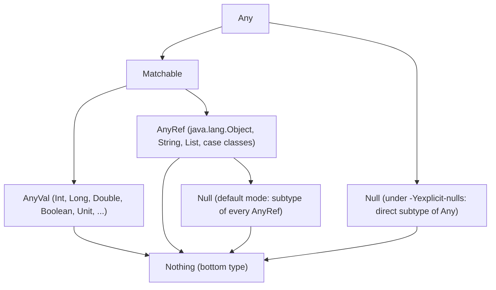
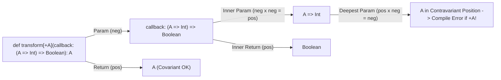

# Module 03 — Type System, Variance, and Type Inference

Scala 3 anchors its static type system in the **Dependent Object Types (DOT)** calculus (Amin, Grütter, Odersky, Rompf, and Stucki, _The Essence of Dependent Object Types_, 2016), unifying subtyping, parametric polymorphism, path-dependent abstract types, and algebraic union/intersection types into a sound lattice. This module examines Scala 3.10.1's unified type hierarchy, `Matchable` and `CanEqual` safety boundaries, declaration-site variance and negative compiler rejections, generalized type constraints (`<:<` and `=:=`), why general type projections `T#U` were dropped for DOT soundness, union/intersection types with `-Yexplicit-nulls`, and local bidirectional type inference with automatic eta-expansion.

---

## 1. The Unified Type Lattice, `Matchable`, and `CanEqual`

Every value in Scala—whether lowered to a JVM primitive `int` or a heap `Object`—inhabits a single subtyping lattice rooted at `Any` and bottomed at `Nothing`.



### Why Scala 3 Introduced `Matchable`

In Scala 2, every type implicitly allowed `.isInstanceOf`, `.asInstanceOf`, and pattern matching (`x match { case s: String => ... }`) directly on `Any` or an unconstrained type parameter `A`. That broke **parametricity** ([FP Module 01](../../../architecture/functional-programming/modules/01-referential-transparency-and-lambda-calculus.md)): a function `def id[A](a: A): A` could inspect `a`'s runtime tag and behave differently for `Int` vs `String`, violating Wadler's free theorems and leaking representation details across `opaque type` boundaries!

Scala 3 inserts `trait Matchable extends Any` between `Any` and both `AnyVal` and `AnyRef`:

- **Universal type parameters (`A`, implicitly bounded by `A <: Any`)**: Values of an unbounded type `A` are **not** guaranteed to be `Matchable`. Pattern matching on `a: A` emits a compile-time warning (and error under `-source:future`) instructing you to widen the bound to `A <: Matchable` if runtime tag inspection is genuinely intended.
- **Preserving `opaque type` encapsulation**: Because an `opaque type UserId = Long` does _not_ expose `Long <: Matchable` outside its defining scope, `UserId` is only a subtype of `Any` externally—preventing callers from pattern-matching on `Long` to pierce the opaque abstraction!

```scala
// Emits warning under default Scala 3.10.1 and fails under -source:future:
// def badInspect[A](a: A): String = a match { case s: String => s; case _ => "other" }

// Explicit Matchable bound documents loss of parametricity intentionally:
def inspect[A <: Matchable](a: A): String = a match
  case s: String => s"str:$s"
  case n: Int    => s"int:$n"
  case _         => "other"
```

### Universal Equality Pitfalls vs `CanEqual` (Multiversal Equality)

Because `Any` defines `def ==(that: Any): Boolean`, Scala inherits Java's universal equality hazard: comparing completely unrelated types such as `1 == "1"` or `Option(1) == Some(1)` vs `List(1) == Vector(1)` vs `Option(42) == 42` compiles silently and returns `false` at runtime. Refactoring a field from `UserId` to `String` leaves stale `user.id == "abc"` checks compiling with zero warnings while silently failing every conditional branch in production.

Scala 3 introduces **multiversal equality** via the `scala.CanEqual[-L, -R]` type class, activated by `import scala.language.strictEquality` (or compiler flag `-language:strictEquality`):

```scala
import scala.language.strictEquality
import scala.compiletime.testing.{typeChecks, typeCheckErrors}

final case class UserId(value: Long) derives CanEqual
final case class OrderId(value: Long) derives CanEqual

val u = UserId(1L)
val o = OrderId(1L)

val sameCompiles = u == UserId(1L) // Compiles: derives CanEqual generates given CanEqual[UserId, UserId]
val crossAllowed = typeChecks("""
  import scala.language.strictEquality
  final case class AId(v: Long) derives CanEqual
  final case class BId(v: Long) derives CanEqual
  AId(1L) == BId(1L)
""") // false: "Values of types AId and BId cannot be compared with == or !="
```

When `strictEquality` is enabled, `x == y` compiles if and only if a contextual `CanEqual[X, Y]` instance exists (built in for primitive numeric promotions, `String`, `Seq`/`Set` cross-comparisons, etc., or derived via `derives CanEqual`). Unlike Scala 2's ad-hoc `===` Cats operator, `CanEqual` guards standard `==`, `!=`, and `match` literal patterns without changing runtime performance.

---

## 2. Declaration-Site Variance, Polarity, and Negative Compiler Rejections

Type constructors `F[A]` describe subtyping relationships between container types when their element types are related by subtyping ($A <: B$):

| Annotation | Formal Definition | Subtyping Intuition | Canonical Scala Examples |
| --- | --- | --- | --- |
| **Covariant (`+A`)** | $A <: B \implies F[A] <: F[B]$ | Producer / read-only container of `A` | `List[+A]`, `Option[+A]`, `Vector[+A]`, `LazyList[+A]` |
| **Contravariant (`-A`)** | $A <: B \implies F[B] <: F[A]$ | Consumer / sink / predicate accepting `A` | `Function1[-T, +R]`, `Ordering[-A]`, `CanEqual[-L, -R]` |
| **Invariant (`A`)** | $F[A] <: F[B] \iff A = B$ | Both reads and writes `A` (mutable cells, `Set`, `Array`) | `Array[T]`, `scala.collection.mutable.Buffer[A]`, `Set[A]` |

### Polarity Flipping across Higher-Order Function Arrows

Every method `def f(x: P): R` places its **parameter type `P` in contravariant (negative) position** and its **return type `R` in covariant (positive) position**. Each nested function arrow reverses polarity again, following standard sign multiplication ($+ \times - = -$, $- \times - = +$):



In `(A => Int) => Boolean`:

- The outer `callback` parameter sits in negative (`-`) position.
- Its own parameter `(A => Int)` flips twice ($- \times - = +$, positive).
- Inside `A => Int`, the parameter `A` flips once more ($+ \times - = -$, **negative/contravariant**). Consequently, declaring `def accept(f: (A => Int) => Boolean)` on `class Box[+A]` is rejected at compile time: if `Box[Cat]` were widened to `Box[Animal]`, a caller could supply a callback expecting an `Animal => Int` handler while `Box[Cat]` only holds a `Cat => Int` capability.

If Scala allowed a covariant container `Box[+A]` to accept `A` in a method parameter—`def put(a: A): Unit`—Liskov substitutability would immediately break JVM type safety:

```scala
// Suppose Scala allowed covariant input parameters (it does NOT):
// class Box[+A](var value: A)
// val cats: Box[Cat] = Box(Cat("Milo"))
// val animals: Box[Animal] = cats // Valid if Box is covariant
// animals.put(Dog("Rex"))         // Writes a Dog into a Box[Cat]!
// val c: Cat = cats.value         // ClassCastException: Dog cannot be cast to Cat!
```

Scala's variance checker rejects this at compile time. Using `scala.compiletime.testing`, we can assert the exact compiler rejection in automated negative tests:

```scala
import scala.compiletime.testing.{typeChecks, typeCheckErrors}

val valid = typeChecks("class Box[+A] { def put(a: A): Unit = () }") // false
val errors = typeCheckErrors("class Box[+A] { def put(a: A): Unit = () }").map(_.message)
// List("covariant type A occurs in contravariant position in type A of parameter a")
```

Similarly, a `var` field in a `class` generates both a getter `def field: A` (covariant position) and a setter `def field_=(x: A): Unit` (contravariant position), forcing any class containing a public `var` of type `A` to be invariant in `A`.

### Lower-Bound Widening (`[B >: A]`) and Variance Escape Hatches

Persistent functional data structures ([FP Module 02](../../../architecture/functional-programming/modules/02-persistent-data-structures-and-structural-sharing.md)) are covariant (`List[+A]`, `Option[+A]`) so `Nil: List[Nothing]` and `None: Option[Nothing]` serve as universal empty values. To still permit prepending a supertype or supplying a default value without sacrificing covariance, methods introduce a **lower type bound** `B >: A`:

```scala
sealed trait MyOption[+A]:
  def getOrElse[B >: A](default: => B): B = this match
    case MySome(a) => a
    case MyNone    => default

case class MySome[+A](value: A) extends MyOption[A]
case object MyNone extends MyOption[Nothing]
```

Here, `B` is an independent method type parameter bounded below by `A`. Because `B` does not carry `+` variance on the class, `default: => B` sits cleanly in contravariant parameter position. Calling `MySome(Cat("Milo")).getOrElse(Dog("Rex"))` widens `B` to the least upper bound `Animal` (or `Pet`), preserving type safety with zero mutation.

Two additional variance rules distinguish Scala 3 from Scala 2:

1. **Removal of `private[this]`**: Scala 2 used `private[this] var cache` to exempt instance-private fields from variance checking. Scala 3 removes `private[this]` as a visibility modifier and automatically infers whether a `private` member escapes `this`; when an immutable wrapper stores an internal mutable/covariant array safely (such as `IArray` or `Vector` internals), the implementation uses `@scala.annotation.unchecked.uncheckedVariance`.
2. **Higher-Kinded Variance (`F[_]` vs `F[+_]`)**: Writing `trait Functor[F[_]]` accepts any unary type constructor (`List`, `Option`, `Id`, `Set`-like invariant wrappers), whereas `trait Co[F[+_]]` restricts `F` exclusively to covariant type constructors.

### F-Bounded Polymorphism vs Type Classes

Object-oriented Scala 2 codebases frequently used **F-bounded polymorphism** (`trait Entity[A <: Entity[A]]`) to make a method on a base trait return the concrete subtype `A` (`def copyWithId(id: Long): A`). While F-bounded polymorphism works for closed single-class models, it breaks down as soon as you mix unrelated `Entity` subtypes into a heterogeneous `List` (there is no clean `Entity[?]` common behavior without existential friction) or retroactively add operations to third-party types like `String` or `Instant`. Type classes ([Module 04](04-contextual-abstractions-given-using-and-typeclasses.md)) decouple the algebra from inheritance completely:

```scala
// F-bounded polymorphism: couples data model to interface hierarchy
trait Identifiable[A <: Identifiable[A]]:
  def id: Long
  def withId(newId: Long): A

final case class Account(id: Long, balance: BigDecimal) extends Identifiable[Account]:
  def withId(newId: Long): Account = copy(id = newId)

// Idiomatic Scala 3 alternative: plain immutable data + type class or extension
final case class Customer(id: Long, email: String)
```

---

## 3. Generalized Type Constraints (`<:<` and `=:=`)

Sometimes a method on a generic class `Box[A]` only makes sense when `A` satisfies an additional relationship—such as `Option[Option[Int]].flatten` requiring `A` to be an `Option[B]`, or `List[(K, V)].toMap` requiring `A` to be a pair `(K, V)`. Imposing `A <: Option[B]` on the class itself would reject `Box[Int]` everywhere!

Instead, Scala encodes **subtyping evidence** and **type-equality evidence** as first-class types in `scala.Predef`:

- **`A <:< B`** (`sealed abstract class <:<[-From, +To]`): Evidence that `A` is a subtype of `B`, providing `apply(a: A): B` and zero-cast `substituteCo[F[_]](fa: F[A]): F[B]`.
- **`A =:= B`** (`sealed abstract class =:=[From, To] <: (From <:< To)`): Evidence that `A` and `B` are identical types, supporting bidirectional substitution `substituteCo` and `flip`.

```scala
final case class Box[+A](value: A):
  def flatten[B](using ev: A <:< Box[B]): Box[B] = ev(value)
  def doubled(using ev: A =:= Int): Int = ev(value) * 2

val nested = Box(Box("hello")).flatten // Box("hello")
val ints   = Box(21).doubled           // 42
// Box("hello").doubled                // Compile error: Cannot prove that String =:= Int
```

Notice why `Box[String]` still compiles cleanly: `<:<` and `=:=` are checked **per method invocation** via contextual `given` synthesis (`<:<.refl[T]` and `=:=.refl[T]`), not on the class definition. Moreover, because `ev(value)` lowers to an identity method returning `this` (`x => x`), generalized type constraints execute with zero allocation after JIT inlining!

---

## 4. Path-Dependent Types and the DOT Soundness Fix for `T#U`

Scala allows classes and traits to declare **abstract type members** (`type Elem`) alongside value members. When an object `val a: Container` defines `type Elem`, the type `a.Elem` is a **path-dependent type** tied to the stable identifier `a`:

```scala
trait Key:
  type Value

final class StringKey extends Key:
  type Value = String

final class IntKey extends Key:
  type Value = Int

final class TypedStore(private val backing: Map[Key, Any] = Map.empty):
  def put(k: Key)(v: k.Value): TypedStore = TypedStore(backing.updated(k, v))
  def get(k: Key): Option[k.Value] = backing.get(k).asInstanceOf[Option[k.Value]]
```

Calling `store.put(strKey)("alice")` and `store.get(intKey)` guarantees at compile time that `strKey` only accepts/returns `String` and `intKey` only accepts/returns `Int`. Two distinct instances `val k1: Key`, `val k2: Key` produce distinct path-dependent types `k1.Value` and `k2.Value` that the compiler refuses to mix.

### Why General Type Projections (`T#U`) Were Dropped in Scala 3

In Scala 2, developers could also project a type member off an **uninhabited or abstract type** using `#`: `def foo[T <: Container](x: T#Elem)`. In 2016, Amin et al. proved while formalizing the **DOT calculus** that unrestricted general type projections render Scala 2's type system **unsound** (allowing a program to coerce `String` into `Int` without casts and crash with `ClassCastException` at runtime!).

The unsoundness mechanism worked as follows:

1. Define a trait with contradictory bounds on a type member: `trait Bad { type L >: String <: Int }`. Note that no class can ever instantiate `Bad` because `String` is not a subtype of `Int`.
2. In Scala 2, `Bad#L` could be projected **without an instance of `Bad`**.
3. By transitivity inside `Bad#L`, the type checker could deduce `String <: Bad#L <: Int`, allowing `def coerce(s: String): Int = s` to pass typechecking even though `Bad` is uninhabited!

**Scala 3's DOT Solution**: General type projections `T#U` are **forbidden** when `T` is an abstract type, type parameter, or intersection/union containing abstract types:

```scala
val projCompiles = typeChecks("""
  trait Box { type Elem }
  def bad[T <: Box](x: T#Elem): Unit = ()
""") // false: "T is not a legal prefix for a type projection"
```

You may write `C#U` **only when `C` is a concrete class or trait reference**, or else project off a **term path** `p.U` (`val p: T`). Requiring a real value `p: T` ensures `T` was actually constructed at runtime, which is impossible for contradictory bounds like `Bad`.

---

## 5. Union Types, Intersection Types, and Explicit Nulls

Scala 3 makes **union types (`A | B`)** and **intersection types (`A & B`)** first-class structural types, replacing Scala 2's `with` compound syntax and workarounds for untagged disjunctions.

| Construct | Lattice Law | JVM Erasure | Key Differences from Alternatives |
| --- | --- | --- | --- |
| **Intersection `A & B`** | Commutative ($A \& B \equiv B \& A$), associative, idempotent | Erases to first non-trait class, or first trait (`A`); compiler emits `checkcast` for `B` members | Replaces `A with B`; linearization order matters only in `class C extends A, B` |
| **Union `A \| B`** | Commutative ($A \| B \equiv B \| A$), associative, idempotent | Erases to least upper bound (often `Object`) | **Untagged** (`Int \| Int = Int`; `(A \| B)` cannot distinguish `Left(x)` vs `Right(x)` when $A = B$!) |
| **`Either[A, B]`** | Tagged disjoint sum ($A + B$) | Erases to `scala.util.Either` (`Left` / `Right` wrapper) | Preserves distinct tags even when $A = B$ (`Either[String, String]`), monadic `flatMap` |

### Union Types vs `Either` and Flow-Sensitive Narrowing

Because `A | B` is **untagged**, it allocates zero wrapper objects (unlike `Left`/`Right`), making it ideal for heterogeneous error/result sets or AST modeling:

```scala
enum ParseError:
  case UnexpectedToken(pos: Int)

enum AuthError:
  case ExpiredToken

def handle(res: Int | ParseError | AuthError): String = res match
  case n: Int                        => s"OK: $n"
  case ParseError.UnexpectedToken(p) => s"Parse failed at $p"
  case AuthError.ExpiredToken        => "Re-authenticate"
```

Notice two crucial subtleties:

1. **Nested generic erasure in unions**: Writing `Option[Int] | Option[String]` still erases both branches to `Option` on the JVM; a `match` cannot distinguish `Some(1)` from `Some("a")` without `TypeTest` or wrapping in tagged `enum` cases:

```scala
// Under -Werror, matching erased union branches fails compilation because both erase to Option!
def badUnion(x: Option[Int] | Option[String]): String = x match
  case _: Option[Int]    => "int-opt" // Unchecked warning: Option[Int] erased to Option!
  case _: Option[String] => "str-opt" // Unreachable in bytecode if first case catches all Option!
```

2. **Flow-sensitive type narrowing**: Unlike TypeScript ([`languages/typescript`](../../typescript/)), Scala 3 does **not** perform arbitrary `if x.isInstanceOf[String]` flow narrowing on `A | B`; pattern matching (`x match { case s: String => ... }`) is the primary narrowing construct. The key exception is **null-check narrowing** under `-Yexplicit-nulls`.

### Explicit Nulls (`-Yexplicit-nulls`) and Flexible Types

By default, `Null` is a subtype of every `AnyRef` (`val s: String = null` compiles). Enabling the **`-Yexplicit-nulls`** compiler flag detaches `Null` from `AnyRef` and moves `Null` directly under `Any` (not `Matchable`):

- `val s: String = null` becomes a **compile error**; nullable references must be explicitly typed as `String | Null`.
- Flow-sensitive null narrowing activates in conditionals: inside `if s != null && s.length > 0 then ...`, the compiler narrows `s` from `String | Null` to `String` automatically.
- **Scala 3.5+–3.10 Flexible Types (`(T)?`)**: Calling Java APIs such as `System.getProperty("user.home")` under `-Yexplicit-nulls` returns a **flexible type** `(String)?`, which acts as `String | Null` when checked for `null` yet adapts implicitly to `String` for ergonomic Java interop (with a compiler warning if a public `val`/`def` infers a flexible type without an explicit annotation).

```scala
// Compiled with -Yexplicit-nulls:
def safeLength(maybeName: String | Null): Int =
  if maybeName != null then
    maybeName.length // Flow-narrowed to String; .length compiles safely!
  else
    0
```

Look closely at what happens without the `if maybeName != null` guard: calling `maybeName.length` directly fails to compile because `Null` does not define `.length`. Even better, at module boundaries convert Java nullable strings immediately with `Option(System.getenv("PORT"))` so downstream pure domain types never carry `| Null` at all.

---

## 6. Local Bidirectional Type Inference and Automatic Eta-Expansion

Scala uses **local bidirectional type inference** (Pierce & Turner, _Local Type Inference_, POPL 1998; extended in Scala 3 via Odersky et al.'s constraint-based colored local inference): type arguments are inferred per method invocation by propagating constraints **downward** from expected return types and **left-to-right** across multiple parameter lists.

### Why Multi-Parameter Lists Drive Inference

Compare a single-list `foldLeft` signature with Scala's curried two-list signature:

```scala
// Single parameter list: `B` must be solved simultaneously from `z` and `f`
def badFold[A, B](xs: List[A], z: B, f: (B, A) => B): B = ???

// Multiple parameter lists: `B` is solved in group 1, then pushed as expected type into group 2
def goodFold[A, B](xs: List[A])(z: B)(f: (B, A) => B): B = ???
```

Even though Scala 3's improved solver handles more single-list cases than Scala 2, **multiple parameter lists remain essential** whenever:

1. A type parameter (`B`) is constrained by an initial value (`z: Int` or `z: Map[String, Int]`) and consumed by a lambda `(acc, x) => ...` whose parameter types would otherwise be uninferable (`missing parameter type`).
2. You need **SAM (Single Abstract Method)** conversion or context functions (`A ?=> B`) in a trailing parameter block so callers can pass `{ ... }` or indentation blocks cleanly (`xs.foldLeft(0): (acc, x) => acc + x`).
3. You separate explicit value arguments from `using` contextual arguments ([Module 04](04-contextual-abstractions-given-using-and-typeclasses.md)).

### Automatic Eta-Expansion and SAM Conversion

In Scala 2, converting a method `def add(a: Int, b: Int): Int` into a function value `(Int, Int) => Int` without an explicit expected type required a trailing underscore (`val fn = add _`), and zero-parameter methods `def next(): Int` behaved inconsistently under `next _`. Scala 3 unifies **automatic eta-expansion**: writing `val fn = add` automatically promotes methods with parameter lists into `FunctionN` values (while keeping parameterless `def size: Int` as an evaluated property, and `def next(): Int` promoting cleanly to `() => Int` when a function type is expected or eta-expanded explicitly via `() => next()`).

Additionally, any Scala `trait` or Java `interface` with a **Single Abstract Method (SAM)**—such as `java.lang.Runnable`, `java.util.function.Function[T, R]`, or a custom `trait Handler { def handle(req: String): Int }`—automatically accepts a lambda literal wherever that SAM type is expected. Combined with Scala 3's **wildcard type syntax `?`** (replacing Scala 2's overloaded `_` in `List[?]`, `Map[String, ? <: Number]`), lambda parameters (`_.toInt`) and type wildcards (`List[?]`) never visually collide:

```scala
trait Validator[A]:
  def validate(value: A): Either[String, A]

val nonBlank: Validator[String] = s =>
  if s.trim.nonEmpty then Right(s) else Left("Blank input")

val erasedView: List[?] = List(1, "two", true)
```

### Expected-Type Pitfalls with Covariant Empty Constructors and `Nothing`

Even with bidirectional inference, `val opt = None` infers `None.type` (which widens to `Option[Nothing]`), and `var state = None` locks `state` to `None.type`, rejecting a later `state = Some(42)`. Similarly, `Right(42)` infers `Right[Nothing, Int]` (not `Either[String, Int]`), and `foldLeft(None)((acc, x) => if p(x) then Some(x) else acc)` fails to compile unless `None` is widened to `Option.empty[A]` or typed `None: Option[A]`:

```scala
val inferredWrong = typeChecks("""
  List(1, 2, 3).foldLeft(None)((acc, x) => if x > 1 then Some(x) else acc)
""") // false: acc is inferred as None.type, rejecting Some[Int] in the branch!

val fixed: Option[Int] =
  List(1, 2, 3).foldLeft(Option.empty[Int])((acc, x) => if x > 1 then Some(x) else acc)
```

| Scenario | Inference Strategy | Idiomatic Scala 3 Fix When Stuck |
| --- | --- | --- |
| `xs.foldLeft(z)(f)` | Left-to-right across parameter lists | Keep curried `z` before `f`; widen `Option.empty[T]` |
| `val x = Right(1)` | Bottom-up `Right[Nothing, Int]` | Annotate `val x: Either[Err, Int] = Right(1)` |
| `val fn = methodName` | Automatic eta-expansion to `FunctionN` | Use `() => next()` for zero-arg impure thunks |
| `val h: Validator[String] = s => ...` | Downward SAM expected-type propagation | Ensure single abstract method with unambiguous overload |

---

## 7. Then vs now: Scala 2 Type Quirks to Scala 3 Soundness

| Feature | Then (Scala 2.13) | Now (Scala 3.10.1) | Underlying Improvement |
| --- | --- | --- | --- |
| Universal matching | `def f[A](x: A) = x match { ... }` allowed on `Any` | Requires `A <: Matchable` (warning/error under `-source:future`) | Protects parametricity and `opaque type` boundaries |
| Equality checks | `1 == "1"` always compiles (`false` at runtime) | `-language:strictEquality` + `CanEqual[L, R]` (`derives CanEqual`) | Catches domain ID / unrelated-type equality bugs at compile time |
| Type projection | `T#U` allowed on abstract `T` | Restricted to concrete class prefixes `C#U`; use path `p.U` | Closes DOT soundness hole (`String <: Int` via uninhabited bounds) |
| Compound & union types | `A with B`; `Either` or Shapeless `Coproduct` for unions | `A & B` (commutative intersection); `A \| B` (untagged union) | True lattice operations; zero-allocation union types |
| Null safety | `Null <: AnyRef` everywhere | `-Yexplicit-nulls` (`Null <: Matchable`) + flexible types `(T)?` | Eliminates unexpected `NullPointerException` on Scala references |
| Eta-expansion & wildcards | Mandatory `foo _` suffix; `List[_]`; `private[this]` modifier | Automatic `val f = foo`; `List[?]`; smart object-private variance + `@uncheckedVariance` | Eliminates `_` overloading and simplifies functional composition |

---

## Interview Drill

### 1. Why did Scala 3 introduce `Matchable` between `Any` and `AnyVal`/`AnyRef`?

<details><summary>Answer</summary>

Allowing pattern matching and `.isInstanceOf` on unbounded `Any` or unconstrained type parameters `A` breaks parametricity and allows callers to pierce `opaque type` encapsulations by inspecting underlying runtime JVM tags (e.g., matching an `opaque type UserId = Long` against `Long`). Inserting `Matchable` restricts pattern matching to values whose types visibly subtype `Matchable`, protecting parametricity and opaque abstractions.
</details>

### 2. Why does `class Box[+A] { def put(a: A): Unit }` fail to compile, and why does `def ::[B >: A](elem: B): List[B]` succeed on `List[+A]`?

<details><summary>Answer</summary>

In `def put(a: A)`, the method parameter sits in **contravariant position**. If `Box[+A]` were covariant and allowed `A` in parameter position, casting `Box[Cat]` to `Box[Animal]` would allow inserting a `Dog`, corrupting `Box[Cat]` and causing a `ClassCastException` on read. In `List[+A]`, `::` introduces a fresh method type parameter `B` with a lower bound `B >: A`; because `B` is not the class's covariant parameter `+A`, `elem: B` is sound and widens the returned list to `List[B]` (e.g., `Animal`).
</details>

### 3. Why did Scala 3 remove general type projections `T#U` when `T` is an abstract type?

<details><summary>Answer</summary>

In formalizing the DOT calculus, researchers proved that projecting `T#U` off an abstract type without a runtime term witness makes the type system unsound: a trait with contradictory bounds `type L >: String <: Int` is uninhabited, yet projecting `Bad#L` allowed Scala 2 to deduce `String <: Int` and coerce types unsafely. Requiring a concrete class prefix `C#U` or a value path `p.U` guarantees `p` was actually instantiated, making contradictory bounds impossible to reach.
</details>

### 4. When should you prefer `A | B` (union type) over `Either[A, B]`, and when is `Either` still mandatory?

<details><summary>Answer</summary>

Prefer `A | B` when the alternatives are disjoint runtime types (e.g., `Int | ParseError | AuthError`) and you want zero wrapper allocation and commutativity/associativity (`A | B =:= B | A`). Use `Either[A, B]` when the alternatives may have the same or overlapping types (e.g., `Either[String, String]` where `Left` means error and `Right` means success), when type arguments are erased generics (`Option[Int]` vs `Option[String]`), or when you need `Monad` / `for`-comprehension short-circuiting (`flatMap`).
</details>

### 5. How does `-language:strictEquality` (`CanEqual`) prevent bugs that `===` in Scala 2 libraries tried to solve?

<details><summary>Answer</summary>

Without `strictEquality`, `x == y` compiles for any two expressions because `==` takes `Any`, hiding logic bugs when comparing `UserId` against `OrderId` or `Option[Int]` against `Int`. Enabling `strictEquality` forces the compiler to summon a contextual `CanEqual[L, R]` instance for every `==`, `!=`, and literal pattern match, turning nonsensical cross-type comparisons into compile errors without introducing a separate operator or runtime overhead.
</details>

### 6. How does `-Yexplicit-nulls` change the type lattice and Java interoperability in Scala 3.10.1?

<details><summary>Answer</summary>

Under `-Yexplicit-nulls`, `Null` is removed as a subtype of `AnyRef` and becomes a direct subtype of `Matchable` / `Any`, so `val s: String = null` fails to compile unless typed as `String | Null`. Flow-sensitive narrowing automatically refines `x` from `String | Null` to `String` inside `if x != null` guards. Java method return types are imported as **flexible types** `(T)?`, permitting seamless Java interop while warning on inferred public signatures.
</details>

### 7. Why do Scala standard-library combinators like `foldLeft(z)(f)` split arguments across multiple parameter lists?

<details><summary>Answer</summary>

Scala's local bidirectional type inference resolves type constraints left-to-right across parameter lists. Splitting `foldLeft(z: B)(f: (B, A) => B)` lets the compiler unify `B` from the seed value `z` in the first parameter list before type-checking the anonymous function `f` in the second list—so callers can write `(acc, x) => acc + x` without repeating parameter type annotations.
</details>

### 8. What is the difference between a method type bound `def flatten[B](using A <:< Box[B])` and placing `A <: Box[B]` on `class Box[A]`?

<details><summary>Answer</summary>

Placing `A <: Box[B]` on the class restricts every instance of `Box[A]` to hold nested boxes, forbidding `Box[Int]` or `Box[String]`. By contrast, `using ev: A <:< Box[B]` is a generalized type constraint checked only at call sites of `flatten`: `Box[Int]` compiles normally for `.map` or `.value`, while `.flatten` compiles exclusively when `A` is provably a subtype of `Box[B]`, using `ev(value)` with zero runtime cast or allocation.
</details>
