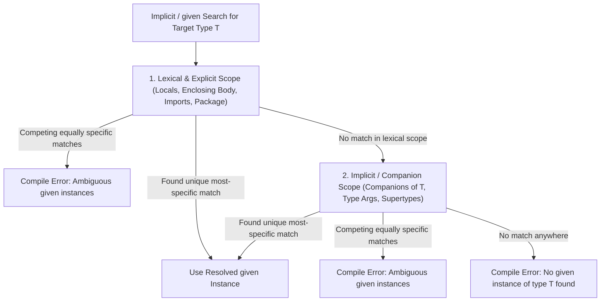
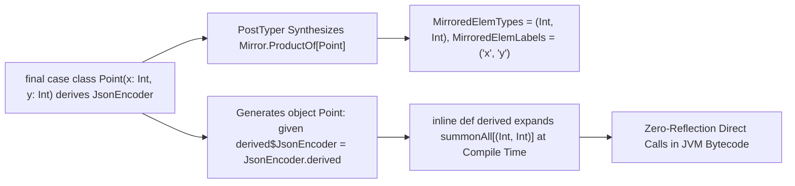

# Module 04 — Contextual Abstractions: `given`, `using`, Extensions, and Type Classes

While pure algebraic type classes—`Semigroup`, `Monoid`, `Foldable`, `Functor`, `Monad`, `Applicative`, and `Traverse`—and their equational laws are owned and proven in [FP Module 09](../../../architecture/functional-programming/modules/09-monoids-foldables-and-parallel-reduction.md), [FP Module 10](../../../architecture/functional-programming/modules/10-functors-monads-and-kleisli-composition.md), and [FP Module 11](../../../architecture/functional-programming/modules/11-applicative-and-traversable-functors.md), Scala 3 encodes type classes through **contextual abstractions**: `given` definitions, `using` clauses, `extension` methods, context functions (`A ?=> B`), and compiler-synthesized `derives` / `Mirror` evidence. In Scala 2, a single overloaded `implicit` keyword governed type-class instances, implicit parameters, extension wrappers, and unsafe silent type coercions—producing notorious ambiguity and import hazards. Scala 3 separates those four distinct mechanisms syntactically and semantically.

---

## 1. `given`, `using`, Context Bounds, and Context Functions

### Defining and Summoning Type Classes (`given` and `using`)

A type class in Scala 3 consists of a parameterized `trait` defining algebraic operations (often as `extension` methods), companion laws/combinators, and concrete `given` instances:

```scala
trait Monoid[A]:
  def empty: A
  extension (x: A) def combine(y: A): A

object Monoid:
  given intSum: Monoid[Int] with
    def empty: Int = 0
    extension (x: Int) def combine(y: Int): Int = x + y

  given [A](using m: Monoid[A]): Monoid[Option[A]] with
    def empty: Option[A] = None
    extension (x: Option[A])
      def combine(y: Option[A]): Option[A] = (x, y) match
        case (Some(a), Some(b)) => Some(a.combine(b))
        case (Some(a), None)    => Some(a)
        case (None, Some(b))    => Some(b)
        case (None, None)       => None
```

Three rules govern `given` lowering and invocation:

1. **Lazy vs Eager Initialization**: Parameterless `given` instances (such as `given intSum: Monoid[Int] with ...`) compile to a lazy `object` / cached singleton initialized once on first access, whereas parameterized `given` instances (`given [A](using Monoid[A]): ...`) compile to a method (`def`) creating an instance when summoned with concrete evidence.
2. **Explicit `using` Application**: Unlike Scala 2's implicit parameters—where passing an explicit instance `combineAll(xs)(customMonoid)` could collide ambiguously with an `apply` method on the return type—Scala 3 **requires the `using` keyword at the call site** when overriding contextual search: `combineAll(xs)(using customMonoid)`.
3. **`summon[T]` replaces `implicitly[T]`**: Writing `summon[Monoid[Int]]` is an `inline def summon[T](using x: T): x.type = x`. Because it preserves the singleton/precise type `x.type` rather than widening to `T`, `summon` retains refined path-dependent type members (such as `Mirror.ProductOf` `MirroredElemTypes`) critical for metaprogramming!

### Context Bounds and Named Context Bounds (Scala 3.6–3.10)

Instead of writing `def combineAll[A](xs: List[A])(using m: Monoid[A]): A`, a **context bound** `[A: Monoid]` desugars into an anonymous `(using evidence$1: Monoid[A])` parameter clause. In Scala 3.6+ (including Scala `3.10.1`), **named context bounds** (`as`) bind a local identifier directly inside the type parameter bracket without needing `summon`:

```scala
def combineAll[A: Monoid as m](xs: List[A]): A =
  xs.foldLeft(m.empty)(_.combine(_))
```

### Context Functions (`A ?=> B`)

Scala 3 introduces first-class **context function types** (`A ?=> B`, backed by `scala.ContextFunction1[-T, +R]`), generalizing implicit parameters from method declarations to function values:

```scala
final case class TraceCtx(traceId: String, depth: Int)

type Traced[A] = TraceCtx ?=> A

def log(msg: String)(using ctx: TraceCtx): Unit =
  println(s"[${ctx.traceId}:${ctx.depth}] $msg")

def runWorkflow: Traced[Int] =
  log("step 1") // `TraceCtx` is threaded automatically!
  42

def entry(): Unit =
  given TraceCtx = TraceCtx("req-99", 0)
  val result = runWorkflow // Compiler automatically supplies `given TraceCtx`
```

Because `ContextFunction1` compiles directly to a JVM SAM interface taking `TraceCtx`, context functions model scoped capabilities (`scala.util.boundary.Label[T]`, transactional sessions, HTML builder DSLs, and Scala 3 Capture Checking capabilities) with **zero monad transformer or `ReaderT` heap overhead** when pure synchronous scoping suffices.

---

## 2. `extension` Methods, Desugaring, and Allocation Mechanics

In Scala 2, adding methods to existing types (`1.squared` or `x |+| y`) required an `implicit class RichInt(val x: Int) extends AnyVal`, which still suffered `AnyVal` re-boxing traps ([Module 01](01-scala3-toolchain-tasty-and-jvm-lowering.md)) and boilerplate constructor wrappers. Scala 3 replaces this with **`extension` methods**:

```scala
extension [A](xs: List[A])
  def secondOption: Option[A] = xs.drop(1).headOption
  def intersperse(sep: A): List[A] = xs match
    case Nil      => Nil
    case h :: Nil => List(h)
    case h :: t   => h :: sep :: t.intersperse(sep)
```

### Compiler Lowering and Parameterized `given` Allocation Cost

Understanding how Scala 3 lowers contextual abstractions prevents hidden GC allocations in tight loops:

1. **`extension` method lowering**: An `extension` method compiles directly to a plain method taking the receiver as its first parameter (`def secondOption[A](xs: List[A]): Option[A]`)—**no wrapper class exists in bytecode**. Furthermore, an `extension` method on a type class `trait Semigroup[A]` automatically activates whenever a `given Semigroup[A]` is visible in scope, eliminating Scala 2's separate `ops` / `syntax` boilerplate objects (though libraries like Cats retain `.syntax.*` for Scala 2/3 cross-compilation).
2. **Parameterized `given` instantiation cost**: While `given Monoid[Int]` compiles to a single lazy `object` (`MODULE$`), a parameterized `given [A](using m: Monoid[A]): Monoid[Option[A]]` compiles to a **factory method** `def given_Monoid_Option[A](using m: Monoid[A]): Monoid[Option[A]]` that allocates a new `Monoid[Option[A]]` anonymous object **every time it is summoned inside a loop or uncached helper**! Inside hot paths, bind `val optMonoid = summon[Monoid[Option[Int]]]` outside the loop or construct shared instances inside a `val` / `inline given` helper when allocation profiling flags it.

---

## 3. Resolution Priority, Specificity, and Negative Ambiguity Tests

When the compiler searches for a `given` value of target type `T` (or searches for an `extension` method on receiver type `R`), Scala 3 follows a deterministic **two-tier precedence hierarchy**:



### Detailed Precedence and Specificity Rules

1. **Tier 1 beats Tier 2**: Any matching `given` in **lexical or explicitly imported scope** completely shadows `given` instances in **companion (implicit) scope**, even if the companion instance is strictly more specific.
2. **Same-tier specificity ranking**: Within the same tier, candidate `A` beats candidate `B` if `A` is defined in a subclass of `B`'s owner, or if `A`'s parameters are strictly more constrained (e.g., `given Ordering[Int]` beats a polymorphic `given [T <: AnyVal]: Ordering[T]`, and a concrete `given Show[List[Int]]` beats `given [A: Show]: Show[List[A]]`).
3. **Classic `LowPriorityImplicits` Pattern**: Library authors stack fallback `given`s inside a parent `trait LowPriorityInstances` extended by `object MyTypeClass extends LowPriorityInstances` so specific instances on the companion object strictly outrank generic fallbacks on the super-trait:

```scala
trait Show[A]:
  extension (a: A) def show: String

trait LowPriorityShow:
  given [A: Show]: Show[Seq[A]] with
    extension (xs: Seq[A]) def show: String = xs.map(_.show).mkString("[", ", ", "]")

object Show extends LowPriorityShow:
  given Show[Int] with
    extension (n: Int) def show: String = n.toString

  // Defined on companion subclass of LowPriorityShow -> strictly higher priority for List[Int]!
  given Show[List[Int]] with
    extension (xs: List[Int]) def show: String = s"Ints(${xs.mkString(",")})"
```

4. **Negative Compile-Time Rejection on Ambiguity**: When two equally specific `given`s exist in the same scope, Scala 3 refuses to pick arbitrarily and aborts compilation:

```scala
import scala.compiletime.testing.{typeChecks, typeCheckErrors}

val ambiguousSnippet = """
  trait Codec[A] { def encode(a: A): String }
  given c1: Codec[Int] with { def encode(a: Int) = a.toString }
  given c2: Codec[Int] with { def encode(a: Int) = s"int:$a" }
  summon[Codec[Int]]
"""

val compiles = typeChecks(ambiguousSnippet) // false
val msg = typeCheckErrors(ambiguousSnippet).head.message
// "Ambiguous given instances: both object c2 ... and object c1 ... match type Codec[Int]..."
```

### Type-Class Hierarchy Diamond Ambiguity (`Monad` + `Traverse`)

Consider a function requiring two type classes that both extend `Functor[F]`:

```scala
trait Functor[F[_]]:
  extension [A](fa: F[A]) def map[B](f: A => B): F[B]

trait Monad[F[_]] extends Functor[F]:
  def pure[A](a: A): F[A]
  extension [A](fa: F[A]) def flatMap[B](f: A => F[B]): F[B]

trait Traverse[F[_]] extends Functor[F]:
  extension [G[_], A](fa: F[A]) def traverse[B](f: A => G[B]): G[F[B]]

def pipeline[F[_]](xs: F[Int])(using m: Monad[F], t: Traverse[F]): F[Int] =
  xs.map(_ + 1) // Watch out! Both `m` and `t` carry `Functor[F]`!
```

In `pipeline`, if `Functor.map` is a normal method on `Functor[F]`, calling `summon[Functor[F]]` sees **both `m: Monad[F]` and `t: Traverse[F]`** as valid `given` candidates for `Functor[F]`, triggering `"Ambiguous given instances"`. Similarly, calling `xs.map(_ + 1)` via extension search finds `map` through both `m` and `t`.

There are two standard architectural fixes:

1. **Disambiguate extension methods vs subtyping**: Avoid calling `summon[Functor[F]]` directly when `Monad[F]` and `Traverse[F]` are both in scope (`m.map(xs)(_ + 1)` or keeping a single combined `given Monad[F] & Traverse[F]` instance when `F` is concrete like `List`).
2. **Non-subtyping capability factoring (or Cats' `Unapply` / `LowPriority` scoping)**: In Cats, `Monad[F]` and `Traverse[F]` both inherit `Functor[F]`, so generic polymorphic functions taking both `(using F: Monad[F], T: Traverse[F])` avoid ambiguous `Functor` implicit lookups by invoking `F.map` / `T.traverse` explicitly or receiving a single combined constraint.

---

## 4. Type-Class Coherence, Multi-Parameter Classes, and Orphan Instances

Unlike **Haskell**, which enforces **global type-class coherence** (at most one `instance Monoid Int` may exist anywhere in a compiled program), Scala adopts **scoped (local) contextual resolution**: different lexical scopes can supply different `given` instances (e.g., additive `0, +` vs multiplicative `1, *` for `Monoid[Int]`).

While useful for custom local overrides, this freedom creates a serious production defect known as the **orphan-instance hazard**:

- **What is an orphan instance?** A `given TypeClass[DataType]` defined in neither `object TypeClass` nor `object DataType`, but in an unrelated third-party utility object `object ExtraInstances`.
- **Why it corrupts invariants**: Consider `scala.collection.immutable.TreeSet[User]` or `Hash` invariants. A `TreeSet[User]` stores an `Ordering[User]` captured at construction time to maintain its Red-Black tree ordering. If Module A constructs a `TreeSet` using an orphan `given Ordering[User]` (sorted by `id`) and passes it to Module B, which calls `.union(otherSet)` using a different orphan `given Ordering[User]` (sorted by `email`), lookups fail silently because the tree invariant depends on consistent `Ordering` across the program.
- **Architectural rule**: Place canonical, law-abiding instances inside `object DataType` or `object TypeClass` (Tier 2 companion scope), and reserve named `opaque type` wrappers (`opaque type SumInt = Int` / `ProdInt`) or explicit `(using ...)` overrides for non-canonical alternative algebras.

### Multi-Parameter Type Classes and Functional Dependencies (`Aux` vs Type Members)

When modeling relationships between two types—such as `trait ElemOf[Coll] { type Elem }` or `trait Convert[From, To]`—a naive two-parameter `trait Convert[A, B]` leaves `B` unconstrained when only `A` is known at a call site, causing ambiguous search if multiple `Convert[String, ?]` instances exist.

To express a **functional dependency** ($A \to B$, meaning `A` uniquely determines `B`), store `B` as an **abstract type member** (`type Out`) instead of a type parameter, and expose a type alias `Aux` when callers need to unify `Out` in the same parameter list:

```scala
trait Repr[A]:
  type Out
  def toRepr(a: A): Out

object Repr:
  type Aux[A, O] = Repr[A] { type Out = O }

  given Repr[Int] with
    type Out = String
    def toRepr(a: Int): String = a.toString

def convertAndShow[A, O](a: A)(using r: Repr.Aux[A, O], s: Codec[O]): String = ???
```

Because `Out` is a type member rather than an independent search parameter, `summon[Repr[Int]]` searches exclusively on `Int`, avoiding multi-parameter ambiguity while still propagating `Out = String` into downstream `using` parameters!

---

## 5. Type-Class Derivation (`derives` and `Mirror`) and `Conversion`

### Automatic Derivation with `derives` and `scala.deriving.Mirror`

In Scala 2, generic type-class derivation for `case class`es and `sealed trait`s required `shapeless.Generic` macros—often multiplying compile times and producing cryptic implicit-not-found errors. Scala 3 builds structural reflection directly into the compiler (`PostTyper` phase) via **`scala.deriving.Mirror`**:



- Every `case class` gets a `given Mirror.ProductOf[P]` exposing `MirroredElemTypes` (a tuple of field types, e.g., `(String, Int)`) and `MirroredElemLabels` (a tuple of singleton string literal types, e.g., `("name", "age")`), plus `fromProduct(p: Product): P`.
- Every `sealed trait` or `enum` gets a `given Mirror.SumOf[S]` exposing `MirroredElemTypes` (a tuple of all variant types) and `ordinal(x: S): Int`.

Any type class `TC[A]` whose companion defines `inline def derived[A](using m: Mirror.Of[A]): TC[A]` automatically supports the `derives` clause:

```scala
import scala.deriving.Mirror
import scala.compiletime.{erasedValue, summonInline}

trait JsonEncoder[A]:
  def encode(a: A): String

object JsonEncoder:
  given JsonEncoder[String] = s => s"\"$s\""
  given JsonEncoder[Int]    = n => n.toString

  inline def derived[A](using m: Mirror.Of[A]): JsonEncoder[A] =
    inline m match
      case p: Mirror.ProductOf[A] => encodeProduct(p)
      case s: Mirror.SumOf[A]     => encodeSum(s)

  private inline def encodeProduct[A](p: Mirror.ProductOf[A]): JsonEncoder[A] =
    val encoders = summonAll[p.MirroredElemTypes]
    (a: A) =>
      val elems = a.asInstanceOf[Product].productIterator.toList
      elems.zip(encoders).map((v, enc) => enc.asInstanceOf[JsonEncoder[Any]].encode(v)).mkString("[", ",", "]")

  private inline def encodeSum[A](s: Mirror.SumOf[A]): JsonEncoder[A] =
    val encoders = summonAll[s.MirroredElemTypes]
    (a: A) =>
      val ord = s.ordinal(a)
      encoders(ord).asInstanceOf[JsonEncoder[Any]].encode(a)

  private inline def summonAll[T <: Tuple]: List[JsonEncoder[?]] =
    inline erasedValue[T] match
      case _: EmptyTuple => Nil
      case _: (h *: t)   => summonInline[JsonEncoder[h]] :: summonAll[t]

final case class Point(x: Int, y: Int) derives JsonEncoder
```

Writing `derives JsonEncoder` generates a `given derived$JsonEncoder: JsonEncoder[Point] = JsonEncoder.derived` inside `object Point`—placing the derived instance directly in Tier 2 companion scope with zero runtime reflection!

Notice also how **composite `given` derivation** scales cleanly across product and associative containers—for instance, deriving `Monoid[(A, B)]` and `Monoid[Map[K, V]]` (merging collisions via `Semigroup[V]` / `Monoid[V]`) while still allowing explicit local overrides via `(using intProduct)`:

```scala
object ExtraMonoids:
  val intProduct: Monoid[Int] = new Monoid[Int]:
    def empty: Int = 1
    extension (x: Int) def combine(y: Int): Int = x * y

  given [A: Monoid as ma, B: Monoid as mb]: Monoid[(A, B)] with
    def empty: (A, B) = (ma.empty, mb.empty)
    extension (p: (A, B))
      def combine(q: (A, B)): (A, B) = (p._1.combine(q._1), p._2.combine(q._2))

val sumResult: Int = combineAll(List(2, 3, 4))                         // 9 (via companion intSum)
val prodResult: Int = combineAll(List(2, 3, 4))(using ExtraMonoids.intProduct) // 24 (explicit override!)
```

### Opt-In `Conversion[A, B]` and `export` Clauses

Scala 3 replaces unchecked `implicit def a2b(a: A): B` coercions with the explicit **`scala.Conversion[A, B]`** abstract class (which requires `import scala.language.implicitConversions` at definition sites unless invoked explicitly via `.convert`, preventing accidental invisible type conversions inside expressions):

```scala
import scala.language.implicitConversions

final case class RawEmail(value: String)
final case class Domain(host: String)

given Conversion[RawEmail, Domain] = e => Domain(e.value.substring(e.value.indexOf('@') + 1))

def resolveMx(d: Domain): String = s"mx.${d.host}"
val mxRecord: String = resolveMx(RawEmail("ops@example.com"))
```

Meanwhile, **`export`** replaces package-object mixin inheritance (`package object cats { ... }`) and deep class inheritance hierarchies for composing modular APIs and type-class namespaces cleanly:

```scala
final class AuditLog:
  def record(event: String): Unit = println(s"AUDIT: $event")
  def flush(): Unit = ()

final class UserService(private val audit: AuditLog):
  export audit.{record as logAudit, flush} // Selective rename + export without inheriting AuditLog!

object AllInstances:
  export Monoid.given
  export JsonEncoder.given
```

Note how `export` supports selective renaming (`record as logAudit`), wildcards (`*`), exclusions (`flush as _`), and `given` forwarding (`export Monoid.given`). When forwarding `given`s from a field (`private val inner: HasInstances`), `export inner.given` exposes those instances in the outer scope cleanly—replacing Scala 2's pattern of mixing traits into `package object`s.

### End-to-End Composable Type-Class Pipeline

Putting `given`, `using`, named context bounds (`as`), and `extension` methods together yields clean polymorphic pipelines whose instances compose recursively (`Option[List[Int]]`, `(Int, Option[String])`) purely at compile time:

```scala
def summarize[A: Monoid as m](items: List[Option[A]])(using s: Show[A]): String =
  val combined: Option[A] = items.foldLeft(Option.empty[A])(_.combine(_))
  combined match
    case Some(a) => s"Total=${a.show}"
    case None    => s"Empty(zero=${m.empty.show})"
```

---

## 6. Then vs now: Scala 2 `implicit` Chaos to Scala 3 Contextual Clarity

| Capability | Then (Scala 2.13) | Now (Scala 3.10.1) | Why Scala 3 Changed It |
| --- | --- | --- | --- |
| Defining instances | `implicit val` / `implicit object` / `implicit def` | `given ... with` / `given ... = ...` | Separates instance definitions from normal values and implicit conversions |
| Consuming instances | `implicit m: Monoid[A]` (ambiguous `f(xs)(m)` calls) | `using m: Monoid[A]`, `[A: Monoid as m]`, `(using m)` | Eliminates application ambiguity with `apply` methods on return values |
| Wildcard imports | `import Foo._` silently pulled in every `implicit`! | `import Foo.*` skips `given`s! Must write `import Foo.given` | Prevents accidental implicit pollution and compile-time slowdowns from wildcard imports |
| Extension methods | `implicit class RichA(val a: A) extends AnyVal` | `extension (a: A) def foo = ...` | Zero wrapper class, zero `AnyVal` boxing traps, direct static dispatch |
| Implicit conversions | `implicit def strToUser(s: String): User` | `given Conversion[String, User] = ...` | Gates dangerous coercions explicitly and eliminates conversion/instance confusion |
| Generic derivation | Shapeless `Generic` + macro-heavy `Lazy[...]` | Built-in `Mirror.ProductOf` / `SumOf` + `derives` | Fast compile times, zero external macro dependencies, clean error messages |
| Package objects | `package object foo extends Implicits` | Top-level definitions + `export Foo.given` | Eliminates JVM package-object static initialization bottlenecks and fragile inheritance |

### The Wildcard Import Trap (`import Foo.*` vs `import Foo.given`)

One of the highest-impact migration gotchas when porting Scala 2 code to Scala 3 is **`import Foo.*` no longer importing `given` instances** (it still imports legacy Scala 2 `implicit` vals/defs during cross-version migration, but **never** Scala 3 `given`s!). To bring `given` instances into lexical scope, callers must import them explicitly by type (`import Foo.{given Monoid[Int]}`) or via the dedicated wildcard **`import Foo.given`** (or `import Foo.{*, given}` to import both regular members and `given`s):

```scala
import scala.compiletime.testing.typeChecks

val wildcardSkipsGiven = typeChecks("""
  object Scope { given Int = 99 }
  import Scope.*
  summon[Int]
""") // false: wildcard `.*` does NOT import `given` instances!

val explicitGivenWorks = typeChecks("""
  object Scope { given Int = 99 }
  import Scope.given
  summon[Int]
""") // true: `import Scope.given` brings contextual instances into Tier 1 lexical scope
```

This separation keeps ordinary namespace imports clean and forces contextual dependencies to be visible at the top of the file.

---

## Interview Drill

### 1. Why did Scala 3 split the `implicit` keyword into `given`, `using`, `extension`, and `Conversion`?

<details><summary>Answer</summary>

Scala 2 overloaded `implicit` for four unrelated mechanisms: type-class instances (`implicit val`/`def`), contextual parameter clauses (`implicit ev: ...`), extension-method wrappers (`implicit class`), and automatic type coercions (`implicit def a2b`). Overloading one keyword caused silent accidental conversions, `apply`-vs-implicit parameter call-site ambiguities, and opaque compiler errors. Splitting them makes intent explicit at both definition and call sites while removing wrapper classes for extensions.
</details>

### 2. Why does `import Foo.*` NOT import Scala 3 `given` instances, and how do you import them?

<details><summary>Answer</summary>

In Scala 2, `import Foo._` dragged every `implicit` into lexical scope unintentionally, causing subtle shadowing and slow implicit search. Scala 3 separates term/type imports from contextual imports: `import Foo.*` imports only non-`given` members. To import `given` instances, you must write `import Foo.given` (or `import Foo.{given Monoid[?]}`, or `import Foo.{*, given}`).
</details>

### 3. Explain the two-tier resolution order when Scala 3 searches for a `given T` instance.

<details><summary>Answer</summary>

Scala 3 checks **Tier 1 (Lexical & Explicit Scope)** first: local `given`s, enclosing class/object members, explicit/given imports, and package definitions. Only if Tier 1 finds no match does it search **Tier 2 (Implicit / Companion Scope)**: the companion objects of `T`, its type arguments, and all their supertypes. Any match in Tier 1 shadows Tier 2 completely, while multiple equally specific matches in the same tier trigger an `"Ambiguous given instances"` compile error.
</details>

### 4. What is the orphan-instance hazard in Scala, and why does it break data structures like `TreeSet`?

<details><summary>Answer</summary>

An orphan instance is a `given TypeClass[Data]` defined outside both `object TypeClass` and `object Data`, imported ad hoc from a third-party utility module. Because Scala lacks Haskell's global coherence guarantee, two modules can construct or combine `TreeSet[User]` instances with conflicting `Ordering[User]` orphans—silently corrupting binary-search-tree invariants, failing `.contains` lookups, or violating `Monoid`/`Eq` laws across module boundaries.
</details>

### 5. How does `derives` work with `scala.deriving.Mirror` without runtime reflection?

<details><summary>Answer</summary>

During `PostTyper`, the compiler synthesizes a `Mirror.ProductOf` (for `case class`es) or `Mirror.SumOf` (for `enum`s/`sealed trait`s) carrying compile-time tuple types `MirroredElemTypes` and `MirroredElemLabels`. Adding `derives TC` generates a `given` in the type's companion calling `TC.derived`, which uses `inline match`, `erasedValue`, and `summonInline` to specialize element encoders/decoders at compile time into direct static calls with zero `java.lang.reflect` overhead.
</details>

### 6. What is a context function `A ?=> B`, and when is it preferable to a `Reader` monad (`Kleisli`)?

<details><summary>Answer</summary>

`A ?=> B` (`scala.ContextFunction1[A, B]`) is a first-class function type whose argument `A` is supplied contextually via `given`/`using` at call sites. Unlike `ReaderT` / `Kleisli`, which wraps computations in heap-allocated closures and monadic `flatMap` frames, a context function compiles to a direct single-argument SAM call with zero monadic wrapper overhead—ideal for synchronous capabilities, builders, and `boundary.Label` scopes when asynchronous effect suspension is not needed.
</details>

### 7. Why does Scala 3 require `(using myInstance)` when passing an explicit contextual argument, unlike Scala 2's `foo(x)(myInstance)`?

<details><summary>Answer</summary>

In Scala 2, `foo(x)(y)` was ambiguous if `foo(x)` returned a function or an object with an `apply` method and `foo` also took an implicit second parameter list—sometimes silently invoking `apply` instead of overriding the implicit or vice versa. Requiring `(using myInstance)` makes overriding contextual search unambiguous at every call site.
</details>

### 8. Why can `[F[_]: Monad: Traverse]` trigger an ambiguity error when summoning `Functor[F]`, and what is the runtime cost of parameterized `given` instances?

<details><summary>Answer</summary>

Because both `Monad[F]` and `Traverse[F]` extend `Functor[F]`, both parameters satisfy a search for `given Functor[F]` with equal specificity, triggering `"Ambiguous given instances"` unless disambiguated explicitly (`m.map(xs)(...)`). Meanwhile, unlike parameterless `given` singletons (`object`), parameterized `given [A: Monoid]: Monoid[Option[A]]` instances compile to factory `def` methods that allocate a fresh wrapper instance at every summon site unless hoisted into a `val` outside loops.
</details>
