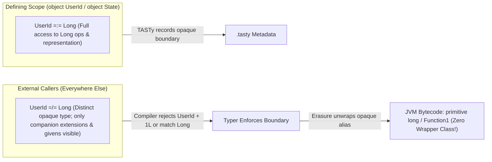
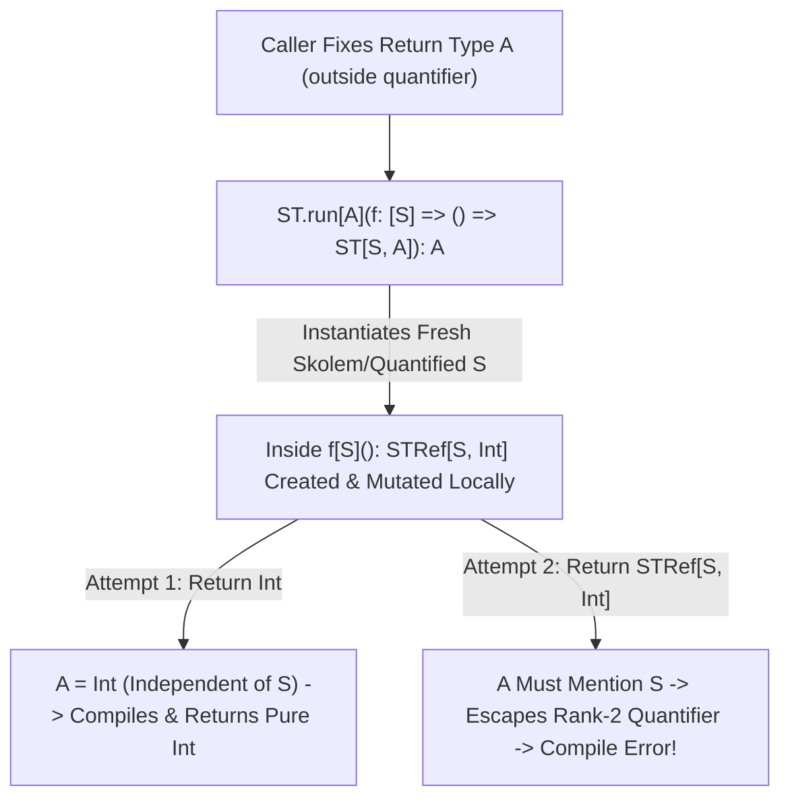

# Module 05 — Type-Level Scala: Opaque Types, Match Types, Type Lambdas, and Rank-2 Polymorphism

Scala 3 elevates several type-level patterns that previously required heap-allocating wrapper classes, compiler plugins (`kind-projector`), unsound structural type projections, or macro-heavy Shapeless boilerplate into first-class language primitives. This module examines **`opaque type`** abstractions and their JVM erasure boundary, **higher-kinded types, `AnyKind`, and native type lambdas** (`[X] =>> ...`), **match types** (`X match { ... }`) with termination and disjointness rules, **polymorphic and rank-2 function types** for scoped mutable state (`ST`), **type-level `Tuple`s** replacing `HList`, and **dependent function types alongside singleton literal types**.

---

## 1. `opaque type` Aliases: Zero-Allocation Newtypes on the JVM

Functional domain modeling wraps raw primitives (`Long`, `String`, `S => (A, S)`) into distinct domain types (`UserId`, `Email`, `State[S, A]`) so the compiler rejects argument swaps (`transfer(from: AccountId, to: AccountId)` vs `transfer(Long, Long)`). Previously, Scala 2 developers faced an unpleasant trade-off between **zero-safety type aliases** (`type UserId = Long`, interchangeable with any `Long`), **allocating `case class` wrappers**, or **`extends AnyVal` value classes** that silently boxed back onto the heap inside `List`, `Option`, or `Array` ([Module 01](01-scala3-toolchain-tasty-and-jvm-lowering.md)).

Scala 3 introduces **`opaque type`** aliases: **distinct nominal types at compile time outside their defining scope, and identical to their underlying representation inside it and after JVM erasure**.



### Anatomy of an `opaque type` Module

Every `opaque type` is declared inside an `object`, `class`, or `trait` (never as a bare top-level definition without an enclosing scope, because the enclosing scope defines where transparency holds):

```scala
object Domain:
  opaque type UserId = Long
  opaque type NonEmptyText <: String = String

  object UserId:
    def apply(raw: Long): Either[String, UserId] =
      if raw > 0L then Right(raw) else Left(s"UserId must be positive: $raw")

    def unsafe(raw: Long): UserId = raw

    given CanEqual[UserId, UserId] = CanEqual.derived

    extension (id: UserId)
      def value: Long = id
      def next: UserId = id + 1L

  object NonEmptyText:
    def from(s: String): Option[NonEmptyText] =
      if s.nonEmpty then Some(s) else None
```

Notice four essential properties:

1. **One-way subtyping with upper bounds (`<:`)**: Declaring `opaque type NonEmptyText <: String = String` allows callers to pass a `NonEmptyText` directly to any API expecting `String` (zero conversion!), while preventing callers from passing an unvalidated `String` where `NonEmptyText` is required. Without an upper bound, `UserId` does not even subtype `Matchable` ([Module 03](03-type-system-variance-and-type-inference.md))—protecting `UserId` from runtime `match` inspection!
2. **Zero boxing even inside generic containers**: Because `opaque type UserId = Long` does **not** create a `UserId.class` wrapper object, a `Vector[UserId]` or `Option[UserId]` stores `java.lang.Long` directly—eliminating the double-boxing penalty of `case class UserId(value: Long)` and avoiding `AnyVal`'s wrapper-class allocations completely.
3. **Zero-Cost Functional `State[S, +A]`**: As cross-linked from [FP Module 05](../../../architecture/functional-programming/modules/05-purely-functional-state-and-combinators.md), wrapping `S => (A, S)` in an `opaque type` eliminates the outer wrapper object on every `map`/`flatMap` step:

```scala
object PureState:
  opaque type State[S, +A] = S => (A, S)

  object State:
    def apply[S, A](run: S => (A, S)): State[S, A] = run
    def pure[S, A](a: A): State[S, A] = s => (a, s)

    extension [S, A](sa: State[S, A])
      def run(initial: S): (A, S) = sa(initial)
      def map[B](f: A => B): State[S, B] = s =>
        val (a, s2) = sa(s)
        (f(a), s2)
      def flatMap[B](f: A => State[S, B]): State[S, B] = s =>
        val (a, s2) = sa(s)
        f(a)(s2)
```

4. **Erasure overload collision trap**: Because `UserId` erases to `long` on the JVM, defining `def find(id: UserId)` and `def find(raw: Long)` in the same class triggers an erasure clash unless one carries `@targetName("findByRawLong")`:

```scala
import scala.annotation.targetName

object UserRepo:
  def find(id: Domain.UserId): Option[String] = Some(s"user:${id.value}")
  @targetName("findByRawId")
  def find(raw: Long): Option[String] = Domain.UserId(raw).toOption.flatMap(find)
```

5. **Compile-time dimensioned `IArray` wrapper (`Matrix`)**: Combining `opaque type`, `IArray[Double]`, and `scala.compiletime.ops.int.*` builds zero-overhead fixed-shape matrices where mismatched dimensions fail compilation before allocation:

```scala
import scala.compiletime.ops.int.*

object LinearAlgebra:
  opaque type Matrix[Rows <: Int, Cols <: Int] = IArray[Double]

  object Matrix:
    def fill[R <: Int, C <: Int](v: Double)(using r: ValueOf[R], c: ValueOf[C]): Matrix[R, C] =
      IArray.fill(r.value * c.value)(v)

    extension [R <: Int, C <: Int](m: Matrix[R, C])
      def add(other: Matrix[R, C]): Matrix[R, C] =
        IArray.tabulate(m.length)(i => m(i) + other(i))
```

---

## 2. Higher-Kinded Types `F[_]`, `AnyKind`, and Native Type Lambdas

A **type constructor** such as `List[_]` or `Option[_]` has kind $\star \to \star$ (it takes one type argument to produce a concrete type). Abstracting over type constructors (`trait Functor[F[_]]`, `trait Monad[F[_]]`) creates **higher-kinded polymorphism** of kind $(\star \to \star) \to \star$ ([FP Module 10](../../../architecture/functional-programming/modules/10-functors-monads-and-kleisli-composition.md)).

Often, however, a binary type constructor like `Either[E, A]`, `Map[K, V]`, or `State[S, A]` has kind $\star \to \star \to \star$ and must be **partially applied** to fit `F[_]`. Scala 3 supports **native type lambdas** directly in the language syntax:

```scala
trait Functor[F[_]]:
  extension [A](fa: F[A]) def map[B](f: A => B): F[B]

given [E]: Functor[[X] =>> Either[E, X]] with
  extension [A](fa: Either[E, A])
    def map[B](f: A => B): Either[E, B] = fa match
      case Left(e)  => Left(e)
      case Right(a) => Right(f(a))

given [S]: Functor[[X] =>> PureState.State[S, X]] with
  extension [A](fa: PureState.State[S, A])
    def map[B](f: A => B): PureState.State[S, B] =
      PureState.State.map(fa)(f)
```

### Variance, Bounds, and Kind Polymorphism (`AnyKind`)

Type parameters inside `[X] =>> ...` infer variance automatically from usage or accept explicit variance/bound annotations when needed:

- `[+X] =>> Either[E, X]` is valid because `Either` is covariant in its second parameter.
- `[X <: Number] =>> List[X]` constrains the type lambda's argument kind directly.
- Type lambdas also support **higher-kinded parameters**: `[F[_]] =>> F[Int]` has kind $(\star \to \star) \to \star$.
- **Kind Polymorphism (`scala.AnyKind`)**: When writing generic type-level tags or constraints that must accept _both_ proper types (`Int : *`) and unapplied type constructors (`List : * -> *` or `Map : * -> * -> *`), bound the type parameter with `T <: AnyKind` (e.g., `type ShowKind[T <: AnyKind]`). Note that `AnyKind` parameters can only be passed to type-level constructs (like `summon`, match types, or type aliases), never directly instantiated as value parameters `x: T`.

### Then vs now: Structural Refinement Hacks and `kind-projector` to `[X] =>> ...`

In Scala 2, partially applying `State[S, _]` required either an unreadable **structural refinement + general type projection hack** or the third-party **`kind-projector`** compiler plugin:

| Approach | Syntax | Status in Scala 3.10.1 | Underlying Mechanics |
| --- | --- | --- | --- |
| **Scala 2 Type Projection Hack** | `({ type L[X] = State[S, X] })#L` | **Illegal** under DOT soundness rules ([Module 03](03-type-system-variance-and-type-inference.md)) | Projected `#L` off an anonymous structural type; verbose, broke inference |
| **Scala 2 `kind-projector` Plugin** | `State[S, *]` / `Either[E, ?]` | External plugin obsolete; `-Ykind-projector` migration flag only | Rewrote `*` / `?` AST placeholders into Scala 2 structural lambdas |
| **Scala 3 Native Type Lambda** | `[X] =>> State[S, X]` | **First-class language feature** (zero plugins!) | Direct $\lambda$-abstraction at the type level in DOT/TASTy |

Note one important Scala 3 syntax pitfall: writing `Either[E, ?]` in Scala 3 **without** `-Ykind-projector` denotes an **existential wildcard type** (`Either[E, ?]` $\equiv$ `Either[E, _]` in Scala 2), **not** a type lambda! Always write `[X] =>> Either[E, X]` in idiomatic Scala 3.

---

## 3. Match Types (`X match { ... }`): Termination and Disjointness

A **match type** reduces a type expression by pattern matching on a scrutinee type at compile time:

```scala
type Elem[X] = X match
  case String      => Char
  case Array[t]    => t
  case Iterable[t] => t
  case AnyVal      => X

val ch: Elem[String]      = 'a'   // reduces to Char
val n: Elem[Array[Int]]   = 42    // reduces to Int
val s: Elem[List[String]] = "ok"  // reduces to String
```

Match types can also be **recursive**, e.g., extracting the innermost scalar element of arbitrarily nested arrays/iterables, or concatenating heterogeneous `Tuple` types (`A *: B`):

```scala
type LeafElem[X] = X match
  case String      => Char
  case Array[t]    => LeafElem[t]
  case Iterable[t] => LeafElem[t]
  case Any         => X

val leaf: LeafElem[List[Array[Int]]] = 7 // Reduces: List[Array[Int]] -> Array[Int] -> Int
```

### Disjointness, Abstract Scrutinees, and `inline def` Pairing

Match types enforce strict soundness rules so type reduction never contradicts subtyping or loops forever:

1. **Provable Disjointness**: If a scrutinee matches an earlier `case P1 => R1`, the compiler must know that subsequent cases `P2` are either strictly disjoint from `P1` or ordered from more specific to catch-all (`String` before `Any`). Notice why `case Iterable[t] => ...` works with `case Array[t] => ...`: `Array` is not a subtype of `Iterable` (conversions happen via implicit extension wrappers, not subtyping), so `Array[?]` and `Iterable[?]` are provably disjoint! If two patterns overlap non-trivially (e.g., matching on two unrelated non-final traits `trait A` and `trait B` that a single class `class C extends A, B` could both extend), the match type **fails to reduce** when given `C` or an ambiguous intersection `A & B`.
2. **Stuck Match Types on Abstract Type Parameters**: Inside a generic method `def first[X](x: X): LeafElem[X]`, `X` is unknown, so `LeafElem[X]` remains unreduced ("stuck"). You cannot implement `def first[X](x: X): LeafElem[X]` with an ordinary runtime `x match` unless the method is **`inline def`**:

```scala
inline def firstLeaf[X](x: X): LeafElem[X] =
  inline x match
    case s: String      => s.charAt(0)
    case a: Array[t]    => firstLeaf(a(0))
    case it: Iterable[t] => firstLeaf(it.head)
    case _              => x
```

Here, `inline match` forces specialization at every concrete call site where `X` is known, keeping the runtime branch and the match-type reduction provably aligned!

3. **Termination Limits and Negative Compilation Checks**: Recursive match types bound reduction depth with the compiler's inline/recursion limit (`-Xmax-inlines`, default `32`). Exceeding it aborts compilation cleanly with `"Maximal number of successive inlines (32) exceeded"` instead of hanging `scalac`. Similarly, attempting to reduce a stuck abstract match type or assign an incompatible branch fails cleanly at compile time:

```scala
import scala.compiletime.testing.typeChecks

val stuckFails = typeChecks("""
  type Elem[X] = X match { case String => Char; case AnyVal => X }
  def bad[X](x: X): Elem[X] = x
""") // false: Elem[X] cannot reduce for abstract X

// Overlapping non-disjoint traits: `C extends A, B` stalls reduction on `A & B`
trait TagA
trait TagB
final class TagAB extends TagA, TagB

type Classify[X] = X match
  case TagA => Int
  case TagB => String

// `Classify[TagA]` -> Int, `Classify[TagB]` -> String,
// `Classify[TagAB]` -> Int (first match wins for concrete class,
// while abstract `X <: TagA` vs `TagB` blocks unsound cross-branch assumptions).
```

---

## 4. Type-Level `Tuple`s Replacing Shapeless `HList`

In Scala 2, heterogeneous compile-time lists (`Int :: String :: Boolean :: HNil`) required the external Shapeless library, duplicating tuple machinery with `HCons` and `HNil` wrappers. Scala 3 turns `scala.Tuple` itself into an inductive type-level heterogeneous list (`NonEmptyTuple` constructed via right-associative **`*:`** and terminated by **`EmptyTuple`**):

- **Literal tuple equivalence**: `(Int, String, Boolean)` is literally syntactic sugar for **`Int *: String *: Boolean *: EmptyTuple`**.
- **Built-in type-level combinators**: `scala.Tuple` ships match-type operations directly in the standard library:
  - `Tuple.Head[T]` / `Tuple.Tail[T]`
  - `Tuple.Concat[A <: Tuple, B <: Tuple]` (`++` at value level)
  - `Tuple.Map[T <: Tuple, F[_]]` (e.g., `Tuple.Map[(Int, String), Option]` reduces to `(Option[Int], Option[String])`)
  - `Tuple.Zip[A <: Tuple, B <: Tuple]` and `Tuple.Union[T <: Tuple]`
- **JVM representation**: Tuples of arity 1–22 lower to specialized `Tuple1`..`Tuple22` classes; tuples of arity $> 22$ (removing Scala 2's infamous 22-field limit!) lower cleanly to **`scala.runtime.TupleXXL`** backed by an `Array[Object]`.

```scala
type Row = Int *: String *: Boolean *: EmptyTuple
type OptRow = Tuple.Map[Row, Option]

val optRow: OptRow = (Some(1), Some("alice"), None)
val concat: (Int, String, Boolean, Double) = (1, "alice", true) ++ Tuple1(3.14)
```

---

## 5. Polymorphic Function Types and Rank-2 Polymorphism (`ST`)

In Scala 2, functions (`A => B`) were **monomorphic values**: a polymorphic method `def headOpt[A](xs: List[A]): Option[A]` could not be stored in a `val` or passed directly as a higher-order argument without wrapping it in a custom trait (`FunctionK[List, Option]`, famously written `List ~> Option` in Cats).

Scala 3 introduces **polymorphic function types**:

```scala
// A first-class universally quantified function value: ∀A. List[A] => Option[A]
val headOpt: [A] => List[A] => Option[A] =
  [A] => (xs: List[A]) => xs.headOption

val i: Option[Int]    = headOpt(List(1, 2, 3))
val s: Option[String] = headOpt(List("a", "b"))

// Natural transformation (FunctionK) without boilerplate traits:
type ~>[F[_], G[_]] = [A] => F[A] => G[A]

val optionToList: Option ~> List = [A] => (opt: Option[A]) => opt.toList
val mapped: List[Int] = optionToList(Some(7)) // List(7)
```

### Scala 3 Delta: Rank-2 Polymorphic Encoding of `ST`

The formal theory of Launchbury and Peyton Jones's `ST` monad, contextual purity, and the in-place Quicksort proof are owned by [FP Module 12](../../../architecture/functional-programming/modules/12-effects-io-trampolining-st-and-streaming.md). The **Scala 3 language delta** is how polymorphic function types eliminate Scala 2's `trait RunnableST[A] { def apply[S]: ST[S, A] }` boilerplate while `opaque type` removes heap wrapper allocations:



Two Scala 3 compiler mechanics govern the signature `def run[A](f: [S] => () => ST[S, A]): A`:

1. **Zero-arg `() =>` requirement (`scala.PolyFunction`)**: Scala 3 requires a polymorphic function type to return a value-level function (`[S] => () => ST[S, A]`), because `scala.PolyFunction` lowers to a class with an `apply` method carrying at least one value parameter list (`def apply[S](): ST[S, A]`). Writing `[S] => ST[S, A]` without `() =>` is rejected (`typeChecks("def bad[A](f: [S] => ST[S, A]): A = ???") == false`).
2. **Zero-cost `opaque type` backing + static escape rejection**: Defining `opaque type ST[S, +A] = () => A` and `opaque type STRef[S, A] = Array[Any]` erases both wrappers in bytecode while keeping `S` phantom and unextractable outside `ST.run`, where `A` is quantified outside `[S] => ...` (see the full executable proof and negative `typeChecks` escape test in `architecture/functional-programming/examples/scala/TrampolineAndST.test.scala`).

| Scala 3 Abstraction | Bytecode Representation | Boxing in `List[T]` / `Option[T]` | Can Enforce Rank-2 / Phantom Token `S` |
| --- | --- | --- | --- |
| `case class Box(raw: Long)` | Heap `LBox;` object | Always boxed | Yes, with extra wrapper allocation |
| `class Box(val raw: Long) extends AnyVal` | `long` in direct calls, `LBox;` in generics | Boxes in `Option`, `List`, `Array`, traits | Limited (cannot hold private mutable array cleanly without allocation) |
| `opaque type Box = Long` | Unboxed `long` (`[J` in `Array[Box]`) | Boxes only as `java.lang.Long` in erased generics | Yes (`opaque type STRef[S, A]`), zero wrapper class generated |
| `[S] => () => ST[S, A]` (`PolyFunction`) | Generated `PolyFunction` class with generic `apply[S]()` | Single function object per `runST` call | Enforces universal quantification over `S` without named `RunnableST` trait |

---

## 6. Dependent Function Types, Singleton Literal Types, and `compiletime.ops`

### Dependent Function Types (`(x: K) => x.Value`)

Scala 2 supported dependent _methods_ (`def extract(k: Key): k.Value`), but could not eta-expand them into function values because `Function1[T, R]` fixed a non-dependent `R`. Scala 3 adds **dependent function types**:

```scala
trait AttrKey:
  type Value

val extract: (k: AttrKey) => k.Value => String =
  (k: AttrKey) => (v: k.Value) => v.toString
```

Under the hood, `(k: AttrKey) => k.Value => String` compiles to a refined `Function1[AttrKey, Any] { def apply(k: AttrKey): k.Value => String }`, preserving exact path-dependent return typing when passing dependent callbacks into higher-order combinators.

### Singleton Literal Types and `scala.compiletime.ops`

Every literal primitive and `String` in Scala 3 can serve directly as a **singleton type** (`42`, `"GET"`, `true`), upper-bounded by `Singleton`. The standard library packages `scala.compiletime.ops.int`, `scala.compiletime.ops.string`, and `scala.compiletime.ops.boolean` evaluate arithmetic, comparisons, and string concatenation purely inside the type checker:

```scala
import scala.compiletime.constValue
import scala.compiletime.ops.int.{+, *}
import scala.compiletime.ops.string.{+ as ++}

type HttpOk = 200
val status: HttpOk = 200
// val bad: HttpOk = 404 // Compile error: Found: (404 : Int), Required: HttpOk

val sumLit: 2 + 3 * 4 = 14                 // Evaluated in type checker via compiletime.ops.int
val route: "/api/" ++ "v1" = "/api/v1"     // Evaluated in type checker via compiletime.ops.string
val port: Int = constValue[8000 + 80]      // 8080 materialized into runtime Int at compile time
```

Combined with `opaque type` and `Mirror.MirroredElemLabels` (whose tuple elements are literal `String` singleton types like `("id", "email")`), singleton literal types enable zero-runtime-overhead schema validation, fixed-dimension vector arithmetic (`Vec[N + M, Double]`), and compile-time SQL/HTTP route verification.

---

## 7. Then vs now: Scala 2 Type-Level Workarounds to Scala 3 Primitives

| Type-Level Pattern | Then (Scala 2.13) | Now (Scala 3.10.1) | Impact |
| --- | --- | --- | --- |
| Zero-cost newtypes | `class Id(val v: Long) extends AnyVal` (boxes in generics!) | `opaque type Id = Long` | True zero wrapper class; preserves encapsulation via `Matchable` boundary |
| Partial type application | `({ type L[X] = State[S, X] })#L` or `kind-projector` (`State[S, *]`) | Native type lambdas `[X] =>> State[S, X]` | Sound under DOT, built-in syntax, zero plugins |
| Type-level computation | `Aux`-pattern implicit induction + Shapeless `HList` | Match types `type F[X] = X match { ... }` + `Tuple` (`*:`) + `compiletime.ops` | Direct functional notation at type level; clean reduction errors |
| Natural transformations / Rank-2 | `trait FunctionK[F[_], G[_]]` / `trait RunnableST[A]` | `[A] => F[A] => G[A]` / `[S] => () => ST[S, A]` | First-class universally quantified function values |
| Dependent callbacks | Custom SAM trait per dependent signature | `(x: Key) => x.Value` | First-class path-dependent function types |

---

## Interview Drill

### 1. Why does `opaque type UserId = Long` guarantee zero allocation in `List[UserId]` where `case class UserId(v: Long) extends AnyVal` does not?

<details><summary>Answer</summary>

`AnyVal` still generates a real JVM class (`UserId.class`); whenever `UserId` is placed into a generic container like `List[UserId]`, `Option[UserId]`, or `Array[UserId]`, the JVM boxes the primitive `long` inside a heap-allocated `UserId` wrapper instance. By contrast, `opaque type UserId = Long` emits no `UserId` class at all: after erasure it becomes `long` directly (`java.lang.Long` in `List[UserId]`), avoiding wrapper object allocations completely.
</details>

### 2. How does `opaque type` prevent callers from breaking abstraction via `match` or `isInstanceOf`?

<details><summary>Answer</summary>

Outside its defining scope, an unbounded `opaque type UserId = Long` does not expose `Long` and therefore does not subtype `Matchable`. Calling `id match { case l: Long => ... }` outside the defining object fails or warns under Scala 3's `Matchable` parametricity rules and cannot treat `UserId` as `Long` statically.
</details>

### 3. Why did Scala 3 replace `({ type L[X] = Either[E, X] })#L` and `kind-projector`'s `Either[E, *]` with `[X] =>> Either[E, X]`?

<details><summary>Answer</summary>

The Scala 2 `({ type L[X] = ... })#L` trick relied on general type projections `#` over anonymous structural types—the exact mechanism removed in Scala 3 to keep the DOT calculus sound—while `kind-projector` was an external compiler plugin. Native type lambdas `[X] =>> Either[E, X]` integrate type-level abstraction directly into the core type system with full variance and kind checking. (And `Either[E, ?]` in Scala 3 without migration flags is a wildcard existential type, not a type lambda.)
</details>

### 4. What happens if a match type's scrutinee is an abstract type parameter `X`, and how do you implement a function returning `Elem[X]`?

<details><summary>Answer</summary>

When `X` is an abstract type parameter, `Elem[X]` is "stuck"—the compiler cannot reduce it to a concrete branch during type-checking of the generic body. Implementing a function `Elem[X]` requires declaring `inline def` paired with an `inline x match { ... }` so each call site specializes `X` to a concrete type before type-checking the reduced branch.
</details>

### 5. Why must a match type have provably disjoint cases (or ordered subtype patterns)?

<details><summary>Answer</summary>

Because subtyping in Scala permits multiple inheritance (`class C extends A, B`), if a match type checks `case A => Int` followed by `case B => String` without `A` and `B` being provably disjoint, passing `A & B` or `C` could violate soundness if the type checker picks `Int` for `A` while a narrower subtype reduces to `String`. Scala 3 therefore blocks reduction on non-disjoint patterns unless disjointness is statically proven.
</details>

### 6. Why is `[S] => () => ST[S, A]` rank-2 polymorphic, and how does it stop an `STRef[S, Int]` from escaping `ST.run`?

<details><summary>Answer</summary>

In `def run[A](f: [S] => () => ST[S, A]): A`, the type variable `S` is universally quantified _inside_ the parameter type `f` rather than at `run`'s top level, making `run` rank-2 polymorphic. Because `A` is bound _outside_ `[S] => ...`, `A` cannot legally reference `S`. Any attempt to return `STRef[S, Int]` from `ST.run` fails type checking because `S` would escape its quantifier scope.
</details>

### 7. Why does `[S] => ST[S, A]` without `() =>` fail to compile in Scala 3, while `[S] => () => ST[S, A]` succeeds?

<details><summary>Answer</summary>

Scala 3 polymorphic function types compile to subclasses of `scala.PolyFunction` with an `apply` method that must take at least one value parameter list (`def apply[S](...): R`). Without a value-level function arrow (`() =>` or `x => ...`), `[S] => ST[S, A]` has no value-parameter `apply` signature and is rejected by the parser/typer.
</details>

### 8. How does Scala 3's `Tuple` (`*:`) replace Shapeless `HList`, and how do tuples with more than 22 elements lower on the JVM?

<details><summary>Answer</summary>

In Scala 3, `(A, B)` is syntactic sugar for `A *: B *: EmptyTuple`, forming an inductive type-level list with built-in match-type combinators (`Tuple.Map`, `Tuple.Concat`, `Tuple.Zip`) and native `Mirror.MirroredElemTypes` integration—eliminating Shapeless `HList` macros. At runtime, arities 1–22 compile to `Tuple1`..`Tuple22`, while arities above 22 lower seamlessly to `scala.runtime.TupleXXL` backed by an `Array[Object]`.
</details>
