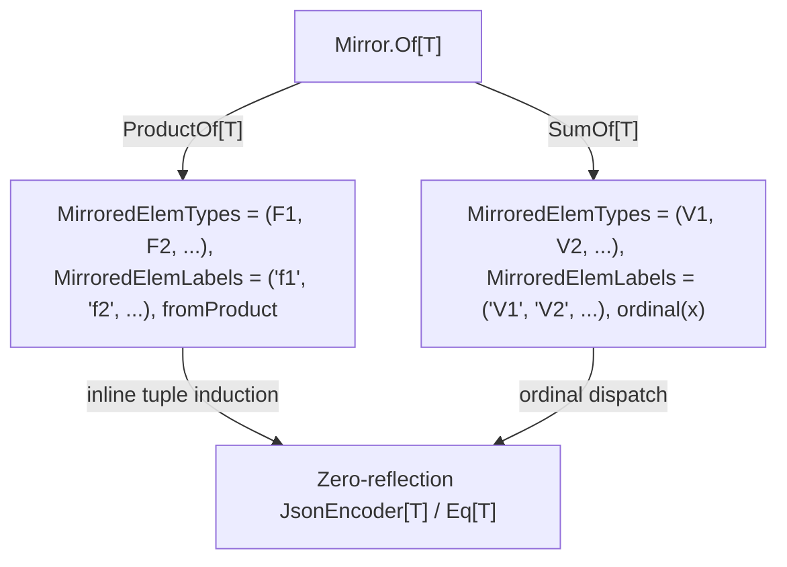
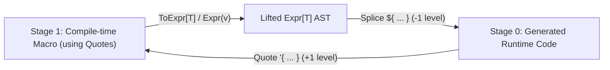

# Metaprogramming: `inline`, `Mirror`, Quotes, and TASTy Macros

Metaprogramming shifts computation from runtime execution to compile-time AST transformation, specialization, and code generation. In Scala 2, compile-time programming depended on experimental `scala.reflect` compiler internals (`blackbox` and `whitebox` contexts) and heavy implicit-resolution chains over Shapeless `HList`s, both of which coupled user libraries to compiler AST representations and triggered severe compile-time blowups. Scala 3 replaces that ad-hoc machinery with a **stratified, statically typed metaprogramming architecture** grounded in multi-stage programming (Taha & Sheard, _MetaML_) and the **Scala 3 Language Reference**: zero-overhead `inline` expansion, `scala.compiletime` type-level inspection, `scala.deriving.Mirror` generic programming, hygienic `'{ ... }` / `${ ... }` staging, and typed TASTy reflection via `quotes.reflect`.

---

## 1. Compile-Time Staging with `inline`

Scala 3 treats `inline` not as an optimization hint like JVM JIT inlining or C++ `inline`, but as a **semantic guarantee enforced by the frontend compiler**. Every `inline` definition is expanded at the call site during the `inlining` compiler phase (after `typer`, using preserved TASTy trees), enabling dead-branch elimination, constant folding, and zero-allocation specialization before JVM bytecode emission.


### `inline val`, `inline def`, and Parameter Semantics

An `inline val` must have a constant expression right-hand side (`Int`, `Long`, `Double`, `Boolean`, `String`, etc.) and binds a **singleton constant type**. Wherever the identifier appears, the compiler substitutes the literal constant directly and folds constant expressions (such as `2 * Pi`) at compile time without emitting a static field read in bytecode unless referenced reflectively.

An `inline def` expands its body at every call site. Crucially, the evaluation semantics of parameters passed to an `inline def` follow strict rules:

- **Default value parameters (`x: Int`)**: Evaluated **once** before the inlined body by binding a synthetic `val x$proxy = arg` if the argument is non-trivial or referenced multiple times, preserving call-by-value semantics and preventing duplicated side effects.
- **By-name parameters (`x: => Int`)**: Substituted directly as expressions at every reference inside the inlined body without allocating a `Function0` closure object, eliminating closure heap allocation on hot paths.
- **`inline` parameters (`inline x: Int`)**: Substituted syntactically as ASTs at every use site (similar to call-by-name, but eligible for compile-time constant folding, `inline if`, and `constValue` inside the body).

```scala
object Logger:
  inline val Enabled = false

  inline def debug(inline msg: String): Unit =
    inline if Enabled then println(s"[DEBUG] $msg")

// At call site: Logger.debug(expensiveBuildString())
// Expands to `()` — `expensiveBuildString()` is never evaluated and no call remains in bytecode.
```

Because `inline if` requires its condition to reduce to a compile-time `Boolean` literal (`true` or `false`) after parameter substitution and constant folding, the compiler rejects any `inline if` whose condition depends on a runtime variable. Once resolved, the untaken branch is **discarded before bytecode generation**—and in `transparent inline` methods, is not even required to conform to the same runtime type as the taken branch.

### `inline match` and Type Specialization

An `inline match` inspects either a compile-time constant value or the **static type** of a scrutinee (often paired with `scala.compiletime.erasedValue`) and reduces to a single matching case branch during inlining:

```scala
import scala.compiletime.erasedValue

inline def defaultFor[T]: T =
  inline erasedValue[T] match
    case _: Int     => 0.asInstanceOf[T]
    case _: String  => "".asInstanceOf[T]
    case _: Boolean => false.asInstanceOf[T]
```

Here `erasedValue[T]` acts as a **compile-time phantom witness** of type `T`: it never exists at runtime (calling it outside an `inline match` scrutinee is a compile error), allowing `inline match` to branch on type `T` itself without boxing, `ClassTag`, or runtime `isInstanceOf` checks.

### `transparent inline` vs. Standard `inline def`

A standard `inline def` has a **fixed declared return type** checked at definition time; callers see only that declared supertype even after expansion. Marking a method `transparent inline def` instructs the typechecker to **expand the method immediately during typechecking at the call site** and assign the **narrowest static type of the expanded branch**:

```scala
transparent inline def choose(b: Boolean): Any =
  inline if b then 42 else "fallback"

val n: Int    = choose(true)       // static type is Int (specifically singleton 42)
val s: String = choose(false)      // static type is String (specifically "fallback")
```

> [!WARNING]
> Reserve `transparent inline` for type-level specialization, generic derivation, and macro entry points. Because callers depend on the _post-expansion_ return type, every `transparent inline` call site re-runs inline expansion during `typer`, increasing compile times and coupling binary callers to internal branch types.

---

## 2. `scala.compiletime` Primitives and Negative Type Testing

The `scala.compiletime` package supplies the standard library's type-level toolkit, eliminating much of the boilerplate that previously required custom macros or Shapeless.

| Primitive | Purpose | Typical Usage | Failure Behavior |
| --- | --- | --- | --- |
| `constValue[T]` | Materialize a singleton literal type `T` into a runtime value | `constValue[42]` yields `42: 42` | Compile error if `T` is not a singleton constant type |
| `constValueOpt[T]` | Safe `Option[T]` extraction of a singleton type | Optional metadata inspection | Evaluates to `None` at compile time when non-constant |
| `erasedValue[T]` | Zero-cost compile-time value placeholder for type `T` | Scrutinee of `inline match` | Compile error if emitted into runtime code |
| `summonInline[T]` | Delayed `given` lookup triggered after inline expansion | Recursive derivation inside `inline def` | Emits missing-given error specialized to concrete `T` |
| `summonFrom { ... }` | Pattern match over available `given` instances in scope | Prioritized type-class fallback without ambiguity | Falls through to wildcard or fails compile if unmatched |
| `error(msg)` | Emit a custom compile-time error message | Reject invalid type-level configurations | Halts compilation with `msg` at the expansion site |
| `testing.typeChecks(code)` | Returns `true` iff `code` string typechecks | Positive/negative type tests in MUnit | Never fails build; returns `Boolean` literal |
| `testing.compileErrors(code)` | Returns list of `Error` diagnostics for `code` | Asserting exact type-error messages | Returns `Nil` if `code` compiles cleanly |

### Delayed Implicit Resolution with `summonInline` and `summonFrom`

When writing a polymorphic `inline def`, ordinary `using` parameters are resolved at the **definition** or **generic call site** before type parameters are instantiated inside `inline match` branches. `summonInline[T]` defers implicit search until **after** `inline match` selects a concrete branch and substitutes type parameters:

```scala
import scala.compiletime.{erasedValue, summonInline, summonFrom, error}

trait Show[A]:
  def show(a: A): String

inline def showAnything[A](a: A): String =
  summonFrom:
    case s: Show[A] => s.show(a)
    case _          => a.toString
```

For negative compile-time verification—proving that invalid variance annotations, missing `given` instances, or illegal capability escapes fail compilation—`scala.compiletime.testing` compiles code snippets inside an inline context and inspects the compiler diagnostics directly in unit tests:

```scala
import scala.compiletime.testing.{typeChecks, compileErrors}

val illTypedRejected: Boolean = !typeChecks("""
  trait Box[+A]:
    def put(a: A): Unit
""")

val errors = compileErrors("summon[Show[java.net.Socket]]")
assert(errors.nonEmpty)
```

Notice the engineering discipline: negative type tests require no external compiler plugin or runtime reflection; they execute deterministically during `scala test` and verify both that invalid constructs fail and that diagnostics explain why.

---

## 3. Generic Programming with `scala.deriving.Mirror`

Type-class derivation builds instances of algebras like `Eq`, `Show`, `Codec`, or `Monoid` automatically for arbitrary algebraic data types (`case class` products and `enum` / `sealed trait` sums). In Scala 3, the compiler automatically synthesizes a `scala.deriving.Mirror.Of[T]` `given` instance for every eligible product and sum type—zero runtime reflection, zero bytecode generation libraries, and zero Shapeless `Generic` boilerplate.

### Algebraic Structure of `Mirror.ProductOf` and `Mirror.SumOf`

`Mirror` projects any ADT onto tuple types of its fields or variants at the type level:

- **`Mirror.ProductOf[P]`** (for `case class`, `case object`, and `enum` singleton/parameterized cases):
  - `type MirroredMonoType = P`
  - `type MirroredLabel <: String`: singleton literal of the type name (e.g., `"User"`).
  - `type MirroredElemTypes <: Tuple`: heterogeneous tuple of field types (e.g., `(Long, String, Boolean)`).
  - `type MirroredElemLabels <: Tuple`: tuple of singleton field-name strings (e.g., `("id", "name", "active")`).
  - `def fromProduct(p: scala.Product): P`: reconstructs `P` from any `Product` (such as a `Tuple`) in $O(k)$ field reads.
- **`Mirror.SumOf[S]`** (for `enum` and `sealed trait` hierarchies):
  - `type MirroredElemTypes <: Tuple`: tuple of all direct subtype variants (e.g., `(Card, Wire, Cash.type)`).
  - `type MirroredElemLabels <: Tuple`: tuple of subtype names.
  - `def ordinal(x: S): Int`: returns the zero-based variant index in $O(1)$ without `isInstanceOf` chains.



### Complete Zero-Reflection `JsonEncoder[A]` Derivation

Combining `Mirror`, `inline match` over `erasedValue[Types]`, `constValue`, and `summonInline`, we derive a complete JSON encoder with `derives` support and no runtime reflection:

```scala
import scala.deriving.Mirror
import scala.compiletime.{constValue, erasedValue, summonInline}

trait JsonEncoder[A]:
  def encode(a: A): String

object JsonEncoder:
  given JsonEncoder[String] with
    def encode(s: String): String = "\"" + s.replace("\"", "\\\"") + "\""
  given JsonEncoder[Int] with
    def encode(i: Int): String = i.toString
  given JsonEncoder[Boolean] with
    def encode(b: Boolean): String = b.toString

  private inline def encodeFields[Types <: Tuple, Labels <: Tuple](
      prod: Product,
      idx: Int
  ): List[String] =
    inline (erasedValue[Types], erasedValue[Labels]) match
      case _: (EmptyTuple, EmptyTuple) => Nil
      case _: ((t *: ts), (l *: ls)) =>
        val label = constValue[l & String]
        val enc   = summonInline[JsonEncoder[t]]
        val value = prod.productElement(idx).asInstanceOf[t]
        val head  = s"\"$label\":${enc.encode(value)}"
        head :: encodeFields[ts, ls](prod, idx + 1)

  private inline def encodeSum[S, Variants <: Tuple](
      value: S,
      ordinal: Int,
      idx: Int
  ): String =
    inline erasedValue[Variants] match
      case _: EmptyTuple => throw IllegalStateException(s"Invalid ordinal $ordinal")
      case _: (v *: vs) =>
        if idx == ordinal then
          summonInline[JsonEncoder[v]].encode(value.asInstanceOf[v])
        else
          encodeSum[S, vs](value, ordinal, idx + 1)

  inline given derived[A](using m: Mirror.Of[A]): JsonEncoder[A] =
    inline m match
      case p: Mirror.ProductOf[A] =>
        new JsonEncoder[A]:
          def encode(a: A): String =
            val prod = a.asInstanceOf[Product]
            encodeFields[m.MirroredElemTypes, m.MirroredElemLabels](prod, 0).mkString("{", ",", "}")
      case s: Mirror.SumOf[A] =>
        new JsonEncoder[A]:
          def encode(a: A): String =
            encodeSum[A, m.MirroredElemTypes](a, s.ordinal(a), 0)

enum Payment derives JsonEncoder:
  case Card(last4: String, authorized: Boolean)
  case Wire(reference: String, amountCents: Int)
```

For structural equality (`Eq[A]`), `Mirror.SumOf.ordinal` enables an $O(1)$ fast-path rejection before descending into variant fields:

```scala
trait Eq[A]:
  def eqv(x: A, y: A): Boolean

object Eq:
  given Eq[Int] with
    def eqv(x: Int, y: Int): Boolean = x == y
  given Eq[String] with
    def eqv(x: String, y: String): Boolean = x == y

  private inline def eqFields[T <: Tuple](px: Product, py: Product, idx: Int): Boolean =
    inline erasedValue[T] match
      case _: EmptyTuple => true
      case _: (h *: t) =>
        val headEq = summonInline[Eq[h]].eqv(
          px.productElement(idx).asInstanceOf[h],
          py.productElement(idx).asInstanceOf[h]
        )
        headEq && eqFields[t](px, py, idx + 1)

  private inline def eqSum[S, V <: Tuple](x: S, y: S, ord: Int, idx: Int): Boolean =
    inline erasedValue[V] match
      case _: EmptyTuple => false
      case _: (h *: t) =>
        if idx == ord then summonInline[Eq[h]].eqv(x.asInstanceOf[h], y.asInstanceOf[h])
        else eqSum[S, t](x, y, ord, idx + 1)

  inline given derived[A](using m: Mirror.Of[A]): Eq[A] =
    inline m match
      case _: Mirror.ProductOf[A] =>
        new Eq[A]:
          def eqv(x: A, y: A): Boolean =
            eqFields[m.MirroredElemTypes](x.asInstanceOf[Product], y.asInstanceOf[Product], 0)
      case s: Mirror.SumOf[A] =>
        new Eq[A]:
          def eqv(x: A, y: A): Boolean =
            val ox = s.ordinal(x)
            ox == s.ordinal(y) && eqSum[A, m.MirroredElemTypes](x, y, ox, 0)
```

Notice what `scalac` emits for `Payment`: there is no `java.lang.reflect.Field` scanning, no `HList` intermediate allocations (`::` cons cells in Shapeless), and no dynamic method lookup. Each `encodeFields` recursion unrolls at compile time into direct calls to `JsonEncoder[String].encode(prod.productElement(0).asInstanceOf[String])`, while `encodeSum` lowers to an integer `if/else` chain keyed by `s.ordinal(a)`. For deeply nested or recursive ADTs (such as `enum Tree[A] { case Leaf(v: A); case Branch(l: Tree[A], r: Tree[A]) }`), note a critical pitfall: calling `summonInline[JsonEncoder[Tree[A]]]` eagerly inside `inline given` without an anonymous class indirection or `lazy` boundary triggers infinite inline expansion up to `-Xmax-inlines` (default 32). Guarding recursive calls via a `lazy val` or `new JsonEncoder[A]` method body (as above, where `summonInline` sits inside `def encode`) ensures the recursive lookup resolves to the outer `given` reference rather than re-expanding endlessly.

---

## 4. Principled Metaprogramming: Quotes, Splices, and Phase Consistency

When type-level `inline` and `Mirror` are insufficient—for example, when generating optimized `while` loops, inspecting expression ASTs for SQL/JSON schema validation, or synthesizing bespoke helper methods—Scala 3 provides **Quotes (`'{ ... }`) and Splices (`${ ... }`)** in `scala.quoted`.

### Two-Stage Typing and Hygienic ASTs

Drawing directly from MetaML and multi-stage calculus (Stucki, Biboudis, & Odersky, _A Theory of Tagged Objects / Principled Metaprogramming in Scala 3_), Scala 3 enforces two invariants at compile time:

1. **Static typing across stages**: A quoted expression `'{ expr }` of type `Expr[T]` represents a **well-typed AST fragment** whose runtime evaluation yields a value of type `T`. Unlike string macros or untyped `scala.reflect.api.Trees`, you cannot construct an ill-typed `Expr[T]` without explicitly breaking out via unsafe casts.
2. **Hygienic lexical scoping**: Identifiers bound inside `'{ val x = 1; x + ... }` are alpha-renamed and resolved against their lexical definition site, preventing accidental variable capture when spliced into an arbitrary caller scope.

Every macro entry point pairs an `inline def` in normal stage-0 code with a top-level splice `${ ... }` whose implementation takes `(using Quotes)` at stage 1 (compile time):

```scala
import scala.quoted.*

inline def assertPositive(inline x: Int): Int =
  ${ assertPositiveImpl('x) }

private def assertPositiveImpl(x: Expr[Int])(using Quotes): Expr[Int] =
  x.value match
    case Some(n) if n <= 0 =>
      quotes.reflect.report.errorAndAbort(s"Expected positive literal, got $n", x)
    case Some(_) =>
      x
    case None =>
      '{
        val evaluated = $x
        if evaluated <= 0 then throw IllegalArgumentException(s"Expected > 0, got $evaluated")
        evaluated
      }
```

Look closely at what happens in `assertPositiveImpl`: if `x` is a compile-time constant (`x.value` extracts `Some(n)` via `FromExpr[Int]`), invalid literals like `assertPositive(-3)` **fail compilation** immediately; if `x` is a runtime expression (`None`), the macro synthesizes a hygienic `val evaluated = $x` block so `$x` is evaluated **exactly once** at runtime!

### The Phase Consistency Principle (PCP)

Staging distinguishes **level 0** (runtime program execution) from **level 1** (macro execution inside the compiler). A quotation `'{ ... }` increases the stage level by $+1$, and a splice `${ ... }` decreases the stage level by $-1$.

$$\text{level}(\text{splice } \$\{e\}) = \text{level}(e) - 1, \qquad \text{level}(\text{quote } '\{e\}) = \text{level}(e) + 1$$

The **Phase Consistency Principle (PCP)** states: _a variable `v` defined at stage level $k$ may only be referenced directly at stage level $k$_. Violating PCP is a compile-time error:

- **Illegal downward leak**: Referencing a runtime local `val n: Int = readInt()` (level 0) inside a macro body (level 1) outside a quote fails because `n` does not exist when the compiler runs.
- **Illegal upward capture**: Computing `val list: List[Int] = List(1, 2, 3)` inside a macro (level 1) and referencing `list` directly inside `'{ list.sum }` (level 0) fails unless `list` is **lifted** across stages via `Expr(list)` (which requires a `ToExpr[List[Int]]` instance that serializes the compile-time value into an `Expr[List[Int]]` AST construction).



---

## 5. TASTy Reflect (`quotes.reflect.*`)

High-level `Expr[T]` quotes cover expression construction, yet structural inspection—listing case-class fields, reading annotations, analyzing `val` definitions inside a block, or constructing match expressions over dynamic case lists—requires **TASTy Reflect** via `quotes.reflect.*`.

TASTy Reflect exposes a **sandboxed, compiler-version-independent view** of TASTy trees (`Term`, `TypeRepr`, `Symbol`, `TreeMap`, `TreeAccumulator`) scoped to the active `(using Quotes)` context:

```scala
import scala.quoted.*

inline def fieldNamesOf[T]: List[String] =
  ${ fieldNamesOfImpl[T] }

private def fieldNamesOfImpl[T: Type](using Quotes): Expr[List[String]] =
  import quotes.reflect.*
  val tpe    = TypeRepr.of[T]
  val sym    = tpe.typeSymbol
  if !sym.flags.is(Flags.Case) then
    report.errorAndAbort(s"${tpe.show} is not a case class", Position.ofMacroExpansion)
  val names: List[String] = sym.caseFields.map(_.name)
  Expr(names) // Lifted to Expr[List[String]] via ToExpr
```

Key safety guarantees of `quotes.reflect`:

1. **Path-dependent isolation**: `quotes.reflect.Term` is path-dependent on the `Quotes` parameter, so AST nodes cannot accidentally leak across macro invocations or threads.
2. **Typed bridge (`asExprOf[T]`)**: Converting a raw `Term` back into an `Expr[T]` via `term.asExprOf[T]` performs a **type-check at macro runtime**, throwing a clear diagnostic if the synthesized tree does not conform to `T`, supplemented by `-Xcheck-macros` in tests to validate owner chains, symbol flags, and tree invariants.
3. **TASTy compatibility**: Unlike Scala 2's `scala.reflect.macros.Universe`, which exposed internal `nsc` compiler mutability and broke across compiler patch versions, `quotes.reflect` talks to the standardized TASTy abstraction layer, preserving macro compatibility across Scala 3 minor releases.

### Inspecting Annotations and Rewriting Trees (`TreeMap` / `ValDef.let`)

When a macro needs to measure expression latency, inject tracing spans, or extract metadata from annotations on case-class fields, `quotes.reflect` provides `Symbol.annotations`, `TreeAccumulator` (read-only AST folds), and `TreeMap` (hygienic AST transformations). Crucially, creating local synthetic `val` bindings directly via `quotes.reflect` requires setting the exact lexical `Symbol.spliceOwner`—which `ValDef.let` handles automatically:

```scala
import scala.quoted.*

inline def timed[A](inline label: String)(inline body: A): A =
  ${ timedImpl('label, 'body) }

private def timedImpl[A: Type](label: Expr[String], body: Expr[A])(using Quotes): Expr[A] =
  import quotes.reflect.*
  val bodyTerm = body.asTerm
  // Inspect whether `body` is a trivial literal or identifier before wrapping
  bodyTerm match
    case Literal(_) => body
    case _ =>
      '{
        val start  = System.nanoTime()
        val result = $body
        val elapsedNs = System.nanoTime() - start
        println(s"[${$label}] ${elapsedNs / 1_000_000.0} ms")
        result
      }
```

Notice how `quotes.reflect` pattern matching on `Literal(_)` complements high-level `'{ ... }` quotation: we inspect the TASTy structure using `quotes.reflect.Term`, yet emit the instrumented runtime code using hygienic typed quotes. When transforming existing user ASTs (for example, rewriting every `var` assignment inside a block), subclass `TreeMap` and pass `Symbol.spliceOwner` when entering new owner scopes so `-Xcheck-macros` never flags an `OwnerMismatch`.

---

## 6. Then vs. Now: Scala 2 Macros & Shapeless vs. Scala 3 Metaprogramming

| Dimension | Scala 2 (2.10–2.13) | Scala 3 (3.0–3.10.1) | Engineering Impact |
| --- | --- | --- | --- |
| Generic Derivation | Shapeless `Generic[T]`, `HList`, `Coproduct`, `Lazy` | `scala.deriving.Mirror` (`ProductOf` \| `SumOf`) + `inline` | Eliminates `HList` runtime allocations and quadratic implicit search |
| Macro Entry Point | `def f = macro impl` (experimental `scala.reflect.macros`) | `inline def f = ${ impl }` (`scala.quoted`) | Full separation of compile-time phase and runtime code |
| Return-Type Refinement | `whitebox.Context` (fragile IDE/typechecker inference) | `transparent inline def` + `inline match` | Standardized, statically specified expansion in `typer` |
| Prioritized Fallback | `LowPriorityImplicits` trait inheritance hierarchy | `scala.compiletime.summonFrom` | Local, explicit fallback without trait linearization hacks |
| Negative Type Tests | `shapeless.test.illTyped` (macro hack) | `scala.compiletime.testing.{typeChecks, compileErrors}` | Built into standard library with inspectable diagnostics |
| AST Compatibility | Coupled to `scala-reflect` compiler internals | Sandboxed `quotes.reflect` over TASTy | Macros survive compiler internal refactors across minor versions |

In Scala 2 codebases using Shapeless 2.x, deriving a JSON codec for a 30-field case class materialized a 30-element nested `::[F1, ::[F2, ...]]` type, triggering up to $O(n^2)$ implicit lookups, `ImplicitNotFound` cascades that obscured which field actually lacked an encoder, and JVM method-size or stack-depth pressure from deeply nested `HList` wrappers. In Scala 3, `Mirror` emits flat tuple type projections and `inline` unrolls directly to field indexing (`productElement(i)`), shrinking both compile times and bytecode footprint dramatically.

---

## 7. Failure Modes and Debugging Compiler Phases

1. **Exceeding `-Xmax-inlines` (default 32)**: Recursive `inline def` calls without a terminating `EmptyTuple` branch—or calling `summonInline[Codec[T]]` eagerly during `Codec[T]` derivation of a recursive `enum`—overflows the inline budget and aborts compilation. Fix by wrapping recursive element lookups inside an instantiated object method body (`def encode`) or increasing `-Xmax-inlines` strictly when genuinely deriving large flat schemas (>32 fields).
2. **Broken binary compatibility from `inline` bodies**: Because `inline def` copies its implementation AST into downstream callers' bytecode and TASTy, changing a private helper called by a public `inline def` breaks binary compatibility for un-recompiled downstream libraries (even when method signatures appear unchanged). Keep public `inline` surfaces thin and delegate heavy logic to non-inline runtime methods.
3. **`FromExpr` extraction failure on non-literal arguments**: Calling `expr.value` inside a macro returns `None` whenever a caller passes a `val x = compute()` instead of a literal constant. Either require `inline` parameters plus `constValue` or provide a runtime fallback branch inside `'{ ... }`.
4. **Corrupted symbol ownership in `quotes.reflect`**: Manually constructing `ValDef` or `DefDef` trees with `Symbol.newVal` using `Symbol.spliceOwner` incorrectly causes `OwnerMismatch` crashes during `erasure` or `genBCode`. Always pass `-Xcheck-macros` in library test builds (`//> using options -Xcheck-macros`) and inspect expanded ASTs with `-Xprint:inlining`.

---

## Interview Drill

1. **What is the semantic difference between passing an argument as `x: Int`, `x: => Int`, and `inline x: Int` to an `inline def`?**

<details><summary>Answer</summary>

A regular value parameter `x: Int` preserves call-by-value semantics: if the argument expression is non-trivial, the compiler binds a synthetic `val` before the inlined body so it executes once. A by-name parameter `x: => Int` substitutes the expression at every use site without allocating a `Function0` closure, re-evaluating on each use. An `inline x: Int` parameter also substitutes the AST at every use site, **and** keeps its compile-time constant/singleton AST structure visible to `inline if`, `inline match`, and `constValue` inside the body.

</details>

2. **When should you choose `transparent inline def` over a standard `inline def`, and what is its cost?**

<details><summary>Answer</summary>

Use `transparent inline def` when the caller needs a **more specific static type** than the declared return type—such as refining `Any` to `Int` or `"ok"`, returning a concrete subtype from a `Mirror` lookup, or returning a macro-synthesized structural type. The cost is compile-time overhead and tighter coupling: `transparent inline` methods must be expanded immediately during `typer` at every call site rather than later in `inlining`, and changing any branch's inferred type alters downstream typechecking.

</details>

3. **How does `scala.compiletime.erasedValue[T]` enable type-level branching without runtime overhead?**

<details><summary>Answer</summary>

`erasedValue[T]` has return type `T` at typechecking time so it can serve as the scrutinee of an `inline match` (matching `case _: Int => ...` or `case _: (h *: t) => ...`), yet it has no runtime implementation and is a compile error if it survives into emitted bytecode. After `inline match` selects the single matching type branch and discards the scrutinee, zero runtime objects or `ClassTag` checks remain.

</details>

4. **Explain how `Mirror.ProductOf` and `Mirror.SumOf` eliminate Shapeless `HList`s in Scala 3 type-class derivation.**

<details><summary>Answer</summary>

The compiler natively synthesizes `Mirror.ProductOf[P]` (exposing `MirroredElemTypes` and `MirroredElemLabels` as flat heterogeneous tuples plus `fromProduct`) and `Mirror.SumOf[S]` (exposing variant types plus an $O(1)$ `ordinal(s)` method). Combined with `inline match` over `erasedValue[MirroredElemTypes]` and `summonInline`, derivation unrolls directly into flat field-index or ordinal-switch code at compile time, avoiding Shapeless's runtime `::` cons-cell wrappers and quadratic implicit search chains.

</details>

5. **What is the Phase Consistency Principle (PCP) in Scala 3 macros, and how does `ToExpr` satisfy it?**

<details><summary>Answer</summary>

PCP states that a variable bound at staging level $k$ (where level 0 is runtime and level 1 is compile-time macro execution) can only be referenced directly at level $k$. A compile-time value `v: T` at level 1 cannot be referenced directly inside a level-0 quotation `'{ ... }` because `v` lives in the compiler process, not the target runtime JVM. Calling `Expr(v)` uses a `ToExpr[T]` given to serialize `v` into an AST construction `Expr[T]`, lifting the value safely across stages so `${ Expr(v) }` emits level-0 code.

</details>

6. **Why does deriving a `JsonEncoder` for a recursive ADT (`enum Tree`) fail with `MaxInlines` if `summonInline` is evaluated eagerly during `inline given` expansion?**

<details><summary>Answer</summary>

If `summonInline[JsonEncoder[Tree[A]]]` executes inside an `inline` branch while `JsonEncoder.derived[Tree[A]]` itself is still being expanded, the compiler recursively expands `derived` for `Tree[A]` inside itself without termination until it hits the `-Xmax-inlines` limit (32). Placing `summonInline` inside an instantiated object's method body (`new JsonEncoder[A] { def encode(...) = ... summonInline ... }`) creates a concrete runtime target so the recursive lookup resolves to the outer `given` instance or defers cleanly.

</details>

7. **How do you write a deterministic negative test proving that a type-class instance must not exist or that an illegal variance position is rejected?**

<details><summary>Answer</summary>

Use `scala.compiletime.testing.typeChecks("...")` and `compileErrors("...")`. Both invoke the Scala 3 typer inside an inline macro during test compilation, returning `false` or a non-empty list of compiler `Error` objects without failing the test suite build—allowing MUnit tests to assert both compilation rejection and exact diagnostic text.

</details>
