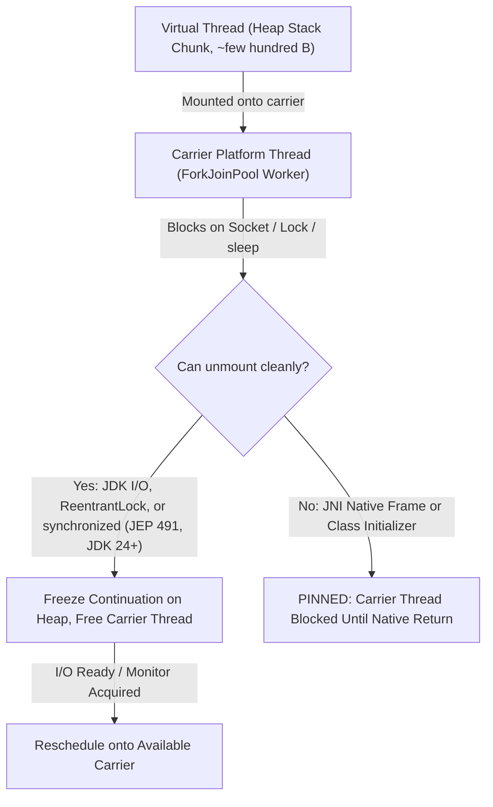
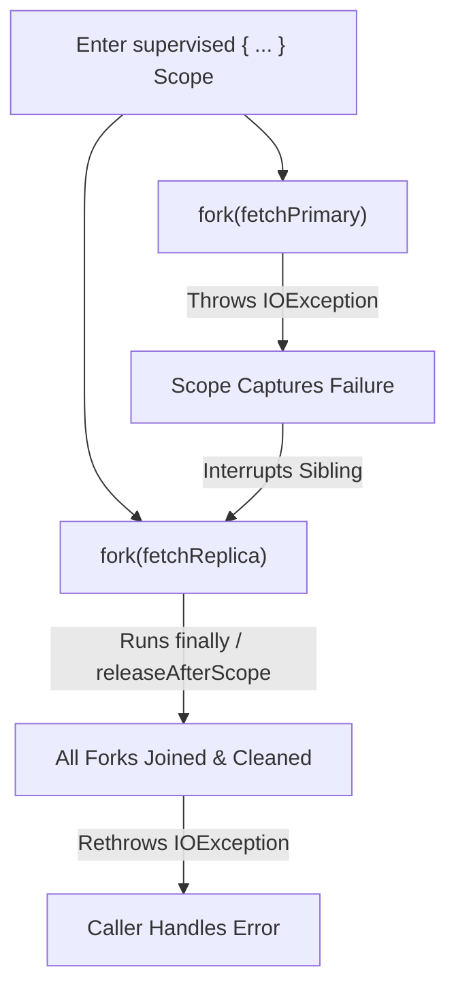

# Concurrency: JVM Memory Model, Virtual Threads, Direct-Style Ox, and Capture Checking

Language-neutral concurrency theory—work-span bounds, Brent's theorem, hardware Compare-And-Swap (CAS), lock-free Treiber stacks, and the ABA problem—is owned by [Algorithms & Data Structures M14](../../../algorithms/dsa/modules/14-parallel-algorithms-concurrency-and-interview-execution.md), while the algebraic derivation of pure functional parallelism (`Par`) and scoped local state (`ST`) lives in [Functional Programming M06](../../../architecture/functional-programming/modules/06-purely-functional-parallelism-and-laws.md) and [Functional Programming M12](../../../architecture/functional-programming/modules/12-effects-io-trampolining-st-and-streaming.md). This module covers the **JVM and Scala 3 execution substrate**: the Java Memory Model (JMM), JDK 25 LTS Virtual Threads and JEP 491 unpinning, why `scala.concurrent.Future` breaks referential transparency and starves thread pools, direct-style structured concurrency with **Ox 1.0.9**, and **Scala 3 Capture Checking** for compile-time capability safety.

---

## 1. The JVM Memory Model (JMM) and Scala Execution Semantics

Without memory-ordering guarantees, modern CPUs (out-of-order execution, store buffers, invalidation queues) and the JVM HotSpot JIT compiler (register hoisting, load/store reordering) routinely observe stale writes or torn initialization across threads. JSR-133 defines the **Java Memory Model** as a partial **happens-before** relation ($\prec_{hb}$) over memory actions: a read $r$ may observe a write $w$ only if $w$ happens-before $r$ (or no intervening write $w'$ satisfies $w \prec_{hb} w' \prec_{hb} r$).

Key JMM edges surfaced in Scala programs:

1. **Program order**: Each action in a thread happens-before every subsequent action in that same thread's execution trace.
2. **Volatile variable rule**: A write to a `@volatile var` field happens-before every subsequent read of that same `@volatile` field, emitting hardware memory fences (e.g., `StoreLoad` barrier on x86-64 / `DMB` or `LDAR`/`STLR` on ARM64) and disabling JIT loop hoisting.
3. **Monitor lock rule**: Unlocking a monitor (`synchronized` exit) happens-before every subsequent lock acquisition on the same monitor.
4. **Final field freeze semantics**: In JVM bytecode, `val` fields inside classes compile to `final` JVM fields. Provided the `this` reference does **not escape during construction**, any thread reading that object observes initialized `final` fields without requiring synchronization (`safe publication`).
5. **Scala `lazy val` initialization**: In Scala 3, thread-safe `lazy val` lowers to bitmap-based state tracking with `VarHandle` CAS/acquire-release transitions (`scala.runtime.LazyVals`), fixing the Scala 2 whole-instance monitor lock (`synchronized(this)`) that previously caused deadlocks when two threads evaluated different `lazy val` fields across mutually referencing objects.

> [!WARNING]
> `@volatile` guarantees **visibility and ordering**, **not atomicity** of read-modify-write sequences. Writing `@volatile var count = 0` and executing `count += 1` from two threads loses updates because `count + 1` and the subsequent store are separate actions. Use `java.util.concurrent.atomic.AtomicInteger` / `VarHandle` CAS loops—or purely functional `Ref` / `STM` (covered in Modules 08 and 09)—for shared atomic updates.

### Volatile Visibility vs. CAS Atomicity and Scala 3 `LazyVals`

Comparing a torn `@volatile` counter against a lock-free `AtomicLong` CAS update demonstrates why hardware memory fences alone cannot serialize read-modify-write operations:

```scala
import java.util.concurrent.atomic.AtomicLong

final class CounterBox:
  @volatile var nonAtomic: Long = 0L
  val atomic: AtomicLong        = AtomicLong(0L)

  // Racy under concurrent threads: read + add + store is NOT atomic
  def incBroken(): Unit = nonAtomic = nonAtomic + 1L

  // Linearizable: hardware LOCK XADD / CAS retry loop
  def incSafe(): Long = atomic.incrementAndGet()
```

For lazy initialization, Scala 2 wrapped every `lazy val` inside `synchronized(this)`, which caused cross-instance monitor deadlocks when Thread A held `obj1`'s monitor while waiting for `obj2.x` and Thread B held `obj2`'s monitor waiting for `obj1.y`. Scala 3 replaces that whole-object lock with `scala.runtime.LazyVals`: a 2-bit state machine per `lazy val` stored in a bitmap `VarHandle` field (`00` uninitialized → `01` evaluating → `11` initialized, plus `10` contended), spinning or waiting per-field via `CountDownLatch`/`Object` monitors only when two threads race on the exact same `lazy val`.

---

## 2. JDK 25 LTS Virtual Threads (Project Loom) and Pinning

Traditional JVM `java.lang.Thread` instances wrap OS kernel threads (1:1 mapping). Each OS thread reserves roughly 1 MiB of off-heap stack memory, incurs $\sim 1\text{–}10\,\mu\text{s}$ kernel context-switch overhead, and limits practical concurrency to a few thousand threads—forcing reactive Scala 2 stacks into callback-heavy `Future` or complex async state machines.

**Virtual Threads** (standardized in JDK 21 and refined in **JDK 25 LTS**) decouple JVM threads from OS threads via **M:N scheduling** backed by delimited heap-stored continuations (`jdk.internal.vm.Continuation`) and a work-stealing `ForkJoinPool` of **carrier platform threads** sized by default to `Runtime.availableProcessors`:



When a virtual thread calls a blocking JDK API (`SocketInputStream.read`, `LockSupport.park`, `Thread.sleep`, `BlockingQueue.take`), the JVM suspends its continuation, copies the minimal active stack frames into a resizable heap chunk object, and returns the carrier platform thread to execute another virtual thread. Scaling to $10^5\text{–}10^6$ concurrent blocked I/O tasks requires only modest heap rather than gigabytes of OS thread stacks.

### JEP 491 (JDK 24/25) Delta: `synchronized` Unpinning vs. JNI Pinning

Prior to JDK 24, entering a `synchronized` block or calling `Object.wait()` **pinned** the virtual thread to its carrier platform thread because monitor ownership was tied to the underlying OS thread in HotSpot. **JEP 491 (_Synchronize Virtual Threads without Pinning_, delivered in JDK 24 and standard in JDK 25 LTS)** re-engineered JVM monitors so virtual threads can acquire, block inside, and unmount from `synchronized` blocks and `Object.wait()` without holding the carrier thread hostage.

However, two pinning hazards remain in JDK 25 LTS:

| Blocking Scenario | JDK 21–23 Behavior | JDK 24–25 LTS Behavior (JEP 491) | Operational Mitigation |
| --- | --- | --- | --- |
| JDK socket / NIO / `ReentrantLock` / `Semaphore` | Unmounts cleanly | Unmounts cleanly | Safe for millions of virtual threads |
| `synchronized` block / `Object.wait()` | **Pins carrier thread** | **Unmounts cleanly (JEP 491)** | Legacy JDBC/logging libraries no longer starve carriers |
| Blocking inside **JNI / FFM native frames** | **Pins carrier thread** | **Still pins carrier thread** | Offload native/JNI C calls to a bounded platform pool |
| Blocking inside class initializer (`<clinit>`) | **Pins carrier thread** | **Still pins carrier thread** | Avoid I/O or locks inside static/object initialization |
| CPU-bound tight loops (no blocking/yield) | Occupies carrier until finished | Occupies carrier until finished | Do not use virtual threads for parallel CPU crunching; bound compute pools |

Verify pinning in production with JDK Flight Recorder (`jcmd <pid> JFR.start` or `-Djdk.tracePinnedThreads=full` in older JDKs, replaced by JFR `jdk.VirtualThreadPinned` events with stack traces in JDK 24/25). You can also inspect pinning programmatically in tests via JFR recording streams:

```scala
import jdk.jfr.consumer.RecordingStream

def monitorPinning(onPinned: String => Unit): Thread =
  Thread.ofVirtual().start: () =>
    val rs = RecordingStream()
    rs.enable("jdk.VirtualThreadPinned")
    rs.onEvent("jdk.VirtualThreadPinned", evt => onPinned(evt.getStackTrace.toString))
    rs.start()
```

---

## 3. `scala.concurrent.Future`: Eager-Execution Traps and Starvation

Before virtual threads and effect runtimes, `scala.concurrent.Future[A]` served as Scala's standard concurrency abstraction. In production systems, `Future` exhibits three structural flaws rooted in **eager evaluation** and **unstructured lifetimes**.

### Trap 1: Breaking Referential Transparency

Constructing a `Future { body }` immediately submits `body` to the implicit `ExecutionContext` as a side effect of value creation. Consider refactoring a repeated `Future` expression into a `val`:

```scala
import scala.concurrent.{ExecutionContext, Future}
import java.util.concurrent.atomic.AtomicInteger

given ExecutionContext = ExecutionContext.global
val counter = AtomicInteger(0)

// Program A: Two distinct Future expressions -> counter increments TWICE
val progA: Future[(Int, Int)] =
  for
    a <- Future(counter.incrementAndGet())
    b <- Future(counter.incrementAndGet())
  yield (a, b) // Yields (1, 2)

// Program B: Factoring common sub-expression breaks equivalence! -> increments ONCE
val inc = Future(counter.incrementAndGet())
val progB: Future[(Int, Int)] =
  for
    a <- inc
    b <- inc
  yield (a, b) // Yields (1, 1) — memoized result!
```

Furthermore, writing `for { a <- Future(op1()); b <- Future(op2()) } yield ...` runs `op1` and `op2` **sequentially** because `flatMap` constructs `Future(op2())` only inside `op1`'s completion callback—whereas creating `val f1 = Future(op1()); val f2 = Future(op2())` before the `for` runs them **concurrently**. Because `Future` conflates _task description_ with _running handle_, equational reasoning fails (contrast with `Par` in [FP M06](../../../architecture/functional-programming/modules/06-purely-functional-parallelism-and-laws.md)).

### Trap 2: `ExecutionContext.global` Thread Starvation

`ExecutionContext.global` is a `ForkJoinPool` capped at `availableProcessors`. When tasks perform blocking calls (JDBC queries, `Thread.sleep`, `Await.result`) without wrapping them in `scala.concurrent.blocking { ... }`, the pool cannot detect the blocked threads via `ForkJoinPool.ManagedBlocker`:

```scala
import scala.concurrent.{Await, ExecutionContext, Future}
import scala.concurrent.duration.*
import java.util.concurrent.Executors

// Negative proof: 2-thread fixed pool deadlocks when tasks block waiting on child Futures!
val tinyPool = ExecutionContext.fromExecutorService(Executors.newFixedThreadPool(2))

def nestedBlockingDeadlock(): Unit =
  given ExecutionContext = tinyPool
  val tasks = (1 to 2).map { _ =>
    Future {
      val inner = Future(42)
      Await.result(inner, 2.seconds) // 💥 Deadlocks: both workers blocked waiting for inner!
    }
  }
  tasks.foreach(Await.result(_, 3.seconds))
```

Even with `blocking { ... }`, `ExecutionContext.global` caps extra compensated threads at `scala.concurrent.context.maxExtraThreads` (default 256), throwing `RejectedExecutionException` or exhausting OS threads under bursty slow I/O.

### Trap 3: Unstructured Lifetimes and Missing Cancellation

`Future` exposes **no cancellation primitive** and **no parent-child supervision**. If a request times out after 100 ms and you race `Future.firstCompletedOf`, the losing `Future` continues executing in the background, holding database connections, saturating downstream APIs, and leaking memory until completion.

---

## 4. Direct-Style Structured Concurrency with Ox 1.0.9

With JDK 21+/25 Virtual Threads eliminating the 1:1 OS-thread scaling ceiling, **direct-style Scala 3 concurrency** returns to plain blocking expressions (`T` instead of `Future[T]` or `IO[T]`) without sacrificing safety—provided concurrency obeys **structured concurrency** (Martin Sústrik; Nathaniel J. Smith, _Notes on structured concurrency, or: Go statement considered harmful_).

**Ox 1.0.9** (`com.softwaremill.ox::core:1.0.9`) implements structured concurrency on JDK virtual threads using Scala 3 context functions (`Ox ?=> T`):

```scala
import ox.*
import ox.channels.*
import scala.concurrent.duration.*

case class UserProfile(name: String, score: Int)

def fetchName(id: Long): String =
  sleep(50.millis)
  s"user-$id"

def fetchScore(id: Long): Int =
  sleep(80.millis)
  99

def loadProfile(id: Long): UserProfile =
  supervised:
    val nameFork  = fork(fetchName(id))
    val scoreFork = fork(fetchScore(id))
    UserProfile(nameFork.join(), scoreFork.join())
```

### Invariants of `supervised` Scopes and Channels

1. **Lexical lifetime containment**: `supervised { ... }` binds an `Ox` capability via context parameter (`using Ox`). No child `fork` can outlive the `supervised` block; before `supervised` returns, it **joins all `forkUser` threads** and **interrupts and joins any remaining daemon `fork`s**.
2. **Fail-fast sibling cancellation**: By default, if any `fork` inside `supervised` throws an unhandled exception, the scope immediately interrupts all active sibling forks, waits for their `finally` blocks / `releaseAfterScope` cleanup hooks to complete, and rethrows the error to the parent—preventing orphaned background tasks and connection leaks.
3. **High-level combinators (`par`, `race`, `timeout`)**: `par(fetchName(id), fetchScore(id))` runs computations concurrently and joins both; `raceSuccess(primary(), replica())` returns the first successful result and cancels the slower branch; `timeout(200.millis)(callService())` interrupts the computation cleanly via `InterruptedException` if the deadline elapses.
4. **Go-style CSP `Channel` and `select`**: Instead of sharing mutable state across forks, virtual threads communicate over typed bounded or rendezvous channels (`Channel.rendezvous[A]`, `Channel.buffered[A](capacity)`) with backpressure, explicit `.done()` / `.error(t)` termination, and multi-channel `select(ch1.receiveClause, ch2.receiveClause)`.

### Bounded Worker Pool and `select` Multiplexing in Ox

Combining `supervised`, `Channel.buffered`, `forkUser`, and `select` yields deterministic backpressure and clean drain semantics without callback pyramids:

```scala
import ox.*
import ox.channels.*
import scala.concurrent.duration.*

case class WorkItem(id: Int, payload: String)

def processBatch(items: List[WorkItem], workers: Int): List[String] =
  supervised:
    val jobs    = Channel.buffered[WorkItem](capacity = 16)
    val results = Channel.buffered[String](capacity = 16)

    // Producer fork: closes `jobs` cleanly once all items are enqueued
    fork:
      items.foreach(jobs.send)
      jobs.done()

    // Worker pool: `forkUser` ensures `supervised` waits for all workers
    val workerForks = (1 to workers).map: _ =>
      forkUser:
        repeatWhile:
          jobs.receiveOrClosed() match
            case ChannelClosed.Done     => false
            case ChannelClosed.Error(e) => throw e
            case item: WorkItem =>
              results.send(s"processed-${item.id}:${item.payload.length}")
              true

    fork:
      workerForks.foreach(_.join())
      results.done()

    results.toList
```

Look closely at the structured shutdown invariants: if any worker throws an exception on a malformed `WorkItem`, `supervised` immediately interrupts the producer, all sibling workers, and the collector fork, drains cleanup hooks, and rethrows the original failure to `processBatch`'s caller without leaking virtual threads or hanging on `results.toList`.

> [!NOTE]
> Use `repeatWhile` or `jobs.foreach` carefully when mixing multiple workers draining one `Channel`: `Channel.done()` broadcasts completion to every waiting receiver, whereas unhandled exceptions propagate via `Channel.error(e)` or `supervised` sibling interruption.



> [!NOTE]
> Ox treats **cancellation as JVM thread interruption** (`Thread.interrupt()`). Any blocking operation inside a fork must respect interruption (standard JDK blocking I/O, `Thread.sleep`, Ox `Channel`, and `LockSupport.park` all do); tight CPU loops performing pure computation without checking `Thread.currentThread().isInterrupted` will delay scope exit until the loop finishes.

---

## 5. Scala 3 Experimental Capture Checking

Structured concurrency with `supervised` enforces runtime scope bounds via `using Ox`, yet without type-system tracking a developer can still **capture the `Ox` capability or a scoped `File` handle inside a closure or lazy stream** and return it out of the lexical block, causing a runtime `IllegalStateException` when invoked after the scope closes.

**Scala 3 Capture Checking** (`import language.experimental.captureChecking`, `import caps.*`) closes this hole at **compile time** using an **object-capability type system** (Boruch-Gruszecki, Odersky, Brachthäuser et al., _Capturing Types_, OOPSLA 2023).

### Capturing Types (`T^{c}`), `Capability`, and Scope Escape Prevention

Under capture checking:

- **Capabilities**: Objects granting permission to perform effects or access scoped resources inherit from `caps.Capability` (or subtraits like `ExclusiveCapability`).
- **Capturing types**: A type `T^C` carries a **capture set** `C = {c1, c2, ...}` listing the free capabilities that values of this type may retain. The shorthand `T^` denotes an existential or universal fresh capability (`T^{cap}`), while a bare `A => B` represents a **pure function** capturing no capabilities, distinct from the impure/capturing function type `A -> B` (which may capture arbitrary capabilities).
- **Preventing closure escape (connection to `ST`)**: In [FP M12](../../../architecture/functional-programming/modules/12-effects-io-trampolining-st-and-streaming.md#4-local-effects-sts-a-and-rank-2-polymorphism), `ST[S, A]` relied on rank-2 polymorphism (`[S] => () => ST[S, A]`) to stop `STRef[S, T]` from escaping `runST`. Capture checking generalizes that guarantee to arbitrary resources without rank-2 type boilerplate:

```scala
import language.experimental.captureChecking
import caps.*
import java.io.{BufferedReader, FileReader}

class FileCap(path: String) extends Capability:
  private val reader = BufferedReader(FileReader(path))
  def readLine(): String = reader.readLine()
  def close(): Unit = reader.close()

def withFile[T](path: String)(op: FileCap^ => T): T =
  val f = FileCap(path)
  try op(f)
  finally f.close()

// Compiles cleanly: `f` never leaves `withFile`
val firstLine: String = withFile("config.toml")(f => f.readLine())

// Negative check (rejected at compile time by capture checking):
// val leaked: () => String = withFile("config.toml")(f => () => f.readLine())
// Error: `() => f.readLine()` has type `() ->{f} String`, which references `f`
// outside the scope of `withFile` (`f` escapes its binder in return type `T`)!
```

Notice why the compiler rejects `leaked`: the closure `() => f.readLine()` has inferred type `() ->{f} String`. Unifying `T` with `() => String` (which requires an empty capture set `{}`) fails because `{f}` cannot be widened out of `withFile`'s parameter scope.

### Capture Set Subtyping, Pure vs. Impure Functions, and Reach Capabilities

In capture checking, the arrow `A => B` denotes a **pure function** whose capture set is empty (`{}`), whereas `A -> B` denotes an **impure function** permitted to capture arbitrary capabilities (`A ->{cap} B`). Subtyping respects capture-set inclusion:

$$\{\} \subseteq \{c_1\} \subseteq \{c_1, c_2\} \;\implies\; (A \Rightarrow B) \;<\!:\; (A \to^{\{c_1\}} B) \;<\!:\; (A \to B)$$

Consequently, passing a pure lambda `(x: Int) => x + 1` where an impure `Int -> String` is expected compiles cleanly, whereas passing a capability-capturing lambda `() => file.readLine()` to a scheduler expecting a pure `() => String` is rejected at compile time!

1. **Reach capabilities (`rcaps`)**: When a capturing capability `f: FileCap^` is stored inside a container such as `List[() ->{f} String]` or `Box[FileCap^]`, a downstream function polymorphic over `Box[A]` needs to propagate whatever capabilities hide inside `A`. Scala 3's **reach capabilities** (`x*`) track capabilities reachable _through_ a parameter or field so standard generic collections remain sound without exponential capture-set annotations.
2. **Checked exceptions via `CanThrow[E]`**: Pairing `captureChecking` with `import language.experimental.saferExceptions` turns checked exceptions into lexical capabilities:

```scala
import language.experimental.saferExceptions
import language.experimental.captureChecking

class InsufficientFunds(val deficit: BigDecimal) extends Exception

// Desugars to: def debit(balance: BigDecimal, amount: BigDecimal)(using CanThrow[InsufficientFunds]): BigDecimal
def debit(balance: BigDecimal, amount: BigDecimal): BigDecimal throws InsufficientFunds =
  if amount > balance then throw InsufficientFunds(amount - balance)
  else balance - amount

// Discharging the capability with `try / catch`:
val settled: BigDecimal =
  try debit(100, 150)
  catch case _: InsufficientFunds => 0
```

Crucially, because `CanThrow[E]` is a tracked capability, passing a throwing lambda `(x: Int) => debit(x, 50)` to `List(10, 20).map(...)` inside a `try` block works seamlessly **without** breaking `map`'s signature—the compiler tracks that the lambda captures the local `CanThrow` capability, preventing that lambda from escaping the enclosing `try` block!

---

## 6. Then vs. Now: Scala Concurrency Paradigms Compared

| Dimension | Scala 2 `Future` (2013–2020) | Direct-Style Ox 1.0.9 + JDK 25 Virtual Threads | Pure Effect Runtime (CE3 `IO`, Module 08) |
| --- | --- | --- | --- |
| Execution model | Eager submission to `ExecutionContext` | Direct blocking on M:N JDK 25 virtual threads | Lazy reified `IO` values on work-stealing fibers |
| Referential transparency | Broken (evaluating `Future(...)` fires immediately) | Side effects happen inline (enforce purity via discipline or Capture Checking) | Strictly preserved (`val io = IO(...)` is an inert description) |
| Cancellation & cleanup | None (`Future` has no cancel or supervision) | Structured `supervised` scope + JVM interruption | Structured fibers + masked `IO.uncancelable` & `Resource` |
| Blocking I/O safety | Starves `global` pool without `blocking { ... }` | Safe (`JEP 491` unmounts even inside `synchronized`; avoid JNI pinning) | Explicitly shifted via `IO.blocking` to cached pool |
| Checked resource escape | Runtime bugs only | Compile-time prevention via experimental Capture Checking | Encoded via lexical `Resource` / `Ref` algebras |

---

## 7. Production Failure Modes and Negative Examples

1. **JNI / native library pinning on Virtual Threads**: Wrapping a C/JNI library (such as legacy RocksDB JNI calls or native compression that blocks on a POSIX mutex) inside 10,000 concurrent Ox `fork`s pins all carrier platform threads, stalling unrelated virtual threads across the entire JVM. Monitor `jdk.VirtualThreadPinned` in JFR and isolate blocking JNI work onto a bounded `ExecutorService` of platform threads.
2. **ThreadLocal memory bloat on Virtual Threads**: Storing large caches (`SimpleDateFormat`, byte buffers) in `ThreadLocal` assumes a small fixed pool of OS threads. With $100{,}000$ virtual threads, each `ThreadLocal` allocates $100{,}000$ independent copies and retains them until the virtual thread terminates. Prefer `ScopedValue` (JDK 25 standard, JEP 506) or explicit parameter passing / Ox `ForkLocal`:

```scala
import java.lang.ScopedValue

object RequestContext:
  val TraceId: ScopedValue[String] = ScopedValue.newInstance()

  def withTrace[A](id: String)(body: => A): A =
    ScopedValue.where(TraceId, id).call(() => body)
```

Unlike `ThreadLocal`, `ScopedValue` is immutable within its dynamic scope, automatically reclaimed when `withTrace` exits, and inherited without copying across structured child virtual threads. 3. **`Future` fire-and-forget swallowing exceptions**: Writing `Future { updateAuditLog() }` without attaching `.recover` or awaiting it drops exceptions silently (only logging via `ExecutionContext.reportFailure` if configured) and breaks backpressure. 4. **Capture-set escape via lazy collections (`LazyList` / `Iterator`)**: Under capture checking, returning `linesFromFile(f): Iterator[String]` out of `withFile` fails compilation unless the iterator does not capture `f`, preventing classic use-after-close bugs common in eager Java `Stream` / `BufferedReader` wrappers:

```scala
import scala.compiletime.testing.typeChecks

// Negative compile-time proof: returning a closure capturing FileCap^ fails typechecking
val captureEscapeRejected: Boolean = !typeChecks("""
  import language.experimental.captureChecking
  import caps.*
  trait Handle extends Capability { def read(): Int }
  def scoped[T](op: Handle^ => T): T = ???
  val leaked: () => Int = scoped(h => () => h.read())
""")
```

In standard Scala without capture checking, `leaked` compiles cleanly and crashes with `IOException: Stream Closed` when invoked later; capture checking turns that runtime use-after-free into an immediate compile error.

---

## Interview Drill

1. **Why did `synchronized` blocks pin Virtual Threads in JDK 21, what changed in JDK 24/25 (JEP 491), and what can still pin a carrier thread?**

<details><summary>Answer</summary>

In JDK 21–23, HotSpot tied Java object monitor ownership directly to the underlying OS carrier thread, so a virtual thread blocking inside `synchronized` or `Object.wait()` could not unmount without risking another virtual thread on the same carrier re-entering the monitor. JEP 491 (JDK 24, included in JDK 25 LTS) decoupled monitor ownership from carrier threads so virtual threads unmount cleanly inside `synchronized`. However, blocking inside **JNI / native stack frames** or inside class initializers (`<clinit>`) still pins the carrier thread because native C frames cannot be frozen into JVM heap continuations.

</details>

2. **Give a concrete example proving `scala.concurrent.Future` violates referential transparency.**

<details><summary>Answer</summary>

In `for { a <- Future(counter.incrementAndGet()); b <- Future(counter.incrementAndGet()) } yield (a, b)`, `counter` increments twice, yielding `(1, 2)`. Extracting `val f = Future(counter.incrementAndGet())` and substituting `f` into both `for` generators executes `Future` once at `val` binding time and shares the memoized result, yielding `(1, 1)`. Because replacing an expression with its bound identifier changes program behavior, `Future` violates referential transparency.

</details>

3. **How does `scala.concurrent.blocking { ... }` interact with `ExecutionContext.global`, and what fails if you omit it on a fixed thread pool?**

<details><summary>Answer</summary>

`ExecutionContext.global` wraps a `ForkJoinPool`. Entering `blocking { ... }` invokes `ForkJoinPool.managedBlock`, signaling the pool to spawn a temporary compensating worker thread if the blocking call stalls. Omitting `blocking`—or running on a plain `Executors.newFixedThreadPool(n)` that ignores `ManagedBlocker`—leaves worker threads blocked; if nested `Future`s wait on child `Future`s via `Await.result`, all threads wait for queue items that no free thread can execute, causing total deadlock.

</details>

4. **What guarantees does an Ox `supervised` block provide that raw `Thread.startVirtualThread` lacks?**

<details><summary>Answer</summary>

Raw `Thread.startVirtualThread` spawns an unstructured background task with no lexical owner: exceptions vanish into an uncaught handler, and the spawning method can return while threads still hold sockets or mutate state. `supervised` enforces structured concurrency: every `fork` belongs to the scope, any unhandled failure in one fork automatically interrupts all sibling forks, and `supervised` blocks until every fork finishes cleanup (`finally` / `releaseAfterScope`) before exiting or rethrowing.

</details>

5. **How does Scala 3 Capture Checking stop a file handle or capability from escaping a helper like `withFile`?**

<details><summary>Answer</summary>

Under `language.experimental.captureChecking`, `FileCap^` carries a tracked capability in its type. Any closure referencing `f` receives a capturing function type `() ->{f} A` whose capture set includes `{f}`. Because `withFile[T](path)(op: FileCap^ => T): T` requires its return type `T` not to mention the locally bound parameter `f` (whose scope ends when `withFile` returns), attempting to return `() => f.readLine()` fails typechecking with a capture-escape error—achieving compile-time lifetime containment akin to `ST[S, A]` without rank-2 encoding.

</details>

6. **How does `CanThrow[E]` under `saferExceptions` improve upon Java's checked exceptions?**

<details><summary>Answer</summary>

Java's checked exceptions fail to compose with higher-order methods like `List.map` or `Stream.filter` because `Function<A, B>` does not declare `throws E`. In Scala 3, `throws E` desugars to `using CanThrow[E]`, and with capture checking enabled, a lambda calling a throwing function simply captures the enclosing `CanThrow[E]` capability in its inferred capture set (`A ->{ct} B`). Standard polymorphic `map` passes that capability implicitly inside a `try` block while still preventing the throwing closure from escaping outside the `try`.

</details>

7. **Why can `ThreadLocal` cause severe memory regression when migrating an application from platform thread pools to Virtual Threads?**

<details><summary>Answer</summary>

With a 200-thread platform pool, a `ThreadLocal` buffer creates at most 200 instances reused across requests. With 100,000 short-lived or request-per-thread Virtual Threads, `ThreadLocal` allocates 100,000 separate copies that stay pinned to each thread map until the virtual thread exits, multiplying heap pressure and GC pause times. Replace `ThreadLocal` caches with thread-safe object pools or JDK 25 `ScopedValue` for immutable context propagation.

</details>

8. **How did Scala 3 fix the `lazy val` deadlock that plagued Scala 2 under cyclic object graphs?**

<details><summary>Answer</summary>

Scala 2 compiled `lazy val` initialization using `synchronized(this)`, locking the entire enclosing object monitor while computing any lazy field. If Thread 1 held `objA`'s monitor initializing `objA.x` (which read `objB.y`) while Thread 2 held `objB`'s monitor initializing `objB.y` (which read `objA.z`), both threads deadlocked even though `x`, `y`, and `z` were independent fields. Scala 3's `LazyVals` uses a per-field 2-bit CAS state machine in a `VarHandle` bitmap, synchronizing only threads racing on the exact same `lazy val` field.

</details>
