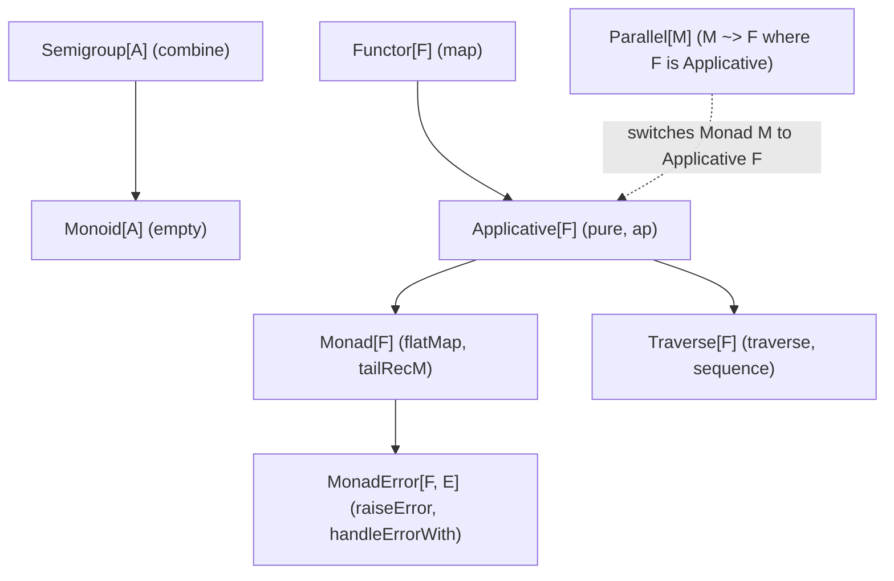
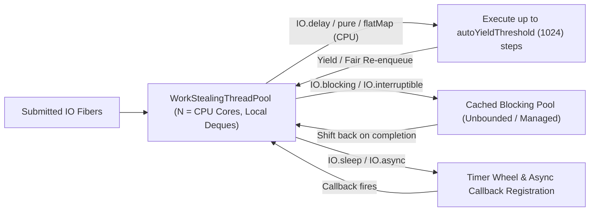

# Typelevel Ecosystem: Cats 2.13 and Cats Effect 3.7

The algebraic definitions and laws of `Semigroup`, `Monoid`, `Functor`, `Monad`, `Applicative`, `Traverse`, and trampolined `IO` are derived in [Functional Programming M09](../../../architecture/functional-programming/modules/09-monoids-foldables-and-parallel-reduction.md), [M10](../../../architecture/functional-programming/modules/10-functors-monads-and-kleisli-composition.md), [M11](../../../architecture/functional-programming/modules/11-applicative-and-traversable-functors.md), and [M12](../../../architecture/functional-programming/modules/12-effects-io-trampolining-st-and-streaming.md). This module covers how the **Typelevel** stack brings that algebra to production JVM services in Scala 3: **Cats 2.13.0** type classes, data types, and Discipline law suites, paired with the **Cats Effect 3.7.1** fiber runtime, `IO.uncancelable` masking, `Resource`, and purely functional concurrency primitives.

---

## 1. Cats 2.13.0 Type-Class Hierarchy and Data Types

Cats encodes the algebraic hierarchy as Scala type classes split across `cats-kernel` (equality, order, semigroups, monoids) and `cats-core` (`Functor`, `Applicative`, `Monad`, `Traverse`, `Parallel`, and friends). Importing `import cats.syntax.all.*` brings extension methods (`.combine`, `|+|`, `.map`, `.flatMap`, `.traverse`, `.parMapN`) into scope via zero-overhead extension wrappers.



### Production Workhorses Beyond `Option` and `Either`

1. **`NonEmptyList[A]` (`NEL`) and `ValidatedNel[E, A]`**: `NonEmptyList(head, tail)` encodes non-emptiness in the type system so `reduceLeft`, `head`, and `Semigroup` (without needing an identity `empty`) are total. `Validated[E, A]` is an `Applicative`—**deliberately not a `Monad`**—that accumulates every independent validation failure using `Semigroup[E]` (`ValidatedNel[DomainError, Config]` uses `NonEmptyList` concatenation), whereas `Either` short-circuits on the first `Left`.
2. **`Parallel[M]` (`parMapN`, `parTraverse`)**: Bridges a sequential `Monad` `M` and an independent `Applicative` `F` via natural transformations (`M ~> F` and `F ~> M`). For `Either[NonEmptyList[E], A]`, `.parMapN` switches temporarily to `ValidatedNel` to accumulate errors and converts back to `Either`; for `IO`, `.parMapN` switches to `IO.Par` to execute branches concurrently on separate fibers.
3. **`Kleisli[F, A, B]`**: Wraps `A => F[B]` (monadic function arrows, see [FP M10](../../../architecture/functional-programming/modules/10-functors-monads-and-kleisli-composition.md#the-kleislif_-a-b-arrow-in-production-pipelines)), powering HTTP routing (`HttpRoutes[F] = Kleisli[OptionT[F, *], Request[F], Response[F]]` in http4s) and contextual dependency injection without global mutable singletons.
4. **`OptionT[F, A]` and `EitherT[F, E, A]`**: Monad transformers stacking `F[Option[A]]` and `F[Either[E, A]]` so `for`-comprehensions bind cleanly across outer effect `F` and inner failure/absence. **Performance caveat**: Every `flatMap` on `OptionT` / `EitherT` allocates a wrapper object and pattern-matches inside `F.flatMap`. Avoid nesting transformers inside tight inner loops; reserve them for request/command orchestration boundaries or unwrap into `F[A]` with `MonadError` / typed errors where hot-loop allocation matters.

```scala
import cats.data.{EitherT, NonEmptyList, ValidatedNel}
import cats.effect.IO
import cats.syntax.all.*

case class RawOrder(sku: String, qty: Int)
case class ValidOrder(sku: String, qty: Int)

def validateOrder(raw: RawOrder): ValidatedNel[String, ValidOrder] =
  val skuV = if raw.sku.nonEmpty then raw.sku.validNel else "empty SKU".invalidNel
  val qtyV = if raw.qty > 0 then raw.qty.validNel else "non-positive qty".invalidNel
  (skuV, qtyV).mapN(ValidOrder.apply)

// Accumulates ALL validation errors via ValidatedNel, then switches into EitherT[IO, ...]
def submitOrder(raw: RawOrder, persist: ValidOrder => IO[Either[String, Long]]): EitherT[IO, NonEmptyList[String], Long] =
  for
    valid <- EitherT.fromEither[IO](validateOrder(raw).toEither)
    id    <- EitherT(persist(valid).map(_.leftMap(NonEmptyList.one)))
  yield id
```

### Automated Law Verification with Discipline (`cats-laws`)

Every Cats type class ships formal laws in `cats.laws.discipline.*`. Whenever you define a custom `Monoid[MetricsBucket]` or `Monad[TenantContext]` instance, wire `cats-laws` and `discipline-munit` into your test suite rather than trusting intuition:

```scala
import cats.kernel.laws.discipline.MonoidTests
import cats.Monoid
import munit.DisciplineSuite
import org.scalacheck.{Arbitrary, Gen}

case class Counter(hits: Long, errors: Long)
object Counter:
  given Monoid[Counter] with
    def empty: Counter = Counter(0L, 0L)
    def combine(x: Counter, y: Counter): Counter =
      Counter(x.hits + y.hits, x.errors + y.errors)

  given Arbitrary[Counter] = Arbitrary(
    for h <- Gen.chooseNum(0L, 1000L); e <- Gen.chooseNum(0L, 1000L)
    yield Counter(h, e)
  )

class CounterLawsSuite extends DisciplineSuite:
  checkAll("Counter.MonoidLaws", MonoidTests[Counter].monoid)
```

`MonoidTests[Counter].monoid` automatically exercises left identity, right identity, associativity, `combineAll`, and `isEmpty` across hundreds of ScalaCheck-generated inputs.

---

## 2. Cats Effect 3.7.1: `IORuntime` and Fiber Scheduling

In [FP M12](../../../architecture/functional-programming/modules/12-effects-io-trampolining-st-and-streaming.md), we constructed a minimal trampolined `TailRec` and `Free` monad. **Cats Effect 3.7.1** scales that heap-reified continuation design into a production **M:N fiber runtime** (`cats.effect.IO` and `cats.effect.unsafe.IORuntime`) capable of multiplexing millions of lightweight fibers onto CPU-bound OS threads with microsecond context switches.



### Runtime Pools and Auto-Yielding Mechanics

`IORuntime` separates execution into specialized pools so compute-heavy fibers never starve I/O callbacks and blocking calls never stall compute workers:

1. **Compute pool (`WorkStealingThreadPool`)**: Runs `N` worker OS threads (defaulting to `Runtime.availableProcessors`), each maintaining a local lock-free queue and work-stealing from peer workers when idle (see [DSA M14](../../../algorithms/dsa/modules/14-parallel-algorithms-concurrency-and-interview-execution.md) for Chase-Lev style work-stealing theory). When an `IOFiber` triggers an asynchronous callback from the same worker, CE3 prioritizes local-queue scheduling to maximize L1/L2 CPU cache locality.
2. **Blocking pool (`IO.blocking` and `IO.interruptible`)**: Any legacy blocking JVM call (JDBC `Connection`, `java.io.InputStream.read`, `Thread.sleep`) **must** be wrapped in `IO.blocking { ... }` (or `IO.interruptible { ... }` / `IO.interruptibleMany { ... }` if cancellation should invoke `Thread.interrupt()`). CE3 shifts the fiber onto a dynamically expanding cached daemon thread pool for the blocking call and immediately shifts execution back to the compute pool once the blocking call returns.
3. **Cooperative auto-yielding (`IO.cede` and `autoYieldThreshold`)**: An `IOFiber` executes a tight `while` run-loop interpreting `IO` algebraic nodes (`Pure`, `Delay`, `Map`, `FlatMap`, `HandleErrorWith`, `Async`, `Uncancelable`). After `autoYieldThreshold` (default **1024**) consecutive synchronous iterations on the same fiber, the runtime automatically yields (`cede`) and re-enqueues the fiber, guaranteeing fairness so a runaway `foreverM` pure loop cannot monopolize a compute worker thread.
4. **Application Entry Point (`IOApp.Simple`) & Starvation Detection**: Production services extend `IOApp.Simple` (implementing `def run: IO[Unit]`), which installs a single global `IORuntime`, registers JVM `SIGINT`/`SIGTERM` shutdown hooks that cleanly cancel the root fiber and unwind all `Resource` finalizers, and runs a periodic **CPU starvation checker** (`cpuStarvationCheckInterval`, default `1.second`) logging stack warnings whenever compute pool timers drift beyond threshold:

```scala
import cats.effect.{ExitCode, IO, IOApp, Resource}
import scala.concurrent.duration.*

object ServiceMain extends IOApp.Simple:
  // Configure runtime tuning if needed via `override protected def runtimeConfig`
  private val serverResource: Resource[IO, String] =
    Resource.make(IO.println("Starting HTTP server") *> IO.pure("server-handle")): h =>
      IO.println(s"Draining $h cleanly on SIGTERM")

  val run: IO[Unit] =
    serverResource.use: _ =>
      IO.println("Serving traffic...") *> IO.never
```

Notice what `IO.never` inside `serverResource.use` accomplishes: the root fiber suspends with zero OS threads blocked, and the moment Kubernetes sends `SIGTERM`, `IOApp` cancels `IO.never`, triggering `serverResource`'s release finalizer before the JVM exits.

### Bridging Callback APIs Safely with `IO.async`

Non-blocking Java libraries (`java.util.concurrent.CompletableFuture`, Netty `ChannelFuture`, NIO `AsynchronousSocketChannel`) deliver results via callbacks rather than blocking threads. `IO.async` suspends the fiber semantically—freeing its compute thread immediately—and optionally registers a **cancellation finalizer** (`Option[IO[Unit]]`) invoked if the fiber is canceled or loses an `IO.race` before the callback fires:

```scala
import cats.effect.IO
import java.util.concurrent.CompletableFuture

def fromCompletableFuture[A](mkCf: => CompletableFuture[A]): IO[A] =
  IO.async: cb =>
    IO.delay:
      val cf = mkCf
      cf.whenComplete: (value, err) =>
        if err != null then cb(Left(err))
        else cb(Right(value))
      // Return cancellation hook so racing/timeouts cancel the underlying CompletableFuture
      Some(IO.delay(cf.cancel(false)).void)
```

For simpler non-cancellable callbacks, `IO.async_` skips the finalizer (`Option[IO[Unit]]` defaults to `None`), whereas `IO.fromCompletableFuture(IO(mkCf))` in Cats Effect provides the production-hardened implementation directly.

---

## 3. Structured Concurrency, Cancelation Masking, and `Resource`

Every `IO` fiber supports **backpressured asynchronous cancelation** and **three-valued completion outcomes**.

### Fiber Lifecycle and `Outcome`

Launching a background fiber with `io.start` returns `IO[FiberIO[A]]` (or better, `io.background` returns `Resource[IO, IO[OutcomeIO[A]]]`, automatically canceling the fiber when the lexical scope exits). Joining a fiber returns `Outcome[IO, Throwable, A]`, an algebraic sum with three states:

- `Outcome.Succeeded(fa: IO[A])`
- `Outcome.Errored(e: Throwable)`
- `Outcome.Canceled()`

Combinators like `guaranteeCase` inspect `Outcome` directly to distinguish normal completion, error rollback, and fiber cancelation cleanly:

```scala
import cats.effect.{IO, Outcome}

def auditOutcome[A](task: IO[A], log: String => IO[Unit]): IO[A] =
  task.guaranteeCase:
    case Outcome.Succeeded(_) => log("status=ok")
    case Outcome.Errored(e)   => log(s"status=err msg=${e.getMessage}")
    case Outcome.Canceled()   => log("status=canceled")
```

High-level combinators—`IO.both(a, b)`, `IO.race(a, b)`, `parMapN`, and `parTraverseN(maxConcurrent)`—enforce structured lifetimes automatically: if `a` fails in `IO.both(a, b)` or `a` wins in `IO.race(a, b)`, the runtime cancels `b` and **awaits `b`'s finalizers** before returning! That wait is why CE3 cancelation is called **backpressured**: `fiber.cancel` does not fire-and-forget; it semantically blocks the canceling fiber until the target fiber completes its cleanup handlers, eliminating half-closed sockets and zombie database transactions.

### Masked vs. Unmasked Cancelation (`IO.uncancelable` and `Poll`)

Naive `try / finally` or unmasked `acquire.flatMap(use)` fails if a cancelation signal arrives _between_ `acquire` returning a connection handle and `use` registering the cleanup hook. `IO.uncancelable` establishes a **masked region** in which external cancelation signals are recorded as pending rather than immediately aborting execution, while explicitly exposing a `Poll[IO]` capability to re-enable cancelation selectively on safe inner regions:

```scala
import cats.effect.{IO, Deferred}

def safeAcquireAndUse[A](acquire: IO[Handle], release: Handle => IO[Unit])(use: Handle => IO[A]): IO[A] =
  IO.uncancelable: poll =>
    for
      h   <- acquire                     // Uncancelable: atomic acquisition
      res <- poll(use(h)).onCancel(release(h)) // Cancelable ONLY during `use(h)`, triggers `release(h)`
      _   <- release(h)                  // Uncancelable: normal release
    yield res
```

Notice the subtle semantics of `poll`: `poll(fa)` restores cancelability **only if the enclosing `IO.uncancelable` was not itself nested inside an outer uncancelable block** (lexical masking composes cleanly!). Inside `poll(use(h))`, if another fiber calls `.cancel` (or an `IO.race` loses), the fiber interrupts at the next cancelation boundary inside `use(h)`, runs `release(h)` completely uncancelably, and transitions to `Outcome.Canceled`.

### Composable Lifecycle Safety with `Resource[F, A]`

Writing `IO.uncancelable` manually for multiple resources quickly becomes unreadable. `Resource[F, A]` reifies acquisition and LIFO release as a composable `Monad` and `Parallel` value:

```scala
import cats.effect.{IO, Resource}
import java.io.{BufferedReader, FileReader}

def openReader(path: String): Resource[IO, BufferedReader] =
  Resource.fromAutoCloseable(IO.blocking(BufferedReader(FileReader(path))))

val pipeline: Resource[IO, (BufferedReader, BufferedReader)] =
  for
    in1 <- openReader("primary.csv")
    in2 <- openReader("lookup.csv")
  yield (in1, in2)

// Concurrent acquisition: opens `primary.csv` and `lookup.csv` in parallel fibers
// and cancels/closes whichever succeeded if the other fails!
val parallelPipeline: Resource[IO, (BufferedReader, BufferedReader)] =
  (openReader("primary.csv"), openReader("lookup.csv")).parTupled
```

Notice `parTupled` on `Resource`: because `Resource` implements `Parallel`, independent database pools, Kafka clients, and HTTP servers initialize concurrently during service startup while still guaranteeing deterministic LIFO teardown if any parallel initializer fails or times out.

If `openReader("lookup.csv")` fails or the fiber is canceled mid-acquisition, `Resource` guarantees `in1.close()` executes on the blocking pool before propagating the error or cancelation. Finalizers run strictly in **reverse acquisition order (LIFO)**: `in2` closes before `in1`.

---

## 4. Purely Functional Concurrency Primitives

Shared mutable state in Cats Effect avoids JVM locks (`synchronized`), `wait`/`notify`, and blocked carrier threads by suspending fibers semantically:

| Primitive | Underlying Mechanism | Blocking Semantics | Primary Production Use Case |
| --- | --- | --- | --- |
| `Ref[F, A]` | `AtomicReference` CAS loop (`modify`, `update`) | **Wait-free / Lock-free** (pure state transition `A => (A, B)`) | Counters, circuit-breaker state, connection-pool bookkeeping |
| `Deferred[F, A]` | Single-assignment promise (`complete`, `get`) | **Semantic fiber suspension** (0 OS threads blocked) | Fiber handshakes, once-only initialization gates, request-reply latches |
| `Semaphore[F]` | Permit counter built on `Ref` + `Deferred` waiter queue | **Semantic fiber suspension** | Bounded concurrency (`withPermit`), rate/connection limits |
| `Queue[F, A]` | `bounded`, `unbounded`, `dropping`, `sliding` over `Ref` + `Deferred` | **Backpressure on full/empty** via suspended fibers | Producer-consumer work buffers, actor mailboxes |
| `Supervisor[F]` | `Resource`-scoped fiber registry (`supervise`) | Waits/cancels all spawned child fibers on scope exit | Fire-and-forget telemetry/webhook tasks bounded to service lifetime |

Notice `Ref.modify[B](f: A => (A, B)): F[B]`: because `f` may be re-evaluated if a concurrent fiber wins the CAS race, `f` **must be pure**—you must never perform `IO` side effects inside `Ref.modify` (instead return an `IO[Unit]` action as `B` and `.flatten` outside the CAS loop!).

```scala
import cats.effect.{IO, Outcome, Ref, Deferred}
import java.util.concurrent.CancellationException

enum State:
  case Idle
  case InFlight(waiter: Deferred[IO, Either[Throwable, String]])
  case Ready(value: String)

// Single-flight cache coalescing concurrent misses without hanging waiters on error or cancelation
def getOrCompute(cache: Ref[IO, State], fetch: IO[String]): IO[String] =
  IO.uncancelable: poll =>
    Deferred[IO, Either[Throwable, String]].flatMap: fresh =>
      cache.modify:
        case s @ State.Ready(v)    => s -> IO.pure(v)
        case s @ State.InFlight(w) => s -> poll(w.get).rethrow
        case State.Idle =>
          State.InFlight(fresh) ->
            poll(fetch).guaranteeCase:
              case Outcome.Succeeded(fa) =>
                fa.flatMap(v => cache.set(State.Ready(v)) *> fresh.complete(Right(v)).void)
              case Outcome.Errored(err) =>
                cache.set(State.Idle) *> fresh.complete(Left(err)).void
              case Outcome.Canceled() =>
                cache.set(State.Idle) *> fresh.complete(Left(new CancellationException("leader canceled"))).void
      .flatten
```

Look closely at that pattern: `cache.modify` atomically checks and transitions `Idle -> InFlight(fresh)` using lock-free CAS, returning an `IO[String]` program to execute **after** the CAS succeeds. Multiple concurrent fibers hitting `Idle` never duplicate `fetch`; losers observe `InFlight(fresh)` and suspend on `fresh.get` without consuming any OS thread.

### Deterministic Virtual-Time Testing with `TestControl` and `Supervisor`

Production services using `IO.sleep`, exponential retry backoff, or `Supervisor` background workers cannot afford multi-minute wall-clock test runs. `cats.effect.testkit.TestControl` executes arbitrary `IO` fiber graphs on a **deterministic simulated clock**, advancing virtual time instantaneously whenever all fibers are sleeping:

```scala
import cats.effect.IO
import cats.effect.std.{Queue, Supervisor}
import cats.effect.testkit.TestControl
import scala.concurrent.duration.*

def retryAfterDelay(attempts: Int, op: IO[String]): IO[String] =
  op.handleErrorWith: err =>
    if attempts <= 1 then IO.raiseError(err)
    else IO.sleep(1.hour) *> retryAfterDelay(attempts - 1, op)

// Executes 3 hours of virtual backoff in < 1 millisecond of wall-clock time!
val simulated: IO[String] =
  TestControl.executeEmbed(retryAfterDelay(4, IO.raiseError(RuntimeException("boom")))).attempt.map(_.toString)

def supervisedWorker(queue: Queue[IO, String]): IO[Unit] =
  Supervisor[IO](await = true).use: sup =>
    sup.supervise(queue.take.flatMap(msg => IO.println(s"audit:$msg")).foreverM).void *>
      queue.offer("event-1") *> queue.offer("event-2")
```

For bounded rate-limiting across concurrent callers, `Semaphore[IO]` gates access cleanly via `permit` (`Resource[IO, Unit]`):

```scala
import cats.effect.std.Semaphore

def boundedFetch(sem: Semaphore[IO], urls: List[String], fetch: String => IO[String]): IO[List[String]] =
  urls.parTraverse: url =>
    sem.permit.use(_ => fetch(url))
```

Even if `fetch(url)` throws an exception or the fiber is canceled mid-request, `sem.permit.use` releases the permit inside an `uncancelable` finalizer so permit leaks are impossible.

Notice `Supervisor[IO](await = true)`: when `use` exits (or is canceled), `await = true` waits for active supervised fibers to finish their in-flight work before shutting down, whereas `await = false` cancels remaining supervised fibers immediately.

---

## 5. Tagless Final (`F[_]: Async`) vs. Concrete `IO`

Cats Effect models capabilities incrementally through a hierarchy of type classes (`cats.effect.kernel`):

$$\text{MonadCancel}[F, E] \;\subset\; \text{Spawn}[F] \;\subset\; \text{Concurrent}[F] \;\subset\; \text{Temporal}[F] \;\subset\; \text{Sync}[F] \;\subset\; \text{Async}[F]$$

In **Tagless Final** style (Oleg Kiselyov, _Typed Tagless Final Interpreters_), business services are polymorphic over an abstract effect `F[_]` constrained only to the minimal capability required:

```scala
import cats.effect.kernel.{Temporal, Ref}
import cats.syntax.all.*
import scala.concurrent.duration.*

trait RateLimiter[F[_]]:
  def acquire: F[Unit]

object RateLimiter:
  def make[F[_]: Temporal](maxPerSec: Int): F[RateLimiter[F]] =
    Ref.of[F, Int](maxPerSec).map: tokens =>
      new RateLimiter[F]:
        def acquire: F[Unit] =
          Temporal[F].sleep(10.millis) *> tokens.update(_ - 1)
```

### Architectural Trade-offs: When `F[_]` Helps vs. When Concrete `IO` Wins

- **Where Tagless Final (`F[_]`) excels**: Reusable open-source libraries (http4s, Skunk, FS2, Doobie) that must support multiple runtimes or monad transformer stacks (`EitherT[IO, AppError, *]`), and domain modules tested deterministically against `TestControl` / pure state monads without mocking HTTP clients.
- **Where concrete `IO` wins**: Application codebases that will never swap out Cats Effect `IO` for ZIO or `Future`. Abstracting every internal service behind `[F[_]: Async]` forces extra `using` implicit dictionaries at every method boundary, inflates bytecode size and compile times, complicates stack traces and IDE navigation, and encourages anti-patterns like `Async[F].delay` everywhere (which forfeits the principle of least power anyway). A pragmatic production design uses **concrete `IO`** at the application shell and small, effect-free or narrow-capability traits (`trait UserRepo[F[_]]` or concrete `IO` interfaces) for testable boundaries.

---

## 6. Then vs. Now: 2015 `Free`/`Task` and CE2 vs. Cats Effect 3.7.1

| Era / Abstraction | Runtime Model | Blocking I/O Safety | Resource Cleanup | Error / Cancellation |
| --- | --- | --- | --- | --- |
| 2015 _FP in Scala_ Ch 13 `IO` / `Free` | Single-threaded trampoline + custom `Par` `ExecutorService` | Manual pool switching | Naive `try/finally` breaks across async boundaries | No structured fiber cancellation |
| Scalaz `Task` / Cats Effect 2 (`2.x`) | `ContextShift[F]` + explicit `Timer[F]` + `Blocker` passed implicitly everywhere | `Blocker.delay` (easy to forget, silently blocked compute pool) | `Resource` over `Bracket` (synchronous cancel signal) | Unbackpressured cancelation could leak in-flight cleanup |
| **Cats Effect 3.7.1** (`3.x`) | Integrated work-stealing `IORuntime` + 1024-step auto-yield | Built-in `IO.blocking` / `IO.interruptible` on `IORuntime` | Lexical `Resource` + `IO.uncancelable` with `Poll` | Backpressured cancelation + 3-state `Outcome` (`Succeeded` \| `Errored` \| `Canceled`) |

---

## 7. Production Failure Modes and Negative Examples

1. **Starving `WorkStealingThreadPool` with unshifted blocking I/O**: Calling `Thread.sleep(5000)` or `jdbcStatement.executeQuery()` inside `IO { ... }` instead of `IO.blocking { ... }` stalls one of the `N` compute carrier threads. Under $N$ concurrent requests, the entire service—including `IO.sleep` timers and health checks—freezes. (Cats Effect 3 emits a **starvation warning** on stderr if compute threads appear stalled beyond `cpuStarvationCheckInterval`.)
2. **Deadlocking via `uncancelable` around an unpolled wait**: Writing `IO.uncancelable(_ => deferred.get)` disables cancelation for the entire wait; if another fiber races or times out that fiber, `fiber.cancel` hangs indefinitely waiting for `deferred.get` to return. Always wrap interruptible waits inside `poll(...)`.
3. **Side effects inside `Ref.modify` or `Ref.update`**: Performing `println` or logging inside `ref.update { x => println(x); x + 1 }` executes the side effect multiple times whenever CAS contention triggers a retry. Keep the function passed to `Ref.modify` strictly pure and execute returned `IO` outside `.modify`.
4. **Calling `unsafeRunSync()` inside `IO` or `Resource`**: Blocking a compute thread in `IO(innerIO.unsafeRunSync())` wastes a carrier thread and deadlocks when `innerIO` schedules continuations onto the same saturated pool. Compose `IO` with `flatMap` / `Resource` and invoke `unsafeRunSync()` (or `IOApp.Simple`) **once** at the program entry point.

```scala
// Negative anti-patterns (never write in production!):
val doubleAllocBug: IO[Int] =
  def counter = Ref.of[IO, Int](0)
  // BUG: Calling `counter` twice allocates TWO distinct Ref instances!
  for
    _ <- counter.flatMap(_.update(_ + 1))
    v <- counter.flatMap(_.get) // Always returns 0!
  yield v

val unpolledDeadlock: IO[Unit] =
  Deferred[IO, Unit].flatMap: d =>
    // BUG: If canceled before `d.complete`, `fiber.cancel` hangs forever!
    IO.uncancelable(_ => d.get)
```

---

## Interview Drill

1. **Why is `Validated` in Cats an `Applicative` but intentionally NOT a `Monad`?**

<details><summary>Answer</summary>

In a `Monad`, `flatMap` introduces sequential data dependency (`fa.flatMap(a => fb(a))`), meaning `fb` cannot even be constructed until `fa` succeeds with `a`. Consequently, `Monad` consistency laws require `ap` (`<*>`) derived from `flatMap` to short-circuit on the first error, making error accumulation impossible. `Validated` omits `Monad` so its `Applicative` instance can evaluate both branches independently and combine multiple errors via `Semigroup[E]`.

</details>

2. **How does `IORuntime`'s work-stealing compute pool differ from `IO.blocking`, and what happens if you run JDBC calls inside `IO(...)`?**

<details><summary>Answer</summary>

The compute pool (`WorkStealingThreadPool`) has a fixed number of OS threads equal to CPU core count, optimized for non-blocking CPU work and fiber switches via per-worker deques. `IO.blocking` shifts execution onto a separate cached daemon thread pool meant for blocking OS/JNI calls and shifts back to the compute pool afterward. Running blocking JDBC queries inside `IO(...)` pins compute worker threads; once `N = cores` concurrent queries execute, the entire compute pool stalls, starving unrelated non-blocking fibers and triggering CE3's CPU starvation detector.

</details>

3. **What does "backpressured cancelation" mean in Cats Effect 3, and how does `IO.uncancelable` use `Poll`?**

<details><summary>Answer</summary>

Backpressured cancelation means `fiber.cancel` does not return until the canceled fiber actually terminates and finishes running all its registered finalizers (`onCancel` / `Resource` release), preventing resource leaks and race conditions on shutdown. `IO.uncancelable { poll => ... }` masks cancelation for sensitive steps like resource acquisition and release while passing a `poll` token that selectively restores cancelability for the inner `use` region (provided no outer `uncancelable` mask is active).

</details>

4. **Why must the state-transition function passed to `Ref.modify(f: A => (A, B))` be strictly pure?**

<details><summary>Answer</summary>

`Ref` is implemented over `java.util.concurrent.atomic.AtomicReference` using an optimistic Compare-And-Swap (CAS) retry loop. If another fiber updates the `Ref` between the read and `compareAndSet`, `Ref.modify` loops and re-invokes `f` on the new state. Any side effect inside `f` would fire multiple times under contention; instead, return a pure `IO[Unit]` description inside `B` and run `.flatten` after `.modify` commits.

</details>

5. **How does `Resource` guarantee cleanup order when composing two resources `r1` and `r2` via `for`-comprehension, even if `r2` fails or is canceled?**

<details><summary>Answer</summary>

`Resource` desugars monadic composition (`flatMap`) into nested `IO.uncancelable` bracket scopes. `r1` acquires atomically, and `r2` executes inside `r1`'s `use` region protected by `r1`'s finalizer. If `r2`'s acquisition fails or receives a cancelation signal, `r2` cleans up any partial state and unwinds out of `r1`'s `use` block, triggering `r1`'s release finalizer in strict LIFO order before propagating the error or `Canceled` outcome.

</details>

6. **How does `autoYieldThreshold` prevent a tight `foreverM` loop from starving other fibers on `IORuntime`?**

<details><summary>Answer</summary>

Each `IOFiber` maintains an iteration counter inside its trampolined execution loop. After executing `autoYieldThreshold` (default 1024) synchronous `IO` steps (`Pure`, `Delay`, `Map`, `FlatMap`) without suspending, the fiber yields control (`IO.cede` semantics), re-enqueuing itself onto the worker queue so sibling fibers on the same core make progress.

</details>

7. **When is Tagless Final (`F[_]: Async`) justified over concrete `IO`, and when is it over-engineering?**

<details><summary>Answer</summary>

Tagless Final is justified in published libraries (`http4s`, `fs2`, `doobie`) that must remain agnostic to `IO` vs monad transformer stacks (`EitherT[IO, E, *]`), and in narrow domain algebras where restricting capabilities (e.g., `F[_]: Temporal` or custom `Clock`/`Repo`) enforces least power and allows pure deterministic tests. Using `[F[_]: Async]` uniformly across an entire application that always runs on Cats Effect `IO` adds implicit dictionary plumbing, slower compiles, noisier type errors, and zero practical benefit because `Async[F]` already exposes the full `IO` capability surface.

</details>

8. **Why should `IO.async` return `Some(cancelIO)` when wrapping a `CompletableFuture` or Netty request?**

<details><summary>Answer</summary>

When a fiber awaiting `IO.async` loses an `IO.race` or exceeds `.timeout(50.millis)`, Cats Effect signals cancelation to the suspended fiber. If `IO.async` returned `None`, the fiber cannot cancel the underlying socket read or `CompletableFuture`, leaving network I/O running in the background and delaying backpressured `fiber.cancel` until the remote server responds. Returning `Some(IO(cf.cancel(false)).void)` aborts the in-flight request immediately and releases resources promptly.

</details>
