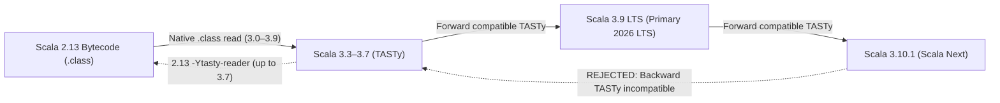

# Production Scala: Testing, Interoperability, and Version Evolution

Writing pure algebras and effect systems solves half the engineering problem; shipping production Scala 3 services requires deterministic property testing, zero-friction interoperability with Java libraries, strict binary and TASTy compatibility guarantees across library upgrades, and disciplined migration paths from legacy Scala 2 codebases. The algebraic theory of generators, properties, and shrinking is covered in [Functional Programming M07](../../../architecture/functional-programming/modules/07-property-based-testing-and-shrinking.md); this module focuses on **MUnit 1.3.6 + ScalaCheck 1.20.0** testing mechanics, **Java ↔ Scala 3 JVM interoperability**, **MiMa and TASTy compatibility**, and the **Scala 2.10 → Scala 3.10.1** evolution matrix.

---

## 1. Property-Based and Compile-Time Testing with MUnit 1.3.6 and ScalaCheck 1.20.0

Unit tests assert specific examples; **property-based tests** quantify universal invariants over hundreds of generated inputs and automatically minimize counterexamples. In Scala 3, **MUnit 1.3.6** (`org.scalameta::munit:1.3.6`) combined with **ScalaCheck 1.20.0** via **munit-scalacheck 1.3.1** (`org.scalameta::munit-scalacheck:1.3.1`) provides lightweight test suites with concise diffs and deterministic seed replay.

### `Gen`, `Arbitrary`, `Shrink`, and Seed Reproducibility

`Gen[T]` describes a pure pseudo-random generator, `Arbitrary[T]` binds a canonical `given Gen[T]` for a type, and `Shrink[T]` produces smaller candidate counterexamples (`LazyList[T]`) once a property fails:

```scala
import munit.ScalaCheckSuite
import org.scalacheck.{Arbitrary, Gen, Prop, Shrink}
import org.scalacheck.Prop.forAll

opaque type Port = Int
object Port:
  def fromInt(n: Int): Option[Port] =
    Option.when(n >= 1024 && n <= 65535)(n)
  extension (p: Port) def value: Int = p

given Arbitrary[Port] = Arbitrary(Gen.choose(1024, 65535).map(n => Port.fromInt(n).get))

// Explicit Shrink preserving the [1024, 65535] domain invariant!
given Shrink[Port] = Shrink { p =>
  Shrink.shrink(p.value).filter(_ >= 1024).flatMap(Port.fromInt)
}

class PortSpec extends ScalaCheckSuite:
  override def scalaCheckTestParameters =
    super.scalaCheckTestParameters.withMinSuccessfulTests(200)

  property("Port round-trips through fromInt"):
    forAll: (p: Port) =>
      Port.fromInt(p.value) == Some(p)
```

Notice the critical invariant pitfall highlighted in [FP M07](../../../architecture/functional-programming/modules/07-property-based-testing-and-shrinking.md#3-test-case-minimisation-and-shrinking-architectures): **ScalaCheck uses type-based post-hoc shrinking (`Shrink[T]`) rather than generator-integrated shrinking**. If you derive `Shrink[Int]` blindly on a filtered type (or shrink an unvalidated wrapper), ScalaCheck can feed `0` or `-1` into your property during minimization, reporting a spurious failure caused by violating the generator's precondition! Always either preserve invariants inside a custom `Shrink[T]` (as above) or pass raw inputs through `Gen.suchThat` / `Prop.==>` guards carefully without exhausting discard ratios (`maxDiscardRatio`).

When a property fails in CI, ScalaCheck logs a Base64 RNG seed. Replaying that exact failure locally requires overriding `scalaCheckInitialSeed`:

```scala
override def scalaCheckInitialSeed = "dGhpcy1pcy1hLXNlZWQ="
```

### Model-Based Stateful Testing, `Gen.frequency`, and MUnit Fixtures

For stateful structures (caches, bounded queues, in-memory indexes), **model-based testing** generates sequences of algebraic commands via `Gen.oneOf` / `Gen.frequency` and asserts equivalence against a trivial pure reference model (such as `Vector` or `Map`):

```scala
import munit.{FunFixture, ScalaCheckSuite}
import org.scalacheck.Gen
import org.scalacheck.Prop.forAll

enum CacheOp:
  case Put(k: Int, v: String)
  case Delete(k: Int)
  case Get(k: Int)

val genOp: Gen[CacheOp] = Gen.frequency(
  5 -> (for k <- Gen.choose(1, 20); v <- Gen.alphaNumStr yield CacheOp.Put(k, v)),
  2 -> Gen.choose(1, 20).map(CacheOp.Delete.apply),
  3 -> Gen.choose(1, 20).map(CacheOp.Get.apply)
)

class RingCacheModelSpec extends ScalaCheckSuite:
  property("mutable cache matches pure Map model across arbitrary command sequences"):
    forAll(Gen.listOf(genOp)): ops =>
      val sut   = scala.collection.mutable.HashMap.empty[Int, String]
      var model = Map.empty[Int, String]
      ops.forall:
        case CacheOp.Put(k, v) =>
          sut.put(k, v); model = model.updated(k, v); true
        case CacheOp.Delete(k) =>
          sut.remove(k); model = model - k; true
        case CacheOp.Get(k) =>
          sut.get(k) == model.get(k)

// MUnit FunFixture isolates per-test setup/teardown cleanly
class TempDirSpec extends munit.FunSuite:
  val tempDir = FunFixture[java.nio.file.Path](
    setup = _ => java.nio.file.Files.createTempDirectory("scala-munit-"),
    teardown = dir => java.nio.file.Files.deleteIfExists(dir)
  )

  tempDir.test("writes config file inside isolated directory"): dir =>
    val file = dir.resolve("app.conf")
    java.nio.file.Files.writeString(file, "port=8080")
    assertEquals(java.nio.file.Files.readString(file), "port=8080")
```

Notice a common generator anti-pattern: filtering `Gen.choose(0, 1_000_000).suchThat(_ % 997 == 0)` discards 99.9% of samples and aborts ScalaCheck with `Gave up after only N passed tests` (`maxDiscardRatio` exceeded). Always construct valid domains directly (e.g., `Gen.choose(0, 1000).map(_ * 997)`) rather than filtering sparse spaces with `.suchThat`.

### Testing Higher-Order Functions with `Cogen` and Suite-Level Fixtures

ScalaCheck natively derives `Arbitrary[A => B]` whenever `Cogen[A]` and `Arbitrary[B]` exist—perturbing the RNG seed deterministically from input `A` to generate pure, referentially transparent test functions (`f(x) == f(x)`):

```scala
class HigherOrderSpec extends ScalaCheckSuite:
  property("takeWhile and dropWhile partition any list for any generated predicate"):
    forAll: (xs: List[Int], pred: Int => Boolean) =>
      xs.takeWhile(pred) ++ xs.dropWhile(pred) == xs
```

For expensive integration fixtures shared across all tests in a suite (such as a single embedded HTTP server or database pool), override `munitFixtures` with `Fixture[T]` (`beforeAll` / `afterAll`) rather than `FunFixture` (`beforeEach` / `afterEach`), preserving fast deterministic execution.

### Negative Compile-Time Tests in MUnit

To lock in type-level invariants—ensuring `opaque type Port` cannot mix with `Int`, covariant containers reject contravariant methods, or un-implemented type classes fail resolution—pair MUnit with `scala.compiletime.testing`:

```scala
import munit.FunSuite
import scala.compiletime.testing.{typeChecks, compileErrors}

class TypeSafetySpec extends FunSuite:
  test("opaque Port rejects raw Int addition outside companion"):
    assert(!typeChecks("""
      import PortSpec.*
      val bad: Port = 8080
    """))

  test("variance violation produces clear compiler error"):
    val errs = compileErrors("""
      trait Producer[+A]:
        def accept(a: A): Unit
    """)
    assert(errs.contains("covariant type A occurs in contravariant position"))
```

Because `typeChecks` and `compileErrors` run during compilation of the test suite itself, type regressions break `scala test` immediately with zero external plugins.

---

## 2. Java ↔ Scala 3 Interoperability on the JVM

Because Scala 3 compiles to standard JVM bytecode on **JDK 25 LTS**, Scala libraries routinely call Java APIs (`java.time`, `java.nio`, JDBC, Netty) and expose Scala APIs to Java callers. Crossing the boundary safely requires understanding five compiler and standard-library bridges.

### Collection, Option, and Future Converters

Scala 2's deprecated `scala.collection.JavaConverters` and `JavaConversions` (implicit silent conversions that masked `O(n)` allocations or mutations) are replaced in Scala 2.13 and Scala 3 by explicit converters in **`scala.jdk.*`**:

1. **`import scala.jdk.CollectionConverters.*`**: Adds `.asJava` and `.asScala` extension methods. **Crucial semantic trap**: `.asJava` returns a **zero-copy live wrapper** rather than a defensive copy. Wrapping an immutable Scala `List(1, 2, 3).asJava` returns an unmodifiable `java.util.List`; calling `.add(4)` from Java throws `UnsupportedOperationException` at runtime! Conversely, wrapping a Java `ArrayList` via `.asScala` yields a mutable `scala.collection.mutable.Buffer` backed by the same array—mutating one mutates the other.
2. **`import scala.jdk.OptionConverters.*`**: Converts `scala.Option[A]` ↔ `java.util.Optional[A]` via `.toJava` and `.toScala` (plus `toJavaPrimitive` for `OptionalInt`/`OptionalLong`/`OptionalDouble` avoiding boxing).
3. **`import scala.jdk.FutureConverters.*`**: Bridges `scala.concurrent.Future[A]` ↔ `java.util.concurrent.CompletionStage[A]` / `CompletableFuture[A]` via `.asJava` and `.asScala`.

### SAM Conversion, `@targetName`, and `@throws`

- **Single Abstract Method (SAM) conversion**: A Scala 3 lambda `(x: Int) => x * 2` automatically converts to any Java `@FunctionalInterface` or single-abstract-method class (`java.util.function.IntUnaryOperator`, `Runnable`, `Comparator[T]`). However, if a Java method is overloaded with two distinct SAM types (e.g., `submit(Runnable)` vs `submit(Callable[T])`), you may need an explicit type ascription or parameter type to guide overload resolution.
- **`@targetName` for erasure collisions and symbolic operators**: Because JVM bytecode erases generic type arguments (`List[Int]` and `List[String]` both erase to `scala.collection.immutable.List`), overloading on generic type parameters fails JVM method verification unless disambiguated with `@targetName`:

```scala
import scala.annotation.targetName

object Stats:
  @targetName("sumInts")
  def sum(xs: List[Int]): Int = xs.sum

  @targetName("sumStrings")
  def sum(xs: List[String]): Int = xs.map(_.length).sum

  @targetName("combine")
  def |+|(a: Int, b: Int): Int = a + b
```

From Scala, callers invoke `Stats.sum(List(1, 2))` and `Stats.|+|(1, 2)` normally; from Java (and in JVM stack traces), the methods have clean, distinct bytecode names `sumInts`, `sumStrings`, and `combine` instead of `$bar$plus$bar`.

- **Checked exceptions via `@throws`**: Scala does not enforce Java checked exceptions at compile time (unless using experimental `saferExceptions`). If a Java caller invokes a Scala method inside a `try { ... } catch (IOException e)`, `javac` refuses to compile the `catch (IOException)` block unless the Scala method explicitly carries `@throws[IOException]` so `scalac` emits the `Exceptions` bytecode attribute.
- **`enum` vs. `java.lang.Enum` and `opaque type` erasure**: A Scala 3 `enum Color extends Enum[Color] { case Red, Green, Blue }` compiles directly into a binary-compatible `java.lang.Enum` subclass usable in Java `switch` statements. By contrast, an **`opaque type UserId = Long`** erases completely to primitive `long` in JVM signatures—Java callers see `long`, bypassing the compile-time abstraction boundary! Wrap public Java-facing boundaries in explicit DTOs or adapters when type safety across languages matters.

### Side-by-Side Java Interop Surface and `StreamConverters`

Beyond collections and `Optional`, `scala.jdk.StreamConverters.*` bridges Java 8+ `java.util.stream.Stream` lazily (avoiding full materialization via `.toScala(Vector)` or `.asJavaSeqStream`):

```scala
import scala.annotation.targetName
import scala.beans.BeanProperty
import scala.jdk.CollectionConverters.*
import scala.jdk.OptionConverters.*
import scala.jdk.StreamConverters.*
import java.io.IOException

enum Currency extends Enum[Currency]:
  case EUR, USD, CZK

final case class JavaOrderDto(@BeanProperty id: String, @BeanProperty amountCents: Long)

object BillingBridge:
  @throws[IOException]
  @targetName("exportActiveIds")
  def exportActive(ids: List[String], filterPrefix: Option[String]): java.util.List[String] =
    val prefix = filterPrefix.toJava
    ids.filter(id => prefix.map(p => id.startsWith(p)).orElse(true)).asJava

  def sumJavaStream(stream: java.util.stream.IntStream): Int =
    stream.toScala(LazyList).sum
```

Look closely at `@BeanProperty` and `opaque type` bytecode lowering: `@BeanProperty` generates standard `getId()` and `getAmountCents()` JavaBean getters required by Jackson/Spring/Hibernate frameworks, while an `opaque type UserId = Long` lowers to unboxed JVM `long` parameters (`(J)V`) in methods—unlike legacy `class UserId(val raw: Long) extends AnyVal`, which still allocates a heap wrapper `LUserId;` inside generic containers (`List[UserId]`, `Option[UserId]`).

From a Java caller's perspective, those annotations produce clean, idiomatic Java syntax:

```java
// Java 25 consumer calling Scala 3 compiled JAR:
import java.io.IOException;
import java.util.List;
import java.util.Optional;
import scala.jdk.javaapi.OptionConverters;

public final class JavaConsumer {
  public static void runDemo() {
    int total = Stats.combine(10, 32); // Calls Scala's `|+|` via @targetName("combine")
    try {
      List<String> active = BillingBridge.exportActiveIds(
          scala.jdk.javaapi.CollectionConverters.asScala(List.of("eu-1", "us-2")).toList(),
          OptionConverters.toScala(Optional.of("eu-"))
      );
      System.out.println(active);
    } catch (IOException e) {
      throw new RuntimeException(e); // Compiles ONLY because Scala method has @throws[IOException]!
    }
  }
}
```

Notice `scala.jdk.javaapi.{CollectionConverters, OptionConverters, FutureConverters}`: Java code imports static methods from `scala.jdk.javaapi.*` rather than Scala 3 extension methods, keeping cross-language boundaries explicit and zero-magic.

---

## 3. Binary Compatibility, TASTy Guarantees, and LTS vs. Scala Next

Managing upgrades in a JVM ecosystem with hundreds of transitive artifacts requires separating **JVM binary compatibility** from **TASTy compatibility**.



### JVM Binary Compatibility (MiMa) vs. TASTy Compatibility

1. **JVM Binary Compatibility**: Checked statically by **MiMa** (_Migration Manager_). Changing a method's parameter types, removing a `public` method, adding an abstract method to a `trait`, or changing an `inline def` body referenced by un-recompiled callers breaks JVM binary compatibility (`NoSuchMethodError`, `AbstractMethodError`). Adding a concrete method to a `class`, or adding a new `given` instance in a companion object, is binary-compatible.
2. **TASTy Forward and Backward Compatibility**: Scala 3 embeds `.tasty` files alongside `.class` files. Within a major version (`3.x`), **newer compilers can always read TASTy produced by older compilers** (e.g., Scala 3.10.1 reads libraries compiled with Scala 3.3.0 LTS or 3.9.0 LTS). **However, older compilers CANNOT read TASTy produced by newer minor releases**: a project pinned to Scala 3.3 LTS cannot depend on a library published with Scala 3.9 LTS or 3.10.1!

| Library Change | JVM Binary Compat (MiMa) | Source Compat | Notes for Maintainers |
| --- | --- | --- | --- |
| Add concrete `def` to a `class` | Compatible | Compatible | Safe in patch/minor releases |
| Add concrete `def` with default body to `trait` | **Breaking** (unless callers recompile) | Compatible | JVM classes compiled against old `trait` lack synthetic forwarder if interface defaults change |
| Add new `case` to a `sealed trait` or `enum` | Compatible (`class`) \| **Exhaustivity break** | May break pattern matches | Triggers new non-exhaustive match warnings (`-Werror` fails downstream) |
| Add new default parameter to existing `def` | **Breaking** | Compatible | Changes JVM method descriptor arity; overload via forwarder `def` instead |
| Change private helper called by public `inline def` | **Breaking** | Compatible | Caller TASTy inlines the old call to the removed/renamed private helper |
| Change `opaque type` underlying representation | **Breaking** | Compatible | Erased JVM method descriptor changes (e.g., `Int` → `String`) |

Enforce these rules automatically in CI using `sbt-mima-plugin` (`mimaPreviousArtifacts` + `mimaReportBinaryIssues`) paired with `scala-cli` or `sbt` TASTy compatibility checks across your oldest supported LTS compiler (`3.3.9` or `3.9.0`). Failing to run MiMa on every PR risks silent binary breaks whenever a trait gains a default method or a public method acquires a new default parameter.

### Scala 3 LTS vs. Scala Next Release Policy

Scala 3 uses a dual-track release model:

- **Scala 3 LTS (Long Term Support)**: `3.3.x` LTS (supported across a multi-year overlap) and **`3.9.0` LTS** (the primary 2026 LTS baseline, guaranteed 3+ years of maintenance backports, requiring **JDK 17+** to compile and run, and stabilizing SIP-71 `into` conversions). **Open-source library authors publish against the lowest active LTS (`3.3` or `3.9`)** so downstream users on newer LTS and Next releases can all consume the library via forward TASTy compatibility.
- **Scala Next (`3.10.1`)**: Rolling feature release for applications and teams adopting the newest language improvements (`SIP-67` strict equality pattern matching, preview syntax improvements) and stricter legacy cleanups (requiring `A & B` instead of deprecated `A with B` compound syntax, removing legacy Scala 2 cross-compilation scaffolding).

---

## 4. Comprehensive Scala Version History (2.10 → 3.10.1)

| Version | Era / Role | Key Language, Stdlib & Runtime Changes | Ecosystem & Migration Impact |
| --- | --- | --- | --- |
| **Scala 2.10 / 2.11** | 2013–2016 (_FP in Scala_ 1e baseline) | Experimental `scala.reflect` macros, `implicit class`, `Future` introduced; JVM 6/8 target | Heavy reliance on Shapeless `HList`, `kind-projector`, Scalaz 7 / early Cats; `Stream` head-strict memory leak |
| **Scala 2.12** | 2016 (Java 8 alignment) | Functions compile to JVM 8 `invokedynamic` lambdas; full SAM trait interoperability | Massive reduction in anonymous `$anonfun` class count and JAR size |
| **Scala 2.13** | 2019 (Bridge to Scala 3) | Stdlib collections redesign; `LazyList` replaces head-strict `Stream`; `scala.jdk.CollectionConverters`; `-Xsource:3` | Last Scala 2 major series; binary-compatible TASTy bridge target for migrating to Scala 3 |
| **Scala 3.0** | 2021 (Dotty release) | DOT calculus foundations; `given`/`using`, `enum`, `opaque type`, `A \| B` & `A & B`, match types, type lambdas, `inline`/`Mirror`/`Quotes`, indentation syntax, TASTy | Complete rewrite of metaprogramming; Scala 2 macros incompatible; `kind-projector` largely unnecessary |
| **Scala 3.3 LTS** | 2023 (First LTS) | Long-Term Support baseline; stabilized `fewerBraces` syntax; mature TASTy binary compatibility | Industry-wide library publishing baseline (`cats`, `ce3`, `fs2`, `zio`) |
| **Scala 3.5** | 2024 (SIP-46 Tooling) | **Scala CLI** becomes official default `scala` runner (`scala compile`, `scala test`, `//> using` directives); named tuples preview | Eliminates ceremony for scripts, single-file apps, and reproducible bug repros |
| **Scala 3.9 LTS** | 2026 (Primary 2026 LTS) | Succeeds 3.3 LTS (3+ yr support); **requires JDK 17+**; unfrozen Scala 3-native stdlib; stabilizes `into` (SIP-71) | Recommended production LTS baseline; artifacts cannot be consumed by 3.3 LTS callers |
| **Scala 3.10.1** | 2026 (Scala Next) | Drops legacy `A with B` compound types (`A & B` required); removes Scala 2 cross-compilation support; stabilizes SIP-67 strict equality pattern matching | Leading-edge application compiler; pairs cleanly with JDK 25 LTS & `captureChecking` experiments |

---

## 5. Then vs. Now: Scala 2 → Scala 3 Migration Checklist and Pitfalls

### Recommended Migration Pipeline

1. **Upgrade to latest Scala 2.13 + JDK 17+/25**: Eliminate deprecated stdlib usages (`Stream` → `LazyList`, `JavaConverters` → `scala.jdk.CollectionConverters`), enable `-Xsource:3`, and run **Scalafix** rules (`ProcedureSyntax`, `ExplicitResultTypes`, `RemoveUnused`) so every public/implicit method has explicit return types.
2. **Rewrite or dual-publish Scala 2 macros**: Because `scala.reflect.macros` ASTs do not exist in Scala 3, rewrite macros using `inline` / `Mirror` (80% of cases) or `scala.quoted` (`quotes.reflect`), cross-building dual `src/main/scala-2` and `src/main/scala-3` directories only during transition.
3. **Compile under Scala 3 with `-source:3.0-migration -rewrite`** (and `-source:3.x-migration -rewrite` for 3.3 → 3.9/3.10 jumps): Let `scalac` automatically rewrite `implicit` syntax, `with` → `&`, wildcard `_` types → `?`, and varargs `xs: _*` → `xs*`.
4. **Harden and modernize**: Enable `-Werror -Wunused:all` and `-language:strictEquality` (`CanEqual`) on domain types, convert `sealed trait` ADTs to `enum`, and replace `AnyVal` value wrappers with zero-allocation `opaque type`s.

### Pitfalls of Mixing Old and New

1. **Macro incompatibility across 2.13 ↔ 3.x**: While Scala 3.3–3.9 can consume regular Scala 2.13 binary `.jar`s seamlessly, **calling a Scala 2 macro method from Scala 3 fails at compile time** because `scalac` 3 cannot load `scala.reflect` compiler plugins or blackbox/whitebox macro implementations. Note also that Scala 3.10 drops Scala 2 cross-compilation compatibility altogether.
2. **`AnyVal` boxing leaks vs. `opaque type`**: Mixing legacy `class UserId(val raw: Long) extends AnyVal` inside generic collections (`List[UserId]`) or polymorphic methods (`Option[UserId]`) silently boxes every element on the JVM heap, whereas `opaque type UserId = Long` remains unboxed inside `Array` and generic containers outside boundary primitives:

```scala
// Inspecting bytecode signatures (`javap -p`):
// AnyVal: `def lookup(id: UserId): Option[UserId]` -> parameter is primitive `J`,
//         but `Option[UserId]` stores boxed `LUserId;` wrapper objects on the heap!
// opaque: `opaque type UserId = Long` -> `Array[UserId]` compiles to primitive `long[]` (`[J`)!
```

3. **Over-broad `implicit` → `given` conversion errors**: Converting `implicit val` blindly without checking Scala 3's stricter implicit resolution rules (e.g., `given` conversions requiring `scala.language.implicitConversions` or `into`, and Scala 3.10 rejecting inaccessible companion implicits) exposes subtle ambiguity bugs that Scala 2 silently picked via textual ordering.
4. **`inline` binary breakage in published libraries**: Shipping a library with heavy `inline def` bodies that call `private[pkg]` helpers leaks internal symbols into downstream TASTy; renaming those private helpers in a patch release breaks binary compatibility for downstream binaries without MiMa catching the cross-TASTy call unless tested explicitly.

### Side-by-Side Scala 2.13 → Scala 3.10.1 Idiom Refactoring

```scala
// --- THEN (Scala 2.13) ---
// sealed trait Color
// object Color { case object Red extends Color; case object Blue extends Color }
// implicit class RichString(private val s: String) extends AnyVal {
//   def nonBlank: Boolean = s.trim.nonEmpty
// }
// type IntMapF[F[_, _], A] = F[Int, A] // Required kind-projector: F[Int, *]

// --- NOW (Scala 3.10.1) ---
enum Color derives CanEqual:
  case Red, Blue

extension (s: String)
  def nonBlank: Boolean = s.trim.nonEmpty

type IntMapF[F[_, _]] = [A] =>> F[Int, A] // Native type lambda!

opaque type AccountId = Long
object AccountId:
  def apply(raw: Long): AccountId = raw
  extension (id: AccountId) def value: Long = id
```

To automate large repository migrations safely, combine compiler rewrite passes with **Scalafix** rules before flipping to `-Werror`:

```hocon
# .scalafix.conf (run during Scala 2.13 prep before Scala 3 jump)
rules = [
  ProcedureSyntax,
  ExplicitResultTypes,
  RemoveUnused,
  DisableSyntax
]
DisableSyntax.noUniversalEquality = true
```

Run `scalac -source:3.0-migration -rewrite` first to modernize `implicit`/wildcard/varargs syntax, verify all tests pass, then advance to `-source:3.9` or `3.10` with `-Werror -Wunused:all` to prevent deprecated Scala 2 patterns from creeping back in.

### Production Compiler Flags Checklist

- **`-deprecation -feature -unchecked`**: Surfaces legacy Scala 2 syntax, reflective structural types, and erased type-test warnings before they reach production.
- **`-Werror` (with `-Wunused:all`)**: Treats unused imports, dead local bindings, and non-exhaustive `match` warnings as build failures.
- **`-language:strictEquality`**: Requires explicit `CanEqual[A, B]` (`derives CanEqual`) witnesses before comparing values with `==`, eliminating silent `List[Int] == Option[Int]` bugs.
- **`-release:25` (or `-release:17`)**: Pins generated JVM `.class` bytecode version and JDK standard library API surface regardless of which newer JDK runs the build machine.

---

## Interview Drill

1. **Why can a Scala 3.10.1 application depend on a library compiled with Scala 3.3 LTS, but a Scala 3.3 LTS application CANNOT depend on a library compiled with Scala 3.9 LTS or 3.10.1?**

<details><summary>Answer</summary>

TASTy compatibility is **forward-compatible across minor versions**: newer compilers (`3.9`, `3.10.1`) embed readers capable of decoding older TASTy versions (`3.3`). However, TASTy is **not backward-compatible** because older compilers (`3.3`) lack decoders for newer language constructs and TASTy tags emitted by `3.9` or `3.10.1`. That is why open-source libraries compile against the oldest active LTS baseline.

</details>

2. **What runtime exception can occur when passing `List(1, 2, 3).asJava` from `scala.jdk.CollectionConverters` to a Java library, and why?**

<details><summary>Answer</summary>

`asJava` creates a **zero-copy live adapter view** rather than copying into a `java.util.ArrayList`. Because `scala.collection.immutable.List` is immutable, its `.asJava` wrapper throws `UnsupportedOperationException` if Java code invokes mutating methods like `.add()`, `.remove()`, or `.sort()` in place. Pass a mutable buffer or explicitly copy into `new java.util.ArrayList(xs.asJava)` when the Java API expects mutability.

</details>

3. **How does `@targetName` solve JVM bytecode erasure collisions, and why is it critical for Java callers?**

<details><summary>Answer</summary>

Because JVM generics erase `List[Int]` and `List[String]` to raw `List`, two Scala overloads `def f(xs: List[Int])` and `def f(xs: List[String])` have identical erased JVM descriptors `(Lscala/collection/immutable/List;)V` and fail compilation. Annotating one or both with `@targetName("fInts")` changes the emitted JVM method name while preserving `f` in Scala source and TASTy. It also gives symbolic operators (`|+|`) readable Java method names.

</details>

4. **Explain the shrinking hazard in ScalaCheck when testing a refined type or `Gen.suchThat` generator, and how to fix it.**

<details><summary>Answer</summary>

ScalaCheck shrinks failed inputs using `Shrink[T]` _outside_ the `Gen[T]` that produced them. If `Gen[Int]` generates positive numbers via `.suchThat(_ > 0)` or maps `Gen.choose(1024, 65535)` into a type whose `Shrink` emits `0` or negative values, shrinking breaks the generator's precondition and produces false counterexamples. Fix it by writing a custom `given Shrink[T]` that filters/enforces domain invariants (or constructs values through the validated smart constructor) on every shrink candidate.

</details>

5. **Why did Scala 2.13 introduce `LazyList` to replace `Stream`, and what production bug did `Stream` cause?**

<details><summary>Answer</summary>

Scala 2 `Stream` evaluated its **head strictly** while keeping its tail lazy, and memoized every traversed node. Retaining a reference to the head of a `Stream` (or constructing it with strict head evaluation on infinite/large sequences) prevented garbage collection of already-consumed elements, causing $O(n)$ heap retention and `OutOfMemoryError`, plus unexpected strict evaluation of the first element at construction time. `LazyList` is fully lazy in both head and tail, allowing earlier nodes to be GC'd once unreferenced.

</details>

6. **When migrating a large Scala 2.13 codebase to Scala 3, why do Scala 2 macros block direct upgrade even though Scala 3 reads normal 2.13 JARs natively?**

<details><summary>Answer</summary>

While Scala 3's native Scala 2.13 pickle/classfile reader links binary Scala 2.13 `.class` signatures seamlessly (and Scala 2.13's `-Ytasty-reader` flag can read Scala 3 TASTy libraries up to Scala 3.7), macros execute **at compile time inside the compiler**. Scala 2 macros depend on `scala.reflect.macros.Context` and `nsc` AST internals that do not exist in the Scala 3 compiler. Any Scala 2 macro used directly by callers must be re-implemented with Scala 3 `inline` / `Mirror` or `scala.quoted` macros.

</details>

7. **What changed in Scala 3.5, Scala 3.9 LTS, and Scala 3.10.1 that practitioners upgrading from Scala 3.3 LTS must know?**

<details><summary>Answer</summary>

Scala 3.5 (SIP-46) made Scala CLI the official `scala` runner (`scala test`, `//> using` directives). Scala 3.9 LTS succeeded 3.3 LTS as the primary multi-year LTS line, requires **JDK 17+** to compile and run, unfroze the standard library to use Scala 3 features natively, and stabilized `into` (SIP-71). Scala 3.10.1 (Next) removed legacy Scala 2 compatibility syntax (`A with B` must be written `A & B`), dropped Scala 2 cross-compilation scaffolding, and stabilized strict equality pattern matching (SIP-67).

</details>

8. **Why does adding a new default parameter to a public `def` break JVM binary compatibility, and how do library authors avoid it?**

<details><summary>Answer</summary>

Adding a parameter with a default value changes the method's JVM bytecode descriptor (for example, `(I)V` becomes `(II)V` plus a generated `foo$default$2` method). Any un-recompiled downstream caller compiled against the 1-argument descriptor throws `NoSuchMethodError` at runtime. Library authors preserve binary compatibility by keeping the original 1-argument `def` intact and adding a separate 2-argument overload (or annotating new binary-only overloads appropriately) until the next major release.

</details>
