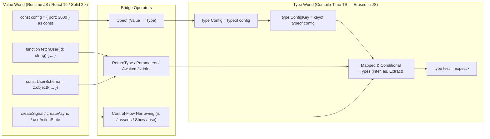

# Total TypeScript — Complete Language & Type-System Curriculum

TypeScript transforms JavaScript from a dynamically typed scripting language into a statically verified systems and application language. Modeled after Matt Pocock's [Total TypeScript Learning Path](https://www.totaltypescript.com/typescript-learning-path) (spanning **Pro Essentials**, **Beginner's TypeScript**, **Type Transformations**, **TypeScript Generics**, **Advanced TypeScript Patterns**, **TypeScript Expert Interviews**, and **Zod Runtime Validation**) and expanded with **Modern JS/TS 5.x–7.0**, this track provides complete, self-paced learning material, type-level exercises with full solutions, a 476-lesson syllabus audit, and runnable TypeScript reference code.

> [!NOTE]
> Framework-specific runtime tracks are modularized and deduplicated:
> - For React 19, Server Components, Fiber, and Concurrent Rendering: see [technologies/react](../../technologies/react).
> - For SolidJS 2.0, reactive graph mechanics, and fine-grained DOM compilation: see [technologies/solidjs](../../technologies/solidjs).

## Module Layout

```text
languages/typescript/
├── README.md                                            # Full syllabus, architecture map, and setup guide
├── GLOSSARY.md                                          # Bilingual (EN ↔ CZ) TypeScript & type-system terminology index
├── CHEATSHEET.md                                        # Fast lookup for utility types, generics, and TSConfig
├── SYLLABUS_AUDIT.md                                    # Verification matrix mapping all 476 lessons + modern JS/TS
├── package.json                                         # Typechecking and execution scripts
├── tsconfig.json                                        # Total TypeScript strict production configuration
├── modules/
│   ├── 01-setup-and-essential-types.md                  # Weeks 1–2 & 10–11: Setup, IDE Superpowers, & Essential Types
│   ├── 02-unions-narrowing-and-objects.md               # Week 3: Unions, Literals, Control-Flow Narrowing, & Objects
│   ├── 03-mutability-classes-and-ts-features.md         # Weeks 4–5: Mutability, Classes, TS-Only Features, & Deriving Types
│   ├── 04-assertions-weird-parts-and-tsconfig.md        # Weeks 6–9: Assertions, Weird Parts, Modules, & TSConfig
│   ├── 05-type-transformations-fundamentals.md          # Weeks 12–13: Type Transformations I — Inference & Template Literals
│   ├── 06-conditional-and-mapped-types.md               # Week 14: Type Transformations II — Conditionals, infer, & Mapped Types
│   ├── 07-typescript-generics.md                        # Weeks 14–16: TypeScript Generics — Functions, Classes, & Overloads
│   ├── 08-advanced-typescript-patterns.md               # Weeks 17–20: Branded Types, Predicates, Assertions, & Builders
│   ├── 09-zod-and-react-foundations.md                  # Week 21: Runtime Checking with Zod & Schema Validation
│   └── 11-expert-interviews-and-modern-ts-js.md         # Bonus & Modern TS/JS: Expert Interviews, using/Dispose, Decorators, TS 5.x–7.0
└── examples/
    ├── utils/
    │   └── type-helpers.ts                              # Expect<T>, Equal<X, Y>, Prettify<T>, StrictOmit<T, K>, Brand<T, B>
    ├── 01-essentials-and-narrowing.ts                   # Discriminated unions, exhaustiveness, readonly, and satisfies
    ├── 02-type-transformations.ts                       # Template literals, conditional types, infer, and URL path parsers
    ├── 03-generics-and-overloads.ts                     # Generic constraints, const type parameters, currying, and overloads
    ├── 04-advanced-patterns.ts                          # Branded types, type predicates, assertion functions, and builders
    ├── 05-zod-and-schema-validation.ts                  # Schema validation, transforms, refinements, and z.infer<T>
    └── 07-modern-ts-and-js-features.ts                  # Explicit Resource Management (using), Stage-3 Decorators, tRPC & ts-pattern
```

## Full Curriculum Map (Modules 01–13)

| Module | Learning Path Weeks | Source Workshops & Extensions | Key Concepts & Primitives Covered |
| :--- | :--- | :--- | :--- |
| [Module 01](./modules/01-setup-and-essential-types.md) | Weeks 1–2, 10–11 | Pro Essentials (Sec 1–4) & Beginner's TS | `tsc --noEmit`, `// ^?` hover introspection, JSDoc, tuples, `Set`, `Map`, `Promise<T>` |
| [Module 02](./modules/02-unions-narrowing-and-objects.md) | Week 3 | Pro Essentials (Sec 5–6) | Union sets, literal narrowing, discriminated unions, `never`, `interface extends` vs `&`, `Record` |
| [Module 03](./modules/03-mutability-classes-and-ts-features.md) | Weeks 4–5 | Pro Essentials (Sec 7–10) | `readonly`, `as const`, `#private` vs `private`, why to avoid `enum`, `typeof`, `keyof`, indexed access |
| [Module 04](./modules/04-assertions-weird-parts-and-tsconfig.md) | Weeks 6–9 | Pro Essentials (Sec 11–17) | `satisfies` vs `as`, `@ts-expect-error`, `{}` vs `object`, excess properties, `.d.ts`, `tsconfig.json` |
| [Module 05](./modules/05-type-transformations-fundamentals.md) | Weeks 12–13 | Type Transformations (Sec 1–4) | `ReturnType`, `Parameters`, `Awaited`, `Extract`, `Exclude`, template literals, type helpers |
| [Module 06](./modules/06-conditional-and-mapped-types.md) | Week 14 | Type Transformations (Sec 5–7) | Distributive conditional types, `infer` pattern matching, mapped types, `as` key remapping, `DeepPartial` |
| [Module 07](./modules/07-typescript-generics.md) | Weeks 14–16 | TypeScript Generics (Sec 1–6) | Generic functions/classes, `<const T>`, Golden Rule of Generics, function overloads vs conditional types |
| [Module 08](./modules/08-advanced-typescript-patterns.md) | Weeks 17–20 | Advanced TS Patterns (Sec 1–7) | Branded types (`unique symbol`), `declare global`, `x is T`, `asserts x is T`, Builder pattern, `NoInfer<T>` |
| [Module 09](./modules/09-zod-and-react-foundations.md) | Weeks 21–23 | Zod Tutorial & React with TS | `z.object()`, `z.infer`, `z.input`/`z.output`, `ComponentProps`, `ReactNode` vs `JSX.Element`, typed hooks |
| [Module 10](./modules/10-advanced-react-with-typescript.md) | Weeks 24–26 | Advanced React with TypeScript (Sec 1–6) | Discriminated props, generic JSX `<Table<T>>`, `useSafeContext`, polymorphic `as` prop, `fixedForwardRef` |
| [Module 11](./modules/11-expert-interviews-and-modern-ts-js.md) | Complete Volume Bonus | TypeScript Expert Interviews & Modern TS/JS | tRPC phantom builders, TanStack `DataTag`, `ts-pattern`, `using` / `Symbol.dispose`, Stage-3 Decorators, ES2025 `Set` & `Object.groupBy`, `(string & {})` |
| [Module 12](./modules/12-react-19-and-modern-react-typescript.md) | Modern React Extension | React 19.x Deep Dive | `ref` as standard prop, `RefCallback` cleanup, `use(Promise \| Context)`, `useActionState`, `useOptimistic`, `useFormStatus`, RSC `Serializable<T>` |
| [Module 13](./modules/13-solidjs-2-with-typescript.md) | Modern Signals Extension | SolidJS 2.x (`@solidjs/signals`) Deep Dive | Microtask batching & `flush()`, first-class async `createMemo`/`createAsync`, `<Loading>` & `<Errored>`, split `createEffect`, draft-first `createStore`, `createProjection`, `onSettled`, ref directive factories, `mergeProps`/`splitProps` |

## Architecture of TypeScript's Dual Spaces

TypeScript operates across two parallel worlds: the **Type World** (evaluated and erased at compile time) and the **Value World** (emitted and executed at runtime). Mastering Total TypeScript means knowing how to bridge between them cleanly without losing type information.



## How to Run the Examples and Type Tests

Every example in [`examples/`](./examples/) is self-contained and verified with compile-time `Expect<Equal<Actual, Expected>>` assertions and runtime tests.

### 1. Run the TypeScript Compiler Check (`tsc --noEmit`)

```bash
npm run typecheck
```

### 2. Run the Node.js Runtime Test Suite

```bash
npm test
```

## Verification & Syllabus Audit

See [`SYLLABUS_AUDIT.md`](./SYLLABUS_AUDIT.md) for the complete section-by-section verification matrix covering all 476 lessons across the 8 official Total TypeScript workshops/tutorials, the 7 **TypeScript Expert Interviews**, **Modern JS/TS (ES2023–ES2025, TS 5.x–7.0)**, **React 19.x**, and **SolidJS 2.x**.
