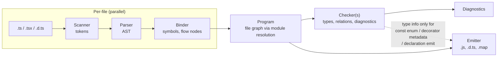
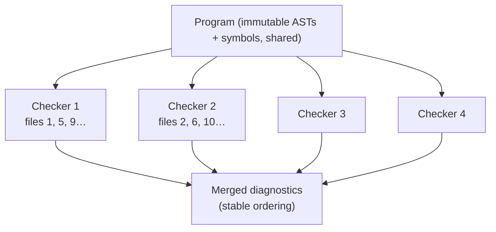
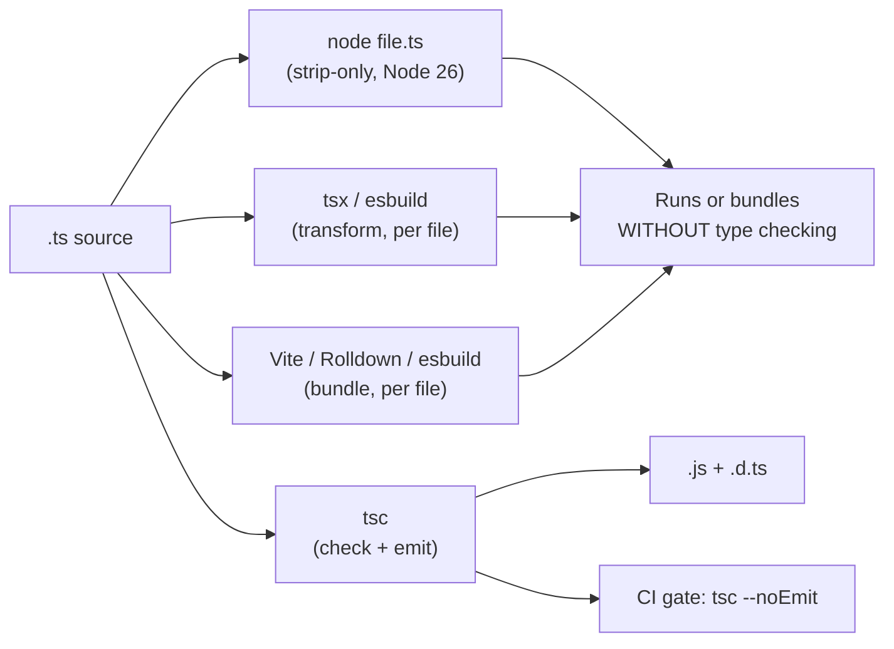

# Module 01: Toolchain & Compiler Model (TypeScript 7)

> Example and tests: [`examples/01-toolchain/toolchain.test.ts`](../examples/01-toolchain/toolchain.test.ts) (compiler fixtures in [`examples/01-toolchain/fixtures/`](../examples/01-toolchain/fixtures/)).
> Run: `mise exec -- node --test examples/01-toolchain/`

TypeScript is two programs that happen to share a parser: a **type checker** that proves properties of your program without running it, and an **emitter** that deletes the proof and leaves JavaScript. Almost every toolchain decision in a TypeScript codebase (which tool strips types, which one checks them, which flags are legal) follows from keeping those two jobs apart. This module builds that model, then applies it to the toolchain as it stands in TypeScript 7.0: a native Go compiler, new defaults, no classic programmatic API, and a compatibility bridge for tools that still need the 6.0 API.

---

## 1. The erasure model

### 1.1 Formal statement

Let `S` be a TypeScript source program and `erase(S)` the JavaScript program obtained by deleting every type-level construct: annotations, `interface` and `type` declarations, type arguments, `declare` declarations, `as`/`satisfies`/`!` operators, `import type`/`export type`, and `implements` clauses.

TypeScript's design goal is the **erasure property**:

> For every well-typed program `S` that uses only erasable syntax, the runtime behaviour of `S` is the runtime behaviour of `erase(S)`.

Two consequences follow, and both shape the rest of the course:

1. **Types cannot influence runtime behaviour.** There is no overload dispatch on static types, no runtime type information, and no checked casts. `x as User` compiles to `x`. If you need a runtime decision, you need a runtime value (a discriminant, a schema, a `typeof` test). See [Module 11](./11-runtime-boundaries-validation.md).
2. **Erasure is a per-file, syntax-directed transformation.** Deleting an annotation requires no knowledge of other files. That is what lets esbuild, SWC, Oxc, Babel and Node's built-in stripper "compile" TypeScript without a type checker.

### 1.2 Where the property breaks: non-erasable syntax

A handful of TypeScript constructs **emit runtime code** and therefore violate the property:

| Construct | Emitted JavaScript | Why it is not erasable |
|---|---|---|
| `enum E { A }` | An IIFE that builds a bidirectional object | Introduces a runtime value |
| `namespace N { export const x = 1 }` (with values) | An IIFE populating an object | Introduces a runtime value |
| `constructor(private x: number)` (parameter properties) | `this.x = x;` in the constructor body | Generates assignments |
| `import fs = require("fs")` / `export =` | CommonJS `require` / `module.exports` | Module-format specific emit |
| `<T>expr` (angle-bracket assertion) | `expr` | Erasable in principle, but ambiguous with JSX, so strippers refuse it |
| Legacy decorators with `emitDecoratorMetadata` | `__decorate`/`__metadata` calls carrying **type** information | Emit depends on types |

`const enum` is worse: erasing it correctly needs the *value* of the enum member, which lives in another file. That is the canonical example of an emit that is not per-file, and the reason `isolatedModules` exists: with it, using a `const enum` declared in another file's declarations is **TS2748** ("Cannot access ambient const enums when 'isolatedModules' is enabled"; fixture `const-enum-isolated/`). Library authors should never export `const enum`s across package boundaries.

### 1.3 `isolatedModules`, `verbatimModuleSyntax`, `erasableSyntaxOnly`

Three flags let the type checker *enforce* that a per-file transpiler will be correct:

| Flag | Guarantee it gives a per-file transpiler |
|---|---|
| `isolatedModules` | Every file can be transpiled without type information (no cross-file `const enum` inlining, re-exports of types are marked). |
| `verbatimModuleSyntax` | Import/export elision is purely syntactic: anything without `type` is kept, anything with `type` is dropped. Implies `isolatedModules`. |
| `erasableSyntaxOnly` | No construct from the table above appears, so *deleting* type syntax is the whole compilation. |

`verbatimModuleSyntax` + `erasableSyntaxOnly` is the configuration for code that runs under Node's type stripping. The track's own [`tsconfig.json`](../tsconfig.json) uses both. The fixture [`erasable/`](../examples/01-toolchain/fixtures/erasable/) shows `tsc` reporting **TS1294** ("This syntax is not allowed when 'erasableSyntaxOnly' is enabled") for an `enum`, a value `namespace`, a parameter property and a `<number>` cast.

---

## 2. Anatomy of a compiler run



- **Scanner and parser.** Produce a concrete-ish AST for each file. Parsing is context-free per file (except for `.tsx` vs `.ts` and `jsx` options), which is why it parallelises trivially.
- **Binder.** Walks each AST, creates **symbols** for declarations (merging declarations that share a name: `interface` merging, namespace + function merging), and builds the **control-flow graph** used later for narrowing ([Module 03](./03-unions-narrowing-and-control-flow.md)).
- **Program.** The set of root files plus everything reached through module resolution (`import`, `/// <reference>`, `types`), plus `lib.*.d.ts` files chosen by `target`/`lib`.
- **Checker.** Lazily computes the type of each node and checks assignability ([Module 04](./04-objects-assignability-and-weird-parts.md)). It is the expensive part: on large codebases checking usually dominates total time.
- **Emitter.** Prints JavaScript (essentially `erase(S)` plus down-levelling for older `target`s) and, when `declaration` is on, `.d.ts` files. Declaration emit *does* need the checker, unless `isolatedDeclarations` is on ([Module 13](./13-library-authoring-performance-and-type-tests.md)).

### 2.1 Lowering and `target`

`target` controls **syntax lowering**: features newer than the target are rewritten (e.g. class fields into constructor assignments, `using` into `try`/`finally` with `__addDisposableResource` helpers). `lib` controls which **type declarations** for built-ins are visible. They are independent: `target: "es2022"` with `lib: ["esnext"]` type-checks calls to `Iterator.prototype.map` but does not polyfill them. Polyfilling is never the compiler's job.

---

## 3. TypeScript 7: the native compiler

### 3.1 What changed and why

TypeScript 7.0 (npm `typescript@7.0.2`, published 2026-07-08) is a **port** of the compiler from TypeScript to Go. It was a port rather than a rewrite: the Go code mirrors the structure of the JavaScript code base so that type-checking results stay compatible with 6.0. The release announcement reports full-build speed-ups of 7.7× to 11.9× at the default of four checkers (for example the VS Code repository: 125.7 s → 10.6 s) and lower memory use (VS Code: 5.2 GB → 4.2 GB).

The speed comes from two sources:

1. **Native code.** Go compiles ahead of time; there is no JIT warm-up and object layout is compact.
2. **Shared-memory parallelism.** Go has goroutines and shared memory. JavaScript workers do not share heaps, so the 6.0 compiler could not parallelise the checker without copying the whole program. In 7.0, parsing and binding run in parallel per file, and type checking is split across **N checker instances** that share the immutable program.



Each checker owns its own type cache, so a type used by files on two checkers may be computed twice. That is the memory/CPU trade-off behind the flag.

### 3.2 The new CLI knobs

| Flag | Meaning | Default |
|---|---|---|
| `--checkers <n>` | Number of type-checker workers per project. Experimental. | 4 |
| `--builders <n>` | Number of project-reference projects built in parallel under `tsc -b`. Experimental. | Not stated in the announcement (unverified) |
| `--singleThreaded` | One checker; parsing and emit on one thread. Useful for profiling and reproducible traces. | off |
| `--ignoreConfig` | Allow `tsc file.ts` when a `tsconfig.json` is present. Without it, 7.0 reports **TS5112**. | off |

The test `--checkers and --singleThreaded are accepted` runs both. Speed-ups are hardware-dependent, so the track records performance numbers as information, not as assertions.

### 3.3 Determinism: `stableTypeOrdering`

The 6.0 checker assigned type IDs in the order types were created, and union members were printed in ID order. With parallel checkers, creation order depends on scheduling, so 7.0 orders types by a stable key. The option `stableTypeOrdering` is always on in 7.0 (the announcement says it "cannot be turned off"; the fixture shows that `"stableTypeOrdering": false` is accepted silently). TS 6.0 offers the same flag so you can preview 7.0's ordering before migrating.

**Failure mode:** snapshot tests of `.d.ts` output or of error messages churn on upgrade because union members print in a different order (`"b" | "a"` becomes `"a" | "b"`). Regenerate the snapshots in a dedicated commit.

### 3.4 Editor integration

The 7.0 language server speaks the Language Server Protocol (LSP) directly and is multi-threaded. In 6.x, editors talked to `tsserver` over a TypeScript-specific protocol, and **language-service plugins** (CSS-modules plugins, the Next.js plugin, Vue/Volar, Angular template checking) were loaded into `tsserver`. 7.0 has no plugin system, so those tools only work against 6.0 until 7.1's content mappers land (see §5).

When the editor shows stale types after a branch switch, restart the language server (VS Code: "TypeScript: Restart TS Server", or the "Disable/Enable TypeScript 7 Language Server" commands of the TS 7 extension).

Hover introspection still works the same way, and course material uses the *twoslash* convention `// ^?` to show what the editor would display:

```ts
const user = { id: "usr_102", loginCount: 42 };
user.loginCount;
//   ^? (property) loginCount: number
```

JSDoc on declarations (`@deprecated`, `@example`, `@param`) is surfaced in hovers and completions; `@deprecated` renders the symbol struck through.

---

## 4. Defaults and removals: TS 5.x → 6.0 → 7.0

TypeScript 6.0 (2026-03-23) was the last JavaScript-based compiler and a **transition release**: it changed defaults and deprecated options. TypeScript 7.0 turns every 6.0 deprecation into a **hard error**.

### 4.1 Changed defaults (since 6.0, kept in 7.0)

| Option | 5.x default | 6.0 / 7.0 default | Consequence |
|---|---|---|---|
| `strict` | `false` | `true` | A bare `tsconfig.json` is strict. |
| `module` | `commonjs` (depending on `target`) | `esnext` | Set `nodenext` for Node packages, `preserve` for bundlers. |
| `target` | `es5` | Latest stable ES year (6.0: `es2025`) | Less down-levelling by default. |
| `types` | All of `node_modules/@types/*` | `[]` | `process`, `Buffer`, `describe` become "Cannot find name". `["*"]` restores 5.x behaviour. |
| `rootDir` | Common directory of all inputs | The directory containing `tsconfig.json` | Emit layout can change; 7.0 reports **TS5011** if the inferred common directory differs. |
| `noUncheckedSideEffectImports` | `false` | `true` | `import "./styles.css"` needs a declaration (**TS2882**). |
| `libReplacement` | `true` | `false` | `@typescript/lib-*` packages are no longer picked up implicitly. |
| `stableTypeOrdering` | n/a | `true` (cannot be disabled in 7.0) | Union print order changes. |

### 4.2 Removed in 7.0 (deprecated in 6.0)

`target: es5`, `downlevelIteration`, `moduleResolution: node`/`node10`/`classic`, `module: amd`/`umd`/`systemjs`/`none`, `baseUrl`, `outFile`, `esModuleInterop: false`, `allowSyntheticDefaultImports: false`, `alwaysStrict: false`, the `module` keyword for namespaces (`module Foo {}` → `namespace Foo {}`), and import `assert { … }` (use `with { … }`).

The fixture [`removed-options/`](../examples/01-toolchain/fixtures/removed-options/tsconfig.json) shows the exact diagnostics: **TS5102** "Option 'baseUrl' has been removed" (with the hint `"paths": {"*": ["./*"]}`) and **TS5108** "Option 'moduleResolution=node10' has been removed" for each removed *value*.

### Then vs now: project configuration

**Then (TS ≤ 5.9).** A `tsconfig.json` restated almost everything, because the defaults were tuned for 2012-era ES5 scripts:

```jsonc
{
  "compilerOptions": {
    "target": "ES2022",
    "module": "NodeNext",
    "moduleResolution": "NodeNext",
    "strict": true,
    "esModuleInterop": true,
    "skipLibCheck": true,
    "baseUrl": ".",
    "paths": { "@/*": ["src/*"] }
  }
}
```

**Now (TS 6.0/7.0).** State only what differs from the defaults:

```jsonc
{
  "compilerOptions": {
    "module": "nodenext",
    "types": ["node"],
    "rootDir": "./src",
    "outDir": "./dist",
    "paths": { "@/*": ["./src/*"] },
    "noUncheckedIndexedAccess": true,
    "skipLibCheck": true
  }
}
```

**Why it changed.** The old defaults silently produced weak configurations (non-strict, ambient `@types` pollution, CommonJS emit). With the Go port the team also dropped options whose semantics were costly to port (`baseUrl` resolution, `node10` resolution, ES5 lowering).

**Migration steps.**
1. Upgrade to 6.0 first. Fix every deprecation warning instead of silencing it with `"ignoreDeprecations": "6.0"`. Turn on `stableTypeOrdering` in 6.0 to see 7.0's ordering early.
2. Add `"types": [...]` explicitly (`node`, test-runner globals).
3. Replace `baseUrl` + `paths` with `paths` entries that start with `./`.
4. Replace `moduleResolution: node` with `nodenext` (Node packages) or `bundler` (apps built by Vite/esbuild).
5. Set `rootDir` if your sources live in a subdirectory and you emit.
6. Add ambient declarations for side-effect imports of non-code assets (`declare module "*.css";`).
7. Switch to 7.0 for `tsc`. Keep 6.0 for tools that need the API (§5).

**Pitfalls of mixing.** A monorepo that upgrades one package to 7.0 while a shared base config still has `baseUrl` breaks *every* package at once, because the error is reported on the shared config. Upgrade the base config first. Running 6.0 and 7.0 side by side is supported, but they must read the same `tsconfig.json`, so that config must be valid for 7.0.

---

## 5. No classic API in 7.0, and the 6.0 bridge

### 5.1 What "no API" means precisely

In 5.x/6.x, `import ts from "typescript"` gave you the whole compiler: `ts.createProgram`, `ts.transpileModule`, the language service. Linters (typescript-eslint), framework checkers (vue-tsc/Volar, Angular), documentation tools and codemods are built on it.

In 7.0.2 the package's main entry exports only `version` and `versionMajorMinor`. The test `TS 7 has no classic programmatic API on the main entry point` asserts that `createProgram` and `transpileModule` are `undefined`. The `package.json` `exports` map does contain `./unstable/sync`, `./unstable/async`, `./unstable/ast` and similar subpaths: an **unstable** API over the native process, not covered by the announcement and not meant for production tools. The 7.1 beta (2026-10-20) promotes a new API to `typescript/sync`, `typescript/async`, `typescript/fs`, `typescript/ast`, `typescript/ast/is` and `typescript/ast/factory`, with `Disposable` `API` and `Program` objects:

```ts
// TypeScript 7.1 beta (preview, not taught as current): the new API
import { API } from "typescript/sync";
using api = new API();
using program = api.createProgram(fileNames, options);
const result = program.emit();
```

It is a *different* API. Code written against `ts.createProgram` from 6.0 does not port mechanically.

### 5.2 The bridge: `@typescript/typescript6`

`@typescript/typescript6@6.0.2` re-exports the 6.0 API and ships the 6.0 compiler as a binary named `tsc6`. Two installation patterns:

```jsonc
// A: tools that import "typescript" get 6.0; you still get the 7.0 tsc via a second alias
{
  "devDependencies": {
    "typescript": "npm:@typescript/typescript6@^6.0.2",
    "@typescript/native": "npm:typescript@^7.0.2"
  }
}
```

```jsonc
// B: keep "typescript" at 7.0 and add the bridge for one tool that accepts a custom compiler path
{
  "devDependencies": {
    "typescript": "7.0.2",
    "@typescript/typescript6": "6.0.2"
  }
}
```

Pattern A is what the 7.0 announcement describes for API consumers such as typescript-eslint 8.x, which resolve `typescript` by package name. Type-check with 7.0 in CI (`tsc`), lint with the 6.0 API. Both read the same `tsconfig.json`.

**Failure mode:** with pattern A, a script named `tsc` in `package.json` now resolves to whichever package's `bin` wins the `node_modules/.bin/tsc` link. Call the binaries explicitly (`tsc6`, or the 7.0 binary via `@typescript/native`) and check `tsc --version` in CI.

### 5.3 What still needs 6.0 (as of 7.0.2)

| Tool category | Why | 7.x path |
|---|---|---|
| typescript-eslint type-aware rules | Uses the 6.0 program/checker API | Bridge (pattern A) |
| Vue (`vue-tsc`/Volar), Svelte, Astro, MDX | Map non-TS files into virtual TS via the API or plugins | 7.1 `contentMappers` + `--runExternalCode` (beta) |
| Angular template type checking | API | Bridge |
| Language-service plugins (CSS modules, Next.js TS plugin) | `tsserver` plugin system | None in 7.0; content mappers in 7.1 for file-type mapping |
| `ts-morph`, custom transformers, `ttypescript`-style patches | API / transformer hooks | Bridge; transformer hooks have no 7.x equivalent (unverified for 7.1) |

---

## 6. Executing TypeScript: who strips the types?



### 6.1 Node's built-in type stripping

Node 26 executes `.ts` files directly: `node file.ts`. `process.features.typescript` is `"strip"`. Node replaces type syntax with whitespace (so positions and stack traces stay correct without source maps) and refuses anything non-erasable with `ERR_UNSUPPORTED_TYPESCRIPT_SYNTAX` (the test `Node 26 strips types but refuses non-erasable syntax at runtime` runs an `enum` file and asserts the error). Rules that follow from strip-only execution:

- Imports must carry the real extension: `import { x } from "./util.ts"`. Set `allowImportingTsExtensions` (with `noEmit`) or `rewriteRelativeImportExtensions` (when `tsc` emits, it rewrites `.ts` → `.js`).
- Type-only imports must say so (`import type`), otherwise Node tries to import a binding that does not exist at runtime. `verbatimModuleSyntax` enforces this.
- No `enum`, value `namespace`, parameter properties or `import =`. `erasableSyntaxOnly` enforces this at check time.
- `tsconfig.json` is **not read** by Node. `paths` aliases do not work at runtime; use package.json `imports` (`#/…` subpath imports, supported by TS 6.0+ under `nodenext`/`bundler`).

Node 26.12.1 accepts `--experimental-strip-types` as a no-op and `--no-strip-types` to turn stripping off. It **rejects** `--experimental-transform-types` (verified locally: "bad option"). Earlier releases used that flag to transform enums and namespaces (version range: introduced in 22.7; the exact removal version is unverified). The deep treatment of Node's loader belongs to the `technologies/nodejs` track (owner per `.agents/OWNERSHIP.md`; not yet written, so no link).

### 6.2 `tsx` and bundlers

`tsx` (4.23.x) runs TypeScript through esbuild, so it supports non-erasable syntax, `paths` and extensionless imports. It is still useful for scripts in codebases that use `enum`s. Bundlers (Vite, Rolldown, esbuild) transpile per file in the same way.

**Rule:** none of these check types. The only type checker is `tsc` (or the editor's language server, which runs the same checker). Every pipeline needs a `tsc --noEmit` (or `tsc -b`) gate in CI.

### Then vs now: running a TypeScript script

| | Then (Node ≤ 22.5, TS ≤ 5.7) | Now (Node 26, TS 7) |
|---|---|---|
| Command | `ts-node script.ts` or `tsx script.ts` | `node script.ts` |
| Non-erasable syntax | Supported | Rejected; enforce `erasableSyntaxOnly` |
| Import specifiers | Extensionless or `.js` | `.ts` (with `allowImportingTsExtensions` or `rewriteRelativeImportExtensions`) |
| Type checking | ts-node checked by default (slow); tsx never | Never at runtime; `tsc` in CI |

Migration: enable `erasableSyntaxOnly` and `verbatimModuleSyntax`, fix the reported constructs (enums → `as const` objects, see [Module 05](./05-classes-mutability-and-ts-only-syntax.md)), rename imports to `.ts`, replace `paths` with `imports`. Pitfall: mixing `tsx` locally with `node` in production hides `enum` usage until deploy. Run the same command in both places.

---

## 7. Production failure modes

1. **"Cannot find name 'process'" after upgrading.** `types` defaults to `[]` since 6.0. Add `"types": ["node"]` (plus test globals such as `"vitest/globals"` if you use them). Proven by the `ts7-defaults` fixture.
2. **"Cannot find module or type declarations for side-effect import of './index.css'" (TS2882).** `noUncheckedSideEffectImports` is on by default. Add `declare module "*.css";` in a `.d.ts` that the program includes. 7.1 adds attribute-aware ambient modules: `declare module "*" with { type: "css" } { … }`.
3. **The whole monorepo breaks at once on 7.0.** A shared base config still has `baseUrl` or `moduleResolution: "node"`. These are errors, not warnings.
4. **Emit lands in `dist/src/…` or `tsc` fails with TS5011.** `rootDir` now defaults to the config directory. Set `rootDir` explicitly.
5. **Lint or Vue type-checking silently uses a different compiler.** Those tools import `typescript` and need the 6.0 API. Pin the bridge deliberately and print both versions in CI.
6. **Code works under `tsx`, crashes under `node`.** Non-erasable syntax or extensionless imports. Enforce `erasableSyntaxOnly` + `verbatimModuleSyntax` in `tsconfig.json`.
7. **CI is green but production throws a `TypeError`.** The pipeline transpiles with a bundler and never runs `tsc`. Add the `tsc --noEmit` gate.
8. **Decorator metadata disappears.** `emitDecoratorMetadata` needs type information, so per-file transpilers cannot produce it. 7.0's `tsc` still supports `experimentalDecorators` and `emitDecoratorMetadata` (verified by compiling a fixture), but esbuild/Node stripping do not emit metadata.

---

## 8. Version history (compiler and toolchain)

| Version | Date | Relevant change for practitioners |
|---|---|---|
| 5.0 | 2023-03 | Standard (TC39) decorators, `const` type parameters, `verbatimModuleSyntax`, `moduleResolution: bundler` |
| 5.5 | 2024-06 | Inferred type predicates, `isolatedDeclarations` |
| 5.7 | 2024-11 | `rewriteRelativeImportExtensions` |
| 5.8 | 2025-02 | `erasableSyntaxOnly`, `--module node18` |
| 6.0 | 2026-03-23 | Last JS-based compiler; new defaults (`strict`, `types: []`, `rootDir`, …); deprecations; `stableTypeOrdering` preview; `es2025` target |
| 7.0 | 2026-07-08 (npm publish of 7.0.2) | Native Go compiler; deprecations become errors; no classic API; `--checkers`/`--builders`/`--singleThreaded`; code-point-aware template literal inference |
| 7.1 beta | 2026-10-20 | New API (`typescript/sync` …), `contentMappers`, `es2026`, import attributes in ambient modules, `import source` (preview, not taught as current) |

The 5.x dates are from model knowledge of the release cadence (month granularity) and are marked (unverified); the 6.0, 7.0 and 7.1 rows are from the release posts and the npm registry.

---

## Interview Drill

<details><summary>1. Why can esbuild compile TypeScript without type checking, and which constructs break that?</summary>

Because erasure is per-file and syntax-directed: deleting annotations needs no type information. It breaks for constructs whose emit depends on other files or on types: `const enum` (needs the member value from another file), decorator metadata (needs the parameter types), and re-exports where the transpiler cannot tell whether a name is a type. `isolatedModules`/`verbatimModuleSyntax` make the checker reject those cases so per-file transpilation is always correct.
</details>

<details><summary>2. What does <code>erasableSyntaxOnly</code> forbid, and why does it matter now?</summary>

`enum`, value-carrying `namespace`, parameter properties, `import x = require()`/`export =`, and angle-bracket type assertions. Node 26 executes `.ts` by stripping types and throws `ERR_UNSUPPORTED_TYPESCRIPT_SYNTAX` on those constructs. The flag moves that runtime failure to compile time.
</details>

<details><summary>3. TypeScript 7 is "10× faster". Where does the speed come from?</summary>

Native ahead-of-time compiled Go instead of JIT-compiled JavaScript, and shared-memory parallelism: parsing/binding per file in parallel, and type checking split across several checker instances (`--checkers`, default 4) that share the immutable program. The reported range is 7.7×–11.9× at four checkers on real repositories.
</details>

<details><summary>4. Your team upgrades to TS 7 and typescript-eslint stops working. Why, and what do you do?</summary>

typescript-eslint uses the compiler API (`ts.createProgram`, the checker). 7.0's `typescript` package has no classic API (only `version` on the main entry). Install the bridge: `"typescript": "npm:@typescript/typescript6@^6.0.2"` so API consumers get 6.0, and add `"@typescript/native": "npm:typescript@^7.0.2"` to keep the 7.0 `tsc` for type checking. Both read the same `tsconfig.json`.
</details>

<details><summary>5. After upgrading, every test file reports "Cannot find name 'describe'". Explain.</summary>

Since 6.0, `types` defaults to `[]`, so global declarations from `@types/*` packages (or `vitest/globals`) are no longer included automatically. List them: `"types": ["node", "vitest/globals"]`, or import the test functions explicitly.
</details>

<details><summary>6. What is the difference between <code>target</code> and <code>lib</code>?</summary>

`target` controls syntax lowering in emitted JavaScript. `lib` controls which built-in API declarations the checker sees. Neither polyfills anything. A mismatch (high `lib`, old runtime) type-checks code that fails at runtime with "x is not a function".
</details>

<details><summary>7. Why does 7.0 need <code>stableTypeOrdering</code>, and what breaks because of it?</summary>

With parallel checkers, the order in which types are created (and therefore their internal IDs) depends on scheduling. Printing unions in ID order would make error messages and `.d.ts` output nondeterministic. 7.0 always orders by a stable key. Snapshot tests of declarations and error text change on upgrade.
</details>

<details><summary>8. Which tool type-checks in a Vite + Node-type-stripping project?</summary>

None of the runtime tools. Vite (esbuild/Rolldown) and Node only strip types. Type checking happens in the editor (language server) and must be enforced with `tsc --noEmit` (or `tsc -b` for project references) in CI.
</details>
