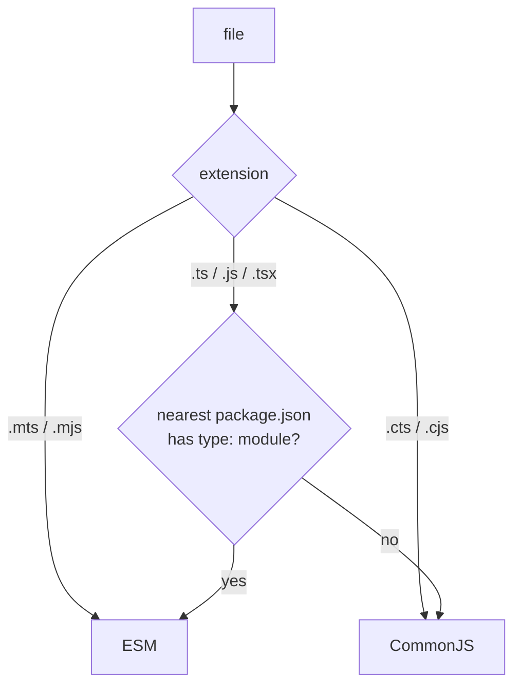

# Module 06: Modules, Declarations & tsconfig (TypeScript 7 Edition)

> Example and tests: [`examples/06-modules-tsconfig/modules-tsconfig.test.ts`](../examples/06-modules-tsconfig/modules-tsconfig.test.ts) with fixtures in [`examples/06-modules-tsconfig/fixtures/`](../examples/06-modules-tsconfig/fixtures/) (`nodenext` errors and fixes, `bundler` resolution, project references) and an augmentable module [`event-registry.ts`](../examples/06-modules-tsconfig/event-registry.ts).
> Run: `mise exec -- node --test examples/06-modules-tsconfig/`

The type checker has to answer, for every `import` specifier, *which file the runtime will load* and *which declarations describe it*. Get that wrong and the program either fails to compile or, worse, type-checks against declarations of a file that is never loaded. This module covers how TypeScript models module systems, how it resolves specifiers (`nodenext` vs `bundler`), declaration files and ambient declarations, augmentation, project references, and a TS 7-era `tsconfig.json`.

**Ownership.** The runtime semantics of ES modules (Module Records, linking, live bindings, cycles, top-level await) and of `package.json` `exports` at runtime belong to `languages/javascript`; Node's loader internals belong to `technologies/nodejs`. This module covers the *type-checker's model* of them. Publishing (`exports`/`types` conditions from the publisher's side, attw) is in [Module 13](./13-library-authoring-performance-and-type-tests.md).

---

## 1. Modules vs scripts

A file is a **module** if it has a top-level `import` or `export` (or, with `moduleDetection: "auto"`, other signals such as `"type": "module"` or JSX under `react-jsx`). Otherwise it is a **script**, and its top-level declarations are **global**: they merge with every other script's declarations and with `lib.d.ts`.

| `moduleDetection` | Rule |
|---|---|
| `"auto"` (default) | Module if it has `import`/`export`, is `.mjs`/`.mts`/`.cjs`/`.cts`, is under `"type": "module"` with `module: nodenext`, or uses the automatic JSX runtime |
| `"force"` | Every non-declaration file is a module |
| `"legacy"` | Only `import`/`export` makes a module |

**Failure mode:** a helper file without imports declares `const name = "x"` and collides with the DOM's global `name` (TS2451 "Cannot redeclare block-scoped variable", reported both in your file and in `lib.dom.d.ts`). The fixture [`module-detection/`](../examples/06-modules-tsconfig/fixtures/module-detection/index.ts) reproduces it and the test shows that `--moduleDetection force` makes it compile. Use `moduleDetection: "force"`, or add `export {}`.

**Why scripts still exist.** Global scripts are how `lib.d.ts`, `@types/node` globals and classic `<script>` code are modelled: their top-level declarations *must* merge into one global scope. A `.d.ts` without `import`/`export` is therefore global on purpose; adding a single `import` to it silently turns its declarations into module-local ones, a common reason "my global type disappeared".

---

## 2. The `module` option: what the checker assumes about the runtime

Since TS 4.7, `module` describes the **host's module system**, not just the emit format:

| `module` | Means | Implied `moduleResolution` | Typical use |
|---|---|---|---|
| `nodenext` (or `node18`/`node20`) | Node's dual ESM/CJS system; each file's format comes from its extension and the nearest `package.json` `"type"` | `nodenext` | Libraries and Node apps executed by Node |
| `preserve` | Keep `import`/`require` as written; a bundler or runtime will handle them | `bundler` | Apps built by Vite/Rolldown/esbuild, Bun |
| `esnext` (TS 6/7 default) | Emit ESM syntax, no host semantics | `bundler` | Rarely the right explicit choice; prefer the two above |
| `commonjs` | Emit CJS | `bundler` is allowed since 6.0; `node10` was removed in 7.0 | Legacy CJS outputs |

Removed in 7.0: `amd`, `umd`, `system`, `none` ([Module 01](./01-toolchain-and-compiler-model.md) §4).

### 2.1 Per-file module format under `nodenext`



The format decides which import syntax is legal and how imports resolve. Under `verbatimModuleSyntax`, writing `export const x` in a file the checker considers CommonJS is an error (**TS1287**, seen in [Module 13](./13-library-authoring-performance-and-type-tests.md)'s broken package before `"type": "module"` was added).

---

## 3. Module resolution: `nodenext` vs `bundler`

### 3.1 `nodenext`: model Node exactly

The fixture [`nodenext-errors/`](../examples/06-modules-tsconfig/fixtures/nodenext-errors/index.ts) collects the three errors everyone meets:

| Code | Message (abridged) | Why | Fix |
|---|---|---|---|
| **TS2835** | Relative import paths need explicit file extensions in ECMAScript imports … Did you mean `./lib/user.js`? | Node's ESM resolver does no extension probing | Write the extension of the **output** file: `./lib/user.js` (or `.ts` with `allowImportingTsExtensions`/`rewriteRelativeImportExtensions`) |
| **TS1484** | 'User' is a type and must be imported using a type-only import | `verbatimModuleSyntax`: unmarked imports are kept in the output, and Node would fail to find the binding | `import type { User }` or `import { type User }` |
| **TS1543** | Importing a JSON file into an ECMAScript module requires a `type: "json"` import attribute | Node requires the attribute | `import data from "./data.json" with { type: "json" }` |

Writing `.js` for a file that exists as `.ts` surprises newcomers. The rule: specifiers name the file *the runtime loads*. TypeScript maps `./user.js` back to `./user.ts` (and `./user.d.ts`) during checking.

**Subpath imports.** `package.json` `"imports": { "#lib/*": "./lib/*" }` gives Node-native aliases (`import … from "#lib/user.js"`), resolved by both Node and TypeScript (supported for `#/…` since TS 6.0 under `nodenext` and `bundler`). Unlike `paths`, they work at runtime without a bundler. The fixed fixture uses one.

**`exports` and conditions.** When resolving a bare specifier `pkg/sub`, `nodenext` reads `pkg`'s `exports` map with the conditions `["types", "node", "import"]` for an ESM importer or `["types", "node", "require"]` for a CJS importer (plus `customConditions`). A subpath missing from `exports` is not importable, even if the file exists (Node would refuse it too). `typesVersions` is consulted only when `exports` is absent or for older resolution modes.

### 3.2 `bundler`: model a bundler

`moduleResolution: "bundler"` (implied by `module: "preserve"`) uses the `exports` map with the `import` condition, but allows extensionless relative imports and directory `index` files, because bundlers do. The fixture [`bundler/`](../examples/06-modules-tsconfig/fixtures/bundler/index.ts) compiles `import { version } from "./user"`.

### 3.3 How `exports` conditions are matched (worked example)

The fixture [`exports-conditions/`](../examples/06-modules-tsconfig/fixtures/exports-conditions/package.json) is a package that imports *itself* by name (Node's **package self-reference**, which works whenever the nearest `package.json` has `name` and `exports`):

```json
{
  "name": "zto-self",
  "type": "module",
  "exports": {
    ".": {
      "types": { "import": "./types/esm.d.ts", "require": "./types/cjs.d.cts" },
      "default": "./src/index.js"
    },
    "./public": { "source": "./src/public.ts", "types": "./types/public.d.ts", "default": "./src/public.js" }
  }
}
```

Resolution walks the condition object **in key order** and takes the first key that is in the active condition set; nested objects repeat the walk. The active set under `nodenext` is `types` + `node` + (`import` for an ESM importer | `require` for a CJS importer) + `customConditions` + `default`.

| Importer | Specifier | Path taken | Declarations |
|---|---|---|---|
| `consumer.mts` (ESM) | `zto-self` | `"."` → `types` → `import` | `types/esm.d.ts` (`flavor: "esm"`) |
| `consumer.cts` (CJS) | `zto-self` | `"."` → `types` → `require` | `types/cjs.d.cts` (`flavor: "cjs"`) |
| `consumer.mts` | `zto-self/public` | `"./public"` → `types` | `types/public.d.ts` (`pub: 1`) |
| `consumer.mts` with `--customConditions source` | `zto-self/public` | `"./public"` → `source` (listed first, now active) | `src/public.ts` (`pub: 2`) |
| `consumer.mts` | `zto-self/src/internal.js` | no matching key in `exports` | **TS2307**: the file exists but is encapsulated |

The tests assert each row. Two practical uses follow. **Encapsulation:** `exports` is a public-API boundary; deep imports into a dependency's internals stop compiling (and stop working in Node) when the dependency adds `exports`. **Source conditions in monorepos:** a custom `"source"` condition pointing at `.ts` files lets workspace packages type-check against each other's sources without building first; the bundler and `customConditions` must agree, or editor and build see different code.

`--traceResolution` prints every step ("Resolving module 'zto-self' from …", which conditions were tried, which file was found). It is the tool for "why does TypeScript pick that file?" (asserted by a test).

### 3.4 `paths`: a type-checker alias, not a runtime feature

`paths` maps specifier patterns to file locations *for the checker only*:

```jsonc
"paths": { "@lib/*": ["./src/lib/*"], "config": ["./src/config/index.ts"] }
```

Matching rules: a pattern may contain one `*`; when several patterns match, the one with the **longest prefix before the `*`** wins; each pattern may list several fallback locations, tried in order; locations are resolved relative to the config file (since `baseUrl` is gone in 7.0, start them with `./`). `paths` never rewrites the emitted specifier.

The fixture [`paths-alias/`](../examples/06-modules-tsconfig/fixtures/paths-alias/src/main.ts) type-checks `import { answer } from "@lib/answer.ts"`, and the test then runs the same file with Node, which fails with `ERR_MODULE_NOT_FOUND`: Node does not read `tsconfig.json`. Use `paths` only when a bundler (configured with the same aliases) produces the runtime code; for code that Node runs, use `package.json` `imports` (`#lib/*`), which both Node and TypeScript understand.

### Then vs now: module resolution

**Then (TS ≤ 5.x).** `moduleResolution: "node"` (renamed `node10`) modelled Node 10's CommonJS resolver: extension probing, `index.js`, `main`/`types` fields, **no `exports`**. It accepted code that Node's ESM loader rejects, and it ignored `exports` so it could type-check deep imports that fail at runtime. `baseUrl` + `paths` provided aliases that only bundlers understood.

**Now (TS 6.0 deprecations, 7.0 removal).** `node10`, `classic` and `baseUrl` are gone (TS5108/TS5102). Choose `nodenext` when Node runs the output, `bundler` when a bundler does. Aliases: `package.json` `imports` (runtime-native) or `paths` relative to the config (`"@/*": ["./src/*"]`, bundler must mirror them).

**Migration.**
1. Decide who resolves at runtime (Node or a bundler) per package; set `module` accordingly.
2. Under `nodenext`, add extensions (the quick fix "Add missing file extension" works across files) and `type` modifiers (`verbatimModuleSyntax` tells you where).
3. Replace `baseUrl`-relative imports (`import x from "utils/x"`) with `#` subpath imports or `paths` entries starting with `./`.
4. Re-run with `--traceResolution` on a single import when something resolves to an unexpected file.

**Pitfall of mixing:** a library type-checked with `bundler` but executed by Node ships extensionless ESM imports that crash at runtime (`ERR_MODULE_NOT_FOUND`). Libraries consumed by Node should be checked with `nodenext`.

---

## 4. Import elision and `verbatimModuleSyntax`

Historically TypeScript **elided** imports that were only used as types. That was invisible but had two problems: per-file transpilers could not know whether `import { X }` was a type, and side-effectful modules disappeared when only types were used.

`verbatimModuleSyntax` replaces the heuristics with one rule: imports and exports without `type` stay, with `type` they go. It supersedes `importsNotUsedAsValues` and `preserveValueImports` (both deprecated since 5.0 and ignored with a warning when `verbatimModuleSyntax` is active). It implies `isolatedModules`, and it forbids `import x = require()` in ESM files and `export =` in ESM.

### Then vs now: type-only imports

| | Then (≤ 4.9) | Now (5.0+; required in practice for Node type stripping) |
|---|---|---|
| `import { User } from "./user"` used only as a type | Silently elided | Kept; error TS1484 when `User` is a type |
| Side-effect retention | `importsNotUsedAsValues: preserve` | Default under `verbatimModuleSyntax` |
| Per-file transpilers | Needed `isolatedModules` and guessed | Exact |

---

## 5. Declaration files and ambient declarations

### 5.1 `.d.ts` files

A `.d.ts` file contains only declarations and emits nothing. TypeScript finds them:
- next to a resolved `.js` file (`user.js` → `user.d.ts`; `.mjs` → `.d.mts`; `.cjs` → `.d.cts`);
- through `types` conditions in `exports`, or `types`/`typings` in `package.json`;
- in `@types/*` packages, *only* for packages you import, or for names listed in `types` (default `[]` since 6.0);
- through `include`/`files`, for ambient declaration files you write.

A declaration file is a module if it has a top-level `import`/`export`; otherwise its declarations are global. That distinction decides whether `declare module "x"` *declares* a module or *augments* one (§6).

### 5.2 Ambient modules for non-code assets

`noUncheckedSideEffectImports` (default `true` since 6.0) makes `import "./styles.css"` an error (TS2882) unless the specifier resolves or is declared. Pattern declarations cover whole families:

```ts
// assets.d.ts — a script (no top-level import/export), so this is a global declaration
declare module "*.css";                              // side-effect import only
declare module "*.module.css" {
  const classes: { readonly [className: string]: string };
  export default classes;
}
declare module "*.svg" {
  const url: string;
  export default url;
}
```

TS 7.1 (beta, preview) adds attribute-aware declarations, so that `import sheet from "./a.css" with { type: "css" }` has a precise type:

```ts
declare module "*" with { type: "css" } {
  const sheet: CSSStyleSheet;
  export default sheet;
}
```

Ambient module patterns are **not checked against files on disk**: a typo in the path compiles and fails in the bundler or at runtime.

### 5.3 `lib`, `target` and `types`

- `lib` selects built-in declaration files (`es2025`, `esnext`, `dom`, `webworker`, `esnext.disposable`, …). In TS 6.0+ `dom` includes the iterable and async-iterable DOM declarations (`dom.iterable` is merged into `dom`).
- `target` defaults to the latest stable ES year and controls lowering, not polyfills ([Module 01](./01-toolchain-and-compiler-model.md) §2.1).
- `types` lists the `@types/*` packages whose **global** declarations are included without an import. Default `[]` since 6.0. Imported packages' types are always found; `types` matters for globals (`process`, `describe`, `jest`, `chrome`).

---

## 6. Declaration merging and augmentation

### 6.1 Merging rules

Declarations with the same name in the same scope **merge**:

| Merge | Result |
|---|---|
| interface + interface | Members combined; later overloads first; conflicting property types are an error |
| namespace + namespace | Exported members combined |
| namespace + function/class/enum | Static members attached to the value |
| class + interface | Interface members added to the instance type (unchecked: the class body need not implement them) |
| `type` alias + anything | **Not allowed**: type aliases never merge (TS2300 duplicate identifier) |

This is the deep reason behind "interfaces are open, type aliases are closed" ([Module 04](./04-objects-assignability-and-weird-parts.md)).

### 6.2 Module augmentation

Inside a **module**, `declare module "specifier" { … }` adds to the declarations of an existing module. You can merge into interfaces and namespaces; you cannot add new top-level values or change existing types. The example augments its own [`event-registry.ts`](../examples/06-modules-tsconfig/event-registry.ts):

```ts
declare module "./event-registry.ts" {
  interface EventRegistry {
    "user.created": { id: string };
    "order.paid": { orderId: string; cents: number };
  }
}
emit("order.paid", { orderId: "o1" }); // error: cents missing
```

This "registry interface" is how Express (`Request`), Vue (`ComponentCustomProperties`), Fastify, i18n libraries and React's `CSSProperties` ([Module 12](./12-typing-ui-frameworks.md)) let applications extend library types.

### 6.3 Global augmentation

From inside a module, `declare global { … }` adds to the global scope:

```ts
declare global {
  interface Window { __APP_VERSION__: string }
  var __BUILD_ID__: string | undefined;   // `var` (not let/const) declares a property of globalThis
}
```

Use `var` for globals that must appear on `globalThis`. Global augmentation describes values someone else provides (a script tag, a bundler `define`): it does not create them, so type them as possibly `undefined` unless their presence is guaranteed (the test asserts `globalThis.__BUILD_ID__` is `undefined` at runtime).

**Failure mode:** `declare global` in a file without imports/exports is an error (TS2669: augmentations for the global scope can only be directly nested in external modules), and a *script* `.d.ts` with `declare module "x" {}` *replaces* the module's types instead of augmenting them, silently hiding the real declarations. Keep augmentation files as modules (`export {}`).

### 6.4 How merged symbols are resolved

Declaration merging happens in the binder (per file) and in the checker (across files, and between a module and its augmentations). Rules worth knowing when an augmentation "doesn't apply":

1. **The specifier must resolve to the same module.** `declare module "lib"` augments whatever `"lib"` resolves to *from the augmenting file*. If the augmentation file resolves `"lib"` to a different copy (two versions in `node_modules`, or `"lib/dist/index"` vs `"lib"`), the augmentation lands on a different symbol. `--traceResolution` from the augmenting file shows which.
2. **Only existing interfaces/namespaces can be extended.** A new top-level `export const` inside `declare module "lib"` is an error; a new interface is allowed but is only visible to code that imports it from `"lib"`.
3. **Interface member order matters for overloads.** Later declarations' call signatures come *first*, so an augmentation can add a more specific overload that wins over the library's own.
4. **The augmenting file must be part of the program.** An augmentation in a file nobody imports and `include` does not match has no effect; for library-provided augmentations, `types` or an explicit `import "lib/augment"` brings it in.

---

## 7. Project references and `tsc -b`

A large repository is split into projects with their own `tsconfig.json`, linked with `references`. Each referenced project must set `composite: true` (which implies `declaration`, requires all files to be matched by `include`/`files`, and defaults `rootDir` to the config directory). Without it, `tsc -b` fails with **TS6306** (fixture `refs-broken/`).

```jsonc
// app/tsconfig.json
{
  "compilerOptions": { "rootDir": "src", "outDir": "dist" },
  "references": [{ "path": "../core" }]
}
```

`tsc -b app`:
1. Builds the dependency graph from `references`.
2. For each project in topological order, checks whether it is up to date (by comparing `.tsbuildinfo` hashes with the inputs) and rebuilds only if needed.
3. Downstream projects type-check against the **`.d.ts` output** of upstream projects, not against their sources. That is what makes references scale, and also why a stale upstream build produces confusing errors.

TS 7 builds independent projects in parallel (`--builders <n>`, experimental), and with `isolatedDeclarations` declaration output no longer waits for a full check ([Module 13](./13-library-authoring-performance-and-type-tests.md)). The fixture `refs/` builds with `--builders 2 --verbose`.

**Editor note.** The language server uses the source files of referenced projects for go-to-definition (with `disableSourceOfProjectReferenceRedirect` off), but CI uses the `.d.ts` outputs. "Works in the editor, fails in CI" usually means CI built in the wrong order or did not use `-b`.

---

## 8. A TS 7 `tsconfig.json`, stating only differences from defaults

### 8.1 Node library or service (run by Node)

```jsonc
{
  "compilerOptions": {
    "module": "nodenext",
    "types": ["node"],
    "rootDir": "./src",
    "outDir": "./dist",
    "declaration": true,
    "isolatedDeclarations": true,
    "verbatimModuleSyntax": true,
    "erasableSyntaxOnly": true,
    "rewriteRelativeImportExtensions": true,  // write ./x.ts in source, emit ./x.js
    "noUncheckedIndexedAccess": true,
    "exactOptionalPropertyTypes": true,
    "noImplicitOverride": true,
    "skipLibCheck": true
  },
  "include": ["src"]
}
```

### 8.2 Bundled application (Vite + React or Solid)

```jsonc
{
  "compilerOptions": {
    "module": "preserve",
    "jsx": "react-jsx",            // Solid: "preserve" + "jsxImportSource": "@solidjs/web"
    "lib": ["esnext", "dom"],
    "types": ["vite/client"],
    "noEmit": true,
    "allowImportingTsExtensions": true,
    "verbatimModuleSyntax": true,
    "noUncheckedIndexedAccess": true,
    "skipLibCheck": true,
    "paths": { "@/*": ["./src/*"] }
  },
  "include": ["src"]
}
```

### 8.3 Options worth knowing beyond defaults

| Option | Effect | Trade-off |
|---|---|---|
| `noUncheckedIndexedAccess` | `arr[i]` and `record[key]` include `undefined` | Noisy in index-heavy code; use `for…of`, `.at()` + checks |
| `exactOptionalPropertyTypes` | `{ a?: string }` no longer accepts explicit `a: undefined` | Libraries' types sometimes disagree; see [Module 04](./04-objects-assignability-and-weird-parts.md) |
| `noImplicitOverride` | Requires `override` on overriding members | None; catches renamed base methods |
| `noPropertyAccessFromIndexSignature` | Forces `obj["key"]` for index-signature access | Makes dynamic access visible |
| `skipLibCheck` | Skips checking `.d.ts` files | Hides conflicts between `@types` versions; almost always worth it for speed |
| `isolatedDeclarations` | Exports need syntactically evident types | For libraries; see Module 13 |
| `erasableSyntaxOnly` | No enums/namespaces/parameter properties | Required for Node type stripping |
| `customConditions` | Extra `exports` conditions (e.g. `"development"`, `"source"`) | Must match the bundler's conditions |

---

## 9. Production failure modes

1. **Code type-checks with `bundler` but crashes under Node** (`ERR_MODULE_NOT_FOUND` for extensionless imports). Check Node-executed code with `nodenext`.
2. **Deep imports that compile but fail at runtime**: `node10` ignored `exports`. Fixed by `nodenext`/`bundler`, which honour `exports`.
3. **`import type` missing**: Node strips the annotation, keeps the import, and throws "does not provide an export named 'User'". `verbatimModuleSyntax` makes it a compile error (TS1484).
4. **Ambient `declare module "x"` in a script file replaces a real package's types.** Make augmentation files modules.
5. **Globals declared but never provided.** Type them `| undefined` unless guaranteed.
6. **Stale project-reference builds** cause phantom errors. Always `tsc -b` in CI, and clean `.tsbuildinfo` when switching branches if the build tool caches.
7. **`paths` aliases work in the editor but not at runtime.** `paths` never changes emitted specifiers; use `imports` or configure the bundler.
8. **CSS/asset side-effect imports fail after upgrading** (TS2882). Add ambient declarations.
9. **Deep imports break when a dependency adds `exports`** (TS2307 for a file that exists). Import from the public entry points, or ask the maintainer to export the subpath.
10. **Editor and build disagree in a monorepo** because one uses a `"source"` custom condition and the other does not. Configure `customConditions` and the bundler's `resolve.conditions` identically.
11. **A global declaration file stops being global** after someone adds an `import` to it. Keep global `.d.ts` files import-free, or wrap their contents in `declare global {}` and add `export {}` deliberately.

---

## Interview Drill

<details><summary>1. <code>nodenext</code> or <code>bundler</code>? How do you decide?</summary>

By who resolves imports at runtime. If Node loads the emitted files (services, libraries published to npm and consumed by Node), use `nodenext`: it models Node's ESM/CJS rules exactly (extensions, `exports`, `type`). If a bundler produces the runtime artifact, use `module: preserve` / `moduleResolution: bundler`, which allows extensionless imports like the bundler does.
</details>

<details><summary>2. Why do you write <code>./user.js</code> to import <code>user.ts</code> under <code>nodenext</code>?</summary>

Specifiers must name the file the runtime will load, and Node's ESM resolver does not probe extensions. TypeScript maps `./user.js` to `./user.ts` for checking. Alternatively write `./user.ts` with `rewriteRelativeImportExtensions` (tsc rewrites on emit) or `allowImportingTsExtensions` (no emit; Node type stripping or a bundler runs the `.ts`).
</details>

<details><summary>3. What does <code>verbatimModuleSyntax</code> change, and why does Node type stripping need it?</summary>

Imports/exports are kept or removed purely by the presence of `type`. Without it, TS elided imports used only as types, which a type stripper cannot know; Node would keep `import { User }` and fail because `User` does not exist at runtime.
</details>

<details><summary>4. Module augmentation vs global augmentation vs ambient module declaration?</summary>

Augmentation (`declare module "lib" { interface X { … } }` inside a module) merges into an existing module's declarations. Global augmentation (`declare global {}` inside a module) adds to the global scope. An ambient module declaration (`declare module "lib" {}` in a *script*) declares the module from scratch and shadows real types if both exist.
</details>

<details><summary>5. Why do project references type-check against <code>.d.ts</code> files, and what does that imply?</summary>

So each project is checked once and downstream projects only read the compact public surface, which scales. Implications: upstream must be `composite`, built first (`tsc -b`), and declaration emit becomes the bottleneck (hence `isolatedDeclarations` and TS 7's `--builders`).
</details>

<details><summary>6. Your app compiles after upgrading to TS 7 except for <code>import "./app.css"</code>. Explain and fix.</summary>

`noUncheckedSideEffectImports` is on by default since 6.0, so the side-effect import must resolve or be declared. Add `declare module "*.css";` in an ambient `.d.ts` (or, in 7.1, an attribute-based declaration for `with { type: "css" }` imports).
</details>

<details><summary>7. In what order are <code>exports</code> conditions matched, and how does a <code>.cts</code> file get different types from a <code>.mts</code> file for the same specifier?</summary>

In the object's key order; the first key in the active set wins and nested objects are walked recursively. The active set contains `types`, `node`, `import` or `require` depending on the importing file's format, any `customConditions`, and `default`. A `.cts` importer activates `require`, a `.mts` importer `import`, so a `types: { import: …, require: … }` object gives them different declaration files.
</details>

<details><summary>8. Why can't a type alias be augmented?</summary>

Only interfaces, namespaces, and value/namespace combinations participate in declaration merging. A second `type X = …` is a duplicate identifier. Libraries that want to be extensible expose interfaces (registry pattern).
</details>
