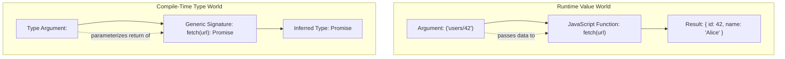

# Module 07: TypeScript Generics Workshop — Functions, Classes, Type Arguments, & Overloads

> **Weeks 14–16** | Modeled after Matt Pocock's *Total TypeScript Generics Workshop* (6 sections, 49 exercises).  
> **Prerequisites**: Modules 01–06 (Unions, Narrowing, Object Types, Type Transformations, Conditionals & Mapped Types).

---

## Workshop Overview & Mental Model

In standard programming, functions accept runtime values as arguments and return runtime values. Generics introduce the exact same abstraction to TypeScript's type system: **type parameters that accept types as arguments and produce specialized types**.



A generic function or interface does not lock in concrete types ahead of time. Instead, it declares type parameters (`<T>`, `<K>`, `<TItem>`) acting as placeholders, resolved at the call site through either **automatic inference** from runtime arguments or **explicit type arguments** (`fn<string>(...)`).

```ts
// Total TypeScript test helpers
type Expect<T extends true> = T;
type Equal<X, Y> =
  (<T>() => T extends X ? 1 : 2) extends (<T>() => T extends Y ? 1 : 2) ? true : false;
```

---

## Lesson 7.1: Intro to Generics in Functions & Classes

### 7.1.1 Typing Generic Functions & Preserving Types

The simplest generic function returns its input unmodified without widening to `unknown` or `any`:

```ts
function identity<T>(value: T): T {
  return value;
}

const num = identity(42);
//    ^? const num: 42
const str = identity("hello");
//    ^? const str: "hello"

type testNum = Expect<Equal<typeof num, 42>>;
type testStr = Expect<Equal<typeof str, "hello">>;
```

Without `<T>`, annotating `value: unknown` forces the return type to `unknown`, destroying downstream type safety.

### 7.1.2 Restricting Generic Arguments with `extends`

Unconstrained generics (`<T>`) allow any type, including `null`, `undefined`, or numbers. When accessing properties like `.id` or `.length`, constrain `T` using `extends`:

```ts
interface HasId {
  id: string;
}

function getEntityId<T extends HasId>(entity: T): string {
  return entity.id;
}

const user = getEntityId({ id: "usr_101", name: "Alice", role: "admin" });
// @ts-expect-error - number does not satisfy HasId
getEntityId(123);
// @ts-expect-error - missing required id property
getEntityId({ name: "Bob" });
```

`T extends HasId` requires `T` to be assignable to `HasId`, while preserving extra properties on `T`.

### 7.1.3 Multiple Independent Type Parameters

When function arguments vary independently, declare separate type parameters `<TFirst, TSecond>`:

```ts
function pair<TFirst, TSecond>(first: TFirst, second: TSecond): [TFirst, TSecond] {
  return [first, second];
}

const result = pair("statusCode", 200);
//    ^? const result: ["statusCode", 200]
type testPair = Expect<Equal<typeof result, ["statusCode", 200]>>;
```

### 7.1.4 Typing Object Parameters with Property Constraints

Extracting an object property requires linking the object's type to its keys:

```ts
function getProperty<TObj, TKey extends keyof TObj>(obj: TObj, key: TKey): TObj[TKey] {
  return obj[key];
}

const config = { host: "localhost", port: 8080, secure: true };
const host = getProperty(config, "host");
//    ^? const host: string
const port = getProperty(config, "port");
//    ^? const port: number

// @ts-expect-error - "database" does not exist on config
getProperty(config, "database");
```

### 7.1.5 Case Study: Generic Elements in Excalidraw

Canvas libraries share base geometry while preserving shape-specific properties (e.g. `radius` vs `strokeColor`):

```ts
interface BaseElement { id: string; x: number; y: number }
interface RectangleElement extends BaseElement { type: "rectangle"; strokeColor: string }
interface CircleElement extends BaseElement { type: "circle"; radius: number }

function translateElement<TElement extends BaseElement>(element: TElement, dx: number, dy: number): TElement {
  return { ...element, x: element.x + dx, y: element.y + dy };
}

const circle: CircleElement = { id: "c1", type: "circle", x: 10, y: 20, radius: 25 };
const movedCircle = translateElement(circle, 5, -10);
//    ^? const movedCircle: CircleElement
type testCircle = Expect<Equal<typeof movedCircle, CircleElement>>;
```

### 7.1.6 Generics in Classes

Classes parameterize their internal state, constructor arguments, and instance methods:

```ts
class StateStore<TState> {
  private state: TState;
  private listeners = new Set<(state: TState) => void>();

  constructor(initialState: TState) {
    this.state = initialState;
  }

  public getState(): TState { return this.state; }

  public setState(update: Partial<TState> | ((prev: TState) => TState)): void {
    this.state = typeof update === "function" ? update(this.state) : { ...this.state, ...update };
    this.listeners.forEach((fn) => fn(this.state));
  }
}

interface Session { user: string; token: string }
const store = new StateStore<Session>({ user: "alex", token: "jwt_123" });
store.setState({ user: "alex_updated" });
// @ts-expect-error - invalid property
store.setState({ invalidProp: 42 });
```

---

## Lesson 7.2: Passing Type Arguments & Avoiding `any`

### 7.2.1 Adding Type Parameters to Unannotated Functions

Standard web APIs return `Promise<any>`. Adding a type parameter allows callers to specify expected types:

```ts
async function fetchData<TData>(url: string): Promise<TData> {
  const response = await fetch(url);
  if (!response.ok) throw new Error(`HTTP ${response.status}`);
  return response.json() as Promise<TData>;
}

interface GitHubUser { login: string; id: number }
async function run() {
  const user = await fetchData<GitHubUser>("https://api.github.com/users/octocat");
  //    ^? const user: GitHubUser
  console.log(user.login);
}
```

### 7.2.2 Defaults in Type Parameters

When callers frequently omit a type argument, supply a fallback default:

```ts
interface ApiResponse<TBody = Record<string, unknown>> {
  status: "success" | "error";
  data: TBody;
}

type DefaultResp = ApiResponse;
//   ^? type DefaultResp = ApiResponse<Record<string, unknown>>
type UserResp = ApiResponse<{ id: string; name: string }>;
```

### 7.2.3 Strongly Typing `Array.prototype.reduce`

When `.reduce` uses an empty object `{}` as initial value, TypeScript infers accumulator as `{}`. Supply the accumulator generic explicitly:

```ts
interface Product { id: string; category: "tech" | "books"; price: number }
const items: Product[] = [
  { id: "p1", category: "tech", price: 100 },
  { id: "p2", category: "books", price: 20 },
];

const grouped = items.reduce<Record<string, Product[]>>((acc, item) => {
  const list = acc[item.category] ?? [];
  list.push(item);
  acc[item.category] = list;
  return acc;
}, {});
//    ^? const grouped: Record<string, Product[]>
```

### 7.2.4 Real-World Case Study: Cal.com API Routing

Cal.com enforces type boundaries between HTTP handlers and database queries:

```ts
type QueryHandler<TInput, TOutput> = (input: TInput) => Promise<TOutput>;

function createApiHandler<TInput, TOutput>(
  validator: (raw: unknown) => TInput,
  handler: QueryHandler<TInput, TOutput>
): (rawRequest: unknown) => Promise<TOutput> {
  return async (rawRequest: unknown) => {
    const input = validator(rawRequest);
    return handler(input);
  };
}
```

---

## Lesson 7.3: The Art of Type Arguments & Literal Inference

### 7.3.1 Generics at Different Levels: Interface vs. Method Level

```ts
// 1. Interface-Level: Locked once when the instance is created
interface CacheClient<TValue> {
  get(key: string): TValue | null;
  set(key: string, value: TValue): void;
}

// 2. Method-Level: Parameterized independently on every call
interface UniversalSerializer {
  serialize<TData>(data: TData): string;
  deserialize<TData>(raw: string): TData;
}
```

Use interface-level generics when state or methods operate on a single shared type; use method-level generics when every invocation handles a different type.

### 7.3.2 Typed `Object.keys`

By default, `Object.keys(obj)` returns `string[]` because JavaScript objects can contain excess runtime properties. In closed domain models, a typed wrapper preserves keys:

```ts
function typedObjectKeys<TObj extends object>(obj: TObj): (keyof TObj)[] {
  return Object.keys(obj) as (keyof TObj)[];
}

const theme = { primary: "#3b82f6", secondary: "#10b981", danger: "#ef4444" };
const themeKeys = typedObjectKeys(theme);
//    ^? const themeKeys: ("primary" | "secondary" | "danger")[]
```

### 7.3.3 Generic Function Wrappers

Preserve parameter types and return type using generic spread tuples:

```ts
function withExecutionTiming<TArgs extends readonly unknown[], TReturn>(
  fn: (...args: TArgs) => TReturn
): (...args: TArgs) => { result: TReturn; durationMs: number } {
  return (...args: TArgs) => {
    const start = performance.now();
    const result = fn(...args);
    return { result, durationMs: performance.now() - start };
  };
}

const computeHash = (data: string, salt: number) => `${data}_${salt}`;
const timedHash = withExecutionTiming(computeHash);
//    ^? const timedHash: (data: string, salt: number) => { result: string; durationMs: number; }
```

### 7.3.4 Literal Inference & Const Type Parameters (`<const T>` in TS 5.0+)

Passing objects to generic functions normally widens string literals. `<const T>` preserves exact literals without requiring `as const` at the call site:

```ts
// TS 5.0+ const type parameter
function defineRoutes<const TRoutes extends readonly string[]>(routes: TRoutes): TRoutes {
  return routes;
}

const routes = defineRoutes(["/dashboard", "/settings", "/billing"]);
//    ^? const routes: readonly ["/dashboard", "/settings", "/billing"]
type testRoutes = Expect<Equal<typeof routes, readonly ["/dashboard", "/settings", "/billing"]>>;
```

---

## Lesson 7.4: Advanced Generics, Currying & Spotting Useless Generics

### 7.4.1 Generics with Conditional Types & Implementation Assertions

TypeScript cannot resolve conditional types containing unresolved generic parameters inside the function body. A controlled `as` assertion reconciles the implementation:

```ts
type Formatted<T> = T extends string ? string : number;

function formatInput<T extends string | number>(value: T): Formatted<T> {
  if (typeof value === "string") {
    return value.trim() as Formatted<T>;
  }
  return Math.round(value) as Formatted<T>;
}

const fStr = formatInput("  data  ");
//    ^? const fStr: string
const fNum = formatInput(42.7);
//    ^? const fNum: number
```

### 7.4.2 Generic Function Currying & The Partial Inference Problem

TypeScript does not support partial generic inference (supplying one type parameter while inferring the other). Currying breaks the signature into distinct inference steps:

```ts
const createProcessor = <TPrefix extends string>(prefix: TPrefix) => {
  return <TData extends { label: string }>(data: TData) => ({
    ...data,
    tagged: `${prefix}:${data.label}` as const,
  });
};

const logger = createProcessor("AUDIT");
const entry = logger({ label: "user_login", userId: "u1" });
//    ^? const entry: { label: string; userId: string; tagged: `AUDIT:${string}`; }
```

### 7.4.3 Matt Pocock's Golden Rule of Generics

> [!IMPORTANT]
> **The Golden Rule of Generics**:  
> *If a type parameter only appears once in the function signature and isn't used to constrain or compute the return type or another parameter, it is a useless generic.*

```ts
// ❌ ANTI-PATTERN: T appears only once in parameter position (Useless Generic)
function logMessageBad<T extends string>(message: T): void {
  console.log(message);
}

// ✅ BEST PRACTICE: Use a plain type annotation
function logMessageGood(message: string): void {
  console.log(message);
}

// ❌ ANTI-PATTERN: T appears only in return position (Fabricating types)
function parseJsonUnsafe<T>(raw: string): T {
  return JSON.parse(raw);
}

// ✅ BEST PRACTICE: Pass a runtime validator to prove T
function parseJsonSafe<T>(raw: string, validate: (parsed: unknown) => T): T {
  return validate(JSON.parse(raw));
}
```

---

## Lesson 7.5: Function Overloads vs Conditional Types vs Unions

### 7.5.1 Overload Signatures vs. Implementation Signature

Overloads provide multiple distinct callable signatures. The implementation signature unifies all branches and is hidden from callers:

```ts
// Public Overload Signatures
function parseValue(value: string): number;
function parseValue(value: number): string;

// Implementation Signature (Reconciles both branches)
function parseValue(value: string | number): string | number {
  return typeof value === "string" ? parseFloat(value) : value.toString();
}

const p1 = parseValue("42.5");
//    ^? const p1: number
const p2 = parseValue(100);
//    ^? const p2: string

// @ts-expect-error - boolean is not overloaded
parseValue(true);
```

### 7.5.2 Decision Framework: Unions vs. Overloads vs. Conditional Types

| Pattern | When to Use | Trade-off |
| :--- | :--- | :--- |
| **Union Types** | Return type does not depend on parameter type | Simplest signature; cannot express input-to-output coupling |
| **Conditional Types** | Return type transforms smoothly based on generic input (`T extends A ? B : C`) | Works cleanly with generics; hover types can become verbose |
| **Function Overloads** | Differing argument counts (arities) or disparate parameter structures | Clear error messages; duplicate declarations; implementation complexity |

### 7.5.3 The "Instantiated with Subtype" Error

A frequent trap occurs when assigning a fallback value to a generic return type:

```ts
// ❌ FAILS: 'T' could be instantiated with a subtype like "admin"
function getDefaultRoleBad<T extends string>(role?: T): T {
  // @ts-expect-error - TS2322
  return role ?? "viewer";
}

// ✅ BEST PRACTICE: Use function overloads for default fallback inference
function getDefaultRole(): "viewer";
function getDefaultRole<T extends string>(role: T): T;
function getDefaultRole(role?: string): string {
  return role ?? "viewer";
}

const rDefault = getDefaultRole();
//    ^? const rDefault: "viewer"
const rCustom = getDefaultRole("admin");
//    ^? const rCustom: "admin"
```

---

## Lesson 7.6: Generics Workshop Challenges

### Challenge 1: Infinite Scroll Generic Hook

```ts
interface InfiniteScrollConfig<TItem, TCursor> {
  fetchPage: (cursor: TCursor | null) => Promise<{ items: TItem[]; nextCursor: TCursor | null }>;
}

interface InfiniteScrollState<TItem, TCursor> {
  pages: { items: TItem[]; nextCursor: TCursor | null }[];
  allItems: TItem[];
  loadNext: () => Promise<void>;
}

function createInfiniteScroller<TItem, TCursor>(
  config: InfiniteScrollConfig<TItem, TCursor>
): InfiniteScrollState<TItem, TCursor> {
  const pages: { items: TItem[]; nextCursor: TCursor | null }[] = [];
  let cursor: TCursor | null = null;

  return {
    pages,
    get allItems() { return pages.flatMap((p) => p.items); },
    async loadNext() {
      const page = await config.fetchPage(cursor);
      pages.push(page);
      cursor = page.nextCursor;
    },
  };
}
```

### Challenge 2: Dynamic Arguments with Discriminated Union Tuples

```ts
type AppEvents =
  | ["LOGIN", { userId: string; timestamp: number }]
  | ["LOGOUT", { reason: string }]
  | ["PING"];

function dispatchEvent<TEvent extends AppEvents[0]>(
  ...args: Extract<AppEvents, [TEvent, ...any[]]> extends [TEvent, infer TPayload]
    ? [event: TEvent, payload: TPayload]
    : [event: TEvent]
): void {
  const [event, payload] = args;
  console.log(`Event ${event}`, payload);
}

dispatchEvent("LOGIN", { userId: "u123", timestamp: Date.now() });
dispatchEvent("PING");

// @ts-expect-error - missing payload for LOGIN
dispatchEvent("LOGIN");
```

### Challenge 3: Type-Safe `pick(obj, keys)`

```ts
function pick<TObj extends object, const TKeys extends readonly (keyof TObj)[]>(
  obj: TObj,
  keys: TKeys
): Pick<TObj, TKeys[number]> {
  const result = {} as Pick<TObj, TKeys[number]>;
  for (const k of keys) {
    if (k in obj) result[k as unknown as keyof typeof result] = obj[k] as any;
  }
  return result;
}

const account = { id: "u42", name: "Alice", email: "alice@acme.com", hash: "secret" };
const publicAccount = pick(account, ["id", "name", "email"]);
//    ^? const publicAccount: Pick<typeof account, "id" | "name" | "email">

type testPick = Expect<Equal<typeof publicAccount, { id: string; name: string; email: string }>>;
```

### Challenge 4: Generic Form Validator Library

```ts
type ValidationSchema<TForm> = {
  [K in keyof TForm]: (value: TForm[K]) => string | null;
};

type ValidationErrors<TForm> = Partial<Record<keyof TForm, string>>;

function createValidator<TForm extends Record<string, unknown>>(schema: ValidationSchema<TForm>) {
  return (data: TForm): { valid: boolean; errors: ValidationErrors<TForm> } => {
    const errors: ValidationErrors<TForm> = {};
    let valid = true;

    for (const key of Object.keys(schema) as (keyof TForm)[]) {
      const errorMsg = schema[key](data[key]);
      if (errorMsg) {
        errors[key] = errorMsg;
        valid = false;
      }
    }
    return { valid, errors };
  };
}

interface RegisterForm { username: string; age: number }
const validateRegistration = createValidator<RegisterForm>({
  username: (u) => (u.length >= 3 ? null : "Too short"),
  age: (a) => (a >= 18 ? null : "Must be 18+"),
});
```

### Challenge 5: Enforcing Explicit Type Argument via Default Guard

```ts
function strictFetch<
  T = ["Error: You must pass an explicit type argument to strictFetch<T>()"]
>(url: string): Promise<T> {
  return fetch(url).then((res) => res.json() as Promise<T>);
}

interface Post { id: number; title: string }
// ✅ Explicit type argument provided
const post = strictFetch<Post>("/api/posts/1");
//    ^? const post: Promise<Post>

// ❌ Type argument omitted: results in descriptive error tuple type
const missing = strictFetch("/api/posts/1");
//    ^? const missing: Promise<["Error: You must pass an explicit type argument to strictFetch<T>()"]>
```

---

## Anti-Patterns vs. Best Practices

| Category | ❌ Anti-Pattern | ✅ Best Practice |
| :--- | :--- | :--- |
| **Generic Cardinality** | `<T>(val: T): void` (Single occurrence of type parameter) | `(val: string): void` (Use concrete primitive or union) |
| **JSON / API Parsing** | `parse<T>(json: string): T` (Fabricates type out of thin air) | `parse<T>(json: string, validator: (u: unknown) => T): T` |
| **Literal Narrowing** | `fn<T extends string[]>(arr: T)` (Widened string array) | `fn<const T extends readonly string[]>(arr: T)` (Preserves exact literals) |
| **Overloads vs Unions** | 6 overloads for identical arity and behavior | Single signature with a union or generic constraint |
| **Object Key Return** | `Object.keys(x) as any` | `typedObjectKeys<T extends object>(obj: T): (keyof T)[]` |

---

## Hands-On Exercises & Solutions

### Exercise 1: Generic Data Pipeline (`pipe3`)

**Objective**: Implement a fully typed `pipe3` function that threads data through 3 successive transformation functions with strict type inference between stages.

```ts
// Solution
function pipe3<A, B, C, D>(
  input: A,
  fn1: (arg: A) => B,
  fn2: (arg: B) => C,
  fn3: (arg: C) => D
): D {
  return fn3(fn2(fn1(input)));
}

// Verification
const res = pipe3(
  "  123  ",
  (s) => s.trim(),
  (s) => parseInt(s, 10),
  (n) => n * 2
);
//    ^? const res: number
type testPipe = Expect<Equal<typeof res, number>>;
```

### Exercise 2: Strongly Typed In-Memory Repository

**Objective**: Create a generic repository class `InMemoryRepo<TEntity extends { id: string }>` with type-safe `save`, `findById`, and `findWhere`.

```ts
// Solution
class InMemoryRepo<TEntity extends { id: string }> {
  private records = new Map<string, TEntity>();

  public save(item: TEntity): void {
    this.records.set(item.id, item);
  }

  public findById(id: string): TEntity | undefined {
    return this.records.get(id);
  }

  public findWhere<K extends keyof TEntity>(key: K, value: TEntity[K]): TEntity[] {
    const matches: TEntity[] = [];
    for (const record of this.records.values()) {
      if (record[key] === value) matches.push(record);
    }
    return matches;
  }
}

interface Member { id: string; department: "eng" | "sales"; active: boolean }
const repo = new InMemoryRepo<Member>();
repo.save({ id: "m1", department: "eng", active: true });
const engineers = repo.findWhere("department", "eng");
//    ^? const engineers: Member[]
```

### Exercise 3: Dynamic Event Emitter with Inherited Payloads

**Objective**: Build a typed `EventEmitter<TEvents>` where `TEvents` is an object mapping event names to their payload structures.

```ts
// Solution
type Listener<TPayload> = (payload: TPayload) => void;

class TypedEventEmitter<TEvents extends Record<string, unknown>> {
  private handlers: { [K in keyof TEvents]?: Set<Listener<TEvents[K]>> } = {};

  public on<K extends keyof TEvents>(event: K, listener: Listener<TEvents[K]>): () => void {
    const set = this.handlers[event] ?? new Set();
    set.add(listener);
    this.handlers[event] = set;
    return () => set.delete(listener);
  }

  public emit<K extends keyof TEvents>(event: K, payload: TEvents[K]): void {
    this.handlers[event]?.forEach((fn) => fn(payload));
  }
}

interface ServerEvents {
  start: { port: number };
  shutdown: { signal: "SIGTERM" | "SIGINT" };
}

const emitter = new TypedEventEmitter<ServerEvents>();
emitter.on("start", (data) => console.log(data.port));
emitter.emit("shutdown", { signal: "SIGTERM" });

// @ts-expect-error - invalid event payload
emitter.emit("shutdown", { signal: "INVALID" });
```

### Exercise 4: Curried Object Key-Value Inversion

**Objective**: Create a generic inversion helper `invertMap(obj)` that swaps keys and values while preserving literal types.

```ts
// Solution
function invertMap<const TObj extends Record<PropertyKey, PropertyKey>>(
  obj: TObj
): { [K in keyof TObj as `${TObj[K] & (string | number)}`]: K } {
  const result: any = {};
  for (const [key, value] of Object.entries(obj)) {
    result[value as PropertyKey] = key;
  }
  return result;
}

const statusMap = invertMap({ active: "1", pending: "2", archived: "3" });
//    ^? const statusMap: { 1: "active"; 2: "pending"; 3: "archived"; }

type testInvert = Expect<Equal<typeof statusMap, { 1: "active"; 2: "pending"; 3: "archived" }>>;
```

---

## Summary & Next Steps

In this workshop module, we mastered:
1. **Generic Functions & Classes**: Constraining type parameters with `extends`, parameterizing class instances, and typing object parameters.
2. **Type Argument Inference & Passing**: Providing defaults (`<T = ...>`), typing tricky standard library functions like `reduce`, and preventing `any` propagation.
3. **The Art of Type Arguments**: Interface-level vs. method-level generics, typed `Object.keys`, and preserving deep literals with `<const T>` in TypeScript 5.0+.
4. **Advanced Generics & Currying**: Reconciling unresolved generics with safe `as` assertions, avoiding useless generics via Matt Pocock's Golden Rule, and solving partial inference.
5. **Function Overloads vs. Conditional Types**: Crafting overloaded signatures, understanding implementation signature mechanics, and choosing between unions, conditionals, and overloads.

Proceed to **[Module 08: Advanced TypeScript Patterns](./08-advanced-typescript-patterns.md)** to explore nominal branded types, global augmenting, type predicates, assertion functions, and the builder pattern.
