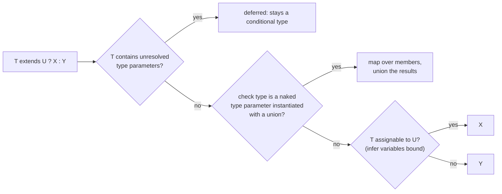

# Module 09: Type-Level Programming II — Conditional, Mapped & Recursive Types

> Example and tests: [`examples/09-conditional-mapped/conditional-mapped.test.ts`](../examples/09-conditional-mapped/conditional-mapped.test.ts) (distribution, `infer … extends`, code-point template inference, route params, homomorphic and remapped mapped types, union ↔ map, `DeepReadonly`). Recursion-limit fixtures live with [Module 13](./13-library-authoring-performance-and-type-tests.md).
> Run: `mise exec -- node --test examples/09-conditional-mapped/` and `mise exec -- npm run typecheck`.
>
> Prerequisites: [Module 08](./08-type-derivation-and-template-literals.md) (derivation, indexed access, template literal types) and [Module 07](./07-generics-and-inference.md) (generics).

---

## The Type Transformation Logic Engine

In Module 08, we treated types as static structures to inspect, slice, and index. In this module we step into the full computational engine of TypeScript: **Conditional Types**, **Pattern Matching with `infer`**, and **Mapped Types with Key Remapping**.

Together, these three constructs elevate TypeScript from a structural checker to a Turing-complete metaprogramming system capable of:
- Inspecting and destructuring arbitrary function signatures, promises, and tuple structures.
- Transforming complex nested schemas and discriminated unions into ergonomic API interfaces.
- Eliminating hundreds of lines of boilerplate across modern state management libraries, ORMs, and design systems.

```
┌────────────────────────────────────────────────────────────────────────┐
│                   CONDITIONAL TYPES & PATTERN MATCHING                 │
│                                                                        │
│   T extends Pattern<infer Extracted> ? Transform<Extracted> : Fallback │
└───────────────────────────────────┬────────────────────────────────────┘
                                    │
                                    ▼
┌────────────────────────────────────────────────────────────────────────┐
│                   MAPPED TYPES & KEY REMAPPING                         │
│                                                                        │
│   { [K in keyof T as NewKey<K>]: TransformedValue<T[K]> }              │
└────────────────────────────────────────────────────────────────────────┘
```

### Learning Objectives

By the end of this module, you will be able to:
1. Master conditional types (`T extends U ? X : Y`), grasp how and why distributive conditional types operate over unions, and understand how to control distribution using 1-tuples (`[T] extends [U]`).
2. Harness the `infer` keyword for pattern matching to extract return types, parameter lists, promise resolutions, tuple elements, and template literal string segments.
3. Construct advanced Mapped Types with property modifiers (`readonly`, `-readonly`, `?`, `-?`), remap object keys using `as`, filter keys using `as never`, and transform objects into unions of tuples or template literals.
4. Solve four capstone transformation challenges: URL path parameter extraction, object-to-discriminated-union translation, discriminated-union-to-map conversion, and recursive `DeepPartial<T>`.

---

## Formal semantics in brief

**Conditional types.** `T extends U ? X : Y` is evaluated by asking whether `T` is assignable to `U`. If `T` (or `U`) still contains type parameters whose instantiation could change the answer, the type is **deferred**: it stays as a conditional type and is re-evaluated when the parameters are known. That is why `function f<T>(x: T): T extends string ? 1 : 2` cannot return `1` from its body without a cast ([Module 07](./07-generics-and-inference.md)).

**Distributivity.** A conditional type whose check type is a *naked* type parameter `T` is **distributive**: instantiating it with a union applies it to each member and unions the results:

$$C\langle A_1 \mid \dots \mid A_n \rangle = C\langle A_1 \rangle \mid \dots \mid C\langle A_n \rangle, \qquad C\langle \text{never} \rangle = \text{never}$$

Wrapping both sides in a one-tuple (`[T] extends [U]`) or any other type constructor (`{ v: T }`) turns distribution off. The test `_wrapped` shows that `{ v: string | number } extends { v: string }` is simply false.

**`infer`.** `infer X` introduces a type variable bound by **inference** against the pattern, exactly as when inferring type arguments of a call. `infer X extends C` (since 4.7/4.8) adds a constraint: the branch matches only if the inferred `X` satisfies `C`, and within a template literal the constraint also *parses* (`` `${infer N extends number}` `` turns `"42"` into `42`). For overloaded functions, inference uses the **last** overload signature (`Parameters<typeof over>` is `[x: number]`).

**Mapped types.** `{ [K in S]: F<K> }` builds an object type with one property per member of the key union `S`. It is **homomorphic** when `S` is `keyof T` for a type parameter `T` (or `keyof` of a type): then it copies `readonly`/`?` modifiers from `T`, maps array and tuple types to arrays and tuples (instead of mapping their methods), and distributes over unions in `T`. `+`/`-` prefixes add or remove modifiers. Key remapping `as N<K>` changes the key; remapping to `never` removes it. A remapped mapped type is still homomorphic for modifier purposes when it iterates `keyof T`.



---

## Lesson 9.1: Conditional Types & Distributive Conditional Types

### The Ternary Operator at Type Level

Introduced in TypeScript 2.8, **Conditional Types** introduce conditional branching logic into type space. The syntax mirrors JavaScript's ternary expression:

```typescript
type IsString<T> = T extends string ? true : false;

type A = IsString<"hello">; // true
//   ^? type A = true
type B = IsString<42>;      // false
//   ^? type B = false
type C = IsString<string>;  // true
//   ^? type C = true
```

The relation `T extends U` checks **assignability** (subtyping). If values of type `T` can be safely assigned to a variable of type `U`, the condition evaluates to the true branch (`X`); otherwise, it evaluates to the false branch (`Y`).

### Nesting Conditional Types

Conditional types can be nested to model multi-branch decision trees:

```typescript
type TypeCategory<T> = 
  T extends string ? "text" :
  T extends number ? "numeric" :
  T extends boolean ? "boolean" :
  T extends (...args: any[]) => any ? "function" :
  T extends object ? "object" :
  "other";

type Cat1 = TypeCategory<"admin">;       // "text"
type Cat2 = TypeCategory<100>;           // "numeric"
type Cat3 = TypeCategory<() => void>;   // "function"
type Cat4 = TypeCategory<string[]>;      // "object"
```

### Distributive Conditional Types

When a conditional type acts on a **naked type parameter** (a generic parameter `T` that is not wrapped in an array, tuple, or Promise), it is **distributive**.

When you pass a union to a distributive conditional type, TypeScript automatically distributes the evaluation across every individual member of the union, exactly like a `map` operation over an array:

```typescript
(A | B | C) extends U ? X : Y  ⟺  (A extends U ? X : Y) | (B extends U ? X : Y) | (C extends U ? X : Y)
```

Consider how TypeScript's built-in `Exclude<T, U>` is implemented:

```typescript
type MyExclude<T, U> = T extends U ? never : T;
```

Let's trace `MyExclude<"a" | "b" | "c", "a">`:
1. `"a" extends "a" ? never : "a"` ⟹ `never`
2. `"b" extends "a" ? never : "b"` ⟹ `"b"`
3. `"c" extends "a" ? never : "c"` ⟹ `"c"`
4. Union of results: `never | "b" | "c"` ⟹ `"b" | "c"` (because `never` represents the empty set and disappears from unions).

### Why `T extends any` Distributes

A powerful pattern pioneered by Matt Pocock in Total TypeScript is using `T extends any` (or `T extends unknown`) to force distribution across a union:

```typescript
// Suppose we have a discriminated union:
type Fruit =
  | { name: "apple"; color: "red" }
  | { name: "banana"; color: "yellow" }
  | { name: "lime"; color: "green" };

// We want to transform each variant into a label string:
type FruitLabel<T> = T extends { name: infer Name extends string; color: infer Color extends string }
  ? `${Capitalize<Name>} is ${Color}`
  : never;

type Labels = FruitLabel<Fruit>;
//   ^? type Labels = "Apple is red" | "Banana is yellow" | "Lime is green"
```

Because `Fruit` is distributed one variant at a time, `infer Name` and `infer Color` bind to the specific properties of *that individual variant*, rather than unioning all names and colors together.

### Preventing Distribution with Tuples (`[T] extends [U]`)

Sometimes distribution is undesirable. If you want to check whether an *entire union* as a whole is assignable to a type, wrap both sides of `extends` in a 1-tuple `[T] extends [U]`:

```typescript
// Distributive (Checks each member individually):
type IsUnionStringDistributive<T> = T extends string ? true : false;
type TestDist = IsUnionStringDistributive<string | number>;
//   ^? type TestDist = boolean (true | false)

// Non-distributive (Checks the whole union together):
type IsExactlyStringNonDistributive<T> = [T] extends [string] ? true : false;
type TestNonDist = IsExactlyStringNonDistributive<string | number>;
//   ^? type TestNonDist = false
```

### The Behavior of `never` in Conditional Types

`never` is the empty union (a union with 0 members). When passed to a distributive conditional type, **the conditional type distributes over zero members**, resulting in `never` immediately without even executing either branch:

```typescript
type IsNeverDistributive<T> = T extends never ? true : false;
type Result1 = IsNeverDistributive<never>;
//   ^? type Result1 = never  <-- Neither true nor false!

// To properly check for 'never', prevent distribution:
type IsNever<T> = [T] extends [never] ? true : false;
type Result2 = IsNever<never>;
//   ^? type Result2 = true
type Result3 = IsNever<string>;
//   ^? type Result3 = false
```

---

## Lesson 9.2: Pattern Matching with the `infer` Keyword

The `infer` keyword allows you to declare a type variable within the `extends` clause of a conditional type. TypeScript deduces ("infers") what type occupies that position during structural pattern matching.

### Extracting Return Types & Parameters

Let's re-implement `ReturnType<T>` and `Parameters<T>` from first principles:

```typescript
import type { Equal, Expect } from "../examples/utils/type-helpers";

// Pattern match the return type:
type MyReturnType<T> = T extends (...args: any[]) => infer R ? R : never;

// Pattern match the parameters tuple:
type MyParameters<T> = T extends (...args: infer P) => any ? P : never;

// Extracting just the first argument:
type FirstParameter<T> = T extends (first: infer F, ...rest: any[]) => any ? F : never;

function greet(user: { name: string; age: number }, greeting: string): string {
  return `${greeting}, ${user.name}!`;
}

type GreetReturn = MyReturnType<typeof greet>; // string
type GreetParams = MyParameters<typeof greet>; // [user: { name: string; age: number; }, greeting: string]
type GreetFirst = FirstParameter<typeof greet>; // { name: string; age: number; }

type TestReturn = Expect<Equal<GreetReturn, string>>;
type TestFirst = Expect<Equal<GreetFirst, { name: string; age: number }>>;
```

### Unwrapping Promises Recursively

`infer` can be combined with recursion to unwrap arbitrarily nested `Promise` wrappers:

```typescript
type DeepAwaited<T> = T extends Promise<infer Inner>
  ? DeepAwaited<Inner>
  : T;

type NestedPromise = Promise<Promise<Promise<{ token: string }>>>;

type Unwrapped = DeepAwaited<NestedPromise>;
//   ^? type Unwrapped = { token: string; }

type TestUnwrapped = Expect<Equal<Unwrapped, { token: string }>>;
```

### Pattern Matching in Object Shapes

Extracting nested types from standard library or third-party wrappers:

```typescript
interface ApiResponse<TData> {
  status: 200 | 201;
  data: TData;
  timestamp: number;
}

type ExtractDataPayload<T> = T extends { data: infer TPayload } ? TPayload : never;

type OrderPayload = ExtractDataPayload<ApiResponse<{ orderId: string; amount: number }>>;
//   ^? type OrderPayload = { orderId: string; amount: number; }
```

### Pattern Matching in Tuples (Head, Tail, and Last)

With tuple spread syntax, `infer` enables standard functional list operations on tuple types:

```typescript
type Head<T extends readonly any[]> = T extends [infer H, ...any[]] ? H : never;
type Tail<T extends readonly any[]> = T extends [any, ...infer Rest] ? Rest : [];
type Last<T extends readonly any[]> = T extends [...any[], infer L] ? L : never;

type MyTuple = [string, number, boolean, Date];

type TupleHead = Head<MyTuple>; // string
type TupleTail = Tail<MyTuple>; // [number, boolean, Date]
type TupleLast = Last<MyTuple>; // Date

type TestHead = Expect<Equal<TupleHead, string>>;
type TestTail = Expect<Equal<TupleTail, [number, boolean, Date]>>;
type TestLast = Expect<Equal<TupleLast, Date>>;
```

### Pattern Matching in Template Literals

Template literal types were initially conceived by Anders Hejlsberg and the TypeScript team as regular expressions for types. While full regex support was abandoned for performance reasons, template literal `infer` provides greedy and non-greedy string pattern matching:

```typescript
// Splitting a delimiter string into head and tail:
type SplitBySlash<T extends string> = T extends `${infer Head}/${infer Tail}`
  ? [Head, ...SplitBySlash<Tail>]
  : [T];

type RouteSegments = SplitBySlash<"users/profile/settings">;
//   ^? type RouteSegments = ["users", "profile", "settings"]

type TestSegments = Expect<Equal<RouteSegments, ["users", "profile", "settings"]>>;
```

### Extracting from Multiple Function Shapes

If a function type could take multiple shapes, pattern matching handles unions gracefully:

```typescript
type ActionResolver<T> = T extends () => infer R
  ? R
  : T extends (payload: any) => infer R
  ? R
  : never;

type Resolver1 = ActionResolver<() => { type: "RESET" }>;
//   ^? type Resolver1 = { type: "RESET"; }

type Resolver2 = ActionResolver<(id: string) => { type: "LOAD"; id: string }>;
//   ^? type Resolver2 = { type: "LOAD"; id: string; }
```

---

## Lesson 9.3: Mapped Types & Key Remapping

**Mapped Types** allow you to create new object types based on another type. They iterate over keys much like a `for...in` loop or `Array.prototype.map`.

### Fundamentals of Mapped Types

```typescript
type Weekday = "mon" | "tue" | "wed" | "thu" | "fri";

// Map over a union:
type WorkingHours = {
  [K in Weekday]: { start: string; end: string };
};
// Resulting type has keys "mon" | "tue" | "wed" | "thu" | "fri"
```

### Iterating Over an Existing Object (`keyof T`)

```typescript
interface UserProfile {
  id: string;
  name: string;
  age: number;
}

// Convert all values to strings:
type StringifiedObject<T> = {
  [K in keyof T]: string;
};

type StringifiedUser = StringifiedObject<UserProfile>;
//   ^? type StringifiedUser = { id: string; name: string; age: string; }
```

### Property Modifiers (`readonly`, `?`, `-readonly`, `-?`)

You can add or strip property modifiers using `+` (optional, default) and `-` (strip modifier):

```typescript
interface MutableSettings {
  theme: string;
  fontSize: number;
}

// 1. Add readonly:
type MakeReadonly<T> = {
  readonly [K in keyof T]: T[K];
};

// 2. Remove readonly:
type MakeMutable<T> = {
  -readonly [K in keyof T]: T[K];
};

// 3. Make all properties required (strip '?'):
interface PartialForm {
  email?: string;
  password?: string;
}

type MyRequired<T> = {
  [K in keyof T]-?: T[K];
};

type ConcreteForm = MyRequired<PartialForm>;
//   ^? type ConcreteForm = { email: string; password: string; }
```

### Key Remapping with `as`

Introduced in TypeScript 4.1, the `as` clause inside a mapped type allows you to compute a new key for each property:

```typescript
interface DataService {
  user: { id: string; name: string };
  settings: { theme: "light" | "dark" };
}

// Generate getters:
type Getters<T> = {
  [K in keyof T as `get${Capitalize<string & K>}`]: () => T[K];
};

type ServiceGetters = Getters<DataService>;
//   ^? type ServiceGetters = { getUser: () => { id: string; name: string; }; getSettings: () => { theme: "light" | "dark"; }; }
```

> [!NOTE]
> `string & K` is an intersection that guarantees TypeScript treats `K` as a `string` (since `keyof T` can include `symbol` or `number`).

### Key Filtering via `as never`

If a key is remapped to `never`, TypeScript completely omits that key from the resulting object:

```typescript
interface Product {
  id: string;
  sku: string;
  price: number;
  calculateDiscount: (percent: number) => number;
  isAvailable: () => boolean;
}

// Keep only properties whose values are NOT functions:
type NonFunctionProperties<T> = {
  [K in keyof T as T[K] extends (...args: any[]) => any ? never : K]: T[K];
};

type ProductData = NonFunctionProperties<Product>;
//   ^? type ProductData = { id: string; sku: string; price: number; }
```

### Real-World Deep Dive: How Excalidraw Uses Mapped Types

In the open-source canvas application **Excalidraw**, elements on the canvas (rectangles, diamonds, arrows, text) have differing attributes, but all need standardized action creators and state updates.

Rather than hand-writing:
```typescript
interface Actions {
  updateRectangle: (element: RectangleElement) => void;
  updateDiamond: (element: DiamondElement) => void;
  updateArrow: (element: ArrowElement) => void;
  // ... repeated dozens of times
}
```

Excalidraw defines a map of element types to their representations, and uses a single mapped type with key remapping:
```typescript
type ElementMap = {
  rectangle: { x: number; y: number; width: number; height: number };
  diamond: { x: number; y: number; size: number };
  arrow: { startX: number; startY: number; endX: number; endY: number };
};

type ElementUpdaters = {
  [K in keyof ElementMap as `update${Capitalize<K>}`]: (
    id: string,
    patch: Partial<ElementMap[K]>
  ) => void;
};
```
This saved hundreds of lines of brittle boilerplate and eliminated bugs when new element types were added.

### Transforming Objects into Unions of Tuples or Template Literals

Mapped types can be indexed immediately by `[keyof T]` to collapse the object into a union:

```typescript
interface ThemeColors {
  primary: "#4f46e5";
  secondary: "#06b6d4";
  danger: "#ef4444";
}

// 1. Transform object to a union of key-value tuples:
type ObjectToTuples<T> = {
  [K in keyof T]: [K, T[K]];
}[keyof T];

type ColorTuples = ObjectToTuples<ThemeColors>;
//   ^? type ColorTuples = ["primary", "#4f46e5"] | ["secondary", "#06b6d4"] | ["danger", "#ef4444"]

// 2. Transform object to a union of template literal strings:
type ObjectToCssVariables<T> = {
  [K in keyof T]: `--color-${string & K}: ${string & T[K]}`;
}[keyof T];

type CssTokens = ObjectToCssVariables<ThemeColors>;
//   ^? type CssTokens = "--color-primary: #4f46e5" | "--color-secondary: #06b6d4" | "--color-danger: #ef4444"
```

---

## Lesson 9.4: Master Type Transformation Challenges

These four capstone challenges represent the summit of TypeScript's type transformation capabilities.

### Challenge 1: Transform URL Path Parameters into an Object

#### Problem
Given a URL path string with parameter segments (e.g., `"/users/:id/posts/:postId"`), construct an object type containing only the extracted parameter names as keys with `string` values: `{ id: string; postId: string }`.

#### Solution & Walkthrough

```typescript
import type { Equal, Expect } from "../examples/utils/type-helpers";

// Step 1: Recursively extract the union of parameter names from the path
type ExtractParamNames<TPath extends string> =
  TPath extends `${string}:${infer Rest}`
    ? Rest extends `${infer Param}/${infer Next}`
      ? Param | ExtractParamNames<`/${Next}`>
      : Rest
    : never;

// Step 2: Map the extracted param union into an object type
type PathParams<TPath extends string> = {
  [K in ExtractParamNames<TPath>]: string;
};

// Verification:
type ExtractedKeys = ExtractParamNames<"/users/:id/posts/:postId">;
//   ^? type ExtractedKeys = "id" | "postId"

type UserPostParams = PathParams<"/users/:id/posts/:postId">;
//   ^? type UserPostParams = { id: string; postId: string; }

type TestParams = Expect<
  Equal<UserPostParams, { id: string; postId: string }>
>;
```

---

### Challenge 2: Transform an Attributes Object into a Discriminated Union

#### Problem
Given an object interface describing entity attributes, transform it into a discriminated union where each variant has a `type` property matching the key and a `value` property matching that key's type:

```typescript
// Input:
type InputAttributes = {
  id: string;
  email: string;
  age: number;
};

// Desired Output:
// | { type: "id"; value: string }
// | { type: "email"; value: string }
// | { type: "age"; value: number }
```

#### Solution & Walkthrough

```typescript
import type { Equal, Expect } from "../examples/utils/type-helpers";

// Step 1: Create an intermediate mapped type where each property value is the desired variant
// Step 2: Index the mapped type by [keyof T] to collapse the properties into a union
type ObjectToDiscriminatedUnion<T> = {
  [K in keyof T]: {
    type: K;
    value: T[K];
  };
}[keyof T];

type AttributeUnion = ObjectToDiscriminatedUnion<InputAttributes>;
//   ^? type AttributeUnion = { type: "id"; value: string; } | { type: "email"; value: string; } | { type: "age"; value: number; }

type TestAttributeUnion = Expect<
  Equal<
    AttributeUnion,
    | { type: "id"; value: string }
    | { type: "email"; value: string }
    | { type: "age"; value: number }
  >
>;
```

---

### Challenge 3: Transform a Discriminated Union into a Key-Value Map

#### Problem
Take a discriminated union with unique discriminant tags and transform it into a dictionary object where keys are the discriminant values:

```typescript
// Input:
type AppAction =
  | { type: "login"; username: string; token: string }
  | { type: "logout"; timestamp: number }
  | { type: "navigate"; route: string };

// Desired Output:
// {
//   login: { username: string; token: string };
//   logout: { timestamp: number };
//   navigate: { route: string };
// }
```

#### Solution & Walkthrough

```typescript
import type { Equal, Expect } from "../examples/utils/type-helpers";

// We iterate over each variant in the union (Variant in U).
// We remap each key using `as Variant["type"]`.
// We strip the discriminant key using Omit<Variant, "type">.
type DiscriminatedUnionToMap<U extends { type: string }> = {
  [Variant in U as Variant["type"]]: Omit<Variant, "type">;
};

type ActionMap = DiscriminatedUnionToMap<AppAction>;
//   ^? type ActionMap = { login: { username: string; token: string; }; logout: { timestamp: number; }; navigate: { route: string; }; }

type TestActionMap = Expect<
  Equal<
    ActionMap,
    {
      login: { username: string; token: string };
      logout: { timestamp: number };
      navigate: { route: string };
    }
  >
>;
```

---

### Challenge 4: Construct Recursive `DeepPartial<T>` and `DeepReadonly<T>`

#### Problem
TypeScript's standard `Partial<T>` and `Readonly<T>` are strictly shallow. Construct `DeepPartial<T>` and `DeepReadonly<T>` that recursively transform nested objects and arrays without corrupting primitives, functions, or special built-in classes (`Date`, `RegExp`).

#### Solution & Walkthrough

```typescript
import type { Equal, Expect } from "../examples/utils/type-helpers";

// Built-ins and primitives that must not be recursed into:
type NonObject = Function | Date | RegExp | boolean | number | string | symbol | null | undefined;

export type DeepPartial<T> = 
  T extends NonObject
    ? T
    : T extends Array<infer U>
    ? Array<DeepPartial<U>>
    : T extends ReadonlyArray<infer U>
    ? ReadonlyArray<DeepPartial<U>>
    : { [K in keyof T]?: DeepPartial<T[K]> };

export type DeepReadonly<T> =
  T extends NonObject
    ? T
    : T extends Array<infer U>
    ? ReadonlyArray<DeepReadonly<U>>
    : T extends ReadonlyArray<infer U>
    ? ReadonlyArray<DeepReadonly<U>>
    : { readonly [K in keyof T]: DeepReadonly<T[K]> };

// Verification:
interface ComplexConfig {
  version: number;
  author: {
    name: string;
    contacts: {
      email: string;
      verified: boolean;
    };
  };
  tags: string[];
  createdAt: Date;
  validate: () => boolean;
}

type PartialConfig = DeepPartial<ComplexConfig>;

type TestDeepPartial = Expect<
  Equal<
    PartialConfig,
    {
      version?: number;
      author?: {
        name?: string;
        contacts?: {
          email?: string;
          verified?: boolean;
        };
      };
      tags?: string[];
      createdAt?: Date;
      validate?: () => boolean;
    }
  >
>;
```

---

## Lesson 9.5: Recursion, Limits and TypeScript 7 Changes

### 9.5.1 Recursive types and the depth limit

Recursive conditional types (`DeepPartial`, `Length`, `RouteParams`) are evaluated by nested instantiation, and the checker stops at a fixed depth with **TS2589** "Type instantiation is excessively deep and possibly infinite". Measured on TS 7.0.2 ([Module 13](./13-library-authoring-performance-and-type-tests.md), fixture `depth/`): building a tuple non-tail-recursively fails at 48 elements; the tail-recursive version fails at 1000 iterations.

A conditional type is **tail-recursive** when the recursive reference is the *entire* branch:

```ts
// Not tail-recursive: the recursive call is wrapped in a spread
type BuildNT<N extends number, A extends unknown[] = []> = A["length"] extends N ? A : [...BuildNT<N, [...A, 0]>];
// Tail-recursive: accumulate in a parameter and return the call itself
type BuildT<N extends number, A extends unknown[] = []> = A["length"] extends N ? A : BuildT<N, [...A, 0]>;
```

Rewrite with an accumulator parameter (the `Length<S, Acc>` helper in the example does this) and always give the recursion a base case that is reached for `string`/`number` (non-literal) inputs, otherwise `Length<string>` recurses forever.

### 9.5.2 Then vs now: template literal inference by code point (TS 7.0)

**Then (TS ≤ 6.0).** `` S extends `${infer H}${infer T}` `` consumed one UTF-16 code unit, so `HeadTail<"😀abc">` produced `["\ud83d", "\ude00abc"]` and a `Length` helper counted the emoji as 2.

**Now (TS 7.0).** Inference consumes one Unicode **code point**: `HeadTail<"😀abc">` is `["😀", "abc"]` and `Length<"a😀b">` is `3` (both asserted in the example). This matches `[...str]` at runtime but *not* `str.length` (which still counts code units, and is 4 for `"a😀b"`).

**Migration.** Search for type-level string utilities (lengths, reversals, splitters) whose tests use non-BMP characters; update expected values, or document that the type models code points. Pitfall: a type-level `Length` that now disagrees with the runtime `.length` it is meant to describe.

### 9.5.3 Preview: stricter distributive relations (TS 7.1 beta)

TS 7.1 (beta, 2026-10-20, preview only) reports an error when a type parameter constrained to *another* type parameter is related to that parameter inside a branch where it has been distributed:

```ts
type Issue<A extends number, B extends A> = A extends B ? never : Show<A, B>;
// 7.1: 'B' is only assignable to the non-distributed 'A', but 'A' has been distributed here.
```

In 7.0 this compiles, and `Issue<0 | 1, 0>` silently produced the misleading `"0 extends 1"` case. Fix by removing the unnecessary `B extends A` constraint or by adding an explicit check inside the branch.

---

## Anti-Patterns vs. Best Practices

| Anti-Pattern | Best Practice | Why it Matters |
| :--- | :--- | :--- |
| **Accidental Distribution**<br>`type Check<T> = T extends string ? 1 : 2;`<br>Passing `string \| number` yields `1 \| 2`. | **Tuple-Wrapped Conditionals**<br>`type Check<T> = [T] extends [string] ? 1 : 2;` | Prevents unintentional union distribution when testing entire compound types. |
| **Testing `never` Directly**<br>`type IsNever<T> = T extends never ? true : false;`<br>Passing `never` evaluates to `never`. | **1-Tuple Never Check**<br>`type IsNever<T> = [T] extends [never] ? true : false;` | `never` is the empty union; naked distribution bypasses conditional logic completely. |
| **Unbounded Recursive Types**<br>Unrestricted self-referential template literal parsing without termination. | **Bounded Base-Case Fallback**<br>Ensuring terminal clauses in `infer` recursions. | Prevents TS2589: `Type instantiation is excessively deep and possibly infinite`. |
| **Handcrafted Type Maps**<br>Writing parallel interfaces for every variant in a discriminated union. | **Mapped Key Remapping (`as`)**<br>`[V in Union as V["type"]]: ...` | Automatically stays 100% in sync when new variants are added. |

---

## Hands-On Exercises & Type Tests

### Exercise 1: Distributive Union Filter & Tuple Reverser

#### Scenario
1. Implement `FilterUnion<TUnion, TTarget>`: filters a union to only members assignable to `TTarget` using distributive conditional types.
2. Implement `ReverseTuple<TTuple>`: reverses the order of elements in a tuple using recursion and `infer`.

```typescript
import type { Equal, Expect } from "../examples/utils/type-helpers";

// TODO: Implement FilterUnion
type FilterUnion<TUnion, TTarget> = TUnion extends TTarget ? TUnion : never;

// TODO: Implement ReverseTuple
type ReverseTuple<TTuple extends readonly any[]> = 
  TTuple extends [infer First, ...infer Rest]
    ? [...ReverseTuple<Rest>, First]
    : [];

// Tests:
type MixedUnion = string | number | boolean | (() => void) | { id: string };
type OnlyPrimitives = FilterUnion<MixedUnion, string | number | boolean>;

type TestFilterUnion = Expect<
  Equal<OnlyPrimitives, string | number | boolean>
>;

type Reversed = ReverseTuple<[1, "two", true, null]>;

type TestReversed = Expect<
  Equal<Reversed, [null, true, "two", 1]>
>;
```

---

### Exercise 2: Type-Safe Query String Parser

#### Scenario
Create a type helper `ParseQueryString<TQuery>` that parses a URL query string (without the leading `?`) into an object type:
`"tab=settings&mode=dark&ref=dashboard"` ⟹ `{ tab: "settings"; mode: "dark"; ref: "dashboard" }`.

```typescript
import type { Equal, Expect } from "../examples/utils/type-helpers";

// Step 1: Split string by '&' into a union of "key=val" pairs
type SplitQueryPairs<T extends string> =
  T extends `${infer Pair}&${infer Rest}`
    ? Pair | SplitQueryPairs<Rest>
    : T;

// Step 2: Parse key-value pairs and remap into an object
type ParseQueryString<T extends string> = {
  [Pair in SplitQueryPairs<T> as Pair extends `${infer Key}=${string}` ? Key : never]:
    Pair extends `${string}=${infer Val}` ? Val : never;
};

// Verification:
type ParsedQuery = ParseQueryString<"tab=settings&mode=dark&ref=dashboard">;

type TestParsedQuery = Expect<
  Equal<
    ParsedQuery,
    {
      tab: "settings";
      mode: "dark";
      ref: "dashboard";
    }
  >
>;
```

---

### Exercise 3: CRUD Action Creator Mapper

#### Scenario
Given a record type describing database models, create a type helper `CrudActions<TModels>` that generates CRUD methods for every model in the format:
- `create{Model}: (data: Omit<TModels[Model], "id">) => TModels[Model]`
- `get{Model}: (id: string) => TModels[Model] | null`

```typescript
import type { Equal, Expect } from "../examples/utils/type-helpers";

interface Schema {
  user: { id: string; name: string; email: string };
  project: { id: string; title: string; budget: number };
}

// TODO: Implement CrudActions
type CrudActions<TModels> = {
  [K in keyof TModels as `create${Capitalize<string & K>}`]: (
    data: Omit<TModels[K], "id">
  ) => TModels[K];
} & {
  [K in keyof TModels as `get${Capitalize<string & K>}`]: (
    id: string
  ) => TModels[K] | null;
};

type Actions = CrudActions<Schema>;

type TestActions = Expect<
  Equal<
    Actions,
    {
      createUser: (data: { name: string; email: string }) => { id: string; name: string; email: string };
      createProject: (data: { title: string; budget: number }) => { id: string; title: string; budget: number };
      getUser: (id: string) => { id: string; name: string; email: string } | null;
      getProject: (id: string) => { id: string; title: string; budget: number } | null;
    }
  >
>;
```

---

### Exercise 4: Deep Required with Nested Objects and Arrays

#### Scenario
Construct `DeepRequired<T>` that traverses down all nested objects, making all optional properties required, including objects inside arrays.

```typescript
import type { Equal, Expect } from "../examples/utils/type-helpers";

type NonObject = Function | Date | RegExp | boolean | number | string | symbol | null | undefined;

// TODO: Implement DeepRequired
type DeepRequired<T> = 
  T extends NonObject
    ? T
    : T extends Array<infer U>
    ? Array<DeepRequired<U>>
    : { [K in keyof T]-?: DeepRequired<T[K]> };

interface OptionalNestedProfile {
  username?: string;
  preferences?: {
    notifications?: {
      email?: boolean;
      sms?: boolean;
    };
  };
  favoriteTags?: Array<{ name?: string }>;
}

type RequiredProfile = DeepRequired<OptionalNestedProfile>;

type TestDeepRequired = Expect<
  Equal<
    RequiredProfile,
    {
      username: string;
      preferences: {
        notifications: {
          email: boolean;
          sms: boolean;
        };
      };
      favoriteTags: Array<{ name: string }>;
    }
  >
>;
```

---

## Interview Drill

<details><summary>1. Why does <code>T extends string ? 1 : 2</code> with <code>T = string | number</code> give <code>1 | 2</code>, and how do you prevent it?</summary>

A conditional type whose check type is a naked type parameter distributes over unions: it is evaluated per member and the results are unioned. Wrap both sides (`[T] extends [string]`) to evaluate the union as a whole.
</details>

<details><summary>2. Why does <code>IsNever&lt;never&gt;</code> written as <code>T extends never ? true : false</code> return <code>never</code>?</summary>

`never` is the empty union, and distributing over an empty union yields the empty union, `never`, without evaluating either branch. Use `[T] extends [never]`.
</details>

<details><summary>3. What does <code>infer X extends C</code> add over plain <code>infer X</code>?</summary>

A constraint checked during matching: the branch is taken only if the inferred type satisfies `C`, and `X` has type `C` in the true branch without a nested conditional. In template literals it also converts: `` `${infer N extends number}` `` parses `"42"` into the literal `42`.
</details>

<details><summary>4. What is a homomorphic mapped type, and what does it preserve?</summary>

A mapped type over `keyof T` (e.g. `{ [K in keyof T]: F<T[K]> }`). It preserves `readonly`/optional modifiers, maps arrays/tuples to arrays/tuples, and distributes over unions in `T`. A mapped type over an arbitrary key union does none of this.
</details>

<details><summary>5. How do you turn a discriminated union into a map keyed by the discriminant?</summary>

`{ [E in Union as E["type"]]: Omit<E, "type"> }`: iterate the union members themselves (not keys) and remap each to its discriminant. Derived handler maps then stay exhaustive automatically when a member is added.
</details>

<details><summary>6. You hit TS2589 in a recursive type. What are your options?</summary>

Make the recursion tail-recursive (accumulator parameter, recursive call as the whole branch; limit 1000 instead of the depth limit), add or fix base cases for non-literal inputs, cap the depth with a counter tuple, or precompute/annotate the result. Then measure with `--extendedDiagnostics`.
</details>

<details><summary>7. What changed for template literal types in TS 7.0?</summary>

Inference splits strings by Unicode code point instead of UTF-16 code unit, so astral characters (emoji) are no longer split into surrogate halves. Type-level length/split utilities change results for non-BMP input.
</details>
